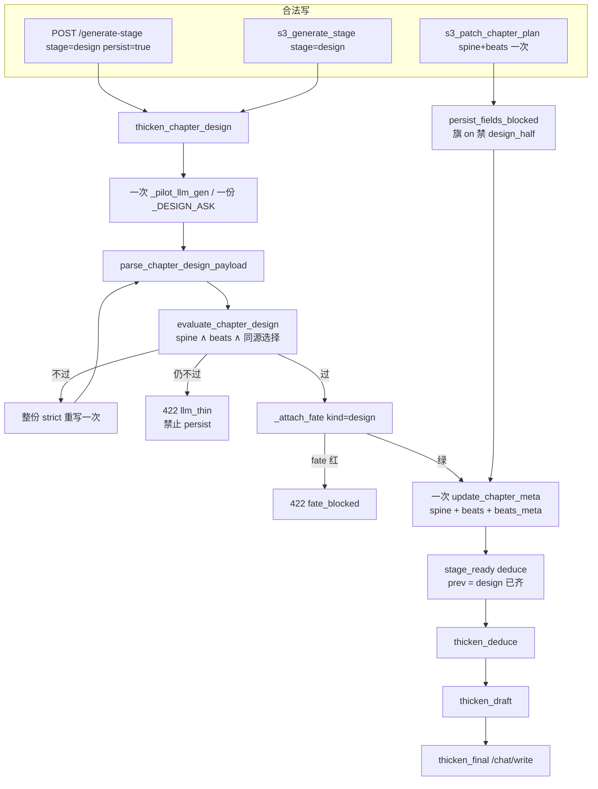
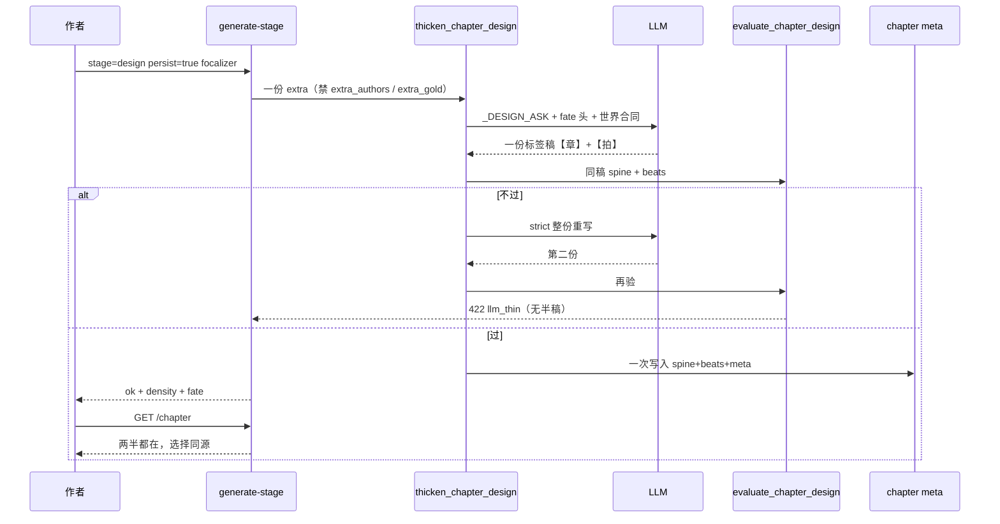

# 大纲/节拍两个过闸节点融合成一个

| 项 | 值 |
|----|-----|
| **文档标题** | 铜炉写章：大纲与节拍合成一道设计闸 |
| **作者** | Grok Design |
| **日期** | 2026-08-17 |
| **状态** | Implemented |
| **产品** | 铜炉 / tonglu · 代码 `scribe3/` · 仓库 `/home/admin/projects/scribe-writing-system` |
| **协议** | `docs/e2e-director-journey-v634-true-chat-full-capability.md` **v6.3.4 rev.11**（本设计默认：只改 OpSeq 步数叙述，总 PASS 公式不变） |
| **前序** | `docs/plans/2026-08-16-fate-dearer-novelist-reform.md` rev.8；`docs/plans/2026-08-16-world-surface-break-the-loop.md` |
| **宇宙 SSOT** | `docs/worlds/wanjie-probability-war-v7.md` |
| **最新实跑** | `book_718fe88f` ch1 generate-stage 分两次考；ch2/3 大纲+节拍靠点批金样。审查：`docs/audits/2026-08-17-book718fe88f-ch1-3-quality.md` |
| **验收环境** | 只打已部署 demo `tonglu.qing.blue`（`ubuntu@82.157.130.140` `/opt/scribe3/app`） |
| **短名** | `outline-beats-merge` / `chapter_design` |
| **旗** | `SCRIBE3_CHAPTER_DESIGN` 默认 **on** · `audience=author` · `hot` |
| **规范阶段名** | `design`（URL `stage=design`） |

> **本设计只收口前两层的双节点。** 融的是过闸节点与一次 LLM / 一次 persist / 一道合同，不是把两份职责揉成一段肥 synopsis。  
> 用户已裁定的最优形态（禁止再发明「再加 WAVE」或「再扩词表」当主方案）：
>
> ```
> 一份落库、一次 LLM、一道合同，里面仍分两块：
> 【章】要 / 挡 / 选 A vs B / 决 / 代价 / 钩 / 线 / 钟地 / 世界命题
> 【拍】≥3
>   拍2（或指定一拍）必须带选（就是上面那个 A vs B 的演出）
>   每拍一句要/挡/变/付，是章的展开，禁止再发明第二个选择
> 验收也合成一次：
> - 章：有选择、有世界命题、钩悬着、线有 id
> - 拍：能演完这个选择，拍的稀有词来自同一份稿，不是第二张卷抄第一张
> 一次不过就一次重写这一份，禁止「大纲绿、节拍另开炉灶」。
> ```

---

## Overview

铜炉写章链把「章级价值转向」和「拍级走位」做成了**两次应试**：`POST /generate-stage stage=outline` 先绿 `chapter_spine`，再 `stage=beats` 用 `beats_realize_spine` / `beat_off_spine` 逼第二张卷去抄第一张的稀有词。`book_718fe88f` 第 2、3 章把这个裂缝用到了底——generate-stage 大纲/节拍连续 `llm_thin` / 503，短槽由点批 `s3_patch_chapter_plan` 写入已校准金样。闸绿了，作者权却交了两次。

本设计把 Ice1 + Ice2 收成**一道设计闸**。规范阶段名写死为 `design`。旗 `SCRIBE3_CHAPTER_DESIGN=on`（默认）时：一次 LLM、一次 persist、一道 `evaluate_chapter_design`。落库仍是两个字段——`chapter.chapter_spine`（`chapter_spine.v1`，14 键）+ `chapter.beats[]`（GCD 台阶），外加同一次写入的 `beats_meta`（`clock` / `place` / `world_fact` / `world_claim`）。**禁止**把拍做成第 15 个 `SPINE_SLOTS`，**禁止**退回字数闸肥大纲。

旗 `off` 时 OpSeq 回到旧两步 `outline → beats`，代码路径不删。旧书已有 spine 无 beats 或反过来：读路径兼容，**不重烧**；写路径旗 on 必须一次齐。

**诚实边界（融节点 ≠ 禁评委一次交卷）：** 关掉的是「两次应试 / 只补一半 / extra 把 14 槽或拍头当试卷」。点批一次提交齐全的 `chapter_spine+beats` 仍是合法写通道，记录仪标 `source=patch`。规划阶段的 caller extra 若 `looks_like_13slot` 或带**标题形**拍头 → 422 `extra_gold`（不是 2-gram；不扫 ASK）。命令语气仍走 `extra_authors`。

本轮验收须**新 slug**（可在 `book_718fe88f` 之后新建），只验新书第 1 章融合节点。禁止 overlay `book_e415dfeb` ch8/9、`book_61a7935e`、`book_83584141`、`book_bdfdcdc4`。合法写：主编 / 点批 / generate-stage / `/chat/write`。禁止 EMERGENCY REST 灌章。

---

## Background & Motivation

### 会话结论（SSOT，禁止再发明同构叙述）

- 大纲与节拍是**两个职责**（章级价值转向 vs 拍级走位），但被做成**两次应试**。
- 作者权在第二节拍再交一次：extra / 点批写出已绿 GCD；`beat_off_spine` 还要求抄大纲稀有词，节拍几乎不能反对大纲。
- generate-stage 走 `_pilot_llm_gen` → `_assemble_write_instructions`（宪法：不另起简化 prompt）。每层都吃组装洪水（续写快照 / 圣经 / 结构多样性 / envelope…），阶段 ASK「只输出标签」被淹没。
- 闸量代理指标（`is_atom_field`、密度、`SLOT_MAX_CN=40`）。评委语言进试卷 = extra 当作者。
- 用户原想：大纲设计 → 节拍按大纲展开 → 演绎备料 → 草稿剧作化 → 正文只抽水面。**本设计只收口前两层的双节点。**

`docs/audits/2026-08-17-book718fe88f-ch1-3-quality.md` 把这条裂缝写成了现网证据：ch1 走 generate-stage 两次考；ch2/3 大纲+节拍靠点批金样。结论原文：「generate-stage 不是每层作者」「extra / 点批当作者」。闸绿 ≠ 完全按方案。

### 现网已经做成的（不要推倒）

| 层 | 落点 | 已证明 | 本轮态度 |
|----|------|--------|----------|
| 14 槽章纲 | `chapter_spine.v1` · `SPINE_SLOTS` 14 键（口语 13 + 可空 `forbid`） | 人读 30 秒能说出要/选/付/线 | **保留字段形状**，不再单独过闸 |
| 密度 | `clue_density.evaluate_spine` / `evaluate_beats` | 口号、无 A vs B、`lines_unbound` 不过闸 | 合成闸的两个合取项，不再分两次应试 |
| 节拍兑现 | `beats_realize_spine` → `beat_off_spine` | 只验本章 choice/decision/cost/escalation 稀有词是否进 GCD blob | **改语义**：同源稿一致性，禁止「先绿 spine 再逼 beats 抄」 |
| 钟/地/世界事实 | `fate_dearer.parse_clock_place_labels` / `parse_world_fact_label` → `beats_meta` | WAVE-1 硬闸 `clock_frozen` / `place_frozen` / `world_fact_*` | 仍从**同一份稿**抽标签，不新开 WAVE-3 |
| 水面命题 | `world_surface.load_world_claim` / `claim_paid` | 硬组 goal/hook 各一词；`extra_authors` | **不改**；设计 persist 仍自动 `groups_from_spine` |
| 生成链 | `stage_generate.thicken_outline` / `thicken_beats` · 必须 `llm_fn` | 薄稿不 skip；禁切句充数 | 合成 `thicken_chapter_design`；旧两函数旗 off 保留 |
| 组装分档 | `stage_skips_editor_chrome` / `stage_skips_craft_engine` / `stage_skips_drama_vacuum` | 规划阶段已跳主编 chrome / 工艺 / 真空警告 | 给 `design` 挂上；**最小**再跳结构多样性与续写快照 |
| 点批 | `s3_patch_chapter_plan` + REST `PATCH /chapter` → `persist_fields_blocked` | 合法写通道 | 旗 on 禁止只补一半 |

### 双节点如何把作者权交了两次（绑代码）

```text
作者意图
   │
   ▼
generate-stage?stage=outline  ──► thicken_outline
   │                                parse_outline_payload
   │                                evaluate_spine  ──► 绿
   │                                persist {chapter_spine, beats_meta}
   │                                （beats 可以空着过闸，见 persist_fields_blocked 分支 1）
   ▼
generate-stage?stage=beats    ──► thicken_beats
                                    parse_beats_payload(spine=已绿大纲)
                                    evaluate_beats → beats_realize_spine
                                      稀有词从已落库 spine 抽，逼 GCD blob 命中
                                    persist {beats}
```

关键裂缝，按文件钉死：

1. **两次 LLM、两次 persist。** `scribe3/stage_generate.py`：`thicken_outline`（L1049）与 `thicken_beats`（L1151）各自 `_call_llm` + `persist_fn`。`thicken_stage`（L1577）按名分发，没有第三条「一次齐」路径。
2. **persist 允许只写 spine。** `iceberg.persist_fields_blocked` 分支 1（L431–444）：本次含 `chapter_spine` 时，只有 `fields` 里**同时带** `beats` 才验拍；`thicken_outline` 的 `fields` 是 `{"chapter_spine", "synopsis?", "beats_meta"}`，**不带 beats**。于是 Ice1 可以单独绿。REST `PATCH /chapter` 走同一函数（`chapters.py` L457–469）。`PATCH /chapters/{seq}/gcd-fields`（`chapters.py` L521）是闸外微调，今日**不**跑 `persist_fields_blocked`。
3. **`beat_off_spine` 是二次作者。** `clue_density.beats_realize_spine`（L323–344）：从已落库 spine 的 `choice/decision/cost/escalation` 抽 `_RARE_MARK` 二字以上词，要求 ≥2 个出现在拍 blob。节拍阶段的工作变成「把大纲稀有词抄进 GCD」，不能反对大纲。
4. **点批把裂缝做成合法作者位。** `mcp/tools_write.py` `s3_patch_chapter_plan`（L1123）可单独传 `chapter_spine` 或单独传 `beats`。`book_718fe88f` ch2/3 就是这条路：generate-stage `llm_thin` 后，点批写入已校准短槽。审查原文：「这是合法写通道，不是模型按合同自己写出来。」
5. **ASK 被组装洪水淹没。** `misc_helpers._pilot_llm_gen`（L314）宪法写明「同一 `_assemble_write_instructions`，不另起简化 prompt」。`write_assemble_v1.py` 即使 `stage_skips_editor_chrome`，仍 `_push` `structure_diversity`（L342）与 `continue_snapshot`（L343）。阶段 ASK「只输出标签行」（`_OUTLINE_ASK` L752 / `_BEATS_ASK` L782）被续写快照 / 结构多样性 / envelope / 圣经压到卷尾。
6. **`stage_ready` 把双节点写进下游合同。** `_NEED_PREV_DENSITY["deduce"] = ("spine", "beats")`（L180–186）。演绎把「两张已绿卷」当输入，而不是「一份设计稿」。

### 为何「再写干一点短槽 / 再加一条闸」不够

短槽已经够干（`SLOT_MAX_CN=40`，字数地板已废除）。问题不是答题纸太肥，是**同一章戏剧问题被考了两次**：第一次考「有没有 A vs B」，第二次考「拍里有没有抄到那些稀有词」。第二次考的金样来自第一次的落库，评委语言必然进第二节拍。再扩 `WORLD_PHRASE`、再开 WAVE-3，只是换一套可抄的词。

用户原想的链是对的。本设计只动前两层的**节点数**，不改后三层的职责。

---

## Goals & Non-Goals

### Goals

1. **一道设计闸。** 规范阶段 `design`：一次 LLM、一次 persist、一道 `evaluate_chapter_design`。落库同时有 `chapter_spine` + `beats[]`（≥3）+ `beats_meta`（clock/place/world_fact/world_claim）。
2. **两块职责仍分开。** 【章】14 槽（禁令可空）+ 钟地 + 世界命题；【拍】≥3，默认拍 2（或「选拍：N」）演出**同一个** A vs B，其余拍禁止发明第二个选择。禁止揉成一段 synopsis。
3. **同源兑现，不再抄卷。** 改 `beats_realize_spine`：选择核无条件进函数；`beat_off_spine` 旗 on 改为同稿 decision/cost 落在带选拍，旗 off 保留旧抄卷逻辑。
4. **一次不过就重写这一份。** 缺槽、缺拍、拍另造选择、同源兑现失败 → 整份 `llm_thin`，禁止 persist 半稿。禁止「大纲绿、节拍另开炉灶」。
5. **SKIP 一次齐。** 设计已齐且未 `force` → 一次 SKIP。禁止只 skip outline 留下空 beats。
6. **点批不能再拆作者位。** 旗 on 时创建路径只补一半 → 422 `design_half`。修复路径（库里两半已在）允许单边，**必须对 merged 跑合成闸**。
7. **extra 结构闸（不是 2-gram）。** 规划阶段的 **caller extra** 若像 14 槽金样或标题形拍头 → 422 `extra_gold`。不扫 ASK/`request_text`。draft/final extra 不走此闸。**融节点 ≠ 禁评委一次写完**：点批整份金样仍合法，只禁拆半。
8. **最小减洪水。** `design` 挂上已有 skip 分档，并跳过 `structure_diversity` / `continue_snapshot`。不拆 assemble 宪法。
9. **兼容。** 旗 off = 旧两步。读路径兼容旧半稿。写路径旗 on 必须一次齐。不重烧旧章。
10. **协议 rev.11 只改 OpSeq 叙述。** UI / SESSION 文案改成「设计一层」。不改宣称 / GATE-B / WCG / SPA / 总 PASS 公式。

### Non-Goals（冻结，点名即可）

- **定稿「只文学化草稿、禁止另写」**——用户已认定对，**另案**。本文件不设计 Ice6 语义。
- WAVE-3、extra 2-gram 闸、constrained decoding。
- 改宣称公式、GATE-B（`synopsis_min_chars=80`）、`GATE_SAVE_MODE`、WCG 数字门槛、SPA 三通道。
- 把 `beats` 做成第 15 个 `SPINE_SLOTS`，或退回字数闸肥大纲。
- 占用 `chapter_brief` / `GET /chapter-brief`。不自动 `plant_promise`。
- 把水面闸 `SCRIBE3_WORLD_SURFACE` / `claim_paid` 改成「一句集齐 must_show」。
- Ice3/4/6 字数地板（已废除）——融合后也不偷偷加回。
- 新开 WAVE-3。钟/地仍是场景坐标。
- overlay / 重写 `book_e415dfeb` ch8/9、`book_61a7935e`、`book_83584141`、`book_bdfdcdc4`。
- 为验收再起 Surreal / 第二套 compose；本机 `npm ci` / 全量 pytest / 本机 Surreal。

---

## Proposed Design

### 1. 阶段名写死（含 URL 兼容）

| 角色 | 名字 | 说明 |
|------|------|------|
| **规范阶段** | `design` | URL / MCP / `StageSpec.stage` / `STAGE_MAX_TOKENS` 键 |
| 产品短名 | `chapter_design` | 文档、旗描述、schema 标记 `beats_meta.schema_design = "chapter_design.v1"` |
| 内部函数 | `thicken_chapter_design` / `parse_chapter_design_payload` / `evaluate_chapter_design` | 避免与旧 `thicken_outline` 撞名 |

`chapter_design_mode()` 抄 `clue_density_mode` 去掉 shadow（**不要**抄 `world_surface_mode`：后者空/非法都当 on）：

```python
def chapter_design_mode() -> str:
    """on | off。设置 DB → env → 默认 on。"""
    raw = ""
    try:
        from scribe3.settings import get_setting
        raw = str(get_setting("SCRIBE3_CHAPTER_DESIGN") or "").strip().lower()
    except Exception:
        raw = ""
    if raw in ("on", "1", "true", "yes"):
        return "on"
    if raw in ("off", "0", "false", "no"):
        return "off"
    if not raw:
        return "on"   # 空 → 默认 on
    return "off"      # 非法 typo → off（避免写错当开）
```

`normalize_stage`（`stage_generate.py` L65）扩展。**`beats` 不别名成 `design`**（否则旧脚本第二步会再跑一次整份重写）：

```python
def normalize_stage(phase: str | None) -> str:
    p = (phase or "").strip().lower()
    if p == "plan":
        p = "outline"
    if p in ("write", "prose"):
        return "final"
    if p == "chapter_design":
        p = "design"
    if chapter_design_mode() == "on" and p == "outline":
        return "design"
    return p
```

**唯一分发点（写死，REST 与 MCP 共用，禁止两条入口各写一遍）：**

```python
def dispatch_design_stage(stg: str, ch, *, extra: str = "") -> dict | None:
    """返回 skip 字典 / error 字典 / None=继续 thicken。
    调用方：_reject_stage_not_ready、thicken_stage、s3_generate_stage。
    旗 on 且 stg==beats 时 **禁止** 先走 stage_ready → 409。
    """
    if extra_authors(extra):
        return {"ok": False, "code": "extra_authors", ...}
    # extra_gold 只扫 caller extra，且只在规划阶段。禁止扫 ASK / request_text。
    if stg in ("design", "outline", "beats") and extra_gold(extra):
        return {"ok": False, "code": "extra_gold", ...}
    if chapter_design_mode() != "on":
        if stg in ("design", "chapter_design"):
            return {"ok": False, "code": "stage_flag_off",
                    "message": "SCRIBE3_CHAPTER_DESIGN=off，请用 outline 然后 beats"}
        return None
    if stg == "beats":
        if iceberg_ok_for(ch, "design") and not _extra_force(extra):
            return {"ok": True, "skipped": "章设计已过，不覆盖", "source": "existing",
                    "chapter_spine": (ch or {}).get("chapter_spine"),
                    "beats": (ch or {}).get("beats")}
        return {"ok": False, "code": "stage_merged",
                "message": "旗 on：大纲+节拍已合成 design，禁止单独写节拍"}
    return None
```

`_reject_stage_not_ready`（`write.py` L73–93）改成：

```python
stg = normalize_stage(phase)
hit = dispatch_design_stage(stg, ch, extra="")
if hit and hit.get("code") == "stage_merged":
    raise HTTPException(422, detail=hit)          # 未齐 beats：直接 422，不到 409
if stg in ("", "outline", "design"):
    return                                         # design 无 prev，放行
if stg == "beats" and chapter_design_mode() == "on":
    return                                         # 已齐：放行给 thicken_stage 做 SKIP
# 其余 deduce/draft/final 仍 stage_ready → 409
```

`thicken_stage` 在分发表之前先 `dispatch_design_stage`：SKIP / `stage_merged` / `stage_flag_off` 原样返回。分发表加 `"design": thicken_chapter_design`。旗 on 时 `outline` 已经 normalize 成 `design`，**不要**再让 `beats` 指向 `thicken_chapter_design`。

MCP `s3_generate_stage` 白名单加 `design`。`normalize` 之后立刻 `dispatch_design_stage`，与 REST 同一张表。未知阶段仍 422。

不发 HTTP 301。响应 `stage` 字段：别名路径写规范名 `design`；`beats` SKIP/422 写 `beats`（调用方知道自己打的是旧第二步）。

`GenerateStageReq.stage` Literal 扩为 `"outline" | "beats" | "design" | "chapter_design" | "deduce" | "draft" | "final"`。

`STAGE_MAX_TOKENS["design"] = 4096`。重试与 `thicken_outline` 相同：失败后再 `_call_llm(..., strict=True)` **一次**。不要提 `MAX_THICKEN_ROUNDS`（L827 常量从未被引用）。

`iceberg._THICKEN_PHASES`（L47–49）与 `pipeline_trace._THICKEN_PHASES`（L502–504）都加 `"design"`，否则 `should_block_prose_write("design")` 会按散文阶段拦，记录仪也不把 design 当 thicken。

### 2. 一份落库：字段与解析

#### 2.1 仍是两个字段，不是第 15 槽

一次 `persist_fn` 写入：

```python
fields = {
    "chapter_spine": spine,          # chapter_spine.v1，14 键，形状不变
    "beats": beats,                  # ≥3 条 GCD dict（要/挡/变/付/选/水下）
    "beats_meta": meta,              # clock / place / world_fact / world_claim + schema_design
    "synopsis": assembled,           # 仅当章上尚无 synopsis：assemble_synopsis_from_spine，帽 400
}
# schema 标记（不占 SPINE_SLOTS）
meta["schema_design"] = "chapter_design.v1"
```

`brief_only=true`（定稿已锁的逃生舱）由调用方先 `filter_brief_only_fields`（`chapter_spine.py` L369+）剥掉 `beats` / `prose`，再进 persist。**不要**给 `persist_fields_blocked` 新增 `brief_only` 参数。锁章 brief **按 merged 合成闸（已决）**：库里有拍 → `evaluate_chapter_design(新 spine, 旧 beats)`，改选择不改拍 → 422；空章只写 spine → `design_half`。`GenerateStageReq.brief_only` / MCP 同名参数只负责剥字段。

#### 2.2 一份 ASK

`stage_spec("design")`：

```python
{
    "stage": "design",
    "persist_tool": "s3_patch_chapter_plan",
    "persist_field": "chapter_spine+beats",   # 文档用；persist 仍走 update_chapter_meta
    "max_tokens": 4096,
    "must_parts": list(OUTLINE_PARTS) + ["拍"],
    "short_kernel": (
        "【章设计合同】一次写出 14 槽章纲（禁令可空）+ ≥3 拍台阶。"
        "章：选择必须 A vs B；动哪条线必须 promise:<id>/storyline:<id>；钩悬着。"
        "拍：默认拍2演出上面那个 A vs B；可用「选拍：N」改指定；每拍只要/挡/变/付；禁止再发明第二个选择。"
        "落库 chapter_spine + beats。禁止场面预演。"
    ),
    "ask": _DESIGN_ASK,
}
```

`_DESIGN_ASK` 由现网 `_OUTLINE_ASK` + `_BEATS_ASK` 拼接，**只加一条同源约束**，不写金样句：

```text
写本章设计，不是场面预演，不是读者正文。分两块输出，缺一不可。

【章】用下列标签，每条一句，禁止对白、禁止气味/街景/微动作凑句：
<现网 _OUTLINE_ASK 标签表原文：时空/在场/咬上章/本章要/挡/触发/升级/选择/决断/代价/信息差/动哪条线/钩/禁令/时长/增量/地点/地点增量/世界事实>

【拍】把上面这一章拆成 ≥3 拍场面台阶。每拍只写：
要 / 挡 / 变 / 付 / 选 / 水下
默认拍2必须演出【章】里那个 A vs B。可另写一行「选拍：N」（N 为已切出的拍号）改指定；省略或非法 N 当作没写，回退拍2。
指定拍必须带选，禁止另造第二道选择。其余拍的选写「无」或留空。
每拍要/挡/变/付是章的展开，必须是本章新动作。
禁止进场空气段。禁止每拍重写烟/锅/巷。GCD 短句是主合同。

禁止「全文≥N字」。禁止完成灯、口号当全文。只输出上述标签行。
禁止命令「必须有一句… / 原样复述 / 必须以时空：开头」。
```

闸仍然只能否决。合同可列登记词 / 章+拍结构约束（正向 washback），**不可**写「必须有一句：…」。extra「必须原样 / 必须有一句 / 必须以时空」仍走已有 `extra_authors`（`world_surface.py` L171，REST 422 / MCP `status=error`）。

`build_stage_prompt` 必须改现网两行（PR-2 清单显式列出，不是「文档说说」）：

```python
density_on = clue_density_mode() == "on" and stg in ("outline", "beats", "design")
# ...
if stg in ("outline", "design"):
    head = _fate_ask_header(ch, st=st, seq=seq)
    if head:
        bits.insert(0, head)
```

现网 `density_on` 只认 `outline/beats`（L847），`_fate_ask_header` 只在 `stg=="outline"` 插入（L870–873）。漏改则 design 既没有命运头，续写加厚句也会走错字数枝。`_world_contract_block` 仍后置，压过 extra。

#### 2.3 `parse_chapter_design_payload`

**禁止**对整份稿或无拍头前文调用带段落回退的 `parse_beats_payload`（`stage_generate.py` L391–408：`_BEAT_SPLIT` 切不出时把 `cn_len>=40` 的段落当拍）。只有【章】标签的稿会被收成假 beats。

先抽切分函数（旧 `parse_beats_payload` 改调它，`fallback=True` 保旧行为）：

```python
_BEAT_HEAD = re.compile(
    r"(?:^|\n)\s*(?:#{1,3}\s*)?(?:拍\s*|第)\s*(\d+)\s*(?:拍|场)?\s*[:：.、)]?\s*",
    re.I,
)

def _split_beat_chunks(text: str, *, fallback: bool = True) -> list[str]:
    body = text or ""
    parts = [p for p in _BEAT_HEAD.split(body) if p is not None]
    chunks: list[str] = []
    if len(parts) >= 3:
        i = 1
        while i + 1 < len(parts):
            chunk = str(parts[i + 1]).strip()
            if chunk:
                chunks.append(chunk)
            i += 2
    if not chunks and fallback:
        chunks = [p.strip() for p in re.split(r"\n\s*\n", body) if cn_len(p) >= 40]
    return chunks
```

```python
def parse_chapter_design_payload(text: str, *, known_line_ids=None) -> dict:
    body = _strip_fence(text)
    # 1) 用 _BEAT_HEAD 找第一张拍头；前文=章，后文=拍
    # 2) 前文 → parse_spine_labels + parse_clock_place_labels + parse_world_fact_label
    # 3) 后文 → _split_beat_chunks(..., fallback=False)；切不出即空列表
    # 4) 每 chunk 抽 BEAT_SLOTS（_extract_slot），不走段落回退
    spine_ok = looks_like_13slot(preamble)
    chunks = _split_beat_chunks(beats_body, fallback=False)
    struct_ok = spine_ok and len(chunks) >= 3
    return {
        "ok": struct_ok,   # 只看结构。密度 / 同源不进 parse.ok
        "code": (
            "" if struct_ok else
            "design_spine_unparsed" if not spine_ok else
            "design_beats_unparsed"
        ),
        "chapter_spine": parse_spine_labels(preamble),
        "beats": beats_from_chunks(chunks),
        "designated_beat": parse_designated_beat(body, len(chunks)),
        ...
    }
```

`选拍：N` **不是第 15 槽**。解析规则写死（已决）：

```python
_XUAN_PAI = re.compile(
    r"(?:^|\n)\s*(?:选拍|指定拍|带选拍)\s*[:：]\s*(\d+)",
    re.I,
)

def parse_designated_beat(text: str, n_beats: int) -> int:
    """1-based 拍号。未写 / 非数字 / N<1 / N>已切拍数 → 当作没写，回退 2（不足 2 拍则 1）。"""
    default = 2 if n_beats >= 2 else max(1, n_beats)
    m = _XUAN_PAI.search(text or "")
    if not m:
        return default
    try:
        n = int(m.group(1))
    except ValueError:
        return default
    if n < 1 or n > n_beats:
        return default
    return n
```

`parse.ok` 不因选拍非法变 False（非法=回退）。指定拍无选由 `evaluate_chapter_design` 报 `choice_not_staged`。落库写 `beats_meta.designated_beat`（int，可选；缺省当 2）。

现网 `parse_outline_payload` / `parse_beats_payload` 的 `ok` **已经含密度**（L360–363、L450–453）。design **不得**直接复用那两个函数的 `ok`。密度只进 `evaluate_chapter_design`。

**解析失败策略（写死）：**

| 现象 | parse `ok` | persist | 重试 | 对外码 |
|------|------------|---------|------|--------|
| 章标签 `_filled < 8` | False | 禁止 | 整份 strict 一次 | `llm_thin` / `design_spine_unparsed` |
| `_split_beat_chunks(fallback=False)` < 3 | False | 禁止 | 整份 strict 一次 | `llm_thin` / `design_beats_unparsed` |
| 结构齐，密度/同源不过 | parse True，evaluate False | 禁止 | 整份 strict 一次 | `llm_thin`（`need=chapter_design`） |
| 结构齐，拍缺选 / 另造选择 | parse True，evaluate False | 禁止 | 整份 strict 一次 | `choice_not_staged` / `second_choice` |
| evaluate 过 | True | 一次写入全部字段 | — | — |

**禁止**「章过了先 persist spine」。`thicken_chapter_design` 在 `evaluate_chapter_design.ok` 之前不得调用 `persist_fn`。

钟/地/世界事实抽不到 → parse 不发明默认值；交给既有 fate（与现网 outline 相同）。设计节点**不放松** fate 闸。

#### 2.4 `thicken_chapter_design`

形状对齐 `thicken_outline` / `thicken_beats`：

```text
extra_authors → 422；规划阶段 extra_gold(extra) → 422（不扫 ASK）
iceberg_ok_for(ch, "design") and not force → SKIP（一次，两半都在才算齐）
build_stage_prompt("design") → _call_llm (4096)
parse_chapter_design_payload
  not ok → strict 重试一次 → 仍不 ok → 返回 llm_thin（parsed 带两半，供记录仪）
evaluate_chapter_design
  not ok → 同上，整份 llm_thin
组 fields = spine + beats + beats_meta(clock/place/world_fact/world_claim/designated_beat)
_blocked_or_none(fields)          # persist_fields_blocked 一次看两半
_attach_fate(..., kind="design")  # evaluate_fate_spine ∧ evaluate_fate_beats ∧ contract_blocked(spine, beats)
persist_fn(fields)                # 一次 update_chapter_meta
_emit_fate_artifacts("design", ...)
```

`thicken_stage` 分发表加 `"design": thicken_chapter_design`。旗 on 时 `"outline"` 也指向它（normalize 之后）。

`thicken_outline` / `thicken_beats` **不删**。旗 off 或单测显式调用旧函数时仍走旧路径。

### 3. 合成闸：`evaluate_chapter_design`

新纯函数，放 `clue_density.py`（与 `evaluate_spine` / `evaluate_beats` 同模块，零 I/O）：

```python
def evaluate_chapter_design(
    spine: dict | None,
    beats: list | None,
    *,
    known_line_ids: set | None = None,
    designated_beat: int | None = None,   # 1-based；None → parse_designated_beat 默认 2
) -> DensityReport:
    spine_rep = evaluate_spine(spine, known_line_ids=known_line_ids)
    beat_rep = evaluate_beats(
        beats, spine=spine, designated_beat=designated_beat,
    )   # 内部改过的 realize
    errs = list(spine_rep.errors) + list(beat_rep.errors)
    # evaluate_beats 已含改写后的 beats_realize_spine
    return DensityReport(ok=not errs, errors=errs, ...)
```

**合成合同（一次验收）：**

| 块 | 必须 | 现网函数 | 本轮增删 |
|----|------|----------|----------|
| 章 | 必填槽非空且 ≤40 字；`parse_choice_ab`；`lines` 绑已有 id；原子/密度/注水地板 | `evaluate_spine` | 不改门槛数字 |
| 章 | 世界命题（`world_fact` / 短槽点名 `WORLD_PHRASE`） | fate `world_fact_*` / `goal_off_world` | 不改；仍经 `_attach_fate` |
| 章 | 钩悬着、钟地 | spine.hook；fate clock/place | 不改 |
| 拍 | ≥3；每拍要/挡/变/付为原子；全章恰好演出**一个** A vs B | `evaluate_beats` | 见下节改 realize |
| 同源 | 拍演的就是章的那个选择；稀有词来自同一份稿 | `beats_realize_spine` **改语义** | 新增 `choice_not_staged` / `second_choice` |

`evaluate_spine` / `evaluate_beats` 的密度数字（`WORKING_MIN_ATOMS=6`、`WORKING_MIN_DENSITY=0.45`、`WORKING_BEAT_MIN_ATOMS=8`、`SLOT_MAX_CN=40`）**不改**。Ice3/4/6 字数地板不偷偷加回。

#### 3.1 `beats_realize_spine` 语义怎么改才不是评委当作者

现网（`clue_density.py` L323–344）：

```python
need_src = " ".join(slot_text(src.get(k)) for k in ("choice", "decision", "cost", "escalation"))
rare = [t for t in _content_tokens(need_src) if any(m in t for m in _RARE_MARK)]
# 要求 rare 里至少 2 个出现在拍 blob
```

这在「spine 已绿、beats 另考」时 = 评委把过闸词发给第二节拍当作者。融合后两半来自同一份稿，稀有词命中变成**同稿自洽**，不再是抄卷。但仍要改判定，否则模型可以在【拍】另造一道选择、只靠二字稀有词过闸。

**真值表（写死；函数仍只看入参，零 I/O）：**

| 旗 | 选择核 | `beat_off_spine` 稀有词源 | 命中面 | 失败 id |
|----|--------|---------------------------|--------|---------|
| off | **无条件**跑（旧两步也受益） | 现网：spine `choice/decision/cost/escalation` ∩ `_RARE_MARK`，≥2 | **整份** beat blob | 旧 `beat_off_spine`；外加 `choice_not_staged` / `second_choice` |
| on | 同上 | **不再**用 `_RARE_MARK`。`decision`+`cost` 的 `_content_tokens(min_len=2)` 至少 **1** 个 | **指定带选拍** 的 GCD | 新语义 `beat_off_spine`；外加选择核两 id |

PR-0：加选择核两 id + `_ab_same` 金样 + `chapter_design_mode`；抄卷旧语义旗 off 先留。PR-1：旗 on 分支生效；G14/G15 等旧两步断言显式 `SCRIBE3_CHAPTER_DESIGN=off`。

**实现（替换上面省略号）：**

```python
def beats_realize_spine(beats, spine, *, designated_beat: int | None = None) -> list[str]:
    """同一份稿内：指定拍必须演出章的那一个 A vs B。"""
    errs = []
    ab = parse_choice_ab(spine.choice)
    if not ab:
        return []  # 章选择缺失由 evaluate_spine.spine_choice 报
    staged = []  # (index, (A, B))
    for i, b in enumerate(beats):
        cab = parse_choice_ab(b.get("choice"))
        if cab:
            staged.append((i, cab))
    if not staged:
        return ["choice_not_staged"]
    # 默认指定拍2（index=1）；若拍2无选，则第一张带选的拍必须对上章的 A vs B
    n = len(beats or [])
    want = designated_beat if (
        isinstance(designated_beat, int) and 1 <= designated_beat <= n
    ) else (2 if n >= 2 else 1)
    idx = want - 1
    cab = parse_choice_ab((beats or [])[idx].get("choice")) if 0 <= idx < len(beats or []) else None
    if not cab:
        return errs + ["choice_not_staged"]   # 指定拍（含默认拍2）无选：不过，不改抓第一张带选拍
    designated = (idx, cab)
    if not _ab_same(designated[1], ab):
        errs.append("choice_not_staged")
    # 其余带选的拍不得另造（允许「无」；允许把同一 A vs B 再写一次）
    for i, cab in staged:
        if i != designated[0] and not _ab_same(cab, ab):
            errs.append("second_choice")
            break
    src = coerce_spine(spine)
    if chapter_design_mode() == "on":
        need = " ".join(slot_text(src.get(k)) for k in ("decision", "cost"))
        toks = _content_tokens(need, min_len=2)
        blob = _beat_blob((beats or [])[designated[0]]) if beats else ""
        if toks and not any(t in blob for t in toks):
            errs.append("beat_off_spine")
    else:
        need_src = " ".join(slot_text(src.get(k)) for k in
                            ("choice", "decision", "cost", "escalation"))
        rare = [t for t in _content_tokens(need_src, min_len=2)
                if any(m in t for m in _RARE_MARK)]
        blob = " ".join(_beat_blob(b) if isinstance(b, dict) else str(b)
                        for b in (beats or []))
        hits = [t for t in rare if t in blob]
        if len(rare) >= 2 and len(hits) < min(2, len(rare)):
            errs.append("beat_off_spine")
    return errs
```

`_ab_same` 见 §3.1b，禁止再用「≥4 字核」当唯一规则。

`beat_off_spine` **保留 id**。旗 on = 同稿 decision/cost 没落在带选拍；旗 off = 现网抄卷。失败后果旗 on 时整份设计不过。

| | 旧 | 新 |
|--|----|----|
| 输入 | 已落库 spine + 新 beats | **同一 parse 的** spine + beats |
| 意思 | 第二节拍必须抄大纲稀有词 | 这一份稿里，决断/代价的内容词要落在带选那一拍 |
| 谁是作者 | 已绿大纲（评委） | 这一次 LLM（作者） |
| 失败后果 | 只打回 beats，spine 已绿 | 整份设计不过，一次重写 |

`evaluate_fate_beats` 的 `beat_decision_homeless`（`fate_dearer.py` L1068–1080）与新选择核同向。本轮**不改**该 id。

**空 beats 折 `None` 钉在这两个函数，不是 `contract_blocked`：**

- `_attach_fate`（`stage_generate.py` L1000–1004）：`beats_for_contract = raw_beats if raw_beats else None`
- `persist_fields_blocked._fate_hit`（`iceberg.py` L396–401）：`if not beats_for_contract: beats_for_contract = None`

`contract_blocked` / `evaluate_write_contract`（L1379–1434）本身不折；且 **`evaluate_write_contract` 不调用 `evaluate_fate_beats`**。因此即使传入真实 beats，`beat_decision_homeless` / `beat_echo_prev` 仍只出现在 `_attach_fate` 的 `rep` 里，**不一定**进 `blocked`。

PR-1 改这两个调用方（不要改错文件）：

```python
# _attach_fate / _fate_hit
if kind in ("design", "beats"):
    beats_for_contract = raw_beats if isinstance(raw_beats, list) else []
    # 禁止把 [] 折 None
if kind == "design":
    spine_rep = evaluate_fate_spine(...)
    beats_rep = evaluate_fate_beats(...)
    rep = merge errors
    blocked = contract_blocked(spine, beats_for_contract, ...)  # beats 是 list
    # 并把 WAVE 内 beat_decision_homeless / beat_echo_prev / beat_span_mismatch 并入 blocked
```

或扩展 `evaluate_write_contract`：`beats is not None` 时调用 `evaluate_fate_beats`，把 WAVE 内拍 id 并入 hard。单测：design persist 缺决断核 → **422 `fate_blocked`**，不是带 `fate.errors` 的 ok。

#### 3.1b `_ab_same`（可测，必须兑文档自己的同选例子）

禁止用「≥4 字核相交」当唯一规则。`parse_choice_ab`（`chapter_spine.py` L87–105）只认分隔符，不做 paraphrasis。实现写死三层，表驱动单测：

```python
_AB_PREFIX = re.compile(r"^(?:只把|只将|只|把|将|自己|亲自)")
_CHOICE_VERBS = (
    "交", "按", "还", "塞", "推", "揭", "拨", "拔",
    "开", "关", "焊", "锁", "撕", "报", "按回",
)
_VERB_STEM = {"按回": "按"}          # 最长词先剥；茎用来比集合
_DIR_COMPL = ("出去", "回去", "过来", "起来", "住", "给")
_REFLEX = frozenset({"自", "己", "自己"})
# 只服务 P1 同选，不是 WORLD_PHRASE 扩表、不进密度闸
_OBJ_BUCKETS = (frozenset({"核", "碎片", "场核", "成核", "成核点"}),)

def _ab_norm_side(s: str) -> str:
    return _AB_PREFIX.sub("", cn_strip(s))

def _char_ngrams(s: str, n: int = 2) -> set[str]:
    t = cn_strip(s)
    return {t[i:i + n] for i in range(0, max(0, len(t) - n + 1))}

def _verb_stems(s: str) -> set[str]:
    raw = {v for v in _CHOICE_VERBS if v and v in (s or "")}
    return {_VERB_STEM.get(v, v) for v in raw}

def _obj_residue(s: str) -> str:
    t = _ab_norm_side(s)
    for d in _DIR_COMPL:
        t = t.replace(d, "")
    for v in sorted(_CHOICE_VERBS, key=len, reverse=True):
        t = t.replace(v, "")
    t = cn_strip(t)
    if not t or t in _REFLEX or all(c in "自己" for c in t):
        return ""
    return t

def _obj_compatible(a: str, b: str) -> bool:
    ra, rb = _obj_residue(a), _obj_residue(b)
    if ra == rb:                                  # 两侧皆空，或宾语字面相同
        return True
    if ra and rb:
        if ra in rb or rb in ra:
            return True
        for bucket in _OBJ_BUCKETS:
            if any(x in ra for x in bucket) and any(x in rb for x in bucket):
                return True
    return False                                  # 一侧空一侧有宾语 → 不相容（N3 按住腕）

def _side_same(a: str, b: str) -> bool:
    na, nb = _ab_norm_side(a), _ab_norm_side(b)
    if not na or not nb:
        return False
    if na in nb or nb in na:                      # 1) 去前缀后双向包含
        return True
    ga, gb = _char_ngrams(na, 2), _char_ngrams(nb, 2)
    if ga and gb and len(ga & gb) >= 2:           # 2) 至少 2 个重叠 2-gram（单「门缝」不够）
        return True
    va, vb = _verb_stems(na), _verb_stems(nb)
    if va and vb and va == vb and _obj_compatible(na, nb):
        return True                               # 3) 动词茎集合相等 且 宾语相容
    return False

def _ab_same(left: tuple[str, str], right: tuple[str, str]) -> bool:
    a1, b1 = left
    a2, b2 = right
    return (
        (_side_same(a1, a2) and _side_same(b1, b2))
        or (_side_same(a1, b2) and _side_same(b1, a2))
    )
```

层 3 必须同时过 P1 与 N3：`交核`/`把碎片交出去` 动词茎 `{交}` 且宾语落入 `_OBJ_BUCKETS`；`自按`/`自己按回去` 剥「自己」「回去」后宾语皆空。`交核`/`交令牌` 动词同但 `核` 与 `令牌` 不同桶；`自按`/`按住腕` 一侧空一侧剩「腕」。层 2 要 ≥2 个 2-gram，避免「纸角塞回门缝」≈「把门缝撕开」。`_OBJ_BUCKETS` 只服务本表 P1，不进 `is_atom_field`、不扩 `WORLD_PHRASE`。

表驱动（`test_chapter_design.py`）：

| # | 左 | 右 | 期望 |
|---|----|----|------|
| P1 | 交核 vs 自按 | 把碎片交出去 vs 自己按回去 | 同 |
| P2 | 硬还焦黑暴露埋灰人 vs 只把纸角塞回门缝 | 硬还焦黑暴露 vs 纸角塞回门缝 | 同 |
| P3 | 交碎片给沈烛换活 vs 自己按回裂口暴露双权柄 | （字面相同，G_WANJIE） | 同 |
| N1 | 交核 vs 自按 | 开门 vs 关门 | 不同 |
| N2 | 交碎片给沈烛换活 vs 自己按回裂口 | 硬还焦黑暴露 vs 纸角塞回门缝 | 不同 |
| N3 | 交核 vs 自按 | 交令牌 vs 按住腕 | 不同 |

#### 3.2 `persist_fields_blocked`：创建禁半稿，修复验 merged

**不要**读 `brief_only`。一律先合成再决定：

```python
if chapter_design_mode() == "on" and (
    "chapter_spine" in (fields or {}) or "beats" in (fields or {})
):
    merged_spine = (
        fields["chapter_spine"] if "chapter_spine" in fields
        else (existing or {}).get("chapter_spine")
    )
    merged_beats = (
        fields["beats"] if "beats" in fields
        else (existing or {}).get("beats")
    )
    have_s = is_v1(merged_spine)
    have_b = bool(merged_beats)
    if not have_s or not have_b:
        missing.append({"id": "design_half", "detail":
                        "spine_without_beats" if have_s else "beats_without_spine"})
    else:
        want = None
        meta = (fields.get("beats_meta") or (existing or {}).get("beats_meta") or {})
        if isinstance(meta, dict) and meta.get("designated_beat"):
            want = meta.get("designated_beat")
        rep = evaluate_chapter_design(
            merged_spine, merged_beats, known_line_ids=known_line_ids,
            designated_beat=want,
        )
        if mode == "on" and not rep.ok:
            missing.extend(rep.as_missing())
```

| 本次 fields | 库里 | 路径 | 闸 |
|-------------|------|------|----|
| 只有 spine | 无拍 | 创建半稿 | `design_half` |
| 只有 beats | 无 spine | 创建半稿 | `design_half` |
| spine+beats | 任意 | 一次齐 | `evaluate_chapter_design(fields 两半)` |
| 只有 spine | 已有拍 | **修复** | `evaluate_chapter_design(新 spine, 旧 beats)` |
| 只有 beats | 已有 spine | **修复** | `evaluate_chapter_design(旧 spine, 新 beats)` |

修复路径测试：库里金样两半齐，只 PATCH 一个不同的 A vs B → 422，`missing` 含 `choice_not_staged`。

`_block` 顶层码：当 `missing` 含 `design_half` 时 **`code="design_half"`**（可保留 `role="iceberg_thin_persist"`）。现网 `_block`（L342–355）顶层恒为 `iceberg_thin_persist`，REST `chapters.py` L468–469 把整个 `_blocked` 当 `detail` 抛出，MCP L1246–1251 抄 `_blocked["code"]`——不改顶层码，冒烟对不上 `detail.code == design_half`。

这挡住：`thicken_chapter_design`、`s3_patch_chapter_plan`、REST `PATCH /chapter`（`chapters.py` **L457–469**）。

`PATCH /chapters/{seq}/gcd-fields`（L521）今日**不**走 `persist_fields_blocked`。旗 on 时该入口必须补一句：`evaluate_chapter_design(existing.spine, normalized_beats)`，不过则 422（顶层码按 missing 走 `choice_not_staged` / `second_choice` / `design_half`）。拍数仍守恒（gcd-fields 合同不变）；这是修复路径，不是创建。

MCP 创建路径的显式 422 与 persist 闸共用同一个 `design_half` 构造，避免两套文案。

### 4. `stage_ready` / SKIP

#### 4.1 prev 图

旗 on：

```python
_NEED_PREV_DENSITY = {
    "design": (),
    "outline": (),          # 别名后走 design；保留键以免外部直接读
    "beats": ("design",),   # 只用于「未齐 → 422 stage_merged」的就绪检查
    "deduce": ("design",),  # 原 ("spine", "beats")
    "draft": ("design", "deduction"),
    "final": ("design", "deduction", "draft"),
}
```

`_missing_bucket`：旗 on 时 `spine_*` / `lines_unbound` / `beat_*` / `beat_count` / `choice_not_staged` / `second_choice` / `design_half` 全部归入 `"design"`。

旗 off：保持现网 `_NEED_PREV_DENSITY` / `_NEED_PREV_WORDS`。

`draft` / `final` 的语义不变：仍要设计齐 + 演绎齐（+ 排演齐）。只是「设计齐」从「spine 桶 ∧ beats 桶」变成一个桶。

`_reject_stage_not_ready` 必须走 §1 的 `dispatch_design_stage`，**先于** `stage_ready`。拟议 `_NEED_PREV_DENSITY["beats"]=("design",)` 只作文档/就绪描述；**不得**让 `stage=beats` 未齐先掉进 409。`design` 加入放行集合（与 `outline` 同）。已齐 beats 放行给 `thicken_stage` 做 SKIP。

#### 4.2 `iceberg_ok_for(ch, "design")`

```python
if field == "design":
    # 两半都过密度 + 无泄漏，才算齐
    if any(spine_* or lines_unbound or beat_* or choice_not_staged or second_choice
           in miss):
        return False
    if not is_v1(src.get("chapter_spine")):
        return False
    if len([b for b in src.get("beats") or [] if b]) < 3:
        return False
    return not scan_persist_fields_for_leaks({
        "chapter_spine": src.get("chapter_spine"),
        "beats": src.get("beats"),
    })
```

`iceberg_ok_for(ch, "synopsis" | "spine")` 旗 on 时**改道**到 `"design"`（否则 `thicken_outline` 旧 skip 会在「只有 spine」时提前返回，留下空 beats——正是要禁的）。`iceberg_ok_for(ch, "beats")` 旗 on 同样改道到 `"design"`。

SKIP 文案写死：`"章设计已过，不覆盖"`。禁止再出现「线索密度已过」却只跳大纲。

`evaluate_iceberg`（开写总闸）旗 on 时：空 beats 仍报 `beat_count`，但 bucket 归 `design`；下游 `stage_ready("deduce")` 会说「设计节点未齐」，而不是「先去写节拍」。

### 5. 点批 `s3_patch_chapter_plan` 与 extra 结构闸

MCP 创建半稿与 persist 闸**共用**一个构造，避免两套文案：

```python
def design_half_block(detail: str) -> dict:
    return {
        "code": "design_half",
        "role": "iceberg_thin_persist",
        "message": "旗 on：禁止只写一半。请一次提交 spine+beats，或 s3_generate_stage(stage=design)",
        "missing": [{"id": "design_half", "detail": detail}],
    }
```

`s3_patch_chapter_plan`（L1123）创建路径（库里缺另一半）直接 `return {status: error, **design_half_block(...)}`。修复路径不在这里短路，交给 `persist_fields_blocked` 对 merged 跑合成闸。REST `PATCH /chapter`（L457–469）只靠 persist 闸；因 `_block` 顶层码在含 `design_half` 时已是 `design_half`，`detail.code` 对得上冒烟。

#### 5.1 `extra_gold`（闭包，不是 2-gram；禁止扫 ASK）

`extra_authors`（`world_surface.py` L171）只拦命令语气，且**只扫** `req.extra` / `thicken_stage(extra)` / `extra_instructions`（`write_assemble.py` L232），**不扫** `request_text`。`_pilot_llm_gen` 把 ASK 当作 `request_text` 传入 assemble（`misc_helpers.py` L326–328）。`extra_gold` 必须遵守同一边界，否则 `_DESIGN_ASK` 里的「拍2」和 14 条标签说明会自伤主路径。

**三句写死：**

1. **只扫调用方 extra / `extra_instructions`。** 禁止扫 ASK、`request_text`、`_DESIGN_ASK`、`_OUTLINE_ASK`、`_BEATS_ASK`、assemble 成品、envelope。
2. **仅对 `normalize_stage ∈ {design, outline, beats, plan}` 生效。** `dispatch_design_stage` 把 `extra_gold` 放进这些分支，不当全阶段第一闸。deduce/draft/final 的 extra「按拍2把选择演完」必须放行。
3. **拍头正则必须是标题形，且合同残片直接空。** 禁止用可选分隔符去匹配行首「拍2（若拍2写…」。

```python
# world_surface.py
# 标题形拍头：## 拍1  或  拍1：  或  第1拍：
# 不匹配「拍2（若拍2写无）」——_DESIGN_ASK 行首说明
_EXTRA_GOLD_BEAT = re.compile(
    r"(?:^|\n)\s*(?:#{1,3}\s+)(?:拍\s*|第)\s*\d+"
    r"|(?:^|\n)\s*(?:拍\s*|第)\s*\d+\s*(?:拍|场)?\s*[:：]",
    re.I,
)
_ASK_CONTRACT_MARKERS = (
    "只输出上述标签行",
    "只输出各拍标签行",
    "【章设计合同】",
    "禁止场面预演",
    "禁止「全文≥N字」",
    "缺一不可",
)

def extra_gold(extra: str) -> list[str]:
    """只接受 caller extra。传入 ASK / 合同正文必须返回 []。"""
    blob = extra or ""
    if not blob.strip():
        return []
    if any(m in blob for m in _ASK_CONTRACT_MARKERS):
        return []
    from scribe3.chapter_spine import looks_like_13slot
    if looks_like_13slot(blob):
        return ["extra_gold"]
    if _EXTRA_GOLD_BEAT.search(blob):
        return ["extra_gold"]
    return []

def extra_gold_blocked(extra: str, stage: str | None) -> list[str]:
    stg = normalize_stage(stage)
    if stg not in ("design", "outline", "beats", "plan"):
        return []
    return extra_gold(extra)
```

接线（与 `extra_authors` 对齐，**更窄**）：

| 入口 | 扫什么 | 扫 ASK / request_text？ |
|------|--------|-------------------------|
| `generate_stage` / `thicken_stage` | `req.extra` / `extra=` | 否 |
| `dispatch_design_stage` | 同上，且 `stg ∈ {design,outline,beats}` | 否 |
| `_assemble_write_instructions` | **只** `extra_instructions`（L232 同 extra_authors） | **否**。禁止对 `request_text` 调 `extra_gold` |

命中 → 422 `{code: extra_gold}`，不 persist。

单测（零 Surreal，必须有）：

| 调用 | 期望 |
|------|------|
| `extra_gold(_DESIGN_ASK)` | `[]` |
| `extra_gold(_OUTLINE_ASK)` / `extra_gold(_BEATS_ASK)` | `[]` |
| `extra_gold_blocked("请按拍2演出选择", "draft")` | `[]` |
| `extra_gold_blocked("请按拍2演出选择", "final")` | `[]` |
| `extra_gold("请按拍2演出选择")` | `[]`（不是标题形拍头） |
| `extra_gold("## 拍1\n要：把假铜挡在眼皮外")` | `["extra_gold"]` |
| `extra_gold("拍1：把假铜挡在眼皮外")` | `["extra_gold"]` |
| `extra_gold(炉灰 14 槽金样，无合同套话)` | `["extra_gold"]` |
| `extra_gold("请把选择写清楚，不要口号")` | `[]` |
| `extra_authors("必须有一句母亲咳")` | `["extra_authors"]`（不是 extra_gold） |

**点批一次交两半金样仍合法。** 记录仪必须能分清来源（§Observability）。

主编种子：`chiefSeed.js` 的 `scaffoldToolContract('outline'|'beats')` 旗 on 时合并为一条，点名 `s3_generate_stage(stage=design)`。

### 6. Prompt 减洪水（最小改动，不拆 assemble 宪法）

宪法不动：`_pilot_llm_gen` 仍走 `_assemble_write_instructions`。本设计只扩已有分档。

| 分档函数 | 现网 | 本轮 |
|----------|------|------|
| `stage_skips_editor_chrome` | outline/beats/deduce/draft | **加 `design`**（normalize 后 outline 已是 design） |
| `stage_skips_drama_vacuum` | outline/beats/deduce | **加 `design`** |
| `stage_skips_craft_engine` | outline/beats/deduce | **加 `design`** |
| **新建** `stage_skips_structure_diversity` | 无（`write_assemble_v1.py` L342 无条件 push） | `design` / `outline` / `beats` / `deduce` → True |
| **新建** `stage_skips_continue_snapshot` | 无（L343 无条件 push） | `design` / `outline` / `beats` → True |
| `draft_full_block` | 仅 `draft/final/write/prose`（L825） | **不改**（设计阶段本来吃不到） |

`write_assemble_v1.py` 在 `_push("structure_diversity"…)` / `_push("continue_snapshot"…)` 前读新分档，skip 时 `note_push(..., skip="stage_skip_planning")`。这两行是防 `llm_thin` 的必要缓解，**并进 PR-2**，不要等 PR-3。

`_phase_role_block`（`misc_helpers.py` L242）旗 on 时 `outline`/`plan`/`beats`/`design` 共用一段：

```text
## 阶段角色(章设计)
你此刻必须用 LLM 一次写出 14 槽章纲（禁令可空）+ ≥3 拍台阶。
选择必须 A vs B；默认拍2演出这个选择，可用「选拍：N」改指定；禁止再发明第二个选择。
动哪条线必须 promise:<id> 或 storyline:<id>。
用 s3_generate_stage(stage=design) 或一次提交 spine+beats 的 s3_patch_chapter_plan。
禁止只写大纲留下空节拍。禁止场面预演、禁止口号。
```

圣经（`_bible_for_thicken`）仍挂——设定库专名给代价点名用，不是洪水主犯。不在本设计拆 named pack。

### 7. 旗

| 项 | 值 |
|----|-----|
| 名 | `SCRIBE3_CHAPTER_DESIGN` |
| 默认 | **`on`**（写死） |
| 取值 | `on` / `off`。对齐 `clue_density_mode` 去掉 shadow：**空 → on**；`off/0/false/no` → off；**其余非法 → off**。不要抄 `world_surface_mode`（空/非法都当 on）。不做 shadow——半开等于再拆节点。 |
| 读序 | 设置 DB → env → 目录默认 `on` |
| `audience` | `author` |
| 生效 | `hot`（不重启） |
| 登记 | `feature_flags.FLAG_REGISTRY` + `settings.py` `Setting(...)` + `SettingField.jsx` 下拉 |

设置页文案：

```text
章设计合成闸
on  = 大纲+节拍一次 LLM / 一次 persist / 一道合同（推荐）
off = 回到旧两步 OpSeq（outline → beats）
```

**默认 on 的理由：** 这是用户裁定的最优形态，不是灰度实验。`off` 是回滚开关，不是主路径。与 `CLUE_DENSITY` / `FATE_DEARER` / `WORLD_SURFACE` 默认 on 同族。旧书不重烧：没人点 generate-stage / 半边 PATCH，库存半稿继续可读。

不做 `shadow`：shadow 会让「写一半」在报告里红、在库里绿，正好再造一个作者位。

### 8. 协议 / SESSION / UI

#### 8.1 OpSeq（协议 **rev.11**，本设计默认采纳，不再当 Open Question）

rev.11 页眉必须写：「OpSeq 步数因 design 合并减少，**总 PASS 公式不变**。」审查者不得把「少一步 outline/beats」判成 FAIL。

rev.10 现行：

```text
1. stage=outline persist=true
2. stage=beats   persist=true
3. stage=deduce  persist=true
4. stage=draft   persist=true
5. stage=final   persist=true
```

旗 on 后：

```text
0.  开书 S2（不变）
0b. 新章壳（不变）
1.  POST /generate-stage  stage=design  persist=true  focalizer=role:<本章主视角>
    → GET /chapter 同时验：
        chapter_spine 14 槽密度过闸（有 A vs B、lines 已绑 id）
        clock.span + delta；place.name + delta
        world_fact 一句可核对变化
        beats ≥3；指定一拍演出同一个 A vs B；无 second_choice
        beats_meta.schema_design == chapter_design.v1（新写）
2.  POST /generate-stage  stage=deduce  persist=true  …
3.  POST /generate-stage  stage=draft   persist=true  …
4.  POST /generate-stage  stage=final   persist=true  …
```

`KD-25` 改为：写章 OpSeq = **设计一层** → 演绎 → 排演 `persist=true` → `GET /latest-draft` → 定稿 → `/save-chapter` 验 hook。禁止 persist 只写 spine 让 beats 空着过闸。已齐设计 SKIP 一次。

SESSION「当前状态」加一段：本轮短名 `outline-beats-merge`；验收书须新 slug；`book_718fe88f` 只作双节点病灶考古，不 overlay。

#### 8.2 UI（`ChapterStudio.jsx`）

现网五页签（L41–47）：大纲 / 节拍 / 演绎 / 草稿 / 正文。`ChapterStudio.jsx` **从不**读 `SCRIBE3_CLUE_DENSITY` / `FATE_DEARER`——密度/命运只在设置页，不驱动页签。不存在可抄的「hot 读旗」同路。

**前端读旗写死：** `GET /capabilities` 扩 `flags.chapter_design`（布尔，后端 `chapter_design_mode()=="on"`）。与 `snapshot_v1` 同路（`settings_gateway.py` L82–109）。`ChapterStudio` / `StageBoard` / `WorkflowCapsule` 读 capabilities，不读 `/settings` 全表。

旗 on：

| 现 | 改 |
|----|----|
| 顶栏五页签 | **四页签**：章设计 / 演绎 / 草稿 / 正文 |
| 大纲页 + 节拍页 | **一个** `DesignTab`：上块 14 槽，下块 ≥3 拍 |
| 两个「让主编写」 | **一个**「让主编写设计」（seed `s3_generate_stage(stage=design)`） |
| `BeatsTab` 单独 `patchChapterGcdFields({beats})`（L410） | 见下保存合同 |
| `data-phase` | `design`；旧 `outline-*` / `beats-*` testid 保留为子块钩 |

**`DesignTab` 保存（一个钮）：**

- **创建**（库里缺一半）：载荷必须同时含 `chapter_spine` + `beats`，走 `PATCH /chapter` 或 `s3_patch_chapter_plan`（进 `persist_fields_blocked`）。**禁止**走 `gcd-fields`（该入口不许增拍）。
- **已齐修复**：允许只改一栏；spine 走 `PATCH /chapter`，拍短字段可走 `gcd-fields`，但后端必须对 merged 跑 `evaluate_chapter_design`（§3.2）。不过 422。

旗 off：五页签原样。

必须同步的前端文件（PR-5 清单，漏了会红）：

- `ChapterStudio.jsx` `PHASES` / `META_EDITOR_PHASES`
- `web/src/StageBoard.jsx` `DEFAULT_PHASES` / `PHASE_LABEL`（加 `design: 章设计`）
- `web/src/layout/layoutMode.js` `COLLAB_PHASES` 加 `design`
- `web/src/context/contextSnapshot.js` `PHASES` Set 加 `design`
- `web/src/lib/chiefSeed.js` + `chiefSeed.test.js`
- `web/src/__tests__/chapterStudio-selAction.test.jsx`（`outline-ask-chief`）
- `web/src/__tests__/chapterStudio-topbar.test.jsx`

`WorkflowCapsule.jsx` 的 `domainHint`：`design` → `chapter.design`。

#### 8.3 编排域

`orchestration/catalog.py` 现有 `chapter.outline` / `chapter.beats`（L301–351），`match_force` 都含 `s3_patch_chapter_plan`。`resolve.py` L42–64 对「写大纲」+90 给 outline、对「写节拍」+90 给 beats。只改 `instruction_duty` **不够**。

旗 on：

1. 新增 `chapter.design` 域，`phase_hint="design"`，`instruction_duty` 点名 `s3_generate_stage(stage=design)`，`match_force` 含 `s3_generate_stage` + `s3_patch_chapter_plan` + 「写大纲/写节拍/写设计」。
2. `resolve.py` `_score_entry`：旗 on 时「写大纲|写节拍|章纲|field=synopsis|field=beats|stage=design」全部给 `chapter.design` +90；`chapter.outline` / `chapter.beats` 的共享 tool +100 降为 +10 或只在旗 off 计。负向：经验六格仍不得落到 design 写。
3. 旧域保留作兼容提示（instruction_duty：「请改走 chapter.design；禁止只补一半」），但不再靠 keyword 赢。

`run_stage_policy.py`：加 `"design"`，与 outline/beats 共用 `scribe3_plan` / `PLAN_SCAFFOLD_ALLOWED_TOOLS`。

`pilot_actions/outline.py`：旗 on 改调 `thicken_chapter_design`，`iceberg_ok_for(..., "design")`。`pilot_actions/beats.py`：走 `dispatch_design_stage`（已齐 skip / 未齐 park `stage_merged`）。

### 9. 数据流





---

## API / Interface Changes

### REST `POST /generate-stage`

| | 前 | 后（旗 on） |
|--|----|-------------|
| `stage` | `outline` / `beats` / … | 加 `design` / `chapter_design`；`outline` 别名 `design` |
| 成功 persist | 只写 spine **或** 只写 beats | 一次写 spine + beats + beats_meta |
| SKIP | 可只 skip outline | 只有 `iceberg_ok_for(design)` 才 skip |
| `stage=beats` 未齐 | 409 `stage_not_ready`（缺 spine） | **422 `stage_merged`**（`dispatch_design_stage` 先于 409） |
| `stage=beats` 已齐 | 可能再跑 thicken_beats | 200 SKIP |
| extra 14 槽/标题形拍头（仅 design/outline/beats） | 进 ASK | 422 `extra_gold`；不扫 ASK；draft extra「按拍2」放行 |
| `llm_thin` | 422，半边可能已在库（若上次 outline 已绿） | 422，库中无新半稿 |

响应多一个 `stage: "design"`。`density` 为合成报告。`skipped` 文案见 §4.2。

### MCP `s3_generate_stage`

白名单加 `design`。`normalize` 后立刻 `dispatch_design_stage`（与 REST 同一张表）。`persist=true` 时 `copy_keys`（L1371）已含三字段，一次 elicitation。

### MCP `s3_patch_chapter_plan` / REST `PATCH /chapter` / `gcd-fields`

创建路径只来一半 → 422，顶层 `code=design_half`。修复路径对 merged 跑合成闸。`PATCH /chapters/{seq}/gcd-fields` 旗 on 补 `evaluate_chapter_design(existing.spine, new_beats)`。

### 阶段机 `chapter_stage.py`

```python
# 旗 on
PHASES = ("design", "deduce", "draft", "final")
_ACTIONS = {
    "start_outline": "design",
    "start_design": "design",
    "to_beats": "design",     # 不再前进到已删除的拍节点
    "to_deduce": "deduce",
    ...
}
```

`stage_from_chapter_dict`：有 `chapter_spine` 且有 `beats` → `design`；只有一半 → 仍报 `design`（未齐），不要报 `outline` 假装下一跳是 `to_beats`。

---

## Data Model Changes

不新开 Surreal 表。不改 `chapter_spine.v1` 键集。不占 `chapter_brief`。

| 字段 | 变？ | 说明 |
|------|------|------|
| `chapter.chapter_spine` | 否 | 形状不变 |
| `chapter.beats` | 否 | GCD 形状不变 |
| `chapter.beats_meta.clock/place/world_fact/world_claim` | 否 | 仍从同一份稿抽 |
| `chapter.beats_meta.schema_design` | **新，可选** | `"chapter_design.v1"`，标记这次是合成写入。读路径不依赖它 |
| `chapter.synopsis` | 否 | 仅空时从 spine 拼装，帽 400 |

### 迁移

- **读：** 旧章只有 spine 或只有 beats，GET 原样返回。`evaluate_iceberg` / `stage_ready("deduce")` 会报设计未齐——这是诚实状态，不是损坏。
- **写：** 旗 on 的 generate-stage / 创建点批必须一次齐。对旧半稿跑 `stage=design` = **整份重写**（一次 LLM 覆盖 spine+beats）。这是作者动作，不是批处理回填。
- **不重烧：** 禁止脚本遍历旧书补 `schema_design`、禁止自动给旧 spine 生成拍。`book_718fe88f` ch2/3 的点批金样保持考古，不 overlay。
- **回滚：** 旗拨 `off`，旧两步立刻可用；已写入的两半字段无需回滚。

---

## Alternatives Considered

### 替代 A — 升级 `outline` 语义为「章+拍一次」，不引入 `design`〔次选〕

**做法：** `stage=outline` 直接一次写两半；`stage=beats` 永远 SKIP 或 422。

| 利 | 弊 |
|----|----|
| 少一个词；旧 OpSeq 第一步自动对齐 | 「大纲」这个词在协议 / UI / 作者口中仍是章级职责，语义过载 |
| 少改 Literal / 阶段机 | 旗 off 时 `outline` 又变回只写 spine，同一字符串两种合同，单测与文档易炸 |
| | `stage_spec("outline").persist_field` 今日是 `synopsis`，偷偷改形状比加新名更脏 |

否决作主方案。保留为兼容别名：旗 on 时 `outline → design`。

### 替代 B — 只合成闸、仍两次 LLM（「先大纲后拍，但一次 evaluate」）〔否决〕

**做法：** persist 仍分两次，但第二次结束才跑 `evaluate_chapter_design`；第一次 persist 改 shadow。

| 利 | 弊 |
|----|----|
| 改动面小 | **作者权仍交两次**；`beat_off_spine` 仍是抄卷 |
| | ch2/3 点批裂缝原样还在 |
| | 用户已裁定「一次 LLM、一次 persist」 |

否决。这不是融合节点，是给双节点加一把总锁。

### 替代 C — 把拍做成第 15 个 `SPINE_SLOTS` / 一段 synopsis〔否决〕

用户点名禁止。章级价值转向与拍级走位是两个职责；揉成肥 synopsis 会退回字数闸时代。

### 替代 D — 默认 off，灰度再开〔否决作默认〕

`off` 必须存在（回滚）。默认 off 等于本设计不生效，验收还要走旧两步，与「最优形态」裁定相反。默认 **on**；验收新 slug。

---

## Security & Privacy Considerations

- 不新开世界写通道。`design` persist 仍走 `update_chapter_meta` + 既有 `persist_fields_blocked` / `extra_authors` / `extra_gold` / `reject_persist_leaks`。
- `brief_only` 靠调用方剥字段 + merged/exist 规则；不给 `persist_fields_blocked` 加参。锁章后不得借 design 覆盖 `prose`。
- MCP `s3_generate_stage persist=true` 仍 elicitation 一次；不要为了「两半」拆成两次审批。
- extra 命令语气 → `extra_authors`（全阶段）。规划阶段 caller extra 带 14 槽或标题形拍头 → `extra_gold`。不扫 ASK/`request_text`。二者都不进 fate wave。
- 不把登记词写成「必须有一句：…」。正向 washback 只列结构约束与已有世界合同分组词。

**诚实边界：** 点批一次提交齐全 spine+beats 仍合法（`source=patch`）。本轮不做 extra 2-gram。合成闸仍能否决无选择 / 第二选择 / 线未绑。

---

## Observability

| 信号 | 落点 | 用途 |
|------|------|------|
| `stage=design` | `pipeline_trace` chain phase | 替代 outline/beats 双链 |
| `schema_design=chapter_design.v1` | `beats_meta` | 区分合成写入 vs 旧半稿 |
| `density` 合成报告 | generate-stage 响应 + 记录仪 `gate_input` | 一次看章+拍+同源 id |
| `skipped=章设计已过，不覆盖` | thicken 返回 | 禁止假 SKIP |
| `code=design_half` / `stage_merged` | 422 | 点批拆半、旧脚本单独 beats |
| `code=llm_thin` `need=chapter_design` | 422 | 整份重写失败 |
| `code=extra_gold` | 422 | extra 交 14 槽/拍头试卷 |
| `_emit_fate_artifacts("design")` | 记录仪 **一次** | 见下 `source` |

**记录仪来源写死（冒烟必须能读到）：**

`_emit_fate_artifacts` 的 `gate_input` JSON 加字段 `source` ∈ `{llm, patch, extra}`：

- `thicken_chapter_design` persist → `source=llm`（`kind=design` 一次 emit，覆盖现网只在 `kind=="outline"` 写 `spine_card` 的分支，L1547）
- `s3_patch_chapter_plan` / REST `PATCH /chapter` 写入 spine 或 beats → `source=patch`（patch 路径补一次 `put_fate_artifact("gate_input", ...)`）
- extra 非空且未 422（仅舵，无金样）→ 仍 `source=llm`，另加 `extra_present=true`
- `extra_gold` / `extra_authors` 拒绝则不 persist；请求级记录可选，不挡写

`beats_meta.design_source` 同步写入 `"llm"|"patch"`，GET chapter 可读。

告警：demo 冒烟若 `GET /chapter` 有 spine 无 3 拍，记为 **P0 回归**（半稿过闸），不是「节拍还没跑」。

不新增独立 metrics 后端。沿用 `SCRIBE3_PIPELINE_RECORDER`。

---

## Rollout Plan

1. **PR 落地（本机只改代码 + 纯函数单测）。** 不在 Grok 运行机 `npm ci` / 本机 Surreal / 全量 pytest。
2. **`./scripts/deploy_demo.sh` 热更** 已部署 backend（`ubuntu@82.157.130.140:/opt/scribe3/app`）。
3. **设置页确认** `SCRIBE3_CHAPTER_DESIGN=on`（默认；若 DB 被拨过再拨回）。
4. **新 slug 冒烟（只第 1 章设计节点）：**
   - `s3_set_intent` + 种 1 条 `promise:` / `storyline:`
   - `s3_add_chapter`
   - **一次** `POST /generate-stage stage=design persist=true focalizer=role:柳岸青`
   - `GET /chapter`：结构验收——有 A vs B、`beats.length ≥ 3`、同源、clock/place/world_fact。**不要**把炉灰稀有词当 demo 通过条件
   - 记录仪 `gate_input.source == llm`
   - 再打一次不带 force → `skipped` 一次齐
   - `stage=beats`（已齐）→ **200 SKIP**，不得 409
   - 点批只传 spine（REST 与 MCP）→ 422，`detail.code` / 顶层 `code` == `design_half`
   - extra 带 14 槽标签 → 422 `extra_gold`
5. **禁止** overlay 旧书；禁止把 `book_718fe88f` 当本轮验收书。
6. **回滚：** 设置页拨 `off`（hot）。已写入字段不用回滚。协议/UI 四页签在 off 下回五页签。

风险：

| 风险 | 严重度 | 缓解 |
|------|--------|------|
| 组装洪水仍淹没 `_DESIGN_ASK`，一次 LLM 更容易 `llm_thin` | 高 | 最小跳过 structure_diversity / continue_snapshot；不拆宪法。若仍薄，记录仪对照注入段，**另案**再减 envelope，不在本设计扩词表 |
| 4096 tokens 一次输出两块被截断 | 中 | 输出是标签行，现网 beats 已是 4096；strict 重试一次；必要时再升到 6144（单独 PR，不预支） |
| 旧 OpSeq 脚本第二步 `stage=beats` 误报错 | 低 | 已齐 SKIP；未齐 422 文案写明改 `design` |
| 点批一次提交评委金样两半 | 中 | **已知合法**（诚实边界）；记录仪 `source=patch`；extra 金样走 `extra_gold` |
| 前端未读旗，仍显示两个「让主编写」 | 中 | PR-UI 与后端同发；即使旧 UI 点「写节拍」，后端 422 `stage_merged` / `design_half` |
| 默认 on 让进行中的半稿章无法进演绎 | 低 | 诚实：本就不应空拍进演绎。作者跑一次 `design`（整份重写）或拨 `off` |

---

## Open Questions

1. **~~协议版本号~~（已决）。** 采纳 v6.3.4 **rev.11**：只改 OpSeq 叙述与 KD-25；页眉写「步数因 design 合并减少，总 PASS 公式不变」。见 Key Decision 14。
2. **~~选拍：N~~（已决）。** 允许。默认拍 2；稿可写「选拍：N」。非法/越界 N → 当没写，回退拍 2。指定拍无选 → `choice_not_staged`（不改抓第一张带选拍）。见 Key Decision 16、§2.3 `parse_designated_beat`。
3. **~~锁章 brief~~（已决）。** 库里有拍就对 merged 跑合成闸；改选择不改拍 → 422。空章只写 spine → `design_half`。不给 `persist_fields_blocked` 加 `brief_only`。见 §2.1 / §3.2。

---

## References

- 协议：`docs/e2e-director-journey-v634-true-chat-full-capability.md` v6.3.4 **rev.11**（本设计改 OpSeq；现行仓库文本仍是 rev.10，PR-Doc 落地）
- 前序：`docs/plans/2026-08-16-fate-dearer-novelist-reform.md` rev.8；`docs/plans/2026-08-16-world-surface-break-the-loop.md`
- 章纲闭环：`docs/plans/2026-08-15-chapter-spine-closed-loop.md`；`docs/plans/2026-08-15-outline-beats-craft-reform.md`
- 审查：`docs/audits/2026-08-17-book718fe88f-ch1-3-quality.md`
- 宇宙：`docs/worlds/wanjie-probability-war-v7.md`
- 代码：
  - `scribe3/stage_generate.py` — `stage_spec` / `_NEED_PREV_*` / `stage_ready` / `thicken_outline` / `thicken_beats` / `build_stage_prompt` / `_ctx_bits` / `parse_*` / `_OUTLINE_ASK` / `_BEATS_ASK`
  - `scribe3/clue_density.py` — `evaluate_spine` / `evaluate_beats` / `beats_realize_spine` / `is_atom_field`
  - `scribe3/chapter_spine.py` — `SPINE_SLOTS` / `parse_spine_labels` / `format_must_land` / `SLOT_MAX_CN`
  - `scribe3/iceberg.py` — `evaluate_iceberg` / `persist_fields_blocked` / `clip_for`
  - `scribe3/fate_dearer.py` — `parse_clock_place_labels` / `contract_blocked` / `evaluate_write_contract`
  - `scribe3/api/routers/write.py` — `generate_stage`
  - `scribe3/mcp/tools_write.py` — `s3_generate_stage` / `s3_patch_chapter_plan`
  - `scribe3/api/services/misc_helpers.py` — `_pilot_llm_gen` / `_phase_role_block`
  - `scribe3/api/services/write_assemble_v1.py` — 分档 push
  - `scribe3/web/src/ChapterStudio.jsx` — `PHASES`
  - `scribe3/chapter_stage.py` — `PHASES` / `transition`

---

## Testing Plan

**原则：** 纯函数，零 Surreal。禁止本机全量 pytest。新文件 `scribe3/tests/test_chapter_design.py`，可在 demo 机对单文件跑。

金样（一份短稿，炉灰记槽位形状考古，不当总 PASS 宇宙）：

```text
【章】
时空：还账日后第一个下午，巷口到旧库
在场：灰七；冷锅婆；灰狸
咬上章：天亮前不能张嘴；掌心焦黑未还
本章要：灰七要在炉冷前把焦黑还回侧门
挡：灰狸递假铜挡路；婆子捞锅里账钱
触发：灰狸把假铜举到灰七眼皮底下
升级：灰七拨开假铜；婆子说账勾了门没开
选择：硬还焦黑暴露埋灰人 vs 只把纸角塞回门缝
决断：灰七不进门，把纸角朝门里推回一分
代价：账清了门更死；门内咳了一声爹的口气
信息差：灰狸不知匙；婆子不知撕角
动哪条线：promise:xiang-debt 香债勾笔；storyline:side-gate 侧门未开
钩：铜钱缺口硌着肋骨
禁令：锁眼、真名、灰狸知匙
时长：scene
增量：1
地点：侧门旧库
地点增量：1
世界事实：侧门在账勾之后更死，咳出了爹的口气

【拍】
## 拍1
要：把假铜挡在眼皮外
挡：灰狸递假铜挡路
变：假铜被拨开落回他自己手里
付：灰狸受伤账更难看
选：无
## 拍2
要：把焦黑还回侧门
挡：婆子说账勾了门没开
变：门更死咳了一声
付：门没开更险
选：硬还焦黑暴露 vs 纸角塞回门缝
## 拍3
要：守住撕角不让狸看见
挡：灰狸跟在柴垛后
变：纸角朝门里推回一分
付：门内咳像爹未兑
选：无
```

**正例至少两份**（炉灰形状考古 + 万界 `G_WANJIE` / G15 拍）。冒烟只看结构，不以炉灰 `_RARE_MARK` 为通过条件。

| 用例 | 期望 |
|------|------|
| `evaluate_chapter_design(炉灰金样)` 旗 on | `ok` |
| `evaluate_chapter_design(G_WANJIE + G15 拍)` 旗 on | `ok` |
| 只有 spine、beats=`[]` | 不过；含 `beat_count` 或 `design_half` |
| 拍 2 另造「开门 vs 关门」 | 不过；`second_choice` 或 `choice_not_staged` |
| `_ab_same` 表 P1–P3 / N1–N3（§3.1b） | 与表一致；N3 交令牌/按住腕不同 |
| `parse_chapter_design_payload(金样)` | 两半都在；parse `ok` 只看结构 |
| `parse` 只有章无拍（无 `## 拍N`） | `ok=False` / `design_beats_unparsed`；**不得**把章段落收成假拍 |
| `thicken_chapter_design` persist_fn 在薄稿 | **不被调用** |
| 库里两半齐，只 PATCH 不同 A vs B | 422 `choice_not_staged`（修复路径 merged） |
| `parse_designated_beat("选拍：3", 3)` | `3` |
| `parse_designated_beat("选拍：9", 3)` / `"选拍：x"` / 无标签 | `2`（非法当没写） |
| 金样 + `选拍：3` 且拍 3 有与章相同的 A vs B | `evaluate_chapter_design` ok |
| 金样 + `选拍：3` 但拍 3 无选（选在拍 2） | 不过；`choice_not_staged` |
| `iceberg_ok_for(只有 spine, "design")` | False |
| `dispatch_design_stage("beats", 未齐)` | `{code: stage_merged}`，不是 `stage_not_ready` |
| `extra_gold(_DESIGN_ASK)` | `[]`（合同残片 / 非标题拍头） |
| `extra_gold_blocked("请按拍2演出选择", "draft")` | `[]` |
| `extra_gold("请按拍2演出选择")` | `[]` |
| `extra_gold(14 槽金样)` / `extra_gold("## 拍1\\n要：…")` | `["extra_gold"]` |
| `extra_gold(请把选择写清楚)` | `[]` |
| persist `design_half` 的 `_block` 顶层 `code` | `"design_half"` |
| design persist 缺决断核 | 422 `fate_blocked`（`beat_decision_homeless` 进 blocked） |
| 旗 off `thicken_stage("design")` | `stage_flag_off` |

**凡断言旧两步合同的旧用例必须显式 `SCRIBE3_CHAPTER_DESIGN=off`**（不要假设「只改一个文件」）：

- `scribe3/tests/test_iceberg.py::test_persist_spine_gold_passes`
- `scribe3/tests/test_stage_generate.py::test_thicken_outline_persists_only_thick_llm`
- `scribe3/tests/test_stage_generate.py::test_stage_ready_chain`
- `scribe3/tests/test_chapter_spine.py::test_g14_recycled_beats_off_spine_fail`
- `scribe3/tests/test_chapter_spine.py::test_g15_wanjie_gold_passes_density`（`beat_off_spine` 旧语义）
- `scribe3/tests/test_opseq_consume_fix.py` 中断言 `beat_off_spine` 的用例

新文件 `test_chapter_design.py` 测旗 on。禁止本机全量 pytest。

### Demo 冒烟（只打已部署栈）

新 slug，第 1 章，**只打一次** `generate-stage stage=design persist=true`。`GET /chapter` 同时有 spine + ≥3 拍 + 选择同源。禁止 overlay 旧书。禁止为冒烟再起 Surreal。

---

## PR Plan

| PR | 标题 | 文件 | 依赖 | 简述 |
|----|------|------|------|------|
| **PR-0** | `feat: CHAPTER_DESIGN 旗 + 纯函数金样` | `feature_flags.py`；`settings.py`；`clue_density.chapter_design_mode`；新建 `tests/test_chapter_design.py`；`beats_realize_spine` **只加**选择核两 id（抄卷旧语义旗 off 保留） | — | **任何行为改动之前**先落旗。新文件测旗 on。上列旧两步用例显式 off |
| **PR-1** | `feat: persist/fate 调用方走合成闸` | `iceberg.persist_fields_blocked` + `_block` 顶层码 + `_fate_hit`；`stage_generate._attach_fate`（**不要改 `contract_blocked` 折 None**）；可选扩展 `evaluate_write_contract` 调 `evaluate_fate_beats`；旗 on 的 `beat_off_spine` 新语义；G14/G15 显式 off | PR-0 | merged 修复路径；`design_half`；缺决断核 422 `fate_blocked` |
| **PR-2** | `feat: stage=design 一次 LLM/一次 persist` | `stage_generate.py`（normalize / `dispatch_design_stage` / spec / ASK / `_split_beat_chunks` / parse / thicken_chapter_design / stage_ready / iceberg_ok_for / skip 分档 / `density_on`+fate header）；两个 `_THICKEN_PHASES`；`write.py` Literal + `_reject_stage_not_ready`；MCP 白名单 + 同一 dispatch；`write_assemble_v1.py` 两行 skip；`world_surface.extra_gold` | PR-1 | 主路径。assemble 减洪并进本 PR。旧 thicken_* 留给 off |
| **PR-3** | `feat: 点批禁半稿 + 角色块` | `mcp/tools_write.py` `design_half_block`；`chapters.py` gcd-fields 补合成闸；`misc_helpers._phase_role_block`；`SettingField.jsx` 下拉 | PR-2 | REST/MCP `code=design_half`；gcd-fields 修复合并验 |
| **PR-4** | `feat: 阶段机 / 编排 / pilot 走 design` | `chapter_stage.py`；`orchestration/catalog.py` + `resolve.py`（design +90，旧域降权）；`run_stage_policy.py`；`pilot_actions/outline.py` + `beats.py` | PR-2 | 四阶段；域不再拆两个 world_write |
| **PR-5** | `feat: UI 章设计一页签` | `ChapterStudio.jsx`；`StageBoard.jsx`；`layout/layoutMode.js`；`context/contextSnapshot.js`；`chiefSeed.js`；`WorkflowCapsule.jsx`；`settings_gateway.capabilities` `flags.chapter_design`；studio 单测 | PR-3 | capabilities 读旗；一个保存钮；创建发两半 |
| **PR-Doc** | `docs: OpSeq rev.11 + SESSION` | 协议页眉 + KD-25；`docs/SESSION.md`；本文 | PR-2 | 只改 OpSeq 叙述，总 PASS 不变 |
| **PR-Demo** | `chore: demo 热更 + 新 slug HTTP 冒烟` | `scripts/deploy_demo.sh`；证据进 `docs/evidence/` | **PR-2 即可 HTTP 冒烟**；PR-5 只补 UI 页签，不挡主验收 | 一次 `stage=design persist=true` |

PR-0 → PR-1 → PR-2 串行。PR-3 / PR-4 在 PR-2 后可并行。PR-5 不挡 PR-Demo HTTP。

---

## Key Decisions

1. **规范阶段名 = `design`。** `outline`/`plan` 旗 on 别名到 `design`。`beats` **不**别名：已齐 SKIP、未齐 **422 `stage_merged`**，由 `dispatch_design_stage` 在 `_reject_stage_not_ready` **之前**处理，禁止先 409。
2. **旗 `SCRIBE3_CHAPTER_DESIGN` 默认 on，`audience=author`，`hot`。** 空→on，非法→off（抄 `clue_density_mode` 去 shadow）。不做 shadow。off = 旧两步。**旗函数 + FLAG_REGISTRY + settings 在 PR-0**，先于任何行为改动。
3. **融的是节点，不是职责。** 仍是 `chapter_spine.v1` + `beats[]` + `beats_meta`。禁止第 15 槽 / 肥 synopsis。
4. **一次 LLM、一次 persist、一道 `evaluate_chapter_design`。** parse `ok` 只看结构；密度只进 evaluate。`_split_beat_chunks(fallback=False)`，禁止段落回退把章标签收成假拍。
5. **选择核无条件进 `beats_realize_spine`。** `_ab_same` 三层：去前缀包含 → 重叠 2-gram → 闭集动词相交。必须兑「交核 vs 自按」/「把碎片交出去 vs 自己按回去」。`beat_off_spine` 旗 off 保留抄卷；旗 on 改为 decision/cost 至少 1 个 token 落在带选拍。
6. **`stage_ready("deduce")` prev = `"design"`。** draft/final 不变。
7. **SKIP 一次齐。** `iceberg_ok_for(..., "design")` 两半都过才算。
8. **创建半稿 → 422 `design_half`（顶层 code）。** 修复路径对 **merged** 跑合成闸。gcd-fields 同样补验。不给 `persist_fields_blocked` 加 `brief_only`。
9. **`_attach_fate` / `_fate_hit` 禁止把 `[]` 折 `None`。** `kind=design` 把 WAVE 内 `beat_decision_homeless` 等并入 `blocked`。不要改错到 `contract_blocked`。
10. **extra：命令语气 `extra_authors`；规划阶段 caller extra 的 14 槽/标题形拍头 `extra_gold`。** 不扫 ASK/`request_text`。draft extra「按拍2演出」放行。点批整份金样仍合法，`source=patch`。
11. **组装减洪并进 PR-2。** chrome/vacuum/craft + structure_diversity + continue_snapshot。不拆 assemble 宪法。
12. **不改**宣称 / GATE-B 80 / `GATE_SAVE_MODE` / WCG / SPA / 水面 `claim_paid` / Ice 字数。不占 `chapter_brief`。不自动 `plant_promise`。不新开 WAVE-3。定稿只文学化草稿是另案。
13. **验收 = 新 slug 第 1 章一次 `stage=design persist=true`。** 结构验收。PR-2 后即可 HTTP 冒烟。禁止 overlay 旧书 / 本机重活。
14. **协议 rev.11 已决。** 只改 OpSeq 叙述与 KD-25；页眉写明总 PASS 公式不变。
15. **前端读 `GET /capabilities.flags.chapter_design`。** DesignTab 一个保存钮：创建发两半，已齐才单边。`resolve.py` 旗 on 把写大纲/写节拍加分到 `chapter.design`。
16. **允许「选拍：N」。** 默认拍 2。`parse_designated_beat`：未写 / 非数字 / 越界 → 当没写，回退 2。指定拍无选 → `choice_not_staged`，不改抓第一张带选拍。落库 `beats_meta.designated_beat`，不占 `SPINE_SLOTS`。
17. **锁章 brief 走 merged 合成闸（已决）。** 库里有拍、只改选择 → 422。空章只写 spine → `design_half`。persist 签名不加 `brief_only`。
