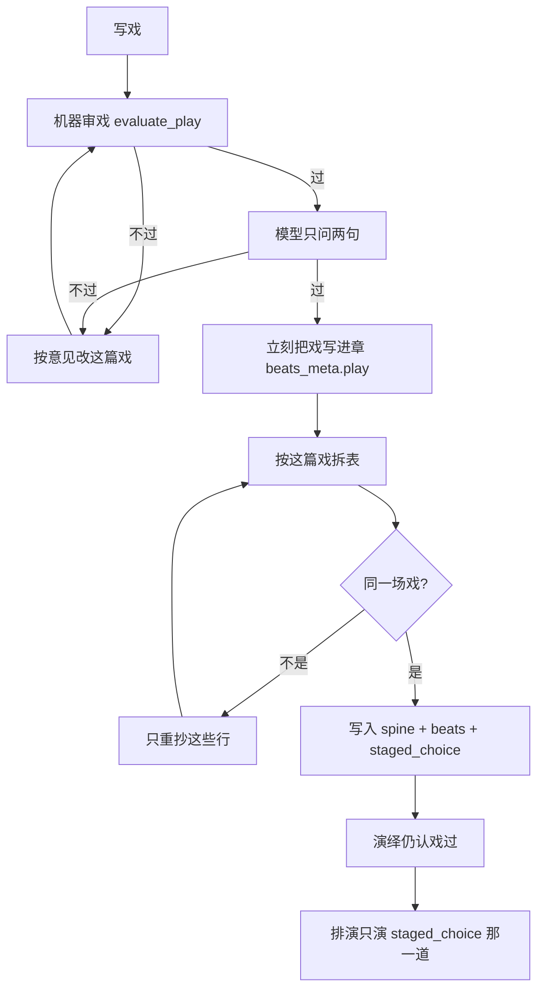
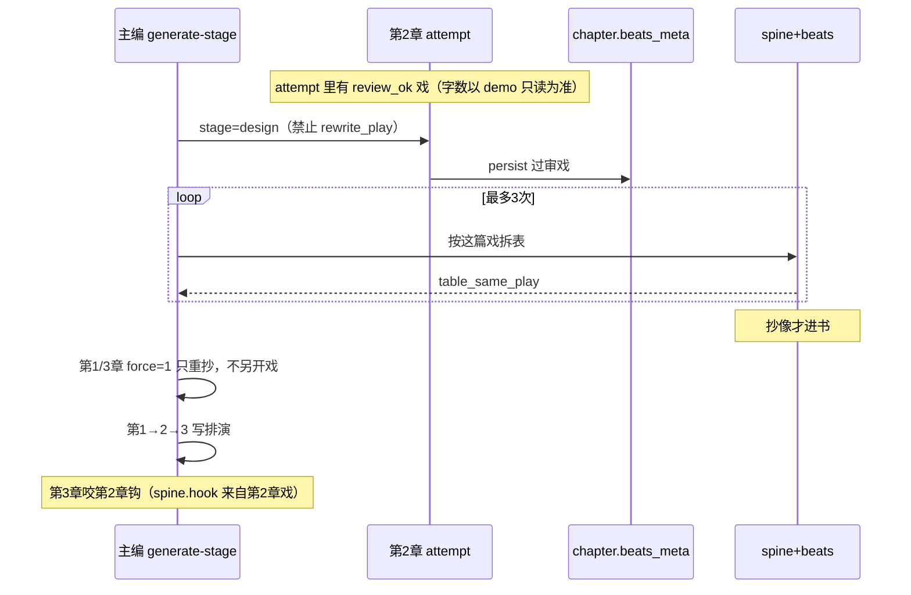
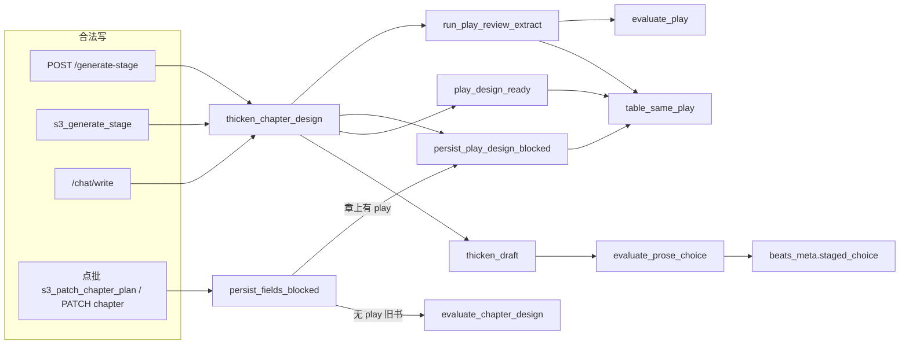

# 表只能是这篇戏的抄本

| 项 | 值 |
|----|-----|
| **文档标题** | 铜炉写章：过审的戏留下，表按戏抄，排演只演那一道选择 |
| **作者** | Grok Design |
| **日期** | 2026-08-18 |
| **状态** | Draft |
| **产品** | 铜炉 / tonglu · 代码 `scribe3/` · 仓库 `/home/admin/projects/scribe-writing-system` |
| **短名** | `play-copy-table` |
| **现网书** | demo `book_b0beed49`《万界概率战争》· 第1章《华山成核》有戏+演绎无排演 · 第2章《四十二度》空章 · 第3章《金縢裂纹》有戏+演绎无排演 |
| **前序** | 已上线「写戏 → 审戏 → 拆表」：`scribe3/design_play.py` · `thicken_chapter_design` 戏过即可写入、跳过 `evaluate_chapter_design` 当质量嘴 |
| **验收环境** | 只打已部署 demo `tonglu.example.com`（`ubuntu@203.0.113.10` `/opt/scribe3/app`） |
| **合法写入** | 主编 `generate-stage`、点批、`/chat/write`。禁止 REST PATCH 当产品写章 |
| **不改** | 宣称、GATE-B 80、`GATE_SAVE_MODE`、WCG、SPA、不占用 `chapter_brief` |
| **不自动** | 不种线、不建户口外人 |
| **旗** | **不加新产品旗。** 这是戏优先路径的验收收口，不是第三条合同 |

---

## Overview

已上线的「写戏 → 审戏 → 拆表」把质量嘴从十四项表格考试挪到了这篇戏上：`run_play_review_extract` 先写戏、`evaluate_play` 机器审、模型只问两句、再拆表；`thicken_chapter_design` 戏过即可写入，不再用 `evaluate_chapter_design` 当 persist 质量嘴；演绎在 `play_design_ready` 时不再用 fate 重考设计表。

但拆表验收太松，书认的是抄歪的表，不是已过审的戏。过关条件近似 `parse_choice_ab` + 三场 + `_distinctive_overlap` 二字碰在一起。不查：本章要是不是今晚那一件；是不是只有一场把那道两难搬上台；其余场选是否「无」。`persist_play_design_blocked` 只拦半稿 / 编人 / 换地。`play_design_ready` 更松：有 play + schema + 两难可拆 + 三场就算齐。歪表进书后，排演 / fate 仍读表：`evaluate_prose_choice` 按 `spine.choice` 两边词是否在排演里出现。表上「本章要」写成「做出选择」、三场每场都有选、选择句膨胀 → 排演必挂 `choice_unperformed` / `ore_unlanded`。

第 2 章更糟：中间稿 `design_attempt` 里有一篇 `review_ok` 的戏（约 1116 字），三次 `extract_thin` 没进书；后来 `force=1` 另开新稿，机器审 `no_dilemma`，把过审戏冲掉。根因不是「再严一点表格考试」，而是**书认错了主人**：表是第二份故事，戏只是附件。

本设计把表降成这篇戏的忠实抄本。拆表验收改问「是不是同一场戏」。抄不像只再抄，不重写戏。过审戏必须留下：`extract_thin` / persist 失败从这篇续，禁止默认 `force=1` 另开一篇。排演 / 定稿认这篇戏（或已对准戏的那张表）里那一次选择，不用膨胀选择句当词表。旧十四项表格考试不加回来当质量嘴。

---

## 对人说

打开书，这一章先是一篇已经过审的短戏：今晚谁在做事、办哪一件、他还没选时两头各要付出什么、他选了哪边、世界因此怎么变。表不是另一场故事，只是把这篇戏抄成机器能读的几行。本章要就是今晚那一件；代价若有字，就是戏里付出去的那笔账。三场压力里，只有一场把那道还没选的两难搬上台，其余场的「选」是无。排演演的是这篇戏里那一次选择，不会被表上那句又长又空的「做出选择」卡住。

第 2 章现在是空的。改完之后，不会再丢掉那篇已经过审的戏，只从那篇接着把表抄准。第 1、3 章戏还在，先把表抄回这篇戏，再写排演。第 3 章要接住第 2 章没做完的事。

怎样算做完：打开这本《万界概率战争》，三章都还是各自那篇过审戏；表和戏是同一场；第 2 章不再空；排演能写下去，不再因为表抄歪而卡死。文采深不深，本轮不管。

---

## Background & Motivation

### 现网已经做成的（不要推倒）

| 层 | 落点 | 已证明 | 本轮态度 |
|----|------|--------|----------|
| 写戏 | `design_play.build_play_prompt` / `run_play_review_extract` | 先写短戏，不要表格、标签、拍头 | **保留**。质量嘴仍是这篇戏 |
| 机器审戏 | `evaluate_play` | 问谁 / 那一件 / 账 / 咬上章 / 两难有没有写出来 | **保留**。意见只说戏 |
| 模型审戏 | `build_review_prompt` / `parse_review` | 首行必须整词「过」；「过程写歪了」不算过 | **保留** |
| 拆表 | `build_extract_prompt` / `parse_chapter_design_payload` | 戏过之后才抽标签；抽不齐只重抽 | **改验收**，不改「先戏后表」 |
| 设计写入 | `persist_play_design_blocked` | 不跑 `evaluate_chapter_design` | **加同一场戏**，不加回十四项 |
| 设计算齐 | `play_design_ready` | 演绎 / 排演不再用旧表当质量嘴 | **收紧为「戏在、表是抄本」** |
| 工作稿 | `store/design_attempts.py` · `load_working_paper` | 戏可暂存在 attempt | **改选取**：认过审戏，不认最后一篇烂稿 |
| 字段形状 | `chapter_spine.v1` 14 键 + `beats[]` ≥3 + `beats_meta.play` | 人读 30 秒能说出要 / 选 / 付 | **保留字段**，表降成抄本 |

`thicken_chapter_design`（`stage_generate.py` L1920+）已经是唯一设计入口。`thicken_outline` / `thicken_beats` 只转发。`iceberg.evaluate_iceberg` 在 `play_design_ready` 时会剥掉 design 桶的 missing（L280–287），让下一层不要再考旧表。这条「戏过了就不要拿十四项卡下一层」必须留下。

### 根因：书认的是抄歪的表

不是症状清单。一条因果链：

```text
过审的戏
    │
    ▼
拆表验收 ≈ 二字碰在一起 + 两难能拆 + 三场有字
    │
    ▼
歪表写入 chapter_spine / beats
    │
    ├─ play_design_ready = True（有戏、有表、能拆两难、三场）
    │     → 演绎不再重考设计表（对）
    │     → 但排演 / fate 仍读这张歪表（错）
    │
    └─ 第2章拆表三次没进书
          → force=1 把工作稿整份丢掉
          → 另开一篇没有两难的新戏
          → 过审戏被冲掉
```

绑到现网函数：

| # | 现网必然放行 / 必然冲戏 | 代码 |
|---|------------------------|------|
| 1 | 本章要写成「做出选择」也能过拆表 | `table_ungrounded`（`design_play.py` L252–272）对 `goal` 只做 `_distinctive_overlap`。二字碰戏里任意一句即可。`event_unmet`（`clue_density.py` L560–573）把 goal+choice+decision **拼成一团**再碰 `duty_event`，选择句里有成核/按回，就能把空的「本章要」藏过去 |
| 2 | 三场每场都有选也能过拆表 | `table_ungrounded` **不看拍**。`play_design_ready`（L275–290）只要求 `len(beats) >= 3`，不要求「只有一场搬上这道两难」。`build_extract_prompt`（L205–209）原文「每场要/挡/变/付/选」，等于教模型每场都填选 |
| 3 | 决断写成等于没选也能过 | 只查决断句和戏有没有二字重叠，不查决断是不是选了两难的一边 |
| 4 | 选择句可以膨胀成一段说明 | `parse_choice_ab` 只要中间有「还是 / vs」就能拆。拆表不要求选择句是戏里那一句 |
| 5 | 歪表进书后排演按膨胀选择考 | `evaluate_prose_choice`（`fate_dearer.py` L499–526）对 `spine.choice` 两边做 `_choice_toks`（内容块 + **全文二字滑窗**）。选择越长，两边词越碎，越难在两句里分别命中并夹犹豫词。必挂 `choice_unperformed`。`ore_unlanded` 读的也是从这张表抽的矿 |
| 6 | 过审戏可以被后一篇烂稿冲掉 | `load_working_paper`（L354–364）倒序扫 attempt，**第一篇有 play 的就用**，不问 `review_ok`。`thicken_chapter_design` L1972：`paper = None if _extra_force(extra)`。`force=1` 本意是「别跳过已齐的设计、再跑一遍」，设计层被理解成「整份作废另开戏」 |
| 7 | 过审戏只活在 attempt 里 | 戏要等整张表 persist 成功才写进 `beats_meta.play`（L2051–2053）。`extract_thin` 时戏不进章。第 2 章 12 次 attempt、一篇 `extract_thin`+`review_ok`，章上仍空 |

### 现网证据（2026-08-18 demo，`book_b0beed49`）

下表是任务给定的 demo 病历，用来说明因果，**不是**仓库内可复现的断言。PR4 开工前在已部署 demo 上只读核对：第 2 章 attempt 的 `review_ok` + play sha、第 1/3 章 `beats_meta.play` 是否仍在。字数 / 篇次以当场为准。

| 章 | 打开书实际有什么 | 表怎么歪 | 后果 |
|----|------------------|----------|------|
| 1 《华山成核》 | play 1272 字过审；演绎在；draft=0 | exam 仍红 `spine_goal_thin, choice_not_staged, second_choice`；三场都有选；地点「屋内，窗外」；线绑金縢封印 | 排演按这张表考，写不下去 |
| 2 《四十二度》 | 空章；12 次 attempt；一篇 `extract_thin`+`review_ok`（约 1116 字） | 后续 `play_rejected` / `hard_review` / `no_dilemma` | 过审戏被后开的新稿冲掉 |
| 3 《金縢裂纹》 | play 1528 过审 + 演绎；draft=0 | exam 红 `spine_goal_thin, choice_not_staged, line_wrong_bind`；决断写成等于没选 | 同第 1 章 |

`evaluate_iceberg` 在 `play_design_ready` 时会剥掉 design 桶红灯，所以「设计算齐、可以进演绎」是真的——第 1、3 章演绎已经在。红灯是旧十四项考试还在旁边喊。本轮**不要**让那盏灯重新当质量嘴；要让表先变成这篇戏的抄本，排演才有东西可演。

### 为什么不能把旧表考试加回来

`evaluate_chapter_design` = `evaluate_spine` ∧ `evaluate_beats` ∧ `evaluate_design_continuity`。`evaluate_spine` 在 design 考卷下仍报 `spine_goal_thin`（`is_atom_field`：动作+物件或点名世界机制词）。这正是「选择两边那几个字得出现 / 点名至少一个机制词」的亲戚。用户已经裁定：戏过了不要再用这张卷子当质量嘴。第 1、3 章 exam 红的那些码，是旧卷子在说话，不是「戏没过」。

试金石：若模型只靠换词、堆「大遮蔽 / 成核点」、左右对打，表就能过，而打开书这场戏并没有发生——这条检查是坏的。本轮新检查必须问：打开书，表上写的是不是这篇已经过审的戏。

---

## Goals & Non-Goals

### Goals

1. **拆表验收 = 是不是同一场戏。** 本章要 = 今晚那一件；选择 = 戏里那一道还没选的两难；决断 = 选了哪边；代价若有字 = 戏里世界因此怎么变；**只有一场**搬上这道两难，其余选 = 无。二字碰在一起不够。
2. **抄不像只再抄，不重写戏。** `extract_thin` / persist 失败从这篇过审戏续拆。
3. **过审的戏必须留下。** 写入 `beats_meta.play` + `play_review_ok` 发生在审过的那一刻，不等整张表齐。`load_working_paper` 只认过审戏。默认 `force=1` 不得另开一篇。
4. **排演 / 定稿认这篇戏里那一次选择。** 用戏里（或已对准戏的抄本上）那道紧的两难，不用膨胀选择句当词表。
5. **现网三章按这条修。** 第 2 章从那篇过审戏接着抄；第 1、3 章表对准后再写排演；第 3 章咬第 2 章留下的事。

### Non-Goals

- 不把 `evaluate_chapter_design` 加回设计 persist 当质量嘴。
- 不改宣称、GATE-B 80、`GATE_SAVE_MODE`、WCG、SPA。
- 不占用 `chapter_brief` / `GET /chapter-brief`。
- 不自动种线、不自动建户口外人。
- 不改戏的机器审标准（`evaluate_play` 仍问谁 / 那一件 / 账 / 咬 / 两难）。
- 不删 `chapter_spine.v1` 字段形状，不把拍做成第 15 槽。
- 不把表整张丢掉、让排演直接读戏全文（下游演绎 / 线 / 钟地仍要抄本）。
- 不加新产品旗、不加 WAVE、不扩词表当主方案。
- 不在 Grok 运行机跑全量 npm / pytest / 本机 Surreal。验收只打已部署 demo。
- 不 overlay 旧验收书名单（`book_bdfdcdc4` / `book_e415dfeb` / `book_61a7935e` / `book_83584141`）。本轮修的是 `book_b0beed49`。

---

## Proposed Design

一句话：戏是主人，表是抄本，排演演抄准了的那一场。



### 1. 同一场戏：拆表验收换嘴

新纯函数放在 `scribe3/design_play.py`（戏优先的 SSOT，不放回 `clue_density.evaluate_chapter_design`）：

```python
def table_same_play(play: str, parsed: Mapping[str, Any] | None, book) -> list[str]:
    """表上哪些行不是这篇戏。返回人话行名，不是十四项编号。"""
```

`table_ungrounded` 改成它的薄壳（保留旧名给现有测试，语义换成同一场戏）。`run_play_review_extract` L524 仍调用它；miss 非空则只重抄，不改戏。

#### 1.1 先从戏里取出四件东西

不做词表，做「这篇戏自己写了什么」。

**禁止**用现成 `parse_choice_ab` 扫第一句当两难。`parse_choice_ab`（`chapter_spine.py` L88–105）分隔符含「对」「或」，普通叙述「沈烛若对观测口说不」「他还是走进了灯亭」会被拆成假两难。`evaluate_play` 的两难只认 `_DILEMMA_MARK`（`还是` / `vs` / `要么`，`design_play.py` L11、L52–53）。两把尺子必须同一把。

`play_choice_ab(play) -> tuple[str,str] | None` 写死：

```python
_PLAY_AB_MARK = ("还是", " vs ", " VS ", "vs", "要么")  # 与 evaluate_play 相同；不含 对/或

def play_choice_ab(play: str) -> tuple[str, str] | None:
    for sent in split_sents(play):
        ab = _split_on_marks(sent, _PLAY_AB_MARK)  # 要么 须切成 ≥3 段，取后两段
        if not ab:
            continue
        a, b = (ab[0] or "").strip(" ，,：:"), (ab[1] or "").strip(" ，,：:")
        if _side_has_substance(a) and _side_has_substance(b):
            return a, b
    return None
```

`_side_has_substance`：去掉「他/她/它/还/就/便」之后仍有 ≥2 个汉字内容。用来跳过「他还是走进了灯亭」（左边只剩「他」）。金样必须钉：戏里先有「沈烛若对观测口说不」，后有「交核还是自按」→ 取出的是后一句，不是「对」切开的假两难。

| 取出 | 怎么取 | 取不到算什么 |
|------|--------|----------------|
| 戏里的两难 | `play_choice_ab` 如上，**不是** `parse_choice_ab` 扫第一句 | 戏在 `evaluate_play` 已过 `no_dilemma` 时不应发生；若发生，拆表 miss「选择」，只重抄，不重写戏 |
| 戏里选了哪边 | 两难句之后，第一句只贴上其中一边、不贴另一边的，就是决断句 | 两边都贴或两边都不贴 → miss「决断」 |
| 今晚那一件 | `book.duty_event`（戏已过 `event_unmet`）落在戏里的那一句；没有 duty 则用两难句本身（两难就是今晚要办的那一件的两头） | 没有可对的事 → miss「本章要」 |
| 世界怎么变 | 戏里在决断之后、说到世界 / 账变化的**那一句**（`bill_sent`）。取不到就是没有账句，**禁止**用决断后整段戏冒充 | 账句可空。表上代价有字却没有账句 → miss「代价」（见 1.2 第 5 条） |

这四件是**从这篇戏读出来的**，不是从十四槽金样读出来的。表选择格仍可用 `parse_choice_ab`（抽取约定写「还是」）；和戏比对时走 `_ab_same(parse_choice_ab(spine.choice), play_choice_ab(play))`。

#### 1.2 五条验收（一条只问一件事）

每条都必须能改写成小说家的问句。过不了就说哪一件不是这篇戏，好让下一笔补抄，不要补字。

**（1）本章要是今晚那一件吗？**

- 打开书应看到：本章要写的是戏里正在办的那一件，不是「做出选择」这种空话。
- 机器问法：
  - `goal` 必须和「今晚那一件」是同一件事：对 `duty_event`（有则必对）以及对戏里的事件句，走 `_copied_clause(goal, event_sent)`（见 1.3）。禁止对整篇戏做二字重叠。
  - **单独对 goal**，禁止再把 choice/decision 拼进去（这是现网 `event_unmet` 藏空目标的根）。
  - `_meta_choice_only(goal)`：去掉「选择 / 做出 / 决定 / 选边 / 两难 / 还是」之后，再没有能对上事件句的内容 → 不是那一件。
- 不过 → 行名「本章要」。意见：「本章要写成了另一句。按戏里今晚办的那一件重抄。」

**（2）选择是戏里那道还没选的两难吗？**

- 打开书应看到：选择格就是戏里他站在两头还没迈步的那一句，不是另编的、也不是已经选完的句子。
- 机器问法：`parse_choice_ab(spine.choice)` 必须存在，且与 `play_choice_ab(play)` 走现成 `_ab_same`（`clue_density.py` L911–917，已处理交核/自按与「把碎片交出去 / 自己按回去」这种同义）。
- 不过 → 行名「选择」。意见：「选择要抄戏里他还没选时的两难，不要另写一句。」

**（3）决断是选了哪边吗？**

- 打开书应看到：他选了两难的一边。不是「等于没选」，也不是两边各沾一点。
- 机器问法：`decision` 只与两难的一边 `_side_same`，不能两边都像，也不能两边都不像。空 / 「无」 / 「没选」 / 「等于没选」不过。
- 不过 → 行名「决断」。意见：「决断写他选了哪边，按戏里他迈出去的那一步抄。」

**（4）是不是只有一场把这道两难搬上台？**

- 打开书应看到：三场压力里，只有一场他站在两头还没选；其余场的选是无。
- 机器问法：
  - `normalize_choice` 已把「无 / 没有 / 无选择」收成空。
  - `parse_choice_ab(beat.choice)` 非空的拍，计数必须 **恰好 1**。
  - 这一场的两难必须与章选择 `_ab_same`。
  - 不强制是拍 2。哪一场搬上就认哪一场，写入 `beats_meta.staged_beat`（1-based）。
- 0 场 → 「没有一场把两难搬上台」。>1 场 → 「只有一场搬上这道两难，其余选写无」。搬上的不是这道 → 「搬上台的不是戏里那道两难」。
- `beats_meta.staged_beat` 是本轮唯一准绳（哪一场真的搬上了）。若仍写 `designated_beat`（抽取稿「选拍」），必须等于 `staged_beat`。旧 `evaluate_chapter_design` / `beats_realize_spine` **不读** `designated_beat` 当本轮质量嘴。

**（5）代价是戏里那笔账吗？**

- 打开书应看到：世界因此怎么变，写的是这篇戏付出去的那一笔，不是另一本账。
- 机器问法：
  - 代价**可空**（戏里可以还没写出账句，表上也可以不填）。
  - 有字则必须先取出 §1.1 的那一句 `bill_sent`。**没有账句 → 直接 miss「代价」**，不要回退到决断后整段戏（那是现网整篇二字袋的缩小版：另写一笔账，后半篇碰两个字就能过）。
  - 有账句则 `_copied_clause(cost, bill_sent)`，且不得 `_meta_choice_only`。`_copied_clause` 的 `source` **只能是这一句**，不是后半篇、不是整篇戏。
  - 禁止 `is_atom_field` / 机制词表。
- 不过 → 行名「代价」。意见：「代价要抄戏里世界因此怎么变的那一句，不要另写一笔账。」

编人仍走现成 `invented_cast_names`（已在 `table_ungrounded` / `persist_play_design_blocked`）。换地没说清仍走 `same_landmark`。这两条是户口底线，不是本轮主检查。咬上章 / 钩有字时，拆表不另开质量嘴（戏的 `evaluate_play` 已问过咬）；不把旧 `_TABLE_KEYS` 六行二字重叠加回来。

**动哪条线**：戏里没动到的线，表上不要补。若表写了 delta，delta 必须能在戏里对上；对不上 → 行名「动哪条线」。**不要求**必须绑一条线（不自动种线）。`lines_unbound` 不再挡戏优先的 persist。

#### 1.3 什么叫「抄自这篇戏」

抽取提示已经说「冒号后面只写戏里有的句子」。验收落实这句话，但不要做成「必须整句相等」（模型会加标点、截半句）：

```python
def _copied_clause(slot: str, source: str) -> bool:
    if not (slot or "").strip():
        return False
    if slot in source:
        return True
    for sent in split_sents(source):
        if _distinctive_overlap(slot, sent, None) and not _meta_choice_only(slot):
            return True
    return False
```

`_copied_clause` **只接到「本章要」和「代价」上**：本章要对事件句，代价**只对那一句** `bill_sent`。禁止 `source` 传入整篇戏、决断后半篇、或 `bill_sent or play_after_decision` 这种回退。选择、决断、只有一场走 `_ab_same` / `_side_same` / 计数，不走这条。禁止只定义不调用。

`_distinctive_overlap` 仍只作「同一句里的同一件事」，不再拿整篇戏当袋：对整篇做二字重叠，任何短句都能过——这就是现网 `table_ungrounded` 的洞。

#### 1.4 抽取提示改责任，不改答法

`build_extract_prompt`（L194–225）现文「每场要/挡/变/付/选」是在教答法，且必然诱出三场都有选。改成责任：

- 本章要：抄今晚办的那一件，不要写成「做出选择」。
- 选择：抄他还没选时的两难，中间用「还是」。
- 决断：抄他选了哪边。
- 代价：抄世界因此怎么变；戏里没有就不要编。
- 三场：只有一场的选抄这道两难，其余场选写「无」。
- 戏里没有的人、物、线不要补。

拍头 `## 拍1` 仍是给解析器的格式，写在「只输出标签行」那一段，**不写进「写好」的标准**。`_DESIGN_ASK`（`stage_generate.py` L1293+）里「第二场的选写两难、其余无」已经对；抽取提示向它对齐。点批一次交齐 spine+beats 且章上已有过审戏，走同一张 `table_same_play`（见 §4）。

`extract_missing` 分两层，**不要**用同一场戏四条盖掉结构缺口：

- **同一场戏（质量嘴）：** 本章要不是今晚那一件；选择不是戏里那道还没选的两难；决断不是选了哪边；代价不是戏里那笔账；不是只有一场搬上这道两难。
- **结构（给解析器，不是十四项考试）：** 选择/决断仍空、三场不足 3、时长空、地点空——维持现网 `extract_missing` 已有的这些行。`persist_play_design_blocked` / `play_design_ready` 仍不拿 clock/place 当质量嘴；但重试必须点名，否则三次后留下空时长，排演 `ink_over_span` / `ink_under_span` 会读到空 `clock.span`。

#### 1.5 自我审查（本设计的检查必须过这三问）

| 问 | 答 |
|----|----|
| 模型不理解这场戏、只堆词，能过吗？ | 不能。堆「大遮蔽」过不了「本章要是那一件」；左右对打但三场都有选过不了「只有一场」；选择句膨胀但和戏里两难 `_ab_same` 失败会重抄。 |
| 是在教答法还是交责任？ | 交责任。格式（拍头、还是）留在解析层。 |
| 用户听这句检查，能听成打开书应该看到什么吗？ | 能。五条都是小说家能问出口的话（含世界因此怎么变）。 |

### 2. 过审的戏必须留下

#### 2.1 审过那一刻就进章

落点写死在 `thicken_chapter_design`，**不是**在 `run_play_review_extract` 内部。`run_play_review_extract` 只负责把 `play` + `review` 带回来；调用方在拆表成败之前写下戏。

现网顺序（`stage_generate.py` L1975–2008）：先跑完整条 pipe，再 `if not pipe.get("ok"): return`，persist 成功路径在更后面。实现者若只在成功拆表时写 play，第 2 章 `extract_thin` 戏仍不进章。

**（a）必须在 `if not pipe.get("ok")` 之前写戏。** `extract_thin` / `play_rejected` 只要 `review_ok` 且有 play，就写。伪码：

```python
pipe = run_play_review_extract(...)
play = str(pipe.get("play") or "")
review_ok = bool((pipe.get("review") or {}).get("ok"))
if review_ok and play:
    persist_reviewed_play(persist_fn, ch, play)   # REST persist_fn 有则写库
    # 无论 persist_fn 是否为 None，都把 play 键挂到将返回的 out / 后续 fields
if not pipe.get("ok"):
    out = {..., "play": play, "review": pipe.get("review"),
           "beats_meta": reviewed_play_meta(ch, play)}  # extract_thin 也带
    return out
```

`persist_reviewed_play` 只深合并 `beats_meta`。`update_chapter_meta` 对 `beats_meta` 是整字段 JSON 覆盖（`store/chapters.py` L1091–1096），必须先读现章再 merge，禁止只传 `{play, play_review_ok}` 把 clock/place/ore 冲掉：

```text
beats_meta.play            = play[:4000]
beats_meta.play_review_ok  = True
beats_meta.play_sha        = sha256(play)[:16]
```

此时可以还没有 spine / beats。`persist_play_design_blocked` 对「只带 play 的 beats_meta、没有新 spine/beats」直接放行。`persist_fields_blocked` 的 design 半稿分支只在 `chapter_spine in fields or beats in fields` 时触发（现网 L573–575），play-only 不会走进 `design_half`。

**（b）成功拆表重建 `beats_meta` 时强制带回这些键。** 现网 `merge_clock_place` 从**内存旧章**抄 meta（`fate_dearer.py` L1253–1276），`thicken_chapter_design` L2037–2053 只补 `schema_design` / `duty` / `play[:4000]`，不写 `play_review_ok` / `play_sha` / `staged_choice`。表一齐，审过那一刻写下的新键会被整包覆盖。`load_working_paper` 第一步就认 `play_review_ok`，键丢了选取会退回 attempt。

成功路径在 `merge_clock_place` 之后**显式盖回**（不要指望旧章内存里已经有）：

```text
meta["play"]           = play[:4000]
meta["play_review_ok"] = True
meta["play_sha"]       = sha256(play)[:16]
meta["staged_choice"]  = f"{a} 还是 {b}"   # PR3 起；PR2 可先不写
meta["staged_beat"]    = n
# 若写 designated_beat，必须 = staged_beat
```

**（c）MCP 设计层 `persist_fn` 现网是 `None`。** `mcp/tools_write.py` L1363–1379 只给 draft/final 设 `persist_fn`；设计落库在 thicken **之后**，且条件是 `out.get("ok") or out.get("beats_meta")`（L1396）。现网 `extract_thin` 返回体没有 `beats_meta`（`design_play.py` L539–547），后置 persist 整段跳过。只改 `thicken` 里的 `persist_fn` 对 MCP 无效。

MCP 必须两条都做：

1. `extract_thin` / `play_rejected`（`review_ok`）的返回体带 `beats_meta`（play-only 那三键，深合并自现章）。
2. 后置 persist：有 `out.play` 且 stage 为 design 时走 `persist_play_design_blocked` 的 play-only 放行，再 `update_chapter_meta` **深合并** `beats_meta`。PR2 文件清单含 `mcp/tools_write.py`。

`/chat/write` 若最终进 `thicken_chapter_design` 且自带 `persist_fn`，走（a）。不另开第三条合同。

#### 2.2 工作稿只认过审戏

`load_working_paper` 重写选取顺序：

1. 章上 `beats_meta.play` 且 `play_review_ok`（或仅有 play、且 attempt 里同 sha 曾 `review_ok`）
2. 否则 `list_design_attempts` **从新到旧**，第一篇 `review_ok and play`
3. 都没有 → `None`（这才允许写新戏）

禁止：倒序第一篇「有 play 即可」。后一篇 `play_rejected` / `no_dilemma` 不得盖过前面的过审戏。

`paper_record` / `save_design_attempt` 继续写 `play` + `review_ok`。`ok` 字段仍是 struct∧exam，给旧查询看；选取不看 `ok`，看 `review_ok`。

#### 2.3 `force=1` 不再等于另开一篇戏

| extra | 现网 | 本设计 |
|-------|------|--------|
| （无） | 有工作稿且 `review_ok` 则续拆 | 不变；选取改为认过审戏 |
| `force=1` | **丢掉工作稿**，`build_play_prompt` 另开一篇 | **续拆过审戏**。只跳过「设计已齐则不覆盖」（`iceberg_ok_for` + `_extra_force`，L1945）。用于第 1、3 章：表歪、戏在，再抄一遍 |
| `rewrite_play=1` | 无 | **唯一**允许丢掉过审戏、另写一篇的开关。主编 / 点批必须显式带上。UI 不得默认塞 |

`_extra_force` 保留给「别 skip、再跑本阶段」。新增 `_extra_rewrite_play(extra)`。

`build_play_prompt` **现网不是剥词**。`design_play.py` L131–134：`if extra and "force=1" not in extra.lower()` 才把整段 extra 注入戏；带 `force=1` 时 **整份 extra 都不进戏**，不是剥掉这两个词留下其余。本轮保持这个开关语义：`force=1` 或 `rewrite_play=1` 任一在 extra 里 → extra **整段不进** `build_play_prompt`。禁止改成「剥掉开关、其余作者 extra 开始进戏」——那会让以前进不了戏的句子悄悄进戏。`rewrite_play=1` 本身只作选取开关，不需要进戏。

`run_play_review_extract(..., resume_extract=True)` 现网已跳过写戏和审戏（L466–468）。本轮保证：只要章上或 attempt 里有过审戏，且 extra 没有 `rewrite_play=1`，`resume_extract` 恒为真。

#### 2.4 拆表三次仍不像：停，留下戏

`_EXTRACT_MAX = 3` 不变。三次后仍返回 `extract_thin`，但：

- `play` 已在章上
- attempt 带 `review_ok=True`
- 返回体带人话：`message` = 「戏过了，表还没从这篇戏里抄像」+ 具体哪几行
- 下一次 generate-stage（哪怕带 `force=1`）从这篇续，不另开

禁止现网 L498–520 那种「表拆不出两难就 bounce 重写戏」作为默认。戏已过 `evaluate_play` 的 `no_dilemma`，拆不出是抄的问题。bounce 只允许在 `rewrite_play=1` 或戏本身后来被证明没有两难（`play_choice_ab` 为空且 `evaluate_play` 复检失败）时发生。第 2 章被冲掉的路径就是这条 bounce + force。

### 3. 排演 / 定稿认那一次选择

#### 3.1 落库时钉死一道紧的两难

表过 `table_same_play` 之后写入：

```text
beats_meta.staged_choice = f"{a} 还是 {b}"   # 来自 play_choice_ab，不是膨胀 spine.choice
beats_meta.staged_beat   = n                 # 1-based，唯一搬上台的那场
beats_meta.schema_design = "chapter_design.v1"  # 已有
```

`spine.choice` 仍保存抽取原文（人读可以稍长），但**考试不读它**。

#### 3.2 `evaluate_prose_choice` 换源

`fate_dearer.evaluate_prose_choice(prose, spine)` 现签名不够。改为：

```python
def evaluate_prose_choice(prose: str, spine: dict | None, *, ch: dict | None = None) -> list[str]:
    ab = staged_choice_ab(ch) or play_choice_ab(play_of(ch)) or parse_choice_ab((spine or {}).get("choice"))
```

`staged_choice_ab` 读 `beats_meta.staged_choice`。调用点 `evaluate_fate_prose` L1129 已有 `src`（整章），传入 `ch=src`。

考试问的是小说家的话：**排演里，他有没有站到这道两难上，然后迈出戏里那一边？**

- 两边作为整段侧写在不同句出现。
- 中间仍可用现成 `HESITATE_NARROW` 作「还没迈出去」的弱证据；没有犹豫词但两边都在、且决断边在后半落地，也算演了。
- **后半句群写死：** `sents = split_sents(prose)`，下标 `>= len(sents)//2` 的句子。不按字数中点，不按 `staged_beat` 对应段。
- 决断边必须在后半句群落地（对 `spine.decision` 或戏里的决断句 `_side_same`）。

有 `staged_choice`（或现场 `play_choice_ab`）时：两边只用 `_side_same` / 原文包含，**不再**对 staged 侧走 `_choice_toks` 全文滑窗。8 字滑窗回退**只留给**没有 staged、只剩短 `spine.choice` 的旧章。`staged_choice` 本身就是短的（「交核 还是 自按」），走滑窗会回到词表洞。

金样（PR3）：有 staged 且排演演了戏里两难 → 空错误；演了另一道 → `choice_unperformed`。现有 `test_fate_dearer.py` 直接调 `evaluate_prose_choice(prose, spine)`，新签名 `ch=` 必须兼容（缺省行为：无 ch 则仍读 `spine.choice`，旧用例不炸）。

`choice_unperformed` 仍是 fate WAVE-2 的码，给机器和记录仪。对人说话走现成意见通道：写成「排演里没有把那道两难演出来」或「演了两难，但没迈出他选的那边」。

#### 3.3 `ore_unlanded` 不另开合同

矿仍从演绎 + 已对准的表抽。表对准之后，矿应对准今晚那一件，落地检查维持现状。禁止为了让排演绿而把 `ore_unlanded` 从 WAVE 拿掉。第 1、3 章先对准表，再写排演；若仍挂矿未落地，那是演绎矿和戏不是同一件——另案，不在本轮把矿检查改成词表。

#### 3.4 排演提示认戏

`_DRAFT_ASK`（L1359–1364）现文「【必须落地】里的选择必须在场面里发生一次」。现网 `build_stage_prompt` 非规划阶段会灌 `format_must_land`（`stage_generate.py` L1168–1171；`chapter_spine.py` L253–299），其中「选择」仍是 `spine.choice`。表对准后这句应已接近戏里两难，但人读「稍长」的 `spine.choice` 仍会和「只演 staged_choice」并排出现。

PR3 改 `format_must_land`：有 `staged_choice` 时【必须落地】的选择用它，不再用膨胀 `spine.choice`。注入时若有 `beats_meta.play`，在材料里另放：

- 这篇过审戏（全文，已有 `beats_meta.play`）
- 一句：排演演这篇戏里那一次选择（`staged_choice`），不要另起一道。

不要把十四槽金样整张再塞进排演提示。

### 4. `play_design_ready` 收紧，十四项不加回

```python
def play_design_ready(ch: Mapping[str, Any] | None) -> bool:
    # 现网：schema + play + is_v1 + parse_choice_ab + 3 beats
    # 本设计加：table_same_play(play, ch, book=None) == []
```

`book=None` 时用戏自己当主人（1.1 的四件东西不依赖户口也能取两难 / 决断 / 事件句）。有 `beats_meta.duty.event` 则本章要还要对那一件。

**收紧放在 PR2，禁止随 PR1 单独热更。** PR1 只换拆表嘴，现网书的 `play_design_ready` / skip 行为不变。否则第 1、3 章设计桶变红，主编习惯带 `force=1` 重跑，而 force 语义还没改，过审戏会被再冲一次。

收紧之后的连锁（故意的，且必须与 §2.3 同时上）：

- 第 1、3 章现网 `play_design_ready` 为真（歪表也算齐）。收紧后为假 → `iceberg_ok_for(design)` 为假 → 下一次 `stage=design`（可带 `force=1`）会走进 thicken，但因 2.3 **只续拆、不另开戏**。
- `stage_ready(deduce)` 现网因 `play_design_ready` 剥掉 design 红灯而为真。收紧后，若表不再算抄本，演绎「已齐」仍看演绎自己的地板（`iceberg_ok_for(deduction)`），不因表歪把已有演绎作废。
- `stage_ready(draft)` 需要 design + deduction。表未对准时不得开排演。这正是「第 1、3 章表对准后再写排演」。

`evaluate_iceberg` 继续在 `play_design_ready` 时剥 design 桶 missing。

**点批仍是合法写，必须走抄本。** 现网三条点批/补丁路都走 `persist_fields_blocked` → `evaluate_chapter_design`，**不会**因章上有 play 改走 `persist_play_design_blocked`：

- `api/routers/chapters.py` L466（`PATCH /chapter`）
- `director.py` L374
- `mcp/tools_write.py` L1252（`s3_patch_chapter_plan`）

`persist_fields_blocked` 在写入 spine/beats 时只看 `chapter_design_mode`（`iceberg.py` L573–620）；`play_design_ready` 只让非 design 写入跳过 fate 合同（L507–508）。若不改这一处，点批仍考 `spine_goal_thin` / `second_choice`：既能挡住忠实抄本，也能放行过了原子格、却不是这篇戏的表。

本轮写死：`persist_fields_blocked` 在 design 分支里，若现章或本次 fields 的 `beats_meta.play` 非空，**改走** `persist_play_design_blocked` + `table_same_play`，不再跑 `evaluate_chapter_design`。一处改三入口。无 play 的旧书仍走旧合成检查。点批改戏本身：只能主编 `rewrite_play=1` 再拆表——本轮不新开「点批改戏」API。

**点批只改一格必须先拼整张表。** 现网 `persist_play_design_blocked` 丢掉 `existing`（`design_play.py` L301 `del existing`），只认本次 `fields` 里的 spine/beats；缺一截就 `design_half`。戏文本也多半只在现章 `beats_meta.play`，不在点批 payload 里。若把未合并的 `fields` 原样传入，只改一格选择会误报半稿，抄本也没有戏可对。

写死调用顺序（沿用 `persist_fields_blocked` 现成 merge，`iceberg.py` L579–586）：

```python
merged_spine = fields["chapter_spine"] if "chapter_spine" in fields else (existing or {}).get("chapter_spine")
merged_beats = fields["beats"] if "beats" in fields else (existing or {}).get("beats")
play = play_of(fields) or play_of(existing)   # 现章 beats_meta.play
writing_table = ("chapter_spine" in fields) or ("beats" in fields)
if not writing_table:
    # play-only：没有新 spine/beats，仍放行（§2.1）
    return persist_play_design_blocked(play_only_fields, ...)  # 不跑 table_same_play
merged_fields = {**fields, "chapter_spine": merged_spine, "beats": merged_beats}
# persist_play_design_blocked 必须停止 `del existing`：半稿判断看 merged，不看裸 fields
blocked = persist_play_design_blocked(merged_fields, existing=existing, book=book, ...)
if blocked:
    return blocked
return table_same_play(play, merged_fields, book)  # 空列表才放行
```

`persist_play_design_blocked` 自己也要用 `existing` 补缺的那一半，禁止再 `del existing`。这样即使有人绕过 `persist_fields_blocked` 直接调用，只改一格也不会被打成半稿。play-only（fields 里既没有 `chapter_spine` 也没有 `beats`）仍直接放行。

REST `PATCH /chapter/:seq/beats-fields`（`chapters.py` L564）是 GCD 字段微调，**不是**产品写章，仍跑 `evaluate_chapter_design`。不把它画进合法写调用图。

### 5. 第 2 章从那篇过审戏接着抄；第 1、3 章先对准

这是交付顺序，不是另一套合同。



**第 2 章**

- 选取与 §2.2 **同一句话**：章上若已有 `play_review_ok` 用章上这篇；否则 `list_design_attempts` **从新到旧**第一篇 `review_ok and play`。后稿若是 `play_rejected` / `no_dilemma` 会被跳过，不会盖过前面的过审戏。同 sha 多篇只在去重时取最早过审的，不另搞「最长 / 最近」第二套算法。
- 字数、篇次以 PR4 开工前 demo 只读核对为准，本文「约 1116 字 / 12 次」只是病历口述，不作断言。
- 不跑 `evaluate_play` 重审（`resume_extract=True`）。
- 拆表用新验收。三次不像 → 停，戏留在章上，再跑一次设计即可。
- 禁止为了「第 2 章空着难看」而 `rewrite_play=1`。

**第 1、3 章**

- 戏已在 `beats_meta.play`。`force=1` 重抄表。
- 演绎已在，不重跑（`iceberg_ok_for(deduction)` 且不 force deduce）。
- 表对准后 `play_design_ready` 变真，再 `stage=draft`。

**第 3 章咬第 2 章**

- `load_design_book` 的 `prev_hook` 来自 `resolve_prev_end_hook`：优先 `spine.hook`（`narrative_drive.py` L102–113）。第 2 章表对准后，钩是从第 2 章戏抄出来的「章末没做完的事」。
- 第 3 章戏是在第 2 章还空时过审的。`evaluate_play` 的 `bite_off_hook` 当时可能没钩可咬。
- **不自动重写第 3 章戏。** 表的「咬上章」按第 3 章戏抄。若第 3 章戏里已经在接「四十二度」留下的事，钩对得上就对齐。若对不上：对人说明，等作者决定要不要 `rewrite_play=1` 改第 3 章戏。禁止系统自作主张另开一篇第 3 章。

**顺序约束**：第 2 章表进书 → 再动第 3 章的咬上章抄本 → 再按 1、2、3 写排演。第 1 章不依赖第 2 章，可与第 2 章拆表并行；排演按章序。

### 6. 调用关系（改完之后）



`PATCH /chapter/:seq/beats-fields` 仍跑 `evaluate_chapter_design`，不在上图。不在本轮改它。

---

## API / Interface Changes

对外 URL / 阶段名不变：`POST /generate-stage` `stage=design|deduce|draft|final`。`outline` / `beats` 仍归一到 `design`。

### extra 语义

| 字段 | 变更 |
|------|------|
| `extra` 含 `force=1` | 设计层：跳过 skip、**续拆过审戏**。演绎 / 排演 / 定稿：保持「不 skip、覆盖本层」 |
| `extra` 含 `rewrite_play=1` | **新**。仅设计层。丢掉过审戏，走 `build_play_prompt` 另写一篇 |
| 响应 `code=extract_thin` | 现有。补 `play`、`review.ok`、`same_play_missing`（人话行名列表） |
| 响应 `code=play_rejected` | 仅当没有过审戏可续、或显式 `rewrite_play=1` 后新戏没过 |

`GenerateStageReq.extra` 不改 schema。不把 `rewrite_play` 做成独立 JSON 字段，避免 SPA 改动（不改 SPA）。

### 纯函数（实现者）

```python
# scribe3/design_play.py
def play_choice_ab(play: str) -> tuple[str, str] | None: ...  # 只用 _DILEMMA_MARK，不含 对/或
def table_same_play(play, parsed, book) -> list[str]: ...
def persist_reviewed_play(persist_fn, ch, play) -> None: ...
def reviewed_play_meta(ch, play) -> dict: ...               # 深合并后的 beats_meta 片段
def load_working_paper(st, seq) -> dict | None:  # 选取顺序改变（PR2）
def play_design_ready(ch) -> bool:               # 加同一场戏（PR2，不在 PR1）
def persist_play_design_blocked(...):            # 停 del existing；半稿看 merged；play-only 放行

# scribe3/stage_generate.py
def _extra_rewrite_play(extra: str) -> bool: ...
# thicken_chapter_design: force 不再清空 paper；if not ok 之前写戏

# scribe3/iceberg.py
# persist_fields_blocked: 有 play 时改走 persist_play_design_blocked + table_same_play

# scribe3/chapter_spine.py
# format_must_land: 有 staged_choice 时选择用它（PR3）

# scribe3/fate_dearer.py
def staged_choice_ab(ch) -> tuple[str, str] | None: ...
def evaluate_prose_choice(prose, spine, *, ch=None) -> list[str]: ...
```

### 对人说话（响应 `message`）

| 机器码 | 对人说 |
|--------|--------|
| `extract_thin` | 戏过了，表还没从这篇戏里抄像。本章要 / 选择 / 决断 / 代价 / 只有一场，点名哪几行 |
| `play_rejected` | 这场戏还没过：接现成 `evaluate_play` 意见 |
| `choice_unperformed` | 排演里没有把那道两难演出来（或没迈出他选的那边） |
| persist 编人 / 换地 | 维持现网人话，不改 |

禁止在 `message` 里抛 `spine_goal_thin` / `second_choice` / `llm_thin` 给作者当正文。记录仪可以留码。

---

## Data Model Changes

无新表。`design_attempt` SCHEMAFULL 不改（`play` / `review_ok` 已在 `body` JSON）。

`chapter.beats_meta` 增字段（JSON，无需 migration）：

| 键 | 类型 | 何时写 | 谁读 |
|----|------|--------|------|
| `play` | str ≤4000 | 审过那一刻（提前）；表齐时强制带回 | 续拆、排演材料、`play_design_ready` |
| `play_review_ok` | bool | 审过那一刻；表齐时强制带回 | `load_working_paper` |
| `play_sha` | str 16 | 同刻；表齐时强制带回 | 对齐 attempt，防后稿顶替 |
| `staged_choice` | str | 表过同一场戏；成功重建 meta 时写入 | `evaluate_prose_choice` / `format_must_land` |
| `staged_beat` | int | 同上。本轮唯一准绳 | 记录仪 / 人读 |
| `designated_beat` | 已有 | 若还写，必须等于 `staged_beat` | 旧考试本轮不读它当质量 |
| `schema_design` | 已有 | 表齐 | 已有 |
| `duty` | 已有 | 表齐 | `play_design_ready` 对本章要 |

第 2 章修复不写平行章、不改 slug、不复制书。只在 `book_b0beed49` 第 2 章写入上述字段 + 对准的 spine/beats。

回滚：停用新检查即可；旧章缺新键时 `play_design_ready` 走「无 staged 则现场算 `table_same_play`」。不写回填脚本。

---

## Alternatives Considered

### A. 把 `evaluate_chapter_design` 加回设计 persist

`persist_play_design_blocked` 里再跑十四项。第 1、3 章立刻被 `spine_goal_thin` / `second_choice` 挡住，看起来像「修好了」。

- 好处：现成测试多，不用想同一场戏。
- 坏处：质量嘴回到词表 / 原子格。模型堆机制词、左右对打就能过，戏可以是另一场。用户已否决。
- **不采用。**

### B. 删表，排演直接读戏全文

`chapter_spine` / `beats` 不再作为设计产物。

- 好处：没有第二份故事。
- 坏处：演绎矿、线 id、钟地、世界命题、点批微调全绑在这张表上。等于重做 Ice1/Ice2，爆破面远超本轮。WCG / 宣称 / SPA 合同会被动。
- **不采用。** 表留下，降成抄本。

### C. 拆表再用一次 LLM 问「是不是同一场戏」

模型当法官。

- 好处：语义宽松，不怕截句。
- 坏处：贵、飘、可被「写得像同一场」骗过；本机 / demo 多一轮 2k token。纯函数五问已经能卡死现网歪法（空目标、假账、三场都有选、决断没选）。
- **不采用为门槛。** 三次纯函数仍不像时，意见里可以给人看，不再自动开第四次模型法官。

### D. `force=1` 维持「整份作废」（只改选取认 `review_ok`）

只修 `load_working_paper`，不改 force。

- 好处：改动小。
- 坏处：第 2 章就是 `force=1` 冲掉的。操作者在拆表失败后习惯带 force 重跑。不改语义，洞还在。
- **不采用。** force = 再跑本层；另开戏必须 `rewrite_play=1`。

---

## Security & Privacy Considerations

- 无新鉴权面。写入仍走主编 / 点批 / `/chat/write` 既有会话。
- `design_attempt.body` 已存 play；本轮只改读取选取，不扩大可读范围。
- `play_sha` 是内容指纹，不是密钥。
- 禁止 REST PATCH 当产品写章——本设计不新开 PATCH 字段写 play。
- 不把户口外人自动建档（`cast_invented` 仍拦）。不把未立档人名写进硬卡。

威胁：有人用 `rewrite_play=1` 覆盖过审戏。缓解：不进默认 extra；记录仪打 `rewrite_play`；现网修复三章禁止带这个开关。

---

## Observability

| 信号 | 落点 | 用途 |
|------|------|------|
| `trail[].step=ungrounded` | 已有，补 `missing` 为人话行名 | 拆表哪一行不像 |
| `trail[].step=resume` | 已有 | 证明没另开戏 |
| `trail[].step=play` 在已有过审戏之后再次出现 | 新告警 | 除非 `rewrite_play=1`，否则是回归 |
| `beats_meta.play_review_ok` | 章字段 | 打开书就能看戏在不在 |
| `attempts[].review_ok` | 已有 | 第 2 章考古 |
| fate `choice_unperformed` | 已有 | 应对准 `staged_choice` 后下降 |
| 记录仪 `source=llm` + extra 是否含 rewrite | `pipeline_trace` | 审计谁丢掉了戏 |

不对作者暴露内部码当正文。demo 冒烟看三件事：第 2 章 `beats_meta.play` 非空且与 attempt 过审篇同 sha；第 1、3 章 `table_same_play` 空；`stage=draft` 不再因膨胀选择句秒挂。字数 / 篇次以当场只读核对为准，不用本文病历数字当断言。

延迟：拆表仍最多 3 次 LLM（现网已是）。省掉的是 force 另开戏的 2–4 次写戏 + 审戏。目标：第 2 章从过审戏到表进书 ≤ 3 次抽取，不再出现第四篇戏。

---

## Rollout Plan

不加旗。代码可分 PR 合 main；**demo 热更禁止 PR1 单独上**。PR1 收紧拆表嘴但不改 force；若单独热更，第 1/3 章一旦有人带 `force=1` 重跑设计，仍会丢掉工作稿另开戏。`play_design_ready` 收紧放在 PR2，与 force=续拆同一提交。

1. **PR1 合 main，不热更 demo。** 单测绿即可。
2. **PR1+PR2 同一次 `./scripts/deploy_demo.sh`。** 只读冒烟：第 2 章 attempt 过审戏仍在、`load_working_paper` 能读到；再主编对第 2 章 `stage=design persist=true` **不带** `rewrite_play` → 戏进章、表抄像。失败则停，不 force 另开。
3. **PR3 热更** → 第 1、3 章 `stage=design extra=force=1` 只重抄 → `play_design_ready` 变真。
4. **PR4** → 先只读核对病历，再按 1→2→3 `stage=draft`。第 3 章咬不上则对人说明，不自动改戏。

回滚：revert PR；章上多出来的 `play_review_ok` / `staged_choice` 不影响旧读取。不回滚数据。

风险：

| 严重度 | 风险 | 缓解 |
|--------|------|------|
| 高 | `_copied_clause` 过严，抽取三次都「不像」 | 允许截半句 + `_distinctive_overlap` 对**事件句**不是对整篇；金样单测钉「做出选择」不过、「按回场核」过 |
| 高 | `_copied_clause` 过松，二字又放行歪表 | 禁止对整篇戏 / 决断后半篇做重叠；代价只对那一句账；有代价无账句不过；`_meta_choice_only` 卡住空目标；三场计数是结构，不靠二字 |
| 中 | 点批一格未合并被打成半稿 | `persist_fields_blocked` 先拼整张表；`persist_play_design_blocked` 停 `del existing` |
| 高 | PR1 单独热更 + 习惯 force → 再冲过审戏 | 禁止 PR1 单独上 demo；`play_design_ready` 收紧挪到 PR2 |
| 中 | 收紧 `play_design_ready` 让第 1、3 章暂时不能排演 | 故意的；且必须与 force=续拆同时上。先重抄再排演。演绎不删 |
| 中 | 操作者仍把 `force=1` 理解成另开戏 | 文档 + 单测钉 force 不写新戏；需要另开必须 `rewrite_play=1` |
| 中 | 第 3 章戏咬不住第 2 章钩 | 不自动重写；对人说明 |
| 低 | play-only 写入覆盖 `beats_meta` 其它键 | 强制深合并；单测钉 clock/place/ore 还在 |

---

## Open Questions

1. **第 3 章戏若确实没接住第 2 章留下的事，作者要不要另写第 3 章？** 本设计默认留下。实现时只报告，不自作主张。
2. **过审戏超过 4000 字怎么办？** 现网截断。本轮不够改。若截断发生，`play_sha` 按截断后算，抽取读章上这篇。具体字数以 demo 当场为准。
3. **点批只改一格选择、不改戏？** 有过审戏时先按现章拼整张表，再走 `table_same_play`。想改故事先改戏。禁止把未合并的一格 payload 直接丢进 `persist_play_design_blocked`。
4. **旧书没有 play、只有十四槽表？** `play_design_ready` 为假，走旧 `persist_fields_blocked` + `evaluate_chapter_design`。不回填戏。本轮不修那些书。

---

## Key Decisions

1. **表是抄本，不是第二份故事。** 拆表验收问「是不是同一场戏」五件（本章要、选择、决断、代价、只有一场），不问十四项格子。理由：现网歪表全部活在「二字碰在一起 + 两难能拆」的洞里；加回旧考试只会让模型堆词。本章要 / 代价走 `_copied_clause` 对**那一句**事件句 / 账句；有代价无账句直接不过，禁止回退到决断后半篇。
2. **`evaluate_chapter_design` 不加回设计 persist。** 理由：用户已把质量嘴改到戏上；exam 红灯是旧卷子在喊，不是戏没过。
3. **过审戏在审过那一刻进章，不等表齐。** 写在 `if not pipe.get("ok")` 之前；成功拆表必须带回 `play_review_ok` / `play_sha`；MCP 设计层靠返回体带 `beats_meta` + 后置深合并，不能指望 `persist_fn`（现网是 `None`）。理由：第 2 章三次 `extract_thin` 戏没进书，后稿才能把它冲掉。
4. **`force=1` = 再跑本层（设计=续拆），`rewrite_play=1` 才另开戏。** 理由：force 是现网冲戏的实际按钮；改选取不够。
5. **排演考 `staged_choice` / 戏里两难，不考膨胀 `spine.choice` 的二字滑窗。** 理由：排演卡死是表当词表，不是排演没写戏。
6. **不强制两难在拍 2。** `staged_beat` 是准绳；`designated_beat` 若还写必须等于它。理由：问的是「只有一场搬上」，不是「格子在第二行」。
7. **不加新产品旗。** 理由：这是戏优先路径的验收收口；再加旗等于承认歪表还是合法产品形态。
8. **第 3 章戏不自动重写。** 理由：过审戏必须留下；咬不上是作者的决定，不是系统另开一篇的许可。
9. **不自动种线、不建户口外人。** 理由：产品约束；线没在戏里动到就不要补。
10. **验收只打已部署 demo，修 `book_b0beed49`。** 理由：本机内存禁重活；这本是现网病历，不是再新开一本把病藏起来。病历数字以 PR4 只读核对为准。
11. **PR1 不单独热更 demo；`play_design_ready` 收紧与 force=续拆同在 PR2。** 理由：只换嘴不改 force，单独上现网会再冲过审戏。
12. **点批有戏时走抄本，改在 `persist_fields_blocked` 一处；先拼整张表再验。** 理由：三入口都经这里；`persist_play_design_blocked` 现网 `del existing`，未合并的一格会误报半稿。play-only 仍放行。

---

## References

- `scribe3/design_play.py` — `evaluate_play` · `table_ungrounded` · `play_design_ready` · `persist_play_design_blocked` · `load_working_paper` · `run_play_review_extract`
- `scribe3/stage_generate.py` — `thicken_chapter_design` · `thicken_deduce` · `thicken_draft` · `_attach_fate` · `_extra_force` · `iceberg_ok_for` · `load_design_book` · `_DESIGN_ASK` / `_DRAFT_ASK`
- `scribe3/iceberg.py` — `evaluate_iceberg`（play_ready 剥 design 桶）· `persist_fields_blocked`（有 play 时改走抄本，覆盖点批三入口）
- `scribe3/fate_dearer.py` — `evaluate_prose_choice` · `choice_unperformed` · `ore_unlanded` · `evaluate_fate_prose` · `merge_clock_place`
- `scribe3/store/design_attempts.py` — `save_design_attempt` / `list_design_attempts`
- `scribe3/clue_density.py` — `_distinctive_overlap` · `_ab_same` · `_side_same` · `evaluate_chapter_design` · `event_unmet` · `beats_realize_spine`
- `scribe3/chapter_spine.py` — `parse_choice_ab`（含「对/或」，**不可**当戏里两难扫描）· `format_must_land` · `normalize_choice` · `slot_text`
- `scribe3/tests/test_chapter_design.py` — `test_resume_does_not_write_new_play` · `test_play_design_ready_opens_next_stage` · `test_persist_play_skips_old_table_exam`
- `scribe3/mcp/tools_write.py` — `s3_generate_stage`（设计层 `persist_fn is None`；后置 persist 看 `ok or beats_meta`）· `s3_patch_chapter_plan`
- `scribe3/director.py` — 点批 persist 走 `persist_fields_blocked`
- `docs/plans/2026-08-17-outline-beats-merge.md` — 大纲/节拍融成一道设计
- `docs/plans/2026-08-17-design-book-continuity.md` — 接得上这本书（户口 / 地 / 咬 / 线）
- `docs/worlds/wanjie-probability-war-v7.md` — 宇宙 SSOT
- `~/.grok/rules/writing-prompt-essence.md` — 提示与检查只写戏，不写格
- `~/.grok/rules/host-resource-and-demo-machine.md` — 验收只打已部署 demo

---

## PR Plan

每个 PR 可单独审、单独合进 main。**禁止「每个 PR 单独热更 demo」。** PR1+PR2 必须同一次 `deploy_demo.sh`；PR1 单独上现网会在 force 改掉之前把过审戏冲掉。

### PR1 — 拆表验收换成同一场戏（不热更 demo）

- **标题：** `play-copy-table: table_same_play replaces loose ungrounded extract`
- **文件：**
  - `scribe3/design_play.py`（`table_same_play` / `play_choice_ab` 只用 `_DILEMMA_MARK` / `_copied_clause` 只对单句 / `_meta_choice_only` / `_side_has_substance`；代价有字无账句不过，禁止 `play_after_decision`；`table_ungrounded` 转薄壳；`build_extract_prompt` / `extract_missing` 保留时长地点结构缺口；`persist_play_design_blocked` 停 `del existing`、用 existing 补半张表、加同一场戏。**不改** `play_design_ready`、**不改** `load_working_paper`、**不改** force）
  - `scribe3/iceberg.py`（`persist_fields_blocked`：有 play 时先按 L579–586 拼 `merged_spine`/`merged_beats` + 现章 play，再走 `persist_play_design_blocked` + `table_same_play`；play-only 不拼表；覆盖点批三入口）
  - `scribe3/tests/test_chapter_design.py`（金样：做出选择不过、假账不过、三场都有选不过、决断没选不过、忠实抄本过；戏里先「对某人说」后真两难 → `play_choice_ab` 取后一句；旧「跳过十四项」仍绿；`play_design_ready` 歪表**仍真**——本 PR 不收紧）
- **依赖：** 无
- **内容：** 纯函数换嘴 + 点批有戏时走抄本。抽取循环已调用 `table_ungrounded`，换语义即生效。现网书 skip 行为不变。单测只跑相关用例（本机轻量，不拉 Surreal）。**不得** `deploy_demo.sh`。

### PR2 — 过审戏留下，force 不得另开戏，并收紧 ready

- **标题：** `play-copy-table: keep reviewed play; force resumes extract`
- **文件：**
  - `scribe3/design_play.py`（`load_working_paper` 选取；`persist_reviewed_play` / `reviewed_play_meta`；`play_design_ready` **在此 PR 收紧**；`extract_thin` / `play_rejected` 返回体带 `beats_meta`）
  - `scribe3/stage_generate.py`（`thicken_chapter_design`：**在 `if not pipe.get("ok")` 之前**写戏；成功重建 meta 强制带回 `play_review_ok` / `play_sha`；`_extra_rewrite_play`；`force=1` 不清 paper；`force=1` / `rewrite_play=1` 时 extra 整段不进 `build_play_prompt`）
  - `scribe3/mcp/tools_write.py`（设计层 `extract_thin` 也能后置 persist play-only；深合并 `beats_meta`）
  - `scribe3/tests/test_chapter_design.py`（后一篇 `no_dilemma` 不得盖过审戏；`force=1` 不产生新 `step=play`；`rewrite_play=1` 才另开；`extract_thin` 后返回体 / 章上有 play；成功拆表后 `play_review_ok` 仍在；`play_design_ready` 歪表为假）
- **依赖：** PR1
- **内容：** 关掉第 2 章被冲掉的路径，并在 force 已改成续拆之后才让第 1/3 章设计算不齐。与 PR1 **同一次**热更 demo。

### PR3 — 排演认 staged_choice

- **标题：** `play-copy-table: draft exams play dilemma not inflated spine.choice`
- **文件：**
  - `scribe3/fate_dearer.py`（`staged_choice_ab`；`evaluate_prose_choice(..., ch=)`；后半 = `>= len(sents)//2`；有 staged 禁止二字滑窗）
  - `scribe3/stage_generate.py`（表齐时写 `staged_choice` / `staged_beat`，`designated_beat` 若写则等于 `staged_beat`；`_DRAFT_ASK` 材料带戏和那一道选择）
  - `scribe3/chapter_spine.py`（`format_must_land`：有 `staged_choice` 时【必须落地】选择用它）
  - `scribe3/tests/` 命运选择相关单测（有 staged 且演了戏里两难 → 空错误；演了另一道 → `choice_unperformed`；无 `ch=` 的旧调用不炸）
- **依赖：** PR1（`play_choice_ab`）；PR2 建议先合（否则 staged 只在表齐时出现，第 2 章仍空）
- **内容：** 解开「表抄歪 → 排演按歪表卡死」。不改 WAVE 集合，不关 `ore_unlanded`。

### PR4 — 现网三章按抄本修齐

- **标题：** `play-copy-table: realign book_b0beed49 from reviewed plays`
- **文件：** 无产品代码（或仅 `docs/SESSION.md` 记冒烟结果）
- **依赖：** PR1+PR2+PR3 已在 demo
- **内容：**
  1. **开工前只读核对**（不要用本文字数当断言）：第 2 章 attempt 里哪一篇 `review_ok`、play sha；第 1/3 章 `beats_meta.play` 是否仍在
  2. 第 2 章 `generate-stage stage=design persist=true`，禁止 `rewrite_play`；选取 = §2.2 从新到旧第一篇过审戏
  3. 确认 `beats_meta.play` = 该篇，`play_review_ok` 在，`table_same_play` 空
  4. 第 1、3 章 `extra=force=1` 只重抄
  5. 第 3 章咬上章是否接住第 2 章钩：只报告
  6. 按 1→2→3 写排演；`choice_unperformed` 不得因旧膨胀选择句出现
  7. 对人回报：三章戏还在、第 2 章不再空、排演能写

若冒烟发现选取还认错篇，只允许在 PR2 上补钉，禁止为了绿而 `rewrite_play`。
