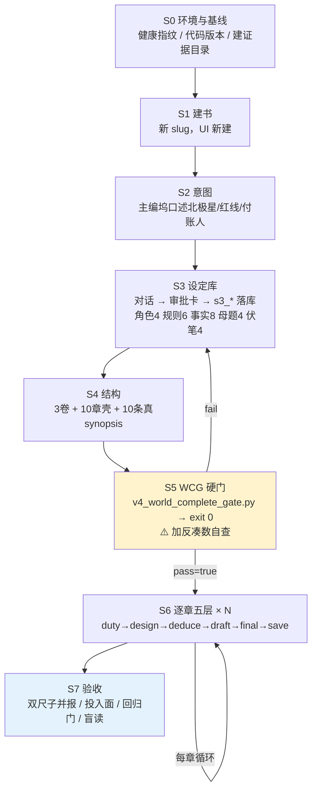
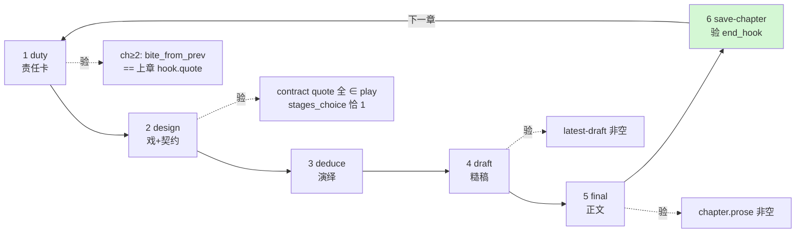

> **执行附记（2026-08-21，不改方案正文）**
>
> - 本次先跑 **N=1**，过了再跑 N=3。
> - 建书走作品库新建（`POST /api/works`，与点新建同一条路）。设定走主编坞 → 编排 → 审批卡 → `s3_*`，禁止直接调写入接口凑库。
> - 方案原文按 `a94ebe65` 写「写第N章正文」会绕开五层；**当前代码**里这句话会进「写这一章」五层。本次写章仍用方案推荐话术：点名 `duty` / `design` / `deduce` / `draft` / `final` 层，每层等审批卡。
> - 章梗概：MCP 里旧大纲写入已废。十条真梗概按稿纸改章信息同一条路写入（不是 `s3_add_*` 直灌）。

# 真人建书 workflow v1.0

> 目标：**模拟真人作者从零建一本书并写 N 章**，用真实操作路径验证系统，而不是用压测脚本一键 seed。
> 基准代码：`a94ebe65`（playbook.3.2.2）｜宇宙：《万界概率战争》V7.5
> 前序教训：\[\[2026-08-21-v634验收方案元审查-方案很好为什么还是漏了]]（本方案内建其 M1-M5 补丁）

***

## 零、这份方案为什么必须存在

上一轮验收的根本失效是：**用 `v634_live_run.py` 假书脚本建书**，它的 `pad(s, n)` 把每个字段用一句废话凑到 WCG 的字数门槛（`synopsis.ge40chars` ↔ `pad(syn, 40)` 精确对位）。gate 亮绿，垃圾种子入库，写章全程吃垃圾。

**本方案的第一性原则：种子必须是人写的真内容，且落库路径必须是真人通道。**
凑字数的种子 = 本次验证作废，不是"轻微瑕疵"。

***

## 一、五条铁律（违反即本次验证作废）

| #      | 铁律                                                                                                                                              | 理由                            |
| ------ | ----------------------------------------------------------------------------------------------------------------------------------------------- | ----------------------------- |
| **R1** | **禁止 `pad` / 禁止凑字数**。任何字段写不满门槛，就把内容想清楚再写，不许拿模板句填充                                                                                               | Goodhart：门槛一旦可凑，验证即失效         |
| **R2** | **设定必须走真人通道落库**：主编坞发话 → `world_write` resolve → **审批卡点批** → `s3_*` 写入。**禁止 curl 直接调 `s3_add_*` 冒充作者**                                           | 协议原文明令；也是验证"作者通道"本身           |
| **R3** | **写章严格按 OpSeq 五层顺序**：duty → design → deduce → draft → final，一层冻结再进下一层，**每层 `persist=true`、每层必传 `focalizer`**。**写章同样走主编对话触发（见 S6 通道辨析），不是 curl** | 乱序/persist=false 会产生空稿与断钩     |
| **R4** | **每章定稿后必须 `/save-chapter`**，确认 `end_hook` 非空，**再**开下一章                                                                                          | 上章无 hook → 下章 `duty_bite` 无咬源 |
| **R5** | **新建 slug，不续写旧书**                                                                                                                               | 旧书带旧代码病痕，混批无法归因               |

***

## 二、参数：章数 N

```
N = 要写正文的章数（1 ≤ N ≤ 10）
```

**关键区分**（很多人在这里做错）：

| 项          | 是否随 N 变化        | 说明                                                          |
| ---------- | --------------- | ----------------------------------------------------------- |
| 卷数         | ❌ **固定 3 卷**    | WCG 硬门 `volumes.ge3`                                        |
| 章壳数        | ❌ **固定 10 章**   | WCG 硬门 `chapters.ge10`                                      |
| 章 synopsis | ❌ **固定 10 条全写** | WCG 硬门 `synopsis.ge40chars.ge10` + `mentions_character.ge8` |
| **写正文的章数** | ✅ **= N**       | 只有这一项由 N 决定                                                 |

即：**无论写几章，都要先把 3 卷 + 10 章壳 + 10 条真 synopsis 建全**，这是开写的前置门。第 N+1 到第 10 章保持"有壳无正文"状态。

### 推荐档位

| N      | 用途            | 预计耗时     | 能验到什么                     |
| ------ | ------------- | -------- | ------------------------- |
| **1**  | 冒烟 / 改动后首验    | 30-60 分钟 | 五层跑通、上游引导是否喂到、单章质量        |
| **3**  | **标准验收批（推荐）** | 2-4 小时   | 跨章承接（钩子/POV/物件/限知）、章间同质检测 |
| **5**  | 协议完整批         | 4-8 小时   | 卷内完整弧线、伏笔到期回响             |
| **10** | 全书压力批         | 1-2 天    | 跨卷承接、成书感                  |

**建议先跑 N=1 确认链路，再跑 N=3。** 直接上 N=3 若首章就断，浪费 3 倍时间。

### 卷章归属（固定）

| 卷           | 章    | 卷责                     |
| ----------- | ---- | ---------------------- |
| 卷一 **囚笼**   | 1-4  | 大遮蔽之下，柳岸青从隐瞒体温到被迫动用双权柄 |
| 卷二 **泄露**   | 5-7  | 屏障击穿，融合点爆发，各方下场抢夺定义权   |
| 卷三 **第三条路** | 8-10 | 在燃烧与冷聚变之外，试出联邦式飞升      |

***

## 三、执行流程总览



***

## 四、逐阶段执行细则

### S0 · 环境与基线

**动作**

1. 记录云端进程指纹：`GET /api/health` → `changefeed.started_at`
2. 记录代码版本：`git log -1 origin/main`、`PLAYBOOK_VERSION`
3. 建证据目录 `artifacts/humanrun-<日期>-<slug>/`

**判据**：进程启动时间 **晚于**最新提交时间（否则跑的是旧代码，整批作废）。

**留证**：`00-baseline.json`（health 原文 + commit hash + playbook 版本）

***

### S1 · 建书

**真人动作**：浏览器登录 → 作品库 → 新建作品

* 书名：`万界概率战争·真人建书·N{章数}·YYYYMMDD-HHMM`

* **必须新 slug**，记下 `book_xxxxxxxx`

**判据**：`GET /api/works` 能看到新 slug；`GET /api/chapters?work=...` 返回空列表（干净起点）。

***

### S2 · 意图（北极星）

**真人动作**：在主编坞用**自己的话**说清这本书要什么。不要粘贴设定集原文——那是资料，不是意图。

发话示例（照抄可用，但更推荐自己改写）：

> 我要写《万界概率战争》。读完这本书，读者要留下的是：**保护和监禁原来是同一件事**——月球给地球挡住了宇宙的噪音，代价是把所有人钉死在一种现实里。主角柳岸青身上带着两套互斥的权柄，他每用一次，就要用自己的体温付账，付出去收不回来。
> 情感弧：从隐瞒体温，到被迫按回碎片，再到欠下一笔还不起的账。
> 红线三条：不美化把人当观测样本这件事；不让柳岸青看见场核坐标；不提前拆穿炉认主与帝的真名。
> 付账的人是柳岸青，付的是四十二度体温和倒计时。
> 全书目标 45000 字。

**系统应发生**：出现 `s3_set_intent` 审批卡 → 批准 → intent 落库。

**判据**（`GET /api/intent?work=...`）：

* `north_star` 非空（**3.2.2 新字段，这是写章时模型能看见的全书方向**）

* `reader_feeling` ≥10 字、`emotional_arc` ≥4 字、`red_lines` ≥3 行

* `total_word_goal` ∈ \[40000, 60000]

**留证**：`01-intent.json` + 审批卡截图

> ⚠️ **反凑数自查**：把 `north_star` 念一遍——它是否具体到"这本书"而不是任何小说都能套？能套 = 重写。

***

### S3 · 设定库（本阶段最重，也最容易偷懒）

**真人动作**：在主编坞分批对话录入。**每批说清一件事，等审批卡出来批准，再说下一批。**

分批建议（第五节提供全部内容，可照抄发送）：

| 批次 | 内容                 | 目标工具                        | WCG 对应                                                      |
| -- | ------------------ | --------------------------- | ----------------------------------------------------------- |
| B1 | 4 个主要角色（每人六字段）     | `s3_add_character`          | `characters.count>=4` + `codex_full>=4` + `has_protagonist` |
| B2 | 角色关系 ≥3 条          | `s3_add_character_relation` | `relations.ge3_or_graph_edges`                              |
| B3 | 世界规则 6 条（每条带代价）    | `s3_add_world_rule`         | `world_rules_or_propositions.ge3`                           |
| B4 | 事实 8 条             | `s3_add_fact`               | `facts.ge5_or_graph`                                        |
| B5 | 势力 3 + 物件 3 + 术语 5 | `s3_add_faction/item/term`  | `faction_item_term.two_categories`                          |
| B6 | 母题 4 条             | `s3_add_motif`              | `motifs.ge3`                                                |
| B7 | 伏笔 4 条             | `s3_plant_promise`          | `promises.ge3`                                              |

**判据**：每批都要看到**审批卡**并点批准；批准后用只读接口回读确认落库。

**留证**：`02-codex-<批次>.json` + 每批审批卡截图

> ⚠️ **反凑数自查（R1 落地）**：
>
> * 每个角色的 `personality_detail` / `backstory` 必须是**具体的人**，不是形容词堆砌
>
> * 任意两个角色的字段不得雷同
>
> * 每条 world\_rule 必须写明**代价**（"能做什么"容易写，"付什么"才是真规则）
>
> * **自测**：把任一字段的角色名遮住，还能认出是谁吗？认不出 = 没写具体

***

### S4 · 结构（3 卷 + 10 章壳 + 10 条真 synopsis）

**真人动作**：主编坞发结构指令（内容见第五节）。

**判据**：

* `volumes` ≥3，每卷 `intro` 是真卷责（非重复句）

* `chapters` ≥10，每章有 title

* **10 章 synopsis 各 ≥40 字、互不相同、≥8 章含角色名**

> ⚠️ **这一步是上次翻车的原点**。`synopsis.ge40chars` 就是 `pad(syn, 40)` 攻击的那个门。
> **自查命令**（M1 补丁的手动版）：把 10 条 synopsis 放一起，检查
> ①有无同句重复 ②有无两条雷同 ③剥掉套话后是否仍 ≥40 字

**留证**：`03-structure.json`（卷+章+synopsis 全文）

***

### S5 · WCG 硬门

```bash
export API_BASE=https://tonglu.example.com
python3 scripts/v4_world_complete_gate.py --slug book_xxxxxxxx \
  --out artifacts/humanrun-.../04-world-complete-gate.json
# 必须 pass=true / exit 0
```

**判据**：`pass=true` 且 `exit 0`。

**⚠️ 附加自查（M1 补丁，脚本还没做，必须人工）**：gate 通过后，再做一遍反凑数检查——

* 所有 synopsis 两两比对，雷同 ≥3 条即视为 FAIL（即便 gate 绿）

* 所有角色字段查同句重复，出现 ≥2 次重复即 FAIL

**gate 绿 + 反凑数自查通过，才允许开写。**

***

### S6 · 逐章五层（循环 N 次）

#### ⚠️ 先读：写章的三条通道，说错话就跑错管线

**前端 UI 上没有任何“跑五层”的按钮**（`generate-stage` 在 web 源码里零调用点）。真人只能靠对话触发，而路由结果取决于你怎么说（代码锚：`web/src/lib/hermesRunIntent.js`）：

| 你在主编坞说的话                                             | 命中的路由规则                                                       | 实际跑什么                                             | 能不能当五层验收              |
| ---------------------------------------------------- | ------------------------------------------------------------- | ------------------------------------------------- | --------------------- |
| 「写第3章**正文**」「续写」「润色」                                 | `PROSE_GENERATION_WORDS`（正文/草稿/续写/润色/写本章…）→ **prose\_write**  | `/chat/write` 出提案卡，点“用此版”落中区。**完全不走 playbook 五层** | ❌ **不行**              |
| 「跑第3章的 **duty 层**」「给第3章立责任卡」「用 `s3_generate_stage`…」 | `WORLD_WRITE_FORCE`（含 `s3_[a-z_]+`）或层名/工具名 → **world\_write** | 审批卡 → MCP `s3_generate_stage` → **五层管线**          | ✅ **推荐**              |
| 主编驾驶模式                                               | `pilot_actions` → `run_stage(persist=True)`                   | 五层管线，但只绑了 design/deduce/draft 三个动作                | ⚠️ 部分（duty/final 不在内） |

> **这是本方案最容易做错的一步。** 真人最自然的说法「写第3章」，恰恰是唯一**不跑五层**的那条路——`hermesRunIntent.js` 注释里写得很明白：「先排除散文生成，避免误路由到需要审批的 Hermes Run」。
> **推荐话术（每层一句，点名层名）**：
>
> * 「主编，给第 1 章跑 **duty** 层，焦点者 role:柳岸青，落库。」
>
> * 「第 1 章 **design** 层，同样落库。」（deduce / draft / final 同式）
>   每句都应出现**审批卡**，批准后才算执行。没审批卡 = 走错通道了，重新措辞。

> **记一条产品缺陷（不影响本次执行）**：作者必须反常地说出内部层名才能触发核心管线，自然语言「写第3章」反而绕过它。写进 `21-defect-ledger.md`。

#### 执行顺序

对第 `seq` 章，**严格按序**，每层 `persist=true`、每层传 `focalizer=role:柳岸青`：



**每层的层内判据**

> 下表的 `POST /generate-stage` 是**审批卡批准后系统实际执行的动作**（用于核验与回读），**不是让你 curl 发起**。真人一侧始终是主编对话 + 点批。

| 层      | 审批卡批准后应发生的动作                                                      | 通过判据（只读回读）                                                                                    |
| ------ | ----------------------------------------------------------------- | --------------------------------------------------------------------------------------------- |
| duty   | `POST /generate-stage stage=duty persist=true focalizer=role:柳岸青` | `GET /chapters/{n}/duty` 五字段非空；ch≥2 的 `bite_from_prev` 字面等于上章 hook.quote                      |
| design | 同上 `stage=design`                                                 | `play` 非空且 400-900 字；`contract` 每个 quote 字面 ∈ play；`stages_choice` 恰 1 个 true；`hook.quote` 非空 |
| deduce | `stage=deduce`                                                    | `chapter_deduce` 冻结，五层限知齐全                                                                    |
| draft  | `stage=draft`                                                     | `GET /latest-draft` 非空且 ≥2000 字                                                               |
| final  | `stage=final`                                                     | 法官 PASS；`GET /chapters/{n}` 的 `prose` 非空                                                      |
| save   | `/save-chapter`                                                   | `narrative_drive.end_hook` 非空                                                                 |

**⚠️ 每章必做（M3 投入面验收，这是本方案相对旧协议的关键增项）**：

> **2026-08-21 升级**：日志方案落地后（提交 `583bd1ac`/`d2939ff0`），投入面**不再靠读应用日志或猜**——每层生成前的真实 prompt 已作为 `kind=prompt` 的 artifact 落库，可直接查。

在 duty 层跑完后，立刻核验模型**到底看见了什么**（三选一，优先第一种）：

```bash
BASE=https://tonglu.example.com
# 【首选】直接查这一层的投入 artifact（生成前渲染的真实 prompt，脱敏截断 4000）
curl -sS -b $JAR "$BASE/api/debug/pipeline-artifacts?work=$SLUG&kind=prompt&limit=10"
#   → 找 name=duty.in.1，读 body：里面必须能看到「卷纲」「北极星」「本章责」「相关设定」四栏有真内容
# 【备选】看这一层的产物 artifact（JSON 全文，不再是空 body）
curl -sS -b $JAR "$BASE/api/debug/pipeline-artifacts?work=$SLUG&trace_id=$TID"
#   → duty.out.1 / contract.out.1 现在应有 JSON 全文（旧版本这里 body=0，是记录缺陷不是生成缺陷）
# 【兜底】build_ctx 抛错时走 soft_fail，查 upstream_guide 事件
curl -sS -b $JAR "$BASE/api/debug/pipeline-events?work=$SLUG&trace_id=$TID" | grep -i guide
```

**断言（双重）**：

1. **投入非空**：`duty.in.1` 的 body 里，「卷纲」「北极星」「本章责」「相关设定」四栏**均不是「（无）」**。这是比"字段长度>0"更强的判据——直接看模型眼前的字。
2. **产物非空**：`duty.out.1`/`contract.out.1` 的 body **有 JSON 全文**（若为空 0 字，先分清是"记录缺陷"还是"生成缺陷"——查 `summary` 与 span 的 `actual`：`actual=empty` 才是真没生成，`actual=present` 但 body 空是记录 bug，应已被 583bd1ac 修掉）。

任一栏为「（无）」→ **立即停止本批**，这意味着上游引导没喂进去，后面写得再好也是瞎写。记缺陷台账并对照 \[\[2026-08-21-上游引导断链根因分析与修复spec]]。

**留证**（每章一套）：
`10-ch{n}-duty.json` / `11-ch{n}-play.json` / `12-ch{n}-contract.json` / `13-ch{n}-deduce.json` / `14-ch{n}-draft.txt` / `15-ch{n}-final.txt` / `16-ch{n}-state.json` / `17-ch{n}-traces.json` / **`18-ch{n}-ctx-lens.json`（投入面证据）**

**失败处置**

| 现象                      | 处置                                                |
| ----------------------- | ------------------------------------------------- |
| 某层 8 轮不过（`needs_human`） | **停，不要外层重发**。记录 `fail_reasons`，人工判断是种子问题还是系统问题    |
| 卡住超过 15 分钟无产出           | 查 traces；若是外层重发导致的空转，**手动终止**（内层熔断是 8 轮，外层重发会绕过它） |
| 已冻结层                    | SKIP，从第一个未冻结层继续                                   |
| 要重拍整章戏                  | 仅 design 层允许 `rewrite=1`                          |

***

### S7 · 验收（四类元判据全上）

#### C-Must 机器项（**双尺子并报**，M2 补丁）

每章都要报**两个数**，差异 >3 倍即为发现：

| 指标  | ①系统闸口径                       | ②独立真口径                            | 判据                     |
| --- | ---------------------------- | --------------------------------- | ---------------------- |
| 对白  | `dialogue_ratio`（含引号整行/全文）   | **真对白**：引号内 ≥3 字的字数占比 + **句数/千字** | 真口径 ≥8% **且** ≥3 句/千字  |
| 比喻  | `simile_density`（数"像/仿佛/似的"） | **裸接喻体**人工清点（喻体名词短语无喻词直接撞主句）      | 合计 ≤1.0/千字             |
| 装腔  | `check_syntax_tics`          | 否定翻转"不是X是Y"密度                     | ≤0.5/千字                |
| 节奏  | `sentence_rhythm`            | **加报独立成段短句占比**                    | 独立短段 ≤20%（超过说明用排版伪装节奏） |
| 重复率 | `draft_play_overlap`         | —                                 | ≤15%                   |
| 拖沓  | （系统无）                        | **事件节点数** + 同一名词千字出现次数            | 每章 ≥2 个事件节点；单名词 ≤12/千字 |

#### C-人评（**先盲读后看数**，M4 补丁）

**强制顺序**：读者在**没有看到任何机器指标**的情况下先读完 N 章，写下三个答案，提交后才允许看 C-Must 表。

1. 这一章推进了几件事？（只有一件就写一件，不要把一件事的过程算成三件）
2. 这一章有几个人说话？说了几句？
3. 读完想不想翻下一页？

**红旗**：任一章"只推进 1 件事"或"少于 3 句对话"→ Wave C 不过。

#### 回归门（M5 补丁）

与上一批并排，任一项退步 >30% 即不过（除非在缺陷台账写明是有意变更）：

| 指标       | 上批基线（book\_0786fff6 ch1） | 本批 |
| -------- | ------------------------ | -- |
| 真对白占比    | 0.53%                    | ?  |
| 真对白句数    | 2 句                      | ?  |
| 裸接喻体密度   | 5.67/千字                  | ?  |
| 事件节点数    | 1                        | ?  |
| 独立成段短句占比 | 43%                      | ?  |

#### 文学对照（可选但推荐）

与《乱世铜炉》同题材章节并排：真对白 31%/60 句、独立短段 8%、比喻 0.55/千字。

**留证**：`20-acceptance.md`（三张表全填）+ `21-defect-ledger.md`（所有发现）

***

## 五、种子内容包（照抄可用 · 全部真内容 · 零填充）

> 用法：在主编坞**分批发送**，每批等审批卡出现并批准后再发下一批。
> 这些内容是从《万界概率战争》V7.5 设定集**转译**的——设定集是物理论文，这里是**能长出戏的人和账**。
> 你可以改写，但**不要退化成术语堆砌**：系统需要的是"谁要什么、付什么代价"，不是"什么是 U(1) 规范场"。

### B1 · 四个角色

> 主编，先把四个人立起来。

**柳岸青（主角）**

* 外形：二十七八，黑发湿贴额角，右手腕内侧一片旧烫疤，疤下皮肤会自己发烫。冬天也只穿单衣，因为体温是他唯一的余额。

* 性格细节：算账算得极细，付出去之前反复掂量，一旦决定就不回头。不解释自己，别人误会他也不辩。对疼痛的忍耐力高得反常，因为他从小就在拿身体换东西。

* 表层目标：在成核点扩开之前，把场核碎片按回裂口。

* 深层需要：证明自己不是一个会把身边人变成观测样本的东西。

* 恐惧：怕自己一睁眼看谁，谁就被"钉死"成一条档案里的条目。

* 前史：三年前大泄露那夜他在华山北峰，双权柄第一次共振，击穿了月球矩阵的屏障。从那天起他的体温开始被计价，腕内浮出倒计时。他母亲还活着，代价是他每年少一点体温。

**沈烛（重要）**

* 外形：灰袍档案员，四十上下，指腹常年沾着炭灰，眼底不热。

* 性格细节：把人当条目，说话像在念卷宗。不撒谎，但会只说一半。他不是冷酷，是觉得档案比人活得久，所以对档案更客气。

* 表层目标：切断柳岸青与场核的观测耦合。

* 深层需要：让档案保持干净——一条被改写过的记录，比一个死人更让他难受。

* 恐惧：怕意识之海改写档案，让"发生过的事"变成"从没发生"。

* 前史：守火人档案局最后一批亲手抄录的人。他抄过柳岸青那夜的原始记录，也是他把那份记录锁进了金縢。

**兰因（重要）**

* 外形：青灰布衣，袖口盖住腕子，走路脚步不紧不慢，背永远是直的。

* 性格细节：话极少，说出口就是账。不劝人，也不拦人——她只在旁边看，看完把结果说出来。她的克制不是冷淡，是她见过太多被劝住的人后来更惨。

* 表层目标：把相位锚焊在还能走的人身上，保住一条撤退通道。

* 深层需要：想有一次不是"看着别人付账"，而是自己付。

* 恐惧：怕她焊上的锚，最后成了别人逃不掉的枷。

* 前史：普罗米修斯同盟的相位锚工程师。同盟的规矩是"民用穿越器必须有人活着回来"，她送出去过十一个人，回来三个。

**赫斯（重要）**

* 外形：神权祭司的黑袍，令牌贴在掌心，掌纹被令牌烫出了印。

* 性格细节：礼数周全，笑得很得体，但每句话都在报价。他不憎恨任何人——交差比理解更要紧，这让他比恨更难对付。

* 表层目标：用令牌锁定柳岸青，带走交差。

* 深层需要：证明自己不只是买办，而是能看懂这场战争的人。

* 恐惧：怕令牌熄火——令牌一灭，他在天龙座那边就什么都不是。

* 前史：天龙座帝国在这一区的买办。他经手过三次"燃烧模式"的收割，每次都在场，每次都没动手。

***

### B2 · 关系（≥3 条）

> 主编，把他们之间的账记一下。

1. **柳岸青 ↔ 沈烛**：旧识，互相欠。沈烛锁走了柳岸青那夜的记录，等于替他挡了一次追查；柳岸青因此欠沈烛一件事，而沈烛想要的正是切断他的耦合。
2. **柳岸青 ↔ 兰因**：交易关系正在变成别的东西。兰因用相位锚换柳岸青的体温读数，两个人都清楚这不公平，谁也不提。
3. **赫斯 ↔ 柳岸青**：猎人与货。赫斯不急，他在等柳岸青自己把价开出来。
4. **沈烛 ↔ 兰因**：立场对立。档案局要封存，同盟要撤离，两边争的是同一批人。

***

### B3 · 世界规则（6 条，每条带代价）

> 主编，记六条这个世界的硬规矩，每条都写清楚代价。

1. **U(1) 铁律**：月球矩阵向地表持续辐射死光子，任何违背经典物理的波动会在极短时间内被环境"投票"否决。代价——想在地表用超常手段，必须先制造一小片不被观测的区域，而遮蔽本身就会留下痕迹。
2. **量子芝诺**：持续观测会把状态钉死。代价——被看得越紧的人越动不了；想改变，先得让人别看你。
3. **光子投票**：现实是得票最多的那个状态。代价——一个人对抗共识，要付出的不是力气，是把所有反对票都盖过去的观测量。
4. **拓扑锚定与场核**：每个概率场中心有一枚场核压舱，规则才稳。代价——场核动一下，整个场的物理常数跟着抖，住在里面的人先受反噬。
5. **五维能量守恒**：能量在动能、势能、热、概率、混沌五个维度之间转移，总量守恒。代价——凭空改概率是不存在的，改了这头，那头一定有人在付。
6. **穿越即重调制**：过融合点是把自己的波函数重新调制一遍。代价——调制失败有两种下场：肉体解体，或者记忆被覆盖成另一个人。

***

### B4 · 事实（8 条）

> 主编，把这几条已经为真的事记下来。

1. 月球不是天然卫星，是一台巨型概率调节器，制造并维持着太阳系内的多个概率场。
2. 土星北极的六边形风暴是运算核心的物理投影，负责控制太阳系内的熵与线性时间。
3. 三年前大泄露之后，全球出现了 164 个融合点，两个世界的坐标在那些点上强制对齐。
4. 修仙界与地球共享同一套三维坐标，靠波函数正交而互不感知；地球的珠峰对应修仙界的昆仑虚。
5. 地球上人口密集的城市，在修仙界往往是灵气枯竭的荒原——观测密度压制灵气流动。
6. 两种收割并存：天龙座要恐惧（量大质粗），安努纳奇要灵感（量小质纯）。
7. 三千年前周公"绝地天通"，物理上切断了地球与几何源代码层的直连，人类从此在宇宙雷达上隐形。
8. 柳岸青同时持有守望者与意识之海两套互斥权柄，成为一个自指的闭环——他不需要外部观测就能确定自己存在。

***

### B5 · 势力 / 物件 / 术语

**势力 3**

1. **守火人档案局**：切断异常耦合，保全档案完整。信条——记录比人活得久。
2. **普罗米修斯同盟**：民用穿越器必须有人活着回来。信条——先保通道，再谈胜负。
3. **天龙座买办处**：负责本区收割配额。信条——交差第一。

**物件 3**

1. **令牌**（赫斯掌心）：锁定坐标用，灭了就作废。
2. **相位锚**（兰因手里）：焊在人身上，能把人从塌陷的概率场里拽回来，但焊上就取不下来。
3. **金縢**（沈烛封存）：装着大泄露那夜原始记录的封印匣，未开箱。

**术语 5**
`大遮蔽` `成核点` `场核` `死光子/活光子` `概率灭活`

***

### B6 · 母题（4 条）

> 主编，记四个贯穿全书的母题。

1. **囚笼与摇篮**：同一层壳，向内是监禁，向外是保护。每次有人想拆它，都要先回答"拆了谁会死"。
2. **观测即暴力**：看一眼就把人钉死成一个样子。全书所有的"被看见"都是危险，所有的"没人看"都是自由也是孤独。
3. **账**：付出去就收不回来。这本书里没有奇迹回血，只有余额减少。
4. **冷与烫**：体温是货币。烫是还有得付，冷是快没了。

***

### B7 · 伏笔（4 条）

> 主编，埋四条线。

1. **肉体三年碳化的标价已经写在袖口**——柳岸青腕内的倒计时是谁标的价，标价的人想要什么。
2. **十八个月深渊碰撞仍在倒计时**——一个所有人都知道、但没人敢算清楚的期限。
3. **金縢因果封印还没开箱**——沈烛锁进去的那份原始记录，开箱那天会翻掉谁。
4. **柳岸青看不见场核坐标**——他身上带着场核，却是唯一看不见它在哪的人；兰因能看见。（**这条同时是禁拆穿项**）

***

### B8 · 结构：3 卷 + 10 章壳 + 10 条 synopsis

> 主编，建三卷十章。

**卷一《囚笼》（1-4）**：大遮蔽还罩着，柳岸青想瞒住体温过完这一年，但每一章都有人逼他动用权柄，账越欠越大。

**卷二《泄露》（5-7）**：屏障出现破口，融合点开始爆发，各方下场抢定义权，柳岸青从被追的人变成必须选边的人。

**卷三《第三条路》（8-10）**：燃烧和冷聚变之外，柳岸青试出第三种活法，代价是把自己变成那个动态开关。

| 章  | 标题     | synopsis（≥40 字，含角色名）                                           |
| -- | ------ | -------------------------------------------------------------- |
| 1  | 华山成核   | 华山北峰当夜，成核点开始扩开，柳岸青必须在把碎片交给沈烛换活路、和自己按回裂口暴露双权柄之间选一个，兰因在三步外看着不出手。 |
| 2  | 四十二度   | 柳岸青的体温被人标成了价格贴在墙上，沈烛提出切断他与场核的观测耦合，代价是那夜的记忆一并被切掉，他得决定认不认这个价。    |
| 3  | 金縢裂纹   | 沈烛封存的金縢出现裂纹，档案局要求提前开箱，柳岸青知道箱子一开就有人要翻掉，他必须选择现在开箱还是再欠一笔。         |
| 4  | 灭活边缘   | 灭活程序对准了整片街区，赫斯给柳岸青三分钟：把自己交出去，或者看着旁边的人被推出去顶数。                   |
| 5  | 牧场主出价  | 天龙座的牧场主亲自开价，要买柳岸青余下的全部体温，赫斯负责递合同，兰因第一次开口劝他别签。                  |
| 6  | 相位锚    | 兰因要把相位锚焊在还能走的人身上，名额只有一个，柳岸青得决定焊谁——焊上就取不下来。                     |
| 7  | 双向隐形破口 | 双向隐形出现单向破口，地球在宇宙雷达上亮了一瞬，柳岸青必须决定暴露哪一侧，沈烛要他暴露修仙界那侧。              |
| 8  | 信史改写   | 档案要被改写成另一个版本的那夜，沈烛来找柳岸青要原句，交出去他就再也没有证据证明自己做过什么。                |
| 9  | 衔尾蛇    | 因果咬住自己的尾巴，柳岸青看见自己三年前那一按的回声正在赶来，他必须切断其中一截，切哪一截都要死人。             |
| 10 | 波粒未决   | 第三条路还没落地，柳岸青必须在做回粒子（各自自由）和并进波（集体连接）之间先付一笔定金，兰因和沈烛站在他两侧。        |

> **synopsis 自查**：十条各不相同、都含角色名、都写清"谁必须决定什么"。
> 这就是反 pad 的正确姿势——**不是把句子写长，是把两难写清楚**。

***

## 六、证据包目录

```
artifacts/humanrun-<日期>-<slug>/
├── 00-baseline.json           进程指纹 + commit + playbook 版本
├── 01-intent.json             意图（含 north_star）
├── 02-codex-B1..B7.json       设定库分批落库回读
├── 03-structure.json          卷 + 章 + 10 条 synopsis
├── 04-world-complete-gate.json  WCG 结果（pass=true）
├── 04b-antipad-selfcheck.md   ⚠️ 反凑数自查记录（M1 手动版）
├── 10..17-ch{n}-*.{json,txt}  每章五层产物 + traces
├── 18-ch{n}-prompt-in.json   投入面证据：duty.in/play.in… artifact（kind=prompt）
├── 19-ch{n}-artifacts.json    产物面证据：*.out JSON 全文 + 丢弃段/帽记账
├── 20-acceptance.md           双尺子表 + 盲读表 + 回归表
├── 21-defect-ledger.md        缺陷台账
└── 99-screenshots/            审批卡等 UI 证据
```

***

## 七、常见失败与处置

| 现象                                            | 判断                                                 | 处置                                                                           |
| --------------------------------------------- | -------------------------------------------------- | ---------------------------------------------------------------------------- |
| 只有对话气泡，没有审批卡                                  | 走的是 discuss 通道，设定没落库                               | 把话说得更像**指令**（"记一条世界规则：…"），或用"让主编写…"种子触发                                      |
| **写章时出的是提案卡而非审批卡，且直接出正文**                     | **误入 prose\_write 通道**（说了"正文/续写/写本章"等词），**五层根本没跑** | 弃用该产出（不得当验收）；重新按层名措辞：「给第 N 章跑 duty 层…落库」。核验：`GET /chapters/{n}/duty` 是否真有产物  |
| **审批卡出了但层名不对**（说 duty 却跑了 design）             | 意图识别偏差                                             | 拒绝该卡，改用工具名明说：「用 s3\_generate\_stage，seq=N，stage=duty，persist=true」           |
| WCG 报 `synopsis.ge40chars` 不过                 | 某章梗概不够 40 字                                        | **补内容不补字数**——把该章的两难写清楚，自然就够                                                  |
| WCG 绿但自查发现雷同                                  | pad 型污染                                            | **判 FAIL**，回 S4 重写；gate 绿不豁免                                                 |
| duty 层投入 artifact（duty.in.1）的卷纲/北极星栏为「（无）」    | 上游引导没喂到                                            | **立即停批**，系统缺陷非内容问题，记缺陷台账                                                     |
| 产物 artifact（duty.out/contract.out）body 为空 0 字 | 先分清记录缺陷 vs 生成缺陷                                    | 查 span 的 `actual`：`present` 但 body 空=记录 bug（583bd1ac 已修，若重现记回归）；`empty`=真没生成 |
| 某层 8 轮 needs\_human                           | 内层熔断已触发                                            | **不要外层重发**（会绕过熔断造成空转），人工判因                                                   |
| ch≥2 的 `bite_from_prev` 对不上                   | 上章没 save-chapter 或 hook 为空                         | 回上章补 save，验 `end_hook` 非空再继续                                                 |
| 某章跑了 15 分钟没动静                                 | 疑似外层重发空转                                           | 查 traces 的重发次数，手动终止                                                          |

***

## 八、与旧协议的差异（为什么这套能验出上次没验出的）

| 维度   | v6.3.4 旧协议                    | 本 workflow                                                    |
| ---- | ----------------------------- | ------------------------------------------------------------- |
| 建书方式 | 允许 `v634_live_run.py` 一键 seed | **只允许真人通道**，脚本 seed 直接作废                                      |
| 种子质量 | 靠 WCG 字数门槛                    | **提供全套真内容** + 反凑数自查（M1）                                       |
| 测量口径 | 禁止另写对照实现                      | **双尺子并报**，差异 >3 倍即为发现（M2）                                     |
| 输入验证 | 无                             | **每层查 `duty.in` artifact，四栏非「（无）」**（M3，日志方案落地后可直接查 prompt 全文） |
| 人评   | 机器全绿后主观投票                     | **先盲读后看数** + 三个量化问题（M4）                                       |
| 回归   | 只横向对照                         | **纵向回归门**，退步 >30% 不过（M5）                                      |
| 章数   | 固定 1-5                        | **N 可指定**，卷章壳固定不随 N 变                                         |

***

## 九、下一步建议

1. **先跑 N=1**，重点验三件事：审批卡通道是否通、WCG 是否在真内容下自然通过、**ctx-lens 四字段是否都 >0**（3.2.2 的核心修复首次真实检验）。
2. N=1 全绿后跑 **N=3**，重点验跨章承接与对话量（上批的致命伤）。
3. 若 N=3 的真对白仍 <8% 或事件节点仍为 1/章，说明"戏必须让人开口"这条 P0 尚未修复——那是系统的问题，不是本 workflow 的问题，应回到 \[\[2026-08-21-book\_0786fff6文学层重审-对话崩塌与描写灌水]] 的修复清单。

> 关联：\[\[2026-08-21-v634验收方案元审查-方案很好为什么还是漏了]]｜\[\[2026-08-21-写章全链流程图-mermaid全图集]]｜\[\[2026-08-21-playbook3.2.2实现度核验与写章全链流程图]]｜\[\[2026-08-21-上游引导断链根因分析与修复spec]]
