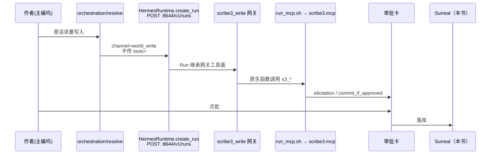
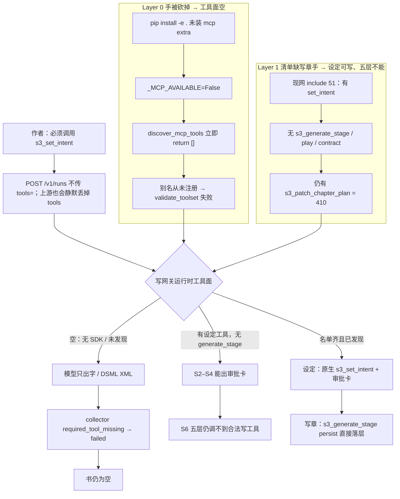
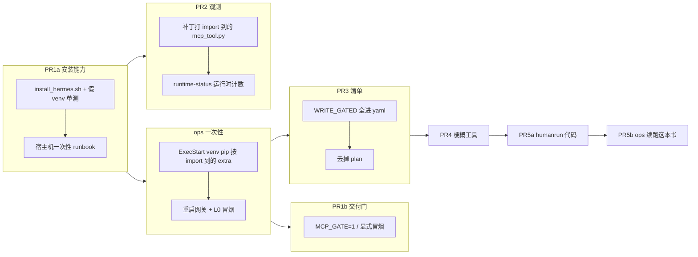

# 写网关的手被砍掉了：MCP SDK 缺失导致真人建书落不了库

| 项 | 值 |
|---|---|
| 状态 | Draft（已按审查修订） |
| 日期 | 2026-08-21 |
| 作者 | Grok（设计稿，未实施） |
| 受众 | 作者侧验收人 + 实现者 |
| 范围 | demo 写网关 `scribe3_write`（`:8644`）与真人建书通道；同一本书 `book_36177e20` 从意图起重跑 |
| 不实施 | 本文只定方案，不改代码、不改 demo 配置 |

---

## 先说人话

现在这本书已经建出来了，名字在，里面是空的。你在主编坞把北极星、角色、卷章原话交出去，主编只回一句「我先去调工具」，审批卡不出现，书里什么都没写进去。合同已经改过：只口头答应会判失败，不再假绿。但失败不等于写进去——手还是没动。

根因不是「模型笨」，更不是种子写得不好。第一刀砍在手上：demo 上负责改书的那只写网关，启动时要装一套叫 MCP 的工具库才能把「改书的手」伸出来。这套库在 Hermes 里是选装，装网关的脚本只做了基础安装，没装这套选装。结果是：配置文件里明明写了读工具、写工具，发现过程一看库不在就直接跳过，日志还写成调试信息，所以 `gateway.log` 里一个 mcp 字都没有。网关对外仍说自己活着，但这一轮能用的工具名单是空的。模型看不见可调的函数，只能把「正在调用」写成普通文字。假绿修好了，字还是进不了书。

第二刀在清单。就算把工具库装上，现网写网关挂着的仍是旧名单：设定类工具（登记意图、加角色、加卷加章）在；写章真正该用的「按层写这一章」、以及人工改戏/改契约的两把工具不在。还挂着一把已经报废的旧大纲工具，一调就是「这路没了」。仓库里的名单已经补上了「按层写」，但从来没有重新铺到这台正在跑的网关上。阶段网关（计划/草稿/演绎）更旧：有的只挂着那把报废工具。

第三层才是模型风险。现网写模型是 `deepseek-v4-flash-0731`，兜底还是同一只。有的模型会把调工具写成描述。这一层先别动。手先装上、清单铺上，若请求里已经有工具它还是只说话，再换会动手的模型。

改完你会看到：同一本还没写过的书，从「把北极星写进去」开始重跑。设定（意图、角色、卷、十个章壳、十条真梗概）走「说话 → 弹出审批卡 → 你点批 → 进书」。第一章按责任卡 → 戏 → 演绎 → 糙稿 → 定稿写完，存下来，章末还悬着钩子。**写章这五层不会每层再弹一张设定那种审批卡**：你发「写这一章」就是这一轮的授权，工具会把各层直接写进书。不要新做一排「写第 N 层」按钮；你说「写这一章」，编排已经会走完整五层。

风险：补工具库要重启写网关，中间几十秒到一两分钟不能写书，读和网页还在。装库可能和现有环境打架，所以先备份再装，不行就卸回去。铺名单时不要动你在面板里选的主模型。十条真梗概不能再走稿纸直接改——那条路现在被关掉了，要改成说话审批。日常热更网页后端**不会**因为写网关还没装好就整条红掉；缺手只禁止宣布「可以写书了」。若装完手当真还是不动，再换模型，那一步单独做、单独验。

怎样算做完：不是「脚本说成功」，是打开这本书能看到人写的意图和角色；第一章有正文、章末有钩子；设定每一步有审批卡，写章是你发话授权后写进书，没有人用命令直接往库里灌。先 N=1，绿了再 N=3。

---

## Overview

真人建书（`scripts/humanrun_wanjie.py`，铁律 R1–R5）要求：种子是人写的真内容；设定走主编对话 → `world_write` Hermes Run → 审批卡 → `s3_*` `commit_if_approved`。2026-08-21 在 demo 上新建 `book_36177e20`，书壳成功，意图/角色/卷章全部未落库。

本方案把故障拆成三层，**按层修，禁止把「换模型」当第一刀**：

1. **Layer 0（阻断全部写入）**：Hermes 共享 venv 没有 `mcp` 包 → `_MCP_AVAILABLE=False` → `discover_mcp_tools()` 立刻返回空 → 写 Run 的 `agent.tools` 为空。
2. **Layer 1（装上 SDK 后写章仍缺手）**：现网 include 未从 git `mcp_servers.yaml` 重新铺开；缺 `s3_generate_stage` / `s3_patch_play` / `s3_patch_contract`；仍挂已废的 `s3_patch_chapter_plan`（HTTP 410 / `stage_gone`）。
3. **Layer 2（潜伏）**：DeepSeek 可能只描述不调用。仅当 Layer 0+1 之后请求里已有工具且 `tool_turns` 仍为 0 时才换写模型。

产品边界不变：`scribe3/AGENTIC_BOUNDARY_DECISION.md`。**不**恢复 REST 表单直填当正典；**不**允许 humanrun `curl` `s3_add_*`；**不**新做五层 UI 按钮。

写章五层的产品授权级别钉死为 **Run 级**（见 Key Decision 14）：`s3_generate_stage` 今天没有 `_ask` / `commit_if_approved`，`persist=true` 时直接把该层写进书。本方案不把「每层一张审批卡」写进验收。

---

## Background & Motivation

### 当前产品路径（必须保住）

设定类写入（意图/角色/卷章/梗概）：



写章五层（`s3_generate_stage`）：同一条 Run 通道，但工具体内 **无** elicit；作者发「写这一章」= 这一轮授权，层结果直接落库。定稿后另走 `/save-chapter` 确认章末钩子。

关键约束写在 `scribe3/llm.py`：

```169:172:scribe3/llm.py
# 会改状态的长任务 Runs 走独立写 profile。Hermes Runs 不支持 per-run tools 裁剪,
# 工具面必须靠 gateway profile/platform_toolsets 隔离。
HERMES_RUNS = os.environ.get("HERMES_RUNS_API", "http://127.0.0.1:8644/v1")
HERMES_RUNS_PROFILE = os.environ.get("HERMES_RUNS_PROFILE", "scribe3_write")
```

`HermesRuntime.create_run`（`scribe3/hermes_runtime.py`）POST `/runs` **不带 `tools=`**。对比：`responses_events` 可以传 `tools=[{type:mcp,server_label}]` 或 `function_tools`。因此 **网关工具面空 = 所有写 Run 工具面空**。这是设计，不是漏传。

demo Hermes 0.20.0 `gateway/platforms/api_server.py` `_handle_runs` 只读 `input` / `instructions` / `conversation_history` / `session_id` / `model` / agent overrides，**没有** `body.get("tools")`。即便有人往 POST `/runs` 塞 `tools=`，也会被 **静默丢掉**，比 API 报错更危险。冒烟不得靠往 Run body 塞 tools 自证。

### 本次事故现象（已留证）

| 观察 | 证据 |
|---|---|
| 书已建、章列表空 | `artifacts/humanrun-20260821-book_36177e20/01-work.json`：`chapters: []`；`state.json`：`phase=s1` |
| 意图空 | `01-intent.json` 三个字段全空 |
| S2 重试假绿被拦住 | `run-S2-intent.json`：`status=failed`，`policy_violations: required_tool_missing / s3_set_intent`，`tool_calls: []` |
| 模型只出字 | `run_89462c1c...`、`run_eb647755...`：`Turn ended: reason=text_response(finish_reason=stop) model=deepseek-v4-flash-0731 tool_turns=0` |
| 写网关 17/17 轮零工具 | demo `~/.hermes/profiles/scribe3_write/logs/agent.log`：`tool_turns=` 17 次，全部 `=0` |
| 十条梗概 PATCH 403 | `03-synopsis-patch.json`：`REST world write disabled; use dialogue + MCP approval`（不是 404；中间件，不是章不存在） |

合同 `explicit_book_tool_contract`（`scribe3/run_stage_policy.py`）已经把「必须调用 s3_*」变成终态证据。**假绿已修；写入仍未发生。**

---

## Goals & Non-Goals

### Goals

- 找出并按层修复根因，使 `world_write` 在 demo 上能产生真实工具事件。设定批次与梗概要出审批卡；写章五层要真的把各层写进书（Run 级授权，见 KD-14）。
- Layer 0：Hermes **ExecStart 那个 venv** 可 `import mcp`；`_MCP_AVAILABLE is True`；写网关发现非空 MCP 工具。`install_hermes.sh` 与 `provision_hermes` 在缺 SDK 时失败。日常 `deploy_demo.sh hot` **默认不**因 MCP 红（见 KD-13）。
- Layer 1：从 git yaml 重新铺 include；去掉 `s3_patch_chapter_plan`；写/计划/草稿/演绎白名单含 `s3_generate_stage`，写与计划另含 `s3_patch_play`、`s3_patch_contract`；**保持** `WRITE_GATED <= write_inc`。
- 可观测：MCP 发现跳过必须是 ERROR；`/ai/runtime-status` 暴露运行时 `mcp_ok` 与 `mcp_runtime_tool_count`；`/health` 只附带短超时缓存字段，不翻转 DB `ok`。
- 梗概：扩 `s3_patch_chapter_meta` 走审批（签名测试、空串拒绝、catalog 关键词、elicit 列出字段）。
- 验收：同一本 `book_36177e20` 从 S2 起重跑 N=1；绿后再 N=3。playbook `playbook.3.2.2`；五层 `duty→design→deduce→draft→final` 写进书；S6 /「写这一章」调用 `s3_generate_stage` 时传入 `focalizer`（章上若已有则 `resolve_stage_focalizer` 回退）；然后 `/save-chapter` 且章末钩子非空。不要求 S4 建章就写下焦点者。

### Non-Goals

- 不把 REST 灌库 / `curl s3_add_*` 当验收通道（R2）。
- 不新增五层 UI 按钮。自然语言「写第 N 章」已由 `19fd3837`（`orchestration/catalog.py` domain `chapter.write`）进五层，只沿用。
- 不给 `s3_generate_stage` 新加每层 elicit（本方案不改成「五张卡」）。
- 不给 `s3_add_chapter` 加 `focalizer`。不把焦点者塞进 PR4 的 `s3_patch_chapter_meta`（该字段虽已在 `CHAPTER_META_ALLOWED`，留给以后，以免梗概 PR 膨胀）。
- 不以换模型作为第一修复。
- 不在 Grok 运行机 `npm ci` / 本机 Surreal / 全量测试。验证 = 打已部署 demo。
- 不在未说明时清空 demo 数据；续写同一本空书，不另开平行栈。
- 不把 MCP 门并进 `/ready` 或 `SCRIBE3_STRICT_GATEWAY_GUARD`。

---

## Root-cause stack（必须按层读，禁止拍扁成「模型傻」）



冒烟两级（不要混）：

- **L0：** `GET :8644/v1/toolsets` 非空，且一次 Run 对 `s3_set_intent` 产生 `tool.started`。
- **L1：** 运行时/include 含 `s3_generate_stage`、`s3_patch_play`、`s3_patch_contract`，且不含 `s3_patch_chapter_plan`。

### Layer 0 — 手被砍掉（阻断全部 `world_write`）

**2026-08-21 demo 只读复核（未改配置）：**

| 项 | 现网值 |
|---|---|
| 写网关 | systemd `hermes-gateway-scribe3-write` **active**；进程 cwd `/opt/scribe3-host/.hermes/profiles/scribe3_write`；监听 `172.18.0.1:8644`；pid `188206` 自 Aug14 |
| **ExecStart 解释器（唯一安装目标）** | `/opt/scribe3-host/.hermes/hermes-agent/venv/bin/python`（3.12.3） |
| Hermes 元数据版本 | **v0.20.0 (2026.8.3)** |
| 运行中的 `mcp_tool.py` | `/opt/scribe3-host/.hermes/src/hermes-agent-0.20.0/tools/mcp_tool.py` |
| clone 目录 | `~/.hermes/hermes-agent/`（**不是 git 仓库**；与运行时 src **不是同一份**） |
| src 树 extra（**安装钉死这份**） | `mcp==1.28.1` + `starlette==1.3.1`（`dev` extra 同样 1.28.1） |
| clone `pyproject.toml` extra（**不要抄**） | `mcp==1.26.0` + `starlette==1.0.1` |
| `src/.../venv` | **不存在** — 禁止 `cd` 进 src 后跑 `./venv` |
| `import mcp` | `ModuleNotFoundError: No module named 'mcp'` |
| `_MCP_AVAILABLE` | **False** |
| `gateway.log` 含 mcp | **0** |
| 症状日志 | `errors.log` Hermes #38798：`unknown name(s): scribe3_read, scribe3_write` |
| 配置仍写着 MCP | `platform_toolsets.api_server: [scribe3_read, scribe3_write]`；`mcp_discovery_timeout: 10.0`；`tool_use_enforcement: true`；command=`/opt/scribe3/app/scribe3/run_mcp.sh` |

因果链：

1. `_MCP_AVAILABLE=False` 时 `discover_mcp_tools()` 立刻 `return []`，debug 日志 `"MCP SDK not available -- skipping MCP tool discovery"`。现网 `gateway.log` 零命中 mcp。
2. 网关启动用 executor 调发现；异常只 `logger.debug`。stdio 的 `run_mcp.sh` **从未 exec**。
3. MCP 服务器名在发现成功并 `register_toolset_alias` 之前 **不是** 原生 toolset。
4. 发现没跑 → 别名不存在 → `validate_toolset("scribe3_write")` 为假 → `agent.tools` 空。
5. `tool_use_enforcement: true` 包在 `if agent.valid_tool_names` 里，空名单 = 强制调用也不发生。
6. #38798 是症状，第一因是 `_MCP_AVAILABLE=False`。

安装脚本漏洞：`deploy/prod/scripts/install_hermes.sh` `pip install -e .`，没有 `.[mcp]`。provision 失败被 `|| true` 吞掉。`scripts/deploy_demo.sh` hot 只热更 backend 容器。

现网健康检查假绿：`hermes_status._hermes_profile_config_summary` 数 **yaml include 行数**（51），运行时工具数是 **0**。

### Layer 1 — 清单与现网漂移（SDK 装上之后设定可写、写章不能）

**git** `scribe3/deploy/hermes/mcp_servers.yaml`（`scribe3_write.include`）：含 `s3_set_intent`、`s3_generate_stage`、`s3_save_chapter_draft`、`s3_patch_chapter_plan`。**不含** `s3_patch_play`、`s3_patch_contract`、`s3_add_arc_beat`、`s3_delete_arc_beat`。

**demo 正在跑的 profile config：**

| profile | write include | `s3_generate_stage` | play / contract | 已废 `s3_patch_chapter_plan` |
|---|---|---|---|---|
| `scribe3_write` | 51 | 无 | 无 | 有 |
| `scribe3_plan` | 2 | 无 | 无 | 有 |
| `scribe3_draft` | 2 | 无 | 无 | 有 |
| `scribe3_deduce` | 1 | 无 | 无 | 有 |

`/opt/scribe3/app` yaml 已是 53 项（含 `s3_generate_stage`），仍无 play/contract。**代码目录新了，Hermes profile 没铺。**

含义（三态，勿当成「工具面仍空」）：

- Layer 0 修好后，**设定批次**（现网 51 里已有 `s3_set_intent` / `s3_add_character` / 卷章）能出审批卡。
- **写章五层不能**：合法写工具 `s3_generate_stage` 现网写/计划/草稿/演绎 **都不挂**。
- play/contract git 与现网都缺。`PLAN_SCAFFOLD_ALLOWED_TOOLS` 已点名，include 物理上没有。
- `s3_patch_chapter_plan` 固定 410 / `stage_gone`。

`test_whitelists_match_mcp_reality` 声称 `WRITE_GATED <= write_inc`。今天就会红：`WRITE_GATED` 含 play/contract/generate_stage/save_draft/arc_beat，yaml 不全。部署路径从不跑它，所以没挡住事故。**本方案保留这条硬门，不改成窄集。** 缺的工具进 yaml；已废的 plan 从 `WRITE_GATED` 和 include 两边拿掉。

`scribe3/tests/test_mcp.py` 的 `EXPECTED_WRITE_GATED` 已与 `_common.py` 漂移（缺 play/contract/generate_stage/save_draft）。`test_structure_write_mcp.py::test_patch_chapter_plan_in_write_gated` 仍断言 plan ∈ `WRITE_GATED`。PR3 必须一起改。

### Layer 2 — 模型风险（不是第一因）

现网写模型 `deepseek-v4-flash-0731`，fallback 同一只。`tool_use_enforcement: true` 在 Layer 0 下不注入。**先不要换主模型。**

### 次生：十条梗概的路是真断的

HTTP 正文是世界写中间件 403，不是 404。即使十个章壳以后建出来，`PATCH /api/chapters/{n}` 照样 403。`s3_patch_chapter_meta` 文档写明不改 synopsis；store 白名单 `CHAPTER_META_ALLOWED` **已经含** `synopsis`。humanrun v7.5「稿纸 PATCH」与 2026-07-22 L1 冲突。缺陷台账 D3 应改为「世界写中间件」，不是「章还不存在」。

---

## Proposed Design

### 总原则

1. **先接手，再补清单，最后才考虑换模型。**
2. **缺手禁止宣布可写**；日常 backend hot **默认不**被 MCP 探针锁死。
3. **正典写通道只有对话 + 审批（设定）或对话 + Run 级授权（五层）。** 不灌库。
4. **验证打已部署 demo。** 备份 venv → 用 ExecStart 的 pip 装包 → 重启网关 → L0 冒烟 → 再铺名单 → 同一本书从 S2 续跑。



### Fix Layer 0 — 装进 systemd ExecStart 那个 venv

**唯一配方（demo 一次性，禁止 cd 进 src 跑 `./venv`）：**

```bash
VENV=/opt/scribe3-host/.hermes/hermes-agent/venv
PY="$VENV/bin/python"
PIP="$VENV/bin/pip"

# 备份
cp -a "$VENV" /opt/scribe3-host/.hermes/hermes-agent/venv.bak.<ts>

# extra 以「这个解释器 import 到的树」为准，不要抄 clone
# 现网应解析到 ~/.hermes/src/hermes-agent-0.20.0/pyproject.toml
# extra mcp==1.28.1 starlette==1.3.1
SRC="$("$PY" - <<'PY'
import pathlib, hermes_cli
print(pathlib.Path(hermes_cli.__file__).resolve().parents[1])
PY
)"
# 若 hermes_cli 定位失败，退回：
#   "$PY" -c "import tools.mcp_tool as m, pathlib; print(pathlib.Path(m.__file__).resolve().parents[1])"

# 只按 extra 钉死的包装进正在跑的 venv，不要再 pip install -e . 改 editable 指向
"$PIP" install 'mcp==1.28.1' 'starlette==1.3.1'

"$PY" -c "import mcp; from tools.mcp_tool import _MCP_AVAILABLE; assert _MCP_AVAILABLE is True"
```

版本以实施当天 `pyproject.toml` 的 `[project.optional-dependencies] mcp` 为准。上表 1.28.1 是 2026-08-21 运行时 src 树的值；clone 的 1.26.0 **不要用**。

**不要** `cd "$SRC" && ./venv/bin/pip …`：`src/hermes-agent-0.20.0/venv` 不存在。

**新机 `install_hermes.sh`：**

- 克隆后记录/钉 Hermes git ref（`git rev-parse HEAD` 写入部署说明），避免 GitHub 默认分支 ≠ 这台 demo 的 0.20.0 src 树。
- `pip install -e ".[mcp]"` 用 **当时 clone 的 extra**（新机 clone 即运行时）。
- **这台 demo 的一次性修复不要重新 clone。**
- provision **禁止** `|| true`。启 unit 前用 **`$VENV/bin/python -c "import mcp"`**。
- 启写网关后跑 L0 冒烟（宿主机脚本，不是容器内 exec 宿主 venv）。

**重启（实施时才做）：** `hermes-gateway-scribe3-write`，以及共享 venv 的 `:8643` 与 plan/draft/deduce。default `:8642` 保持空工具面（U-006）。

**L0 冒烟（宿主机，密钥不回显）：**

1. `$PY -c "import mcp"`。
2. `GET http://172.18.0.1:8644/v1/toolsets`（Bearer 来自 write profile `.env`）：存在已解析的写 MCP，count > 0。
3. `POST /v1/runs` 要求调用 `s3_set_intent`；**不**在 body 里塞 `tools=`。一次性体检书。≤60s 内 `tool.started`。冒烟不点批。
4. `tool_turns=0` 且只出 XML → 失败；此时还不能换模型。

### Fail-closed 分层（禁止 PR1 把 PR3 的名单门提前）

| 入口 | 现状 | 改成 | 放在哪条 PR |
|---|---|---|---|
| `provision_hermes` SDK | 不查 | `--commit` 且 profile 含 `mcp_servers` 时，用 **ExecStart venv** `import mcp`；失败不写 config | PR1a |
| `provision_hermes` 必备工具 | 不查 | `WRITE_GATED <= write_inc`；差集非空拒绝 | **PR3**（yaml 改完的同一 PR） |
| `install_hermes.sh` | 无 extra；provision `\|\| true` | `.[mcp]` + 硬失败 + 钉 git ref | PR1a |
| `deploy_demo.sh hot` | 只验 backend `/health` | **默认仍如此**。MCP 冒烟 = 显式步骤或 `MCP_GATE=1`。探针只打 `:8644/v1/toolsets`（backend 已能打 `172.18.0.1:8644`），**禁止**容器 exec 宿主 venv | PR1b，且必须在一次性 pip 已绿之后合 |
| `hermes_status` | 数 yaml 行 | 运行时 toolsets；yaml 改名 `mcp_config_tool_count` | PR2 |
| Hermes 发现日志 | debug | ERROR，打在 **import 到的** `mcp_tool.py` | PR2 |

PR1a 的 provision 硬门 **只** 查：venv `import mcp`、写 profile 配置了 `mcp_servers`。**不**查 `s3_generate_stage` / play / contract。否则 git yaml 现在就没有 play/contract，现网 51 也没有 generate_stage，`provision --commit` 在 PR3 之前永远失败。

**不要**让写网关缺 SDK 时 crash-loop。进程可起；日志 ERROR；runtime-status 红；**默认 hot 不 exit 1**。

### Fix Layer 1 — 铺名单，保住 `WRITE_GATED <= write_inc`

单一真相源仍是 `mcp_servers.yaml`。provision 整表替换 `mcp_servers`。

**`scribe3_write.include`：**

| 动作 | 工具 |
|---|---|
| 保留 | 现有设定类、`s3_save_chapter`、`s3_generate_codex*`、`s3_set_intent`、卷章 |
| 加入（git 已有 / 现网无） | `s3_generate_stage`、`s3_save_chapter_draft` |
| 加入（git 与现网都无，且 ∈ `WRITE_GATED`） | `s3_patch_play`、`s3_patch_contract`、`s3_add_arc_beat`、`s3_delete_arc_beat` |
| 删除 | `s3_patch_chapter_plan` |

弧光工具仍在产品 catalog / `WRITE_GATED` 里，**进 yaml，不从硬门拿掉**。不另开「窄集替代全量」的口子。

`s3_patch_chapter_plan` 函数可留 410；从所有 include 和 `WRITE_GATED` 移除。

**阶段 profile：**

| server | include 必须含 | 必须不含 |
|---|---|---|
| `scribe3_plan_write` | `s3_generate_stage`, `s3_patch_play`, `s3_patch_contract`, `s3_patch_chapter_meta` | `s3_save_chapter`, `s3_ingest_chapter`, `s3_patch_chapter_plan` |
| `scribe3_draft_write` | `s3_generate_stage`, `s3_save_chapter`, `s3_save_chapter_draft` | 设定写、ingest、plan |
| `scribe3_deduce_write` | `s3_generate_stage` | plan 及其它世界写 |

**测试（PR3 一并改，不能只改 provision 测试）：**

- `test_whitelists_match_mcp_reality`：**保持** `WRITE_GATED <= set(write_inc)`。
- `test_fresh_deploy_from_empty_home`：deduce include 不再含 plan。
- `scribe3/tests/test_mcp.py` `EXPECTED_WRITE_GATED`：加上 `s3_patch_play`、`s3_patch_contract`、`s3_generate_stage`、`s3_save_chapter_draft`；去掉 `s3_patch_chapter_plan`。
- `test_patch_chapter_plan_in_write_gated`：改为 **不在** `WRITE_GATED`（或删断言、改测 410）。
- `test_s3_patch_chapter_plan_signatures` 可保留（函数还在）。

overlay：`overlay.scribe3_deduce.yaml`「只容许 s3_patch_chapter_plan」改为 `s3_generate_stage`。**顺手删** `overlay.scribe3_write.yaml` 里「现网写网关在 8643」过时句（demo 写网关在 `172.18.0.1:8644`）。

`s3_generate_stage` 小修复（同 PR3，挂上才能被调到）：把 `thicken_stage(..., focalizer="")` 改为 `focalizer=resolve_stage_focalizer(focalizer, ch)`；工具增加可选参数 `focalizer: str | None = None`。S6 /「写这一章」必须把焦点者传进这个参数。`resolve_stage_focalizer` 先用参数，参数空再回退 `chapter.focalizer`（章上碰巧已有才用）。禁止写死空串。**不要**为了登记焦点者去改 `s3_add_chapter` 或 S4 建章话术。

### 梗概怎么进书

**决定：扩 `s3_patch_chapter_meta`，可选 `synopsis`，走 `commit_if_approved`。** 不走稿纸 PATCH，不复活 plan。

实现合同：

- `synopsis: str | None = None`。`None` = 不改（保留 title-only noop）。`""` / 纯空白 = `status=error`，不能 noop 成功。
- 写入 `store.update_chapter_meta`（`CHAPTER_META_ALLOWED` 已含 `synopsis`）。
- 一次卡改 title+synopsis 可以；**elicit 文案必须列出本次字段名**（例如「改第3章 meta: title, synopsis」），禁止「改章身份」静默带上作品语义。
- 不写 beats / 戏 / 契约。
- **不加** `focalizer`（虽已在 `CHAPTER_META_ALLOWED`）。章字段常驻焦点者如以后要做，另开，不塞进本 PR。

PR4 测试与路由：

- `test_s3_add_chapter_signatures` / 新测：签名含 `synopsis`。
- 空串、纯空白 → error；`None` 且无其它字段 → noop；title+synopsis 批准后落库。
- `orchestration/catalog.py` `structure.chapter` 的 `match_keywords` 增加「梗概」「synopsis」「章一句话」。
- humanrun B8-syn 话术继续点名 `s3_patch_chapter_meta`（`match_force` 已有）。
- `docs/plans/2026-08-21-humanrun-wanjie-v7.5.md` 与缺陷台账 D3：PATCH 403 = 世界写中间件，不是章不存在。稿纸 PATCH 保持 403。

### 五层触发（不改 IA；授权级别钉死）

`chapter.write`（`19fd3837`）已把「写这章 / 写第」指到 `s3_generate_stage`。不加按钮。

**KD-14：** 不给 `s3_generate_stage` 加 `_ask`。作者发写这一章的 Run = 授权。humanrun S6 自动点批的是 **若出现的** 审批（play/contract 人工改才会有卡），不是「每层一张」。验收人口头不要以为第一章每一层都会弹设定那种卡。

S6 `duty`/`design` 空 phase 走全写 profile；`deduce`/`draft`/`final` 走阶段 profile。Layer 1 必须两边都挂 `s3_generate_stage`。

`scripts/humanrun_wanjie_seed.py` 的 `speech_stage` 今天已点名 `focalizer=`——与 PR3 工具签名对齐。验收靠这次调用传入，不靠 S4 先写章字段。

### Fix 可观测性

**Hermes 托管补丁**

目标路径 **必须** 是：

```bash
/opt/scribe3-host/.hermes/hermes-agent/venv/bin/python \
  -c "import tools.mcp_tool as m; print(m.__file__)"
```

现网应打印 `/opt/scribe3-host/.hermes/src/hermes-agent-0.20.0/tools/mcp_tool.py`。

**禁止**再写死 `hermes_home / "hermes-agent" / "tools" / "mcp_tool.py"`（那是 clone，demo 上甚至不是 git 仓库，没人 import）。解析失败 → provision `--commit` 拒绝（沿用「锚点不对就拒绝」）。旧 ClosedResource 补丁若仍打 clone，标成已知坑，本 PR 不要复制。

发现 skip：`logger.error`，禁止 debug。配置了 `mcp_servers` 但 SDK 缺失再打一条 ERROR。启动异常升到 error。

**scribe3：探针只信 `:8644` HTTP，不在容器里 `import mcp`**

backend 在容器，`HERMES_HOME` 只读挂到 `/hermes-host`。容器 exec 宿主 venv 常因 shebang / `pyvenv.cfg` 绝对路径失败 → **装好了也报没装**。因此：

- `sdk_available` / 运行时 tool_count = `HermesRuntime.probe()["toolsets"]`（已有，打 `172.18.0.1:8644`）。
- 宿主 venv `import mcp` 只留给 `install_hermes.sh` 与一次性 ops。
- 禁止把完整 probe 塞进每次 `GET /health`。

**`/health`：** DB `ok` 语义不变。附加 `write_gateway` 为 **上次缓存**（建议 30s TTL），短超时、失败只填字段，**绝不**改 HTTP 状态或 `ok`。完整 probe 留在 `/ai/runtime-status`。

字段：

```json
"write_gateway": {
  "mcp_ok": false,
  "mcp_runtime_tool_count": 0,
  "mcp_config_tool_count": 51,
  "required_tools_missing": [],
  "cached_at": 0
}
```

`mcp_ok`（runtime-status 全量定义）：写网关可探 + toolsets 非空。必备工具差集在 **PR3 之后** 才进 `required_tools_missing` / `write_required_tools_missing`。PR2 先合观测时，缺 generate_stage 可以 warning，不要让未合 PR3 的日常热更误红。

旧 `summary.write.mcp_tool_count` 改名为配置数 `mcp_config_tool_count`；新运行时字段 `mcp_runtime_tool_count`。若保留旧名一个版本，文档写明「yaml 配置数，不是活工具」。

yaml 行数 > 0 且运行时 = 0 → `error` / `write_mcp_discovery_failed`（事故签名）。此 issue 在 runtime-status 亮红；**默认 `deploy_demo.sh hot` 不读它来 exit 1**。

禁止 `mcp_ok` 并进 `/ready` 或 `SCRIBE3_STRICT_GATEWAY_GUARD`。

### Fix Layer 2 — 仅当 0+1 仍零调用

触发：tool schema 已含 `s3_set_intent`，`tool_turns` 仍 0。换主模型是运维动作（`model` 非 provision owned key）。provision `--commit` 可能把 overlay 的 kimi/MiniMax fallback 铺回去，那不是换主模型。

### 续跑 `book_36177e20`（ops，不是 git 合并）

同一空书从 S2 续。顺序：一次性 pip + L0 冒烟 → PR3 名单 + L1 检查 → PR4/PR5a 热更 backend → **ops** 跑 humanrun S2…S6 章1。代码合并 ≠ 书里有意图。

---

## API / Interface Changes

### Hermes Runs

`create_run` 继续不传 `tools=`。今天传了也会被 `_handle_runs` 静默丢掉。

### `s3_patch_chapter_meta`

```python
async def s3_patch_chapter_meta(
    ctx: Context, seq: int,
    title: str | None = None,
    label: str | None = None,
    volume_id: str | None = None,
    clear_volume: bool = False,
    prose_lock: bool | None = None,
    synopsis: str | None = None,  # None=不改; 空白=error
    work: str | None = None,
) -> dict:
    """改章身份（标题/标签/卷/定稿锁/梗概）。不改 beats/戏/契约/正文。"""
```

elicit 文案含本次非 None 字段名。

### `s3_generate_stage`

增加可选 `focalizer: str | None = None`；实现 `resolve_stage_focalizer(focalizer, ch)`（先参数，再章字段）。不加 elicit。调用方（S6 / catalog「写这一章」）传入；不要求建章时已有章字段。

### `/health` 附加

缓存的 `write_gateway`，不改变 `ok`。

### `/ai/runtime-status`

`mcp_ok`、`mcp_runtime_tool_count`、`mcp_config_tool_count`、`required_tools_missing`。

### 明确不改

- 不新增 REST 灌库；不把 `PATCH /chapters` 拿出世界写中间件。
- 不新增五层按钮。
- 不把 MCP 并进 `/ready`。

---

## Data Model Changes

无新表。`chapter.synopsis` 已在 `CHAPTER_META_ALLOWED`。谁被允许写 synopsis：审批后的 `s3_patch_chapter_meta`。`chapter.focalizer` 同样已在白名单，但本方案不经建章/meta 工具写入；N=1 靠 `s3_generate_stage(focalizer=…)`。

---

## Alternatives Considered

### A. REST / curl 灌种子 — **拒绝**

违反 R2。验收变绿但作者通道仍断。

### B. 在 `create_run` 上传 `tools=` — **不作正典，今天也不是逃逸舱**

`responses_events` 可以带 tools。Runs 路径：仓库不传；Hermes 0.20.0 `_handle_runs` **忽略** `tools` 键。往 body 塞 tools 会静默丢掉，冒烟若靠它自证会假绿。即便上游将来接受 `tools=`，也与阶段 include 隔离冲突，另议。本方案不在 `create_run` 加 `tools=`。

### C. 安装 `mcp` 包 + provision + 运行时健康检查 — **采用**

装包装进 ExecStart venv；健康检查看 `:8644` toolsets。日常 hot 与 MCP 门拆开。

### D. 只换模型 — **不够**

空工具面上换模型仍只出字。留作 Layer 0+1 之后的条件动作。

---

## Security & Privacy

| 威胁 | 缓解 |
|---|---|
| 写网关暴露终端/git（U-006） | default `api_server: []` |
| include 混入 `*_reveal` | 现有不变量 |
| 冒烟 API key | 宿主机 profile `.env`，不进 git / health JSON |
| 体检 Run 污染正本书 | 一次性书；正本书只跑真人种子 |
| pip 依赖面 | 按 **import 到的 extra** 钉 `mcp`/`starlette`；备份 venv；不在运行中的树上再 `pip install -e .` |
| 容器误 exec 宿主 venv | 禁止；只 HTTP 打 `:8644` |
| 重启窗口 | 短；不改 Surreal |

设定路径审批不降级。SDK 修复不是免批。五层是 Run 级授权（KD-14），不是静默灌库：作者必须发写这一章的 Run。

---

## Observability

### 日志

- 发现 skip/fail = ERROR，打在运行时 `mcp_tool.py`。
- 成功 INFO：server + tool count。
- collector 保持 `required_tool_missing`。

### 指标

- `/health.write_gateway`：30s 缓存，best-effort。
- `/ai/runtime-status`：完整 probe；`write_mcp_discovery_failed`。
- `mcp_config_tool_count` vs `mcp_runtime_tool_count`。

### 告警

宣布可写之前必须 L0 冒烟绿。默认 `deploy_demo.sh hot` 失败 ≠ MCP 红。禁止：网关 active + yaml 51 + 运行时 0 + 宣布可写。

---

## Rollout Plan

**环境：demo。Grok 机不装重依赖。**

### 0. 备份

```text
/opt/scribe3-host/.hermes/hermes-agent/venv → venv.bak.<ts>
各 profile config.yaml → .bak.<ts>
```

**不要重新 clone Hermes。**

### 1. PR1a 合入（脚本 + 单测 + runbook）

此时 **还不要** 让 `deploy_demo.sh hot` 因 MCP 失败。

### 2. 宿主机一次性安装（ops，按 Layer 0 配方）

ExecStart venv + 运行时 extra 1.28.1。断言 `_MCP_AVAILABLE`。重启写/读/阶段网关。L0 冒烟：toolsets 非空 + `s3_set_intent` 的 `tool.started`。

### 3. PR2 观测（可与 1a 并行合代码；deploy 门仍等 1b）

补丁必须打 import 路径。`/health` 缓存字段。runtime-status 运行时计数。

### 4. PR1b

仅当步骤 2 已绿：`MCP_GATE=1` 或显式 `smoke_write_mcp.sh`。默认 hot 仍只验 backend。

### 5. PR3 名单 + L1 检查

`provision --commit`（此时 SDK 门与必备工具门都合法）。核对现网 include。

### 6. PR4 + PR5a 热更 backend

`./scripts/deploy_demo.sh hot`（默认路径，不要求 MCP_GATE）。

### 7. PR5b ops：续跑 `book_36177e20` S2…S6 章1，然后 N=3

### 8. Layer 2（条件）

仅当 L0 冒烟已证明工具在请求里且 `tool_turns=0`。

### 回滚

停写网关 → 换回 `venv.bak` 与 config.bak → 启写网关 → `/v1/models` 200。只用于装包打挂网关。

### 功能旗

无新产品旗。`MCP_GATE` 只是 deploy 脚本环境开关，默认关。

---

## Risks

| 风险 | 严重度 | 缓解 |
|---|---|---|
| pip 与 Hermes 依赖冲突 | 高 | 备份 venv；钉运行时 extra；冲突则回滚 |
| cd 进 src 用 `./venv` | 高 | 配方钉死 ExecStart pip；src 无 venv |
| 补丁打到 clone | 高 | import `__file__`；解析失败拒绝 commit |
| PR1 名单门卡死 provision | 高 | 必备工具差集只在 PR3 |
| 默认 hot 因 MCP 锁死所有热更 | 高 | PR1b 显式门；容器不 exec 宿主 venv |
| `/health` 同步打满写网关 | 中 | 30s 缓存 + 短超时 |
| 验收以为五层每层弹卡 | 中 | KD-14 Run 级；人话已改 |
| DeepSeek 有工具仍零调用 | 中 | Layer 2 |
| 代码合了但没跑 ops | 中 | PR5 拆成 5a/5b |

---

## References

- `scribe3/AGENTIC_BOUNDARY_DECISION.md`
- `设计文档/2026-07-22-对话驱动写入-禁表单直填-决策与改造方案.md`
- `docs/plans/2026-08-21-humanrun-wanjie-v7.5.md`
- `artifacts/humanrun-20260821-book_36177e20/`
- `scribe3/mcp/tools_write.py` `s3_generate_stage`（无 `_ask`；`focalizer=""`）
- `scribe3/stage_generate.py` `resolve_stage_focalizer`
- `scribe3/chapter_meta_codec.py` `CHAPTER_META_ALLOWED`（已含 `synopsis`）
- `scribe3/tests/test_mcp.py` `EXPECTED_WRITE_GATED`
- `scribe3/tests/test_structure_write_mcp.py` `test_patch_chapter_plan_in_write_gated`
- Hermes 运行时 extra：`~/.hermes/src/hermes-agent-0.20.0` → `mcp==1.28.1`
- clone extra（勿抄）：`~/.hermes/hermes-agent/pyproject.toml` → `mcp==1.26.0`
- demo：ExecStart venv、`_MCP_AVAILABLE=False`、write include 51、17×`tool_turns=0`

---

## Key Decisions

1. **正典写通道不改。** 设定：对话 → 写 Run → 审批卡 → `s3_*`。拒绝 REST 种子与 humanrun 灌库。

2. **第一刀是 MCP SDK，不是换模型。** 安装进 **systemd ExecStart 那个 venv**（`/opt/scribe3-host/.hermes/hermes-agent/venv`）。extra 跟 **该 venv import 到的 pyproject**（现网 `mcp==1.28.1`），不抄 clone 的 1.26.0，不 `cd` src 跑 `./venv`，不对正在跑的 Hermes 再 `pip install -e .`。

3. **Runs 继续不传 `tools=`。** 今天 POST 带了也会被 `_handle_runs` 静默丢掉。修网关发现，不引入第二套写栈。

4. **缺手禁止宣布可写；缺手不锁死默认 hot。** provision/install 在缺 SDK 时失败。`deploy_demo.sh hot` 默认只验 backend。MCP 门 = `MCP_GATE=1` 或显式冒烟，且一次性 pip 必须先于该门启用。

5. **清单以 git yaml 为真相，保持 `WRITE_GATED <= write_inc`。** 加入 generate_stage / play / contract / arc_beat / save_draft；去掉 plan。不把硬门改成窄集。

6. **梗概走扩元的 `s3_patch_chapter_meta`（待批）。** `None` 不改；空白 error；elicit 列出字段；catalog 加「梗概」。

7. **不新做五层按钮。** `chapter.write` 已承接「写第 N 章」。

8. **续写空的 `book_36177e20`。** 代码 PR ≠ 书里有内容；续跑是 ops。

9. **`/health.ok` 仍表示 DB。** MCP 用缓存附加字段 + runtime-status。不并进 `/ready` / `STRICT_GATEWAY_GUARD`。

10. **Layer 2 换模型仅在 0+1 之后仍零调用时启用。**

11. **MCP 运行时健康只信 `:8644` toolsets HTTP**（backend → `172.18.0.1:8644`）。不在容器里 exec 宿主 venv 做 `import mcp`。

12. **Hermes 源码补丁打 import 到的 `mcp_tool.py`，不打 clone。** 解析失败则拒绝 commit。

13. **PR 切分：PR1a 安装能力 → ops 一次性 pip → PR1b 才把 MCP 门接到 deploy；PR5a 改脚本，PR5b 才跑书。**

14. **写章五层是 Run 级授权，不加 `s3_generate_stage` elicit。** 验收不要求每层一张设定那种审批卡。焦点者：S6 /「写这一章」传给 `s3_generate_stage` 的可选参数；`resolve_stage_focalizer` 参数空时才回退章上已有字段。不给 `s3_add_chapter` 加该字段，也不塞进 PR4 梗概范围。

---

## PR Plan

每条可单独评审合并。顺序即依赖。

### PR1a — `fix(hermes): 安装脚本能装上 MCP extra，provision 缺 SDK 则拒绝 commit`

- **标题：** 新机与假 venv 单测：ExecStart venv 必须能 import mcp
- **文件 / 组件：** `deploy/prod/scripts/install_hermes.sh`（`pip install -e ".[mcp]"`、去掉 provision `|| true`、记录 Hermes git ref）；`scribe3/scripts/provision_hermes.py`（**仅** SDK import 断言，用 `hermes-agent/venv/bin/python`，**不**查 generate_stage/play/contract）；`scribe3/tests/test_provision_hermes.py`（假 venv 无 mcp 时 commit 失败）；**宿主机一次性安装 runbook**（可写在 `scribe3/deploy/hermes/README.md` 短节：备份、ExecStart pip、按 import 树 extra、重启、`import mcp`）
- **依赖：** 无
- **说明：** 不改 yaml 名单。不改 `deploy_demo.sh` 默认退出码。demo 修复按 runbook 手工做，不要重新 clone。

### PR1b — `fix(ops): MCP 冒烟作为显式交付门，不锁死默认 hot`

- **标题：** `MCP_GATE=1` 时才因写网关空手失败；探针打 `:8644/v1/toolsets`
- **文件 / 组件：** `scripts/deploy_demo.sh`（默认行为不变）；`scripts/smoke_write_mcp.sh` 或 `hermes_smoke.sh --live-write`（宿主机；toolsets + 可选 `s3_set_intent` `tool.started`；不传 `tools=`）
- **依赖：** PR1a 代码；**ops 一次性 pip 已绿**（否则一合就红）
- **说明：** 容器不 exec 宿主 venv。L0 冒烟只要求 toolsets 非空 + set_intent，不要求五层三把工具。

### PR2 — `fix(ops): MCP 发现失败升 ERROR，健康检查改看运行时工具`

- **标题：** 空手必须看得见：import 路径补丁 + runtime-status 运行时计数
- **文件 / 组件：** `scribe3/scripts/provision_hermes.py`（补丁目标 = venv python `tools.mcp_tool.__file__`，失败拒绝 commit）；`scribe3/api/services/hermes_status.py`；`scribe3/api/health.py`（30s 缓存 `write_gateway`，失败不改 `ok`/HTTP）；测试夹具
- **依赖：** 无（可与 PR1a 并行）。**不要**把 runtime-status error 接到默认 `deploy_demo.sh` exit 1。
- **说明：** `mcp_config_tool_count` vs `mcp_runtime_tool_count`。`write_required_tools_missing` 在 PR3 名单对齐前不要当 deploy 硬失败。

### PR3 — `fix(hermes): WRITE_GATED 全进写白名单，去掉已废大纲工具`

- **标题：** 挂上 generate_stage / play / contract / arc_beat；plan 退出 WRITE_GATED 与 include
- **文件 / 组件：** `scribe3/deploy/hermes/mcp_servers.yaml`；`overlay.scribe3_deduce.yaml`、`overlay.scribe3_write.yaml`（删 8643 过时句）；`scribe3/mcp/_common.py` `WRITE_GATED`；`scribe3/mcp/tools_write.py`（`s3_generate_stage` 可选 `focalizer` + `resolve_stage_focalizer`）；`scribe3/tests/test_provision_hermes.py`（**保持** `WRITE_GATED <= write_inc`）；`scribe3/tests/test_mcp.py` `EXPECTED_WRITE_GATED`；`scribe3/tests/test_structure_write_mcp.py::test_patch_chapter_plan_in_write_gated`；catalog `chapter.write` 话术与工具签名对齐
- **依赖：** PR1a；现网已 pip（否则 provision SDK 门失败）
- **说明：** 本 PR 才把必备工具差集加进 provision。L1 冒烟：名单含五层三把。

### PR4 — `feat(mcp): s3_patch_chapter_meta 可待批写入梗概`

- **标题：** 章梗概走主编审批的 meta 工具
- **文件 / 组件：** `scribe3/mcp/tools_write.py`；`scribe3/orchestration/catalog.py`（关键词「梗概」「synopsis」）；`scribe3/tests/test_structure_write_mcp.py`（签名、None noop、空白 error、title+synopsis 批准落库、elicit 文案含字段名）
- **依赖：** PR3（白名单与 WRITE_GATED 一致）
- **说明：** 不改 REST 中间件。

### PR5a — `fix(humanrun): B8-syn 改走 world_write，修正计划文档 D3`

- **标题：** 真人建书不再 PATCH /chapters
- **文件 / 组件：** `scripts/humanrun_wanjie.py`；`scripts/humanrun_wanjie_seed.py`（话术与 `s3_generate_stage` 签名一致）；`docs/plans/2026-08-21-humanrun-wanjie-v7.5.md`（稿纸 PATCH 那句；D3 = 世界写中间件）
- **依赖：** PR4
- **说明：** git 合并不等于这本书有意图。

### PR5b — ops：在 demo 续跑 `book_36177e20`

- **标题：** （非 git PR，或空提交附验收证据）同一本空书从 S2 跑到第一章定稿
- **依赖：** PR1b 冒烟绿、PR3 名单、PR4/5a 已热更
- **说明：** S2 意图审批 → S3–S4 → 梗概审批 → S5 → S6 五层（无每层弹卡）→ `/save-chapter` + 章末钩子 → N=1 再 N=3。

### PR6（条件）— `ops(hermes): 工具已进请求仍零调用时换写模型`

- **依赖：** L0+L1 冒烟已证明 toolsets 非空
- **说明：** 若 L0 已有 `tool.started`，关闭不实施。

---

## Open Questions

1. **写模型现在换还是 MCP 冒烟之后换？**  
   **已钉：之后。** 见 KD-10。

2. **梗概是否使用稿纸 PATCH？**  
   **已钉：否。** 见 KD-6。

3. **弧光工具进 yaml 还是退出 `WRITE_GATED`？**  
   **已钉：进 yaml。** 产品 catalog 仍点名；硬门不削弱。见 KD-5 / PR3。

4. **补丁打哪一份 `mcp_tool.py`？**  
   **已钉：venv python import 到的绝对路径。** 见 KD-12。

5. **读网关是否与写网关同一窗口重启？**  
   **建议：是**（共享 venv）。default `:8642` 可不重启。

6. **冒烟用正本书还是体检书？**  
   **建议：体检书。** 正本书只接受真人种子。

7. **`/health.ok` 要不要在 MCP 挂时变 false？默认 hot 要不要因 MCP 失败？**  
   **已钉：都不要。** KD-9 / KD-13。MCP 门显式开启。
