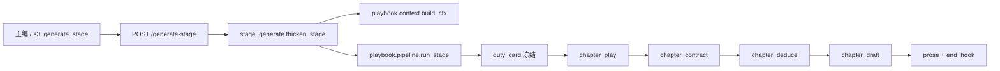
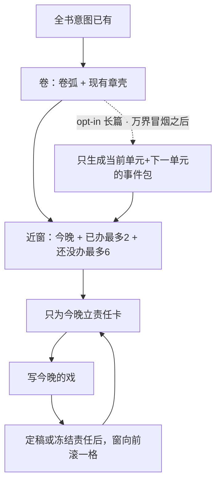

# 铜炉：卷管整卷的账，章只办今晚这一笔

| 项 | 值 |
|----|-----|
| **文档标题** | 铜炉结构层：体量纪律 + 章服务于卷 + 接上 playbook 主干（升 3.2.3） |
| **作者** | Grok Design |
| **日期** | 2026-08-22 |
| **状态** | Draft · rev.3（审查修订：旗登记默认开、版本断言与法官桩点名、横幅拉戏、侧栏不含今晚） |
| **产品** | 铜炉 / tonglu · 代码 `scribe3/` · 仓库 `/home/admin/projects/scribe-writing-system` |
| **短名** | `volume-scale-discipline` |
| **前序** | `docs/playbook/playbook.3.2.2.md`；`docs/plans/2026-08-10-volume-outline-ia-optimal.md`；`docs/plans/2026-08-13-write-path-story-constraints.md`；`docs/plans/2026-08-17-design-book-continuity.md`；`docs/plans/2026-08-18-play-copy-table.md`；`docs/plans/2026-08-21-humanrun-wanjie-v7.5.md` |
| **输入** | 用户贴来的「百万字层级规划」调研 + 「结构层改造最优方案」（Qoder，2026-08-21）。本文是审查后的可实施方案，不是原文再贴。 |
| **验收环境** | 只打已部署 demo `tonglu.qing.blue`（SSH `ubuntu@82.157.130.140`，应用 `/opt/scribe3/app`）。禁止 Grok 运行机 `npm ci` / 全量 pytest / 本机 Surreal。 |
| **不改** | 明喻 1/800、对白 15%、糙稿与戏重合 15%；WCG；SPA 三通道；未分卷一等合法；禁止 pad / 禁止 curl `s3_add_*` 灌库；**禁止对已部署万界书 force 重立责任或 overlay 卷纲。** |

---

## 给作者看的人话

打开书，一卷不是一章的放大。卷一《囚笼》四章（华山成核 / 四十二度 / 金縢裂纹 / 灭活边缘）是四笔账，不是「华山那一夜」写四遍。卷纲要能让人说出每一章各办哪一件；写其中一章时，作者和系统都看得见本卷还没办的其余几笔。后面的事可以在章末当没做完的挂着，不许今晚演完。

章设计页打开就是这场戏，以及从戏里抄出的「他要什么 / 选了什么 / 付了什么 / 还没做完的」。不再去读已经废掉的十三格。侧栏不把机器复盘原文贴给你。

百万字那种细到每一拍的总纲，系统不会一次生成。先把眼前这一卷（或这一卷里最近几段）的账立住，写几章再补下一段。没打开「长篇结构」的书，行为跟现在一样，不会突然多出一堆必填格子。

怎样算做完：打开《万界概率战争·真人建书·N1·20260821-2008》卷一，能看见四章各办哪一件。打开第 1 章设计页，能看见后三章还没办。已经立过责任的第 1 章不重写；还没立责任的章，下一次立责任时嘱咐里会带上邻章。明喻、对白、跟戏重复那三把尺子不动。文采深不深，本轮不管。

---

## Overview

原调研把「章雕局部、卷不推进」诊断成缺五层大纲 + 缺字数/爽点配额。现场事故更窄、也更硬：**写章时看不见本卷其余几笔，一卷被收成一章的夜。** 仓库里写章主干已经是 playbook.3.2.2（`duty → design(play+contract) → deduce → draft → final`），责任卡、戏、契约、卷纲槽都在。缺的不是第二条写路径，是**体量纪律没有进现有槽**。

种子里卷一 intro 其实已经是四章四笔（`scripts/humanrun_wanjie_seed.py` `VOLUMES[0].intro`）。根因首先是**写章上下文没带邻章**，不是「作者没写卷纲」。生成侧只改种子/placeholder，不新造卷纲法官，也不 overlay 已部署 intro。

本设计做三件事：

1. **永远生效的体量纪律**（有卷就生效，与百万字开关无关）：卷纲应对着该卷全部章的账；写章时 `build_ctx` 注入本卷台账近窗（各章标题+梗概，标出今晚 / 已办 / 还没办）；责任/戏法官多问一句「有没有把后面的夜提前演完」（**此问可挡冻结，故升 `playbook.3.2.3`**）。
2. **接上现有五层，不废掉重来**：不降级 playbook，不另造一张职责卡，不复活已废的 `chapter_spine` / `beats`。章设计 UI 只读 play/contract；本卷还没办的几笔用已有 `GET /outline` 拼。
3. **长篇结构 opt-in，且排在万界冒烟绿之后**：只有作者打开时才建情节单元、给预算建议、滚动补近窗。密/疏字数格、爽点每 N 章、展开比 20:1 只当规划预算提示，**不得**变成写路径通过条件。

---

## Background & Motivation

### 本会话刚发生的现场（硬约束来源）

demo 书《万界概率战争·真人建书·N1·20260821-2008》：

| 现象 | 作者点名 | 代码上为什么会发生 |
|------|----------|-------------------|
| 卷一《囚笼》四章，系统把**整卷纲写成第一章一夜** | 一整卷不能只描绘一章的东西 | 卷实体只有 `title/intro/color/sort_order`（`migrations/044_outline.surql`）。`playbook_volume_outline` 只摘 `intro[:400]`（`scribe3/playbook/context.py`），**不附本卷其它章梗概**。写章嘱咐因此看不见邻章。建卷种子也不强调「一章一笔」。 |
| 写章时只看见本章场景 | 章要服务于卷 | `duty_generate` 的【全书定位】里有「卷纲：」和【本章责】，没有「本卷还要发生的其余几笔」。`playbook_chapter_duty` 只取本章 `title+synopsis`。 |
| 章设计页曾空着 | 戏在 play/contract，页还在读旧脊骨 | `DesignTab` 已拉 play/contract，但仍 fallback `meta.chapter_spine`、legacy `meta.beats`，锚点仍是 `id="chapter-spine"`。`OutlineTab`（仅 `designOn=false`）空态「聊聊怎么写」仍带 `fieldKey: 'chapter_spine'`。`api.chapter` 仍把 `chapter_spine` 塞进 meta。后端 PATCH 这些字段已 410。 |
| 演绎曾写成 KPI 报告 | 嘱咐要写字缝 | 已改嘱咐；正文未重写。本设计不重开演绎。 |
| 卷侧栏曾 `JSON.stringify` 机器复盘 | 给人话 | `volumeReviewPlain` 已把 KR4 收成人话或隐藏。本设计在侧栏加「本卷几笔」清单，不把新结构 JSON 贴回去。 |

种子卷一 intro：「北峰按碎片 / 体温标价 / 金縢裂 / 灭活三分钟」。事故不是作者没写四笔，是**写章注入没有邻章台账**；模型只能看见 intro[:400] + 本章梗概，容易把整卷收成一夜。本设计不把「重写已部署 intro」当验收。

### 原案诊断里过时的部分（审查结论）

原案 §1 写：`build_ctx` 只装 5 个字段，`volume_outline / north_star / …` 五个占位恒为「（无）」。

**与现网不符。** `playbook.3.2.2`（`scribe3/playbook/quote.py` `PLAYBOOK_VERSION`）已经把引导槽接上：

```516:525:scribe3/playbook/context.py
GUIDE_SLOT_KEYS = (
    "volume_outline",
    "north_star",
    "chapter_duty",
    "recent_duty_summary",
    "recent_scene_summary",
    "codex_recall",
    "characters_epistemic_history",
    "prev_prose_tail",
)
```

`scribe3/tests/test_playbook_context_guides.py` 用内存夹具断言这些槽有字。空的不是接线，是**卷纲槽里没有「其余几笔」**。把 playbook 降级成可选、另建一条路径 B 规划链，等于丢掉已经能用的戏。

### 写路径真主源（不要再分叉）



`POST /generate-stage`（`scribe3/api/routers/write.py`）经 `thicken_stage` 进 `run_stage`。HTTP `persist=false` **仍会冻卡**：`thicken_stage` 把 `persist` 设成 `persist_fn is not None or st is not None`，而 `generate_stage` 始终传入 `st`。已有冻结责任卡时 `_skip_or_force` 直接 `skipped=True`，新嘱咐不会跑。`force=true` 才会重生成并改已冻责任。验收**禁止**对已部署万界书走这条写路径。

旧 `outline/beats/chapter_design` 返回 410（`scribe3/playbook/stages.py`）。`write_assemble_*` / `loop.py::run_chapter_loop` 仍服务讨论、旧环与部分保存门，**不是**真人建书写章主干。结构层注入点是 `build_ctx` + `prompts.py` + **`pipeline.py` 的 `judge_ctx`**，不是再开 `_assemble_write_instructions` 旁路。

3.2.2 活路径走 `RUBRICS` 的 `duty_judge` / `play_judge`（`scribe3/playbook/judge.py`）。`duty_judge_v2` / `play_judge_v2` 只给 `playbook.2`，不要把它当 3.2.x 活路径。

### 体量对照（这次书 vs 原案百万字公式）

| | 这次真人建书 | 原案百万字公式 |
|--|-------------|----------------|
| 目标字 | `intent.total_word_goal = 45000` | 1,000,000 |
| 卷 | 固定 3 卷 | 4–5 卷 × 20–25 万 |
| 章壳 | 固定 10 章 | 280–330 章 |
| 卷一 | 4 章四笔 | 每卷 3–5 个情节单元 |

体量纪律在 4 章一卷上就已经破了。所以 **「卷覆盖其下全部章」是永远生效的规则**，不能藏进百万字开关。写章注入的台账是**近窗**（见 §3），不是 70 章一卷一次倒出。百万字公式只在 opt-in 时当**建议预算**，不挡 4.5 万字书开写。本次验收书**不打开**长篇结构。

---

## Goals & Non-Goals

### Goals

- 有卷时：卷纲应对着该卷当前全部章的账（人能按章说出各办哪一件）。人工 intro 不 422。
- 写第 N 章时上下文含本卷台账**近窗**（今晚 + 最近已办最多 2 + 后面最多 6，合计 ≤8 行、≤900 字），不是整卷 70 行倒出。
- 责任卡 `must_happen` 仍是「今晚一件事」；法官能判「有没有把后面的夜提前演完」（可挡冻结）。
- 章设计 UI 以 play/contract 为戏/契约真源；空态不再读 `chapter_spine`。本卷还没办的几笔用 `GET /outline` 同卷 synopsis 拼。
- 长篇结构书级 opt-in；未启用的书零新表、零新硬门。排期在万界冒烟绿之后。
- 滚动建纲：只预铺近窗；opt-in 时当前单元 + 下一单元。禁止一次生成全书节拍级以下细纲；账目级一句话章纲允许按卷批跑。
- 规划数字（密/疏、爽点间隔、展开比）只出现在预算建议里，不进写路径通过条件。

### Non-Goals

- 不改 1/800、对白 15%、重合 15%（`scribe3/playbook/structural.py`）。
- 不重写演绎正文、不重开 KPI 化演绎。
- 不把 playbook 五层降为可选，不修复一条平行的「路径 B 结构总线」来取代它。
- 不复活 `beats` 密疏字数格，不把 Σword_budget ∈ [章目标, ×1.1] 当保存门。
- 不把「连续 5 章无正向反馈」做成 422；最多进卷侧栏人话提醒。
- 不新建与 `intent` 重复的 `story_plan` 表。
- 不改 WCG、不 pad、不 curl `s3_add_*` 灌库。
- **不 overlay、不 force 重写已部署万界书的责任卡 / 戏 / 卷纲。**
- 不在 Grok 运行机跑全量测试或起 Surreal。
- 不新造「卷纲法官」函数挡 `s3_patch_volume`。

---

## Proposed Design

### 1. 对原案的裁决（先说清改了什么）

| 原案裁决 | 本设计 | 理由 |
|----------|--------|------|
| 路径 B 唯一主干，playbook 降级可选，duty 改读新 `duty_card`，不修召回 | **否。playbook 保持主干，问卷加问后升 3.2.3。** 现有 `duty_card` 信封的 `body` 就是 L3。补的是 `build_ctx` 台账槽 + `pipeline.py` `judge_ctx` | 召回槽已接；再造职责卡 = 双写。表是 SCHEMAFULL 信封（`seq/version/status/sha/body`），不是扁平 must_happen 列 |
| 五层：story_plan → volume → arc_unit → duty_card → beats 密疏 | **永远生效：intent + volume.intro + 章梗概台账 + 现有五层。opt-in 才加 arc_unit（万界冒烟之后）。L4 = 已有 play/contract，不加密疏格** | 4 章一卷不需要新表；beats 已废 |
| core_event 外键必须引用 arc_unit.events | **否。** 永远生效时合法来源是本卷章梗概；opt-in 时优先单元事件，仍允许作者点名本章梗概 | 外键强迫先建单元，会挡未分卷/短卷 |
| 结构层 900 token 进 `_assemble_write_instructions`，占比 ≥25% | **否。** 注入 `build_ctx` 新槽 `volume_ledger`；生成与法官提示都带【本卷还要办的】 | 写章真主源是 generate-stage；法官不读完整 ctx |
| advance_gate 双证据（要素出现 + LLM）打回 | **否。** 推进检查问「该发生的那一件发生了没有」，禁止「事件要素字面出现」 | 词表命中能过、戏没发生 = 坏检查 |
| craft 定量配额退出写路径 | **playbook 路径已跳过八引擎**（`stage_skips_craft_engine` 恒 True）。本设计不再顺手改 assemble 配额 | 减法已做完的不要再做一遍 |
| derive-budget 公式硬出 280 章 | **opt-in 建议值，人工可改；4.5 万字书不跑百万公式；本次验收不打开开关** | 公式过刚会把这次书判成「结构失败」 |

### 2. 体量纪律（永远生效）

每一层只准管自己那一块。把「卷一写成华山一夜」写成硬约束：

| 层 | 产物（已有或本设计补的） | 管多大一块 | 禁止 |
|----|--------------------------|------------|------|
| 全书 | `intent`：北极星、红线、情感弧、`total_word_goal` | 一本书一个核心矛盾与结局方向 | 把一章一夜写进北极星当全书 |
| 卷 | `volume.intro` | **该卷全部章的账**（从哪一笔走到哪一笔、卷高潮、指向下卷的钩） | 只描绘其中一章的夜；用章设计图当卷纲 |
| 章梗概 | `chapter.synopsis` | 这一章必须发生的一件事 | 把邻章的账写进本章梗概 |
| 责任卡 | 冻结 `duty_card` 信封 `body` 里的 `must_happen` | 今晚这一件 | 把后面几章的夜在今晚演完 |
| 戏 / 契约 | `chapter_play` / `chapter_contract` | 把今晚这一件演完、抄出要/选/付/钩 | 把戏铺成正文；另写一场与责任无关的戏 |
| 演绎 / 排演 / 正文 | 现有三层 | 字缝 → 场面 → 给读者的章 | 本设计不改其门槛 |

**小说家问句（卷纲，非阻塞）：** 打开这一卷，能不能按章说出各办哪一件？若只能复述第一章那一夜，卷纲没写好——UI 警告，不 422。

**小说家问句（责任卡 / 戏，可挡冻结）：** 打开本卷还没办的几笔，这一章是不是只办今晚该办的那一笔？后面的可以在章末当没做完的事挂着。若金縢、灭活已经在第 1 章夜里被演完，没过。

不做的检查：卷纲是否出现各章标题二字、两边是否写成 A vs B、是否点名至少一个机制词、「碰到」later 标签就算花掉。

### 3. 本卷台账（设计心脏，不加新表）

台账是 **`chapters_lite` 的计算视图**，不双写、不落库、不进 duty GET。

```python
# 逻辑形状（进 build_ctx，不是新 Surreal 表）
volume_ledger = [
  {"seq": 1, "title": "华山成核", "synopsis": "……",
   "status": "tonight" | "done" | "later"},
  ...
]
```

装配（拟加在 `scribe3/playbook/context.py` 的 `playbook_volume_ledger(world, frozen, seq, rows) -> str`）：

1. **先滤同卷。** 未分卷（`volume` 空）→ 返回 `""`，不 fail。
2. **标 status，禁止对整卷逐章 `get_frozen`。**
   - 当前 `seq` → `tonight`
   - 其余：`chapters_lite` 已有 `has_prose`（`store/chapters.py` 的 `sql_flags`；旧库无该列则当 false）为真 → `done`
   - 其余 → `later`
   - 可选：只对**近邻**（当前 seq±2 且尚未 `done`）补一次 `get_frozen("duty_card", n)`；有冻结责任也标 `done`。70 章一卷最多多打几次近邻，不扫全卷。
   - `done` = `has_prose OR`（近邻冻结责任）。二者是 OR，没有「取先发生」的时序。
3. **再切近窗。** `tonight` + `done` 里 seq 最大的 2 个 + `later` 里 seq 最小的 6 个，合计硬顶 8 行。
4. **渲染人话，禁止字段名进嘱咐。** 每行：`第{n}章《{title}》〔今晚|已办|还没办〕：{剥垫后的梗概}`。内部 status 枚举只给代码用。
5. **预算。** 整段 ≤ 900 字。与 `_VOLUME_INTRO_BUDGET = 400`、`_CODEX_BUDGET = 800` 并列。**禁止**走 `compact_volume_intro`（会折成 120 字钩子）。PR-1 单测锁死：ledger 文本含后三章标题，且对 `compact_volume_intro` 的输入输出不相等路径（根本不调用）。

`playbook_volume_outline` 仍只描述**卷弧**。**intro 截断保持 400**（不改 `_VOLUME_INTRO_BUDGET`）。卷弧靠 intro，逐章靠台账，不要把 intro 加到 800 去扛清单。

`GUIDE_SLOT_KEYS` 增加 `"volume_ledger"`。空时记录 skip 原因，不算 `_guide_fail`：`unassigned_or_empty` / `single_chapter` / `no_synopses`。有卷且该卷 ≥2 章、至少两章有非垫句梗概、函数仍返回空 → `_guide_fail` 记 `volume_ledger`（可观测，不 422）。

### 4. 提示与法官：只问戏，不填格

三处（责任嘱咐、戏嘱咐、两个法官）**同一句人话**，不出现 `tonight`/`later`、不说「碰了就算花掉」：

> 今晚只办这一章该办的那一笔。后面几章的账可以在章末当没做完的事挂着，不许今晚演完。

**插入点（贴现网）：** `duty_generate` 现网是【全书定位】下的「卷纲：」「北极星：」然后【本章责】。新块放在【本章责】**之后**、【本章焦点者】之前，标题用【本卷还要办的】，正文先是那句人话，再贴台账人话清单。

模型 JSON **键不变**。现网仍是「立五件事」：`must_happen` / `bill` / `who` / `forbidden_reveal` / 第二人做事。`bite_from_prev` 仍由 `gen_duty`（`layers.py`）写入，不进模型输出。人话责任里加体量约束，**不**改成「四件事」，**不**在 PR-1 加 `advances` 字段。

`duty_judge`（3.2.x 活路径）现网标题是「七问：」（`prompts.py` 约 148 行）。加体量问后标题改成 **「八问：」**，新问计入 `verdict`（no → fail → 不冻结）：

> 打开本卷还要办的几笔：这份责任是不是第 N 章该办的那一笔？后面的可以挂着当没做完的事。有没有把后面某章的夜提前写成了这一夜？

`play_generate` 同样在责任块后注入【本卷还要办的】+ 同一句人话。

`play_judge`（现网标题「十一问」，约 233 行）再加一问，标题改成 **「十二问」**，同样计入 `verdict`：

> 这场戏有没有把本卷后面的夜提前演完？章末挂着没做完的事不算演完。

`duty_judge_v2`（「六问」）/ `play_judge_v2`（「八问」）可顺手加同一问以保持对称，**不是** 3.2.x 活路径。若改 v2 标题，对应测试识别串一并改。

**法官桩必须跟着改，否则 import 过了质量环仍会红：**

- `scribe3/tests/test_stage_generate.py` 约 117 行：`if "你是审稿的" in prompt or "五问" … or "七问"`。活路径 `duty_judge` **没有**「你是审稿的」，只靠「七问」被认成法官。改成八问后该桩会把法官提示当生成、返回 `"x"`，duty 质量环失败。必须把 `"八问"` 加进识别串。
- `scribe3/tests/test_play_contract.py` 约 223 行：已含「你是审稿的」和「十一问」，改成十二问后把 `"十二问"` 补上（相对安全，但不要漏）。

**`pipeline.py` 必改（否则法官拿空槽）：**

- `_run_duty` 的 `judge_ctx` 现只显式塞 `volume_outline` / `chapter_duty` / `recent_duty_summary` / `prev_hook_quote`。必须加上 `"volume_ledger": ctx.get("volume_ledger")`。
- `_run_design` 的戏 `judge_ctx` 现只有 `duty_json` + `play_text`。必须加上 `volume_ledger`（至少「还没办」那几行）。

PR-1 单测除 `build_ctx` 外，再断言 `duty_judge(ctx)` / `play_judge(ctx)` 的渲染字符串含后三章标题。

**禁止**在 prompt 里写：密点 ≥250 字、疏点 ≈40 字、展开比 20:1、每 3 章一个小爽点、低压章 ≤15%。

结构闸（`check_duty_struct`）**不**加梗概 n-gram 重合门。机械层只继续验：`must_happen`/`bill`/`who` 非空、户口、咬钩、禁揭。体量对错交给法官那一问。

因为改了法官问卷且新问可挡冻结：`PLAYBOOK_VERSION` 升为 `"playbook.3.2.3"`（`quote.py` 文件头约定：「改法官问卷或门槛才升版本。」）。`judge.py` 的 `VERSIONED_RUBRICS` **追加** `"playbook.3.2.3"`，**保留** `"playbook.3.2.2"`（不要删旧元组项）。`prompts.py` 文件头注释和 **第 560 行模块级** `assert PLAYBOOK_VERSION == "playbook.3.2.2"` 必须一起改——只改 `quote.py`、忘这一行 = `import scribe3.playbook.prompts` 即 AssertionError。`scribe3/playbook/__init__.py` 文档字符串里的 3.2.2 一并改。

模块级 / 测试断言（PR-1 必须点名、全部改到 3.2.3 或追加 in-tuple 检查）：

| 文件 | 现网 |
|------|------|
| `scribe3/playbook/quote.py` | `PLAYBOOK_VERSION = "playbook.3.2.2"` |
| `scribe3/playbook/prompts.py` L1 与 **L560** | 文件头 + `assert PLAYBOOK_VERSION == "playbook.3.2.2"` |
| `scribe3/playbook/judge.py` | `VERSIONED_RUBRICS` 末项 3.2.2 → 追加 3.2.3 |
| `scribe3/playbook/__init__.py` | 模块 docstring `playbook.3.2.2` |
| `scribe3/tests/test_playbook_context_guides.py` | L148、L195 `== "playbook.3.2.2"` |
| `scribe3/tests/test_playbook32.py` | L20 `== "playbook.3.2.2"`；L23 `"playbook.3.2.2" in VERSIONED_RUBRICS`（保留 in-check，并加 3.2.3） |
| `scribe3/tests/test_chapter_state.py` | L38 `==`；L43 `in VERSIONED_RUBRICS`（同上：保留 3.2.2 in，加 3.2.3 in，版本常量改 3.2.3） |
| `scribe3/tests/test_v634_rev13_protocol.py` | L98 `== "playbook.3.2.2"` |
| `scribe3/tools/v634_smoke.py` | L19 `PLAYBOOK_VERSION == "playbook.3.2.2"` |
| `scripts/humanrun_wanjie.py` | L284 指纹字符串 `"playbook.3.2.2"`（热更后 health/指纹会对不上，一并改） |

`scribe3/tools/v634_live_run.py` 只记录 `PLAYBOOK_VERSION` 变量、不断言字面，可不改。新建 `docs/playbook/playbook.3.2.3.md`：相对 3.2.2 的增量就是本卷台账 + 体量一问；明喻/对白/重合不动。历史文档（SESSION、humanrun 方案）不在本 PR 改口，避免范围膨胀。

### 5. 卷纲怎么写成整卷（生成侧，非阻塞）

现场根因以**写章上下文**为主（§3–4 / PR-1）。生成侧没有独立的卷纲 generate-stage，也没有卷纲法官函数。orchestration catalog 的「卷纲」只匹配 `s3_add_volume` / `s3_patch_volume`（`scribe3/orchestration/catalog.py` domain `structure.volume`）。

**「卷纲法官」标成非阻塞，本轮不实现。** PR-3 只做种子 + 侧栏 + placeholder。人工 intro 经审批落库的，不做机器 422。

改的是主编种子文案：

- `scribe3/web/src/lib/volumeSeed.js`：`intro` 说明改为「按本卷每一章各写一笔账，禁止只写其中一章的夜」。若已知 `chapterSeqs` 或本卷已有章，把标题+梗概列表写进种子（主编 LLM 看得到邻章，不另造法官）。
- `VolumeDetailPane` hint/placeholder 同步。有 N 章但 intro 明显只像一章的夜时，侧栏人话警告，永不挡存。
- 没有章壳时，种子只写卷弧 + 「章壳补齐后把每一章各办哪一件补进卷纲」，不发明不存在的章夜。

已部署万界 intro：不 overlay。验收不依赖「重写卷一 intro」。

### 6. 章设计 UI：只认戏和契约；台账走 outline

`ChapterStudio.jsx` 默认 `designOn = true`。按**真实残留**改，不要把 OutlineTab 的空态安到 DesignTab 头上。

| 真实残留 | 改成 |
|----------|------|
| `DesignTab` fallback `meta.chapter_spine`（有 spine 无 play 时画 13 槽卡）；锚点 `id="chapter-spine"` | 删 spine 分支。无 play 只显示「还没有这场戏 · 让主编先写设计」。锚点改 `chapter-play`，testid 同步 |
| `DesignTab` 空态文案其实已经是「还没有这场戏」；种子已是「请先立责任，再写一篇戏」 | 空态与种子保持；不要再改回 spine 的「聊聊怎么写」 |
| 节拍区：`contract.beats`，否则 `meta.beats` | 只展示契约钉子/场次；没有契约就空，不读已废 beats |
| `api.chapter` 仍把 `chapter_spine` 填进 meta | 设计页不再消费。GET 可暂留 |
| `evaluateChapterContract` / `chapterContractGate.js`：`beatsOk` 看 `meta.beats`；iceberg 文案「请用 13 短槽」 | 函数可认 play/contract。但父级 banner（`ChapterStudio.jsx` 约 1040、1330 行）调 `evaluateChapterContract(meta)`，meta 来自 `api.chapter`，**没有戏**。只改 gate 去读 `ch.play` 而父级不拉，横幅仍会按 `meta.beats` 喊材料不齐。**接线写死：父级与 DesignTab 同一次拉 play/contract，把结果并进 evaluate 的入参**（或 designOn 时 banner 不看 `beatsOk`）。 |
| `scribe3/web/src/__tests__/chapterStudio-topbar.test.jsx` 有用例靠 spine+legacy beats 才能看见节拍块 | 改成 mock play/contract；删 fallback 后必红，须同步 |
| `OutlineTab` 空态 `fieldKey: 'chapter_spine'`、subtitle「13 短槽」 | 仅 `designOn=false` 遗留路径。默认走不到。本 PR 不删 OutlineTab 文件 |

**责任与本卷还没办的几笔（读口写死）：**

- 冻结责任：`GET /chapters/{seq}/duty`（已有）。`api.js` 补 `chapterDuty`（现有 `chapterPlay` / `chapterContract`，没有 duty）。404 `duty_missing` 当空态，复用 `missingPlay` 模式，**不要红横幅**。
- 本卷还没办的几笔：**用已有 `GET /outline` 的同卷 `synopsis` 拼人话清单**（PR-2 不依赖新路由）。身份与后端台账同一套：今晚 = 当前 seq；还没办 = 同卷且不是今晚、且无正文（有 `has_prose` 则用；否则无正文即还没办）。**不要把正在写的这章列进「还要办」。** UI 近窗与后端同一上限 8 行。
- 不新开 `GET /chapters/{seq}/volume-ledger`。
- `ChapterMetaPane.jsx`（约 337 行）仍用 `contract.beatsOk` 画节拍点。默认 `designOn` 路径不要再因缺 `meta.beats` 教 13 槽：有戏/契约则点亮「设计齐」，或隐藏节拍点。列入 PR-2。

`OutlineTab` / `BeatsTab` 仅遗留开关。禁止在默认路径再教作者填 13 槽。

前端测：Grok 机不 `npm ci`。有现成 `node_modules` 时只跑 `chapterStudio-topbar` 与 `chapterContractGate` 相关 vitest；否则 demo 点开章设计页肉眼看。

### 7. 卷侧栏：本卷几笔，不贴 JSON

`VolumeDetailPane`「本卷章节」行今天只显示标题、标签、缺大纲点、字数。补第二行：梗概一行人话（空则「这章还没立要办的事」）。侧栏「卷概览」下增加「本卷还要办的」：与 §6 同一套身份——同卷、不是当前选中章、且无正文的标题。数据来自已有 outline。正在看的这一章不要出现在「还要办」。KR4 继续走 `volumeReviewPlain`，没有人话就不渲染。

禁止把 `arc_unit` JSON、`degraded_stages`、法官 raw answers 贴进侧栏。

### 8. 滚动建纲（永远生效的近窗 + opt-in 的单元窗）



- 永远不调用「L0→L1→L2→L3 一次产出 300 张责任卡」。
- 章壳可以按 WCG 先有 10 条真梗概；那是壳，不是 300 章细纲。
- opt-in 后 expand 只允许当前 + 下一段。请求「展开全书」→ 422 人话：「一次只铺眼前这一段和接下来一段。」

Shen 2025 的 R≈0.01、单级展开 ≤20:1：只写进 opt-in 预算建议的注释。不写进 struct，不写进责任嘱咐。

### 9. 长篇结构 opt-in（万界冒烟绿之后才开工）

**本次验收书不打开。** `structure_mode` 永不因 `total_word_goal≥N` 自动开。PR-5/6 排在 PR-4 绿之后。

开关**不能**「经现有 `s3_set_intent` 直接 MERGE」。intent 表即便历史上 SCHEMALESS，读写是白名单：

- `scribe3/store/intent.py` `get_intent` SELECT 列死、`set_intent` 只写 `reader_feeling` / `emotional_arc` / `red_lines` / `imagery` / `north_star` / `overdue_threshold` / `total_word_goal` / `daily_word_goal` / `arc_tracking`。多出来的键丢弃。
- `s3_set_intent`（`mcp/tools_write.py`）没有 `structure_mode` / `structure_budget` 参数。

PR-5 必须同时改：

1. 迁移 DEFINE FIELD（`structure_mode` 默认 false；`structure_budget` option\<string\> 或 object，按现网 intent 惯例）
2. `get_intent` / `set_intent` 白名单
3. `s3_set_intent` 新参数（WRITE_GATED 已有，扩参即可）
4. 前端作品意图入口（人话：「这本书按长篇结构写」），经主编审批，无 form-wall REST

**预算建议（不是硬门）**

只读路径钉死一条：`GET /structure/suggest-budget`（query：`total_word_goal` 可省略则读 intent，可选 `words_per_chapter` 默认 3000）。**不**再写第二套 `/books/{work}/structure/suggest-budget`。不落库、不 WRITE_GATED。

- 百万公式只在 goal≥200,000 时用原案数量级；goal=45,000 时建议 3 卷 × 约 10 章。
- 作者可改后经 `s3_set_intent(structure_budget=...)` 写入。阈值读该对象，不硬编码。

**情节单元（PR-6，依赖 PR-5）**

仅 structure_mode=on 且该卷章壳预计 >8 时需要。≤8 章的卷：章梗概列表就是事件包。

```sql
-- 拟 migrations/152_arc_unit.surql
DEFINE TABLE IF NOT EXISTS arc_unit SCHEMAFULL;
DEFINE FIELD IF NOT EXISTS volume_id ON arc_unit TYPE record<volume>;
DEFINE FIELD IF NOT EXISTS seq ON arc_unit TYPE int;
DEFINE FIELD IF NOT EXISTS title ON arc_unit TYPE string;
DEFINE FIELD IF NOT EXISTS goal ON arc_unit TYPE string;
DEFINE FIELD IF NOT EXISTS events ON arc_unit TYPE array; -- [{id, desc, kind, done_seq}]
DEFINE FIELD IF NOT EXISTS chapter_from ON arc_unit TYPE option<int>;
DEFINE FIELD IF NOT EXISTS chapter_to ON arc_unit TYPE option<int>;
DEFINE FIELD IF NOT EXISTS status ON arc_unit TYPE string; -- pending|draft|active|done
DEFINE INDEX IF NOT EXISTS arc_unit_vol_seq ON arc_unit FIELDS volume_id, seq UNIQUE;
```

产品写**只走 MCP**，进 `WRITE_GATED`（与 `s3_add_volume` 同级）：`s3_add_arc_unit` / `s3_patch_arc_unit` / `s3_settle_arc_event`。REST **最多只读** `GET /volumes/{vid}/arc-units`。禁止 POST/PUT REST 当产品写。

**expand 落点：**

- `s3_expand_arc_window`（WRITE_GATED）：只 `window=current_and_next`。LLM 产出写入 `arc_unit` 行，`status=draft`（草稿就是这张表的行，不另开 ChangePack / 第三张表）。
- 主编审批通过 → 同一行 `status=active`（沿用现有 elicitation / `commit_if_approved`）。
- 拒绝全书 expand。

**settle：** store 函数 `settle_arc_event(volume_id, unit_seq, event_id, done_seq)` 改 `events[i].done_seq`。禁止用正文词表自动勾。作者可在卷侧栏勾「这章办的是这一笔」（该勾也走 MCP）。

`kind` 仅供规划分类，写路径不读当配额。单元与梗概冲突：两边都注入，法官问今晚到底哪一件；不静默选边。

**volume 增量字段**（可选，非开写硬门）可随 PR-6：`goal` / `escalation_from` / `escalation_to` / `climax_event` / `exit_hook`。intro 不删。空不得 422。

### 10. 与现有 duty_card 的对齐（不要第二张职责卡）

表（`146_play_contract.surql`）是信封：`seq, version, status, sha, playbook_version, source_sha, schema_name, body`。`body` 是 JSON 字符串。实现者不要去 ALTER 加 `must_happen` 列。

信封 body 形状（`check_duty_struct` / `gen_duty`）：

```
must_happen, bill, who[], forbidden_reveal[], bite_from_prev,
focalizer, available_cast, available_lines, line_to_touch
```

原案平行 schema **不采用**。`advances` **不进 PR-1**。映射：

| 原案想要的 | 落点 |
|------------|------|
| core_event 非空 | 已有 `must_happen` 非空 |
| advances | 不新字段；体量问覆盖「今晚是不是该办的那一笔」 |
| position 六类 | 不做。近 3 章同质已由现法官第 3 问覆盖 |
| 低压 15% | 不做 |
| promise_ops | 已有 `line_to_touch` + `available_lines` |
| causal_link | 已有 `bite_from_prev` 必须等于上章 `hook.quote` |
| word_goal | 不进责任卡 |

`GET /chapters/{id}/duty-card` 原案新路由不需要：已有 `get_chapter_duty`。主编「立责任」就是 `generate-stage stage=duty`。

### 11. 推进后验：问戏，不打格子

原案 `advance_gate` **拒绝作为 struct 闸**。沿用现有链 + §4 新问。打回上限沿用 `_quality_loop` / `MAX_QUALITY_ROUNDS`。不新造检测器插件。

### 12. 原案 L4 密疏：明确不做

`GONE_STAGES` 含 `beats`。契约场次来自戏的抄本。密疏字数只允许出现在 opt-in 单元事件的人话备忘，生成戏时不当硬指令。

---

## API / Interface Changes

### 永远生效

| 接口 | 变化 |
|------|------|
| `POST /generate-stage` | 无签名变化。`build_ctx` 多 `volume_ledger`；`pipeline.py` `judge_ctx` 传入该槽；duty/play 提示与法官多一问。`playbook.upstream_guide` compute 多该槽字数。HTTP `persist=false` 仍可能冻卡——验收不要靠它当只读 |
| `GET /chapters/{seq}/duty` | 已有。设计页开始消费。响应仍是冻结信封，**不含**台账。404 `duty_missing` = 空态 |
| `GET /chapters/{seq}/play` `/contract` | 已有。设计页去掉 spine fallback |
| `GET /outline` | 已有。章设计页与卷侧栏用同卷 `synopsis` 拼「还没办的几笔」 |
| `s3_add_volume` / `s3_patch_volume` | 签名不变。种子带本卷章列表与体量纪律 |

### opt-in（PR-5/6，万界冒烟之后）

| 接口 | 作用 |
|------|------|
| `s3_set_intent` 增参 `structure_mode` / `structure_budget` | 白名单扩列 + 迁移 DEFINE；审批落库 |
| `GET /structure/suggest-budget` | 只读建议，不落库 |
| `GET /volumes/{vid}/arc-units` | 只读列表 |
| `s3_add_arc_unit` / `s3_patch_arc_unit` / `s3_expand_arc_window` / `s3_settle_arc_event` | 产品写，WRITE_GATED |

未开 structure_mode 调写工具 → 422：`structure_mode_off`，人话「这本书没打开长篇结构」。只读 GET 返回空列表。

台账空不 422。空 `must_happen` 仍走现有 duty 结构失败。

---

## Data Model Changes

### 永远生效

无新表。消费：`volume.intro`、`chapter.synopsis` / `volume` / `seq` / `has_prose`、`duty_card` 信封、`intent.north_star` / `total_word_goal`。

### opt-in

- `intent.structure_mode`、`intent.structure_budget`：迁移 DEFINE + 读写白名单，不是「SCHEMALESS 自动透传」
- 新表 `arc_unit`（`152_arc_unit.surql`），`(volume_id, seq)` UNIQUE
- 可选 volume 增量列；intro 不删

回滚：关 `structure_mode` 停止读写新表。关 `SCRIBE3_VOLUME_LEDGER` 只关**后端注入**（见 Rollout）。只加不改；禁止回填编造单元。

---

## Alternatives Considered

### A. 原案：五层新表 + 路径 B 总线 + playbook 降级

- 优点：一张图从总纲到拍。
- 缺点：与现网主干相反；职责卡双写；百万公式硬套这次书；密疏格验字不验戏。
- **不采用。**

### B. 只加长 `volume.intro` 预算到 2000 字

- 优点：改动面小。
- 缺点：intro 与 synopsis 双写；`compact_volume_intro` 仍可能折成 120 字；写第 2 章仍分不清整卷备忘和今晚。
- **不单独采用。** intro 保持 400 字卷弧；逐章清单用台账槽。

### C. 本设计：台账计算视图进 playbook + 长篇单元后置

- 优点：对准现场根因；4 章一卷零新表就能验；配额不进写路径。
- 缺点：法官可能把「章末挂着金縢」判成演完第 3 章。缓解：三处同一句「可以挂着、不许演完」；结构闸不做字面重合。
- **采用。** 因新问可挡冻结，版本升 3.2.3。

### D. must_happen 必须等于某 synopsis 原文

- 优点：机械可测。
- 缺点：责任卡是可演动作，梗概是规划句，强迫相等会让模型抄梗概。
- **不采用。**

---

## Security & Privacy Considerations

- 台账与单元都是书内数据，一书一 DB 隔离。
- 永远生效部分无新写接口。opt-in 产品写只走 MCP + WRITE_GATED。REST 最多 GET。
- `suggest-budget` 只读。
- 不把密钥、trace 原文、法官 JSON 送到作者页。
- 威胁：把邻章梗概写进本章责任以「消化」整卷。缓解：法官体量问 + 作者看 outline 台账。
- 不引入新的用户生成 HTML。

---

## Observability

沿用 `playbook.upstream_guide` span（`stage_generate._emit_upstream_guide_span`，在 `run_stage` / skip **之前**就会打）：

- compute 增加 `volume_ledger` 字数。这是已部署书上**不写库**也能看到的信号（只要某次调用走到了 `build_ctx`）。验收默认**不**为看这个 span 去打 generate-stage。
- skip 原因：`unassigned_or_empty` / `single_chapter` / `no_synopses` / `present`。
- 有卷且 ≥2 章有梗概但台账空：`_guide_fail` 含 `volume_ledger`，日志 `build_ctx seq=… ledger=0 fail=[volume_ledger]`。
- 禁止 `or "（无）"` 静默填台账。空则写「（本卷还没有其它章的账——未分卷或章壳无梗概）」并打 skip。

opt-in 管线：expand draft、审批、settle 各记 pipeline_trace。单元进度只进卷侧栏人话。

---

## Rollout Plan

1. **默认开**永远生效部分（台账注入 + 法官一问 + UI）。未分卷：台账空，行为与现在一致。有卷有梗概的书：下一次**新的** `stage=duty`（无已冻卡，或作者自己 force）才走新问卷。已冻责任不重跑。
2. **不 overlay** 万界书已落库的责任卡、戏、卷纲。验收见 PR-4，禁止 `force` 重立责任。
3. **structure_mode 默认 off。** PR-5/6 在 PR-4 绿之后才开。不要为这次书建 152 表当验收。
4. **回滚：** 旗必须进 `FLAG_REGISTRY` 且 `default="1"`。未登记时 `get_flag` 在环境变量空返回 `""`，`flag_truthy` 为 False（`scribe3/feature_flags.py` 129–137 行）——裸调 `flag_truthy("SCRIBE3_VOLUME_LEDGER")` = **热更后台账默认关**。读法写死：

```python
Flag(
    "SCRIBE3_VOLUME_LEDGER",
    "1",
    "写章注入本卷台账近窗（邻章还没办的几笔）。0=关注入。",
    "playbook",
    "safe",
),
```

关：环境变量 `SCRIBE3_VOLUME_LEDGER=0`（此时 `flag_truthy` 才是 False）。只关后端 `build_ctx` 台账槽与提示插入。法官新问随 3.2.3 文本回滚（热更回上一版 playbook）。**侧栏清单无害，常开**——不要暗示一个 env 同时关 UI。不 force-push，不删迁移。
5. 验收只打已部署 demo：health、打开该书卷一、`GET /outline` 四章梗概仍在。注入含标题由 PR-1 内存夹具锁死。不在本机起 Surreal。

---

## Open Questions

无待裁项。下列已在本修订拍板：

- 法官新问可挡冻结 → 升 `playbook.3.2.3`，随 PR-1 必做（不再「倾向不升」）。
- `structure_mode` 永不因字数自动开。
- 已落库一夜卷纲不自动重写，不挡验收。

若上线后误杀「章末挂着后账」过多，再考虑把该问改成 advisory（那时才需要另裁是否再升版本）。本轮按可挡冻结做。

---

## Key Decisions

1. **playbook 保持写章主干；问卷加问后升 3.2.3。** 原案「降级 playbook / 路径 B 唯一」与 `generate-stage → thicken_stage → run_stage` 不符。`prompts.py` 写明改法官问卷才升版本。新问计入 `verdict`，必须升。
2. **体量纪律永远生效，长篇单元 opt-in 且后置。** 现场事故发生在 3 卷 10 章书上。PR-5/6 等万界冒烟绿。
3. **本卷台账是章梗概的计算视图，近窗不是整卷倒出。** 先滤同卷 → `has_prose`（+ 近邻 get_frozen）标 status → 再切 8 行 / 900 字。未分卷空过。intro 截断保持 400。
4. **不另造职责卡 schema。** 表是 body 信封。模型 JSON 五键不变。PR-1 不加 `advances`。
5. **检查只问戏。** 三处同一句：今晚只办这一笔；后面可以挂着，不许演完。禁止「碰了 later 就算花掉」。禁止字数格、爽点每 N 章、要素词表。1/800、对白 15%、重合 15% 不动。
6. **法官必须看见台账。** `_run_duty` / `_run_design` 的 `judge_ctx` 传入 `volume_ledger`。只改 `prompts.py` 不够。
7. **L4 不是密疏 beats。** 章内设计真源是 play + contract。
8. **不新建 story_plan 表。** L0 用现有 intent。opt-in 字段要扩白名单和 MCP 参数，不是 SCHEMALESS 透传。
9. **滚动近窗，禁止一次生成全书节拍级以下细纲；账目级一句话章纲允许按卷批跑。**
10. **章设计 UI 只认 play/contract；台账走 GET /outline。** 删 DesignTab spine/legacy beats；父级拉 play/contract 再 evaluate；`ChapterMetaPane` 不因缺 beats 教 13 槽；`api.js` 补 `chapterDuty`；404 当空态。
11. **卷纲法官非阻塞。** 根因是写章上下文。PR-3 只改种子和侧栏。
12. **craft 配额不在本设计重做。** playbook 路径已跳过八引擎。
13. **WRITE_GATED 不变。** opt-in 产品写只走 MCP。REST 最多 GET。
14. **万界验收只读。** 禁止 generate-stage force、禁止 overlay 责任/戏/卷纲。HTTP persist=false 不是只读。
15. **回滚旗登记进 `FLAG_REGISTRY` 且 default=1。** 禁止未登记就裸调 `flag_truthy`（空 env 是 False）。只关后端注入；侧栏常开。
16. **Shen 2025 / Oh-Story 数量表降为规划备忘。**
17. **横幅认戏必须在父级拉 play/contract。** 只改 `chapterContractGate.js` 不够。
18. **「还要办」不含今晚这章。** UI 与后端同一套身份。

---

## Risks

| 风险 | 严重度 | 缓解 |
|------|--------|------|
| 法官把「章末挂着金縢」判成演完第 3 章 | 中 | 三处同一句允许挂着、不许演完；结构闸不做重合；误杀过多再另裁 advisory |
| 台账挤占 duty 提示预算 | 中 | 硬顶 900 字、近窗 8 行；intro 保持 400 |
| 未登记旗 + 裸调 `flag_truthy` → 热更后台账默认关 | 高 | `FLAG_REGISTRY` 登记且 `default="1"`；禁止空 env 走 False |
| 改「七问」后 `test_stage_generate` 把法官当生成 | 高 | 识别串加「八问」；PR-1 点名该文件 |
| 只改 gate、父级 banner 仍无戏 | 中 | 父级与 DesignTab 同一次拉 play/contract |
| `compact_volume_intro` 误伤台账 | 高（若接错） | 台账不走该函数；PR-1 单测锁死 |
| 对已部署书 persist=false / force 重冻责任 | 高 | PR-4 禁止打 generate-stage；注入证明靠内存夹具 + GET /outline |
| 作者梗概互相抄 | 中 | 已有 `synopsis_is_generic`；侧栏人话能看出 |
| 未分卷误 `_guide_fail` | 低 | skip 原因写死；单章/无梗概不算失败 |
| opt-in 单元与梗概冲突 | 低 | 两边都注入；本轮验收不开 opt-in |
| UI 仍有人点到遗留 OutlineTab | 低 | 默认 `designOn=true`；本轮不删文件 |
| 误把百万公式套到 4.5 万字书 | 高（产品） | 验收书不打开 structure_mode；suggest-budget 按 goal 分档 |

---

## References

- `scribe3/playbook/context.py` — `GUIDE_SLOT_KEYS`（约 516–525 行）、`build_ctx`、`playbook_volume_outline`、`playbook_chapter_duty`
- `scribe3/feature_flags.py` — `FLAG_REGISTRY` / `get_flag` / `flag_truthy`（未登记空 env → False）
- `scribe3/playbook/prompts.py` — `duty_generate`（【全书定位】/「卷纲：」/【本章责】）、`duty_judge`（七问）、`play_generate`、`play_judge`（十一问）；L560 模块断言
- `scribe3/tests/test_stage_generate.py` — 约 L117 靠「七问」认 duty 法官
- `scribe3/web/src/ChapterMetaPane.jsx` — `beatsOk` 节拍点
- `scribe3/playbook/pipeline.py` — `_run_duty` / `_run_design` 的 `judge_ctx`（约 352–359、381–385 行）
- `scribe3/playbook/judge.py` — `RUBRICS` vs `RUBRICS_V2`（v2 仅 playbook.2）
- `scribe3/playbook/quote.py` — `PLAYBOOK_VERSION`
- `scribe3/playbook/structural.py` — 1/800、对白 15%、重合 15%、`check_duty_struct`
- `scribe3/playbook/stages.py` — `LIVE_STAGES`、`GONE_STAGES`
- `scribe3/playbook/layers.py` — `gen_duty` 写 `bite_from_prev`
- `scribe3/stage_generate.py` — `thicken_stage` persist 语义、upstream_guide span
- `scribe3/api/routers/write.py` — `POST /generate-stage` 始终传 `st`
- `scribe3/api/routers/chapters.py` — play/contract/duty GET；spine PATCH 410
- `scribe3/web/src/ChapterStudio.jsx` — DesignTab spine fallback；OutlineTab `fieldKey: 'chapter_spine'`
- `scribe3/web/src/lib/chapterContractGate.js` — `beatsOk`、13 短槽文案
- `scribe3/web/src/__tests__/chapterStudio-topbar.test.jsx`
- `scribe3/web/src/layout/VolumeDetailPane.jsx`、`VolumeDetailPane.test.jsx`
- `scribe3/web/src/lib/volumeSeed.js`、`volumeSeed.test.js`
- `scribe3/web/src/lib/volumeSoftHint.js` — `volumeReviewPlain`
- `scribe3/store/chapters.py` — `chapters_lite` / `has_prose`；volume CRUD 白名单
- `scribe3/store/intent.py` — get/set 白名单
- `scribe3/mcp/tools_write.py` — `s3_add_volume` / `s3_patch_volume` / `s3_set_intent`
- `scribe3/orchestration/catalog.py` — `structure.volume` 无独立卷纲生成层
- `scribe3/injection_compact.py` — `compact_volume_intro` 120/400
- `scribe3/migrations/044_outline.surql`、`146_play_contract.surql`、`007_intent.surql`
- `scripts/humanrun_wanjie_seed.py` — `VOLUMES` / `CHAPTERS` 四章四笔原文
- `docs/playbook/playbook.3.2.2.md`（相对基线）；实施时新增 `playbook.3.2.3.md`

---

## PR Plan

每张 PR 可独立审查、可单独上 demo 冒烟。一律不在 Grok 机跑全量 pytest；单测只加内存夹具（仿 `test_playbook_context_guides.py`）。**PR-5/6 在 PR-4 万界冒烟绿之后再开。**

### PR-1 本卷台账进 build_ctx、法官上下文，并升 3.2.3

- **标题：** 写章时看见本卷还没办的几笔（playbook.3.2.3）
- **文件：**
  - 实现：`scribe3/playbook/context.py`；`prompts.py`（含 **L560 模块断言**、问卷标题七问→八问 / 十一问→十二问）；`pipeline.py`；`quote.py`；`judge.py`（`VERSIONED_RUBRICS` 追加 3.2.3、保留 3.2.2）；`__init__.py` docstring；`scribe3/feature_flags.py`（`FLAG_REGISTRY` 登记 `SCRIBE3_VOLUME_LEDGER` **default="1"**）
  - 测试 / 指纹：`scribe3/tests/test_playbook_context_guides.py`（L148、L195 + duty/play 法官渲染含后三章标题 + ledger 不走 `compact_volume_intro`）；`test_playbook32.py`（L20、L23）；`test_chapter_state.py`（L38、L43）；`test_v634_rev13_protocol.py`（L98）；`test_stage_generate.py`（约 L117 识别串加「八问」）；`test_play_contract.py`（约 L223 加「十二问」）；`scribe3/tools/v634_smoke.py`（L19）；`scripts/humanrun_wanjie.py`（L284 指纹）
  - 文档：`docs/playbook/playbook.3.2.3.md`
- **依赖：** 无
- **内容：** `playbook_volume_ledger` 按 §3 算法；`GUIDE_SLOT_KEYS` + 日志；duty/play 生成与活路径法官加同一句人话；`judge_ctx` 传 `volume_ledger`。旗经 `FLAG_REGISTRY` 默认 `"1"`，只把 `0/false/off` 当关；**禁止**未登记裸调 `flag_truthy`。JSON 五键不变。v2 问卷可顺手对称，不当活路径。未分卷空过。

### PR-2 章设计页去掉旧脊骨，用 outline 拼还没办的几笔

- **标题：** 章设计只认这场戏和契约
- **文件：** `scribe3/web/src/ChapterStudio.jsx`（父级与 DesignTab **同一次**拉 play/contract，再交给 `evaluateChapterContract`）；`scribe3/web/src/api.js`（补 `chapterDuty`）；`scribe3/web/src/lib/chapterContractGate.js`；`scribe3/web/src/ChapterMetaPane.jsx`（默认路径不因缺 `meta.beats` 教 13 槽）；`scribe3/web/src/__tests__/chapterStudio-topbar.test.jsx`；`scribe3/web/src/lib/chapterContractGate.test.js`（若有 13 槽断言）
- **依赖：** 无（duty GET 已有；台账用 `GET /outline`，不依赖 PR-1 新路由）
- **内容：** 删 DesignTab spine/legacy beats；改锚点；404 duty 当空态。横幅认戏：父级必须先有 play/contract，不能只改 gate 去读 meta 里没有的 `ch.play`。还没办的清单不含今晚这章。Grok 机不 npm ci。

### PR-3 卷侧栏与建卷种子：整卷是若干笔账

- **标题：** 卷纲按章列出要办的事
- **文件：** `scribe3/web/src/layout/VolumeDetailPane.jsx`；`scribe3/web/src/layout/VolumeDetailPane.test.jsx`；`scribe3/web/src/lib/volumeSeed.js`；`scribe3/web/src/lib/volumeSeed.test.js`
- **依赖：** 无
- **内容：** 章列表下展示梗概一行；侧栏「本卷还要办的」= 同卷、不是当前章、无正文。hint/placeholder/种子写明禁止只写一章的夜，并把已有章标题+梗概写入种子。不新增 REST 写。不实现卷纲法官。不 overlay 已部署 intro。

### PR-4 demo 只读冒烟（不灌库、不重冻责任）

- **标题：** 对已部署万界书确认四章梗概仍在
- **文件：** 本文落仓 `docs/plans/2026-08-22-volume-scale-discipline.md`；可选只读探活（curl health + 登录后 `GET /outline`，**不**调 generate-stage）
- **依赖：** PR-1（建议与 PR-2/3 同批热更）
- **内容：** `./scripts/deploy_demo.sh` 热更。验收：health；打开该书卷一能看见四章各办哪一件；打开第 1 章设计页能看见后三章还没办（PR-2，GET /outline）。写路径嘱咐含后三章标题由 PR-1 夹具锁死——**已冻的第 1 章责任卡本轮不会变**。**禁止** `POST /generate-stage`（含 `persist=false` / `force=true`）打已部署万界书。**禁止**主编种子改卷一 intro 当本 PR 验收。

### PR-5 opt-in：intent 开关与预算建议（万界冒烟绿之后）

- **标题：** 长篇结构开关与预算建议（默认关）
- **文件：** 新迁移 DEFINE intent 字段；`scribe3/store/intent.py`；`scribe3/mcp/tools_write.py` `s3_set_intent`；`GET /structure/suggest-budget`；前端意图入口；内存单测（goal=45000 vs 1_000_000 分档）
- **依赖：** PR-4 绿
- **内容：** 白名单扩列，不是「现有路径就能存」。默认 false。公式只产建议。不建 arc_unit。本次验收书不打开。

### PR-6 opt-in：arc_unit 表与滚动 expand（万界冒烟绿且 PR-5 之后）

- **标题：** 长篇才有的情节单元，一次只铺两段
- **文件：** `scribe3/migrations/152_arc_unit.surql`（含 `(volume_id, seq)` UNIQUE）；store CRUD + `settle_arc_event`；MCP `s3_add_arc_unit` / `s3_patch_arc_unit` / `s3_expand_arc_window` / `s3_settle_arc_event`（WRITE_GATED）；只读 `GET /volumes/{vid}/arc-units`；卷侧栏仅 structure_mode 时显示单元人话
- **依赖：** PR-5
- **内容：** ≤8 章的卷不强迫建单元。expand 写 `status=draft` 行，审批后 `active`。拒绝全书。结算改 `events[i].done_seq`，不用正文词表。无 REST POST/PUT。

**不排期的原案项（明确砍掉）：** beats 密疏字数校验；advance_gate 要素双证据；craft 配额再删一遍；story_plan 新表；core_event 外键；爽点 3/5 章 422；路径 B 结构总线；一次 L1→L3 全管线生成百万细纲；独立卷纲法官挡保存；对万界书 force 重立责任。

**原 PR-7（观察后再升版本）删除。** 升 3.2.3 已并入 PR-1。
