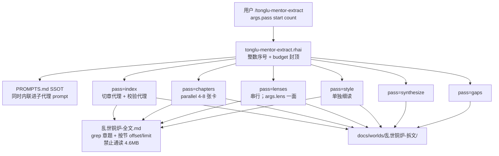
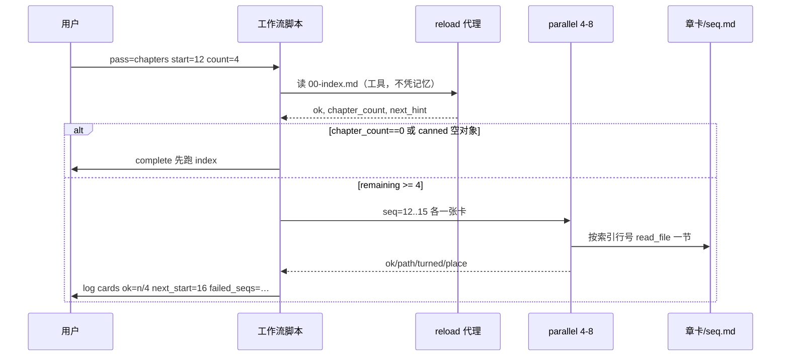
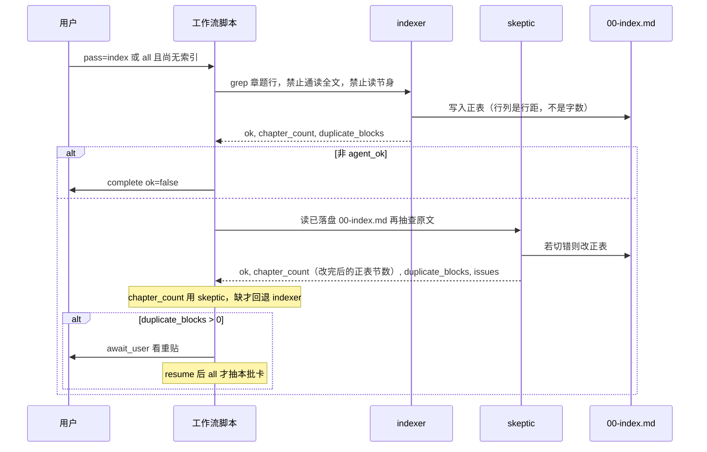

# 《乱世铜炉》工作流拆书：最佳可执行方案与提示词

| 项 | 值 |
|---|---|
| 状态 | 实施中（提示与工作流已按「榨干」增补） |
| 日期 | 2026-08-23 |
| 作者 | Grok |
| 受众 | 要实现 `.grok/workflows/tonglu-mentor-extract.rhai` 的人；跑完后给人翻的是 `参照本.md` |
| 范围 | 同一条项目工作流 + `docs/worlds/乱世铜炉-拆文/` 提示与产物 |
| 提示真源 | `docs/worlds/乱世铜炉-拆文/PROMPTS.md`（含伏笔/人物/线索/开篇） |

---

## 先说人话

现有拆法**不是最完善的，也不是最理想的。** 方向对：一次吃不下，要切开、分批、多面看、再合成一本以后写书能翻的参照。但它现在还是半成品：工作流会把章题批次弄错；提示还没把「一场戏有没有翻」「读者比场上人多知道什么」「下一章换的是哪一种日子」问到位；文风没有单独一轮；硬事实不会被逼着对回原文；全文里有重贴、空壳标题、网站广告，切章一旦切错，后面全废。切章也不能把四兆多的全书一页页翻完；五面透镜一次只跑一路，免得把这台机器卡死。

你要的成品不是一段聊天提示，是：**用本系统的 `/tonglu-mentor-extract` 工作流自动跑，多轮直到抽出一本可搬家的写法参照。** 参照本给人写《腕账》这类别的书用——学它怎么写还在过的日子、群像怎么办事、热闹怎么切到怕；**不要**学半文不白，**不要**抄这本的鬼神和情节。

怎样算做完：打开 `docs/worlds/乱世铜炉-拆文/参照本.md`，能按着写下一本；每一条硬说法都能指回原文行号；缺口文件写着「可以停」。

---

## Overview

Problem: *乱世铜炉* is a ~4.6MB mentor text (`wc -m` ≈ 162.7 万；CJK ≈ 133.8 万。引子 + 前传至第四十三章 + 正传至第六十九章，文末停在酒庄「好好亲近亲近。」). We need a **reusable craft pack** for writing *other* novels, produced automatically by this host’s workflow engine (`agent` / `parallel` / `phase` / `complete` / `budget` / `await_user`), not by a one-shot chat and not by oh-story’s Claude-oriented long-analyze pipeline.

Current state: `.grok/workflows/tonglu-mentor-extract.rhai` + `docs/worlds/乱世铜炉-拆文/PROMPTS.md` already encode the right *shape* (index → batched chapter cards → five lenses → synthesize → gaps). They are **not** complete. Known host and corpus facts make a “one mega-prompt / one parallel of ~70 cards / dump the novel into context / five lenses at once” design fail closed.

Proposed: **evolve the same workflow** (do not invent a second orchestrator). One invocation runs **one pass**, or `pass=all` = index-if-needed + **one** chapter batch (≤8) then stop. User re-invokes with a new `start` (journal resume cannot bump `args`). Prompts live in `PROMPTS.md` as SSOT and are **inlined** into child prompts so a missing file still works. Child agents `capability_mode: "read-write"`, **`isolation_worktree` off**, so files land in the workspace. Never put the novel in a prompt; index agents `grep` headings only; chapter/lens agents `read_file` by line range from the index. Lenses run **serially**.

---

## Background & Motivation

### Why this change

The product’s writing quality target is “铜炉级人间日子”，not shorter sentences. Audits already recorded what to steal and what not to (`docs/evidence/system-audit-20260813/audit-novel.md` F-N01/N05/N07): 岁时与还在过的日子、群像改钱路、笑闹后切异变、说书评点插在动作后、事变型章题。`docs/plans/2026-08-23-humanrun-million.md` rejected 卷纲 that stay in one office: 粮市、田、渡口、庙会、邻镇 must exist as lived days. The extract pack is the **mentor** for that craft, including *腕账*.

A chat-only 拆书 does not survive: the host has no cross-session memory (`AGENTS.md`), the novel does not fit in one context, and cold subagents return empty JSON unless prompts **command tool use** (`create-workflow` Pitfalls).

### Current artifacts (verified 2026-08-23)

| 产物 | 路径 | 事实 |
|---|---|---|
| 全文（未入 git） | `/home/admin/projects/scribe-writing-system/docs/worlds/乱世铜炉-全文.md` | 35538 行；磁盘 **4 655 101 字节（约 4.6MB）**。三种计数不要混用：`wc -m` ≈ **162.7 万**；非 ASCII ≈ **151.4 万**；CJK 汉字 ≈ **133.8 万**。**未**被 `git ls-files` 跟踪，也**尚未**写入 `.gitignore` |
| demo 副本 | `ubuntu@203.0.113.10:/opt/scribe3/data/乱世铜炉-全文.md` | 同大小（2026-08-23 SSH 核对）；验收可对这份；工作流默认读工作区副本 |
| 根目录节选 | `/home/admin/projects/scribe-writing-system/乱世铜炉.md` | 已入 git，约 25.7 万字符。封面自称「引子～第四十三章」，正文约在 L4183 一幕中间结束，**并不是**全文前传到 L7750 第四十三章。**不够**当全文 |
| 现工作流 | `.grok/workflows/tonglu-mentor-extract.rhai` | 已有五 phase、schemas、`count` 封顶 8、部分 `r != ()` 守卫 |
| 现提示 | `docs/worlds/乱世铜炉-拆文/PROMPTS.md` | 第 0–4 轮；拆文目录里**只有**这一份，尚无 `00-index.md` / 章卡 / 参照本 |
| 宿主方言 | `~/.grok/bundled/skills/create-workflow/SKILL.md` | 无 regex；`validate_only` canned output 是小的固定对象；默认 `agent_budget` 128；`parallel` 原子占预算 |
| 旁路长拆 | `oh-story-claudecode-main/skills/story-long-analyze/` | 黄金三章 / 情节点密度 / 桥段词表 / 把原文贴进子代理。**默认不执行** |

### 全文在磁盘上的脏结构（切章必须面对，不是边角）

工作区副本**不是**干净的「引子 + 69 个文件」。实测标题行约 **292** 条（量级约 300；正表合并复读、剔除重贴后仍估 **150–200 节**），原因：

1. **两卷编号撞车**：L3 起前传「第一章…第四十三章」；L8001 `铜炉正传` 后编号从「第一章 杀场」重起，一直到「第六十九章：闻风而动」。口语里的「写到六十九章」= 正传末章号；**卡片数会远高于 69**（上/中/下/一…分册）。
2. **标题复读**：L4530 `第三十一章 离间` 与 **L4531**（行首有空白）`第三十一章：（离间）苏秦曾以计齐宋`。只算一节。
3. **作者自己贴错的声明**（L10120）：正文里写「第十章不在下一页了……」——**禁止**当章题。
4. **空壳标题**：L16896–L16916 `舟渡茫(中)(下)`、`故生忧,故生怖(上中下)` 几乎无正文。索引保留并标瘦；**必须出卡**，打开书写「正文几乎没有」，避免序号洞（已拍板）。
5. **免费外篇**：L14228 `正传 第二十四章 苏醒(免费外篇)` **单独成节**，标题原文保留，不并进苏醒（下）（已拍板）。
6. **回绕重贴（按文件顺序，切章必须照此，不要靠印象）**：正传第一次过到第五十六章之后，L24075 起又出现章题，但**不是**「缺章菜单 + 再贴 36–56」这么整齐：
   - L24075 `第二章 （剪径）围谷正遇草寇帮`，紧接着 L24280 `第一章 ：（杀场）腥血流河经杀地`（顺序反了，且是正传开头的重贴）；
   - L24537 `第四十三章 ：（选择）去留应当果不同` 与**前传** L7750 `第四十三章 选择` 正文重复；**不是**正表里已有的正传第四十三章（L18769 起是「心机」）。只按「（卷, 章号, 分册）」去重会把「43 选择」和「43 心机」撞车，切章键必须带**标题关键部分**；
   - 随后才是回绕段里才出现的真缺章：L24875 `第二十八章 :（随水转）`、L25134 `第三十五章 :一沙一世界`；
   - 再往后是 36–56 的再贴，然后 L32068 起才是**未在前文出现的**第五十七章「鱼龙舞」直到文末第六十九章。
   - **千花不在回绕里补。** `四十一章：千花（一）…（六）` 只出现在回绕**之前**（L18360–L18561），回绕后再无千花。校验代理按「回绕缺章」去找千花会找错地方。
   盲切「回绕之后全丢」会丢掉随水转、一沙一世界、第五十七章起；盲切「回绕里的 43 进正表」会覆盖「心机」。
7. **站内垃圾**：`bxwx.org`、`天才壹秒記住『笔下文学 』`、`<!--阅读面页章节尾部广告-->`。书证禁止引用这些。
8. **文末**：L35538 酒庄「好好亲近亲近。」——索引最后一节必须吃到文末，不要在第六十九章（上）截断。

预估：合并复读标题后，**节**（上/中/下各一卡）约 **150–200**；**章号**约 前传 43 + 正传 69 + 引子。默认 `count≤8` 时，仅章卡就需要约 **20–50 次**独立调用（每次新 `args.start`）。默认预算 128 **一次跑不完**全书卡，这是设计而不是缺陷。

### 现工作流已核对的缺陷

`tonglu-mentor-extract.rhai` 今天有这些硬伤（实现时要改，不是再包一层）：

| ID | 缺陷 | 证据 |
|---|---|---|
| W1 | `pass=all` 走完 index 后，章卡用的是 index 返回的 **`titles[0..count]`**，**忽略 `start`** | L122–154：`seq = start + i` 但 `title = titles[i]`；index schema `titles.maxItems=40` |
| W2 | 宿主无 regex、脚本也读不了 `00-index.md`；却把「章题列表」当编排真源 | 方言：No regex；Host API 无 `read_file` |
| W3 | 无 `budget()`，无空 `parallel([])` 短路 | `create-workflow`：空面板与超预算会整板拒绝 |
| W4 | 无幂等：已有 `章卡/{seq}.md` 仍重写 | 无 |
| W5 | 五面透镜写死一次 `parallel` 全开，无 `args.lens` 补单面；本机内存不够扛五路同时读全文 | L179–209 |
| W6 | 无独立文风轮、无索引对抗校验、无硬事实回溯 | PROMPTS.md 到第 4 轮为止 |
| W7 | `validate_only` 路径依赖 `output.ok == true`；canned 小对象会走失败 `complete`——**可以**，但后面若解包缺字段会炸 | Skill L179；现脚本 index 分支已有守卫，lenses/cards 解包需同样严格 |
| W8 | 全文未 gitignore，存在误提交版权风险 | `.gitignore` 无 `乱世铜炉-全文.md` |

---

## Goals & Non-Goals

### Goals

1. 诚实记录：当前方案**不是**最完整 / 最理想；本文给出在**本宿主约束下**可自动执行的最佳方案。
2. 只进化 `.grok/workflows/tonglu-mentor-extract.rhai` + `docs/worlds/乱世铜炉-拆文/PROMPTS.md`。
3. 调用：`/tonglu-mentor-extract` 或 `/workflow tonglu-mentor-extract`，args：`pass` `source` `out_dir` `start` `count` `force` `lens`。
4. 产出：`00-index.md`、`章卡/{seq}.md`、`透镜-世界.md` 等、`透镜-文风.md`、`参照本.md`、`缺口.md`。
5. 提示问**戏**（谁、哪一件、世界怎么变），不问词表、格、至少 N 个机制词、A vs B 填空。
6. 每条硬事实可 `grep` 回原文；编地理 / 编人名 = 该条作废。
7. 明示**可搬走 / 不要搬走**（古白话腔、这本鬼神、这本情节不得进腕账）。
8. 世界透镜必须能抓住**还在过的日子**（人实际走到过的地方，用一场戏证明），禁止把全书收成一处宅子/续夜处走廊。地点名只作人话举例，不当必填格。

### Non-Goals

- 不把 oh-story `story-long-analyze` 当执行器（可借鉴「切片表 SSOT、分批 5–8、事实可溯、文风单独一轮」，不借鉴情节点密度公式、桥段词表、黄金三章停靠、把原文贴进 prompt）。
- 不在工作流里用 regex 切章；不新写 Python 编排器。
- 一次调用抽完全书。
- 把约 4.6MB 全文提交 git，或把大段原文抄进参照本。
- 用词表闸门验收拆书（「必须出现大遮蔽/成核点」这类）。
- 为拆书在 Grok 机跑 `npm ci` / Playwright / 本机 Surreal / 第二套库。
- 改 scribe3 写路径、把参照本自动灌进 Surreal（**已拍板：参照本不进设定库**；产物只是 Markdown 包）。
- 不破例加 Python 切章（替代 D 关闭；live index 切丢也仍走代理 grep，不另起 execute 脚本）。
- `isolation_worktree: true`（私有 worktree **不会**合并回工作区）。

---

## Key Decisions

1. **同一条工作流，不新编排器。** 用户要 `/workflow` 自动跑。再做 Python/oh-story 第二条管道会分叉、无法用本宿主 `validate_only` 冒烟。  
   *理由：* 仓库已有 `tonglu-mentor-extract.rhai`；Skill 写明 workflows can't launch other workflows。

2. **切章由子代理落盘，脚本只认整数序号。** Rhai 无 regex、不能读索引文件。Index 代理写 `00-index.md`；章卡代理自己按 `seq` 去表里找起止行。脚本**不**把 `titles[]` 当工作清单。  
   *理由：* 现实现 W1/W2：`maxItems: 40` 会静默截断；`start` 与 `titles[i]` 错位。

3. **一次调用只做一 pass，或 `all` = 索引（如缺）+ 一小批章卡然后停。** 透镜 / 文风 / 合成 / 缺口各自再调。  
   *理由：* 150+ 卡不能进一个 `parallel()`；默认预算 128；本机内存 ~1.6Gi。Journal resume **不能**改 `args.start`，下一新批次必须新调用。

4. **`count` 硬顶 8，默认 4。** `budget().remaining` 不够就缩小本批，并 `log` 砍了多少。禁止空 `parallel([])`。  
   *理由：* Skill：超预算整板不发；空面板行为未保证；用户明确 4–8。

5. **索引阶段加对抗校验（第二个代理），必须串行：indexer 落盘成功后再 skeptic。** 禁止两代理 `parallel`。坏索引会污染全部卡。校验只做：抽查标题能否 grep 回该行、回绕块是否标了、空壳是否标了、前传「选择」有没有盖住正传「心机」。`duplicate_blocks > 0` 才 `await_user`。切章**禁止**把 4.6MB / 3.5 万行按页通读；只 `grep` 章题行再抽标题前后两三行。  
   *理由：* 全文确有 L24075 回绕；`read_file` 默认每次约 1000 行，通读三十多次会在 ~1.6Gi 上 OOM；`await_user` 只在会改变后续行为时用。这本书每次重切都会标重贴，`pass=all` 在人 resume 之前不得抽卡。

6. **五面透镜默认串行；禁止五面 `parallel`。** 文风单独 `pass=style`。信息控制 / 戏剧反讽并进「话与说书」，不新开第六面。`args.lens` 只跑一面；空 = 本轮 for 循环依次做完五面。非法短名 `pause`，不得空 `parallel([])`。  
   *理由：* 用户指定五面：世界 / 群像 / 出场 / 说书 / 节奏。每面都要再抽原文，五冷代理同时读 4.6MB 比 4 张短卡更重；live children 默认 32、预算 128 挡不住这次内存峰值。串行峰值 = 一面。

7. **子代理一律 `read-write`、关 `isolation_worktree`、禁 `fork_context`、禁把全文粘进 prompt。** 必须命令 `read_file`/`grep`。切章、透镜都禁止为完成任务而顺序读完全书。  
   *理由：* 冷代理会空答；isolation 的编辑不回工作区；`fork_context` 对项目脚本是拒绝项。

8. **幂等默认开：已有合格产物不覆盖，除非 `force=1`。** 合格不是「文件里有这两个标题」，而是人话段**下面真写了那一件事**（「打开书」后能看出谁/哪一件/世界怎么变，且书证有能指回原文的 `L` 行号）。只有标题的 stub 必须重抽。  
   *理由：* 同进程 pause 不是 exactly-once；用户会重跑同一 `start`；代理自己读自己写的文件，空壳卡否则会永远 `ok=true`。

9. **书证短、带行号；禁止整节摘抄。** 硬事实写「正文未写到」而不是脑补。合成轮禁止用合理性填地理。  
   *理由：* oh-story「合成阶段事实保真」；版权；参照本是作法不是盗章。

10. **参照本只写可转移作法 + 明确不要抄什么。** 铜炉情节缩写不是成品。腕账要的是日子种类和群像机关，不是续夜处走廊，也不是这本妖怪名。  
    *理由：* 用户已否决「一卷都在一处办公」；`writing-prompt-essence`：提示交责任不交答法。

11. **`pass=gaps` 一轮只找缺口并写 `缺口.md`，不在同一次调用里循环到干。** 用户按缺口再调对应 pass。连续两次 `gap_count=0` 才宣称可以停（第二次由人再调一次 gaps）。  
    *理由：* 宿主「loop until dry」要指纹和多次 spawn；一次跑干会吃光预算和内存。折中：缺口文件是干/不干的真源，工作流不自己 while。

12. **全文永不提交；拆文产物（无大段原文）可提交。** **PR1** 把 `docs/worlds/乱世铜炉-全文.md` 写入 `.gitignore`。  
    *理由：* 第三方作品；根目录 `乱世铜炉.md` 已是节选先例，约 4.6MB 全文不应进历史。

---

## Proposed Design

### 架构



### 一次章卡批次的时序



切章必须串行（禁止 indexer 与 skeptic 同一 `parallel`）：



### Pass 表

| `args.pass` | 做什么 | 子代理数（典型） | 产出 |
|---|---|---|---|
| `index` | 切章，**落盘成功后再**校验；回绕则询问。两代理禁止并行 | 2（串行） | `00-index.md` |
| `chapters` | 从 `start` 起最多 `count` 张卡 | 1 reload + 4–8 | `章卡/{seq}.md` |
| `lenses` | 默认**串行**五面；`args.lens` 只跑一面。禁止五面 `parallel` | 1 或 5（串行） | `透镜-*.md` |
| `style` | 文风细读（按索引抽样点名的节） | 1 | `透镜-文风.md` |
| `synthesize` | 只根据已落盘文件合成 | 1 | `参照本.md` |
| `gaps` | 对照参照本找**作法**缺口；**独占**写 `缺口.md` | 1 | `缺口.md` |
| `all` | 共用一次 `reload_index()`；缺则 index+skeptic；标了重贴则 `await_user`，resume 后才抽**一批**卡 | ≤ 2 + 8 | 同上子集 |
| `trace` | 可选：参照本硬事实 grep 回原文；**只改参照本**，不写 `缺口.md` | 1 | 改写参照本不实句 |

默认 `pass` 若缺：`pause("verification", …)`，不要静默当 `index`（现脚本默认 `index` 会让误触浪费一次模型调用；改为 pause 更安全）。实现时可保留默认 `index` 若用户已习惯——**本设计改为 pause**，与 Skill 示例一致。

### 工作流 args（唯一接口）

| 字段 | 类型 | 默认 | 约束 |
|---|---|---|---|
| `pass` | string | （缺则 pause） | `index\|chapters\|lenses\|style\|synthesize\|gaps\|trace\|all` |
| `source` | string | 工作区全文绝对路径 | 非空；脚本不打开文件，只传给代理 |
| `out_dir` | string | `…/docs/worlds/乱世铜炉-拆文` | 产物根 |
| `start` | int | 0 | 节序号，引子 = 0 |
| `count` | int | 4 | clamp 1..8 |
| `force` | int | 0 | `1` = 覆盖已有合格文件 |
| `lens` | string | `""` | 短名见透镜固定数组（含名录/关系/反复/称谓/卷问/回不去/日子细节/未解）。空 = 本轮串行做完全部（一次一面更稳）。其它值 → `pause`，**不得** `parallel([])` |

每个改 rhai 的 PR 必须 `validate_only` **至少两条路径**（不 throw 即绿；canned 常 `ok:false`）：

- 恒有：`#{ pass: "index" }` 与 `#{ pass: "chapters", start: 0, count: 4 }`
- 透镜合入后再加：`#{ pass: "lenses", lens: "世界" }` 与 `#{ pass: "lenses", lens: "world" }`（后者应走到 pause 或 complete，不得空面板）

### 脚本必须遵守的宿主方言（禁止发明 API）

只使用 Skill 已列 API：`agent` `parallel` `phase` `log` `complete` `await_user` `pause` `budget` `write_scratch_file` `json_encode` `args`。

禁止：regex、读工作区文件、`timestamp()`、`sleep()`、`fork_context`、嵌套 workflow、`isolation_worktree: true`。`let meta` 的 `phases` 必须与 `phase()` 对齐：Index / Chapter-cards / Lenses / Style / Synthesize / Gaps（`trace` 并进 Gaps 的 detail，不单开常空轨道）。

守卫样板（每条代理结果都要）：

```rhai
fn agent_ok(r) {
    r != () && r.success && r.output != () && r.output.ok == true
}

fn as_str(x) {
    if type_of(x) == "string" { x } else { "" }
}

fn as_int(x, fallback) {
    if type_of(x) == "int" { x } else { fallback }
}
```

`validate_only` canned host 返回 `success: true` + **小固定对象**（字段经常不齐）。解包 `chapter_count` / `titles` / `evidence_n` 之前必须先 `agent_ok` 或显式 `!= ()`。失败走 `complete(#{ ok: false, … })`，不要对 `()` 取字段。

### 索引之后脚本只认数字

Index schema（缩小，不再用 40 条 titles 当清单）：

```rhai
let index_schema = #{
    "type": "object",
    "required": ["ok", "chapter_count", "index_path"],
    "properties": #{
        "ok": #{ "type": "boolean" },
        "chapter_count": #{ "type": "integer" },
        "index_path": #{ "type": "string" },
        "first_title": #{ "type": "string" },
        "last_title": #{ "type": "string" },
        "duplicate_blocks": #{ "type": "integer" },
        "thin_n": #{ "type": "integer" },
    },
};
```

`pass=index` 顺序（禁止并行）：

```rhai
phase("Index");
let ir = agent(index_prompt, #{ label: "index", capability_mode: "read-write", output_schema: index_schema });
if !agent_ok(ir) {
    complete(#{ summary: "切章索引没做成", pass: pass, ok: false });
}
let sr = agent(skeptic_prompt, #{ label: "index-verify", capability_mode: "read-write", output_schema: index_schema });
if !agent_ok(sr) {
    complete(#{ summary: "切章校验没过", pass: pass, ok: false });
}
let dup = 0;
if sr.output.duplicate_blocks != () { dup = as_int(sr.output.duplicate_blocks, 0); }
if dup > 0 {
    await_user("user", "索引标了重贴。看 00-index.md 三句说明。继续抽卡请 resume；要重切请改完再跑 pass=index force=1");
}
chapter_count = as_int(sr.output.chapter_count, as_int(ir.output.chapter_count, 0));
log("index sections=" + chapter_count.to_string() + " (skeptic preferred)");
```

`reload_index()`（`pass=chapters` 与 `pass=all` **共用一次**，禁止 all 路径上 reload 两次）：

```rhai
fn reload_index(index_path) {
    let rp = "";
    rp += "用 read_file 读 " + index_path + " ，不要凭记忆，不要读小说全文。\n";
    rp += "ok=true 仅当文件存在、顶上有三句话、表里至少一节。chapter_count=正表节数。index_path 仍填该路径。\n";
    let rr = agent(rp, #{ label: "reload-index", capability_mode: "read-only", output_schema: index_schema });
    if !agent_ok(rr) { return (); }
    if as_int(rr.output.chapter_count, 0) < 1 { return (); }
    rr
}

// pass=chapters 或 all：
let rr = reload_index(index_path);
if rr == () {
    if pass == "all" {
        // 就地走 index+skeptic（上面那段），成功后不要再 reload
    } else {
        complete(#{ summary: "没有可用的切章表，先跑 pass=index", pass: pass, ok: false });
    }
} else {
    chapter_count = as_int(rr.output.chapter_count, 0);
}
```

canned 缺字段：`agent_ok` 为假 → `complete(ok:false)`，不要对 `()` 取 `chapter_count`。

章卡循环（修复 W1；本 pass 结束后**没有**必须再留的 `agent()`，预算按 `remain` 用满，不要 `remain-1`）：

```rhai
let n = count;
let cap = chapter_count - start;
if cap < 0 { cap = 0; }
if n > cap { n = cap; }
let b = budget();
let remain = 8;
if b != () { remain = as_int(b.remaining, 8); }
if remain < 1 { pause("infra", "agent budget exhausted"); }
if n > remain { n = remain; }
if n < 1 {
    complete(#{ summary: "本批无节可做或预算不够", pass: pass, ok: true, next_start: start, failed_seqs: [] });
}
log("chapter-cards start=" + start.to_string() + " n=" + n.to_string() + " chapter_count=" + chapter_count.to_string());
let jobs = [];
let i = 0;
while i < n {
    let seq = start + i;
    jobs.push(#{ prompt: cp_for(seq), label: "card-" + seq.to_string(), capability_mode: "read-write", output_schema: card_schema });
    i += 1;
}
let cards = parallel(jobs);
let ok_n = 0;
let failed_seqs = [];
let j = 0;
while j < n {
    let c = cards[j];
    let seq = start + j;
    if c != () && c.success && c.output != () && c.output.ok == true { ok_n += 1; } else { failed_seqs.push(seq); }
    j += 1;
}
log("cards ok=" + ok_n.to_string() + "/" + n.to_string());
let next_start = start + n;
```

`cp_for(seq)` 用 `+=` 拼长提示（禁止一条超长 `+` 链）。标题由卡代理自己从索引读。`json_encode` 只在把**代理吐出的字符串**再塞进下一轮 prompt 时需要；seq 是 int，不必。

**`next_start` 只许一种算法：`start + n`（本批实际派出的窗口右端）。** 不要用 `ok_n` 当游标。并行 12–15 若 14 失败：`next_start=16`，`failed_seqs` 含 14；填洞用 `start=14 count=1 force=1`。summary 用人话列出失败序号。

### 幂等与续跑

- 卡 / 透镜 / 文风 / 参照本：代理**先 `read_file` 目标路径**。若 `force!=1` 且已合格，不覆盖，`ok=true`，`path` 仍填原路径。
- **合格（章卡）**：`【打开书】` 下面已经写出谁的日子、哪一件、读完世界怎么变（不是只剩标题或「正文未写到」四个字敷衍）；且 `【书证】` 里至少有一条带 `L` + 数字、能指回本节。只有两个段题的 stub **不合格**，必须重写。
- 工作流**不能**自己 stat 文件 → 每批仍 spawn 代理（便宜 skip 也算一次 logical agent）。这是宿主限制，接受。
- **禁止**对同一 run `resume` 来跑下一批：`args` 冻结。`complete` 带回 `next_start = start + n` 与 `failed_seqs`。
- `write_scratch_file("run.md", …)` 写本轮三行摘要，方便 `/workflows` 页看；真源仍是工作区 Markdown。

### `all` 的精确语义

```
rr = reload_index()          // 只这一次
if rr == ():
    indexer 落盘
    if !agent_ok: complete ok=false
    skeptic
    if !agent_ok: complete ok=false
    if duplicate_blocks > 0: await_user   // resume 之后才往下
    用校验后的 chapter_count（skeptic.output.chapter_count；缺则回退 indexer），禁止再 reload
else:
    用 rr.chapter_count
跑一批 chapters(start, count)   // 不再 spawn reload
complete；不要透镜
```

这本书回绕真实存在，**每次** `force=1` 重切都会 `await_user`。`pass=all` 在人点 resume 之前不得抽卡。

透镜在「至少有一批卡、建议前传一批 + 文末一批或用户明示」之后再跑。脚本不强制卡齐——透镜提示已写「章卡不必全部齐，但必须再抽原文」。过早透镜会偏前传酒宴；`缺口` 会要求补后半。

### 透镜 `args.lens`

透镜短名固定数组：`世界` `群像` `出场` `说书` `节奏` `伏笔` `人物` `线索` `开篇` `时间线` `地图` `设定` `余烬` `名录` `关系` `反复` `称谓` `卷问` `回不去` `日子细节` `未解`。Rhai 无 regex，只用相等。一次一面。

```rhai
phase("Lenses");
let wanted = lens; // args.lens，空字符串 = 五面都做
if wanted != "" && wanted != "世界" && wanted != "群像" && wanted != "出场" && wanted != "说书" && wanted != "节奏" {
    pause("verification", "args.lens 只能是 世界 / 群像 / 出场 / 说书 / 节奏");
}
let names = ["世界", "群像", "出场", "说书", "节奏"];
for name in names {
    if wanted != "" && wanted != name { continue; }
    let lr = agent(lens_prompt(name), #{ label: "lens-" + name, capability_mode: "read-write", output_schema: lens_schema });
    // 串行；失败 log 后继续下一面，不要 parallel
}
```

缺口补抽时一次只补一面（`args.lens` 必填）。`jobs.len() < 1` 的任何面板都不得调用 `parallel`。默认路径根本不为透镜建 `parallel`。

### 五面 + 文风如何覆盖「完整拆书」清单

| 行业/本书缺项 | 落在哪一轮 | 问法（人话，不当词表） |
|---|---|---|
| McKee 场价值翻转 | 章卡「这场戏有没有翻」+ 节奏透镜 | 开头这人站哪边，节末翻到哪边；没翻就写没翻 |
| 第一次靠动作出场 | 章卡「人」+ 出场透镜 | 读者是靠他做了什么认识他的 |
| 对白潜台词 | 章卡「话」+ 说书透镜 | 嘴上说什么，心里要什么，哪一句把局面推了一步 |
| 说书插入 | 章卡「叙述怎么插手」+ 说书透镜 | 评点在人做完事之后还是之前 |
| 信息控制 / 反讽 | **说书透镜扩一问** | 读者比场上人多知道什么；谁在瞒 |
| 章与章换哪一种日子 | 章卡「日子」+ 节奏透镜 | 这一节过的是哪种日子；跟上节是不是同一种 |
| 文风细读 | **独立 `pass=style`** | 句怎么停、评点怎么插、对话怎么办事；抽样，不报百分比过关 |
| 事实可溯 | 每条书证行号 + `pass=trace` / gaps | grep 不回就改成正文未写到 |
| 活人世界 | 世界透镜 | 人走到过哪些还在过的地方；禁编 |
| 可转移 / 不可抄 | 每张卡最后两段 + 参照本末 | 一条可搬走；古白话和这本鬼神不要搬走 |
| 草蛇灰线 / 埋与收 / 假线索 / 亮过没响 | **透镜-伏笔**（升格，不再塞进说书） | 当时那场戏里它在干什么；中间怎么让人忘；后来哪一场真的发生 |
| 嘴上要的 vs 真正缺的 / 整本书怎么变 / 一开口是谁 | **透镜-人物**（升格；出场透镜仍只管第一面） | 用办事说，不要鉴定式人设 |
| 主线 / 旁人的日子 / 暗账 | **透镜-线索** | 一直在办的那件大事；旁人托没托住；读者后知后觉的账 |
| 开篇凭什么接着看 | **透镜-开篇** | 人被放进什么日子、哪一件事已改钱路或面子、停在什么没做完的事上 |
| 一笔两用 | 伏笔透镜 + 章卡「这一节放了什么」 | 当场必须还在办自己的事 |
| 延迟揭示 / 知情差 | 说书透镜 + 章卡「谁比谁多知道」 | 多知道的那一点改了局面才写 |
| 身体反应代替心理 | 文风透镜 | 人没说怕，手/步/酒杯先变了没有 |
| 时间线 | **透镜-时间线** | 日子怎么往前走；哪一件事让以后回不去；不编天数 |
| 地图与走法 | **透镜-地图** | 走到过哪些地方、怎么到的；不编没写到的路 |
| 全部设定 | **透镜-设定** | 官差/钱/庙/岁时/术与禁忌/物件/势力；专名原样记下，学结构换名 |
| 章间余烬 | **透镜-余烬** | 这一节改了谁的日子，下一节开门接没接上 |

不把 oh-story 的「每章 10–40 情节点」「基调枚举」「桥段词表」「钩子十三式」搬进来——那是格，模型会填字过关，戏仍可以没发生。

**2026-08-23 增补：** 用户要榨写作、伏笔、人物。原先五面把伏笔/人物弧/主暗线折进说书和出场，不够当正式一面。

**同日再补（第一性目标）：** 榨干全书，以后写书会翻的全部挖出——时间线、地图、全部设定、人物、伏笔、接章、写法。禁止再把「不要抄情节」理解成「不挖设定」。专名原样记下，学结构换自己的名。透镜短名：`世界` `群像` `出场` `说书` `节奏` `伏笔` `人物` `线索` `开篇` `时间线` `地图` `设定` `余烬`。仍串行，一次一面。完整问法以 `PROMPTS.md` 为准。没有作者点头，不要 live 开拆。

### 输出目录

```
docs/worlds/乱世铜炉-拆文/
  PROMPTS.md          # SSOT，入 git
  00-index.md         # 切章表，入 git
  章卡/{seq}.md       # 一节一卡，入 git（短书证）
  透镜-世界.md
  透镜-群像.md
  透镜-出场.md
  透镜-说书.md
  透镜-节奏.md
  透镜-伏笔.md
  透镜-人物.md
  透镜-线索.md
  透镜-开篇.md
  透镜-时间线.md
  透镜-地图.md
  透镜-设定.md
  透镜-余烬.md
  透镜-名录.md
  透镜-关系.md
  透镜-反复.md
  透镜-称谓.md
  透镜-卷问.md
  透镜-回不去.md
  透镜-日子细节.md
  透镜-未解.md
  透镜-文风.md
  参照本.md           # 给人翻的唯一成品
  缺口.md
```

`乱世铜炉-全文.md` 同级目录但 **gitignore**。不要 `原文/` 备份进拆文库（oh-story 那样会把版权文本再存一份）。

### `00-index.md` 列（给后续代理，不是给用户考试）

正表（占序号）：

| 序号 | 卷 | 章号 | 分册 | 标题原文 | 起始行 | 结束行 | 行数 | 标记 |
|---|---|---|---|---|---|---|---|---|
| 0 | 前传 | 0 | | 引子（贺客）谈笑分明座上客 | 3 | 103 | 100 | |
| … | 正传 | 41 | 一 | 四十一章：千花（一） | 18360 | … | … | 回绕前已有，不要当缺章 |
| … | 正传 | 43 | 一 | 第四十三章：心机(一) | 18769 | … | … | |
| … | 正传 | 28 | | 第二十八章 :（随水转）… | 24875 | … | … | 缺号补入（回绕段才出现） |

文末另附「疑似重贴」表（**不占正表序号**）：

| 行号 | 标题原文 | 与正表哪一节重复 |
|---|---|---|
| 24075 | 第二章 （剪径）… | 正传第二章剪径 |
| 24280 | 第一章 ：（杀场）… | 正传第一章杀场 |
| 24537 | 第四十三章 ：（选择）… | **前传**第四十三章选择；不要覆盖正传「心机」 |

标记枚举（写在表里，便于人扫，不当质量分）：`疑似重贴` `空壳` `标题复读已合并` `站内广告已忽略` `缺号补入`。

禁止把小说正文抄进索引。**行数 = 结束行 − 起始行**，只用相邻章题行号相减；禁止为填这一列去 `read_file` 节身，也不要「大约字数」。空壳仍按两标题间距不足约二十行来标，不靠字数。

### 章卡文件骨架（解析用，不是写好的标准）

写给人看的段题必须是下面这些**问句**。缺一段就下一轮当缺口，不靠词计数。

```markdown
# {seq} {标题}

## 打开书
## 这场戏有没有翻
## 日子
## 人
## 地与走
## 钱与人情
## 话
## 热怎么变冷
## 怎么起、怎么收
## 叙述怎么插手
## 可搬走的一条作法
## 不要搬走
## 书证
- L{n} 「不超过四十字的原文」
```

---

## Canonical Prompts（本设计的主交付）

以下文本是 `PROMPTS.md` 的目标原文，也是工作流 `+=` 内联的原文。子代理必须先读文件里对应节；文件缺失时，内联足够单独执行。

**所有轮共用的铁律（每条 child prompt 开头都要有）：**

```text
你在给以后写别的书抽作法，不是写读后感，不是给这本做情节缩写。

必须用工具：read_file、grep。禁止凭记忆。禁止把全文一次性读进对话，也禁止为了「读全」而按 1000 行一页把三万多行翻完。切章用 grep 章题；章卡/透镜按索引行号只读那一节。
原文路径、索引路径、输出路径以任务给出的为准。

没在正文里发生的事，写「正文未写到」。不许用合理猜测补地名、人名、官职、钱数、路程。
每一条能指到场面：标题 + 行号 + 不超过四十字的原句。指不出就删。
只换词、堆词、左右对打、点名一个世界词就能交差的句子，删掉重写。
抽的是作法（以后怎么写），不是把这本故事搬进下一本。
禁止主题升华、字数配额、机制词清单、把人写成职能标签、用「至少 N 个」当写好。

打开书先问自己：这一节是谁的日子、发生哪一件、读完世界怎么变。问不清就再读，不要开始写。
```

---

### 第 0 轮 · 切章索引（`pass=index`，indexer）

**这一轮的责任（人话）：** 把这本书按作者自己的章题切开，记下每一节从哪一行到哪一行。切错了，后面每张卡都会读错书。

```text
切章只许用 grep 找章题行，再用 read_file **只抽**该标题行前后各两三行核对。禁止为切章而按页顺序读完全书（本文件约 4.6MB、三万五千行，通读会把机器读死）。**禁止为填表去 read_file 任何一节的正文**（节身留给章卡轮按起止行读）。不要凭记忆，不要把正文抄进索引。

目标：找出每一个真正的章题行，写成 Markdown 表，存到任务指定的 00-index.md。
列：序号、卷（前传|正传）、章号、分册（空|上|中|下|补|一|二|…）、标题原文、起始行、结束行、**行数**、标记。
行数 = 结束行 − 起始行，用相邻章题行号相减即可。不要「大约字数」，不要为估字去读节身。最后一节的结束行：只允许 `read_file` 文件**末尾几行**确认文末行号（文末是酒庄「好好亲近亲近。」），不要从中间翻到文末。
正表只收要抽卡的节。重贴另附一表，不占序号。

怎么认章题（必须 grep，不要只靠印象）：
- 行首（可有空白）的「引子……」。引子序号 0，卷=前传。
- 行首的「第X章……」「正传 第X章……」「正传 二十六章」「四十一章」（缺「第」也算）。
- 卷界：出现「铜炉正传」之后的章号，卷=正传，序号继续累加，不要把正传第一章和前传第一章合成一张卡。
- 同一章的上/中/下/补/（一）（二）……各算一节，不要合并。
- 标题以原文为准，不要改字。

不要当成章题：
- 正文里有人说话或作者插话说「第几章」的（例如有人写「第十章不在下一页了，在第二十二章之后」）。
- 「图片章节」、网站广告、域名行。

去重与回绕（这本书里真实存在，必须按文件顺序处理，不要靠印象）：
- 连续两行都是同一章的标题（一行短、一行带评点），只保留信息更全的一行，标记「标题复读已合并」。
- 去重键是（卷, 章号, 分册, **标题里标明事变的那几个字**），不是只按章号。正传「第四十三章 心机」和前传/回绕「第四十三章 选择」不是同一节。
- 先出现的进正表。
- 后出现且正文明显重复的，只标「疑似重贴」、**不占新序号**。点名：回绕里 L24075「剪径」、L24280「杀场」（顺序反了，是正传开头重贴）、L24537「第四十三章 选择」是**前传**重贴，不要覆盖正传 L18769 起的「心机」。
- 后出现但（卷, 章号, 分册, 标题关键部分）未见过的才补入正表。这本书里该补的是：随水转、一沙一世界、第五十七章「鱼龙舞」起直到文末。不要因为它们坐在回绕段附近就丢掉。
- **不要把千花当回绕缺章。** 千花六节只在回绕之前（约 L18360–L18561），回绕后再没有。
- 两章标题之间**行距**不足约二十行的，仍保留在正表并标记「空壳」（故生忧/故生怖、舟渡茫中下这类）。空壳也占序号，后面必须出卡，不要从正表删掉。
- 「正传 第二十四章 苏醒(免费外篇)」（约 L14228）单独成节，标题原文保留，不要并进苏醒（下）。
- 最后一节的结束行 = 原文最后一行（只读文末几行确认）。不要提前结束。

写完用 grep 抽查（行号必须能对上文件，允许 ±2 行）：引子、前传第十六章（除夕）、铜炉正传、正传第一章 杀场、正传第四十三章 心机、第二十八章 随水转、第六十九章 闻风而动。再抽：L24537「选择」必须在重贴表、不得覆盖「心机」；千花必须在回绕之前的正表。

返回：ok=true 仅当你已经用 grep 找到章题、抽了标题附近行、并写了 00-index.md。chapter_count=正表节数（不含仅标记为重贴、未入正表的行）。index_path=写入路径。first_title、last_title。duplicate_blocks=你标了疑似重贴的块数。thin_n=空壳节数。

最后在索引文件顶上用三句话：共几节、第一题、最后一题。不要写文学评论。
```

### 第 0 轮 · 索引校验（同 pass 第二个代理）

**责任：** 找切错。不是润色。

```text
你在找切章错误。用 grep / read_file，禁止凭记忆。

读任务给出的 **已经落盘的** 00-index.md。用 grep 抽查原文标题行，read_file 只抽标题附近两三行。禁止通读全文。禁止为核对字数或「读一节看看」去 read_file 节身。

至少做这些核对：
- 抽正表标题（含第一、最后、正传第一章杀场、正传第四十三章心机、若表里有则含「随水转」），grep 原文，行号与表相差不能超过 2 行。
- 原文 L10120 附近作者说章节贴错——确认这句没有变成章题。
- 若原文在第五十六章之后又出现「第二章 （剪径）」，索引必须标了疑似重贴。L24280「杀场」也是重贴。L24537「第四十三章 选择」必须标成**前传**重贴，正表里的正传四十三仍是「心机」（约 L18769），不要被选择盖掉。
- 正表仍收入回绕段才出现的缺章（随水转、一沙一世界）以及第五十七章起直到文末。千花必须在回绕之前，不得当成回绕缺章去后段找。
- 空壳标题（几乎无正文）必须有标记，且仍在正表（要出卡）。
- 「苏醒(免费外篇)」必须是单独一节，没有并进苏醒（下）。

ok=true 仅当以上核对你都做过，并且没有「会让后续章卡读错书」的切章错误。
duplicate_blocks、thin_n 按你见到的填。issues 用几句人话写还存在的切错；没有则空字符串。
**chapter_count 必须是你交卷时正表的节数。** 若你修正了 00-index.md（补进随水转、挪走「选择」重贴等），返回改完后的正表节数，不要沿用切章代理原来的数字。
不要改小说原文。若索引确有会读错书的错，可以修正 00-index.md 后再 ok=true；只是不舒服但能用，ok=true 并在 issues 里写明。
```

工作流（可执行约束）：**先** `agent(indexer)` → 非 `agent_ok` 则 `complete(ok:false)` → **再** `agent(skeptic)`（skeptic 的输入是已落盘文件，禁止与 indexer 同一 `parallel`）→ 再读 skeptic 的 `duplicate_blocks` 与 **`chapter_count`**。脚本采用 `as_int(sr.output.chapter_count, as_int(ir.output.chapter_count, 0))`，**优先校验后的正表节数**，不要为对齐数字再 spawn reload。`duplicate_blocks > 0` 时 `await_user("user", "索引标了重贴。看 00-index.md 三句说明。继续抽卡请 resume，要重切请改完再跑 pass=index force=1")`。`pass=all` 必须等这次 resume 之后才跑本批卡。`thin_n` 不阻断。Live 验收：代理工具记录里**没有**对全文的连续分页通读，也没有对节身的 `read_file`。

---

### 第 1 轮 · 章卡（`pass=chapters`，每节一代理）

**这一节的责任：** 打开书，这一节是谁的日子、发生哪一件、读完地/人/日子变成什么样。把**一条**以后能搬走的作法留下。

工作流内联 + 指定 `seq`：

```text
（先附铁律）

你只做索引里序号 = {seq} 的那一节。先读索引文件，找到这一行的标题和起止行。再用 read_file 的 offset/limit 只读这一节。不要读全书。不要把整节原文贴进卡里。

若索引这一行标了「空壳」（故生忧、故生怖、舟渡茫中下这类）：**仍必须写这张卡**，不要跳过（跳过会留下序号洞）。【打开书】写「正文几乎没有」；其余段写没有或正文未写到；turned=false；书证可写「本节行距过短，无句可引」。这算合格卡，不是 stub。
若标题是「苏醒(免费外篇)」：当作独立一节来写，不要并进苏醒（下）。

若目标卡已经存在，且任务未要求 force：先读旧卡。只有「打开书」「可搬走的一条作法」两个标题、下面没有写出谁/哪一件/世界怎么变，或书证没有带 `L` 行号的，视为不合格，必须重写。合格才跳过：ok=true，path 填原路径，title 填章题，turned/place 按旧卡能填则填、不能则空。不要用字数当合格。

先问自己：打开书，这一节是谁的日子、发生哪一件、读完世界怎么变。问不清就再读，不要开始写。

按下面的段写到指定路径。每段只问一件事。没有就写没有或正文未写到。

【打开书】谁的夜或白日。发生哪一件事。读完地、人、日子变成什么样。

【这场戏有没有翻】开头这人站在哪一边，节末有没有翻到另一边。翻的是处境（安危、脸面、在不在路上、信不信、还欠着什么），不是气氛变热闹。括号里的对举只是举例，**不要为了把两边都写上而硬翻**。没翻就写没翻——有热闹不等于有戏。

【日子】人在过什么日子。用这件事说。是婚宴、赶路、坐牢、过年、争符、种田、渡口、庙会，还是别的——以正文为准，不要拿词去套。

【人】出场的人各自要什么、做了什么。起哄、劝酒、报信、收钱、害怕、看热闹都算办事。谁只站着当家具，写明。若有人第一次出场：读者是靠他做了什么认识他的，不要写鉴定式人设。

【地与走】在哪。换了地方，读者怎么看出他到的。没换就写没换地方。地名必须来自本节正文；本节没写到的邻镇不要从别章或常识补进来。

【钱与人情】谁因为银子、面子、酒桌、酬金、官差改了决定。没有就写没有。

【话】若有一段对上劲的对话：嘴里说什么，心里要什么，哪一句把局面推了一步。没有就写没有。

【热怎么变冷】笑闹/酒/日常切到怕/怪/凶/空，切在哪一个动作上。没有就写没有。

【怎么起、怎么收】第一段把人放进什么里。最后一段停在什么没做完的事上。章题是事变还是评点。

【叙述怎么插手】说书评点在人做事之后还是之前。学的是插在动作后的那一句，不是学半文不白。

【可搬走的一条作法】只一条，带一句不超过四十字的书证和行号。写「以后写别的书可以怎么做」，不要写「把胡不为的情节搬过去」。

【不要搬走】这本的时代腔、鬼神规矩、套话、具体妖名法术。腕账可以学日子和办事，不许学这句怎么甩文言。

【书证】若干条，每条 L行号 + 短句。不要引用网站广告行。

ok=true 仅当文件已写（或合格跳过），且你用工具按索引起止行读过这一节。path=写入路径。title=章题原文。turned=这场戏有没有翻（布尔）。place=主要地点；本节没写地点则空字符串。start_line / end_line 填你实际按索引去读的起止行（脚本只 log，不解析文件）。
```

---

### 第 2 轮 · 五面透镜（`pass=lenses`）

共用前缀：

```text
（先附铁律）

你只做下面指定的那一面。必须再读原文抽样，不能只靠章卡脑补。章卡目录可以当线索：哪几节里人走出了宅子、谁在办事，再回原文核对。抽样用 grep + 按索引行号 read_file 那一节，禁止把全文按页读完。
每一条作法必须带书证（标题+行号+短句）。写不出书证的删掉。宁可少，不许编。
不要把这本故事写成另一本大纲。不要给腕账抄鬼神。
把这一面写到任务指定的文件名。若文件已合格且未 force，不要覆盖。合格=该面的人话问题下面已经用一场具体的戏答了，且有带 L 行号的书证。
ok=true 仅当文件已写且书证来自原文。lens=这一面短名。evidence_n=你写下的书证条数。path=写入路径。
```

#### 2A 世界有多大 → `透镜-世界.md`（lens=世界）

```text
只问：这本书里的人实际走到过哪些还在过的日子。每一处用一场具体的戏证明「人在这里过什么」——婚宴、赶路、坐牢、过年、渡口、酒庄争符，以正文为准。

打开书，人是不是一直关在同一处宅子、同一处办公的地方？若走出过，写他走到的那些日子；没写到的不要编，也不要按一份地点名单打卡。村子、田、渡口、庙会、邻镇只是人话举例，不是必须填的格。

说明一卷能写长，是因为换了哪种日子，不是同一场酒写了很多遍。
不要靠「古代农村应该有」补一张地图。

写成 透镜-世界.md。
```

#### 2B 群像与钱路 → `透镜-群像.md`（lens=群像）

```text
只问：不是主角的人如何各有各的活计、面子、银子。

点名你能指着原文证明的、不是主角的人。每人：要什么、靠什么活、缺了他们哪一节会塌。起哄的、劝酒的、报信的、收钱的、看热闹的，只要办了事就算。
不要写成职能表（「反派」「导师」）。写不出的人不要凑数。

写成 透镜-群像.md。
```

#### 2C 人怎么被看见 → `透镜-出场.md`（lens=出场）

```text
只问：主要人物第一次出场，读者是靠哪一个动作认识他的。欲望和害怕怎么从办事里露出来。

不要写鉴定式人设表，不要写「性格关键词」。找不到第一面的，写正文未写到或章卡还没抽到那一节。

写成 透镜-出场.md。
```

#### 2D 话与说书 → `透镜-说书.md`（lens=说书）

```text
只问三件，都用具体场面说：

1. 对话何时在办事、何时在聊天。嘴里说什么、心里要什么。
2. 评点插在人做事之后的例子；学插的位置，不学半文不白。
3. 读者比场上人多知道什么，场上谁在瞒——瞒和露改了局面，才写。没有就写没有。不要用「信息差」三个字代替场面。

章题怎么起：事变还是评点，举书里的题，不要发明一套题法公式。

写成 透镜-说书.md。
```

#### 2E 戏怎么翻、热怎么切、章与章怎么换花样 → `透镜-节奏.md`（lens=节奏）

```text
只问三件：

1. 哪些节开头到结尾，人的处境翻了。没翻的热闹节也点出来——以后写书要躲开连着不翻。
2. 笑转怕切在哪个动作上（不是切在一段抒情上）。
3. 下一节相对上一节，换的是地、人，还是日子的种类。指出连续同一种日子的段落（那是以后写书要躲开的）。

写成 透镜-节奏.md。
```

---

### 第 2F 轮 · 文风细读（`pass=style`）

**责任：** 看这本句子怎么停、评点怎么插、对话怎么办事。给人学**位置和责任**，不给人学腔。

```text
（先附铁律）

你做文风细读。不要统计「短句占比」，不要用百分比当写好。不要把 300 字原文块贴进产物。

必须按索引行号抽样读原文。先读这几场（缺则改抽相邻有正文的节，并写明改抽了哪一节）——这是点名要看的戏，不是「至少五条」配额：
- 前传引子（贺客）
- 前传第十六章（除夕）
- 正传第一章（杀场）
- 正传里一场还在过日子的（贺寿、庙会、酒庄一类，以索引里真实标题为准）
- 文末附近（闻风而动 / 酒庄）

只问：
- 句子在哪停。动作和评点谁先谁后。
- 对话怎么办事：有没有一句把局面推进一步。
- 热闹怎么落到怕：切在哪一个动作。
- 以后写白话书可以搬哪一条停顿/切法；这本的文言甩腔、套话、鬼神名词为什么不要搬。

写成 透镜-文风.md。结构用人口语小标题即可，不要格。每条作法一条短书证。
ok=true 仅当文件已写且你读过上述抽样。lens=文风。evidence_n=书证条数。path=写入路径。
```

---

### 第 3 轮 · 合成参照本（`pass=synthesize`）

**责任：** 给人翻着写下一本。缺的老实写还没抽到。

```text
（先附铁律）

只准用已经落盘的章卡和透镜。缺的写「这一轮还没抽到」。禁止回原文编新地理来把参照本写圆。硬事实必须带着书证行号；对不上就删或改成正文未写到。

写成 参照本.md，给人翻着写下一本书（包括腕账）用。

一、世界有多大（换过的日子种类；人实际走到过、能用一场戏证明的地方——只写有书证的，不要按地点名单打卡）
二、人怎么群（不是主角的人各要什么）
三、人怎么被看见（第一次靠动作）
四、一场戏怎么翻、热怎么切冷
五、话与说书（含：读者比场上人多知道什么时，局面怎么变）
六、章与章如何不重复（换的是日子种类，不是同一场酒）
七、前传到目前为止在问什么（用人事说，不是主题句）
八、给以后开书的六条，每条用铜炉里一场具体的戏当例子：
  1. 先立还在过日子的世界，再让奇事闯进来
  2. 不是主角的人各有要办的事
  3. 要写长就必须换地方、换日子的种类
  4. 热过再冷，切在动作上
  5. 章题要像事变，不要像岗位表
  6. 一场戏读完人的处境要翻，热闹不算
九、文风：可搬的停顿与切法；不要搬走的腔和这本鬼神
十、不要抄进下一本的清单（情节、妖名、法术、古白话套话）

禁止写成另一本情节缩写。禁止把续夜处、一处办公楼、一条走廊当成「世界很大」。

ok=true 仅当参照本已写。path=该路径。gap_count 若你顺手看到明显缺口可填，否则 0。can_stop=false（停不停由缺口轮决定）。
```

---

### 第 4 轮 · 缺口（`pass=gaps`）

**责任：** 以后写书还缺哪一类作法。没有就停。不要因为「还可以更全」空造缺口。

```text
（先附铁律）

对照 参照本.md、已有章卡、五面透镜、文风透镜。只问：以后写书还缺哪一类作法。

本轮**独占**写 缺口.md（覆盖）。先读旧缺口文件：把「上一轮是否可以停」、以及旧文件里若有「回溯改了哪些」收进新文件开头的「沿革」一节，不要丢掉。trace 轮不会写这个文件。

每条缺口写：缺什么（人话）、该回原文哪一类场面再读、建议下一轮 pass（chapters / lenses 的哪一面 / style / synthesize / trace）。
不要因为「还可以更全」而空造缺口。
若索引正表里有大段序号还没有章卡，这算缺口（建议 pass=chapters 和 next start），不是文风缺口。
若已有章卡但「打开书」下面没有写出那一件事，或书证行号 grep 不回原文，这算缺口（建议 `start=<序号> count=1 force=1`），不要当成已经抽过。
若世界透镜里人一直关在宅子/室内、看不到还在过的别种日子，这算缺口。
若参照本里有硬事实没有行号，这算缺口（建议 pass=trace）。
若还没抽过文末附近大约 4 张章卡（索引正表最后几节：闻风而动 / 酒庄一带），这算缺口（建议 pass=chapters，start 对着文末序号）。**第一次把「可以停」写成 true 之前，这四张必须已经在。** 没有它们，即使别处看起来齐，can_stop 也必须是 false。脚本看不见文件系统，这条只写在本提示里，不当 rhai 断言。

没有新缺口、且文末约 4 张卡已在，才写「可以停」，can_stop=true，gap_count=0。文件开头写清「上一轮：…；本轮：可以停 / 还有缺口」，让人不用翻 git 才知道是不是连续两次能停。
写成 缺口.md。
ok=true 仅当缺口文件已写。path=该路径。
```

---

### 第 5 轮 · 硬事实回溯（`pass=trace`，可选）

```text
（先附铁律）

你在找参照本里站不住的硬事实。读 参照本.md。抽出地名、人名、钱数、官差、路程、谁对谁做了什么。
参照本里每一条这类硬说法都要 grep 原文。命中则留下；命中不到的改成「正文未写到」或删除，不要用合理推断补上。
**只改参照本，不要写 缺口.md**（缺口文件由 gaps 独占，以免后一轮覆盖丢掉回溯记录）。
做不完（时间或工具轮次不够）不要凑条数交差：在返回的 issues 里用人话写「还剩哪一类没对完」，ok 仍可 true，gap_count=你改掉的条数，can_stop=false。
ok=true 仅当你对抽出的硬说法做过 grep，而不是报了一个数字。path=参照本路径。
```

---

### 工作流内联策略（避免 `Expression exceeds maximum complexity`）

- 铁律做成 `fn iron_prefix(source, prompts, out_dir)` 返回字符串，函数体内用多条 `+=`。
- 每一 pass 再 `p += "先读 " + prompts + " 里「第 X 轮」；下面是全文，文件缺失也按此做。\n"` 然后把该轮原文再 `+=` 一遍。
- 禁止单表达式里几十个 `+`。
- 指定输出路径用绝对路径（与现脚本一致），避免子代理写到 isolation / 别处。

### 代理 output schemas（实现用）

保持精小，好过 canned 空对象：

- index / skeptic：见上；skeptic 可与 index 共用并允许多余字段缺失。
- card：`ok, path, title`；`turned` boolean；`place` string；`start_line` / `end_line` integer（脚本只 `log`，不读卡文件、不校验行号——验收靠人 grep）。
- lens / style：`ok, path, lens, evidence_n`。
- synth / gaps：`ok, path`；`gap_count` int；`can_stop` bool。
- trace：`ok, path`；`gap_count` int；`can_stop` bool；`issues` string（还没对完的类别）。

失败槽：`parallel` 失败项为 `()`，计入分母：`ok_n/n`，不要从分母里丢掉失败。

---

## API / Interface Changes

无 HTTP API。唯一新接口是工作流 args（见上）与调用方式：

```text
/tonglu-mentor-extract
/workflow tonglu-mentor-extract

# 冒烟（validate_only，不抽书；每个改 rhai 的 PR 至少两条）
workflow tool: name=tonglu-mentor-extract, args={pass:"index"}, validate_only=true
workflow tool: name=tonglu-mentor-extract, args={pass:"chapters", start:0, count:4}, validate_only=true
# 透镜合入后再加：
# args={pass:"lenses", lens:"世界"} 与 args={pass:"lenses", lens:"world"}

# 真切章
args: { "pass": "index" }

# 第一批卡
args: { "pass": "chapters", "start": 0, "count": 4 }

# 下一批（必须新调用，不能 resume 改 start）
args: { "pass": "chapters", "start": 4, "count": 8 }

# 五面串行（本机不要一次当冒烟；live 先只跑世界）
args: { "pass": "lenses", "lens": "世界" }

# 只补世界（重跑）
args: { "pass": "lenses", "lens": "世界", "force": 1 }

# 文风 / 合成 / 缺口
args: { "pass": "style" }
args: { "pass": "synthesize" }
args: { "pass": "gaps" }
```

`complete` 对用户可见字段（人话键名可中英并存，实现用英文字段）：`ok, pass, chapter_count, cards_ok, cards_n, next_start, failed_seqs, lens_ok, evidence_n, gap_count, can_stop, out_dir, summary`。

`next_start` **永远**等于本批 `start + n`（派出窗口右端）。`failed_seqs` 为失败/空对象的序号数组（`maxItems: 8`）。填洞：`start=<失败号> count=1 force=1`。不要用 `cards_ok` 当游标。

`summary` 必须是人能读的一句，例如：「切章做成了，共 172 节，有 1 处重贴，先看索引。」不要把内部 schema 名塞给用户。

---

## Data Model Changes

无 Surreal / 无迁移。纯 Markdown。

章卡 `seq` 是索引正表序号，**不是**「第 N 章」章号（正传第一章不是 seq=1）。参照本引用用**标题原文**，避免两卷「第一章」撞车。

gitignore 追加：

```
# 第三方全文，禁止提交
docs/worlds/乱世铜炉-全文.md
```

根目录已跟踪的 `乱世铜炉.md`（前传节选）本设计不删，以免无提示改 git 历史；**工作流默认 source 必须是全文路径**，不要默默抽节选。

---

## Alternatives Considered

### A. 一条超级提示，一个代理读完全书

把约 4.6MB 全文和全部问题塞进一次 `agent()`。

- 好处：无编排。
- 坏处：上下文装不下；中段丢失（Lost in the Middle）；本机内存；冷代理不读文件会瞎编地理。  
- **否决。** 这正是当前「最佳 prompt」幻觉。

### B. 原样跑 oh-story `story-long-analyze`

Stage 0–6，情节点密度，黄金三章停靠，`chapter-extractor`，文风 Python 句长占比，并把原文拷进 `拆文库/原文/`。

- 好处：方法论全；已有模板；事实可溯写在 material-decomposition.md。
- 坏处：不是本宿主 workflow；子代理 prompt **内嵌整章原文**（Skill L217）；桥段词表 / 基调枚举违反「提示只写戏」；会把版权全文再存一份；产出是网文爽点包，不是铜炉式人间日子参照；Grok 机跑它的并行 5–8 且带全文的代理更容易 OOM。  
- **借鉴切片表 SSOT、分批、合成期事实保真、文风单独一轮；不执行该管道。**

### C. 只由人拆，工作流只存文件

作者自己做卡片。

- 好处：质量上限最高。
- 坏处：用户明确要自动执行；这部书人工拆完不现实。  
- **否决为执行器**；索引回绕处仍保留一次人看（`await_user`）。

### D. `capability_mode: "execute"` + 小 Python 切章

约 **4.6MB** 文件的行扫描在内存上仍然很轻（不是重活），确定性切章会比 LLM 稳。

- 好处：回绕/空壳可用测试钉死。
- 坏处：第二条编排；execute 在本机开进程与「默认禁重活」政策擦边；用户要的是 workflow 子代理读书记作法，切章只是前置。  
- **否决（用户已拍板：不破例）。** 即便 live index 切丢随水转，仍用代理 grep 重切，不加 `execute`+Python。Rhai 读不了表，Python 切完也还要一个代理回报 `chapter_count`，收益不够另起一条编排。

### E. 一次 `pass=all` 串完 150 卡 + 透镜 + 合成

预算 128 理论上可串行 ~100 次 `agent()`，但内存、超时、失败不可恢复、resume 不能改 start。用户已指定小批次停。  
- **否决。**

---

## Security & Privacy Considerations

| 威胁 | 处理 |
|---|---|
| 把第三方全文提交 git | **PR1** gitignore；工作流文档写明 source 是本地/demo 路径；禁止代理 `git add` 全文（capability 不要 `execute`） |
| 参照本大段摘抄构成再分发 | 书证 ≤40 字 + 行号；禁止 300–500 字锚点块（刻意不采用 oh-story 文风模板的长摘录） |
| Prompt 注入（正文里的网站广告、作者对读者说话） | 索引明确忽略；书证禁止广告行；`json_encode` 任何从卡里带回下一 prompt 的标题 |
| 子代理写到仓库其他位置 | prompt 钉死 `out_dir` 绝对路径；后续可用人工 diff 看是否脏写。脚本无法强制路径沙箱 |
| 密钥 | 本工作流不读 `.env`；不要把 demo SSH 写进 prompt 正文以外的仓库文件 |

Threat model：拆书是对用户合法持有文本的转化性笔记，产物是作法。不指导爬取更多盗版源。source 默认工作区已有文件。

---

## Observability

全部用 `log(string)`（宿主没有 metrics backend）。建议固定前缀，便于扫 run 日志：

| 事件 | log 内容 |
|---|---|
| 索引完成 | `index sections={n} duplicate_blocks={d} thin_n={t}` |
| 章卡批次 | `chapter-cards start={s} n={n} chapter_count={c} remain={r}` |
| 章卡结果 | `cards ok={ok}/{n} next_start={s} failed_seqs=…` ；失败也计分母 |
| 卡代理行号（只 log） | `card seq={n} lines={a}-{b}` |
| 透镜 | `lens={name} ok=… evidence_n={e}`（串行，一面一行） |
| 文风 | `style evidence_n={e}` |
| 合成 | `synthesize path=…` |
| 缺口 | `gaps gap_count={g} can_stop={b}` |
| 截断 | `truncated count from {a} to {b} because budget` |
| 跳过 | `skip existing seq={seq}`（若代理在 output 里带回；脚本难以知 skip，可在 summary 不区分） |

`complete` 与 `write_scratch_file("run.md")` 重复一份人话摘要。

无独立 alerting。两次 `can_stop=true` 以 `缺口.md` 开头的「上一轮 / 本轮」为准，不要只记在 git。不要对 demo 写作栈发告警。

---

## Rollout Plan

Feature flags：无。工作流不接 scribe3。回滚 = `git revert` rhai/PROMPTS；已落盘 Markdown 留着可手改。

分阶段（每阶段独立可停）：

1. **validate_only**（代码 PR 合入条件，**不是** live 抽书）：至少 `pass=index` 与 `pass=chapters start=0 count=4`。编译 + canned 路径不炸。预期可能 `ok:false`（canned 无 `ok:true`），**只要不 throw** 即绿。透镜合入后再加合法 `lens=世界` 与非法 `lens=world`。
2. **live `pass=index`**（与脚本分 commit；Grok 机允许这一次切章，但代理必须 grep+抽标题附近行，**禁止**连续分页通读全文；不要起 Surreal / npm）。人看 `00-index.md` 三句话、抽查随水转 / 心机 / 除夕 / 文末行号 / L24537 选择是否标成前传重贴。有重贴则 resume 或 force 重切。
3. **live `pass=chapters` `start=0` `count=4`**：人读四张卡。**人工 grep 书证行号回原文**；不要把 `cards_ok==count` 当质量。看是否编了索引里没有的地名；看「翻」是不是在说处境、有没有为填两边硬翻。
4. 继续批次至前传末，再正传开头一批，再抽文末一批（不要等全书卡齐才抽文末——世界透镜需要后半的酒庄/路）。失败序号用 `failed_seqs` 单张补。
5. `pass=lenses lens=世界` 先一张冒烟（Grok 机**不要**一次串完五面当第一刀）。人看有没有走出宅子。其余四面再调。
6. `pass=style`。
7. `pass=synthesize`。人翻参照本：能不能指导腕账开书；有没有在教古白话。
8. `pass=gaps` → 按缺口补 → 再 gaps。`缺口.md` 开头连续两轮「可以停」则收工。可选 `trace`（只改参照本）。

失败回滚：单张坏卡 `start=<失败号> count=1 force=1`。坏索引 `force=1` 重跑 index（会停等用户看重贴）。

---

## Risks

| 严重度 | 风险 | 缓解 |
|---|---|---|
| P0 | 并行过大 / 本机 OOM | `count` cap 8；默认 4；透镜**串行**、live 先一面；切章禁通读 4.6MB；禁止再开第二层 parallel |
| P0 | 编造地理与邻镇 | 铁律；世界透镜禁地点打卡和常识补图；trace/gaps；人看第一批卡 |
| P0 | 坏索引导致全书错位 | 校验代理串行；回绕 await_user；去重键带标题关键部分；正表收录随水转等缺章、不收千花当回绕补 |
| P1 | 静默截断当全覆盖 | titles 不再当清单；`log` 任何 cap 砍掉的 n；schema maxItems 只留小 batch |
| P1 | 误提交全文 | gitignore；**PR1** |
| P1 | `resume` 以为能跑下一批 | 文档 + complete.next_start；resume 不改 args |
| P1 | 空壳章、广告行污染书证 | 索引标空壳；书证禁广告 |
| P2 | 参照本学会古白话腔 | 「不要搬走」每卡必写；文风轮明确禁甩腔 |
| P2 | 过早透镜只看见前传酒宴 | 缺口轮检查「后半没卡」；建议文末早抽一批 |
| P2 | canned validate_only 假失败 | 守卫缺字段；冒烟判据是不 throw 不是 ok=true |
| P3 | 150+ 次人要改 start | 接受；summary 给下一命令 |

---

## Open Questions

已拍板（2026-08-23，不再讨论）：

1. **空壳「故生忧 / 故生怖」（及同类舟渡茫中下）：写卡。** 索引保留并标空壳；章卡打开书写「正文几乎没有」，避免序号洞。已写入第 0 / 1 轮提示。
2. **「免费外篇」单独成节。** `正传 第二十四章 苏醒(免费外篇)`（L14228）标题原文保留，不并进苏醒（下）。已写入第 0 / 1 轮提示。
3. **第一次 gaps 写「可以停」之前，必须已经抽过文末约 4 张章卡。** 写进第 4 轮提示；脚本不当硬断言（看不见文件系统）。
4. **参照本不进 scribe3 设定库。** 保持 Non-Goal；产物只是 Markdown。
5. **不破例加 Python 切章。** 替代 D 关闭。

---

## References

- 工作流方言：`/home/admin/.grok/bundled/skills/create-workflow/SKILL.md`（Host API、无 regex、validate_only canned、budget、isolation_worktree 不回工作区、冷代理必须命令用工具）
- 现脚本：`/home/admin/projects/scribe-writing-system/.grok/workflows/tonglu-mentor-extract.rhai`
- 现提示：`/home/admin/projects/scribe-writing-system/docs/worlds/乱世铜炉-拆文/PROMPTS.md`
- 全文：`/home/admin/projects/scribe-writing-system/docs/worlds/乱世铜炉-全文.md`（L3 引子，L1801 除夕，L4530–4531 标题复读，L7750 前传选择，L8001 铜炉正传，L10120 贴错声明，L14228 苏醒免费外篇，L16896–16916 空壳，L18360–18561 千花，L18769 正传心机，L24075 回绕剪径，L24280 回绕杀场，L24537 回绕选择=前传重贴，L24875 随水转，L25134 一沙一世界，L32068 鱼龙舞，L35538 好好亲近亲近）
- 小说业务审计（该偷什么）：`docs/evidence/system-audit-20260813/audit-novel.md`
- 腕账卷纲禁「一处办公」：`docs/plans/2026-08-23-humanrun-million.md`
- oh-story 长拆（只借鉴不执行）：`oh-story-claudecode-main/skills/story-long-analyze/SKILL.md`，事实保真 `references/material-decomposition.md` §合成阶段事实保真
- McKee 场须翻转：https://mckeestory.com/do-your-scenes-turn/ （产品里曾被误接成 desire/obstacle 词表；本拆书用「处境有没有翻」）
- 用户规则：`~/.grok/rules/writing-prompt-essence.md`、`plain-talk.md`、`host-resource-and-demo-machine.md`

---

## PR Plan

每条**代码/提示** PR 可单独审查、单独进 main。契约依赖是 args / 文件名，**不是**「全书已经抽完」。Live 抽书（`00-index.md`、章卡、透镜、参照本）一律后续 commit，不挡脚本合入。Grok 机 live 只允许 grep / 按节 `read_file`，禁止本机 Surreal / npm / 通读 4.6MB。

gitignore 编号从 **PR1** 起（没有 PR0）。

### PR1 — 全文不进 git

- **标题：** `chore(gitignore): 不提交乱世铜炉全文`
- **文件：** `.gitignore`
- **依赖：** 无
- **内容：** 忽略 `docs/worlds/乱世铜炉-全文.md`。不碰已跟踪的根目录节选 `乱世铜炉.md`。

### PR2 — 工作流宿主安全壳（不改提示质量）

- **标题：** `fix(workflow): tonglu-mentor-extract 按序号分批并守卫 canned 空对象`
- **文件：** `.grok/workflows/tonglu-mentor-extract.rhai`
- **依赖：** 无（可与 PR1 并行）
- **内容：** 修复 W1–W4、W7：脚本只认 `chapter_count`+`start`+`count`；共用 `reload_index()`；`count` 默认 4 顶 8；`budget()` 用 `min(n, remain)` 缩小批次并 log；禁止空 parallel；所有结果 `agent_ok`；`pass` 非法或缺失则 `pause`；`all` 只做索引（如缺）+一批卡；`next_start = start + n` + `failed_seqs`；关 isolation_worktree；`log` 指定字段；`meta.phases` 先与现 `phase()` 对齐。提示仍可先内联旧 PROMPTS 节。
- **冒烟：** `validate_only` `pass=index` **以及** `pass=chapters start=0 count=4`，不 throw。

### PR3 — 提示 SSOT v2（本文 Canonical Prompts）

- **标题：** `docs(拆文): 铜炉多轮提示改为问戏、可溯源、标明不要抄`
- **文件：** `docs/worlds/乱世铜炉-拆文/PROMPTS.md`
- **依赖：** 无（可与 PR2 并行；PR4 再把内联换成 v2 全文）
- **内容：** 用本文「Canonical Prompts」整替换。增加文风轮、说书里的瞒/露、按真实回绕写的切章说明书、禁通读、铁律。禁止词表闸和地点打卡格。

### PR4 — 索引 + 校验接入工作流（仅脚本）

- **标题：** `feat(workflow): 切章索引对抗校验与重贴询问`
- **文件：** `tonglu-mentor-extract.rhai`（index 段）
- **依赖：** PR2、PR3
- **内容：** indexer **然后** skeptic（禁止并行）；schema 去掉 titles[] 清单；`duplicate_blocks>0` 则 `await_user`；`pass=all` resume 后才抽卡；内联第 0 轮（grep 章题、禁通读）。
- **冒烟：** 同 PR2 两条 canned 路径。
- **不在本 PR：** live 跑 index、不提交 `00-index.md`。live 切章另一次调用 + 独立 commit；验收含「工具记录无连续分页通读」、随水转/心机/选择重贴。

### PR5 — 章卡批次幂等（仅脚本）

- **标题：** `feat(workflow): 分批章卡按索引行号抽，已有则跳过`
- **文件：** rhai chapters 段
- **依赖：** PR4（脚本契约：有 `reload_index` / seq 循环）。**不**依赖仓库里已有章卡。
- **内容：** 内联第 1 轮；收紧合格跳过；`force`；`failed_seqs`；schema 可带 `start_line`/`end_line` 供 log。
- **冒烟：** `validate_only pass=chapters`。
- **不在本 PR：** 把抽到的 `章卡/*.md` 当合入条件。样张后续 commit；审查必须人工 `grep` 书证行号回原文，**不要**把 `cards_ok==count` 当质量。

### PR6 — 五面透镜串行 + 单面补抽（仅脚本）

- **标题：** `feat(workflow): 五面透镜串行，支持 lens 单面重跑`
- **文件：** rhai lenses 段
- **依赖：** PR5 的脚本契约（`pass=lenses` 分支）。**不**依赖「前传一批 + 文末一批」已经抽齐。
- **内容：** 内联 2A–2E；for 循环串行 `agent()`；非法 `lens` → `pause`；禁止空 `parallel`。
- **冒烟：** `validate_only pass=lenses lens=世界` **以及** `lens=world`（后者 pause/complete，不 throw、不空面板）。
- **不在本 PR：** 一次五面 live。Grok 机第一刀只 `lens=世界`；产物后续 commit。

### PR7 — 独立文风轮（仅脚本）

- **标题：** `feat(workflow): 铜炉文风细读单独 pass=style`
- **文件：** rhai 新分支；PROMPTS 已在 PR3
- **依赖：** PR2/PR3 契约。抽样按索引行号，不要求全书卡齐。
- **内容：** `meta.phases` 增加 Style。禁止长摘录和句长百分比闸。Live 产物后续 commit。

### PR8 — 合成参照本 + 缺口 + 可选回溯（仅脚本）

- **标题：** `feat(workflow): 合成参照本、缺口停准、硬事实回溯`
- **文件：** rhai synthesize/gaps/trace
- **依赖：** PR6、PR7 的 pass 名称契约
- **内容：** 内联第 3–5 轮。gaps 独占 `缺口.md` 并保留沿革；trace 只改参照本。`meta.phases` Gaps detail 含回溯。
- **验收（live 另 commit）：** 参照本能指导开书；有「不要搬走」；硬事实带行号；缺口能停。

PR2 与 PR3 可先合，不阻塞产品写路径。全书卡不必一个 PR 抽完：live 批次都是快进 commit，不算新设计。
