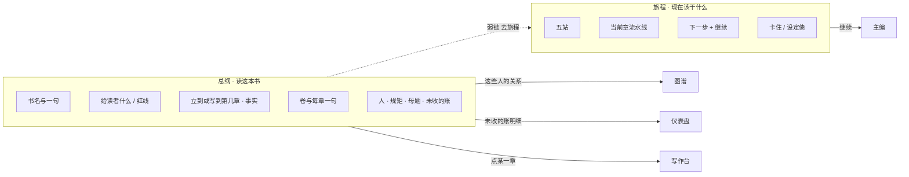
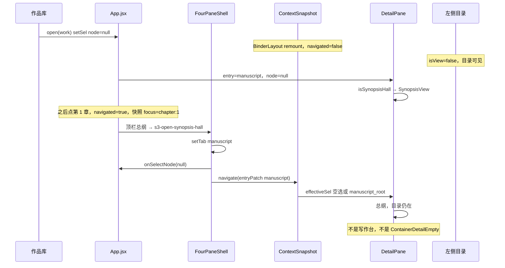

# 总纲真正起到总纲的作用

| 项 | 值 |
|----|-----|
| **文档标题** | 铜炉：总纲是书的肖像，旅程是向导 |
| **作者** | Grok design-doc-writer |
| **日期** | 2026-08-24 |
| **状态** | Draft |
| **产品** | 铜炉 / tonglu · 代码 `scribe3/` · 仓库 `/home/admin/projects/scribe-writing-system` |
| **验收环境** | 只打已部署 demo `https://tonglu.example.com`（不另起平行栈） |
| **短名** | `synopsis-as-book-portrait` |
| **前序** | 2026-08-24 总纲门厅（`SynopsisView` 顶栏第一项，复用 Overview + 抄了旅程五站） |
| **标识符** | 视图 key 仍是 `synopsis`；旧 `overview` 仍作别名。界面文案禁止把评分卡叫「北极星」 |
| **修订** | 2026-08-24 r3：总纲落地三步合同（setTab + 空 sel + `entryPatch('manuscript')`）；门厅含 `manuscript_root`；高亮由四栏壳上报 `synopsisHall` |

---

## Overview

2026-08-24 把「总纲」做成了顶栏第一项，但页面仍是仪表盘加旅程五站的拼盘：同一套 Compass 药丸、同一套母题缺口计数、没有「打开这本书该读什么」的一句，旅程副标题又太弱。作者分不清两页，不是因为没人解释，是因为两页长得像双胞胎。

本设计把总纲做成**书的肖像**：打开就能把整本书当一本书来读——给谁、承诺什么、世界和人、卷章怎么排、种子埋在哪、稿子写到哪——**不问下一步该干什么**。旅程继续当**向导**：当前站、下一步、卡住的地方、继续（预填主编）。两份工作不许混。

**落点（KD-3）：** 打开书不等于切到会藏目录的横切视图。中区在手稿入口且空选或停在手稿根时渲染总纲，**左侧卷章树留下**。从某一章点顶栏「总纲」必须走专用三步落地（切手稿 tab、清空 sel、`navigate(entryPatch('manuscript'))`），禁止只改 sel、禁止套 `planEntryChange`。第一批只改展示层；书级评分卡继续懒加载。

---

## 给人看的一页

打开一本书，左边仍是卷和章的目录，中间是总纲：书名叫什么、一句话它是什么、给读者什么感觉、红线在哪、卷和章各办哪一件、书里有哪些人、世界守什么规矩、母题和还没收回的账、稿子现在立到或写到第几章。这一页不催你写，也不摆五个写作站点。要动手，点顶栏「旅程」或进度行旁边那句弱链。

打开旅程，你看到的是现在该干什么：走到哪一站、下一步聊什么、有没有卡住、点「继续」就能接着写。旅程会收起左边目录，因为那一页是向导，不是读书。

两页图标不一样、第一屏不一样。总纲是读书，旅程是动手。左边树里那个旧的评分卡入口不是总纲，点开仍是机器体检，不是这本书的脸。

---

## Background & Motivation

### 会话结论（必须遵守）

1. 作者要书级「总纲」，因为找不到作品意图。
2. 已落地的门厅把 Overview 改名为 `SynopsisView`，顶栏第一项 `synopsis`，内嵌 `NorthStarBar`，并**原样抄了旅程五站药丸**，外加卷纲 / 母题芯片 / 评分卡懒加载。
3. 问「总纲和旅程什么关系？」已答：总纲 = 这本书是什么；旅程 = 下一步干什么。
4. 作者仍分不清。已同意的诊断：两页是双胞胎——顶栏权重一样、总纲第二块就是旅程五站（同一 Compass、同一药丸）、总纲没有「这一页是读这本书的」一句、旅程副标题太弱、两边都在展示母题/承诺类数据。
5. 本次 **/design 要深度设计，总纲真正起到总纲的作用**。不是「删掉五站」的薄补丁。先想清楚长篇中文小说的总纲是什么，再映射到铜炉。

### 现网双胞胎长什么样（绑代码）

`scribe3/web/src/AppRail.jsx` 顶栏：

```8:14:scribe3/web/src/AppRail.jsx
export const VIEWS = [
  { key: 'synopsis', label: '总纲', icon: BookText },
  { key: 'journey', label: '旅程', icon: Compass },
  { key: 'atlas', label: '图谱', icon: Network },
  { key: 'timeline', label: '时间线', icon: Clock },
  { key: 'insight', label: '仪表盘', icon: Activity },
]
```

图标已经不同，但 `SynopsisView` 进页后立刻又用 Compass 画五站，把差异抵消掉：

```134:173:scribe3/web/src/views/SynopsisView.jsx
        {/* 2. 旅程五站 */}
        <section ... data-testid="synopsis-stations">
            <Compass size={15} className="text-brand" />
            <div ...>旅程五站</div>
              {stations.map((s) => (
                  <button ... onClick={() => onOpenView?.('journey')} ...>
                    {s.label}
```

`JourneyView` 同一套药丸（`data-testid="journey-stations"`），再加当前章、下一步、继续。副标题只有：

> 你只做想象与裁决；系统告诉你做到哪、下一步聊什么。

总纲页标题是「总纲」，**没有副标题**。`NorthStarBar` 自己也用 Compass。作者眼睛里：两页都是指南针 + 药丸 + 母题。

从作品库打开一本书，`App.jsx` `open()` 把选中态清成空节点：

```229:234:scribe3/web/src/App.jsx
  const open = (w) => {
    api.setWork(w.slug)
    writeActiveWorkSlug(w.slug)
    setCur(w)
    setSel({ mode: 'node', node: null })
  }
```

刷新已打开的书走 `readActiveWorkSlug` 直接 `setCur`，`sel` 初始值同样是 `{ mode:'node', node:null }`，**不经过 `open()`**。两种路径今天都落到中区空选。

空选文案**按入口变**：`emptyDetailCopy(entryKey)`（`layout/entrySelection.js` 111–133 行）。手稿入口是「在左侧选择章节开始写作」，设定库是「在左侧选择设定条目…」。容器节点另走 `ContainerDetailEmpty`（「选择目录条目查看详情。」）。不是单一硬编码「选择目录条目」。左侧目录此时**可见**（`isView === false`）。作品意图藏在必须点顶栏「总纲」才出现的折叠条里——而点顶栏会把 `sel` 切成 `mode:'view'`，`FourPaneShell` 对所有 `isView` 滤掉 directory（约 161–163 行），树消失。

所以门厅有两件事要修：① 空选中区不要空白提示，要能读这本书；② **不要**为了显示总纲把打开书改成横切 view，否则进门先丢目录。

### 总纲今天实际拉了什么

`SynopsisView.loadLight` 并行五路，再加 `NorthStarBar` 自己打 `GET /intent`：

| 调用 | 用途（现状） | 是否该出现在总纲第一屏 |
|------|----------------|------------------------|
| `GET /intent` | 读者感受 / 情感弧 / 红线 / 意象 | **是**（书的承诺） |
| `GET /workflow/snapshot` | 五站 + `bible_motif_gap` 名字 | **否**（向导数据） |
| `GET /outline` | 卷 intro + 章字段（无正文） | **是**（结构脊骨） |
| `GET /quality` | 字数、QC、弱章、伏笔计数 | **否**（仪表盘） |
| `GET /setting-completeness` | 角色/规则/势力/地点计数 + 完整度分 | **否**（缺口报告，不是肖像） |
| `GET /promises/ledger` | 开/收/超期计数 | **部分**（「还没收回的账」可读；契诃夫口径留给仪表盘） |
| `GET /north-star/book` | 书级四维评分卡 | **否**（懒加载，机器体检） |

`NorthStarPanel` 在展开前不请求 `northStarBook()`——这条必须保住。`GET /quality` 的 handler 刚按 `FunctionType` 绑回 `app_impl` 全局（`api/routers/quality.py` 201–227 行），本设计不得把缓存辅助函数挪出 `app_impl`。第一批是前端 PR，本来就不碰这条。

### 小说家眼里的总纲（不是仪表盘）

长篇中文小说的总纲通常承载这些，而不是「下一步按钮」：

1. **书名与一句承诺** —— 这本书是什么。
2. **读者感受 / 红线** —— 读完该留下什么，什么不许写。
3. **人物与关系** —— 谁在场、各自要什么；关系网是另一张图。
4. **世界规矩** —— 这本书的账怎么收，不是「完整度 80/100」。
5. **卷章结构与每章一句** —— 卷办哪一段弧，章办哪一件事。
6. **母题与伏笔** —— 立过的骨头、还没收回的账。
7. **稿子写到哪** —— 书的状态，不是任务队列。

铜炉里这些大多已有字段，只是没被当成一本书摊开。缺的不是再造一张表，是页面职责。

---

## Goals & Non-Goals

### Goals

- 打开总纲，作者能**读整本书**，不被问下一步。
- 打开旅程，作者能**看见现在该干什么**，一键继续。
- 两页第一屏、图标语义、副标题、空态文案必须一眼不同。
- 五站药丸离开总纲；进度只留一句事实 + 弱链去旅程。
- 打开书：中区是总纲，**左侧目录留下**。从某一章点顶栏「总纲」必须回到门厅，不得留在写作台。
- 不把总纲嵌进 `JourneyView`。
- 不把死节点 `book_northstar` 激活成总纲（它仍是评分卡，`DetailPane.jsx` 第 173 行）。
- 叙事字段无新作者表单；写入仍走「让主编写入」/ `s3-chief-seed` / MCP `s3_set_intent` + 审批。
- 第一批 PR 零新后端；`northStarBook` 继续懒加载。
- 可见文案用人话：评分卡不叫北极星；不把内部词当标题。

### Non-Goals

- 不在总纲里画 Sigma 关系图（图谱页 `AtlasView` 的活）。
- 不在总纲里做规划看板、事件图、Benchmark 库（现状顶栏三个跳转是工程铬，删掉）。
- 不在总纲里做章流水线、设定债、创意建议、停靠（旅程的活）。
- 不新增「全书一句话」独立表；优先用已有 `intent.north_star`。
- 不在第一批 PR 修 `who_pays` / `axis_terms` / `clock_*` 写丢（见数据模型空缺）。
- 不改 Surreal 2.x / `type::thing`。
- 不在 Grok 运行机跑 `npm ci` / 全量 vitest；前端测走 demo 容器。
- 不为验收另起一套库。

---

## Key Decisions

| 编号 | 决定 | 理由 |
|------|------|------|
| KD-1 | **总纲 = 书的肖像；旅程 = 向导。** 两页不许互相嵌对方的主控件。 | 双胞胎的根因是职责混用，不是缺一句解释。 |
| KD-2 | **五站药丸离开总纲。** 进度行是陈述，右侧一句弱链「去旅程」；整行不可点。英雄区主按钮只在意图空时出现「让主编写入」。 | 五站是向导。整行去旅程会让第一件可点的事变成「动手」，和「总纲不问下一步」打架。 |
| KD-3 | **空选门厅（方案 E）+ 专用落地三步。** 不要 `viewKey:'synopsis'`（`isView` 会藏目录）。门厅谓词：`entryKey==='manuscript'` 且（`!node` **或** `node.type==='manuscript_root'`）；**禁止**用 `!entryKey` 冒充手稿。从顶栏/命令面板进总纲必须一次做完三步（见 §3 `landSynopsisHall`），**禁止**只用 `setSel(null)`，**禁止** `planEntryChange('manuscript')`。`open()` / 刷新保持空节点（Provider 随书 remount，`navigated===false` 时投影未盖 sel）。设定/伏笔等入口空选仍 `emptyDetailCopy`。顶栏高亮由四栏壳上报 `synopsisHall`，App 不得猜 `!node`。 | 人从第 1 章点总纲时 `navigated===true`，快照焦点仍是 `chapter:N`：只清 sel，I-2（FourPaneShell 217–228 行）故意不给空选补记 navigate，投影会冲回写作台。`planEntryChange` 对粘性章是 `keep`（仍停在章），对设定叶是 `land` 到 `manuscript_root`（今日 `ContainerDetailEmpty`）。只有 `entryPatch('manuscript')` 把 focus 改成 `entry:manuscript`，再配上空 sel，`selectionFromSnapshot` 才会留下门厅。 |
| KD-4 | **总纲第一屏不拉 `workflowSnapshot` / `quality` / `setting-completeness`。** 这条从 **PR-1** 生效，不是等 PR-3。脊骨：`outline` + `intent`。人/规矩/母题/账在 PR-3 再加列表 GET。PR-1 去掉一切靠 snapshot 吊着的母题缺口芯片。 | snapshot 是导演态；quality / 完整度是仪表盘。PR-1 若只删五站，demo 上仍是「仪表盘减药丸」。 |
| KD-5 | **`GET /north-star/book` 继续只在展开评分卡时请求。** 死节点 `book_northstar` 仍渲染 `NorthStarPanel`，不改道总纲。 | 跨章扫描重；评分卡是机器体检，不是肖像。 |
| KD-6 | **总纲最终不用 `NorthStarBar` 当英雄区**（PR-2）。PR-1 可暂留意图条或空位，但必须已拆掉仪表盘块。`NorthStarBar` 留给写作台/大纲容器。 | 折叠条 + Compass 不像读一本书；且它不展示已有 `north_star`。 |
| KD-7 | **人物在总纲是名单，不是图。** 主角色 + 一句「他要什么」；关系跳图谱。 | 总纲要能读；图是 Atlas 的活。 |
| KD-8 | **每章一句取数顺序写死：** `settled_note` → `hook_preview` → 截到 80 字的 `synopsis` → 「还没写这一句」。不新字段。点章进写作台。 | 现行写路径是 play-contract；`synopsis` 常空，三章设计过的书只靠 synopsis 会整页「还没写」。`persist_fields_blocked` 已恒 `None`，禁止再引用 ≥500 字闸。 |
| KD-9 | **第一批 PR 零新后端。** 可选 `GET /book-portrait` 只在 300+ 章、`outline()` JSON 明显过重时再做。 | 现有 GET 已覆盖肖像。 |
| KD-10 | **总纲默认不收起右侧主编。** `synopsis` **保持不在** `CROSS_VIEW_COLLAPSE_CHAT`（现码已如此，含 `overview`/`journey`、不含 `synopsis`）。不要为了「不收聊天」去改 `isView`。藏目录是 **view 的既有行为**；门厅根本不进 view（KD-3）。 | 「让主编写入」必须看得见。 |
| KD-11 | **空态说人话，不假装仪表盘。** 缺的块写「还没有」。最小空态文案随 **PR-1** 上，不放到最后。 | 空书看起来像空产品，是第一风险。 |
| KD-12 | **视图 key / testid 可保留英文；可见文案必须人话。** `overview` 别名保留。 | 兼容路由与测试。 |
| KD-13 | **总纲点人/规矩/母题一律经 `onNavigateToObject` → `targetNodeToSelection`。** 点卷用与 `VolumeDetailPane` 同形的 volume 节点走 `onSelectNode`。禁止把 `GET /entities` 行原样丢进 sel。 | `entities[].id` 是 `role:{local}`；栏3要的是 `{ type:'character', id:'character:'+local, ref:local }`。形状错了就是「未知节点类型」。 |

---

## Proposed Design

### 1. 两页分工



禁止：

- 总纲出现五站药丸、`journey-continue`、设定债、创意建议、章流水线、规模四格、完整度分数、弱章列表、契诃夫审计、页头工程跳转。
- 旅程出现卷章结构墙、作品意图条、母题芯片墙、评分卡。
- 任何页面把 `book_northstar` 当总纲入口。

### 2. 总纲信息架构（顺序即第一屏）

从上到下，一块一事。默认展开 vs 折起写死。

| 顺序 | 块 | 默认 | 作者读到什么（人话标题） | 数据 | 动作 |
|------|----|------|--------------------------|------|------|
| 0 | 页头 | 开 | 「总纲」+ 副标题「把这本书当一本书来读」 | 作品 `title`（`workTitle` prop） | **无**跳仪表盘/事件图/Benchmark |
| 1 | 这本书 | 开 | 一句承诺 + 读者感受 / 情感弧 / 红线 / 摸起来 | `GET /intent` | 「让主编写入」（意图空时醒目） |
| 2 | 稿子写到哪 | **一行陈述** | 见 §2.3；**不是**整行按钮 | `GET /outline` 推导 | 右侧弱链「去旅程」→ `onOpenView('journey')` |
| 3 | 卷与章 | 第一卷开，其余折 | 卷名 + 卷纲一句；每章标题 + **一句**（§2.4 取数顺序） | `outline`：`intro` / `settled_note` / `hook_preview` / `synopsis` | 点章 `onJumpChapter`；点卷 → volume 节点 |
| 4 | 这些人 | 有人则开 | 主角色姓名 + 一句「要什么」 | `GET /entities` **客户端** `kind==='character'` | 「在图谱里看关系」；点名 → `onNavigateToObject` |
| 5 | 世界怎么运转 | ≤3 条开，更多折 | 规则名 + 代价/限制一句 | `GET /world-rules` | 点名 → `onNavigateToObject` |
| 6 | 母题 | 开 | 已立母题：名 + theme/unfolding 一句 | `GET /motifs` | 点名 → `onNavigateToObject`。**不显示「还差 N 条」** |
| 7 | 还没收回的账 | 有未收则开 | 「还没收回 N 笔…」+ 最多 5 条 `text` | `GET /promises/ledger` 的 `open` | 「看全部」→ insight。不写契诃夫/平衡勾 |
| 8 | 机器体检 | **默认折** | 「机器看这本书的参考，不是作品意图」 | 展开才挂 `NorthStarPanel scope="book"` | 不进入第一屏请求 |

**PR-1 就必须移出总纲**（不要留到 PR-2/3）：

- `synopsis-stations` 整块。
- `synopsis-scale` 四格。字数并入第 2 行。
- `synopsis-codex` 完整度分数、`missing_dimensions`。
- `synopsis-weak`。
- `synopsis-promises` 里的契诃夫 / 「✓ 已平衡」口径（PR-1 整块拿掉；PR-3 再以人话账补回）。
- 靠 `bible_motif_gap` 的母题芯片（停 snapshot 后不可吊着空壳）。
- 页头三个工程跳转。

PR-1 验收页骨架：**页头 + 意图条或空位 + 进度一行 + 卷章**。这已经是书的肖像骨架，不是「仪表盘减药丸」。

### 2.1 页头视觉（必须和旅程不同）

| | 总纲 | 旅程 |
|--|------|------|
| 顶栏图标 | `BookText`（已是） | `Compass`（已是） |
| 页内主图标 | `BookText`，**禁止 Compass** | `Compass` |
| 标题 | 总纲 | 旅程（与顶栏对齐；可删「写作」二字） |
| 副标题 | **把这本书当一本书来读。不催你写下一笔。** | **现在该干什么：这一站、下一步、卡住的地方。** |
| 第一屏主体 | 书名 + 一句承诺 + 卷章 | 五站 + 当前章 + 下一步 + 继续 |
| 主按钮 | 「让主编写入」（仅意图空时醒目） | 「继续（预填主编）」 |
| 目录 | **在**（空选门厅） | 收起（`isView` 既有行为） |
| 版式 | `max-w-5xl` 阅读栏、衬线标题 | `max-w-3xl` 任务栏 |

`JourneyView` 副标题从弱句换成上表那句。不要在旅程页头再挂作品意图。

### 2.2 「这本书」块

`NorthStarBar` 仍用于 `WriteLayout` / `ContainerOutline`。总纲英雄区 PR-2 换成 `SynopsisIntent`（共用 `api.intent()`，**不是**同一条折叠工具栏）。PR-1 可暂留 `NorthStarBar`，只要仪表盘块已拆。

展示优先级：

1. 有 `north_star` → 大字一句，当作这本书的脸。
2. 无 `north_star` 但有 `reader_feeling` → 用读者感受当临时一句，块底「还没有一句话概括这本书」。
3. 全空 → 空态（§4）。

四格用可读段落。`north_star` 今日 `GET /intent` 已返回（`store/intent.py` 34–35 行），只是 UI 没画。

#### 让主编写入：两条事件都要发（PR-2 合同）

现码 `NorthStarBar.askChiefToWrite` 只写 `sessionStorage s3.chief.seed` 并派 `s3-chief-seed`，**不**派 `s3-right-tab`。`FourPaneShell` 听 `s3-right-tab` 才会 `activate` + `expandRightPanel`（298–304 行）。

总纲按钮必须：

1. `sessionStorage.setItem('s3.chief.seed', text)` + `dispatch('s3-chief-seed', { detail: text })`
2. `dispatch('s3-right-tab', { detail: 'chief' })`

vitest 钉死第 2 条 `detail === 'chief'`。种子里的 `s3_get_intent` / `s3_set_intent` 只给主编，**不出现在作者可见标题**。禁止新表单。

种子骨架（给主编）：

```
请登记/更新这本书是什么（需我审批）：
一句话：……
读者读完该留下：……
情感怎么走：……
不许写：……
这本书摸起来：……
先 s3_get_intent 核对，再用 s3_set_intent 写入。没批准不许说已经存上。
```

工程配额留在系统中心「本书设置」。

### 2.3 「稿子写到哪」一行（不是五站，也不是整行 CTA）

从 `outline.chapters` 本地推导，**不打 snapshot**。`has_prose` 缺省 **false**（`outline()` 降级 SQL 可能没有该列，不得当异常）。

```
hasProse(c) = c.has_prose === true
currentProse = 最后一条 hasProse 的章
currentPlan = 最后一条有 oneLine（§2.4）的章
current = currentProse || currentPlan || sort 序最后一章
M = sum(word_count || 0)

无章：
  「还没有章。」
有章且 currentProse：
  「稿子写到第 X 章《标题》。全书 N 章」+（M>0 则「，约 M 字。」）
有章但没有正文：
  「立到第 X 章《标题》，还没有正文。全书 N 章。」
  禁止「约 0 字」；禁止把「立到」说成「写到」。
```

现网 `book_7042c28c` 三章设计、零正文：应是「立到第 3 章…还没有正文」，不是「现在写到第 3 章…约 0 字」。

**交互：** 左/中是纯陈述（`data-testid="synopsis-progress-line"`）。右侧 `<button>` 弱链「去旅程」（`data-testid="synopsis-open-journey"`）。不要 `onOpenView('journey')` 绑在整行。不要复述 `next_step.title`。

### 2.4 卷与章

沿用 `groupOutline()`。每章一行：

- `chapterLabel(seq, title)`
- 一句，按 **KD-8** 取第一条非空：
  1. `String(settled_note).trim()`（定稿后记：本章办成了什么；`outline()` 已选此列）
  2. `String(hook_preview).trim()`（`outline()` 已算，最多约 40 字）
  3. `String(synopsis).trim()` 截到 80 字 + 省略号（长纲会有；**不是**因为旧 persist ≥500 闸——该闸已废，`iceberg.persist_fields_blocked` 恒 `None`）
  4. 「还没写这一句」
- 不要展开 `beats` / `scenes` / QC

卷头：`title` + `intro`（过长截 160 字）。点卷：

```js
onSelectNode({ id: `vol:${vid}`, type: 'volume', ref: vid, label: title })
```

与 `VolumeDetailPane.test.jsx` / `ManuscriptDirectory.jsx` 同形。`targetNodeToSelection` **不处理** volume，不要硬塞进去。

不新增 `synopsis_one_liner` 字段。

### 2.5 这些人（名单，不是图）

`GET /entities` **没有** `kind` 查询参数。`all_entities()` 返回角色 **加地点**（`store/misc.py` 20–23 行）。前端必须 `.filter((e) => e.kind === 'character')`（`DeduceTree.jsx` 等同款）。地点不进「这些人」。

字段：`name`, `importance`, `surface_goal`, `deep_need`；私密身世已掩码。禁止 `reveal_secret`。

**主角色排序：** 不要 `MAIN_CAST_IMPORTANCE.includes(raw)`。前端抄一份与 `arc_signals.is_main_cast_importance` 同口径的小函数：先走别名表（含「主要角色」「重要配角」「主角」「主要」… → protagonist/major），再判断是否主角色。未点名「只认英文四词」——「主要角色」必须进主档，不能排到可折区垫底。

展示上限 12；先滤角色再 `slice(12)`。多了「还有 K 人，去设定库」。每一行：`名 · 他要什么`（`surface_goal` 否则 `deep_need`）。不要 `backstory`。

跳转：

- 「在图谱里看关系」→ `onOpenView('atlas')`
- 点名 → `onNavigateToObject({ type: 'character', id: entity.id, label: entity.name })`  
  `entity.id` 形如 `role:沈拾灯`；`targetNodeToSelection` → `codexNode` → `{ id:'character:沈拾灯', type:'character', ref:'沈拾灯', label }`，入口 `codex`。验收：中区是设定卡，不是「未知节点类型」。

**不**请求 `GET /graph` / `GET /character-relations`。

### 2.6 世界怎么运转

`GET /world-rules`：只用 `name`、`cost`、`limitations`。**不要渲染 `note` / `exceptions` / `capabilities`，不要 `JSON.stringify` 整行。** `list_world_rules` 是 `SELECT *`，payload 里会有这些键，展示层丢掉。

每条一行：`name` + `cost`（空则 limitations 首条）。上限 8。

点名：`onNavigateToObject({ type: 'world_rule', id: name, label: name })`（落入 `targetNodeToSelection` 对 `world_rule` 的 `codexNode` 分支）。

首屏只 rules，不打 `/factions`。不展示完整度分数。

### 2.7 母题

`GET /motifs`（`name`, `theme`, `unfolding`, `phase`, `hit_count`）。**不要** `bible_motif_gap`。缺口是旅程 blocker。

点名：`onNavigateToObject({ type: 'motif', id: 'motif:'+id, label: name })` → 设定叶 `CodexDetail`（`type==='motif'` 且 ref 不是分组键）。

### 2.8 还没收回的账

PR-3 补回（PR-1 先整块拿掉契诃夫审计）：

- 「还没收回 N 笔」；超期则「其中 M 笔埋了超过三章还没收回」
- 最多 5 条 `open[].text`（截 40 字）
- 「看全部」→ insight
- 去掉平衡勾 / 契诃夫 / 障眼法

### 2.9 机器体检（折起，懒）

保持 `data-testid="synopsis-scorecard"`。禁止默认展开，禁止叫北极星。

`NorthStarPanel` 页头现文案：「改读者感受/红线请用顶栏『作品意图』」。总纲嵌 `scope="book"` 时改为：

> 改这本书是什么，请到上面「这本书」让主编写入。

可加可选 prop，例如 `intentHint="synopsis"`；写作台里的章级面板保持旧句。不要把这段改名叫北极星。

### 3. 路由、落点、跳转

#### 3.1 为什么不能只改 sel（现码三处打架）

1. **快照会盖掉空选。** `effectiveSel = navigated ? selectionFromSnapshot(snapshot, sel) : sel`（`FourPaneShell.jsx` 121 行）。从某一章点过之后 `navigated===true`。I-2 旁路补记（217–228 行）写明：空选 `node:null` **故意不** `navigate`，等 `handleActive` 的入口收敛。顶栏只 `setSel(null)` 时快照焦点仍是 `chapter:N`，投影把空 sel 填回写作台。打开书第一帧 `navigated===false`（`BinderLayout key={slug}` remount）能出门厅；**点章再点总纲就坏**。

2. **不能套 `planEntryChange('manuscript')`。** 章/景/卷是 `STICKY_TYPES`（`entrySelection.js` 12 行）：人还在第 1 章时切手稿是 `keep`，栏 3 仍是章。从设定叶切手稿是 `land` 到 `{ type:'manuscript_root' }`（`defaultLandingNode` 63–70 行）。`DetailPane` 对容器走 `ContainerDetailEmpty`（「选择目录条目查看详情。」，59、275 行）。只认 `!node` 的门厅这两种都出不了总纲。

3. **`selectionFromSnapshot` 对 `focus.type==='entry'`**（`contextSelection.js` 66–71 行）：若 fallback 仍是章，`nodeCompatibleWithEntry(chapter, 'manuscript')` 为 true（粘性 + 手稿域），会 **原样返回那一章**。所以必须先把本地 sel 清掉，再把快照 focus 改成 `entry:manuscript`，两步缺一不可。

4. **App 没有入口。** `AppRail` 在 `App.jsx`，今日 `view={sel.mode==='view' ? viewKey : null}`。入口在四栏壳 left dock / 快照。凭 `!node` 高亮会把伏笔/母题空选（`defaultLandingNode` 为 null）也点亮。`ChiefDock.selContext` 空选今天是「未选中」（269 行）。

#### 3.2 总纲落地合同 `landSynopsisHall`（PR-1 必做）

抽成 **一条函数**，App 顶栏、命令面板、测共用。实现放在 `FourPaneShell`（这里才有 `setTab` / `navigate` / `onSelectNode`）。**三步必须同一事件里做完**，禁止只用 `setSel`，禁止只用 `planEntryChange`：

```js
// FourPaneShell · 总纲专用落地。不要走 applyEntryKey / planEntryChange。
function landSynopsisHall() {
  setTab('manuscript')                              // 1. 目录仍是手稿树
  onSelectNode?.(null)                              // 2. 本地 sel = { mode:'node', node:null }
  navigate(entryPatch('manuscript'))                // 3. 快照 focus = entry:manuscript；投影留下空选
  if (directoryCollapsed) expandDirectory()
}
```

`entryPatch`（`context/contextSnapshot.js` 119–126 行）把 `focus.type` 设为 `'entry'`、`detail_route` 为 `entry:manuscript`，这样 `selectionFromSnapshot` 不再走章分支。配合步骤 2 的空 `fallbackSel`：`nodeCompatibleWithEntry(null, 'manuscript')` 为 true，返回空选。

接线：

- `App.handleView('synopsis'|'overview')` **不要** `setSel({ mode:'view', viewKey })`。若在系统中心/设置/管理台，先空选退出 hub 挂上四栏壳，再 `hallTick++`（壳未挂时事件会丢）。打开书/刷新由 Binder 按 work 再请求一次落地。`journey` / `atlas` / … 仍走 `viewPatch`（藏目录，既有横切）。
- 命令面板点「总纲」走同一 `handleView`。
- **禁止** `handleActive('manuscript')` / `applyEntryKey('manuscript')` 当总纲落地（内部是 `planEntryChange`）。

门厅谓词（`entrySelection.js` 导出，测/壳/DetailPane/ChiefDock 共用）：

```js
export function isSynopsisHall(entryKey, sel) {
  if (entryKey !== 'manuscript') return false
  if (sel?.mode === 'view') return false
  const t = sel?.node?.type
  return !sel?.node || t === 'manuscript_root'
}
```

**不要** `!entryKey`。`projectedEntryKey` 在未导航时是 left tab；打开书默认手稿即可。伏笔空选 `entryKey==='promise'` 不得进总纲。

#### 3.3 序列



#### 3.4 改动对照

| 改动点 | 现在 | 改为 |
|--------|------|------|
| `App.open()` | `{ mode:'node', node:null }` | **保持**（不要改 view） |
| 刷新 `setCur` | sel 初始空节点 | **保持**；新书 remount 后 `navigated===false`，空选即门厅 |
| 顶栏/命令面板「总纲」 | `setSel({ mode:'view', viewKey })` 藏目录 | `landSynopsisHall` 三步。journey/atlas 仍 view |
| `AppRail` 高亮 | 仅 `sel.mode==='view'` | 四栏壳上报 `synopsisHall`（`isSynopsisHall(projectedEntryKey, effectiveSel)`）→ App 传入 `view`。门厅时 `view==='synopsis'`。**禁止** App 猜 `!node` |
| `DetailPane` 门厅 | `emptyDetailCopy` / `ContainerDetailEmpty` | `isSynopsisHall` 为真则 `SynopsisView`（覆盖 `!node` **和** `manuscript_root`）。其它入口空选仍 emptyDetailCopy。拦截须在容器空态分支之前 |
| `DetailPane` view 别名 | overview/synopsis → SynopsisView | **保持**（旧测试）。产品主路径是门厅，不靠藏树的 view |
| `CROSS_VIEW_COLLAPSE_CHAT` | 不含 synopsis | **不要加入**。门厅不是 view，右栏不折叠 |
| `ChiefDock` | 空选「未选中」；view synopsis 露出英文 | 传入同一 `synopsisHall`：真 → 标签「总纲」，不是「未选中」、不是英文 `synopsis`。view journey →「旅程」；overview 别名若仍出现 →「总纲」 |
| `book_northstar` | NorthStarPanel | **不动** |

`isJourneyViewSel` 只认 `viewKey==='journey'`。门厅不是 journey，不套旅程栏宽。

旧 `viewKey=synopsis` 仍能渲染总纲（兼容），产品主路径不靠它。`detailPane-routing.test.jsx` 的 view 别名测试保留。

跳转地图：

```text
总纲 ──弱链去旅程──► 旅程（view，目录收起）
    ──某章────────► 章写作台（node chapter）
    ──某卷────────► VolumeDetailPane（volume 节点）
    ──某人/规矩/母题─► 设定叶（targetNodeToSelection）
    ──关系────────► 图谱（view）
    ──未收的账────► 仪表盘
    ──让主编写入──► 右侧主编（s3-chief-seed + s3-right-tab=chief）
```

### 4. 空书 / 写到一半 / 写完

禁止「完整度 0/100」「还差 3 条母题」当英雄句。

#### 空书（PR-1 最小稿必须有）

```
总纲
把这本书当一本书来读。不催你写下一笔。

《书名或「这本书」》
这本书还没说清自己是什么。
（让主编写入）

还没有章。
```

PR-3 补上：还没有人 / 世界规矩还没写下 / 还没立母题。向导入口是进度行弱链或顶栏旅程，不要复制五站。

#### 写到一半

有意图、有章。进度行按 §2.3：**有正文说「写到」，只有纲/设计说「立到」。** 卷块展开第一卷。人/规矩/母题有则列。

#### 写完

仍是肖像，不换成奖状。「稿子写到第 N 章」。不显示 `ledger.congrats`。评分卡仍折起。

### 5. 性能与请求预算

#### PR-1 第一屏

| GET | 理由 |
|-----|------|
| `/intent` | 一句 + 感受/红线（若仍嵌 NorthStarBar，由它打） |
| `/outline` | 卷章 + 字数 + has_prose / settled_note / hook_preview；**不读正文** |

**PR-1 即停止：** `/workflow/snapshot`、`/quality`、`/setting-completeness`。母题芯片不靠 snapshot 吊着。

#### PR-3 追加（并行，失败互不影响）

| GET | 理由 |
|-----|------|
| `/entities` | 客户端滤角色，再 slice(12) |
| `/motifs` | 母题 |
| `/world-rules` | 只要 name/cost/limitations |
| `/promises/ledger` | 未收的账 |

单块 `catch → null`。前端截断 **不等于** 减 payload：`outline()` 仍带每章 `beats`/`beats_meta`/`scene_meta`/QC；`list_world_rules` 是 `SELECT *`。12 章没问题。300+ 章才考虑 PR-6。entities/rules 是相对今天多出来的重量，用上限和字段白名单压展示，不提前加聚合端点。

#### 明确永不进第一屏

| GET | 原因 |
|-----|------|
| `/workflow/snapshot` | 导演态 |
| `/quality` | 仪表盘；字数已在 outline。缓存符号留在 `app_impl` |
| `/setting-completeness` | 缺口分 |
| `/north-star/book` | 仅展开评分卡 |
| `/graph` | Atlas |
| 章 `prose` | 违反 outline 窄查询 |

#### SSE

现 `SynopsisView.LIVE_TABLES`：`chapter, promise, foreshadow, intent, motif, volume, chapter_scorecard, _reconnect`。

后端 `/live` 订阅清单含 **`character` 和 `world_rule`**（`app_impl._LIVE_TABLES` 1716–1720 行，U-002）。前端加上这两张是合法的，能收到推送。

PR-1/PR-4：

- 列表可加 `character`, `world_rule`（PR-3 有人/规矩块之后才有意义；PR-1 不加也行）。
- **保留 `_reconnect`。** 不是删它。`loadLight` 不再请求 snapshot/quality 后，重连也**不会误拉**它们。
- 防抖 300ms。评分卡展开后仍由 `NorthStarPanel` 800ms 防抖；总纲 live 不得间接触发 `northStarBook`。

实现前对照 `scribe3/live.py` 的 `payload.table`（即订阅表名字符串）。

### 6. 写入政策

| 块 | 展示 | 写入 |
|----|------|------|
| 一句 / 感受 / 弧 / 红线 / 摸起来 | 只读 | `s3_set_intent` + 审批；「让主编写入」 |
| 卷 intro | 只读 | `s3_patch_volume`（已有） |
| 章「一句」 | 只读 | **禁止 `s3_patch_chapter_plan`**（410 `stage_gone`）。改梗概走 `s3_patch_chapter_meta(synopsis=…)`。写「这一章要办的那一件」走现行 duty/design（`s3_generate_stage` / `s3_patch_play` / `s3_patch_contract`）。总纲不提供编辑表单。可选 PR-3：空章种子「让主编写这一章要办的那一件」，**不要**教主编调已废工具 |
| 人物 / 规矩 / 母题 | 只读 | 设定叶 + 主编 |
| 伏笔 | 只读 | 仪表盘 / 主编 |
| 字数目标 | 不在总纲 | `PUT /intent-goals` |
| 评分卡 | 只读机器 | 禁止当 SSOT 写 |

### 7. 旅程侧最小配套

1. 副标题换成 §2.1 那句。
2. 五站标题可改为「写作走到哪」。
3. 不嵌入 `NorthStarBar`、不嵌入卷章墙。
4. 母题缺口段留下。
5. 「继续」仍是本页主按钮。

禁止把总纲折进旅程第二屏。

### 8. 组件切分与 prop 传递

- `SynopsisView.jsx` —— 页头、load、live、空态、门厅
- `SynopsisIntent.jsx` —— PR-2
- `SynopsisProgressLine.jsx`
- `SynopsisOutline.jsx`
- PR-3：`SynopsisCast` / `SynopsisWorld` / `SynopsisMotifs` / `SynopsisPromises`
- 评分卡懒挂 `NorthStarPanel`

testid：保留 `synopsis-view`；**删除** `synopsis-stations`；新增 `synopsis-progress-line`、`synopsis-open-journey`；保留 `synopsis-intent`。

**`workTitle` 传递链（PR-2 缺一截就会空）：**

```
App.cur.title
  → BinderLayout workTitle={cur.title}     （今日 BinderLayout 只收 work=slug）
  → FourPaneShell workTitle={...}          （今日无此 prop，必须加）
  → DetailPane workTitle={...}
  → SynopsisView workTitle={...}
```

门厅与 view 别名两条渲染都要带上。

```jsx
// DetailPane 手稿门厅：必须在 ContainerDetailEmpty 之前。
// 认 manuscript_root，避免 land 到根时掉进「选择目录条目」。
// 禁止 !entryKey 冒充手稿。
if (isSynopsisHall(entryKey, sel)) {
  return (
    <SynopsisView
      workTitle={workTitle}
      onJumpChapter={onJumpChapter}
      onOpenView={openView}
      onSelectNode={onSelectNode}
      onNavigateToObject={onNavigateToObject}
    />
  )
}

// 旧 view 别名
if (k === 'overview' || k === 'synopsis') {
  return (
    <SynopsisView
      workTitle={workTitle}
      onJumpChapter={onJumpChapter}
      onOpenView={openView}
      onSelectNode={onSelectNode}
      onNavigateToObject={onNavigateToObject}
    />
  )
}
```

---

## API / Interface Changes

### 第一批：无新后端

```js
api.intent()
api.outline()
api.entities()          // 客户端滤 character
api.motifs()
api.get('/world-rules') // 可加 listWorldRules 薄封装
api.promisesLedger()
```

总纲停用：`workflowSnapshot`、`quality`、`setting-completeness`（**PR-1 起**）。

### 导航合同（PR-3）

| 点击 | 调用 | 形状 |
|------|------|------|
| 角色 | `onNavigateToObject({ type:'character', id: entity.id, label: name })` | `targetNodeToSelection` → character 叶，`ref` = 去 `role:` 的本地 id |
| 世界规则 | `onNavigateToObject({ type:'world_rule', id: name, label: name })` | 同上，`type:'world_rule'` |
| 母题 | `onNavigateToObject({ type:'motif', id: 'motif:'+id, label: name })` | 设定叶 motif |
| 卷 | `onSelectNode({ id:'vol:'+vid, type:'volume', ref: vid, label })` | 与 VolumeDetailPane 同形 |
| 章 | `onJumpChapter(seq)` | 已有 |

验收：点角色名，中区是设定卡，不是「未知节点类型: …」。

### 后续可选 `GET /book-portrait`（不进第一批）

仅当 demo 上 300+ 章 outline JSON 明显拖慢，有体积/耗时证据。形状仍只读、无 prose、无业务层私有 `_query`。`chapters[].one_line` 按 KD-8 在服务端算好亦可。不绑旗。

---

## Data Model Changes

**第一批：无 schema、无 migration。**

| 小说总纲要的 | 铜炉已有 | 空缺 |
|--------------|----------|------|
| 书名 | `works[].title` | 须经 FourPaneShell 传到总纲 |
| 全书一句 | `intent.north_star` | UI 未展示（PR-2） |
| 读者感受 / 弧 / 红线 / 意象 | `intent.*` | PR-1 可暂用条；PR-2 换成肖像 |
| 谁付钱 / 轴 / 书钟 | 迁移 144 有列；MCP 收参 | `get/set_intent` 白名单无这四键；总纲不画空格 |
| 卷纲 | `volume.intro` | 有 |
| 每章一句 | `settled_note` → `hook_preview` → `synopsis` | 不新列；禁止只绑 synopsis |
| 人物 | `GET /entities` 滤 character | 总纲今日只有人数 |
| 关系网 | `/graph` | 总纲不做；跳 Atlas |
| 世界规矩 | `GET /world-rules` | 只展示 name/cost/limitations |
| 母题 | `GET /motifs` | 不要 snapshot 缺口 |
| 伏笔 | ledger `open` | 人话，不要审计口径 |
| 写到哪 | outline `has_prose` + 字数 | 有正文/无正文两套文案 |
| 机器体检 | `/north-star/book` | 懒加载 |

Surreal 仅 3.x。禁止 `type::thing`。

---

## Alternatives Considered

### A. 保持现在的拼盘

只改副标题或删五站标题。作者已否。**不采用。**

### B. 把总纲并进旅程

违反既定「是什么 vs 下一步」，也违反「不要把总纲放进 JourneyView」。**不采用。**

### C. 真总纲 = 书的肖像；旅程 = 向导（产品方向，采用）

两页分家。落点实现见 E，不要和「切 view 藏目录」绑死。

### D. 激活 `book_northstar` 当总纲

该节点是评分卡；树也不产出它。**不采用。**

### E. 空选中区 = 总纲，目录留下（落点，采用，即 KD-3）

相对「打开书切 `viewKey:synopsis`」（会藏目录）：

| | 切 view（曾写在旧 KD-3） | 空选门厅 E |
|--|--------------------------|------------|
| 进门看见 | 全幅总纲，**左侧树没了** | 树 + 肖像 |
| 刷新 | 须额外把 restore 也改 view，否则仍空白 | sel 天生空节点，同一落点 |
| 顶栏高亮 | 自动 | 四栏壳上报 `synopsisHall`，App 不猜 `!node` |
| 和横切一致 | 是（图谱/旅程同款） | 总纲不当横切；旅程/图谱仍藏树 |
| 设定库空选 | 不误伤 | 必须按 entry 分支，手稿才出门厅 |

**采用 E。** 给人看的一页写的是「打开书，目录还在，中间是总纲」，不是「进门先收起树」。从某一章回来必须走 §3 三步合同，否则快照会把人钉在写作台。

---

## Security & Privacy Considerations

- 总纲只读。不新开 REST 世界写。
- `GET /entities` 已掩码 `backstory_secret`；不得 `reveal_secret=true`。
- 世界规则只展示 name/cost/limitations，不把 `note` 当英雄句。
- 评分卡展开才打跨章扫描。
- 种子不含部署密钥。`s3_*` 工具名只出现在给主编的种子里。

---

## Observability

- 单块失败：「暂时读不到×，不影响其他块」。
- 回归：PR-1 即断言总纲不调用 `workflowSnapshot` / `quality`；未展开不调用 `northStarBook`。
- demo 网络面板：PR-1 后打开总纲无 `/workflow/snapshot`、无 `/quality`、无 `/north-star/book`。

---

## Rollout Plan

- 无新旗。旧 `overview` viewKey 仍能渲染总纲。
- **PR-1 可独立热更 demo**——因为 PR-1 已经是肖像骨架（无仪表盘、无五站、空选门厅、最小空态），不是半拉子「仪表盘减药丸」。
- 热更：`./scripts/deploy_demo.sh`。无 schema。回滚=revert 前端。
- PR-5/PR-6 另案，不进总纲验收。

---

## Test Plan

### vitest（demo 容器，不在 Grok 机 `npm ci`）

`SynopsisView.test.jsx`（PR-1 起）：

1. 标题「总纲」+ 副标题含「当一本书来读」。
2. **没有** `synopsis-stations`，没有五站站名。
3. **没有** 规模四格/完整度/弱章/契诃夫文案/页头「Benchmark 库」等工程跳转。
4. 有 `synopsis-progress-line`；有正文用「写到」，无正文用「立到」；弱链「去旅程」调用 `onOpenView('journey')`；整行不是按钮。
5. 第一屏 **不调用** `workflowSnapshot` / `quality` / `setting-completeness`。
6. 未展开评分卡时 `northStarBook` 0 次；展开 1 次；`northStarChapter` 0 次。
7. 单块失败不挡整页。
8. `OverviewView` 仍渲染同一页。
9. live：改 chapter 后 300ms 刷新 outline，仍不拉评分卡。
10. 空书最小文案：「还没有章」/「还没说清自己是什么」，无完整度分数。
11. 章一句：有 `settled_note` 时优先于 synopsis。

其它（PR-1）：

- `detailPane-routing`：synopsis/overview 别名（已有）。
- **空选门厅：** `isSynopsisHall('manuscript', { mode:'node', node:null })` → `synopsis-view`；`node.type==='manuscript_root'` 同样是总纲，不是 `ContainerDetailEmpty`；`entryKey='codex'` 空选仍是设定库空态。**不要** `!entryKey`。
- `appRail-layout`：第一项仍是总纲。
- **落地三步：** `landSynopsisHall` 调用 `setTab('manuscript')`、`onSelectNode(null)`、`navigate(entryPatch('manuscript'))`；**不**调用 `planEntryChange`。从 `{ type:'chapter', ref:1 }` 落地后 `effectiveSel` 不是章。
- `entrySelection` 测：粘性章不得挡住总纲落地（`planEntryChange` 仍 keep 章——这正是禁止用它的理由）；`isSynopsisHall` 单测。
- 顶栏点总纲：`handleView('synopsis')` 不进入 `mode:'view'`，走 `s3-open-synopsis-hall`。
- **AppRail 高亮：** 由壳上报 `synopsisHall`，伏笔空选不得把 `view` 设成 synopsis。
- **ChiefDock：** `synopsisHall` → 「总纲」不是「未选中」、不是英文 `synopsis`；`journey` → 「旅程」；overview 别名 → 「总纲」。
- 右栏：门厅默认不折叠（不在 collapse 集）。
- `JourneyView`：新副标题；仍有 `journey-stations` 与 `journey-continue`。

PR-2：`workTitle` 出现在页头；「让主编写入」派发 `s3-right-tab` detail `chief`；展示 `north_star`。

PR-3：点角色 → 设定卡（mock `onNavigateToObject` 收到 `role:` id 或经 `targetNodeToSelection` 的 character 叶）；entities 含 place 时地点不进名单；「主要角色」进主档。

### demo 冒烟（`tonglu.example.com`，PR-1 即可）

1. 作品库打开书 → 中区总纲，**左侧目录仍在**，不是空白提示。
2. 刷新（已记住这本书）→ 仍是总纲 + 目录。
3. 看不见五个站名、看不见完整度英雄句、看不见契诃夫。
4. 网络无 `/workflow/snapshot`、无 `/quality`、无 `/north-star/book`。
5. 展开评分卡才出现 `/north-star/book`。
6. 点第 1 章进入写作台；再点顶栏「总纲」→ 中区回到总纲且**目录还在**，不是留在写作台、也不是「选择目录条目」。点旅程，目录收起，有继续。
7. 界面无「北极星」作为评分卡标题。
8. 现网无正文、有章设计的书：进度行是「立到」不是「写到第×章约 0 字」。

---

## Risks

| 风险 | 严重度 | 缓解 |
|------|--------|------|
| PR-1 热更后仍像仪表盘 | 高 | PR-1 一次拿掉五站+规模+完整度+弱章+契诃夫+工程跳转+snapshot/quality。验收页是肖像骨架。 |
| 空书像空产品 | 高 | 最小空态随 PR-1。 |
| 切 view 进门丢树 | 高 | KD-3 不改 `open()` 为 view。 |
| 从章点总纲冲回写作台 | 高 | `landSynopsisHall` 三步；禁止只改 sel、禁止 `planEntryChange`。验收：第 1 章 → 顶栏总纲。 |
| 切手稿落到 ContainerDetailEmpty | 高 | 门厅认 `manuscript_root`。 |
| 设定库/伏笔空选误出总纲或误亮顶栏 | 中 | `entryKey==='manuscript'` 硬条件；高亮由壳上报，App 不猜 `!node`。 |
| 只绑 synopsis，设计过的章全空 | 高 | KD-8 取数顺序。 |
| 实体行直接当 sel | 高 | KD-13 + 验收点角色见设定卡。 |
| `workTitle` 传到 FourPaneShell 漏掉 | 中 | PR-2 文件清单含它。 |
| 六路 GET 比今天重 | 中 | 上限 12/8；rules 字段白名单；不加 portrait 直到有证据。 |
| 长 synopsis 刷 DOM | 中 | 80 字截断；第一卷默认开。 |

---

## Open Questions

1. **落点已裁定为 E**（空选门厅，目录在）。不再问「要不要藏树」。
2. 空章「让主编写这一章要办的那一件」是否做：PR-3 可选，不做不挡验收。种子不得提 `s3_patch_chapter_plan`。
3. `who_pays` 四字段修 mixin：独立后端 PR，不绑总纲。
4. 顶栏「总纲」不改名。

无未决项挡 PR-1。

---

## References

- 现行总纲：`scribe3/web/src/views/SynopsisView.jsx`、`SynopsisView.test.jsx`、`views/OverviewView.jsx`
- 旅程：`JourneyView.jsx`；`director.py` `JOURNEY_STATIONS` / `build_workflow_snapshot`
- 顶栏 / 路由：`AppRail.jsx`；`DetailPane.jsx`；`App.jsx` `open()` / `readActiveWorkSlug`
- 空选文案：`layout/entrySelection.js` `emptyDetailCopy` / `STICKY_TYPES` / `planEntryChange` / `defaultLandingNode`；容器空态 `ContainerDetailEmpty`
- 落点现码：`FourPaneShell.jsx` `effectiveSel` 121 行、I-2 217–228 行（空选不补记）、`handleActive`/`applyEntryKey` 315–332 行；`context/contextSnapshot.js` `entryPatch`；`layout/contextSelection.js` `selectionFromSnapshot` 66–71 行（entry + 粘性章会 keep）
- 藏目录：`FourPaneShell.jsx` `isView` → filter `directory`；`CROSS_VIEW_COLLAPSE_CHAT`（含 overview/journey，不含 synopsis）；`s3-right-tab` 298–304 行
- 顶栏：`App.jsx` `activeView`；`ChiefDock.jsx` `selContext` 空选「未选中」
- 导航形状：`layout/targetNavigation.js` `targetNodeToSelection` / `codexNode`；卷节点 `ManuscriptDirectory.jsx` / `VolumeDetailPane`
- 意图：`NorthStarBar.jsx`、`store/intent.py`、`mcp/tools_write.py` `s3_set_intent`
- 评分卡：`NorthStarPanel.jsx`；`book_northstar` 死节点
- 大纲：`store/structure.py` `outline()`（含 `settled_note`、`hook_preview`、`has_prose`）；`GET /outline`
- 结构写：`s3_patch_chapter_meta`、`s3_patch_volume`、`s3_generate_stage` / `s3_patch_play`；**不要** `s3_patch_chapter_plan`（410 `stage_gone`）
- 旧 persist 闸已废：`iceberg.py` `persist_fields_blocked` → `None`
- 人物 / 规矩 / 母题 / 伏笔：`GET /entities`（角色+地点）、`GET /world-rules`、`GET /motifs`、`GET /promises/ledger`
- 主角色：`arc_signals.is_main_cast_importance`（含 `_IMPORTANCE_ALIASES`）
- LIVE 表：`scribe3/api/app_impl.py` `_LIVE_TABLES`（含 `character`、`world_rule`）
- 写路径铁律：`docs/CURRENT_ARCHITECTURE.md` §4
- 会话：`docs/SESSION.md`「总纲门厅（2026-08-24）」

---

## PR Plan

每 PR 可独立审查、合并。**PR-1 允许热更 demo 给作者看**——它必须已经是肖像骨架。PR-5/6 另案，不进总纲验收。

### PR-1 · 总纲变成书的骨架（拆仪表盘 + 空选门厅）

- **标题：** `总纲去掉仪表盘和五站；打开书中区是总纲、目录留下`
- **文件：** `SynopsisView.jsx`、`SynopsisView.test.jsx`、`JourneyView.jsx`、`App.jsx`（`handleView` 派 `s3-open-synopsis-hall`，接收 `synopsisHall` 传给 AppRail）、`AppRail.jsx`、`DetailPane.jsx`（`isSynopsisHall` 含 `manuscript_root`）、`ChiefDock.jsx`、**`layout/FourPaneShell.jsx`（`landSynopsisHall` + 上报 `synopsisHall`；不把 synopsis 加入 collapse 集；不改 `isView` 藏目录）**、`layout/entrySelection.js`（导出 `isSynopsisHall`）、`layout/__tests__/entrySelection.test.js`、`context/contextSnapshot.js` 的 `entryPatch` 调用点（落地必须走它，不是 `planEntryChange`）、四栏壳/门厅相关测试
- **依赖：** 无
- **内容：**
  - 删除五站、规模四格、完整度、弱章、契诃夫/平衡块、页头三个工程跳转、snapshot 母题芯片。
  - `loadLight` 只打 `outline`（+ 若仍嵌意图条则 intent）。**停止** `workflowSnapshot` / `quality` / `setting-completeness`。
  - 副标题（总纲/旅程）。进度一行按 §2.3（立到/写到）+ 弱链「去旅程」。
  - **落地合同：** `landSynopsisHall` = `setTab('manuscript')` + `setSel` 空节点 + `navigate(entryPatch('manuscript'))`。禁止 `planEntryChange`。打开书仍空 sel。
  - 门厅谓词含 `manuscript_root`。壳上报 `synopsisHall` 给 AppRail / ChiefDock。
  - 最小空态。章一句先按 KD-8。
  - 测试见 Test Plan PR-1（含从第 1 章点总纲、粘性章、ChiefDock、伏笔空选不亮总纲）。
- **验收（demo 可看）：** 打开书 = 目录 + 总纲骨架；从第 1 章点顶栏「总纲」回到总纲且目录还在；无五站、无完整度、无契诃夫；网络无 snapshot/quality/north-star/book；无正文的章显示「立到」。

### PR-2 · 总纲英雄区是书，不是工具条

- **标题：** `总纲展示全书一句；让主编写入打开右侧`
- **文件：** `SynopsisView.jsx` 或 `SynopsisIntent.jsx`、`NorthStarPanel.jsx`（总纲内提示）、`NorthStarBar.jsx` **行为不改**、`App.jsx`、`BinderLayout.jsx`、**`layout/FourPaneShell.jsx`（下传 `workTitle`）**、`DetailPane.jsx`
- **依赖：** PR-1
- **内容：**
  - `workTitle` 从 `App.cur.title` 经 BinderLayout → FourPaneShell → DetailPane → SynopsisView。
  - 英雄区：书名、`north_star`、感受/弧/红线/意象。
  - 「让主编写入」：`s3-chief-seed` **和** `s3-right-tab` `detail='chief'`。vitest 钉后者。
  - 嵌在总纲的评分卡提示改为「到上面『这本书』」。
- **验收：** 有意图的书第一屏能读到「这本书是什么」；点写入右侧主编打开。

### PR-3 · 人、规矩、母题、未收的账

- **标题：** `总纲列出人、世界规矩和母题`
- **文件：** Synopsis 拆块、`api.js` 可选 helper、`DetailPane.jsx` 传入 `onNavigateToObject`
- **依赖：** PR-2
- **内容：**
  - 追加 entities/motifs/world-rules/ledger。滤角色、slice(12)、rules 字段白名单。
  - 导航 KD-13。验收点角色见设定卡。
  - 主角色排序用别名表。
  - 人话账替代契诃夫。母题不显示缺口。
- **验收：** 现网有设定的书能读到人名和规矩；地点不出现在「这些人」。

### PR-4 · live 与 SESSION

- **标题：** `总纲 live 只刷新肖像块；SESSION 记下门厅`
- **文件：** `SynopsisView` LIVE_TABLES、`docs/SESSION.md`
- **依赖：** PR-3（人/规矩块存在后加 `character`/`world_rule` 才有意义）
- **内容：**
  - live 表对照 `_LIVE_TABLES`；文案：reconnect 不会误拉已停的 snapshot/quality。
  - SESSION：总纲是肖像、旅程是向导、打开书空选门厅目录在。
  - 三态文案若 PR-1 最小稿已够，本 PR 只补人/世界空句。
- **验收：** 改设定后总纲名单更新；评分卡未展开不请求 north-star/book。

### PR-5 · （可选，另案）intent 命运轴四字段落库

- **标题：** `s3_set_intent 的谁付钱/轴用语/书钟写入并读回`
- **文件：** `store/intent.py` 等
- **依赖：** 不绑总纲验收。未修好前总纲不画空格。

### PR-6 · （可选，有证据才做）`GET /book-portrait`

- **标题：** `总纲聚合只读端点`
- **依赖：** PR-3 + demo 上 payload/耗时证据。`one_line` 按 KD-8。禁止私有 store 查询、禁止 prose。

---

## Revision Summary

- Draft 2026-08-24：初稿，方案 C 肖像 vs 向导。
- Draft 2026-08-24 r2：审查后——PR-1 一次拆仪表盘且可热更；落点改为空选门厅 E（目录留下，不切 view）；章一句 `settled_note` → `hook_preview` → 截断 synopsis；禁止引用已废 persist 闸与 `s3_patch_chapter_plan`；导航走 `targetNodeToSelection`；`workTitle` 必须经 FourPaneShell；进度行改为陈述+弱链；写到/立到分文案；entities 客户端过滤；主角色走别名；CROSS_VIEW 不再自相矛盾；ChiefDock/右栏/空选文案绑现码。
- Draft 2026-08-24 r3：KD-3 / §3 写成 `landSynopsisHall` 三步（`setTab('manuscript')` + 空 sel + `navigate(entryPatch('manuscript'))`）。禁止只改 sel、禁止 `planEntryChange`。门厅谓词含 `manuscript_root`，禁止 `!entryKey`。高亮与 ChiefDock 同一 `synopsisHall`，由 FourPaneShell 上报。PR-1 文件含 FourPaneShell、entryPatch 调用点、entrySelection 测试。验收：从第 1 章点顶栏总纲回到门厅且目录还在。
