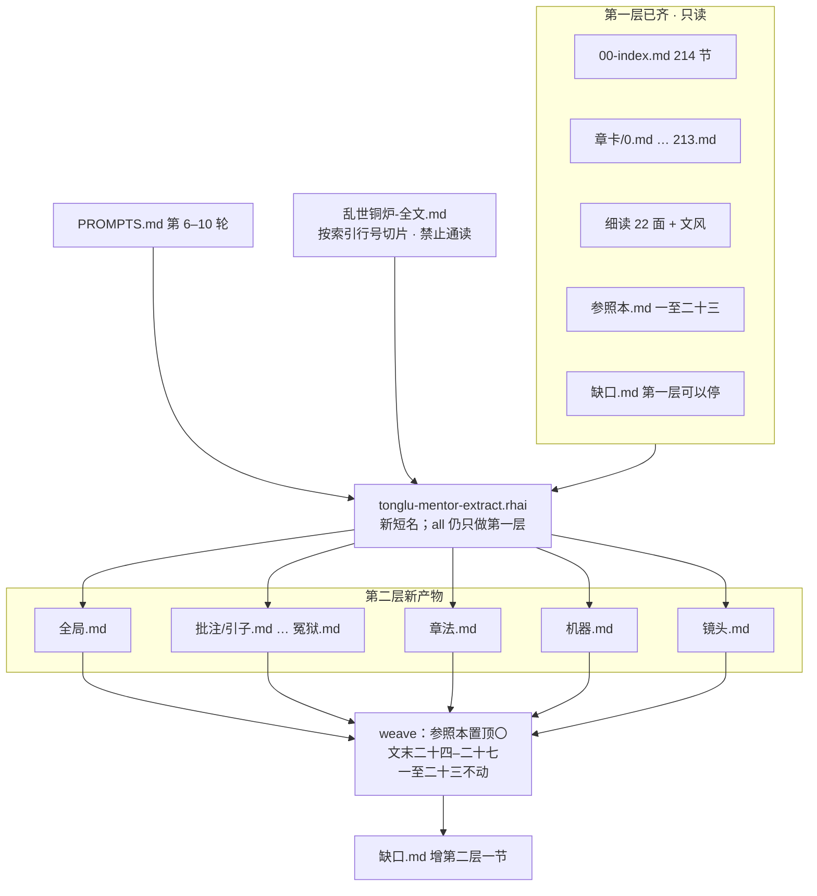
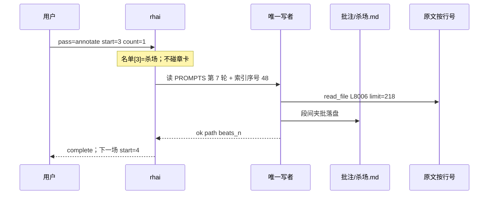

# 《乱世铜炉》第二层：从「发生了什么」加高到「怎么写」

| 项 | 值 |
|---|---|
| 状态 | L2 已落地；薄切片另案 |
| 日期 | 2026-08-24 |
| 其后 | 因文收口 [`2026-08-24-tonglu-yinwen-audit.md`](./2026-08-24-tonglu-yinwen-audit.md)；笔记对照后的薄切片 [`2026-08-24-tonglu-craft-thin-slice.md`](./2026-08-24-tonglu-craft-thin-slice.md)（未点头不写 `对照.md`） |
| 作者 | Grok（设计）；实现者待指派 |
| 受众 | 要加高参照本的人；要实现同一条工作流新轮次的人 |
| 仓库 | `/home/admin/projects/scribe-writing-system` |
| 第一层（已齐） | `docs/plans/2026-08-23-tonglu-mentor-extract-design.md`；git `d2ca376a` 已上 `origin/main` |
| 范围 | 只加高 `docs/worlds/乱世铜炉-拆文/`；**不**重跑 214 张章卡、**不**重切索引；**不**改 scribe3 写路径；全文不入库 |
| 提示真源 | 仍是 `docs/worlds/乱世铜炉-拆文/PROMPTS.md`（追加第 6–10 轮，不另起文件） |
| 工作流 | 仍是 `.grok/workflows/tonglu-mentor-extract.rhai`（加新轮次短名；**不**新开第二条编排器） |

---

## 给用户看的方案

第一层已经把书拆开了：哪一节发生了什么、日子怎么走、人走到过哪、规矩用哪一场收了代价。那一层是齐的。翻开参照本，能顺着看完这本书的骨头。

缺的是另一层。你点名问过：除了这些，是不是还要有全局的分析。对。现在这份参照本还偏「发生了什么」。下一本真要对手，缺的是「这到底是一本什么书、作者怎么写、下一本可以照着开哪几套」。

**改完会怎样。** 打开参照本，最先看到的不是年表，而是站在屋顶上的几页：这不是修仙升级，也不是志怪集；作者拿全书赌什么；换过几口气、哪一气换丢了；过日子的村子、山上的门派、衙门里管鬼的人怎么互相要账；哪一段撑住了、哪一段空了；下一本如果只偷一件，偷哪一件。然后能点开七场必读，原文摊开，一句一句看手为什么停在这儿。多出来的一场是官差收了银子、黑白当场倒过来：救人的女人进了牢。再往后是几套能开章的局（酒宴、赶路、请人开坛、坐牢、一场寿筵里不断有人闯进来），以及一场里镜头怎么轮、人怎么说话。空了的节、切开的比武、庄子里叠同一种日子，写在屋顶正文里，不当附录，免得学到注水。

**打开参照本会看到什么。** 原来的二十三节一节都不删、不重编号。最前面多一节「这本书到底是什么」。文末多几节：能开章的局、三层怎么咬、镜头和说话、七场必读的目录（正文在旁边的批注文件里，避免把整章搬进参照本）。专名、情节仍原样在参照里。学结构，换自己的名。不要把这本故事搬进下一本。

**怎样算做完。** 打开参照本，最先几页能讲清这是什么书；七场旁边能看见原文和手（其中一场是官差收了银子、救人的女人进牢）；几套局能换名开章；有的章节几乎没有正文，写明没戏。第一层已经齐了，这一层是往上加，不是推倒重来。

**这方案行不行，三句。** 改完：参照本最先讲清这本书、七场摊开批、几套局能开章。风险：批注容易变成整章搬家或数词过关；屋顶那几页容易写成主题作文；若有人把第一层的合成再跑一遍，屋顶会被盖掉——设计里挡住这三件事。要不要开干：这份设计可以先合进仓库；真正对着原文开拆，要你点头。没有点头，谁也不许自己开拆。

第一层一张卡都不要重做。有的章节几乎没有正文，继续写明没戏，不要假装有戏。

---

## Overview

Problem: Layer-1 extract of *乱世铜炉* is complete as a **reverse outline + craft bible of facts** (214 cards, 22 fine-reads + style, `参照本.md` ~2387 lines / ~200KB, `缺口.md` = 本轮可以停). It answers “what happened, where, which rule cost whom.” It does **not** yet answer “what kind of book this is, how the author writes a scene you can steal as a *method*, which breaths the book takes, where it goes empty.” That is the gap the user named. Next-book writing (*腕账* and others) will cargo-cult plot or half-classical diction if we only ship the fact pack.

Proposed: **Layer 2 on the same pipeline**, same directory, same `PROMPTS.md` SSOT, same `tonglu-mentor-extract.rhai`. Do **not** re-index, do **not** rewrite 214 cards, do **not** spawn a second orchestrator, do **not** run oh-story `story-long-analyze`. **Do not mutate `fn iron_prefix`.** Produce five new artifact families (`全局.md`, seven `批注/*.md`, `章法.md`, `机器.md`, `镜头.md`), then **weave** a front section into `参照本.md` without regenerating sections 一–二十三. Rhai cannot see HTML markers: synthesize/trace guards live in **prompts** (PR1). Stop condition is two independent sentences in `缺口.md` (layer-1 「本轮：可以停」 untouched; `## 第二层` has its own). Machine: `complete.can_stop` = layer-1; `complete.l2_can_stop` passthrough (PR2 adds it to `synth_schema.properties`). Judged by craft not word-list hits.

This document is the design. Live extract is a later, user-authorized step (PR Plan). Grok-host memory (~1.6Gi, no swap) forbids rereading the 4.6MB novel and forbids parallel heavy writers. Verification is a person opening the Markdown pack. Demo/scribe3 stack is **out of scope**.

---

## Background & Motivation

### 第一层已经齐了（不要再拆一遍）

Verified 2026-08-24 against the workspace (not re-read of the 4.6MB novel):

| 产物 | 路径 | 事实 |
|---|---|---|
| 全文（未入库） | `docs/worlds/乱世铜炉-全文.md` | ~35538 行 / ~4.6MB；`.gitignore` 已列；切章键带标题事变字 |
| 索引 | `docs/worlds/乱世铜炉-拆文/00-index.md` | 正表 214 节（0–213）；引子 L3；正传杀场 L8006；文末 L35538「好好亲近亲近。」 |
| 章卡 | `章卡/0.md` … `213.md` | 空壳节也有卡，写「正文几乎没有」（例：`章卡/101.md` 舟渡茫(中)） |
| 细读 | `透镜-*.md` ×21 + `透镜-文风.md` | 世界/群像/出场/说书/节奏/伏笔/人物/线索/开篇/时间线/地图/设定/余烬/名录/关系/反复/称谓/卷问/回不去/日子细节/未解 + 文风 |
| 参照本 | `参照本.md` | ~2387 行 / ~200KB；二十三节 |
| 缺口 | `缺口.md` | **本轮可以停**；名录配角未逐条核第一面、未解几条未抽伏笔面 = 还可以更全，不是缺一类 |
| 提示 | `PROMPTS.md` | 第 0–5 轮（index / 章卡 / 透镜 / 文风 / 合成 / 缺口 / 回溯） |
| 工作流 | `.grok/workflows/tonglu-mentor-extract.rhai` | `pass=index\|chapters\|lenses\|style\|synthesize\|gaps\|trace\|all`；`count` cap 8 默认 4 |
| 第一层设计 | `docs/plans/2026-08-23-tonglu-mentor-extract-design.md` | Key Decisions 已落地：同一条工作流、脚本只认整数序号、透镜串行、参照本不进 Surreal |

用户与助手已对齐的薄处（第一层偏「发生了什么」）：

1. **全局 / 站在屋顶上**（用户原话：除了这些是不是还要有全局的分析）。这一份必须放在参照本**最前面**，不是再拆一遍章。
2. **必读段落摊开批**（金圣叹式：原文+批，不是再摘一句书证）。
3. **作者反复用的几套写法 / 局** → 合成「下一本可以照着开的几套章法」，偷懒处写清。
4. **世界怎么咬成一台机器**（总图，非法术说明书）：三层互相要账。
5. **镜头和说话**：一场里怎么轮、群像怎么不乱、嘴里突然换词、评点何时办事何时上课。

### 痛点（人打开参照本时）

- 第二十二节「给以后开书的几条」已经有十条可搬走的作法，但它们是**条目**，不是屋顶：读者仍可能把这本书读成「风水先生遇妖」或「门派贺寿」。
- 卷问（第十二节）写清了前传/正传接没接上、时闻盂换气换丢了，但没有把「全书换过几口气」写成布局。
- 设定透镜已经用一场戏收代价，但没有一张**三层互相要账**的总图。
- 文风透镜抽样了引子/除夕/杀场/贺寿/文末，但只评停顿与切法，没有把原文摊开夹批。
- 节奏透镜列了翻与切，没有把酒宴/赶路/开坛/坐牢/寿筵闯人收成**可开章的局**。

### 为什么现在做

下一本（腕账一类）要学的是：先立还在过的日子，再让奇事进来，用一场戏把规矩收成代价。没有屋顶和摊开的手，模型（和人）会去抄鬼神名、抄半文不白、或按网文「黄金三章 / 钩子十三式」把铜炉压成格子。第一层已经把事实榨干；第二层只读已有章卡/细读/参照本，按需回原文行号。

---

## Goals & Non-Goals

### Goals

1. 在参照本**最前面**写出全书读法：这是一本什么书、作者赌什么、换过几口气、三层怎么要账、撑住 vs 空了、下一本只偷一件。
2. 固定七场必读做段间夹批（原文摊开 + 批），学开篇 / 代价 / 年没过成 / 换卷 / 一场酒里换事变 / 文末欠账 / 银子把官差改口、救人的女人进牢。
3. 抽出几套**可开章的局**（不是场面清单），偷懒处单独成节，进入屋顶正文。
4. 世界总图：村子 / 门派 / 衙门三层互相要账；术·丹·符·禁忌收成「谁守了或破了，日子怎么变」。
5. 镜头与说话：一场里怎么轮、群像不乱、同一个人换词、评点位置。
6. 只进化现有工作流 + `PROMPTS.md`。一次调用只做第二层的**一个**轮次（或章法三面串行）。`pass=all` **保持第一层语义**（索引若缺 + 一小批章卡），绝不在 `all` 里顺手开第二层。共用 `fn iron_prefix` **一行不改**；第二层铁律只拼进四个新分支的 prompt。
7. 提示只交责任（谁、哪一件、世界怎么变、手为什么停）。检查只验戏。禁止词表、格子、钩子十三式、黄金三章打卡。
8. 空壳、比武切开、庄子叠同一种日子写入全局正文，不当可选附录。
9. 没有用户点头，不 live 开拆。本设计的交付是这两份 `/tmp` 文档；合入仓库的设计副本与提示/脚本是后续 PR。

### Non-Goals

- 重跑 214 张章卡、重切 `00-index.md`（除非全局发现索引错了——那时只局部补一行，不作为本设计默认路径）。
- 把 oh-story `story-long-analyze` 当执行器，或把铜炉情节、金手指、力量体系 wiki 搬进腕账工程。
- 新写 Python 编排器、第二条 named workflow、把全文 / 大段原文提交 git。
- 真夹注到字（景阳冈数十八次「哨棒」那种）；十五法名单打卡。
- 用常识补古代农村 / 官制 / 地图。
- 为验收起第二套库、本机 Surreal、全量 pytest、通读 4.6MB。
- 把参照本灌进 Surreal（第一层已拍板：Markdown 包，不进设定库）。
- 一次调用抽完第二层全部产物。

---

## Proposed Design

### 架构：加高，不推倒



读序（子代理必须遵守，防止把 4.6MB 和 214 卡灌进上下文）。**硬指令，写进第 6/8/9 轮提示：**

1. `PROMPTS.md` 本轮责任。
2. `参照本.md` **按标题**只读点名的节（屋顶：十二、十三、十九、二十一、二十二；weave：标题块 + `## 一、` 一行确认插入点 + `## 二十三、` 之后）。禁止从头读到二十三。用 `grep '^## '` 定位后再 `read_file` 该节。
3. 点名的章卡：**禁止 `ls` / `grep` 章卡目录**。每张只用 `read_file` 开头约 **80 行**（「打开书」在文件前部）。18 张全卡约 0.3–0.4MB 可活；目录合计 ~5.9MB + 全文 4.6MB 会把 1.6Gi 机器卡死。误列出目录 = **停、不要重试**。
4. 点名的细读文件：只读该面开头或点名的节，不要整面当必须通读。
5. 原文：按 `00-index.md` 行号 `read_file` **那一节**（`offset`/`limit`）。禁止按页翻全书。
6. `缺口.md`：只读沿革 + 现有「可以停」句，不要当索引去翻卡。

### 产物放哪、叫什么（默认拍板）

全部仍在 `docs/worlds/乱世铜炉-拆文/`：

```
docs/worlds/乱世铜炉-拆文/
  PROMPTS.md              # 追加第 6–10 轮；仍是唯一提示真源
  00-index.md             # 只读
  章卡/{seq}.md           # 只读
  透镜-*.md               # 只读
  参照本.md               # weave 时插入 〇 + 二十四–二十七；一至二十三禁止重写
  缺口.md                 # 追加「第二层」；第一层沿革保留
  全局.md                 # 屋顶。给人翻的主文之一；weave 时投影到参照本〇
  章法.md
  机器.md
  镜头.md
  批注/
    引子.md
    怪墓.md
    除夕.md
    杀场.md
    贺寿.md               # 上+下合成一场
    文末.md
    冤狱.md               # 第十九章；银子把黑白倒过来
```

**为什么独立文件再合成，而不是直接改参照本：**

- `参照本.md` 已 ~200KB / 2387 行。一个冷代理整本重写会丢掉第一层硬事实，或把 4.6MB 情节缩写灌回去。
- 批注必须带较长原文，塞进参照本会把「给人翻的作法」胀成盗章。批注旁挂，参照本只留「学什么 + 路径」。
- `weave` 只做插入/替换**有标记的第二层节**，第一层二十三节字节级不碰（见 Data Model）。
- 全局先落 `全局.md`：屋顶写砸了可以 `force=1` 只重写这一份，不必动参照本。

**提示仍追加进 `PROMPTS.md`，不新开 `PROMPTS-L2.md`。** 第一层铁律（工具、禁编、问戏）第二层共用。**四十字书证上限仍只活在未改的 `iron_prefix` 里**；夹批轮必须在本轮正文里覆盖它（单拍八行/二百字）。子代理冷启动时文件缺失则靠工作流内联。

### 全局（屋顶）——放参照本最前面

文件：`全局.md`。责任不是再摘时间线，是回答：

| 节 | 人话问题 | 禁止写成 |
|---|---|---|
| 这是一本什么书 | 打开书，人还在过红事/过年/赶路/贺寿；奇事从日子里闯进来。不是修仙升级，不是志怪集 | 「主题是命运/人性」 |
| 作者拿全书赌什么 | 银子和面子把人按进扛不住的差事；人回不去；账转到下一辈（符） | 金句海报 |
| 全书换过几口气 | 一户被钉和银子按进祸事 → 魂丢了这一户怎么走 → 跳六年翻成孩子手里的符 → 文末酒楼争符刚打起来就停。能换气还不散架，因为人还是这一户、欠的还是那些账。引子时闻盂后面没接上 = **换气换丢了，不要学** | 把时闻盂圆成伏笔 |
| 三层互相要账 | 过日子的村子、山上的门派、衙门里管鬼的人 | 地名清单、法术等级表 |
| 作者站哪边 | 过日子的人这边；半文不白套话不是骨头 | 「人民性」论文 |
| 撑住 vs 空了 | 空壳节（舟渡茫中下、故生忧上中下、免费外篇）；千花/盛典切开；赵家庄叠同一种日子。**写进正文，不当附录** | 「节奏有缓有急」含糊过去 |
| 下一本只偷一件 | 先立还在过的日子，再让奇事进来，用一场戏把规矩收成代价。换自己的名 | 搬三水村、胡不为、定神符 |

抽样清单（写死在提示里，禁止「为了全面」读 214 卡）：

- 参照本：十二（卷问）、十三（主线）、十九（不重复）、二十一（文风）、二十二（开书十条）。
- 章卡打开书：`0` 引子、`1` 怪墓、`16` 除夕、`19` 冤狱、`48` 杀场、`85` 免费外篇（空）、`101`–`105` 空壳、`115`–`116` 贺寿、`117`–`122` 千花、`135`–`140` 盛典、`185` 一沙一世界、`213` 文末。
- 细读：`透镜-卷问.md`、`透镜-节奏.md`、`透镜-设定.md`、`透镜-世界.md` 开头、`缺口.md`。
- 原文：只在写不出书证时按索引抽那一节，仍禁通读。章卡每张 `read_file` 开头 ≤80 行；禁止列出章卡目录。

### 必读段：固定七场，段间夹批

**怎么选：** 固定清单，不从 214 卡抽样再加人工。前六场对话已点名；**第七场冤狱用户 2026-08-24 选 B，现已拍板。** 第一层文风已抽引子 / 除夕 / 杀场 / 贺寿 / 文末（五场，**没有怪墓、没有冤狱**）；本层加上怪墓（学代价）和冤狱（学银子把官差改口）。贺寿上下合成一场。

章法「坐牢」仍点名同一场：批注摊开原文，章法只收「下一本可以照着开」的局。不要两套打架。

| 短名 | 学什么 | 索引序号 | 原文行（00-index） | 产出 |
|---|---|---|---|---|
| 引子 | 学开篇：喜酒里奇事进来 | 0 | L3–103（100 行） | `批注/引子.md` |
| 怪墓 | 学代价：六两银子那颗钉 | 1 | L104–282（178 行） | `批注/怪墓.md` |
| 除夕 | 学年没过成 | 16 | L1801–1917（116 行） | `批注/除夕.md` |
| 杀场 | 学换卷 | 48 | L8006–8224（218 行） | `批注/杀场.md` |
| 贺寿 | 学一场酒里不断换事变 | 115+116 | L18166–18359（上 108 + 下 84） | `批注/贺寿.md`（一场，两节） |
| 文末 | 学欠账停在争符刚打起来 | 213 | L35378–35538（160 行） | `批注/文末.md` |
| 冤狱 | 学银子把官差改口、救人的女人进牢 | 19 | L2246–2398（152 行；第十九章（冤狱）夜中黑白怎分明） | `批注/冤狱.md` |

**夹批还是旁批：** Markdown 做不了古本双行夹注。采用**段间夹批**（金圣叹回前总评 + 文中批的现代等价）：先回前三句（这场是谁、哪一件、学什么），再按拍摘原文（引用块），紧跟一段「批」。不是段落后空发感想，也不是逐字夹注。

试金石（机械执行）：如果只圈词、不说手为什么停、评点为什么插在人做完事之后、热闹为什么切在哪个看得见的动作——不合格，重写。胡适批评金圣叹数「哨棒」十八次是八股选家；本项目明确不学那种。贺寿问的是「刀在人头上没落下去」这场戏，**不要**把「刀停住了」四字当通过条件（原文是「刀却突然停住了。」，抽查可 grep 子串，写好不靠填这几个字）。

格式（解析用，不是写好的标准；`### 1. 酒还没散` 不是质量格）：

```markdown
# 必读：引子（贺客）

## 打开书
时闻盂这一夜。三水村喜酒散不掉。他吐酒开了眼。别人仍看不见。

## 这一场要学什么
学：人还在过红事，奇事从酒桌里进来。不要学半文不白开场。

## 段间

### 1. 酒还没散
> 夜幕渐落。客人们却还迟迟没有散去。
> （最多再续七行。超了就再切一拍。）

**批：** 手停在「还不散」。开篇不是宣布有鬼，是把人按在散不掉的酒桌上。

### 2. …
```

**原文引用上限（防 OOM / 防 git 胀）：**

| 约束 | 值 | 理由 |
|---|---|---|
| 单拍引用 | ≤8 行 **或** ≤200 字，取先碰到的 | 一段能看清手；不是整章 |
| 一场批注文件 | 目标 400–800 行；硬顶 1200 行 / 40KB | 杀场正文才 218 行，批注不应比原文厚过四倍 |
| 七场合计 | 目标 <300KB | 参照本已 200KB；批注旁挂可接受；冤狱 152 行不改单场切片假设 |
| 禁止 | 整节粘贴；网站广告行；`bxwx.org`；把回绕重贴再批一遍 | 版权 + 噪声 |
| 书证短句 | 全局/章法/机器/镜头仍 ≤40 字（走未改的 `iron_prefix`） | 与第一层一致 |
| 夹批引用 | **annotate 本轮覆盖四十字上限**：单拍八行/二百字为准；四十字只约束批语里的短指回。`iron_prefix` 那句不改 | 冷代理否则会把原文砍成四十字 |

子代理读原文：按索引 `read_file` 该节（贺寿两次：115 然后 116）。杀场 218 行、冤狱 152 行一次可读完，不突破 1.6Gi 假设。禁止为批注再读邻节「找上下文」超出 ±30 行。

跳过：空行、分隔线、广告、作者「第十章不在下一页了」。空壳节不在这七场里。

### 章法：几套能开章的局，不是场面清单

`章法.md` 把作者反复用的局收成**下一本可以换名开的手续**。每一套必须能改写成：

> 下一本先让人进什么还在过的日子，再让哪一件闯进来，读完人欠了什么。

默认五套（可在全局之后微调名称，不可改成词表）：

1. **酒宴：** 面子把人按在桌上，奇事从酒里来（引子、中秋、回凤梧）。
2. **赶路：** 人还在回家/赶关，路上撞上别人正在办的祸事（遇险、杀场第四天骡上的人）。
3. **请人开坛：** 银子是交差钱，不是救命钱；规矩当场收代价（怪墓六两）。
4. **坐牢：** 官差和鬼同一夜；银子能把黑白倒过来。批注已摊开 `批注/冤狱.md`（第十九章 L2246–2398）；章法只收「下一本可以照着开」的局，不要再摘一遍原文。大牢后文仍用设定细读，不另开批注。
5. **寿筵里不断有人闯进来：** 地可以不换，换的是谁闯进来办哪一件（贺寿 → 可对照千花/盛典写出「偷懒时只换节号」）。

必须单独立节 **偷懒处**：空壳六节；千花一至六（行距 32–56）几乎是同一场梨树比武切开；盛典一至六几乎是同一场庄前入庄切开；赵家庄从贺寿叠到祸宴，地没换。写清：能写长是因为换事变，不是因为切开。

### 机器：三层互相要账

`机器.md` 不是奇案司组织章程，也不是丹药 wiki。问：

- 村子向谁要账（红白喜事、请人、银子、面子）。
- 山上的门派向谁要账（占山替朝廷扛鬼、寿筵过千人、民不与官斗）。
- 衙门里管鬼的人向谁要账（封城、就地格杀、奇案司被抽空、铁令）。
- 三层撞上的那场（寿筵上宣铁律；贺家庄被围；官差收了包救人的女人进牢）。
- 术 / 丹 / 符 / 禁忌：谁因为守了或破了，**日子**怎么变。画符伤修为、定神符灵别的符不灵、杀生夺丹的戒按得住当面按不住夜里——用已有设定透镜的场面，收回总图，不新编等级。

### 镜头和说话

`镜头.md` 只问四件，都用一场具体的戏：

1. 一场里镜头怎么轮（酒桌外头评 → 跟进吐酒人的眼 → 跳到数日后韩诤的嘴）。
2. 群像怎么不乱（每个人要办的事不同；缺了谁场面塌）。
3. 同一个人嘴里突然换词（哪一句把局面推了；不是口头禅词表）。
4. 评点何时办事、何时上课（人做完事之后补一句 vs 烈阳数「一、二」时突然铺戒律）。

第一层说书/文风已有原料。这一面合成「下一本一场里怎么调度」，不重摘一遍对白。

### 怎样织进参照本

`pass=weave` 一个写者：

1. 读已落盘 `全局.md` / `章法.md` / `机器.md` / `镜头.md` / `批注/*.md` 的「打开书」+「要学什么」。缺的写「这一轮还没抽到」，**禁止**回原文编新屋顶。
2. 读 `参照本.md`。若尚无第二层标记，在标题块之后、`## 一、时间怎么走` 之前插入 `## 〇、这本书到底是什么`（从 `全局.md` 压缩投影：可短于源文件，但必须保住七问）。
3. 在 `## 二十三、…` 之后追加：
   - `## 二十四、下一本可以照着开的几套局`
   - `## 二十五、三层怎么互相要账`
   - `## 二十六、一场里镜头和说话`
   - `## 二十七、七场必读（摊开的手）`（每场三句话 + 相对路径，**不**内嵌长引用）。
4. **禁止**改 `## 一、` 到 `## 二十三、` 的正文。用标记围住第二层节，便于下次 weave 只替换那些块：

```markdown
<!-- tonglu-l2:start 〇 -->
## 〇、这本书到底是什么
…
<!-- tonglu-l2:end 〇 -->
```

5. **Rhai 看不见标记，不能在脚本里跳过合成。** 脚本无 `read_file`、无 regex，`pass=synthesize` / `pass=trace` 仍会派代理。守卫只在 **PR1 就改** 的第 3 轮、第 5 轮提示里：代理先读参照本，看见 `<!-- tonglu-l2:start` 且 `force!=1` → **整本不重写**；`trace` 只许改标记块**之外**的硬事实句，禁止删除/改写 `tonglu-l2` 块。`force=1` 必须在 `issues` 写「屋顶会丢，随后 weave」。人不要在第二层织进去之后误跑这两轮。

不重编号一至二十三，避免破坏已有引用（缺口、审计、人的书签）。weave 压缩投影是默认（Key Decision），不是开放问题。

### 工作流：新短名、一次调用、不重跑第一层

仍是 `.grok/workflows/tonglu-mentor-extract.rhai`。Skill 写明 workflows 不能 launch 其他 workflows；第二条 named workflow 会分叉 `validate_only`、用户口令、铁律内联。**不新开。**

| `args.pass` | 做什么 | 子代理 | 产出 | 并行 |
|---|---|---|---|---|
| `index` `chapters` `lenses` `style` `synthesize` `trace` `all` | **第一层，语义不变** | 同现网 | 同现网 | 同现网。`all` **绝不**进入第二层 |
| `global` | 屋顶 | 1 | `全局.md` | 禁止第二写者 |
| `annotate` | 必读夹批。`start` = 名单下标 0–6（非法 → `pause`，不 clamp）；**本分支**把 `count` 重设：`args.count` 缺则 1，然后硬顶 2（现网全局默认 4 / 顶 8 **不得**落到本分支） | 1（`count=2` 也串行 `while`，禁止 `parallel`） | `批注/{短名}.md` | 禁止 parallel |
| `craft` | `args.lens` = `章法` \| `机器` \| `镜头`。空 = 三面串行 | 1 或 3 串行 | 对应 md | 禁止 parallel |
| `weave` | 把第二层投影进参照本 | 1 | 改 `参照本.md` 标记块 | 1 |
| `gaps` | 现网 + **第二层是否齐** | 1 | `缺口.md`（保留第一层沿革） | 1 |

`args` 不加字段。`start`/`count`/`force`/`lens` 复用。现网在分 pass 之前 `let count = 4`、顶 8；`let start = 0`；`pass` 缺省 `"index"`——**第二层不要改这些全局默认**。

- `annotate`（**必须在 `if do_annotate` 里重设，写在派 agent 之前**）：
  - `start` 是名单下标 0–6，不是章序号。`start < 0 || start > 6` → `pause("verification", …)`，**不要 clamp**（否则 `start=48` 会静默变成名单末项）。
  - `args.count` 缺（本分支内以「未为 annotate 单独传」为准：若调用方没传，现网 `count` 已是 4）→ **本分支把 `count` 写成 1**。实现：`if args == () || args.count == () { count = 1; }` 放在 `do_annotate` 里，覆盖前面的 4。
  - 然后 `if count > 2 { count = 2; }`；`if count < 1 { count = 1; }`。
  - 循环用现网同款 `while`，不要 `for i in start..start+n`。
  - 本分支结束必须自己 `complete(...)`，带 `next_start = start + n`（名单下标），**不要掉进文末那个 `cards_n` 的 complete**。
  - 名单写死：0 引子、1 怪墓、2 除夕、3 杀场、4 贺寿、5 文末、6 冤狱。脚本把短名和输出路径拼进 prompt；行号由代理读索引。
- `craft`：非法 `lens` → `pause`，不得空 `parallel([])`。空 lens = 三面串行 `while`；每面之前看 `budget().remaining`，不够就不要发下一面，并 `complete` 已做的。
- `global` / `weave`：同样提前 `complete`，仿 `do_style` / `do_synth`。
- `force=1`：只覆盖**本轮目标文件**。第二层提示写明：禁止写 `章卡/`、`00-index.md`、`透镜-*.md`。
- 幂等：目标已合格且 `force!=1` → 不覆盖，`ok=true`。合格 = 人话问题下面已经用一场具体的戏答了。批注：回前三句能说出谁/哪一件/学什么，且至少有一处原文+批能回答「手为什么停 / 评点跟在谁做完的事后面 / 热闹切在哪个动作」之一。文件过短（标题 stub、无原文块）打回——「至少三拍」只当防 stub 的体积下限，不当戏的标准。



`pass=global` / `craft` / `weave` 同形，都是单写者。

宿主方言（与第一层相同，必须遵守）：

- 无 regex；脚本不能读工作区文件；`as_int` 接受 `int|i64|u64`（现脚本已做）。
- `validate_only` canned 小对象：解包前 `agent_ok`。
- 默认 `agent_budget` 128；第二层一次 1 个 logical agent（craft 空 lens 最多 3 串行）。
- `isolation_worktree` 关；`capability_mode: "read-write"`；禁 `fork_context`。
- `let meta.phases` **只追加** Global / Annotate / Craft / Weave，**不删现网已有的 Trace**（第一层文档曾说不要单开 Trace 轨道——以**现网脚本**为准，不要改回去）。
- `pass` 缺省保持现网 `"index"`。第二层不要顺手改成 pause。

`validate_only` 至少再加这些路径（不 throw 即绿）：

- `#{ pass: "global" }`
- `#{ pass: "annotate", start: 0, count: 1 }`
- `#{ pass: "annotate", start: 6, count: 1 }`（冤狱，合法）
- `#{ pass: "annotate", start: 7 }` → pause
- `#{ pass: "craft", lens: "章法" }`
- `#{ pass: "craft", lens: "world" }` → pause，不得空面板
- `#{ pass: "weave" }`
- `#{ pass: "gaps" }`（canned 无 `l2_can_stop` 不得 throw：该字段在 properties、不在 required）
- `#{ pass: "annotate", start: 48 }` → pause（非法下标，不 clamp）
- `#{ pass: "annotate" }`（不传 count）不得按 4 场派工——canned 路径至少不 throw；实现审看 `do_annotate` 内 `count=1`
- 恒有的第一层两条保持：`index`、`chapters start=0 count=4`（证明 `iron_prefix` 未改：函数本体不得出现「禁止改 章卡」）

### 怎样算做完（缺口轮，只验戏）

扩展 `PROMPTS.md` 第 4 轮，不新开 `pass`。**两层结论互不覆盖。** 现网 `synth_schema` 只有 `can_stop`（无 `l2_can_stop`）——PR2 按方案 A 补上。第一层 KD11 是连续两次 `gap_count=0`。第二层不得把文件开头的「本轮：可以停」改成 false。

文件格式写死：

```markdown
# 缺口

上一轮：…  
本轮：可以停。          ← **第一层**那一句。只追加沿革，禁止因第二层没齐而改写这一句。

## 沿革
…保留第一层「可以停」的理由…

## 第二层

本轮第二层：可以停 / 还缺：…
（七条用人话列。缺哪一条写哪一条，不要词计数。）
```

选定 **方案 A（唯一说法，不要再写「不加字段也可以」）：**

- 人翻以 `缺口.md` 为准：第一层看开头「本轮：」；第二层看 `## 第二层`。
- 机器：PR2 给现网 `synth_schema.properties` 加上 `l2_can_stop`（boolean，**不**进 `required`，合成/回溯不填也不炸）。第 4 轮代理 **必须**在 output 填这个字段，且与 `## 第二层` 那一句一致。
- `complete.can_stop` **只反映第一层**（「本轮：可以停」仍真则 true）。`complete.l2_can_stop` 原样透传：`gr.output.l2_can_stop == true`，缺或非 true 则 false。
- 现网 gaps 内联（`.rhai` 约 L454「没有新缺口且文末约四张卡已在则 can_stop=true」）**必须改掉**，否则冷代理会把「第二层还缺」当成第一层新缺口。

PR1 改提示；PR2 改 schema + 内联 + `complete` 透传。两层停句不得装进同一个 `can_stop`。

第二层可以停，当且仅当下面**每一条**都能用一场戏或一句能指回原文的话答（不要词计数、不要「至少 N 个机制词」）：

1. **屋顶在参照本最前面。** 打开 `参照本.md` 第一节能看见：这是什么书、赌什么、换过几口气、哪一气换丢了、撑住和空了各举一场、下一本只偷一件。`全局.md` 与这一节同旨。
2. **七场批注齐。** 每场回前能说出谁、哪一件、学什么；有原文+批，且批能回答「手为什么停 / 评点跟在谁做完的事后面 / 热闹切在哪个动作」至少一件（没有就写正文未这样写，不许编）。冤狱问「银子到了，场上谁的日子倒过来」，不要把「黑白」「金银之力」当必须出现的词。文件过短当 stub 打回，不是「必须三拍才算戏」。
3. **几套局能开章。** `章法.md` / 参照本二十四：酒宴、赶路、开坛、坐牢、寿筵闯人能写成「下一本先让人进什么日子」；偷懒处单独成节，点名空壳（85、101–105）/千花（117–122）或盛典（135–140）/庄子叠日子。
4. **三层要账。** `机器.md` / 二十五：村子、门派、衙门各有一场；术丹符禁忌落到日子怎么变，不是等级表。
5. **镜头。** `镜头.md` / 二十六：轮、群像、换词、评点位置各有一场。
6. **空了的不藏。** 全局正文有几乎没正文的节与注水，不是附录。
7. **参照本一至二十三仍在**，硬事实行号没被 weave 删掉（抽查 L5 夜幕渐落；L110 许了六两银子酬金；L18264 刀却突然停住了；L35538 好好亲近亲近）。

连续两次 `gaps` 都写 `## 第二层`「可以停」，才宣称第二层齐（工作流不自己 while）。第一次 gaps 只许找缺，**不许顺手开** `global`/`annotate`/`craft`/`weave`。第一层 `can_stop` 与第二层 `l2_can_stop` 独立。

不合格的典型（必须写进提示当反例）：

- 屋顶写成「命运与救赎」。
- 批注只圈词，不说手。
- 章法变成「酒宴、赶路、开坛」三个标题没有戏。
- 机器变成奇案司编制表。
- 用「出现了大遮蔽/成核点」当过关。

### 失败 / 空壳 / 注水

写进 `全局.md` 固定节 `## 哪一段撑住了，哪一段空了`，weave 进参照本〇。最少点名：

- 空壳：序号 85 免费外篇；101–105 舟渡茫(中)(下)、故生忧上中下。章卡已写「正文几乎没有」。
- 切开：千花一至六（L18360–18617）；盛典一至六（L19236–19585）。
- 叠日子：参照本第十九节赵家庄后半。
- 换气换丢：时闻盂只在引子。

不要用「有的章节是过渡」糊过去。下一本躲开只换节号、不换日子种类、上一节还没翻就再开一节热。

### 与 oh-story `story-long-analyze` 的边界

参考仓库副本：`oh-story-claudecode-main/skills/story-long-analyze/SKILL.md` 及其 `references/material-decomposition.md`、`pipeline-ops.md`。

**可借鉴（已是第一层，第二层继续）：**

- 切片表 SSOT（我们的 `00-index.md`；他们的 `_progress.md` 章节边界）。不要每个阶段各切一次。
- 分批 5–8；文风单独一轮；合成阶段硬事实必须 grep 回原文，缺写「原文未明确」。
- 停靠点等人确认再往下（他们 Stage 1 黄金三章后 pause；我们 live 拆前等人点头）。

**明确拒绝，并写进第二层铁律：**

| oh-story / 网文拆书常见物 | 为什么拒 |
|---|---|
| 黄金三章深度拆解 + 快速预览停靠 | 铜炉开篇学的是喜酒里开眼，不是三秒钩子；前三章打卡会把怪墓六两钉读成「冲突密度」 |
| 每章 10–40 情节点，150–200 字/个 | 格子。模型填满 10 条，戏可以没发生 |
| 把**章节原文贴进**子代理 prompt | 杀场 218 行可切片读文件；贴全文是版权+内存 |
| `拆文库/{书名}/原文/` 再备份一份 | 第一层已禁；4.6MB 不进 git、不进拆文目录 |
| 力量体系 / 金手指 wiki | 铜炉不是升级书；腕账更不是 |
| 桥段词表、钩子十三式、情绪模块卡、基调枚举 | 词表过关 |
| 覆盖率/置信度/重叠率当质量 | 第二层质量 = 打开书看没看见手 |
| 并行 chapter-extractor 5–8 路灌原文 | 本机 1.6Gi 会卡死；第二层一次 1 个写者 |

**不替换本工作流。** 铜炉拆文的执行器只有 `tonglu-mentor-extract`。oh-story 管道若有人拿去拆别的网文，与本目录无关。禁止把铜炉专名、钉、符、除夕这一夜写进腕账设定。

---

## API / Interface Changes

面向人的口令仍是 `/workflow tonglu-mentor-extract`（或 `/tonglu-mentor-extract`）。无新 HTTP、无 Surreal schema。

```text
# 第一层（勿在第二层期间误跑合成覆盖）
pass=index | chapters | lenses | style | synthesize | gaps | trace | all

# 第二层（用户授权后）
pass=global
pass=annotate start=0..6 count=1
pass=craft lens=章法|机器|镜头     # lens 空 = 三面串行
pass=weave
pass=gaps                           # 现网 + 第二层
```

脚本新增分支示意（实现时 `+=` 拼 prompt，禁一条超长 `+` 链）：

```rhai
let do_global = pass == "global";
let do_annotate = pass == "annotate";
let do_craft = pass == "craft";
let do_weave = pass == "weave";
// do_index / do_cards / … 保持；all 仍只绑 index+chapters
if !do_index && !do_cards && !do_lenses && !do_style && !do_synth
    && !do_gaps && !do_trace && !do_global && !do_annotate && !do_craft && !do_weave {
    pause("verification", "Pass args.pass = index | chapters | lenses | style | synthesize | gaps | trace | all | global | annotate | craft | weave");
}

let roster = ["引子", "怪墓", "除夕", "杀场", "贺寿", "文末", "冤狱"];
```

**`fn iron_prefix` 一行不改。** 禁止把「禁止改 章卡/」写进函数本体——否则下一次 `pass=chapters` 会被命令不许写章卡。第二层四句只在四个新分支里：

```rhai
fn l2_iron() {
    let p = "";
    p += "你在加高参照本，不是重拆这本书。禁止改 章卡/、00-index.md、透镜-*.md。\n";
    p += "禁止把全文读进对话。按索引行号只读点名的那一节。禁止 ls/grep 章卡目录。\n";
    p += "有的章节几乎没有正文，写正文几乎没有。不要假装有戏。\n";
    p += "只换词、堆词、点名一个世界词就能交差的句子，删掉重写。\n";
    p
}
// 每个新分支：
// let p = iron_prefix(source, prompts, out_dir);
// p += l2_iron();
```

PR2 diff 检查：`fn iron_prefix` 本体不得出现「禁止改 章卡」。`validate_only` 的 `pass=chapters` 路径继续走，证明第一层没被写死。

`annotate` 覆盖四十字：在第 7 轮正文（不是 `iron_prefix`）写死「本轮引用不受铁律四十字限制」。

`complete` / schema：

- `global` / `craft` / `weave` 复用 `synth_schema` 或 `lens_schema`。
- **`annotate` 必须用带 `beats_n` 的 schema**（现网 `lens_schema`/`synth_schema` 都没有该字段；宿主若拒多余字段，复用会红）。新建 `annotate_schema`：`required: ["ok","path","title"]`，`beats_n` integer 可选。`as_int` 必须继续接受 i64。
- `gaps`：**方案 A。** `can_stop` 仍是第一层。PR2 必须在现网 `synth_schema.properties` 增加 `l2_can_stop` boolean（不进 `required`，不要另造 `gaps_schema`）。`beats_n` 仍只属于 `annotate_schema`，不要塞进 `synth_schema`。

现网 schema 改成（只加 properties 一行，`required` 仍是 `ok`/`path`）：

```rhai
let synth_schema = #{
    "type": "object",
    "required": ["ok", "path"],
    "properties": #{
        "ok": #{ "type": "boolean" },
        "path": #{ "type": "string" },
        "gap_count": #{ "type": "integer" },
        "can_stop": #{ "type": "boolean" },
        "l2_can_stop": #{ "type": "boolean" },
        "issues": #{ "type": "string" },
    },
};
```

现网 `do_gaps` 内联（约 L454）**替换为**：

```rhai
gp += "先读提示文件里「第 4 轮 · 缺口」。本轮独占写缺口文件。\n";
gp += "can_stop 只反映第一层文件开头「本轮：可以停」那一句。第二层写在 ## 第二层；另在 output 填 l2_can_stop。不要因第二层没齐把 can_stop 改 false。ok=true 仅当缺口文件已写。\n";
```

`complete` 透传（缺字段当 false，不要把 `()` 塞进 complete）：

```rhai
complete(#{
    summary: "缺口已写",
    pass: pass,
    ok: true,
    path: outp,
    can_stop: gr.output.can_stop == true,
    l2_can_stop: gr.output.l2_can_stop == true,
    gap_count: as_int(gr.output.gap_count, 0),
    out_dir: out_dir,
});
```

`annotate` 控制流（对照现网章卡 `while`，提前 `complete`，仿 `do_style`）：

```rhai
if do_annotate {
    phase("Annotate");
    if start < 0 || start > 6 {
        pause("verification", "pass=annotate 的 start 是名单下标 0–6（引子…冤狱），不是章序号。");
    }
    if args == () || args.count == () { count = 1; }
    if count < 1 { count = 1; }
    if count > 2 { count = 2; }
    if start + count > 7 { count = 7 - start; }
    if count < 1 {
        complete(#{ summary: "annotate 本批为 0", pass: pass, ok: false, start: start });
    }
    let i = 0;
    let ok_n = 0;
    while i < count {
        let name = roster[start + i];
        // p = iron_prefix(...) + l2_iron() + 第 7 轮 + 覆盖四十字 + 输出路径
        let ar = agent(p, #{ label: "annotate-" + name, capability_mode: "read-write", output_schema: annotate_schema });
        if agent_ok(ar) { ok_n += 1; }
        i += 1;
    }
    complete(#{
        summary: "夹批本轮结束",
        pass: pass,
        ok: ok_n > 0,
        next_start: start + count,
        cards_n: count,
        out_dir: out_dir,
    });
}
```

`craft` 空 lens 时 `wanted = ["章法","机器","镜头"]`，`while` 串行；每面之前 `budget().remaining`，不够则 `complete` 已完成的面，禁止 `parallel([])`。`global`/`weave` 各一个 `agent` 后立刻 `complete`。

---

## Data Model Changes

无数据库、无迁移。Markdown 约定：

| 文件 | 谁写 | 谁禁止写 |
|---|---|---|
| `00-index.md` `章卡/*` `透镜-*` | 仅第一层 pass | 第二层所有 pass |
| `全局.md` `章法.md` `机器.md` `镜头.md` `批注/*` | 对应第二层 pass | 第一层 pass |
| `参照本.md` 一至二十三 | 仅第一层 `synthesize`/`trace` | `weave` 不改这些节的字节；`global` 等不直接改 |
| `参照本.md` 〇、二十四–二十七（`tonglu-l2` 块） | 仅 `weave` | **`synthesize`/`trace` 禁止删除或改写这些块**（靠 PR1 提示，不是 rhai 文件守卫） |
| `缺口.md` | 仅 `gaps` | 其他 pass 不写。第一层「本轮：可以停」只追加沿革；第二层写在 `## 第二层` |

`批注/` 入 git（短引用，转化性评点）。全文仍 gitignore。不要 `原文/` 目录。

体积估计（落盘后，非正式 SLA）：

| 文件 | 估计 |
|---|---|
| `全局.md` | 400–800 行 / 30–60KB |
| 单场批注 | 400–800 行 / 15–40KB |
| 七场批注 | <300KB |
| `章法.md` `机器.md` `镜头.md` | 各 200–500 行 |
| 参照本增量 | +300–800 行（投影，不含长引用） |
| 参照本总量 | 仍建议 <350KB，便于人翻 |

---

## Alternatives Considered

### A. 新开 `tonglu-mentor-craft.rhai`

第二条 named workflow，第二层完全隔离。

- 好处：`pass=all` 不可能误伤；文件更短。
- 坏处：Skill 不能嵌套 workflow；用户要记两个口令；铁律/路径/budget 守卫复制一份会漂。`validate_only` 要维护两份 canned。
- **拒绝。** 在同一脚本加短名，并用「`all` 不含第二层」隔离。

### B. 把屋顶/批注当成新的「透镜」短名，走现有 `pass=lenses`

- 好处：零新 pass。
- 坏处：现网 `lens` 空 = 串行做完全部 21 面。把 `全局` 加进去，一次误触会先跑 21 面再跑屋顶，内存与预算爆炸。透镜提示是「发生了什么」问法，和屋顶问法不同。
- **拒绝。** 新 pass。透镜数组冻结。

### C. 一次性重写参照本（第二层 synthesize 覆盖全文）

- 好处：一个文件给人翻。
- 坏处：2387 行冷重写必丢行号；批注长引用会把参照本变成盗章；与「一至二十三不动」冲突。
- **拒绝。** 独立文件 + weave 标记块。

### D. 真夹注（逐句/逐字）+ 金圣叹十五法清单

- 好处：看起来像古本。
- 坏处：胡适/鲁迅已批机械文法；「草蛇灰线」若理解成数词，就是本项目试金石里的坏检查。十五法打卡 = 词表。
- **拒绝逐字。** 采用读法（屋顶）+ 回前 + 段间夹批。草蛇灰线只保留第一层已经在用的意思：后一场因为有前一场，读法变了。

### E. 用 oh-story 管道拆铜炉

- 好处：现成 Stage 0–6。
- 坏处：黄金三章、10–40 情节点、原文进 prompt、`原文/` 备份、金手指 wiki、情绪模块；执行器是 Claude skill 不是本宿主 rhai；情节易漏进腕账。
- **拒绝当执行器。** 只借鉴切片 SSOT、分批、事实可溯、文风单独一轮。

### F. 必读段从第一层「翻了的章」自动抽样

- 好处：覆盖面大。
- 坏处：冷代理会挑 20 场，本机扛不住；名单由人点名。现为七场：开篇/代价/年/换卷/酒里换事变/文末/银子改官差口。
- **拒绝自动抽样。** 固定七场（用户已拍板加冤狱）。再加场仍要用户点名。

### 全网拆书经验：学到什么、为什么采用/拒绝

| 来源 | 学到什么 | 本设计 |
|---|---|---|
| 金圣叹《读第五才子书法》+ 回前总评 + 夹批 | 「会看的看门道」：读法在前，批在文中；恨只记得事迹。夹批点的是**手**（热闹切在哪个动作、评点跟在动作后） | **采用**屋顶=读法、七场=回前+段间批 |
| 金圣叹「草蛇灰线」+ 胡适《水浒传考证》批评 | 反复意象可拽通体；但数「哨棒」十八次是八股选家 | **采用**「后一场因前一场读法变了」（已在第一层反复）；**拒绝**数词 |
| 毛宗岗《读三国志法》 | 首尾大照应、中间大关锁；六起六结；横云断岭（连叙则累，故必间之）；合则文长而难好 | **采用**屋顶写换气与照应；寿筵「间之」= 一场里换事变；**拒绝**把铜炉削成六条线索打卡表 |
| McKee *Story*：scene must turn；gap = 期望与结果之差；beat→scene→sequence→act | 热闹而无价值翻转 = nonevent。全书换气 ≈ act-level turn | **采用**屋顶「换过几口气」+ 批注问处境翻没翻（第一层已有场级 turn，不重打 214 分） |
| Truby *Anatomy of Story*：want vs need | 嘴上要的是欲望轨道；真正缺的在内部。鉴定式人设表不是它 | **采用**第一层已有「嘴上要的和真正缺的」；屋顶用人事说银子面子 vs 回不去。**拒绝** 22 步清单、人设表 |
| Reverse outline | 写完之后按场问：发生了什么、谁驱动、读完什么变了 | **第一层章卡就是 reverse outline。** 第二层站在这份大纲屋顶上，不重做 |
| Story bible / 设定 wiki | 常见做成百科，方便一致、也方便变成说明书 | **拒绝 wiki。** 世界只问规矩用一场戏收代价（Savannah Gilbo：设定必须在场上挣到篇幅） |
| 张柠《长篇小说的结构与总体性》（中国作家网，2019） | 长篇是杂语世界；难在结构与**价值选择**。叙事布局=先讲什么后讲什么、哪里多讲少讲。缺总体性，小说就成一堆碎片，**可以永远写下去** | **采用为屋顶骨架。** 「撑住 vs 空了」「千花切开」就是缺总体性时的注水。作者站在过日子的人这边 = 价值选择，用人话说，不写论文 |
| 当代网文/AI 拆书（oh-story、钩子十三式、黄金三章、情绪量化、10–40 拍） | 对平台追读有用；对本项目的试金石有害：换词堆词能过、打开书这场戏没有 | **全部拒绝当质量。** 见 Non-Goals 与 oh-story 边界 |

---

## Security & Privacy Considerations

| 风险 | 严重度 | 缓解 |
|---|---|---|
| 4.6MB 全文误提交 | 高 | 已 gitignore `docs/worlds/乱世铜炉-全文.md`。批注只许短引用。PR 审查 `git diff --stat`，单文件 >40KB 的批注打回 |
| 批注变成整章搬家 | 高 | 单拍 ≤8 行/200 字；文件硬顶 1200 行；提示禁止整节粘贴；缺口抽查文件体积 |
| 网站广告/域名进 git | 中 | 与第一层相同：`bxwx.org`、笔下文学、HTML 广告注释禁止引用 |
| 把铜炉情节当腕账设定入库 | 中 | 参照本不进 Surreal；提示写明下一本换名；本设计不改 scribe3 |
| 密钥 | 低 | 本工作无密钥。禁止把 `.env` 写进拆文目录 |
| 子代理 isolation worktree 导致「写了但工作区没有」 | 中 | 保持 `isolation_worktree` 关（第一层 KD7） |

威胁模型：版权文本的转化性评点（短引用+批评），不是传播原文。空壳节没有正文可引，不要为「完整」去邻节借文。

---

## Observability

没有线上指标。可观察性 = 落盘文件 + 工作流 `complete` + `缺口.md`。

- 每轮 `log("l2 pass=… path=…")`；`annotate` 打 `beats_n`（来自 agent output，`as_int`）。
- `complete` 必带 `ok` `path` `pass`；`annotate` 带 `next_start`（名单下标 + 本批 n）。`gaps`：`can_stop` 只反映第一层；`l2_can_stop` **必须**出现在 schema 与 complete 里（方案 A），值与 `## 第二层` 那一句一致，缺则 false。
- `write_scratch_file`：**第一层设计写过、现网脚本未用。** 本层 `complete` 已够；若要 `run.md`，在 PR2 新加一行即可，不要假装去抄一个不存在的调用。
- 告警（对人，不是 pager）：`gaps` 连续两次 `## 第二层` 仍缺同一类 → 停止自动补，等人看是提示坏了还是原文没有。不要因此改第一层「本轮：可以停」。
- 抽查清单（人翻，15 分钟）：参照本有〇；七场批注各有打开书；全局写明几乎没正文的节。grep 与参照本/缺口已用原句一致：
  - L5：夜幕渐落。客人们却还迟迟没有散去。
  - L110：许了六两银子酬金
  - L18264：刀却突然停住了。
  - L35538：好好亲近亲近。

---

## Rollout Plan

1. **合设计副本 + 提示（无 live）。** `docs/plans/2026-08-24-tonglu-mentor-craft-design.md` 与 `PROMPTS.md` 第 6–10 轮，**并在同一 PR 改第 3 轮合成、第 5 轮回溯、第 4 轮缺口**（两层停句、保留 `tonglu-l2` 块）。人可以按提示手翻抽样。工作流尚不认识新 pass——因此 **PR1 合入后不要跑 `gaps`**，除非人能接受代理按新第 4 轮写 `## 第二层`（第一层「可以停」不得改口）。
2. **合 rhai。** `validate_only` 绿。`fn iron_prefix` diff 为零实质改动。`pass=global` 在未授权时不要跑。脚本**不要**假装能读 `<!-- tonglu-l2:start`。
3. **用户点头后 live，顺序：** `global` → `annotate` 七次（或不传 count 的默认一场；`count=2` 分批）→ `craft` 三面 → `weave` → `gaps`。任一轮失败不重跑第一层。
4. **Feature flag：** 无代码旗。口令即旗：不传新 pass 就不发生第二层。
5. **回滚：** 删 `全局.md` / `批注/` / `章法.md` / `机器.md` / `镜头.md`；用 git 把 `参照本.md` `缺口.md` 回第一层 tip（`d2ca376a` 或其后第一层提交）。章卡与索引不动，回滚成本低。
6. **误跑第一层 synthesize / trace：** rhai 拦不住。靠 PR1 提示：见标记且 `force!=1` 则不重写整本、`trace` 不碰标记块。人不要在织进屋顶之后跑这两轮。若已覆盖：从 git 恢复参照本一至二十三，再 `weave` 从 sidecar 重建〇。

本机禁止：`npm ci`、Playwright、全量 pytest、本机 Surreal、通读全文、`parallel` 第二层写者。验收 = 人翻产物。与已部署 demo **无关**。

---

## Open Questions

**已拍板。** 第七场加冤狱（用户 2026-08-24 选 B）。名单下标 6 = 第十九章（冤狱）L2246–2398。没有未决开放问题。

先前能默认的仍是 Key Decision：要全局、不重跑章卡、同一条工作流、段间夹批、空壳进屋顶、参照本〇用压缩投影。

---

## Risks

| ID | 风险 | 严重度 | 缓解 |
|---|---|---|---|
| R1 | 冷代理把 `全局.md` 写成主题作文 | 高 | 提示强制用人/事/哪一气；禁止「命运」「人性」当标题；缺口问「换气换丢了没有点名时闻盂」 |
| R2 | 批注整章搬家或数词 | 高 | 行/字硬顶；试金石写进提示；胡适反例写进提示 |
| R3 | 第一层 synthesize/trace 盖掉屋顶 | 高 | rhai **不能**读文件，脚本跳过做不到。PR1 改第 3/5 轮提示：见 `tonglu-l2` 且 force≠1 则不整本重写；trace 禁止改标记块。人不要误跑。已覆盖则 git 回滚一至二十三再 weave |
| R4 | 误跑 `pass=all` 触发第二层 | 中 | `all` 语义冻结为第一层；代码审必须 grep `do_global` 不在 all 分支 |
| R5 | 全局一轮读太多文件 OOM | 高 | 抽样写死；禁止 `ls` 章卡目录（合计 ~5.9MB）；每卡只读开头 80 行；参照本按节；误列目录 = 停、不要重试 |
| R6 | 贺寿上下合成一场时漏刀没落下去或漏下半截闯人；冤狱只圈「黑白」 | 中 | 贺寿点名两节都读；冤狱问银子到了谁的日子倒过来，不把「黑白」「金银之力」当填空 |
| R7 | 章法退化成场面清单 | 中 | 每套必须能改写成「下一本先让人进什么日子」；缺这句不合格 |
| R8 | live 拆未经授权 | 高 | 本设计不跑 live；PR Plan 标明用户执行授权；提示文件已有「没有作者点头不要自己开拆」 |
| R9 | 把铜炉情节搬进腕账 | 中 | 参照本二十三节+屋顶末条重复「换自己的名」；不入库 |

---

## Canonical Prompts（写入 `PROMPTS.md` 的责任稿）

实现时把下列文本追加或改入 `PROMPTS.md`。工作流 `+=` 内联。文件缺失时内联足够单独执行。

**共用铁律：** 沿用文件开头 + 未改的 `iron_prefix`（含四十字书证）。第二层四句（`l2_iron`）只拼进 `global`/`annotate`/`craft`/`weave` 的 prompt，**不要**改 `fn iron_prefix`。第 3、4、5 轮的补丁是改**现有**节，不是新 pass。

### 第 3 轮补丁 · 合成（现有 `pass=synthesize`，PR1 必须改）

在现有第 3 轮 `text` 块末尾追加：

```text
先 read_file 参照本.md 开头约 80 行。若已有 HTML 注释 <!-- tonglu-l2:start 且 force 不是 1：整本不要重写，一至二十三一个字节都不要动，tonglu-l2 块不要删、不要改。ok=true，issues 写「第二层已在，合成轮不覆盖」。
force=1 才允许按下面二十三节重写；必须在 issues 写清「屋顶会丢，随后要再 weave」。不要把「〇」写进本节清单，否则会按二十三节重排，把屋顶吃掉。
脚本看不见这个标记，不会替你跳过。你自己先看文件。
```

### 第 5 轮补丁 · 回溯（现有 `pass=trace`，PR1 必须改）

在现有第 5 轮 `text` 块末尾追加：

```text
禁止删除或改写 <!-- tonglu-l2:start 到对应 end 之间的块（〇、二十四–二十七）。只改一至二十三里站不住的硬事实句。grep 不到的改成「正文未写到」或删句，不要动标记块。
force=1 也不许拆掉标记块来「重写参照本」。
```

### 第 6 轮 · 屋顶（`pass=global`）

**责任：** 站在屋顶上写清：这是一本什么书。写给人开下一本看的，不是再摘一遍年表。

```text
禁止改 章卡/、00-index.md、透镜-*.md。禁止 ls、禁止 grep 章卡目录。点名的卡只用 read_file 该文件开头约 80 行（「打开书」在前部）。禁止从头到尾读参照本：先 grep '^## ' 定位，再只读第十二、十三、十九、二十一、二十二节。细读文件只读开头或点名的节。不要读 214 张卡。不要通读全文。写不出书证时按索引只读那一节。误列出章卡目录 = 停，不要重试。

书证短句仍不超过四十字。不要把整段原文搬进全局.md。

写到 全局.md。force 不是 1 且文件已合格则不要覆盖。合格 = 下面七问都有一场具体的戏或一句能指回原文的话。

必须用人、事、哪一场回答，禁止主题句（不要用「命运」「人性」当标题）：

1. 这不是修仙升级，也不是志怪集。打开书人在过什么日子？奇事从哪场日子里进来？
2. 作者拿全书赌什么：银子和面子怎样把人按进扛不住的差事；人怎样回不去；账怎样转到下一辈。
3. 全书换过几口气。每一气：从哪一场到哪一场、人还是不是这一户、欠的还是不是那些账。哪一气换丢了（时闻盂）——写不要学，不要圆。
4. 过日子的村子、山上的门派、衙门里管鬼的人，怎样互相要账。举撞上的那场。
5. 作者站在哪一边。半文不白套话是不是骨头。
6. 哪一段撑住了，哪一段空了。几乎没有正文的节（序号 85、101–105）、千花（117–122）或盛典（135–140）切开、庄子里叠同一种日子，写进这一节正文，不要放到附录。
7. 下一本如果只偷一件：先立还在过的日子，再让奇事进来，用一场戏把规矩收成代价。换自己的名。

点名抽样：章卡 0,1,16,19,48,85,101,102,103,104,105,115,116,117,122,135,140,185,213（每张开头约 80 行）。细读：卷问、节奏、设定、世界开头。缺口.md 沿革。

ok=true 仅当文件已写（或合格跳过）。path 填写入路径。
```

### 第 7 轮 · 必读夹批（`pass=annotate`）

**责任：** 把这一场原文按拍摊开，说手为什么停在这儿。不是再摘一句书证。

```text
你只做名单里的这一场（任务给出短名）。禁止改 章卡/、00-index.md、透镜-*.md。禁止 ls 章卡目录。先读索引找到起止行，再按行号只读这一节（贺寿读序号 115 和 116；冤狱读序号 19，L2246–2398，约 152 行）。禁止读全书。禁止把整节粘贴进产物。广告行、域名行丢掉。

本轮引用不受铁律「不超过四十字」限制。每一拍原文最多八行或二百字，取先碰到的。四十字只约束批语里用来指回场面的短句。

写到 批注/{短名}.md。force 不是 1 且文件已合格则不要覆盖。

回前三句：谁的日子、发生哪一件、学什么（开篇 / 代价 / 年没过成 / 换卷 / 酒里换事变 / 文末欠账 / 银子把官差改口 之中这一场要学的那一件）。

然后段间夹批。每一拍：先引用原文，紧跟「批：」说清楚下面至少一件——手为什么停在这儿；评点为什么插在人做完事之后；热闹为什么切在哪个看得见的动作。没有就写正文没有，不许编。

试金石：只圈词、不说手 = 不合格。不要数某个字出现几次。不要把「必须出现某四个字」当写好。

贺寿这一场：上半刀在人头上没落下去、下半同一场酒里换谁闯进来。两节合成一个文件。没有就写正文没有，不许编。

冤狱这一场：银子到了，场上谁的日子倒过来。救人的女人进没进牢。不要把「黑白」「金银之力」当必须出现的词。没有就写正文没有，不许编。

合格（戏）：回前三句能说出谁 / 哪一件 / 学什么；至少有一处原文+批能回答上面三问之一。
防 stub（体积，不是戏）：文件里几乎没有引用块、或整篇只剩标题 = 不合格，必须重写。不要用「至少三拍」当写好的标准。

beats_n=你写的拍数（整数，给解析，不当分数）。ok=true 仅当文件已写（或合格跳过）。path 填写入路径。title 填短名。
```

### 第 8 轮 · 章法（`pass=craft`，`lens=章法`）

**责任：** 合成下一本可以换名开的几套局，不是再列场面清单。

```text
禁止改 章卡/、00-index.md、透镜-*.md。禁止 ls 章卡目录。点名的卡只用 read_file 开头约 80 行。参照本按标题只读第十七、十九、二十二节，不要从头读到二十三。不要读 214 张卡，不要通读全文。书证短句不超过四十字。

写到 章法.md。force 不是 1 且文件已合格则不要覆盖。

每一套必须能改写成一句人话：下一本先让人进什么还在过的日子，再让哪一件闯进来，读完人欠了什么。缺这句 = 不合格。禁止写成「酒宴、赶路、开坛」三个标题没有戏。禁止词表、十五法打卡。

默认五套（名称可微调，不可改成格子）：
1. 酒宴：面子把人按在桌上，奇事从酒里来。抽样：章卡 0 引子；参照本二十二条 1、4。
2. 赶路：人还在回家或赶关，路上撞上别人正在办的祸事。抽样：章卡 2 遇险、48 杀场打开书。
3. 请人开坛：银子是交差钱不是救命钱。抽样：章卡 1 怪墓。
4. 坐牢：官差和鬼同一夜；银子能把黑白倒过来。抽样：批注/冤狱.md 的打开书（已摊开原文）；章法只收「下一本先让人进什么日子」。不要再摘一遍原文，不要两套打架。大牢后文仍用设定细读。
5. 寿筵里不断有人闯进来：地可以不换，换的是谁闯进来办哪一件。抽样：章卡 115、116。

必须单独立节「偷懒处」，点名：
- 几乎没有正文的节：序号 85、101–105（舟渡茫中下、故生忧上中下、免费外篇）。
- 切开：千花 117–122（约 L18360–18617）；盛典 135–140（约 L19236–19585）。
- 庄子叠同一种日子：参照本第十九节赵家庄后半。

合格 = 至少四套各有一场具体的戏，且偷懒处点名了上面三类。ok=true 仅当文件已写（或合格跳过）。path 填写入路径。lens=章法。
```

### 第 8 轮 · 机器（`pass=craft`，`lens=机器`）

**责任：** 三层互相要账的总图。非法术说明书，不是地名多。

```text
禁止改 章卡/、00-index.md、透镜-*.md。禁止 ls 章卡目录。点名的卡只用开头约 80 行。参照本按标题只读第三节（规矩）、第十二节（卷问）。细读只读 透镜-设定.md、透镜-世界.md 开头。不要读 214 张卡，不要通读全文。书证短句不超过四十字。禁止写成奇案司编制表、丹药等级、金手指 wiki。

写到 机器.md。force 不是 1 且文件已合格则不要覆盖。

只问这些，都用一场具体的戏答：
1. 过日子的村子向谁要账（红白喜事、请人、银子、面子）。
2. 山上的门派向谁要账（占山替朝廷扛鬼、寿筵过千人、民不与官斗）。
3. 衙门里管鬼的人向谁要账（封城、就地格杀、管鬼的人被抽空、铁令）。
4. 三层撞上的那场。
5. 术 / 丹 / 符 / 禁忌：谁因为守了或破了，日子怎么变。不是等级表。

合格 = 三层各有一场戏，且第 5 问落到日子怎么变。ok=true 仅当文件已写（或合格跳过）。path 填写入路径。lens=机器。
```

### 第 8 轮 · 镜头（`pass=craft`，`lens=镜头`）

**责任：** 一场里怎么调度镜头和说话。不重摘一遍对白。

```text
禁止改 章卡/、00-index.md、透镜-*.md。禁止 ls 章卡目录。点名的卡只用开头约 80 行。参照本按标题只读第十七、十八、二十一节。细读只读 透镜-说书.md、透镜-文风.md 相关节。不要读 214 张卡，不要通读全文。书证短句不超过四十字。

写到 镜头.md。force 不是 1 且文件已合格则不要覆盖。

四问，各举一场具体的戏：
1. 一场里镜头怎么轮（谁的眼睛、何时跳到说书的人、何时跳到数日后另一张嘴）。
2. 群像怎么不乱（每个人要办的事不同；缺了谁场面塌）。
3. 同一个人嘴里突然换词（哪一句把局面推了；不是口头禅词表）。
4. 评点何时办事、何时上课（人做完事之后补一句 vs 人还在办事时突然铺戒律）。

合格 = 四问各有一场戏。ok=true 仅当文件已写（或合格跳过）。path 填写入路径。lens=镜头。
```

空 `lens` 时工作流按 章法 → 机器 → 镜头 串行，每面用上面对应块。非法短名 pause。

### 第 9 轮 · 织进参照本（`pass=weave`）

**责任：** 把已经落盘的屋顶和几套局装进参照本给人翻。一至二十三一个字节都不要动。

```text
禁止改 章卡/、00-index.md、透镜-*.md。禁止通读全文。禁止 ls 章卡目录。禁止按「一至二十三」重写参照本。

只准读：本轮提示；全局.md、章法.md、机器.md、镜头.md（缺哪个写「这一轮还没抽到」，禁止回原文编新屋顶）；批注/ 里七场文件的「打开书」和「这一场要学什么」两节（每场 read_file 开头约 80 行，不要把夹批长引用贴进参照本）；参照本.md 用 grep '^## ' 和 read_file 开头约 80 行确认插入点，再 read_file 文末约 40 行确认二十三节之后。不要从头读到二十三的正文。

插入位置写死：
1. 若尚无 <!-- tonglu-l2:start 〇 -->：放在标题块和 --- 之后、`## 一、时间怎么走` 之前。
2. 二十四–二十七：放在 `## 二十三、` 那一节正文之后、文件末尾。

标记语法写死（下次 weave 只替换这些块）：

<!-- tonglu-l2:start 〇 -->
## 〇、这本书到底是什么
（从 全局.md 压缩投影：七问都在，每问留一场例子，不要整份粘贴。）
<!-- tonglu-l2:end 〇 -->

<!-- tonglu-l2:start 二十四 -->
## 二十四、下一本可以照着开的几套局
<!-- tonglu-l2:end 二十四 -->

<!-- tonglu-l2:start 二十五 -->
## 二十五、三层怎么互相要账
<!-- tonglu-l2:end 二十五 -->

<!-- tonglu-l2:start 二十六 -->
## 二十六、一场里镜头和说话
<!-- tonglu-l2:end 二十六 -->

<!-- tonglu-l2:start 二十七 -->
## 二十七、七场必读（摊开的手）
每场三句话 + 相对路径 批注/引子.md … 批注/冤狱.md。不要内嵌长引用。
<!-- tonglu-l2:end 二十七 -->

禁止改 `## 一、` 到 `## 二十三、` 的任何正文。缺 sidecar 的节写「这一轮还没抽到」，仍用标记围住。已有标记块则只替换块内，不要复制第二份〇。

脚本看不见标记，不会替你跳过。你自己用 grep tonglu-l2。

ok=true 仅当参照本已写入或更新标记块。path 填参照本路径。can_stop=false。
```

### 第 4 轮补丁 / 第 10 轮 · 缺口两层（现有 `pass=gaps`，PR1 必须改）

**替换**现有第 4 轮里「没有新缺口…才写可以停」那段，改为下面整块（前面「对照参照本、章卡…」仍要，并加上第二层 sidecar）：

```text
本轮独占写 缺口.md（覆盖时必须先读旧文件）。

两层结论互不覆盖：
1. 沿革里第一层「可以停」只追加、不改写。文件开头「上一轮：…；本轮：可以停 / 还有缺口」这一句只谈第一层（时间、地、规矩、名册、文末约四张卡等现网七类）。第二层没齐，也不得把这一句改成「还有缺口」。
2. 新增 ## 第二层。自己写「本轮第二层：可以停」或「本轮第二层：还缺：…」。不要把第二层的缺写进第一层那一句。

工作流返回的 can_stop 只对应第一层那一句（文件开头「本轮：可以停 / 还有缺口」）。另在 output 里填 l2_can_stop（boolean）：第二层可以停则为 true，否则 false。必须填，与 ## 第二层 那一句一致。不要因为第二层没齐把 can_stop 改成 false。也不要把第二层的缺写成第一层 gap_count。

第二层只问下面七条能不能用一场戏或一句能指回原文的话答。不要词计数，不要「至少 N 个」。不要因为「还可以更全」空造缺口。
1. 参照本最前面有没有「这本书到底是什么」（七问有戏）。
2. 七场批注齐了没有：每场回前能说出谁/哪一件/学什么，且有原文+批能说出手指/评点位置/热闹切在哪个动作。没有就写缺哪一场。冤狱问银子到了谁的日子倒过来，不要点名「黑白」「金银之力」才算过。
3. 章法有没有几套能改写成「下一本先让人进什么日子」；偷懒处点名没点名几乎没正文的节、千花或盛典、庄子叠日子。
4. 机器：村子、门派、衙门各有没有一场；术丹符有没有落到日子怎么变。
5. 镜头四问各有没有一场。
6. 几乎没正文的节和注水写没写进屋顶正文（不当附录）。
7. 参照本一至二十三还在不在。抽查：L5 夜幕渐落；L110 许了六两银子酬金；L18264 刀却突然停住了；L35538 好好亲近亲近。

第一次跑本轮只许找缺，不许顺手去写 全局.md / 批注 / 章法 / 机器 / 镜头 / 改参照本。建议下一轮 pass 写在缺口条里，等人再调。

没有第二层产物时：第一层若已可以停，本轮：可以停；## 第二层写「还缺屋顶、七场批注、几套局、机器、镜头、织进参照本」。l2_can_stop=false，gap_count 可仍为 0（第一层无新缺口）。

连续两次 ## 第二层都写可以停，才宣称第二层齐。工作流不要自己循环去拆。

ok=true 仅当缺口文件已写。path 填该路径。
```

---

## Key Decisions

1. **加高一层，不推倒第一层。** 214 卡、索引、22 面细读只读。第二层按需回原文行号。  
   *理由：* 缺口已写第一层可以停；用户点名缺的是「怎么写」，不是「发生了什么」再拆一遍。

2. **屋顶独立 `全局.md`，weave 进参照本最前面为「〇」（压缩投影，七问各留一场），一至二十三不重编号。**  
   *理由：* 用户要全局放最前面；整贴会再胀 30–60KB；重编号会破坏已有引用。压缩是默认，不再当开放问题。

3. **批注旁挂 `批注/*.md`，参照本二十七只留目录+三句话。** 段间夹批，不是逐字夹注，不是纯段后感想。  
   *理由：* 长引用进参照本等于盗章；Markdown 没有双行夹注；胡适反例禁止数词。

4. **必读段固定七场（引子、怪墓、除夕、杀场、贺寿上下合成、文末、冤狱）。** 不加自动抽样。贺寿一场两节。冤狱进批注名单（用户 2026-08-24 选 B）。章法「坐牢」仍点名同一场：批注摊开原文，章法只收可开章的局。  
   *理由：* 前六场对话已点名；第七场用户拍板。文风已抽五场（无怪墓、无冤狱）。内存：冤狱 152 行按索引切片，不突破 1.6Gi。

5. **同一条 `tonglu-mentor-extract.rhai`，新 pass：`global` `annotate` `craft` `weave`。`pass=all` 仍只做第一层。** 不新开第二条工作流。  
   *理由：* 宿主不能嵌套 workflow；两套编排器会漂；误把第二层塞进 `all` 会在抽卡后立刻开重读。

6. **第二层一次一个写者（craft 空 lens 最多三面串行）。`annotate` 禁止 `parallel`。** `do_annotate` 内：`args.count` 缺则 `count=1`，然后硬顶 2；`start` 不在 0..6 → `pause`，不 clamp。循环用 `while`，本分支自己 `complete`。  
   *理由：* 现网全局 `count` 默认 4 顶 8；不重设会一次摊开四场。`start=48` 若 clamp 会静默变成名单末项。

7. **提示仍追加 `PROMPTS.md`，不另起文件。** 检查只验戏。  
   *理由：* 第一层 SSOT 已生效；词表/格子/钩子十三式/黄金三章为本项目明确不要。

8. **空壳、切开、叠日子、时闻盂换气换丢，写入全局正文，不当附录。**  
   *理由：* 用户点名撑住 vs 空了，免得学到注水；张柠「缺总体性就会永远写下去」。

9. **合成/回溯盖屋顶：rhai 做不到文件守卫。** PR1 改第 3、5 轮提示：见 `tonglu-l2` 且 force≠1 则不整本重写；`trace` 禁止删改标记块。weave 只替换标记块。  
   *理由：* 脚本不能读工作区、无 regex。把「脚本跳过」写进设计会让实现者造一个做不到的 if。

10. **Live 拆是后续 PR，必须用户执行授权。** 本设计不跑。验证 = 人翻 Markdown，与 demo 无关。全文不入库。  
    *理由：* 第一层 PROMPTS 已写「没有作者点头不要自己开拆」；拆文不是后端功能。

11. **不把 oh-story 当执行器，不把铜炉情节搬进腕账。** 可借鉴切片 SSOT、分批、事实可溯、文风单轮。  
    *理由：* 黄金三章/情节点密度/原文进 prompt 与试金石冲突。

12. **引用上限：单拍 ≤8 行或 ≤200 字；批注文件硬顶 1200 行 / 40KB。** annotate 本轮覆盖 `iron_prefix` 四十字；全局/章法/机器/镜头仍 ≤40 字。  
    *理由：* 防 OOM、防 git 胀、防整章搬家。不改 `iron_prefix` 那句，免得第一层书证变长。

13. **`fn iron_prefix` 一行不改。** 第二层四句只在四个新分支 `p += l2_iron()`。  
    *理由：* 函数是所有 pass 共用的。写进本体会让 `pass=chapters` 被命令不许写章卡。

14. **缺口两层互不覆盖（方案 A）。** `can_stop` 只反映第一层「本轮：可以停」；`## 第二层` 自写停句。PR1 改第 4 轮，令代理 output 填 `l2_can_stop`。PR2 给 `synth_schema.properties` 加该字段、改 L454 内联、`complete` 透传。不是「不加字段也可以」。  
    *理由：* 宿主若拒多余字段，提示要填而 schema 没收，`pass=gaps` 会红。人翻仍认 Markdown；机器认 complete 透传。

---

## PR Plan

每条可独立审、独立合。Live 拆（PR3 起）**必须**用户当次授权；未授权只合 PR1–PR2。

### PR1 — 第二层提示进 SSOT（无执行）

- **Title：** `docs(tonglu): add layer-2 craft prompts to PROMPTS.md`
- **Files：** `docs/worlds/乱世铜炉-拆文/PROMPTS.md`；可选 `docs/plans/2026-08-24-tonglu-mentor-craft-design.md`（本设计入库副本）
- **Deps：** 无
- **Description：** 追加第 6–10 轮可粘贴责任稿（屋顶、夹批、章法/机器/镜头各一块、weave）。**同一 PR 改第 3 轮合成、第 5 轮回溯**：见 `tonglu-l2` 且 force≠1 则不整本重写；trace 禁止删改标记块。**改第 4 轮缺口**：沿革里第一层「可以停」只追加不改写；新增 `## 第二层` 自写停句；代理 output 的 `can_stop` 只反映第一层，并填 `l2_can_stop`（与 `## 第二层` 一致）。schema / 内联改写在 **PR2**（方案 A），本 PR 不改 rhai。夹批正文写死覆盖四十字上限。不跑 live。PR1 合入后不要用新第 4 轮去把第一层「可以停」改口。

### PR2 — 同一工作流识别第二层短名

- **Title：** `feat(tonglu-workflow): add global/annotate/craft/weave passes`
- **Files：** `.grok/workflows/tonglu-mentor-extract.rhai`
- **Deps：** PR1（提示内联；PR1 未合时把责任稿内联进脚本仍可合，但会双源，不建议）
- **Description：** 对照现网控制流逐步改，不要发明第二条 complete 漏斗。
  1. pause 白名单加上 `global|annotate|craft|weave`；`pass` 缺省保持 `"index"`，不要改成 pause。
  2. `fn iron_prefix` **一行不改**。新分支 `p = iron_prefix(...); p += l2_iron();`。diff 检查函数本体不得出现「禁止改 章卡」。
  3. 四个 `if do_*` 都像 `do_style`/`do_synth` 那样**提前 `complete`**，不要掉进文末 `cards_n` 的 complete。
  4. `do_annotate`：`start` 不在 0..6 → pause；`args.count` 缺则 `count=1`；然后硬顶 2；`while` 串行；`annotate_schema` 含可选 `beats_n`（不要把该字段塞进现网 lens/synth schema）；`next_start = start + count`。roster 七短名含冤狱。
  5. `do_craft`：非法 lens → pause；空 lens = 章法/机器/镜头 `while` 串行；每面看 `budget().remaining`，不够就 complete 已做的，禁止 `parallel([])`。
  6. `meta.phases` 只追加 Global/Annotate/Craft/Weave，**不删现网 Trace**。
  7. `all` 零改动。不要在 rhai 里 grep `tonglu-l2`（做不到）。
  8. **方案 A：** `synth_schema.properties` 增加 `l2_can_stop` boolean（不进 `required`）。把现网 gaps 内联（约 L454「没有新缺口且文末约四张卡已在则 can_stop=true、gap_count=0」）改成：`can_stop` 只反映第一层；第二层写在 `## 第二层`；output 填 `l2_can_stop`；不要因第二层没齐把 `can_stop` 改 false。`do_gaps` 的 `complete` 透传 `l2_can_stop: gr.output.l2_can_stop == true`（缺则 false）。
  9. `validate_only`：global；annotate start=0 count=1；annotate start=6 count=1（冤狱，合法）；annotate start=7 → pause；annotate 不传 count（不 throw）；annotate start=48 → pause；craft 章法；craft world → pause；weave；`#{ pass: "gaps" }`（canned 无 `l2_can_stop` 不得 throw，因为不在 required）；加上恒有的 index / chapters。
  不创建产物、不读全文。

### PR3 — live 屋顶（需用户授权）

- **Title：** `docs(tonglu): add 全局.md roof reading`
- **Files：** `docs/worlds/乱世铜炉-拆文/全局.md`（工作流 `pass=global` 落盘）
- **Deps：** PR1、PR2；**用户点头**
- **Description：** 跑一次 `pass=global`。一人写者。抽样清单外不读卡。合入前人工确认七问都有戏、空壳/千花/时闻盂在正文。不改参照本（等 weave）。

### PR4 — live 七场夹批（需用户授权）

- **Title：** `docs(tonglu): annotate seven mentor scenes`
- **Files：** `docs/worlds/乱世铜炉-拆文/批注/{引子,怪墓,除夕,杀场,贺寿,文末,冤狱}.md`
- **Deps：** PR1、PR2；**用户点头**。与 PR3 无硬依赖，可先可后
- **Description：** 七次 `pass=annotate start=0..6`（不传 count = 一场；或显式 `count=2` 分批），禁止 parallel。`start` 用下标不是章号。审：回前三句有戏；有原文+批能说出手指/评点/切在哪个动作；无整节粘贴、无广告行；贺寿上半刀在人头上没落下去、下半同一场酒里换谁闯进来；冤狱问银子到了谁的日子倒过来（不把「黑白」「金银之力」当填空）。单文件 >40KB 或无引用块打回。

### PR5 — live 章法 / 机器 / 镜头（需用户授权）

- **Title：** `docs(tonglu): add transferable methods, world-machine, camera`
- **Files：** `章法.md` `机器.md` `镜头.md`
- **Deps：** PR1、PR2；建议 PR3 已有屋顶以免章法与全局打架；**用户点头**
- **Description：** `pass=craft` 三面串行或分三次。审：每套局能改写成「下一本先让人进什么日子」；机器不是法术表；镜头四问各有一场；偷懒处点名空壳/切开/叠日子。

### PR6 — weave 进参照本 + 缺口第二层（需用户授权）

- **Title：** `docs(tonglu): weave layer-2 into 参照本 and close gaps`
- **Files：** `参照本.md` `缺口.md`
- **Deps：** PR1（合成/回溯/缺口提示守卫已在）、PR3、PR4、PR5
- **Description：** `pass=weave` 插入〇与二十四–二十七标记块，diff 确认一至二十三无改。`pass=gaps` 写 `## 第二层` 可以停或列真缺；**不得改**文件开头第一层「本轮：可以停」。`complete.can_stop` 仍真；`complete.l2_can_stop` 与 `## 第二层` 一致（PR2 已透传）。抽查 L5 夜幕渐落、L110 许了六两银子酬金、L18264 刀却突然停住了、L35538 好好亲近亲近。人不要跑 `synthesize`/`trace`；若误跑，靠 PR1 提示保住标记块，不够则 git 回滚再 weave。

PR3–PR6 任一失败：只重该 pass（`force=1` 目标文件），不重切索引、不重抽章卡。

---

## References

### 本仓库

- `docs/plans/2026-08-23-tonglu-mentor-extract-design.md` — 第一层设计；KD 1–12；pass 表；与 oh-story 的取舍
- `.grok/workflows/tonglu-mentor-extract.rhai` — 现网 pass、count cap、`as_int` i64、complete 字段
- `docs/worlds/乱世铜炉-拆文/PROMPTS.md` — 「该榨什么」+ 第 0–5 轮
- `docs/worlds/乱世铜炉-拆文/参照本.md` — 二十三节；第十二（卷问）、第十九（不重复）、第二十二（开书十条）
- `docs/worlds/乱世铜炉-拆文/缺口.md` — 第一层可以停
- `docs/worlds/乱世铜炉-拆文/章卡/0.md`、`章卡/101.md` — 打开书 vs 空壳
- `docs/worlds/乱世铜炉-拆文/00-index.md` — 七场行号（含冤狱 L2246–2398）
- `~/.grok/rules/writing-prompt-essence.md` — 提示只交责任，检查只验戏
- `oh-story-claudecode-main/skills/story-long-analyze/SKILL.md` — 对比管道（不执行）
- `oh-story-claudecode-main/skills/story-long-analyze/references/material-decomposition.md` — 10–40 情节点公式（拒绝）

### 评点与叙事（取舍见 Alternatives）

- 金圣叹评《水浒》：序 +《读第五才子书法》+ 回前总评 + 夹批；倒插/夹叙/草蛇灰线等十五法。概要见 [Wikipedia 金聖歎](https://zh.wikipedia.org/wiki/%E9%87%91%E8%81%96%E8%AD%89)
- 胡适《水浒传考证》对「草蛇灰线」数词的批评（选家八股）
- 毛宗岗《读三国志法》：首尾大照应、中间大关锁、六起六结、横云断岭。评点体例：读法 + 回前总评 + 夹批
- Robert McKee, *Story*: “A SCENE is an action through conflict… that turns the value-charged condition of a character’s life”; “No scene that doesn’t turn.” 官方摘录：[Do Your Scenes Turn?](https://mckeestory.com/do-your-scenes-turn/)
- John Truby, *The Anatomy of Story*: need = overcoming a weakness within; desire = external goal the audience rides
- Reverse outline: 写完之后问页上实际发生了什么、谁驱动、读完什么变了（[Kate Broad](https://katebroad.substack.com/p/the-reverse-outline)；[Inkshift](https://inkshift.io/resources/reverse-outline)）
- 设定要在场上挣篇幅，不要 info-dump：[Savannah Gilbo](https://www.savannahgilbo.com/blog/worldbuilding-without-info-dumping)
- 张柠《长篇小说的结构与总体性》，《小说评论》/ [中国作家网 2019-05-24](https://www.chinawriter.com.cn/n1/2019/0524/c419351-31101521.html)：杂语世界；叙事布局 vs 总体结构；缺总体性即可无限写下去
- 当代网文/AI 拆书反例：oh-story 钩子十三式、黄金三章、情节点密度；[novel_generator 黄金三章诊断](https://github.com/2572873335/novel_generator/blob/main/.claude/skills/opening-diagnostician/SKILL.md)；知乎「拆黄金三章钩子」类问答——本项目当反面教材，不当标准

### 第一层 git

- `d2ca376a` on `origin/main` — 第一层产物已上。第二层 PR 快进叠在这之上，不改历史全文。
