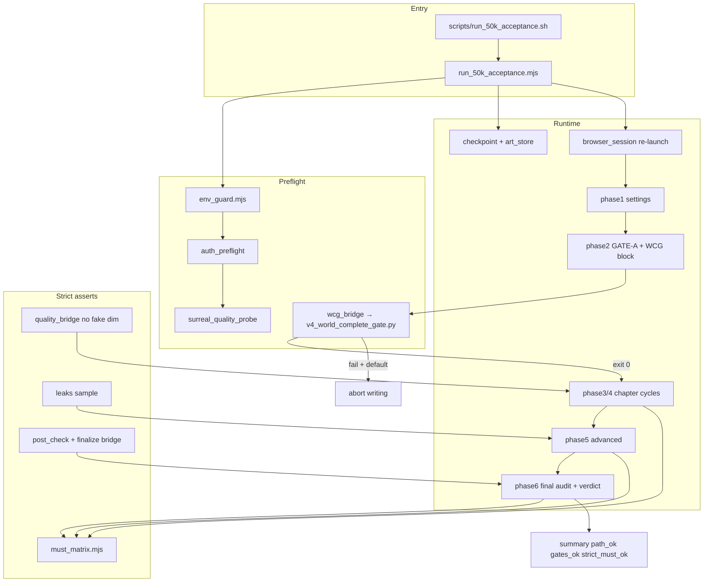
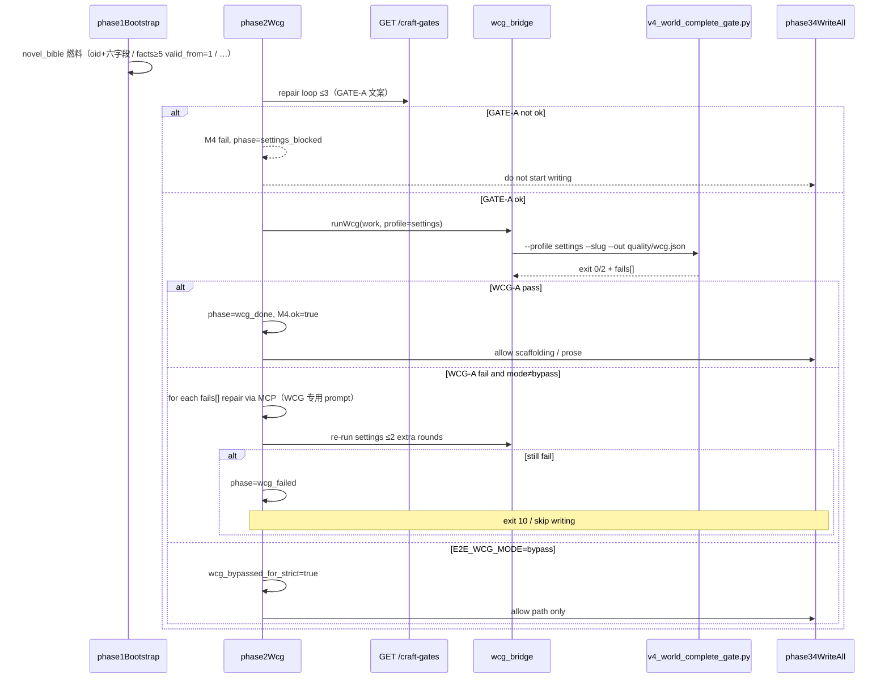
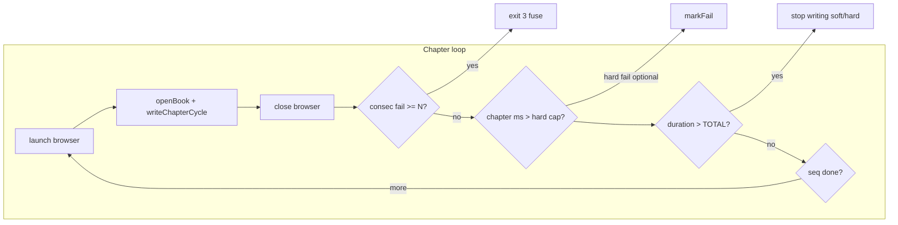

# 50k-e2e · 铜炉 5 万字 CLI+Playwright 验收硬化设计

| 项 | 值 |
|----|-----|
| **短名（会话入口）** | **`50k-e2e`** |
| **路径** | `docs/plans/50k-e2e.md` |
| **标题** | 50k CLI+Playwright 验收方案硬化（防假绿 / 三级判定 / WCG 前置 / 断点与熔断） |
| **日期** | 2026-08-12 |
| **状态** | Accepted Draft 0.3 |
| **产品** | 铜炉 / tonglu · 代码 `scribe3/` |
| **仓库** | `scribe-writing-system` |
| **基线** | v1 脚手架：`docs/plans/2026-08-12-50k-cli-playwright-acceptance.md` + `scribe3/web/e2e/acceptance_50k/*` |
| **审查基线** | B- → 0.2/0.3 关闭；用户已决 Q3/Q5；**实现暂缓** |
| **验证环境** | 已部署 demo（`tonglu.example.com` / :3311·:3321）；禁止 Grok 机 `npm ci` / 本机 Surreal 重活 |
| **新会话怎么提** | `继续 50k-e2e` 或 `读 docs/plans/50k-e2e.md` |

---

## Overview

现有 50k 验收脚手架能跑完「建书 → 设定 → GATE-A → 连载 → 终审」主路径，但 **MUST 断言偏软、WCG 与 GATE-A 双标、checkpoint 在 art 路径切换时易丢、单 `withPage` 撑 4–6h 无熔断、质量桥 HTTP 启发式可假绿、无鉴权 preflight**，导致 `summary.ok === true` 不能诚实代表「工程通路 + craft + 严格 MUST」。

本设计在 **尽量不改共享 e2e 库** 的前提下，硬化 `acceptance_50k` 与方案文档：引入 **三级判定**（`path_ok` / `gates_ok` / `strict_must_ok`）、严格 MUST 矩阵、**v4 WCG 硬前置**、checkpoint 原子迁移、浏览器分章 re-launch 与连续失败熔断、鉴权/Surreal preflight、质量/限知/记忆真断言，以及 dry-run → 1 章 → 全量的分阶段 rollout。默认 **full 模式 exit 跟随 `strict_must_ok`**（smoke/dry-run 见 §1）；明确本方案 PASS **≠** v6.3.4 体验总 PASS，十维代理 **≠** 人盲。

---

## Background & Motivation

### 当前状态（v1 事实）

| 层 | 路径 | 角色 |
|----|------|------|
| 方案 | `docs/plans/2026-08-12-50k-cli-playwright-acceptance.md` | 协议与矩阵 |
| 入口 | `scripts/run_50k_acceptance.sh` | health 探活 + 调 Node |
| 编排 | `scribe3/web/e2e/acceptance_50k/run_50k_acceptance.mjs` | 单 `withPage` 跑 Phase1–5，Phase6 只读 API |
| 阶段 | `phases.mjs` | `phase1Bootstrap` … `phase6FinalAudit` / `writeChapterCycle` |
| 断点 | `checkpoint.mjs` | `checkpoint.json`：`phase` / `lastCompletedChapter` / `must` |
| 质量 | `quality_bridge.mjs` | SurrealStore + `review_chapter_quality`；失败则 **HTTP 启发式** |
| 只读 API | `api_read.mjs` | 含合成 `evaluateFinalizeGateReadOnly`（GATE-A+字数） |
| 复用 | `lib.mjs` `withPage`、`author_decisions.mjs`、`craft_gates.mjs` | 浏览器 / 对话审批 / craft |

### 审查痛点（必须在设计内关闭）

**P0 假绿 / 跑不通**

1. **MUST 软断言**（`phases.mjs`）  
   - **M5**：`phase34WriteAll` 用「`prose_len >= MIN_CHAPTER_HARD` 的章数 ≥ 15×0.8」冒充脚手架齐套，**未**按章统计 `synopsis/beats/scene_truth`。  
   - **M7**：`ok: listLen(cand2) >= 0` **恒真**。  
   - **M8**：只对 `frame` JSON 做正则「全知|上帝视角…」；**未**调 `find_leaks` / `POST /post-check` 的 `leaks`；`frame` 失败仍 `leak:false`。  
   - **M9**：单次 recall 或回复正则命中即可，**无** 5 章抽样 80% 命中率。  
   - **M10**：`list2.length >= 1` 即可；plant→track→resolve 链路与 `hasClosed` 不进 hard。  
   - **M12**：`evaluateFinalizeGateReadOnly` = GATE-A + `word_count ≥ target`，**非** `finalize_gate.evaluate_finalize_gate` + post-check。

2. **GATE-A 与 v4 WCG 双标**  
   - Phase2 仅 `GET /craft-gates` → `gate_a`（`verify_craft_compliance.gate_a`）。  
   - WCG SSOT `scripts/v4_world_complete_gate.py` 要求更丰：角色 ≥4 且 codex 全字段、`total_word_goal` 4–6 万、规则/事实、母题 ≥3、伏笔 ≥3、volumes≥3、chapters≥10 + synopsis 对齐等。  
   - `phase2Wcg` 在 M4 失败时 **仍设 `phase=wcg_done` 并继续写章**（日志 “后续仍写章，终审会 fail-loud”）——与 WCG 文首「exit 0 前禁止验收向连载」冲突。

3. **Checkpoint 迁移丢失**  
   - `run_50k_acceptance.mjs`：`artDir` 初为 `…-new`，拿到 `cp.work` 后改 `activeArt` 为 `…-{work}`，但 **只 `saveCheckpoint(新路径)`，不迁移旧路径状态/产物**；`--resume` 若仍指旧 ART 会丢进度。

4. **长会话脆弱**  
   - 单次 `withPage` 包 Phase1–5（4–6h）；章失败默认 `lastCompletedChapter=seq` 前进；**无连续失败熔断**；性能 8min/章与 6h 全程为软日志。

5. **quality_bridge 假分**  
   - Surreal 不可用时 `qualityReviewHttpFallback` 用长度/段落/引号启发式填十维（常数 3.0–3.5），`ok` 可绿，**未标记为不可信代理**，终审可吞入 `ten_dim`。

6. **无登录/鉴权 preflight**  
   - WCG 脚本强制 `POST /api/auth/login`（`SCRIBE3_BOOTSTRAP_USERS`）；50k 路径无 cookie/login，demo 若开 L1 鉴权会在中段 401 静默失败。

**P1**

- S5 结构多样性、S4 craft_ruler / 十维严格、C3 秘密时序未做。  
- `evidence/run-traces/` 空目录；性能门非硬失败。  
- 字数/均长/最短章口径未钉死（`works.word_count` vs 净文去空白 sum）。  
- 无 dry-run / phase 子集；无防假绿单测。  
- prose 路径（提案卡 `adoptDraftAsFinal` vs `s3_save_chapter`）未分计。

### 协议诚实缺口

v1 `summary.ok ⇔ ∀ M1..M12 must[id].ok`，但因 M7/M5/M12 等可假绿，**单一 `ok` 掩盖工程通路与严格内容的差异**。必须拆成三级，且默认 exit 跟严格层。

---

## Goals & Non-Goals

### Goals

1. **严格 MUST 矩阵**：M1–M12 每条可审计、可复现、不可恒真；失败原因写入 `summary.must[id]`。  
2. **WCG 硬前置**：连载前 WCG-A exit 0；旁路仅 `E2E_WCG_MODE=bypass`（并 **强制** `strict_must_ok=false`）。模式枚举见 §1 / Key Decision 2。  
3. **Checkpoint 可靠**：ART 路径稳定策略 + 迁移/指针；resume 幂等。  
4. **浏览器生命周期**：按章或按 N 章 re-launch；连续失败熔断；可选单章超时 hard。  
5. **鉴权 + Surreal preflight**：fail-loud 于写书前。  
6. **质量轨诚实**：优先真 `verify_content_quality`；fallback **不得** 计入 strict 十维/质量 PASS。  
7. **限知/记忆/伏笔真断言**：M8 默认 Python `find_leaks_for_chapter(prose,st,focalizer,seq)`（prose+focalizer 必填）；记忆 5 查 80%；伏笔 plant→track→resolve。  
8. **定稿门**：抽样章 Python 同源 `collect_deterministic_post_for_prose` → `evaluate_finalize_gate`；禁止 Node 手写 triage；全书合成 GATE-A+字数不得单独 M12。  
9. **三级判定 + exit**：`path_ok` / `gates_ok` / `strict_must_ok`；**full** 模式 exit 跟 `strict_must_ok`；**smoke/phase_subset** 跟 `path_ok` 且强制 `strict_must_ok=false`。  
10. **产物与观测**：run-traces、prose 路径分计、性能硬门可配置。  
11. **Rollout**：`--dry-run` / `--phase` / `--max-chapters=1`；防假绿 unit tests。  
12. **文档边界**：本方案 ≠ v6.3.4；十维代理 ≠ 人盲。

### Non-Goals

- 真人 SPA 盲测 / `author_human=true` 体验总 PASS（仍见 `docs/e2e-director-journey-v634-true-chat-full-capability.md`）。  
- 完整 LLM 十维裁判替代人盲（S4 仍为代理分，且仅真质量轨可贡献）。  
- 在 Grok 运行机装 Playwright / 起临时 Surreal。  
- API 灌正文/设定（`E2E_ALLOW_API_SEED` 默认关；主路径仍 UI→Hermes→MCP 审批）。  
- 大搬家重写 `author_decisions.mjs` / `lib.mjs`（仅必要时 thin 扩展）。  
- 把 50k 挂进默认 PR CI。

---

## Proposed Design

### 架构总览



### 模块变更边界（优先 thin）

| 文件 | 变更类型 | 说明 |
|------|----------|------|
| `acceptance_50k/must_matrix.mjs` | **新增** | M1–M12 / S* / C* 纯函数判定 + 假绿防护可测 |
| `acceptance_50k/verdict.mjs` | **新增** | 三级 ok 聚合与 exit code |
| `acceptance_50k/art_store.mjs` | **新增** | ART 解析、checkpoint 迁移、canonical 指针 |
| `acceptance_50k/browser_session.mjs` | **新增** | 分章 `withPage` / re-launch / 熔断计数 |
| `acceptance_50k/wcg_bridge.mjs` | **新增** | spawn `v4_world_complete_gate.py`，解析 JSON |
| `acceptance_50k/auth_preflight.mjs` | **新增** | login + cookie 注入 Playwright context |
| `acceptance_50k/post_check_bridge.mjs` | **新增** | 限知/定稿：GET chapter → prose+focalizer；默认 deterministic Python；可选 HTTP full |
| `acceptance_50k/finalize_bridge.mjs` | **新增** | spawn Python：`collect_deterministic_post_for_prose` + `evaluate_finalize_gate`（禁止 Node 复刻 triage） |
| `acceptance_50k/http_client.mjs` | **新增** | 全局 cookie jar；`apiFetch` 供 api_read / quality fallback / preflight |
| `acceptance_50k/phases.mjs` | **大改** | 硬断言、WCG 阻断+repair、脚手架 persist、熔断钩子、字数 early-stop |
| `acceptance_50k/run_50k_acceptance.mjs` | **中改** | CLI flags、`run_mode`、session 循环、verdict exit |
| `acceptance_50k/checkpoint.mjs` | **小改** | schema 版本、`schema_version`、连续失败计数 |
| `acceptance_50k/quality_bridge.mjs` | **中改** | fallback 标记 `trust=proxy_http`；strict 不采纳十维；**不**计入熔断 |
| `acceptance_50k/api_read.mjs` | **中改** | 全部只读走 `apiFetch`（cookie）；字数辅助；废弃 M12 合成充分条件 |
| `acceptance_50k/env_guard.mjs` | **中改** | auth/surreal/hermes 硬软策略 |
| `acceptance_50k/novel_bible.mjs` | **中改** | WCG-A 燃料：4 角色 oid+六字段、关系 since_chapter、≥5 facts(**valid_from**)、≥3 规则/母题/伏笔、volumes、total_word_goal |
| `scripts/run_50k_acceptance.sh` | **小改** | flags 透传、可选 WCG/python 路径 |
| `docs/plans/2026-08-12-50k-cli-playwright-acceptance.md` | **改版 v2** | 协议与矩阵与实现对齐 |
| `acceptance_50k/*.test.mjs` | **新增** | 防假绿纯函数单测（不启浏览器） |

共享库：仅当 auth cookie 需要 context 级注入时，**可选** 在 `lib.mjs` 增加 `withPage(fn, { storageState, beforePage })` 薄参数；默认保持向后兼容。

---

### 1. 三级判定协议（核心）

```text
path_ok        工程通路：健康、鉴权、建书、浏览器会话可用、work 已解析；
               另见下方 fuse/abort 取值表。**不**因 quality trust=proxy 而变 false。
gates_ok       craft：GATE-A 绿；GATE-B ≥80% 章；GATE-C-Det ≥90% 章；
               （GATE-D ≥70% 记 should，默认不挡 gates_ok）
strict_must_ok 严格 MUST：M1–M12 全部按 v2 硬条件为 true，且 quality 轨信任级别达标，
               且未 WCG bypass，且 run_mode===full
```

#### 1.1 `run_mode`（决定 exit 与 strict 资格）

| `run_mode` | 触发条件 | 默认 exit 依据 | `strict_must_ok` |
|------------|----------|----------------|------------------|
| `dry_run` | `--dry-run` | preflight 过 → 0；preflight 挂 → 2 | **强制 false**（未跑 MUST） |
| `smoke` | `--max-chapters` &lt; 15（默认阈值）或 `E2E_RUN_MODE=smoke` | **`path_ok`**（可被 `E2E_EXIT_ON` 覆盖） | **强制 false** + `incomplete_run=true` |
| `phase_subset` | `--phase` 非全序列 | 同 smoke | **强制 false** + `incomplete_run=true` |
| `full` | 默认全量 15–18 章、全 phase | **`strict_must_ok`** | 正常计算 |

`summary` **必须**写入：`run_mode`、`exit_basis`（实际用于 exit 的字段名）、`incomplete_run`、`E2E_EXIT_ON` 覆盖值（若有）。

#### 1.2 聚合规则（`verdict.mjs`）

```javascript
// 伪代码 — 实现落在 must_matrix + verdict
export function buildVerdict({ must, should, could, path, gates, meta, run_mode }) {
  // path_ok：基础设施 + 会话；fuse/WCG abort 见取值表，不要求 50k 字
  const path_ok = !!(path.health && path.auth && path.browser_sessions_ok && path.work_resolved)
    && path.fuse_abort !== true   // 熔断 → path.partial=true, path_ok=false（见下表）
  const gates_ok = !!(gates.A && gates.B_rate >= 0.8 && gates.C_rate >= 0.9)
  let strict_must_ok = MUST_IDS.every((id) => must[id]?.ok === true)
    && !meta.quality_all_fallback
    && !meta.wcg_bypassed_for_strict
    && run_mode === 'full'
  if (run_mode !== 'full') strict_must_ok = false
  const incomplete_run = run_mode !== 'full'
  return {
    protocol: '50k-cli-playwright-acceptance-v2',
    run_mode,
    path_ok,
    path_partial: !!path.partial,
    gates_ok,
    strict_must_ok,
    incomplete_run,
    // 兼容字段：ok 仅在 full 且 strict 时为 true（防脚本误读）
    ok: run_mode === 'full' && strict_must_ok,
    must_all: run_mode === 'full' && strict_must_ok,
    exit_basis: resolveExitBasis(run_mode, process.env.E2E_EXIT_ON),
    disclaimer: {
      not_v634_experience_pass: true,
      ten_dim_is_proxy: true,
      author_human_required_for_v634: true,
    },
  }
}
```

#### 1.3 `path_ok` 在异常终止时的取值

| 终止原因 | `path_ok` | `path.partial` | exit | 说明 |
|----------|-----------|----------------|------|------|
| preflight/鉴权失败 | false | false | 2 | 未真正开跑 |
| WCG-A 红且 `E2E_WCG_MODE≠bypass`（未写章） | true* | true | 10 | *若 work 已建、会话曾可用：工程通路曾通；`path.wcg_blocked=true` |
| 写路径连续失败熔断 | **false** | true | 3 | 工程写路径断裂 |
| TOTAL_MAX 优雅停写 | true | true | 按 run_mode | 非 fuse；strict 通常 false |
| quality 全 proxy | true | — | 按 run_mode | **不**拖 path；strict false |
| full 正常跑完 | true | false | 0 仅当 strict | — |

\*WCG abort：`path_ok=true` 表示「能建书/能调 API」，但 **不得** 被脚本当成验收 PASS；exit 10 与 `strict_must_ok=false` 已区分。

#### 1.4 Exit code

| code | 条件 |
|------|------|
| 0 | `dry_run` preflight 过；**或** `smoke`/`phase_subset` 且 `path_ok`；**或** `full` 且 `strict_must_ok`（均可被 `E2E_EXIT_ON` 收紧/放宽，见下） |
| 1 | `full` 跑完但 `strict_must_ok` 假；或 smoke 下 `path_ok` 假 |
| 2 | 致命：preflight / 鉴权 / 环境 / 未捕获异常 |
| 3 | 熔断中止（连续**写路径**失败） |
| 10 | WCG-A 红且未 bypass（连载未启动） |

**`E2E_EXIT_ON`**（写入 `summary.flags`，覆盖上表「成功」依据）：

- 未设置：按 `run_mode` 默认（full→strict，smoke→path，dry_run→preflight）
- `strict` | `gates` | `path`：强制以该层为 exit 0 条件（smoke 上设 `strict` 将**几乎永 1**，仅调试用）

#### 1.5 WCG 模式 SSOT（唯一命名）

```text
E2E_WCG_MODE=full|settings_only|bypass   # 默认 full
```

| 值 | 行为 |
|----|------|
| `full` | Phase2 跑 WCG-A（settings profile）；脚手架后 WCG-B（outline）；终审可跑 full 作证据 |
| `settings_only` | 只强制 WCG-A；WCG-B 记 should（仍建议跑） |
| `bypass` | 允许在 WCG 红时写章；**强制** `meta.wcg_bypassed_for_strict=true` → `strict_must_ok=false` |

**禁止**第二套名 `E2E_ALLOW_WCG_BYPASS`（若环境残留该名，bridge 映射到 `bypass` 并 warn 一次后删除文档引用）。

---

### 2. 严格 MUST 矩阵 v2

实现：`must_matrix.mjs` 纯函数 + `phases` 采集证据。阈值环境变量可覆盖，**默认如下**。

| ID | 硬条件（v2） | 证据来源 | v1 缺陷修复 |
|----|--------------|----------|-------------|
| **M1** | `work` 非空 + four-col 截图存在 + `POST /works` 或 reopen 成功 | phase1 | 保持 |
| **M2** | intent 三字段非空；**且** `cn_len(reader_feeling)≥10`（与 WCG 对齐） | GET `/intent` | 加长度 |
| **M3** | entities≥**4** 角色档案（appearance+deep_need 等）；factions≥1；world_rules≥**3** 或 facts+rules 达标；motifs≥**3**；promises≥**3**；item+term 至少一类 | list APIs | 对齐 WCG 丰度，不再「各 ≥1」 |
| **M4** | `gate_a.ok && blocking=[]` **且** **WCG-A**（`--profile settings`）`pass===true`。**不含** WCG-B/outline/full；WCG-B 失败不改 M4（见 §3.5） | craft-gates + `quality/wcg-settings.json` | GATE-A ∧ WCG-A |
| **M5** | 已达硬底正文的章中，**≥80%** 同时 `has_synopsis && has_beats && has_scene_truth`。证据**仅**读 `chapter_results[seq].plan_snapshot`（`writeChapterCycle` **已计算** `result.plan_snapshot`，v1 缺口是 `phase34WriteAll` **丢弃未 persist**——PR-5 接线而非重算） | `chapter_results[].plan_snapshot` | 不再用「有正文」冒充 |
| **M6** | `chapter_count ≥ 15` **且** 全书净文口径 ≥50000 **且** 最短章净文 ≥1200 **且** 均长 ≥2500（见 §字数口径） | workStats + 逐章净文 | 钉死口径 |
| **M7** | 端点可达 **且**（`candidates_after ≥ 1` **或** `analysis` 列表长度≥1 且至少一条字段非空）**且** 至少一次 canon 相关 `run_id` 的 status 属于 **成功子集**（见表下说明） | canon APIs + run-traces | 消灭 `>=0`；钉 run 终态 |
| **M8** | 抽样 ≥min(5,N) 章：见 §8 钉死算法——**必须** prose+非空 focalizer；默认 deterministic `find_leaks_for_chapter`；`leaks=[]` ∧ `!leaks_degraded` ∧ `find_leaks∉degraded_stages`；空 focalizer / 取章失败 → sample **fail**（禁止当零泄露） | `post_check_bridge` / Python | 修 v1 frame 假绿 + 空 body 新假绿 |
| **M9** | 固定 5 个查询（跨章关键词）中 **≥4（80%）** API 或对话命中；单次命中不够 | recall 矩阵 | 80% 抽样 |
| **M10** | plant≥3（phase1）**且** track 至少 1 次状态变更证据 **且** resolve/close ≥1（`hasClosed`） | promises 前后 diff | 全链路 |
| **M11** | GATE-A 绿；B≥0.8；C≥0.9；（D≥0.7 → should） | craft 汇总 | 保持严 |
| **M12** | 抽样 ≥3 章（最短/中位/末章）：**仅** Python `finalize_bridge`：`collect_deterministic_post_for_prose` → `evaluate_finalize_gate`；`allowed===true` 且 `code∉{no_post,blocked}`；`advisory_accepted` **计 pass**（与产品门一致）；**全书**另要求 GATE-A + 净文字数；`evaluateFinalizeGateReadOnly` 合成门 **不得** 单独 M12 | `finalize_bridge.mjs` | 禁 Node 复刻 triage |

**M7 run 成功子集（与代码对齐，无虚构 status）**

源：`scribe3/web/e2e/author_decisions.mjs` → `isTerminalHermesRunStatus` 终端集合：

```text
completed | completed_unverified | remote_completed_pending_audit
| failed | stopped | cancelled | canceled
```

**成功子集**（M7 hard）：

```text
isTerminalHermesRunStatus(status) === true
  AND lower(status) ∉ { failed, stopped, cancelled, canceled }
  即 ∈ { completed, completed_unverified, remote_completed_pending_audit }
```

- **禁止**使用仓库不存在的 `succeeded` 等别名。  
- `remote_completed_pending_audit` 单独不足：仍须满足 candidates/analysis 实质内容条件，避免「远端完成但无正典产物」假绿。

**SHOULD / COULD（v2 补齐）**

| ID | 条件 | 失败影响 |
|----|------|----------|
| S1 | setting-completeness 端点可读 | 不挡 strict |
| S2 | Director 回复 >20 字 | 不挡 |
| S3 | 返工后 prose 可 diff 或长度变化/修订 run 成功 | 不挡 |
| S4 | 真质量轨十维：均≥3.5、单维≥3.0、无 ≤2.0；fallback 章不计入 | 不挡 strict（除非 `E2E_STRICT_TEN_DIM=1`） |
| S5 | 结构多样性：开篇句式/场景类型至少 3 类（基于 chapters 文本启发式或 quality dashboard） | 不挡 |
| C1 | Storyline DOM 可选 | 不挡 |
| C2 | focalizer 集合 ≥3 | 不挡 |
| C3 | 秘密时序：跨章 frame/secret 可见性不回退（抽样 diff） | 不挡 |

---

### 3. WCG 前置与设定丰度



**`wcg_bridge.mjs`**

- `spawnSync(E2E_PYTHON, [repo/scripts/v4_world_complete_gate.py, '--profile', profile, '--slug', work, '--out', art/quality/wcg.json], { env: { API_BASE, SCRIBE3_BOOTSTRAP_USERS / cookie 同源, ... }})`
- **`argparse` 默认 `--profile full`**（与现网 v6.3.4 / 人工 WCG 行为一致）；50k 仅显式传 `settings` / `outline`。
- `API_BASE`：WCG 脚本 path 为 `BASE + /api/...`；bridge 设 `API_BASE=${E2E_API}`（无尾斜杠）。若 404，自动再试 `E2E_API` 已含 `/api` 的变体并记日志（demo 实测钉死一种后写死默认）。
- 登录：与 §6 同一凭证；WCG 子进程复用 cookie jar 文件或 `SCRIBE3_BOOTSTRAP_USERS`。
- 产物：`quality/wcg-settings.json`（WCG-A）、`quality/wcg-outline.json`（WCG-B 若跑）；`cp.must.M4.wcg_a = settings report`（**仅 settings，不含 WCG-B**）。

#### 3.1 `--profile` 精确检查项（按 `check` 名）

源：`scripts/v4_world_complete_gate.py` → `run_gate` 内 `check("name", ...)`。

| check 名 | `settings` (WCG-A) | `outline` (WCG-B) | `full` |
|----------|--------------------|-------------------|--------|
| `intent.reader_feeling` | ✓ | ✓ | ✓ |
| `intent.emotional_arc` | ✓ | ✓ | ✓ |
| `intent.red_lines` | ✓ | ✓ | ✓ |
| `intent.total_word_goal` | ✓ | ✓ | ✓ |
| `characters.count>=4` | ✓ | ✓ | ✓ |
| `characters.codex_full(backstory+5fields)` | ✓ | ✓ | ✓ |
| `characters.has_protagonist` | ✓ | ✓ | ✓ |
| `relations.ge3_or_graph_edges` | ✓ | ✓ | ✓ |
| `world_rules_or_propositions.ge3` | ✓ | ✓ | ✓ |
| `facts.ge5_or_graph` | ✓ | ✓ | ✓ |
| `faction_item_term.two_categories` | ✓ | ✓ | ✓ |
| `promises.ge3` | ✓ | ✓ | ✓ |
| `motifs.ge3` | ✓ | ✓ | ✓ |
| `volumes.ge3` | ✗ | ✓ | ✓ |
| `chapters.ge10` | ✗ | ✓ | ✓ |
| `synopsis.ge40chars.ge10` | ✗ | ✓ | ✓ |
| `synopsis.mentions_character.ge8` | ✗ | ✓ | ✓ |

实现：`run_gate(slug, profile=...)` 在 `check()` 前按表 skip；**不得**在 settings 中静默删除 facts/codex 项。

#### 3.2 WCG-A 检查项 ↔ Phase1 动作对照表（燃料闭合）

| WCG-A check | Phase1 / bible 动作 | MCP / 工具 | 只读回查 | Repair prompt 要点（Phase2 第二轮） |
|-------------|---------------------|------------|----------|-------------------------------------|
| intent.* + total_word_goal | `s3_set_intent` 一次写齐；`total_word_goal=50000`；rf≥10 字、red_lines 多行 | `s3_set_intent` | GET `/intent` | 补字段长度与 goal 范围 40000–60000 |
| characters.count≥4 + codex_full | **4** 名；每人稳定 **`oid`**（MCP 必填，如 `role:shen_yan`）+ `name` + 六字段 + 一人 `importance=protagonist`；Phase1 prompt **写死 oid** | `s3_add_character(oid, name, …)` | GET `/entities` | 按 oid 补字段（`s3_patch_codex`） |
| relations.ge3 | ≥3 条 `s3_add_character_relation(src_oid, dst_oid, relation, **since_chapter**)`（`since_chapter` 必填，默认 1） | 同上 | `/character-relations` 或 `/graph` | 补边（带 since_chapter） |
| world_rules≥3 | ≥3 条 `s3_add_world_rule`（非仅 1 条） | `s3_add_world_rule` | `/world-rules` | 补规则 |
| **facts.ge5_or_graph** | **≥5** 条：`s3_add_fact(oid, entity, attribute, value, **valid_from**, secret?)`——`valid_from: int` **位置必填**（从第几章起成立）。开书真相默认 **`valid_from=1`**；bible 每项强制含之；Phase1 prompt 必须写出，禁止省略 | `s3_add_fact`（`tools_write.py`） | **优先** `GET /facts?chapter=1`（`valid_from≤1` 可见）≥5；graph 仅 `type∈{proposition,fact,world_rule}`，禁弱 label | 按 chapter=1 可见数补种并 **带 valid_from** |
| faction/item/term | 各 ≥1（满足 two_categories） | `s3_add_faction` / `s3_add_item` / term | 对应 list | 补缺类 |
| promises.ge3 | 已有 3 plant | `s3_plant_promise` | `/promises` | 补种 |
| motifs.ge3 | bible **≥3** 母题 | `s3_add_motif` ×3 | `/motifs` | 补母题 |

**facts 不得**依赖「图上偶然节点」假绿：WCG 的 graph fallback 仅当 `type in (proposition, fact, world_rule)`；50k repair 以 `s3_add_fact` 显式种植为 SSOT。

#### 3.3 `novel_bible.mjs` 变更规格

```javascript
// 角色：稳定 oid（MCP s3_add_character 必填）+ name + WCG 六字段 + importance
characters: [
  { oid: 'role:shen_yan', name: '沈砚', importance: 'protagonist',
    appearance: '…', personality_detail: '…', surface_goal: '…',
    deep_need: '…', fear: '…', backstory: '…' },
  { oid: 'role:lao_dao', name: '老道', importance: 'supporting', /* 六字段齐全 */ },
  { oid: 'role:lu_wan', name: '陆晚', importance: 'supporting', /* 六字段齐全 */ },
  { oid: 'role:huiyin_sishi', name: '灰印司事', importance: 'minor', /* 六字段齐全 */ },
],
// s3_add_character_relation(src_oid, dst_oid, relation, since_chapter) — since_chapter 必填
relations: [
  { src_oid: 'role:shen_yan', dst_oid: 'role:lao_dao', relation: '竞争者', since_chapter: 1 },
  { src_oid: 'role:shen_yan', dst_oid: 'role:lu_wan', relation: '盟友', since_chapter: 1 },
  { src_oid: 'role:lao_dao', dst_oid: 'role:huiyin_sishi', relation: '上下级', since_chapter: 1 },
],
world_rules: [ '…', '…', '…' ],  // ≥3
// s3_add_fact(oid, entity, attribute, value, valid_from, secret?) — valid_from 位置必填
facts: [
  { oid: 'fact:grey_pact_cost', entity: '灰契', attribute: '代价',
    value: '立契后体温与灰印反噬', valid_from: 1, secret: false },
  { oid: 'fact:furnace_guard', entity: '守炉会', attribute: '职能',
    value: '垄断灰契解释权', valid_from: 1 },
  { oid: 'fact:blood_mark', entity: '契血', attribute: '定义',
    value: '立契渗入纸纹的血温痕迹', valid_from: 1 },
  { oid: 'fact:second_deed', entity: '守炉会', attribute: '秘密',
    value: '藏有第二份契底', valid_from: 1, secret: true },
  { oid: 'fact:ash_price', entity: '灰契', attribute: '解除',
    value: '不可无故解除', valid_from: 1 },
  // ≥5；开书真相 valid_from=1 以确保 WCG GET /facts?chapter=1 可见
],
motifs: [ /* ≥3 name/theme/echoes */ ],
promises: [ /* ≥3 */ ],
total_word_goal: 50000,
volumes: [
  { title: '上·契温', sort_order: 0 },
  { title: '中·会册', sort_order: 1 },
  { title: '下·共担', sort_order: 2 },
],
```

**Phase1 种植后自检（PR-2，非只数对话成功）**

1. `GET /entities`：≥4 且 bible 中每个 `oid` 均存在。  
2. `GET /facts?chapter=1`（或等价滤 `valid_from≤1`）：**≥5**；不足 fail-loud 再 repair。  
3. promises/motifs/rules 计数对齐 WCG-A check 名。

**Phase1 顺序**：intent（含 `total_word_goal`）→ 4 角色（**oid 写死**）→ ≥3 关系（`since_chapter`）→ ≥3 规则 → **≥5 facts（`valid_from=1`）** → faction/item/term → ≥3 motifs → ≥3 promises。

**Volumes（统一措辞）**：**WCG-B（outline）执行前必须** `volumes ≥ 3`（`s3_add_volume` ×3）。完成窗口二选一：**(a) Phase1 末**，或 **(b) Phase3 大纲批、第 1 章正文 / 调用 outline profile 之前**。不是可选步骤，只是可与设定同批或大纲同批。

#### 3.4 Phase2 修复轮（GATE-A 之后 WCG-A）

1. 现有 `gateARepair` A1–A7 循环 ≤3（**不足以**刷绿 WCG-A，仅 craft）。  
2. GATE-A 绿后：`wcg_bridge(profile=settings)`。  
3. 若 `fails[]` 非空：按 check 名映射到 §3.2 repair prompt，**仅 MCP 对话**，≤2 轮重跑 WCG-A。  
4. 仍红且 `E2E_WCG_MODE≠bypass` → `phase=wcg_failed`，**禁止** `phase34WriteAll`，exit 10。  
5. **禁止** v1「M4 红仍 `phase=wcg_done` 继续写」。

#### 3.5 WCG-B（outline）时机与 M4 边界

- **M4 只绑定 WCG-A**：`must.M4.ok ⇔ GATE-A 绿 ∧ WCG-A（profile=settings）pass`。WCG-B / full 报告 **不得** 写入或覆盖 `must.M4`。  
- WCG-B 结果：`cp.flags.wcg_b` / `should.WCG_B`；在 `E2E_WCG_MODE=full` 下作为 **正文写循环前置**（失败则大纲 repair）；**不**回写 M4。  
- Phase3：若尚无卷，先 `s3_add_volume` ×3（满足 **WCG-B 前 volumes≥3**）→ 批量 `s3_add_chapter` + `s3_patch_chapter_plan`（synopsis≥40 字、角色名）至 ≥10 章大纲。  
- **第 1 章正文前**跑 `profile=outline`。  
- `E2E_WCG_MODE=settings_only`：WCG-B 失败只记 should，不挡写；**M4 仍仅看 WCG-A**。

**默认**：WCG-A 失败 **禁止** 连载正文；不再「红着写」。

### 4. Checkpoint 与 ART 可靠性

**问题**：`…-new` → `…-{work}` 只 mkdir 新目录写 checkpoint，旧目录状态成孤儿。

**策略（`art_store.mjs`）**：

1. **启动即稳定 ART**  
   - 若 `E2E_ART` 显式给出 → 唯一权威目录。  
   - 若 `E2E_WORK` 已知 → `artifacts/e2e-50k-{date}-{work}`。  
   - 否则暂用 `artifacts/e2e-50k-{date}-pending-{pid}`，**建书成功后**：  
     - `fs.rename` 整目录到 `…-{work}`（同 FS）；  
     - 写 `artifacts/e2e-50k-latest.json` 指针 `{ art, work, book, updated }`；  
     - 旧 pending 仅在 rename 失败时 `cp -a` 迁移 checkpoint + chapters + quality。

2. **checkpoint schema v2**

```json
{
  "schema_version": 2,
  "phase": "writing",
  "work": "book_xxx",
  "book": "…",
  "lastCompletedChapter": 3,
  "consecutive_failures": 0,
  "run_ids": [],
  "must": {},
  "should": {},
  "could": {},
  "chapter_results": {
    "1": {
      "ok": true,
      "engineering_ok": true,
      "prose_len": 2800,
      "prose_path": "proposal_card",
      "plan_snapshot": { "has_synopsis": true, "has_beats": true, "has_scene_truth": true },
      "quality_trust": "surreal",
      "quality_pass": true,
      "duration_ms": 320000,
      "errors": []
    }
  },
  "flags": { "wcg_bypassed": false },
  "started_at": "…",
  "updated": "…"
}
```

3. **Resume**  
   - `--resume` 优先级：`E2E_ART` > latest 指针 > 扫描 `artifacts/e2e-50k-*` 中匹配 `E2E_WORK` 最新。  
   - 加载后校验 `work` 与 API 存在；phase 机从 `lastCompletedChapter+1` 继续。  
   - **仅当章 `engineering_ok===true`（v2 的 `result.ok`）才前进 lastCompleted**；失败章不占用「完成」语义（可配置 `E2E_SKIP_FAILED_CHAPTER=1` 强制跳号并记 `skipped`）。

4. **原子写**：`checkpoint.json.tmp` + rename。

---

### 5. 浏览器 re-launch、熔断、性能门



| 项 | 默认 | 环境变量 |
|----|------|----------|
| 每章 re-launch | **on** | `E2E_BROWSER_PER_CHAPTER=1` |
| 每 N 章 re-launch | 若 per-chapter 关，则 N=3 | `E2E_BROWSER_RELAUNCH_EVERY=3` |
| 连续失败熔断 | 3 | `E2E_MAX_CONSECUTIVE_FAILS=3` |
| 单章软目标 | 8 min | `E2E_CHAPTER_TARGET_MS=480000` |
| 单章硬失败 | off（记录 should）| `E2E_CHAPTER_HARD_MS=0` 关闭；设 600000 则超时章 fail |
| 全程墙钟 | 6h 停止写循环 | `E2E_TOTAL_MAX_MS`；超时 → 进 phase6，`path_ok` 可 true，`strict` 通常 false |
| 章失败是否前进 | **不**将失败章标 completed | `E2E_ADVANCE_ON_FAIL=0` 默认 |

#### 5.1 章结果三层语义（解耦熔断与质量 trust）

| 字段 | 含义 | 计入 `consecutive_failures` |
|------|------|------------------------------|
| `engineering_ok` | 章净文 ≥ `MIN_CHAPTER_HARD` 且落库可读 | **是**（失败则 +1） |
| `quality_trust` | `surreal` / `proxy_http` / `error` | **否**（默认） |
| `quality_pass` | trust=surreal 且 `review_chapter_quality.ok` | 否（进 strict / 章 `strict_ok`） |
| `plan_snapshot` | synopsis/beats/scene_truth 布尔 | 否（进 M5） |
| `result.ok`（v2） | `engineering_ok`（**不再**把 proxy 质量失败并入写路径 ok） | 熔断只看 engineering |

- 浏览器抛错 / 建章失败 / 净文未达硬底 → `engineering_ok=false` → 熔断计数。  
- Surreal 瞬断 → `quality_trust=proxy_http|error`，**重置或保持** consecutive（不 +1）；`meta.quality_fallback_chapters++`；若 fallback 章占比 > 阈值（默认任一章在 full 模式）→ `meta.quality_all_fallback` 或 per-chapter 门槛使 `strict_must_ok=false`。  
- 可选 `E2E_FUSE_ON_QUALITY_TRUST=1` 才把 trust 失败计入熔断（默认 **关**）。

`browser_session.mjs` API：

```javascript
export async function withChapterPage(env, cp, artDir, fn) {
  // withPage wrapper; inject storageState from auth_preflight
  // on exit always close; return { ok, err, ...fnResult }
}
```

熔断时：`saveCheckpoint`、`summary.partial=true`、`path.fuse_abort=true`、`path_ok=false`、`exit 3`。

---

### 6. 鉴权 Preflight（浏览器 + Node `fetch` 全局）

**问题**：v1/`api_read.apiJson` 使用裸 `fetch`，L1 开启时 Playwright 登录后 **Node 侧 GET/POST 仍 401**。

**`http_client.mjs` + `auth_preflight.mjs`**

1. 读 `SCRIBE3_BOOTSTRAP_USERS` 或 `E2E_AUTH_USER`/`E2E_AUTH_PASS`（**禁止写入 git**；demo 从 `.env.production.local` / 运维注入）。  
2. **双试登录**：`POST ${E2E_API}/auth/login` 与 `POST ${E2E_API}/api/auth/login`（及绝对路径探测）；成功则保存 `Set-Cookie` 到进程内 jar + 可选 `storageState` 文件（`0600`，默认 `/tmp/e2e-50k-auth.json`，**不进 art 公开包**）。  
3. 校验：带 cookie `GET /works` 200；401 → exit 2。  
4. **全局 `apiFetch(path, init)`**：自动附加 `Cookie`；供 `api_read.mjs`、`post_check_bridge`（若走 HTTP）、quality HTTP fallback 的 Python 子进程（经 env `E2E_COOKIE` 或临时 cookie 文件）、`wcg_bridge` 的 `COOKIE_JAR`。  
5. Playwright：`browser.newContext({ storageState })`（`lib.mjs` thin 扩展）。  
6. Open mode：login 404 或无 cookie 时 `/works` 已 200 → `auth.mode=open`，`path.auth=true`，`apiFetch` 无 Cookie 头。

`env_guard.assertSafeEnvironment` 顺序：health → frontend → ALLOW_DEPLOYED → **auth + apiFetch 自检** → Hermes（至少一个端口；`E2E_REQUIRE_HERMES=1` 硬失败）→ Surreal 质量探针。

---

### 7. 质量桥与十维诚实

**`quality_bridge.mjs` 变更**

| 结果 | `trust` 字段 | 计入 `quality.ok` for 章 | 计入 strict 十维 / S4 |
|------|--------------|---------------------------|------------------------|
| Surreal + `review_chapter_quality` | `surreal` | 是 | 是 |
| HTTP 启发式 fallback | `proxy_http` | **否**（`ok=false` 或 `ok` 仅作诊断且 `quality_pass=false`） | **否** |
| 完全失败 | `error` | 否 | 否 |

- fallback 报告必须 `note` 含 `UNTRUSTED_PROXY`；`mapTenDimensions` 对 proxy 返回 `present:0` 或 `hardFail:true`。  
- preflight：`SCRIBE3_SURREAL_URL`（demo 常 `:8001`）上执行一次最小 `SurrealStore` 打开；失败则 **warn + 默认拒绝 strict**（`E2E_ALLOW_QUALITY_HTTP=1` 仅允许诊断 fallback，**仍** `strict_must_ok=false`）。  
- 章循环：`quality.trust !== 'surreal'` → `quality_pass=false`，**默认不**计入 `consecutive_failures`（见 §5.1）；计入 `quality_trust_counts` 与 strict 门槛。

---

### 8. 限知 / 记忆 / 伏笔 / 定稿真断言

#### 8.1 代码契约（已核）

| 事实 | 路径 |
|------|------|
| `PostCheckReq.prose: str` **必填**；空 body → 422 | `scribe3/api/models.py` |
| `find_leaks` **仅当 `req.focalizer` 非空**；否则 `leaks=[]` 且 **不** 置 `leaks_degraded` | `scribe3/api/routers/write.py` `post_check` |
| 无 REST `finalize-gate`；产品 SSOT 为 Python `evaluate_finalize_gate` | `scribe3/finalize_gate.py` |
| 存稿同源：`collect_deterministic_post_for_prose` → `evaluate_finalize_gate` | 同上 `check_finalize_for_save` |
| MCP `s3_find_leaks` 存在但需对话审批 | `mcp/tools_read.py` — **不适合** pure assert（见 Alternatives A5） |

#### 8.2 M8 限知 — 钉死算法（`post_check_bridge.mjs`）

**默认路径：deterministic Python（不跑完整 HTTP post-check 的 LLM discipline）**

```text
for seq in sampleSeqs (≥min(5, N)):
  1. GET /chapter?work&seq  （经 apiFetch + cookie）
  2. prose = ch.prose || ch.body
     focalizer = ch.focalizer || chapterPlan(seq).focalizer
  3. if !prose.strip() or !focalizer.strip():
       sample = { ok:false, reason:'missing_prose_or_focalizer' }  # 禁止当零泄露
       continue
  4. spawn Python:
       from scribe3.store import SurrealStore
       from scribe3.verify import find_leaks_for_chapter
       leaks = find_leaks_for_chapter(prose, st, focalizer, seq)
       # 或复用 collect_deterministic_post_for_prose 读 leaks + leaks_degraded
  5. sample.ok = (len(leaks)==0 and not leaks_degraded
                  and 'find_leaks' not in degraded_stages)
  6. 落盘 evidence/epistemic-samples.json
M8.ok = all(sample.ok for sample in samples) and len(samples) >= min(5,N) 的应抽样数
```

**可选 HTTP 金样**（`E2E_FULL_POSTCHECK=1` 或每书 1 章）：

```text
POST ${API}/post-check?work=&seq=
Body: { "prose": "<必填>", "focalizer": "<非空>", "seq": <n> }   # PostCheckReq
判定同：leaks 空 ∧ !leaks_degraded ∧ find_leaks ∉ degraded_stages
```

**禁止**：

- `body: {}` 或省略 prose  
- 空 focalizer 时把 `leaks=[]` 当 PASS  
- 仅 frame 正则（可作附加证据，不定 M8）

**单测**（PR-0/PR-6）：`focalizer=""` fixture → `ok:false`；`leaks:[{…}]` → false；degraded find_leaks → false。

#### 8.3 M12 定稿 — 唯一 SSOT：Python finalize_bridge

```text
samples = [最短净文章, 中位 seq, 末章]  # 至少 3；不足则全取
for seq in samples:
  GET chapter → prose, focalizer（规则同 M8；缺 focalizer → M12 sample fail）
  Python:
    post = collect_deterministic_post_for_prose(prose, st=st, seq=seq, focalizer=focalizer)
    fg = evaluate_finalize_gate(post)
  记录 code/allowed/verdict/blocking/degraded_stages
  sample.ok = fg.allowed and fg.code not in ('no_post', 'blocked')
  # advisory_accepted → allowed True → PASS（与产品门一致）
  # danger_bypass 在验收中不应出现；若出现记 warning 且 sample.ok=false（禁旁路充绿）
全书: GATE-A 绿 ∧ 净文 sum≥目标 ∧ all samples ok → M12.ok
```

**禁止** Node 手写 `loop.triage` / 合成 `evaluateFinalizeGateReadOnly` 作为 M12 充分条件。  
HTTP 完整 post-check 仅作 `evidence/post_check_full_sample.json` 可选附件，**strict 以 Python 同源为准**。

#### 8.4 M9 记忆

查询集（可配置 JSON）：

```text
沈砚 灰契
老道 守炉
陆晚 耳后
第二份契底
反噬 体温
```

每条：`GET /recall`（apiFetch）或 chiefSay semantic/hybrid；命中：`listLen≥1` 或回复匹配章号/专名。  
`hits/total >= 0.8` → M9 ok。

#### 8.5 M10 伏笔

1. Phase1 plant 后 `promises ≥ 3` → `M10_plant`  
2. Phase5：track 前 statuses；MCP track/resolve 后 **至少一条** status 变化；**至少一条** closed/resolved  
3. `M10.ok = plant && tracked && hasClosed`

### 9. 字数 / 均长 / 最短章口径（钉死）

| 指标 | 口径 | 用途 |
|------|------|------|
| **全书字数（M6）** | 对所有 `seq` 的 `prose` 做 `replace(/\s/g,'')` 后 **sum**；与 `works.word_count` **双写对照**，不一致记 warning，**strict 以净文 sum 为准** | M6 |
| **章净文** | 同上单章 | 最短章、均长、质量 minProse |
| **最短章** | min(章净文) over 计入章（prose_len>0） | ≥ `E2E_MIN_CHAPTER_HARD`（1200） |
| **均长** | sum/count | ≥ `E2E_MIN_PROSE`（2500） |
| **目标章数** | `chapter_count ≥ 15`，目标 18 | `E2E_TARGET_CHAPTERS` |

产物：`quality/wordcount_audit.json`：`{ api_word_count, net_sum, per_chapter[], mismatch }`；**每章完成后更新**。

**early-stop（phase34）**：v1 用 `works.word_count >= target && seq>15` 可提前停。v2 **改为与 M6 同口径**：

```text
net_sum = sum(章净文)
early_stop iff net_sum >= WORD_TARGET && chapter_count >= 15 && seq >= 15
```

若仅 API `word_count` 虚高而 `net_sum` 不足 → **继续写**，避免提前停导致 M6 红且无法补字。对照 mismatch 写入 audit warning。

---

### 10. Prose 路径分计

在 `writeChapterCycle` 记录：

```javascript
prose_path: 'proposal_card' | 's3_save_chapter' | 'unknown' | 'failed'
```

- 提案卡：`acceptDraftProposal` kind=stage 且 `adoptDraftAsFinal` 后观察到 `POST /save-chapter` 200。  
- MCP：chiefSay 回退 `s3_save_chapter` 且审批后 prose_len 上升。  
- summary：`prose_path_counts`；run-traces 侧记 run_id。

---

### 11. 产物与观测

```text
artifacts/e2e-50k-{date}-{work}/
├── checkpoint.json          # schema v2
├── journey.log
├── journey-meta.json
├── summary.json             # path_ok, gates_ok, strict_must_ok, disclaimer
├── chapters/chNN.json|txt   # + plan_snapshot, prose_path, quality_trust
├── quality/
│   ├── wcg.json             # WCG-A/B/full
│   ├── craft_gates*.json
│   ├── wordcount_audit.json
│   ├── post_check_samples.json
│   ├── finalize_samples.json
│   ├── rubric_scores.json   # only trust=surreal
│   └── ...
├── evidence/
│   ├── run-traces/{run_id}.json   # GET /ai/runs/{id} 或 trace 端点
│   ├── memory-recalls/
│   ├── epistemic-samples.json     # leaks 真结果
│   ├── promises.json
│   └── canon-candidates.json
└── errors/
```

**run-traces**：每个 `recordRun` 在 run 终态后 soft-fetch 写入；失败不挡 path，但 `should.traces_coverage` 记录覆盖率。

**性能**：`summary.perf = { chapter_p50_ms, chapter_p95_ms, total_ms, hard_fail }`；若 `E2E_PERF_HARD=1` 且任章 > hard 或 total > TOTAL → strict false。

---

### 12. CLI / dry-run / phase 子集

`run_50k_acceptance.sh` / Node argv：

```bash
./scripts/run_50k_acceptance.sh --dry-run
./scripts/run_50k_acceptance.sh --phase preflight,phase1,phase2
./scripts/run_50k_acceptance.sh --max-chapters 1
./scripts/run_50k_acceptance.sh --resume
./scripts/run_50k_acceptance.sh --exit-on gates   # 调试
```

| 模式 | `run_mode` | 行为 / 期望 exit |
|------|------------|------------------|
| `--dry-run` | `dry_run` | 只 preflight + 计划；`summary.incomplete_run=true`；preflight 过 **exit 0**，挂 **exit 2** |
| `--phase …` | `phase_subset` | 只跑列出 phase；**exit 跟 path_ok**；`strict_must_ok` 强制 false |
| `--max-chapters N`（N&lt;15） | `smoke` | 限制写章节数；**exit 跟 path_ok**；不得宣称 must_all |
| 默认全量 | `full` | 15–18 章；**exit 跟 strict_must_ok** |
| `--resume` | 继承 checkpoint | 断点续跑；不改变 mode 规则 |

Rollout 成功标准（与 §1 对齐）：

| 阶段 | 命令 | 期望 exit | 主要看字段 |
|------|------|-----------|------------|
| R1 | `--dry-run` | 0 | preflight / path.auth |
| R2 | `--max-chapters 1` | 0 若 path_ok | path_ok, chapter_results[1], quality_trust（可 proxy） |
| R3 | 5 章 smoke | 0 若 path_ok | fuse 未触发、checkpoint resume、incomplete_run=true |
| R4 | full | 0 仅 strict | strict_must_ok, must_all, disclaimer |

---

### 13. 防假绿单测（不启浏览器）

路径：`scribe3/web/e2e/acceptance_50k/must_matrix.test.mjs` 等（Node 内置 test 或现有 vitest/node:test 惯例）。

覆盖用例（至少）：

1. `listLen >= 0` 型 M7 恒真被拒绝（fixture candidates=[] → ok false）。  
2. M5：仅有 prose 无 plan_snapshot → ok false。  
3. M8：leaks 非空 → ok false；degraded find_leaks → ok false。  
4. M10：无 hasClosed → ok false。  
5. M12：仅 synthetic finalize → ok false。  
6. `buildVerdict`：proxy 质量全 fallback → strict false。  
7. checkpoint migrate：pending→work 路径指针。  
8. 字数：空白填充不计入净文。

在 **demo 机** 或 CI 轻量 job 跑这些测试；**不要**在 Grok 机全量 Playwright。

---

### 14. 与 v6.3.4 边界（文档铁律）

每个 `summary.json` 与方案文首强制：

```text
本自动化 strict_must_ok = 工程+craft+严格 MUST 回归 PASS
≠ docs/e2e-director-journey-v634-true-chat-full-capability.md 体验总 PASS
（缺 author_human=true 真人 SPA 路径）
十维分数 = verify_content_quality / 映射代理，≠ 人盲 ≥9.5
```

---

## API / Interface Changes

### 新增/扩展只读调用（验收侧）

| 调用 | 用途 |
|------|------|
| `POST /auth/login` 与 `/api/auth/login` | preflight（双试）；cookie 进全局 `apiFetch` |
| `GET /chapter?work&seq` | M8/M12 取 prose+focalizer（**先于**任何 post-check） |
| `POST /post-check?work&seq` body `{prose, focalizer, seq}` | **可选**金样；prose 必填；focalizer 非空才有真 leaks |
| Python `find_leaks_for_chapter` / `collect_deterministic_post_for_prose` / `evaluate_finalize_gate` | M8/M12 **strict 默认 SSOT**（无 finalize REST） |
| `GET /ai/runs/{id}` / `/ai/runs/{id}/trace` | run-traces、M7 终态 |
| `GET /craft-gates` | 不变 |
| WCG Python CLI `--profile` | 默认 `full`；50k 传 `settings`/`outline` |

### summary.json 契约 v2（破坏性但兼容字段）

```json
{
  "protocol": "50k-cli-playwright-acceptance-v2",
  "run_mode": "full",
  "ok": false,
  "path_ok": true,
  "path_partial": false,
  "gates_ok": true,
  "strict_must_ok": false,
  "must_all": false,
  "incomplete_run": false,
  "word_count": 50123,
  "word_count_net_sum": 49888,
  "chapter_count": 18,
  "prose_path_counts": { "proposal_card": 15, "s3_save_chapter": 3 },
  "quality_trust_counts": { "surreal": 18, "proxy_http": 0 },
  "disclaimer": {
    "not_v634_experience_pass": true,
    "ten_dim_is_proxy": true
  },
  "must": { "M7": { "ok": false, "reason": "candidates_after=0" } },
  "exit_basis": "strict_must_ok",
  "flags": { "E2E_WCG_MODE": "full", "E2E_EXIT_ON": null }
}
```

旧消费者读 `ok` 时将更严（推荐）；读 `must_all` 同 `strict_must_ok`。

### 可选 `lib.mjs` 薄扩展

```javascript
export async function withPage(fn, { storageState, contextOptions } = {}) {
  const b = await chromium.launch()
  const ctx = await b.newContext({
    viewport: { width: 1440, height: 900 },
    storageState,
    ...contextOptions,
  })
  const p = await ctx.newPage()
  // ... existing error hooks; close ctx+browser
}
```

---

## Data Model Changes

- **无** Surreal schema 迁移。  
- Checkpoint / artifact JSON only。  
- WCG Python：可选 CLI 参数，不改库表。

---

## Alternatives Considered

### A1. 保持单一 `ok`，只加严 M7/M5 等

- **优点**：改动面小。  
- **缺点**：运维无法区分「通路通但内容红」vs「彻底挂」；与审查「协议诚实」不符。  
- **结论**：拒绝；采用三级判定。

### A2. 连载前要求完整 WCG full（含 10 章 synopsis）在零章时强制

- **优点**：与脚本字面一致。  
- **缺点**：逻辑不可能（无章则 chapters.ge10 永假）→ 永远不能开写或必须 API 灌大纲。  
- **结论**：拒绝；采用 WCG-A / WCG-B 两段。

### A3. 质量失败时禁用 HTTP fallback，直接 skip 质量

- **优点**：简单。  
- **缺点**：demo Surreal 瞬断时全程红且无诊断分。  
- **结论**：保留 fallback 作 **诊断**，但不计入 strict / 十维。

### A4. 大改共享 `hq_wordcount_push` / 合并长程脚本

- **优点**：统一入口。  
- **缺点**：回归面大，违背「优先 acceptance_50k」。  
- **结论**：拒绝；50k 目录内自洽，复用函数级导入。

### A5. M8 经 MCP `s3_find_leaks` 对话 或 仅靠 craft GATE-C

- **MCP `s3_find_leaks`**（`mcp/tools_read.py`）：需 chiefSay + 审批，慢、 nondeterministic、难做纯函数单测；适合人工探索，**不适合** 50k pure assert。  
- **仅 GATE-C / craft_gates**：工艺脚手架门，**不**等价 `find_leaks` 知识帧扫描（见 `verify_craft_compliance` vs `verify.find_leaks` 分工）。  
- **结论**：拒绝二者作 M8 SSOT；采用 **Python store 直连 `find_leaks_for_chapter`**（默认）+ 可选 HTTP post-check 金样（body 必带 prose+focalizer）。

---

## Security & Privacy Considerations

| 风险 | 严重度 | 缓解 |
|------|--------|------|
| 误写生产书（纸命/印迹） | 高 | 已有 `E2E_REFUSE_*`；resume 校验 slug |
| 凭证进 git / 日志 | 高 | 仅环境变量；日志打印 `auth=ok` 不打印密码；cookie 文件 `0600` 于 art 外 `/tmp` |
| 长程占用 demo LLM 配额 | 中 | TOTAL_MAX、熔断、max-chapters 冒烟 |
| 产物含全文散文 | 中 | artifacts 本地；打包注意脱敏 run-traces（勿存完整 tool 正文若政策要求） |
| 未设 ALLOW_DEPLOYED 误连 | 中 | 已有 fail-loud |

威胁模型：验收机器人 = 高权限作者会话；必须显式 allow + 黑名单。

---

## Observability

- **日志**：`journey.log` ISO 行；每章 `chN done prose= trust= path= ms=`。  
- **指标字段**（summary）：三级 ok、熔断原因、perf、quality_trust_counts、wcg fail 列表。  
- **告警（人工）**：demo 上 cron 读最新 summary，`strict_must_ok=false` 通知；非本 PR 范围。  
- **Hermes**：preflight 端口；run-traces 覆盖率。

---

## Rollout Plan


| 阶段 | 动作 | 成功标准 |
|------|------|----------|
| R0 | 合并 PR-0..PR-1 单测 | 防假绿 test 绿 |
| R1 | demo `--dry-run` | path preflight 绿 |
| R2 | `--max-chapters 1` | M1–M4、章级 plan/quality trust 可见 |
| R3 | 5 章 | 熔断/relaunch/checkpoint resume 验证 |
| R4 | 全量 | strict_must_ok 或诚实的失败摘要 |
| Rollback | `git revert` 相关 PR；或 `E2E_PROTOCOL=v1` 临时开关（若保留兼容层） | 恢复 v1 行为 |

**Feature flags**

- `E2E_PROTOCOL=v2`（默认 v2）  
- `E2E_WCG_MODE=full|settings_only|bypass`  
- `E2E_ALLOW_QUALITY_HTTP` / `E2E_FULL_POSTCHECK` / `E2E_PERF_HARD` / `E2E_EXIT_ON` / `E2E_FUSE_ON_QUALITY_TRUST`  
- `E2E_RUN_MODE` 可选覆盖自动推断的 `run_mode`

**实现状态（用户 2026-08-12）**：设计 **Accepted Draft 0.3**，审查与关键 Open Q 已关闭；用户选择 **先只看设计、暂不实现**。PR-0…7 计划保留，**待用户明确要求后再开工编码/部署**。

---

## Risks

| 风险 | 严重度 | 缓解 |
|------|--------|------|
| WCG-A profile 与 GATE-A 仍不一致 | 中 | 对照表 + 同一次设定修复轮同时刷两边 |
| post-check 过慢/含 LLM | 中 | **默认不用 full post-check**；deterministic Python；金样可选 |
| 每章 relaunch 增加开销 | 低 | 比 6h 单 session 崩溃更可恢复 |
| 真严格后「长期全红」打击信心 | 中 | 三级 ok 展示 path/gates 进步；分 PR 先假绿修复 |
| API_BASE `/api` 前缀不一致 | 中 | bridge 双试 + Open Question 钉 demo |
| 改 lib.mjs 影响其他 e2e | 低 | 可选参数默认旧行为 |

---

## Key Decisions

1. **三级判定 + full 默认 exit=`strict_must_ok`；smoke/phase_subset exit=`path_ok` 且强制 strict false**  
   - *理由*：审查核心是假绿；单一 ok 无法诚实；冒烟永不 strict 绿，避免 CI 误读。  
   - *用户 2026-08-12*：GATE-D ≥70% **保持 SHOULD**，不进 `gates_ok` / 默认 exit。

2. **WCG 两段 + `E2E_WCG_MODE` 唯一命名（full|settings_only|bypass）；full 时 WCG-B 挡第 1 章正文；CLI `--profile` 默认 full**  
   - *理由*：完整 WCG 含章大纲；统一 flag 防双名；默认 full 不破坏 v6.3.4 人工路径。  
   - *用户 2026-08-12*：确认 full 挡正文（推荐）；`settings_only` 不挡。

3. **质量 HTTP fallback 诊断用不计入 strict；默认不计入写路径熔断**  
   - *理由*：启发式十维假绿；Surreal 瞬断不应 exit 3 杀掉已落库进度。

4. **M8/M12 默认 deterministic Python 同源（`find_leaks_for_chapter` / `collect_deterministic_post_for_prose` + `evaluate_finalize_gate`）；禁止 Node 复刻 triage；HTTP post-check 仅可选金样且 body 必填 prose+非空 focalizer**  
   - *理由*：PostCheckReq 契约与无 finalize REST 已核；关 Open Q6 成本；关空 focalizer 假绿。

5. **Checkpoint：稳定 ART + rename 迁移 + latest 指针；失败章不默认 completed**  
   - *理由*：v1 resume 丢状态是 P0。

6. **默认每章浏览器 re-launch + 连续 3 次 engineering 失败熔断**  
   - *理由*：4–6h 单 page 不可靠；熔断与 quality trust 解耦。

7. **实现边界：`acceptance_50k` + 方案文档 + WCG CLI 小参数；共享库仅 thin（`withPage` storageState）**  
   - *理由*：可拆 PR、可评审、降回归。

8. **本方案永不宣称 v6.3.4 体验总 PASS**  
   - *理由*：产品协议 SSOT；自动化只能工程回归。

9. **字数 strict 以净文 sum 为准；early-stop 同步净文口径**  
   - *理由*：API word_count 虚高会导致提前停写且 M6 红。

10. **防假绿纯函数单测强制进 PR-0**  
    - *理由*：防止 M7/空 focalizer 类回归再次合入。

11. **全局 `apiFetch` cookie jar（Node 与 Playwright 同源登录）**  
    - *理由*：仅 storageState 不够，L1 下只读断言 401。

12. **WCG-A 燃料闭合**：Phase1 经 MCP 种满 settings 全项（≥5×`s3_add_fact` 且含 `valid_from`、角色稳定 `oid`+六字段、关系 `since_chapter`）；种植后 `GET /facts?chapter=1` 自检；PR-2 同批 bible+repair，禁止只加阻断不加燃料  
    - *理由*：否则 exit 10 永驻，验收不可用。

13. **M5 接线：persist 已有 `plan_snapshot`，不重复造轮子**  
    - *理由*：`writeChapterCycle` 已算字段，v1 仅丢弃。

## Open Questions

1. **Demo 鉴权是否强制？** 凭证是否统一 `SCRIBE3_BOOTSTRAP_USERS`？Open mode 探测已设计；若 demo 永开 L1，需运维保证 env 注入。（实现期再钉）  
2. **`API_BASE` 与 `E2E_API` 的 `/api` 前缀**：bridge 双试策略已定；**demo 一次实测后**把胜出组合写死为默认（实现 PR-2 验收项）。  
3. ~~WCG-B 失败是否挡正文？~~ → **已决（用户 2026-08-12）**：**full 模式挡正文（推荐）**——`E2E_WCG_MODE=full` 时 WCG-B 失败 **禁止** 第 1 章正文；`settings_only` 不挡。与 §3.5 / Key Decision 2 默认一致。  
4. ~~WCG 旁路命名~~ → **已决** `E2E_WCG_MODE`。  
5. ~~GATE-D 是否升级进 `gates_ok`？~~ → **已决（用户 2026-08-12）**：**保持 SHOULD（推荐）**——GATE-D ≥70% 只记 `should`，**不进** `gates_ok` / 默认 exit。  
6. ~~post-check 成本~~ → **已决** M8/M12 默认 deterministic Python；`E2E_FULL_POSTCHECK=1` 可选。  
7. **失败章同 seq 重试次数**：建议默认 1 次 soft retry 再计入 consecutive_failures——实现 PR-4 可调 `E2E_CHAPTER_RETRIES=1`。（实现期）  
8. **run-traces 端点**：`/ai/runs/{id}` 与 `/trace` 已注册；不可用时 should 覆盖率不足即可，不降 path。（实现期）

**实现 deferred**：用户 2026-08-12 决定 **先只看设计，暂不实现**；在用户另行要求前 **不启动** PR-0…7 编码、demo 部署或 50k 试跑。

## References

- 方案 v1：`docs/plans/2026-08-12-50k-cli-playwright-acceptance.md`  
- 实现：`scribe3/web/e2e/acceptance_50k/*`，`scripts/run_50k_acceptance.sh`  
- WCG：`scripts/v4_world_complete_gate.py`  
- Craft：`scribe3/verify_craft_compliance.py`，`scribe3/web/e2e/craft_gates.mjs`  
- 质量：`scribe3/verify_content_quality.py`，`scribe3/quality/models.py`（`QualityDimensionKey`）  
- 定稿：`scribe3/finalize_gate.py`（`evaluate_finalize_gate`）  
- 限知：`scribe3/verify.py`（`find_leaks` / `find_leaks_for_chapter`），`scribe3/mcp/tools_read.py`（`s3_find_leaks`），`POST /post-check`  
- 体验总 PASS SSOT：`docs/e2e-director-journey-v634-true-chat-full-capability.md`  
- 复用：`lib.mjs`，`author_decisions.mjs`，`craft_first_journey.mjs`，`hq_wordcount_push.mjs`

---

## PR Plan

### PR-0 — 防假绿纯函数骨架 + verdict 契约

- **Title**：`test(e2e-50k): must_matrix + verdict 三级判定与假绿单测`  
- **Files**：  
  - 新增 `scribe3/web/e2e/acceptance_50k/must_matrix.mjs`  
  - 新增 `scribe3/web/e2e/acceptance_50k/verdict.mjs`  
  - 新增 `scribe3/web/e2e/acceptance_50k/must_matrix.test.mjs`  
  - 新增 `scribe3/web/e2e/acceptance_50k/verdict.test.mjs`  
- **Dependencies**：无  
- **Description**：抽出 M5/M7/M8/M10/M12 判定纯函数与 `buildVerdict`（含 `run_mode`）；单测钉死：M7 恒真拒绝、M5 无 snapshot、**M8 空 focalizer→false**、M10 无 closed、M12 仅 synthetic→false、proxy 不进 strict、smoke 强制 strict false。**不**改运行时 phases 行为。可独立合并。

### PR-1 — Checkpoint / ART 可靠性

- **Title**：`fix(e2e-50k): art_store 迁移与 checkpoint schema v2`  
- **Files**：  
  - 新增 `art_store.mjs`  
  - 改 `checkpoint.mjs`、`run_50k_acceptance.mjs`  
- **Dependencies**：无（可与 PR-0 并行）  
- **Description**：pending→work rename、latest 指针、原子写；resume 路径文档化。失败章默认不标 completed（接线可与 PR-4 对齐）。

### PR-2 — WCG 两段 profile + Phase1 燃料 + Phase2 阻断连载

- **Title**：`feat(e2e-50k): WCG-A/B 前置、bible 燃料与 phase2 写障`  
- **Files**：  
  - 改 `scripts/v4_world_complete_gate.py`（`--profile settings|outline|full`，**默认 full**）  
  - 新增 `wcg_bridge.mjs`  
  - 改 `phases.mjs` phase1/2（WCG-A fails[] repair）、`novel_bible.mjs`（oid+六字段、≥5 facts 含 **valid_from**、关系 since_chapter、volumes）  
  - 种植后自检：`GET /facts?chapter=1` ≥5；最小测：`profile=settings` 无 chapters 可结构 pass  
  - 改方案文档 Phase1–2 节  
- **Dependencies**：建议 PR-0 后（M4）；**禁止**只合「写障」不合 bible——同 PR 或紧前必含燃料  
- **Description**：GATE-A 后再 WCG-A；按 fails repair；失败默认不进 writing；`E2E_WCG_MODE=bypass` 禁 strict。Outline 在脚手架后、正文前。

### PR-3 — 鉴权 preflight + 全局 apiFetch cookie + Surreal 探针

- **Title**：`feat(e2e-50k): auth jar、apiFetch 与质量 trust 标记`  
- **Files**：  
  - 新增 `auth_preflight.mjs`、`http_client.mjs`  
  - 改 `api_read.mjs`（全部走 apiFetch）、`env_guard.mjs`、`quality_bridge.mjs`（cookie 传给 urllib 子进程）、`run_50k_acceptance.mjs`  
  - 可选 thin `lib.mjs` storageState  
- **Dependencies**：PR-1 可选  
- **Description**：双试 `/auth/login` 与 `/api/auth/login`；Node+浏览器同源 cookie；Surreal 不可用则 proxy 不进 strict **且不熔断**。

### PR-4 — 浏览器 re-launch、engineering 熔断、run_mode CLI

- **Title**：`feat(e2e-50k): 分章 browser session、熔断与 run_mode CLI`  
- **Files**：  
  - 新增 `browser_session.mjs`  
  - 改 `run_50k_acceptance.mjs`、`verdict.mjs` 接线、`phases.mjs` phase34、`scripts/run_50k_acceptance.sh`  
- **Dependencies**：PR-1、PR-3（auth context）、PR-0（verdict run_mode）  
- **Description**：每章 relaunch；**仅 engineering_ok** 计入连续失败；`--dry-run`/`--phase`/`--max-chapters` 设 `run_mode` 与 exit_basis；TOTAL_MAX 停写仍 phase6。

### PR-5 — 严格 MUST 接线：M5/M6/M7/M9/M10 + 字数口径 + prose_path

- **Title**：`fix(e2e-50k): 严格 MUST M5–M7/M9–M10 与字数审计`  
- **Files**：  
  - 改 `phases.mjs`（**`chapter_results[seq].plan_snapshot = result.plan_snapshot`**；early-stop 改净文 sum）、`must_matrix.mjs`  
  - 产物 `wordcount_audit.json`  
- **Dependencies**：PR-0、PR-2（M4）、PR-4（章结果字段）  
- **Description**：persist 已有 plan_snapshot→M5；M7 run 终态枚举；记忆 80%；伏笔闭环；净文 sum+early-stop；prose_path 分计。

### PR-6 — 限知 + 定稿 Python 同源（M8/M12）

- **Title**：`feat(e2e-50k): deterministic leaks 与 finalize_gate 抽样`  
- **Files**：  
  - 新增 `post_check_bridge.mjs`、`finalize_bridge.mjs`  
  - 改 `phases.mjs` phase5/6；废弃 M12 合成充分条件  
  - 单测：空 focalizer / leaks 非空 / advisory_accepted pass  
- **Dependencies**：PR-0、PR-3（Surreal+cookie）、PR-5  
- **Description**：GET chapter→prose+focalizer；默认 `find_leaks_for_chapter` + `collect_deterministic_post_for_prose`→`evaluate_finalize_gate`；可选 `E2E_FULL_POSTCHECK` 金样；**禁止** Node triage 复刻。

### PR-7 — 观测：run-traces、S4/S5/C3、性能硬门、summary v2 文档

- **Title**：`docs+feat(e2e-50k): summary v2、traces、SHOULD 补齐与方案文档 v2`  
- **Files**：  
  - 改 `phases.mjs` phase6、`run_50k_acceptance.mjs`  
  - 改 `docs/plans/2026-08-12-50k-cli-playwright-acceptance.md` → v2.0  
  - 可选 S5/C3 启发式  
- **Dependencies**：PR-5、PR-6  
- **Description**：三级 ok 写入 summary；disclaimer；run-traces 填充；性能门可配置硬失败；方案与代码对齐；明确 ≠ v6.3.4。

### PR 顺序与并行建议

```text
PR-0 ──┬── PR-5 ── PR-6 ── PR-7
       │
PR-1 ──┼── PR-4 ──┘
       │
PR-2 ──┘
PR-3 ──┘（PR-4 依赖 auth）
```

- 每个 PR 可独立 review；demo 验收：`deploy_demo` 后 `--dry-run` → `--max-chapters 1`，**不**在 Grok 机跑全量。  
- 全量 50k 仅在 PR-7 后夜间/手动。

---

## P0 Closure Matrix

| P0（审查） | v2 机制 | 单测 / 验证 | PR | 状态 |
|------------|---------|-------------|-----|------|
| M5 正文冒充脚手架 | persist `plan_snapshot`；M5 读布尔三元组 ≥80% | `must_matrix` 无 snapshot→false | PR-0, PR-5 | 规格关闭 |
| M7 `listLen≥0` 恒真 | candidates/analysis 实质 + 成功子集（无 succeeded） | M7 空候选→false | PR-0, PR-5 | 规格关闭 |
| M8 无 find_leaks / frame 假绿 | prose+focalizer 必填；deterministic leaks；空 foc fail | 空 focalizer fixture | PR-0, PR-6 | 规格关闭 |
| M9 单次命中 | 5 查 ≥80% | 矩阵 fixture | PR-5 | 规格关闭 |
| M10 无 resolve | plant∧track∧hasClosed | 无 closed→false | PR-0, PR-5 | 规格关闭 |
| M12 合成 GATE-A+字数 | Python finalize_bridge only | synthetic→false | PR-0, PR-6 | 规格关闭 |
| GATE-A/WCG 双标 + 红着写 | WCG-A 阻断；bible 燃料（valid_from/oid）；M4=GATE-A∧WCG-A | profile=settings；facts@ch1≥5 | PR-2 | 规格关闭 |
| Checkpoint `-new` 丢迁移 | art_store rename + latest 指针 | 迁移单测 | PR-1 | 规格关闭 |
| 单 withPage / 无熔断 | 分章 relaunch；engineering 连续失败熔断 | CLI smoke | PR-4 | 规格关闭 |
| quality HTTP 假十维 | trust 分层；proxy 不进 strict/十维 | proxy→strict false | PR-0, PR-3 | 规格关闭 |
| 无鉴权 preflight | auth + **全局 apiFetch cookie** | preflight dry-run | PR-3 | 规格关闭 |

---

## Revision History

| rev | 日期 | 说明 |
|-----|------|------|
| 0.1 | 2026-08-12 | 初稿：基于 v1 代码与 B- 审查的完整硬化设计 |
| 0.2 | 2026-08-12 | 审查修订：钉死 post-check prose+focalizer；WCG-A 燃料/profile 表；finalize Python SSOT；run_mode exit；熔断与 quality 解耦；全局 apiFetch；E2E_WCG_MODE；P0 matrix；关闭 Q4/Q6 |
| 0.3 | 2026-08-12 | 补 s3_add_fact.valid_from=1；角色稳定 oid；关系 since_chapter；M7 成功子集对齐 isTerminalHermesRunStatus（删 succeeded）；M4=GATE-A∧WCG-A only；volumes WCG-B 前必须 |
| 0.3-accepted | 2026-08-12 | 状态 **Accepted Draft 0.3**；用户已决 Q3（full 挡正文）、Q5（GATE-D 保持 SHOULD）；**暂不实现** PR-0…7 直至用户另行要求 |

---

## 与 craft-loop 的关系

- **短名 `craft-loop`**：`docs/plans/craft-loop.md` — 真人视角块门 + 改进闭环。
- **`50k-e2e` 与 craft-loop PASS 不得互冒**；规模回归 ≠ 第一性块 green。
