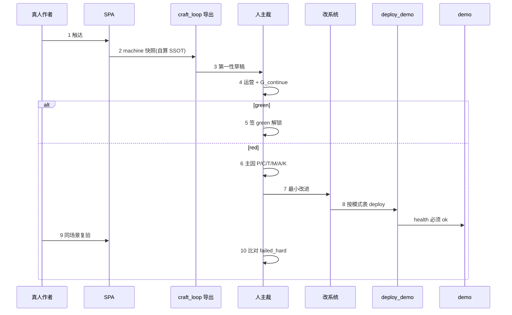

# craft-loop · 铜炉真人视角 + 第一性块门 + 改进闭环

| 项 | 值 |
|----|-----|
| **短名（会话入口）** | **`craft-loop`** |
| **耐久落盘（目标）** | `docs/plans/craft-loop.md` |
| **本轮 scratch** | `/tmp/grok-1000/grok-design-doc-b066a1b5.md` |
| **摘要** | `/tmp/grok-1000/grok-design-summary-b066a1b5.md` |
| **日期** | 2026-08-12 |
| **状态** | **Accepted Draft 0.3.1** · 用户已决 Q1（B1 全绿才进 B2）· **实现暂缓**（先只看设计） |
| **产品** | 铜炉 / tonglu · 代码 `scribe3/` |
| **仓库** | `/home/admin/projects/scribe-writing-system` |
| **验证环境** | **仅已部署 demo**（`https://tonglu.qing.blue`；本机反代 :3311·:3321）；禁止 Grok 机 `npm ci` / 本机 Surreal 重活 |
| **新会话怎么提** | `继续 craft-loop` 或 `读 docs/plans/craft-loop.md` |

---

## Overview

**craft-loop** 是一套**真人作者视角**的协议：在合法 SPA 通道上写出/点批一小段真书，对每个**内容块（CL-B0…CL-B6）**做第一性评审，再叠加运营质量分析；任一未绿必须归入 **P/C/T/M/A/K** 根因 taxonomy，**改系统或流程**（不是只让模型再编一章），经 `./scripts/deploy_demo.sh` 热更后**同场景复验**，块 green 才解锁下一块。

它回答的不是「工程通路能不能跑完 5 万字」，也不是「v6.3.4 全能力矩阵能不能勾满」，而是：

> **站在真人手上写长篇的角度：这块内容是否达到「写出好小说」的第一性需求？交互是否让人愿意继续用？若不达标，根因在产品/工艺/工具/记忆/代理/内容哪一层，且能否当场改掉并复验？**

### 一句话

```text
真人 SPA 触达块 → 第一性 hard checklist（craft-loop SSOT 数字）
→ 运营 → 根因(P/C/T/M/A/K) → 最小改系统/流程
→ deploy_demo → 同场景复验 → 人主裁 green → 下一块
```

### 机判诚实声明（Draft 0.3.1 强制）

```text
1. craft-loop hard 阈值是本协议 SSOT，≠ gate_a.ok / gate_b.ok 自动勾选。
2. 现网 scripts/v4_world_complete_gate.py 无 --profile；整包 WCG ≠ MVP settings_min。
3. C10（大纲情节点机判）未在 verify_craft_compliance.py 实现 → 仅人 hard。
4. GATE-B B6 = verbatim 探针 soft；≠ POST /deductions/grounding 的 ok。
5. 机判映射错误会制造假绿 → CLI 必须绑定 craft-loop 数字，禁止 if gate_b.ok。
```

### 与仓库已有协议的关系（强制分清）

| 协议 | 路径 | 回答的问题 | craft-loop 关系 |
|------|------|------------|-----------------|
| **v6.3.4** | `docs/e2e-director-journey-v634-true-chat-full-capability.md` | 真人 SPA 全能力体验总 PASS（Wave A∧B） | **互补**：路径纪律对齐；**不吞并** |
| **50k-e2e** | `docs/plans/50k-e2e.md`（Accepted 0.3 · **实现暂缓**） | 长程 CLI+Playwright 工程回归 | **互补**；可复用路径思想；**禁止**话术混称「又跑了 50k」；**不**依赖其未合入的 WCG profile PR |
| **工艺优先 v3** | `docs/craft-first-verification-scheme-v3.md` | GATE-A/B/C/D 卫生 + 质量轨 | **下层可复用字段**；阈值以代码为准，craft-loop 可更严 |
| **第一原则质量使能** | `docs/plans/2026-08-12-first-principles-quality-enablement.md` | 注意力税 / 探索 soft / 导演使能 | **L3 修法优先级对齐**（见 §L3 优先级） |
| **craft-loop（本协议）** | 目标 `docs/plans/craft-loop.md` | 块第一性 + 运营 + 改与验闭环 | **独立 PASS 公式** |

**禁止混用宣称：**

```text
50k-e2e.strict_must_ok  ⇏  craft-loop PASS
v6.3.4 总 PASS          ⇏  craft-loop PASS
gate_a.ok ∧ gate_b.ok   ⇏  craft-loop 块 hard 全绿
十维代理分 ≥3.5         ⇏  G_continue
WCG 整包 exit 0         ⇏  MVP settings_min 绿
```

---

## Background & Motivation

### 真实痛点

1. **工程绿 ≠ 真人愿用** — `acceptance_50k/*`、`craft_gates.mjs`、`verify_craft_compliance` 证明通路/脚手架，不证明「大纲是否够写好一章小说」。  
2. **体验协议太重** — v6.3.4 Wave A+B 估 3–5+ 人日，不适合日更「找洞→改→复验」。  
3. **假绿路径** — 字数门 / form_fill / HTTP 十维启发式 / 脚本灌章 / **K 类再生成掩盖 P/C/T/M**。  
4. **第一性块门缺失** — GATE 是「齐套」；缺「齐套后是否达第一性」与块序解锁。  
5. **改进停在再编一章** — 无强制 taxonomy → 改系统 → deploy → 同场景复验。

### 用户真实需求 → 落点

| # | 需求 | 落点 |
|---|------|------|
| 1 | 真人 SPA 合法通道 | L0；三通道白名单 |
| 2 | 运营质量分析 | L2 六维 + G_continue |
| 3 | 改系统/流程 → 同场景复验 | L3 + §4.2 可执行清单 |
| 4 | 真人视角 | 人主裁；drive-to-block 默认 `author_human=false` |
| 5 | 块第一性 → 达标才下一块 | CL-B0…CL-B6 + 块序锁 |

### 代码与文档锚点（2026-08-12 再核实）

| 锚点 | 路径 | 现网事实（绑定用） |
|------|------|-------------------|
| 主编坞 | `scribe3/web/src/ChiefDock.jsx` | `agentic: false` 写死 |
| 章写作槽 | `scribe3/web/src/WriteChat.jsx` | prose / 提案卡 |
| 作者点批 | `scribe3/web/e2e/author_decisions.mjs` | `chiefSay` / `acceptStageFill` / `approveAllPending` / draft 接受 |
| craft 门前端 | `scribe3/web/e2e/craft_gates.mjs` | `GET /craft-gates`；**默认裸 fetch 无 cookie**（L1 鉴权会失败） |
| craft 机判 | `scribe3/verify_craft_compliance.py` | 见 §Hard 三列表；`CraftGateThresholds` 默认值 |
| craft CLI（旁路） | `scribe3/tools/craft_gate_cli.py` | **本机/容器 Surreal** 出 GATE 对照；**≠** craft-loop SSOT；**≠** demo 复验主路径（见附录 C） |
| 内容质量 | `scribe3/verify_content_quality.py` | `min_prose_chars=1500`（Q1） |
| 十维合同 | `scribe3/quality/models.py` | 固定十键；仅附录代理 |
| 限知 | `scribe3/verify.py` `find_leaks_for_chapter` | 返回 `list`；**无 degraded 字段** |
| 定稿门 | `scribe3/finalize_gate.py` | `no_post` fail-closed；`skipped` 门关 allowed；`danger_bypass` |
| **WCG** | `scripts/v4_world_complete_gate.py` | argparse **仅** `--slug` / `--out`；**无 `--profile`**；`run_gate` 整包（含 volumes≥3、chapters≥10…） |
| 部署 | `scripts/deploy_demo.sh` | `hot`（默认）/ `frontend` / `server-git` / `full` / `prune`；容器内探 `3321/health` |
| 50k 脚手架 | `scribe3/web/e2e/acceptance_50k/*` | v1 存在；**硬化实现暂缓**（50k-e2e 设计） |
| 工艺旅程 | `scribe3/web/e2e/craft_first_journey.mjs` | A→B→C 参考路径 |

---

## Goals & Non-Goals

### Goals

1. 四层架构可执行。  
2. **CL-B0…CL-B6** 每块 **craft-loop SSOT hard 表**（三列：本协议阈值 / 可复用机判 / 缺口）。  
3. 块 SOP + **可执行** deploy→同场景复验。  
4. **禁止 K 单独关闭 P/C/T/M**（机器可验字段）。  
5. 人主裁 green；LLM 仅草稿；脚本 drive-to-block **默认不**当真人。  
6. 证据包规范 + checklist。  
7. 独立 PASS 公式 + 三行 disclaimer。  
8. MVP：1 书 **1–2 章** 轻环（settings_min，非整包 WCG）。  
9. 改进最小闭环；L3 优先使能路径（P）而非堆 detector。

### Non-Goals

| # | 非目标 | 理由 |
|---|--------|------|
| NG1 | 取代 v6.3.4 / 50k-e2e | 不同问题 |
| NG2 | 假装现网已有 WCG `--profile` | 代码无此参数 |
| NG3 | `gate_*.ok` 自动等于 craft-loop hard | 假绿源 |
| NG4 | 全自动 LLM 自评 green | 代理作者 |
| NG5 | API 灌库 / emergency 刷绿 | 写路径禁令 |
| NG6 | Grok 机 npm / 本机 Surreal / 第二栈 | 资源纪律 |
| NG7 | 宣称 human-blind ≥9.5 | 产品禁令 |
| NG8 | 预留空号「真洞 PR」当功能范围 | 按洞开 PR |
| NG9 | 依赖 50k-e2e 未合入硬化代码 | 实现暂缓 |

---

## Proposed Design

### 1. 四层架构

```mermaid
flowchart TB
  subgraph L0["L0 体验层 Experience"]
    SPA[真人 SPA · tonglu]
    CH[三通道: discuss / world_write / prose_write]
    UI[白名单点批]
    SPA --> CH --> UI
  end

  subgraph L1["L1 块门层 Block Gates CL-B0..CL-B6"]
    FP[第一性 hard · craft-loop SSOT]
    MCH[机判字段复用 · 非 gate.ok 自动勾]
    LOCK[块序锁]
    FP --> MCH --> LOCK
  end

  subgraph L2["L2 运营与根因"]
    OPS[运营六维 + G_continue]
    RC[P/C/T/M/A/K]
    EVI[证据包 block-CL-B*]
    OPS --> RC --> EVI
  end

  subgraph L3["L3 改与验"]
    FIX[最小改 · P 优先于新 detector]
    DEP[deploy_demo 模式表]
    RE[同场景复验命令序列]
    FIX --> DEP --> RE
  end

  L0 --> L1
  L1 -->|未达标| L2
  L2 --> L3
  L3 -->|复验绿| L1
  L1 -->|块 green| NEXT[解锁 CL-B{i+1}]
```

### 2. 命名空间（防 ID 碰撞）

| 前缀 | 含义 | 示例 |
|------|------|------|
| **`CL-B0`…`CL-B6`** | craft-loop **块** | `CL-B2` = 大纲块 |
| **`CL-B*-H*`** | 块内 hard 项 | `CL-B2-H1` |
| **`gate_a.check.*`** | `verify_craft_compliance.gate_a` 检查 ID | `gate_a.check.A1` |
| **`gate_b.check.*`** | `gate_b` 检查 ID | `gate_b.check.B1`（大纲**非空**，非 CL-B1） |
| **`gate_c.*`** | C-Det 检查 ID | `gate_c.C1` / `gate_c.C11` |
| **`quality.Q*`** | `verify_content_quality` | `quality.Q1` 净文≥1500 |
| **`wcg.check.*`** | 整包 WCG 检查名 | `wcg.check.intent.reader_feeling` |
| **`cl_settings.*`** | craft-loop 自有 settings_min | `cl_settings.intent_rf_ge10` |

**文档与 CLI 枚举一律用全称**；口语「B1」必须带 `CL-` 或 `gate_b.check.` 前缀。

### 3. 合法 SPA 通道

| 通道 | 作者动作 | 落库 | craft-loop |
|------|----------|------|------------|
| **discuss** | 主编坞意图 | 默认不直写 L1 | ✅ |
| **world_write** | resolve → Hermes + **审批卡** | 设定主路径 | ✅ CL-B0/B1/B6 |
| **prose_write** | WriteChat + 提案卡/用此版 | 正文/阶段 | ✅ CL-B2–B5 |
| ChangePack discussion 点批 | 可追溯 chat | 设定 | ✅ |
| REST/MCP 无审批灌库 / EMERGENCY / 表单失焦 | — | ❌ 路径 FAIL |
| 脚本灌 prose / safe_beats | — | ❌ |

### 4. Hard 表 SSOT 约定（三列强制）

每条 hard 必须写清：

| 列 | 含义 |
|----|------|
| **craft-loop 阈值（SSOT）** | 本协议数字/规则；CLI 与人勾选以此为准 |
| **可复用机判（现网真实 verdict）** | 代码实际行为；**不得**夸大 hardness |
| **缺口** | 人判 / 新脚本 / N/A |

**禁止**写「= GATE-B B1 pass」「gate_b.ok → hard 全绿」。

#### 4.0 现网阈值速查（代码真源）

**`CraftGateThresholds`（`verify_craft_compliance.py`）默认：**

| 字段 | 默认 | 行为摘要 |
|------|------|----------|
| `min_characters` | 2 | A2 hard：角色数与「丰满」数 |
| 丰满定义 | — | 外貌 **或** 性格之一 +（surface_goal/deep_need/fear/backstory/internal_conflict 之一） |
| `min_motifs` / `min_open_promises` / `min_relations` / `min_facts_or_rules` | 各 1 | GATE-A hard 下限 |
| `synopsis_soft_chars` | 40 | **仅 warn**；B1 hard 仅 **空** fail |
| `scene_truth_soft_chars` | 40 | 同上；B3 hard 仅空 fail |
| `min_beats` | 3 | B2 hard（bridge/epilogue 用 `bridge_min_beats=1`） |
| `beat_cover_ratio` | 2/3 | C11：&lt;2/3 → **warn**；覆盖 0 → **fail** |
| `max_warns_before_fail` | 3 | warn 堆积升 hard |

**`verify_content_quality.QualityThresholds`：** `min_prose_chars=1500`（Q1 hard）。

**`v4_world_complete_gate.run_gate`：** 整包；intent.rf `cn_len≥10`；角色≥4 且六字段 full≥4；motifs≥3；promises≥3；volumes≥3；chapters≥10；synopsis≥40×10 等。**无 profile 子集。**

---

### 5. 块清单 CL-B0…CL-B6


> **plant 预埋：** 伏笔/母题可在 CL-B1 写入；CL-B6 评写后闭环。  
> **块序（用户已决 Q1）：** CL-B1 必须 **full green** 才解锁 CL-B2；**不允许** B1 partial 进 B2。

---

#### CL-B0 · 北极星

**第一性：** 作者与系统对读者感受、情感弧、红线、规模有可执行共识。

| Hard ID | craft-loop 阈值（SSOT） | 可复用机判（真实） | 缺口 |
|---------|------------------------|-------------------|------|
| **CL-B0-H1** | `reader_feeling` 去空白 **≥10** | `wcg.check.intent.reader_feeling` 同阈值；**`gate_a.check.A1` 仅非空**，**不足以**勾本 hard | CLI 读 intent 自算 `cn_len`；或 curl `/api/intent` |
| **CL-B0-H2** | `emotional_arc` 去空白 **≥4** 且人可复述方向 | WCG `intent.emotional_arc`≥4；GATE-A 仅非空 | 方向 = 人 hard 一句 |
| **CL-B0-H3** | `red_lines` 行数≥3 **或** 去空白≥20 | 与 WCG 同；GATE-A 非空 | 机可检长度 |
| **CL-B0-H4** | `total_word_goal` int ∈ **[40000,60000]** | WCG 同；GATE-A **不检** 此字段 | MVP **允许** goal=45000 只写 1 章（目标≠本轮可见字） |
| **CL-B0-H5** | 意图来自 chat/UI 种子，非无追溯 REST | 无机判 | **人** + thread/截图 |
| **CL-B0-H6** | 作者 ≤3 句复述且与库一致 | 无 | **人 hard**；`evidence` min_len≥20 |

**H6 pass 例句：** 「读者要感到铜腥压迫；弧是冷漠→撕开；红线禁系统流。」  
**H6 fail 例句：** 「写点武侠。」（与库 intent 对不上 / 过短）

---

#### CL-B1 · 世界与人物

**第一性：** 冲突可成立的最小世界（角色/关系/规则/伏笔母题），不是「只有名字」。

##### 5.1 craft-loop `settings_min`（**自有** · ≠ 现网 WCG exit 0）

MVP / 块 CL-B1 **默认**用本子集（只读 API + 本地计数）。**明确：跑通 `settings_min` ≠ `v4_world_complete_gate.py` exit 0。**

| 检查 ID | 阈值 | 建议数据源 |
|---------|------|------------|
| `cl_settings.intent_rf_ge10` | 同 CL-B0-H1 | `GET /api/intent` |
| `cl_settings.chars_ge2_rich` | 角色≥2 且 **GATE-A 丰满定义** 各满足 | `GET /api/entities` |
| `cl_settings.relations_ge1` | ≥1 | relations API |
| `cl_settings.facts_or_rules_ge1` | facts+rules ≥1 | 对应 list |
| `cl_settings.motifs_ge1` | 具名≥1 | motifs |
| `cl_settings.promises_open_ge1` | open 有效≥1 | promises |
| `cl_settings.path_legal` | world_write 审批或 ChangePack 可追溯 | 人+截图 |

**可选加严（full 或清债）：** 对齐整包 WCG（角色≥4 六字段、motifs≥3、promises≥3、volumes≥3…）——调用：

```bash
export API_BASE=https://tonglu.qing.blue   # 或本机反代根；脚本会拼 /api/...
export SCRIBE3_BOOTSTRAP_USERS='user:pass'  # 与 demo 一致；login 写 cookie jar
python3 scripts/v4_world_complete_gate.py --slug <work> --out machine/wcg-full.json
# 仅 --slug / --out；无 --profile。exit 0 ⇔ 整包 pass
```

**若未来 50k-e2e 或独立 PR 为 WCG 增加 `--profile settings|full`：** 属**可选依赖**，合入前本协议**不得**引用不存在的 CLI；合入后可把 `settings_min` 机判迁到 profile，并改本文一节。**当前（2026-08-12）无此参数。**

| Hard ID | craft-loop 阈值（SSOT） | 可复用机判 | 缺口 |
|---------|------------------------|------------|------|
| **CL-B1-H1** | **MVP：** `cl_settings.chars_ge2_rich`；**full：** 角色≥4 且六字段 full≥4 | MVP≈`gate_a.check.A2`（min_characters=2+丰满定义）；full≈`wcg.check.characters.*` | 六字段 **仅** WCG/自脚本，GATE-A **不做** |
| **CL-B1-H2** | 有 `importance=protagonist` | WCG 有；GATE-A **无** | MVP：人勾「已标明主角」可 partial 债 |
| **CL-B1-H3** | MVP 关系≥1；full≥3 | GATE-A min_relations=1；WCG ge3 | |
| **CL-B1-H4** | MVP facts+rules≥1；full 对齐 WCG rules/facts | GATE-A min_facts_or_rules=1 | |
| **CL-B1-H5** | full：faction/item/term 两类 | **仅 WCG** | MVP：**N/A 不挡** `mvp_pass` |
| **CL-B1-H6** | MVP motifs≥1 且 open promises≥1；full 各≥3 | GATE-A 各≥1；WCG≥3 | |
| **CL-B1-H7** | **`settings_min` 全绿**（MVP）或 **整包 WCG exit 0**（full） | 见上；**禁止**写 WCG-A/--profile | |
| **CL-B1-H8** | 设定经合法通道 | 无 | 人+截图 |
| **CL-B1-H9** | 主角欲望/恐惧与 CL-B0 弧可对齐一句 | 无 | 人 hard；evidence≥15 字 |

**`CL-B1` 解锁规则（用户已决 · 严于 Draft 0.3 初稿）：** 仅 `verdict === green`（MVP settings_min 全 hard 达标，无未关闭 debt）才解锁 CL-B2。**禁止** `partial` 进 B2。过程中可记 debt 草稿，但 **不得** 用 partial 宣称解锁或计入序锁。

---

#### CL-B2 · 大纲（单章）

**第一性：** 据此能写出有因果、人物选择、章末钩子的一章。

| Hard ID | craft-loop 阈值（SSOT） | 可复用机判 | 缺口 |
|---------|------------------------|------------|------|
| **CL-B2-H1** | synopsis 去空白 **≥80** | `gate_b.check.B1`：**空→fail**；`len<40`→**warn only**；**40–79 仍 gate pass** | **必须自算长度**；`gate_b.ok` **≠** 本 hard |
| **CL-B2-H2** | 含人物名 + 动作/冲突（人确认；可选关键词启发） | 无 hard 机判 | 人 |
| **CL-B2-H3** | 可指出 **起因→转折→结果** 三点 | **无 C10 实现** | **人 hard**（见例句） |
| **CL-B2-H4** | 与 CL-B0 红线不冲突；与 CL-B1 已 green 角色动机不 OOC | 无 | 人（B1 已全绿，按完整 settings_min 世界评） |
| **CL-B2-H5** | 章末钩子或压力升级之一 | 无 | 人 |
| **CL-B2-H6** | 阶段提案填入/追加落库 | 无 | 路径+截图 |

**H3 pass 例句：** 「起因：灰七拒还匙；转折：冷锅婆暗示侧门；结果：灰七收下印却不敢问名。」  
**H3 fail 例句：** 「夜晚很安静，炉火还在。」（无选择/无转折）

---

#### CL-B3 · 节拍

| Hard ID | craft-loop 阈值（SSOT） | 可复用机判 | 缺口 |
|---------|------------------------|------------|------|
| **CL-B3-H1** | 有效 beats **≥3**（非 bridge） | `gate_b.check.B2` 同 hard | 可复用 |
| **CL-B3-H2** | 每条有可执行动词/事件（非纯形容词） | 无 | 人；fail 例：「忧伤的空气」 |
| **CL-B3-H3** | 覆盖大纲三点中 **≥2/3** | 无 | 人对照 CL-B2-H3 |
| **CL-B3-H4** | ≥1 处升降压或场景类型切换 | 无 | 人 |
| **CL-B3-H5** | 阶段序大纲≤节拍（有 journal 则检；无则 skip+人证） | `gate_b.check.B7` 无 journal→**skip** | 与 craft-first R3 一致 |

---

#### CL-B4 · 演绎与限知

| Hard ID | craft-loop 阈值（SSOT） | 可复用机判 | 缺口 |
|---------|------------------------|------------|------|
| **CL-B4-H1** | `scene_truth` 去空白 **≥80** | `gate_b.check.B3`：空 fail；&lt;40 warn；**不因 40–79 hard fail** | **自算长度** |
| **CL-B4-H2** | involved 非空且 ⊆ 书中角色 | `gate_b.check.B4` 同类 | 可复用字段 |
| **CL-B4-H3** | 每个 involved 有 deduction prose 非空 | `gate_b.check.B5` | 可复用 |
| **CL-B4-H4a** | **verbatim 探针报告可读**；craft-loop：**若有投影则至少 1 条 prose 为 scene_truth 子串，否则人书面接受 soft 风险** | `gate_b.check.B6`：不对齐仅 **warn soft**，**不**挡 `gate_b.ok` | 本 hard **严于** GATE：不对齐且无书面接受 → red |
| **CL-B4-H4b** | 可选：`POST .../deductions/grounding`（或 `_grounding_review`）`ok=true` | **与 B6 不同机制**（可 LLM） | 端点不可用 → **`skip`**，记 `grounding_llm_skipped`；**不得**用 skip 假绿 H4a |
| **CL-B4-H5** | Must-if 声明含秘密：≥1 读者知/角色不知差 | 无 | 人 / project_frame 只读 |
| **CL-B4-H6** | 有草稿时：`focalizer` 非空 + `find_leaks_for_chapter` → `[]` | 函数返回 list；**无 degraded 字段** | degraded 见 post-check 另条 |

---

#### CL-B5 · 正文

| Hard ID | craft-loop 阈值（SSOT） | 可复用机判 | 缺口 |
|---------|------------------------|------------|------|
| **CL-B5-H1** | 净文去空白 **≥1500** | `quality.Q1` 同 | 可复用 |
| **CL-B5-H2** | 提案卡/用此版路径；禁 API 灌 | 无 | 路径+截图 |
| **CL-B5-H3** | **`focalizer` 非空**（否则 **hard fail**）；`find_leaks_for_chapter(prose,st,focalizer,seq)==[]` | 同源 Python；GATE-C C1 无 focalizer→**warn/skip 不 fail**——**craft-loop 更严** | post-check `degraded_stages` 含 `find_leaks` → 另 hard **CL-B5-H3b** fail（不得当零泄露） |
| **CL-B5-H3b** | 若跑 post-check：`find_leaks ∉ degraded_stages` 且 leaks 空 | triage `degraded_stages` | 未跑 post-check → skip 本条，H3 仍要 |
| **CL-B5-H4** | C-Det **hard blocking 列表为空**（含 C1 在有 focalizer 时等） | `audit_chapter_det` / `gate_c` | warn 堆积受 `max_warns_before_fail` 影响——报告原样保留 |
| **CL-B5-H5** | 节拍覆盖 **≥2/3**（人确认可定位痕迹） | `gate_c.C11`：&lt;2/3 仅 **warn**；0 覆盖才 **fail** | **人 hard 可严于机判**；不可写「C11 已保证 2/3」 |
| **CL-B5-H6** | 大纲情节点命中 | **C10 未实现** | **仅人 hard**（对照 CL-B2-H3 三点） |
| **CL-B5-H7** | `review_chapter_quality` hard 项通过 | 模块 `ok` | 可复用 |
| **CL-B5-H8** | 见下「finalize 语义」 | `evaluate_finalize_gate` | |
| **CL-B5-H9** | 人：是否愿意把此章给读者连载 | 无 | 人；evidence 一句理由≥10 字 |

**CL-B5-H8 finalize 语义：**

| 章状态 | H8 判定 |
|--------|---------|
| **未点定稿** | `skip`，**不挡** CL-B5 green |
| **已定稿** | 必须 `code ∈ {ok, advisory_accepted}` |
| `danger_bypass` | **禁止**充 green |
| `code=skipped` 且门环境关 | 记债 `finalize_gate_off`；**不得**当质控绿 |
| `no_post` / `blocked` | fail |

十维仅附录；默认不进 hard。

---

#### CL-B6 · 记忆 · 伏笔 · 正典

| Hard ID | craft-loop 阈值（SSOT） | 可复用机判 | 缺口 |
|---------|------------------------|------------|------|
| **CL-B6-H1** | plant 仍有 open **或** 本轮 close 证据 | promises list | |
| **CL-B6-H2** | 本章对 open：touch/clue/refresh **或** 显式「本章不推进」标记 | GATE-D D1 弱；quality Q4 钩子 | 人可确认标记 |
| **CL-B6-H3** | **≥2 章时：** ≥1 次跨章关键词 recall 命中；**单章 MVP：`N/A`，不挡 `mvp_pass`** | 无统一 50k M9 实现 | 扩规模再 hard |
| **CL-B6-H4** | 中程变更若触发：supersede 单真 | **无现成 dual-truth 机检硬名** | Must-if；未触发 → N/A；触发则人+只读 API 剧本（pending 产品钉死后升 hard） |
| **CL-B6-H5** | finalize 后 pending-claims/收件箱可观测 | API | 未 finalize → skip |
| **CL-B6-H6** | 正典可追溯 chat | 无 | 人 |
| **CL-B6-H7** | 母题 instance 或 brief heat（弱） | GATE-D D2 soft | soft |

**`mvp_pass` 对 CL-B6：** 要求 **H1∧H2** 绿；H3 单章 N/A；H4–H7 非 blocking 除非触发 Must-if。

---

### 6. 块 SOP



#### 6.1 步骤与产物

| 步 | 动作 | 产物 |
|----|------|------|
| 1 触达 | 真人白名单 UI | `reach.md` + **≥1 张带时间戳截图路径** |
| 2 快照 | craft-loop 导出（intent/chapter 自算；可选 GATE JSON **对照不顶替**） | `machine/*` |
| 3 第一性 | 三列表 hard；LLM 草稿可，人改判定 | `first-principles.json` |
| 4 运营 | 见 §8 | `ops-scorecard.md` |
| 5 根因 | primary + non-K 字段 | `root-cause.md` |
| 6 改进 | 最小闭环 | `fix-note.md` |
| 7 部署 | §6.2 | `deploy.log` 摘要 → `00-env.md` |
| 8 复验 | §6.3 命令序列 | `reverify.md` + 新 machine |
| 9 裁决 | 人签 | `verdict.md` |
| 10 解锁 | 仅 `verdict === green`（**含 CL-B1**；无 partial 例外） | `index.md` |

#### 6.2 deploy 模式选择表（可执行）

| 改动类型 | `./scripts/deploy_demo.sh` 模式 | 说明 |
|----------|--------------------------------|------|
| 仅 Python 后端 | **`hot`**（默认） | 热更容器内 app |
| 前端 JSX/静态 | **`frontend`** | 构建并热更静态；**只 hot 会漏** |
| 服务器已 push、拉 main | `server-git` | 远程 pull + 热应用 |
| 依赖/镜像级 | `full` | 重，慎用 |
| 磁盘清理 | `prune` | 不部署代码 |

**deploy 后 health 失败 → 禁止签 reverify green。**

**health 口径：**

| 探针 | 用途 |
|------|------|
| 脚本内 `docker exec … 127.0.0.1:3321/health` | `deploy_demo.sh` `wait_health` 成功标志 |
| 公网 `GET https://tonglu.qing.blue/api/health`（或网关等价） | 证据包 `00-env.md` 外部可达 |
| ready/capabilities（可选） | 记 `memory_fabric_v1` / `emergency_rest_write` |

二者都写：`deploy_health_container=ok|fail`，`public_health=ok|fail`。

**`00-env.md` 必填字段：**

```yaml
work: book_xxx
api_base: https://tonglu.qing.blue
deploy_mode: hot | frontend | server-git | full
deploy_sha: <git rev-parse HEAD 部署时>
deploy_time: ISO-8601
deploy_health_container: ok
public_health: ok
capabilities_note: "memory_fabric_v1=… emergency_rest_write=…"
author_human: true|false
```

**`deploy.log` 摘要至少含：** 模式、本地 SHA、远程 health 输出一行、时间。

#### 6.3 同场景复验 checklist（强制）

同场景 = **同一 `work`** + **同一 `CL-Bi`** + **同一 `failed_hard[]`** + **同一 `seq`（若适用）** + **同一通道类型**。

```text
[ ] 1. primary ∈ {P,C,T,M} ⇒ root-cause.md 已填 non_k_change_paths[] 或 pr_url（非空）
[ ] 2. 已按 §6.2 选择正确 deploy 模式并执行
[ ] 3. deploy_health_container=ok 且 public_health=ok（否则 STOP）
[ ] 4. 00-env.md 写入 deploy_sha / deploy_mode / deploy_time
[ ] 5. 复跑 machine 导出（同一 work/block/seq）——**主路径见附录 C 分级**：
       # PR-1 后（协议 SSOT）：
       python -m scribe3.tools.craft_loop_cli export \
         --work <work> --block CL-B2 --seq 1 \
         --out docs/evidence/.../block-CL-B2/machine/reverify/
       # PR-1 前：curl + cookie 打 demo 公网 /api/* 自算 SSOT 数字（附录 C ①）
       # 禁止：在 Grok 运行机用 craft_gate_cli + 本机 Surreal 当 reverify 主证据
[ ] 6. 仅针对 failed_hard 列表逐条重评；写出 diff（旧 machine vs 新）
[ ] 7. 禁止：只改 verdict.md；换 book；K-only 重写后改 primary 为 K
[ ] 8. 人 hard 证据须手写（非整段粘贴模型）；截图路径更新
[ ] 9. 全部原 failed_hard 现 ok 且运营门槛满足 → 可签 green
```

#### 6.4 块序锁与并行探索

```text
unlock(CL-B{i+1}) ⇔ verdict(CL-Bi) === green

# 用户已决 Q1：无 B1 partial 例外
# 禁止：verdict(CL-B1)===partial 时签 unlock(CL-B2)
```

- **序锁只约束 craft-loop 宣称路径**（签 green / 写 PASS.md），**不**禁止产品 UI 上作者随意点阶段。  
- **同一验收 `work`：** 不得对未解锁块签 craft-loop green；**CL-B1 未 green 不得签 CL-B2 green**。  
- **并行探索：** 用 **sandbox 另一 work**，或明确不入本证据包；禁止把探索污染当复验绿。

---

### 7. MVP · debt · 工期

#### 7.1 目标张力写清

| 项 | MVP | full |
|----|-----|------|
| 章数 | 1–2 | ≥2 |
| 世界 | `settings_min` **全绿**（CL-B1 green 才进 B2） | 整包 WCG exit 0 + 无债 |
| 字数目标 | intent **可** 4–6 万，本轮只写 1 章 | 同左或扩写 |
| CL-B2+ 第一性 | 在 **已 green 的 settings_min 世界** 上评单章可写性 | 可对照全书 / WCG |
| CL-B6-H3 | 单章 **N/A** | 跨章 recall hard |
| 块序 | **严格** green 解锁；**无** B1 partial→B2 | 同左 |

#### 7.2 `index.md` debt schema

```yaml
# docs/evidence/craft-loop-.../index.md 片段
protocol: craft-loop
version: "0.3.1"
work: book_xxx
blocks:
  CL-B0: { verdict: green, debt: [] }
  CL-B1: { verdict: green, debt: [] }   # 必须 green 才有 CL-B2 行可签 green
  CL-B2: { verdict: red, debt: [] }
# debt：仅用于 full 相对 MVP 的加严债（例：settings_min 已绿，full 仍欠 WCG 六字段）
# 禁止：用 debt/partial 解锁 CL-B2
debts:
  - id: D-full-1
    block: CL-B1
    hard_ids: [CL-B1-H1]                 # full 档六字段加严
    reason: "MVP settings_min 已绿（2 丰满角色）；full 需 4+六字段 / 整包 WCG"
    blocks_mvp_pass: true                # 不挡 mvp_pass
    blocks_full_pass: false
    blocks_unlock_next: false            # 恒 false：debt 永不替代 green 解锁
    close_criteria: "整包 WCG characters 检查 pass"
```

**宣称 `craft_loop_mvp_pass` 时：** CL-B0…B5 与 B6 最小集均为 **green**（含 CL-B1）；`debts` 中 `blocks_mvp_pass:false` 不得存在；`blocks_unlock_next` 一律 false。  
**宣称 `craft_loop_full_pass` 时：** `debts` 必须为空。

#### 7.3 工期（修正乐观估计）

| 阶段 | 内容 | 工期 |
|------|------|------|
| 协议落地 | PR-0 文档+TEMPLATE | **~0.5d** |
| 首块演习 | 仅 CL-B0 走通证据包 | **~0.5d** |
| 一章环 | CL-B0…B5 + B6 最小 + 可能 1–2 真洞 deploy 复验 | **2–4d**（视洞与真人档期） |
| 无固定真人作者 | 只能 `author_human=false` → **最高 engineering partial / NON-PASS** | — |

**废除**「MVP-1 含改洞共 1–2 人日」的紧估计。

---

### 8. 运营六维 + 全局

| 维 | 定义 | 1 | 3（锚） | 5 | MVP 采集 |
|----|------|---|--------|---|---------|
| O1 意图对齐 | 理解是否一致 | 答非所问 | 一轮纠正后对 | 一次到位 | 人+对话摘录≥15 字 |
| O2 反馈可理解 | 卡/错/案可读 | 术语墙 | 能猜按钮 | 一句话可决策 | 截图 |
| O3 操作成本 | 点击与等待 | >5 废点击或 >3min 无反馈 | 3 次内关键路径 | ≤2 次关键 | **无 timeline 时**作者自报点击次数+等待分钟，标 `ops_trust=self_report` |
| O4 落库可信 | 点批后回查 | 没进库/串书 | 偶发慢但一致 | 秒级可证 | API 回查摘要 |
| O5 失败可恢复 | 重试/状态 | 卡死丢稿 | 能重试不清 | 明确下一步 | 故障笔记 |
| O6 认知负荷 | 注意力是否在故事 | 门控淹没 | 可忍受 | 几乎无感元数据 | 人一句 |

**G_continue：** 是 / 勉强 / 否（否 → 不得 green）。

#### 8.1 MVP 运营门槛（降低无工具摩擦）

```text
MVP 块 green 运营条件 ⇔
  无维分数 ≤ 2
  ∧ G_continue ∈ {是, 勉强}
  ∧ ops-scorecard 每维有 evidence（min_len 见上）

# 可选加严（Open Q3 / full）：均 ≥3 且均值 ≥3.5
```

Draft 0.1「均 ≥3」改为 **MVP 默认「无维 ≤2」**；full pass 建议恢复均≥3（写在 PASS.md 选用档）。

每人 hard：`evidence` 字符串 **min_len≥10**（B0-H6≥20）；**pass/fail 例句**见各块表。

---

### 9. 根因 P/C/T/M/A/K 与禁 K 刷绿

| 码 | 名 | 修法方向 | RC-* 映射例 |
|----|----|----------|-------------|
| **P** | Product/Path | UI/流程/文案/IA | RC-PRODUCT-HOLE |
| **C** | Craft | GATE/阶段/schema | RC-SKIP-STAGE, RC-SCHEMA-WEAK, RC-EMPTY-AUX |
| **T** | Tool/Tech | MCP/注入/assemble/deploy | RC-TOOL-FAIL, RC-NO-INJECT |
| **M** | Model/Memory | 指令/校验环/memory | RC-INJECT-IGNORED |
| **A** | Author-proxy | 纪律/拒签 | 路径造假 |
| **K** | Kontent-only | 仅重写正文/设定 | — |

#### 9.1 可执行禁令

```text
IF primary ∈ {P, C, T, M}:
  root-cause.md MUST:
    non_k_change_paths: [至少 1 个仓库相对路径]  # 或
    pr_url: https://...                          # 至少填其一
    deploy_sha: <与 00-env 一致>
  closing_actions 仅 K 重写 ⇒ checklist FAIL，verdict 不得 green

IF primary === K:
  必须书面排除 P/C/T/M（why_not_pctm 各一句）
  non_k_change_paths 可空
```

**checklist（PR-1）：** `primary∈{P,C,T,M}` 且 `non_k_change_paths` 与 `pr_url` 皆空 → **fail**。  
**诚实边界：** 无法密码学防伪；靠审计拒签 + 截图哈希路径；`author_human` 是信任字段，绑定 `reach.md` 截图。

#### 9.2 L3 修法优先级（对齐使能 plan）

```text
1. P / 体验摩擦 / 路径使能（降认知负荷、修 IA）优先
2. T 工具/注入真洞
3. C 齐套与 schema（避免只加 warn 堆）
4. M 模型不守 → 指令+校验环，而非只 K 重写
5. 最后才考虑新 detector hard；禁止用「加 GATE」回避 P 使能
与 first-principles-quality-enablement 冲突时：开 P 工单，不默认加硬门
```

---

### 10. 人机分工与防代理

| 角色 | 可做 | 不可做 |
|------|------|--------|
| 真人 | SPA；签 green；定主因；手写人 hard 证据 | 脚本代签 author_human=true |
| LLM | 草稿评审/预填 | 单独 green；单独关 P/C/T/M |
| 脚本 drive-to-block | 点到阶段；导出 | **默认 `author_human=false`** |
| 机判 | 字段与 SSOT 数字 | 替代 G_continue |

**drive-to-block 规则：**

```text
纯脚本跑完 → author_human=false → 最高 engineering partial
真人接管：00-author-path 声明 takeover_at 步骤 + 此后截图 ≥1
  才可 author_human=true
人 hard 证据禁止整段粘贴模型输出（审计拒签；不可完全机检）
```

---

### 11. 证据包目录

```text
docs/evidence/craft-loop-{YYYYMMDD}-{work}/
  README.md
  00-author-path.md
  00-env.md                 # deploy_sha/mode/health 必填
  index.md                  # blocks + debts schema
  PASS.md                   # 含三行 disclaimer；或 NON-PASS.md
  block-CL-B0/
    reach.md                # ≥1 screenshot path
    machine/
    first-principles.json
    ops-scorecard.md
    root-cause.md           # non_k_change_paths / pr_url
    fix-note.md
    deploy.log
    reverify.md
    verdict.md
    screenshots/
  block-CL-B1/ ...
  fixes/
```

**`first-principles.json`：**

```json
{
  "protocol": "craft-loop",
  "protocol_version": "0.3",
  "block": "CL-B2",
  "work": "book_xxx",
  "seq": 1,
  "items": {
    "CL-B2-H1": {
      "ok": true,
      "judge": "machine",
      "ssot_rule": "synopsis_cn_len>=80",
      "measured": 120,
      "gate_field_note": "gate_b.B1 only checks non-empty; not used as auto-ok",
      "evidence": "machine/chapter-1.json#synopsis_len"
    },
    "CL-B2-H3": {
      "ok": false,
      "judge": "human",
      "evidence": "缺转折：只有气氛无选择",
      "evidence_len": 14
    }
  },
  "hard_pass": false,
  "mvp_relaxed": false
}
```

**`verdict.md` 强制字段：**

```yaml
verdict: green|red|partial
block: CL-B2
author_human: true
primary_rc: T
non_k_change_paths: ["scribe3/api/services/write_assemble.py"]  # primary∈P/C/T/M 时非空或 pr_url
pr_url: ""
k_only_forbidden_ok: true   # checklist：P/C/T/M 已有 non-K
g_continue: 勉强
# 运营：与 §8.1 / §12.1 对齐。MVP 门槛 = 无维 ≤2（非「均 ≥3」）
ops_rule: mvp_no_dim_le2          # MVP 默认；full 档可改为 full_all_ge3
ops_min_observed: 3               # 六维实际最低分（观测值，1–5；可=3）
ops_any_le2: false                # MVP hard：必须 false；true → 不得 green
# 勿写 ops_min_score：易被误实现为「均 ≥3」旧门槛；full 档若需均分门槛用 ops_rule + 另计均值
failed_hard_before: [CL-B2-H3]
failed_hard_after: []
deploy_sha: abcdef0
signer: <name>
timestamp: ISO-8601
unlocked_next: CL-B3
```

#### 11.1 证据进 git 卫生（Q5 默认）

| 内容 | 位置 |
|------|------|
| TEMPLATE、空骨架、PASS 摘要、index | **可** `docs/evidence/` |
| 大截图、完整 thread 导出 | 默认 **`artifacts/`** 或外链/git-lfs；docs 只留路径指针 |
| cookie / Authorization / 密钥 | **禁止**；checklist 拒 |

截图：优先外链或 LFS；单文件建议 &lt;500KB。

---

### 12. PASS 公式

#### 12.1 块 green

```text
craft_loop_block_green(CL-Bi) ⇔
    author_human === true
  ∧ path_legal
  ∧ ∀ hard in Hard(CL-Bi): ok===true
      （N/A / skip 按表不挡；mvp_relaxed 项须在 debt 列出）
  ∧ MVP 运营：无维 ≤2 ∧ G_continue∈{是,勉强}
  ∧ 无未关闭 primary∈{P,C,T,M}
  ∧ primary∈{P,C,T,M} ⇒ non_k_change_paths|pr_url 非空（若本块曾 red 后关单）
  ∧ （曾 red）§6.3 复验清单全勾
```

#### 12.2 MVP / full

```text
craft_loop_mvp_pass ⇔
    craft_loop_block_green(CL-B0)
  ∧ craft_loop_block_green(CL-B1)   # 用户已决：必须全绿，无 partial
  ∧ craft_loop_block_green(CL-B2)
  ∧ craft_loop_block_green(CL-B3)
  ∧ craft_loop_block_green(CL-B4)
  ∧ craft_loop_block_green(CL-B5)
  ∧ CL-B6: H1∧H2 绿；H3 单章 N/A
  ∧ 章数 ≥ 1
  ∧ PASS.md 三行 disclaimer
  ∧ 块序：每块 green 后才评下一块（CL-B1→B2 无例外）
  ∧ debts 中无 blocks_mvp_pass:false

craft_loop_full_pass ⇔
    MVP 且 debts=[]
  ∧ 整包 WCG exit 0（现网 CLI 无 profile）
  ∧ 全 CL-B0…B6 green 含 B6 跨章项（章数≥2）
  ∧ 运营档建议均≥3
```

#### 12.3 PASS.md 三行 disclaimer（强制模板）

```markdown
- not_v634_experience_pass: true
- not_50k_strict_must: true
- ten_dim_is_proxy: true
```

**互链（PR-0 必交付，不延后到 PR-7）：**  
`docs/plans/craft-loop.md` ↔ `docs/plans/50k-e2e.md` 各一段「PASS 不可互认」；SESSION 两入口并列。

---

### 13. 工具与代码落点

| 组件 | 路径 | 职责 |
|------|------|------|
| 协议 | `docs/plans/craft-loop.md` | SSOT |
| TEMPLATE | `docs/evidence/craft-loop-TEMPLATE/` | 骨架 |
| hard 表 JSON | `scribe3/craft_loop/hard_items.json`（或 web/e2e/craft_loop/） | SSOT 数字机器可读 |
| CLI | `python -m scribe3.tools.craft_loop_cli` | **自算** SSOT；可选附带 GATE 对照字段；**auth cookie** |
| checklist | `scripts/craft_loop_evidence_checklist.py` | 目录/disclaimer/non-K 路径/截图路径 |
| drive-to-block | `e2e/craft_loop/*` | 默认 author_human=false |

**鉴权：** CLI/导出在 demo L1 下必须 login + cookie（对齐 WCG `SCRIBE3_BOOTSTRAP_USERS` + jar）；**禁止**假设裸 `fetch` 永远 200（`craft_gates.mjs` 现状风险）。

---

### 14. Alternatives

| 方案 | 结论 |
|------|------|
| 全自动 LLM 自评 | 拒为 PASS |
| 只扩 50k-e2e | 互补不替代；硬化暂缓勿绑 |
| 纯人工无工具 | 拒为唯一 |
| 只跑 v6.3.4 | 过重；终局可对齐 |
| **craft-loop** | **采纳** |

---

## Security & Privacy

- 禁提交密钥/cookie/Authorization。  
- 新建 work；禁 wipe demo 卷。  
- 禁 emergency / fabric-off 刷绿。  
- thread/截图脱敏；大包走 artifacts。

---

## Observability

块状态 `index.md`；machine diff；根因分布；deploy_sha；timeline（PR-2）；checklist 拒 K-only / 缺截图。

---

## Rollout

### 实现状态（用户已决 · 2026-08-12）

```text
实现暂缓：先只看设计，用户明确要求前不启动实现类 PR（CLI / drive-to-block / 真洞修复等）。
设计状态 = Accepted Draft 0.3.1（SSOT 可阅读与评审）。
新会话勿默认「继续实现 craft-loop」；须用户再说开工。
协议正文已落盘 docs/plans/craft-loop.md；TEMPLATE/代码工程默认仍暂缓。
```

| 波次 | 内容 | 出口 | 现状 |
|------|------|------|------|
| R0 | 协议文档 SSOT | 可阅读 | **Accepted 0.3.1**（本文件） |
| R1 | CLI+checklist+auth | 只读导出 demo | **暂缓** |
| R2 | 人工 CL-B0 演习 | 模板验证 | **暂缓** |
| R3 | 一章环 2–4d | mvp_pass 或诚实 NON-PASS | **暂缓** |
| R4 | 可选 drive-to-block（非 50k 硬化） | 加速触达 | **暂缓** |

---

## Risks

| 风险 | 缓解 |
|------|------|
| 假绿（机判误绑） | 三列表 SSOT；禁 gate.ok 自动勾 |
| K 改标关单 | non_k 路径强制 |
| 代理作者 | drive-to-block 默认 false；截图 |
| 改系统失控 | 最小闭环；按洞开 PR |
| demo 污染 | 新 slug；sandbox 探索 |
| 话术混 50k | disclaimer + SESSION |
| 门控过严 | L3 P 优先于 detector |
| 无真人 | 仅 partial/NON-PASS |

---

## Open Questions

| ID | 问题 | 状态 | 决议 / 默认 |
|----|------|------|-------------|
| **Q1** | B1 partial 进 B2？ | **已决（用户）** | **不允许**。CL-B1 必须 full green 才解锁 CL-B2 |
| **Q-impl** | 是否立即实现 PR-0+？ | **已决（用户）** | **暂不实现**；先只看设计，直至用户再要求开工 |
| Q2 | MVP 强制整包 WCG？ | 默认 | **否**；用 `settings_min`；full 强制整包 |
| Q3 | 运营门槛 | 默认 | MVP **无维≤2**；full 建议均≥3 |
| Q4 | CLI 语言 | 默认 | Python 主 + cookie |
| Q5 | 证据位置 | 默认 | 模板/摘要 docs；大包 artifacts |
| Q6 | UI 块门面板 | 默认 | P2 后（且实现总闸仍暂缓） |
| Q7 | 双协议并行 | 默认 | 共享截图；分别结案 |
| Q8 | WCG profile 谁做？ | 默认 | **不阻塞** craft-loop；可选未来 PR，合入前禁用伪 CLI |

---

## References

- `docs/plans/50k-e2e.md` · `docs/e2e-director-journey-v634-true-chat-full-capability.md`  
- `docs/craft-first-verification-scheme-v3.md` · `docs/plans/2026-08-12-first-principles-quality-enablement.md`  
- `scribe3/verify_craft_compliance.py` · `verify_content_quality.py` · `finalize_gate.py`  
- `scribe3/web/e2e/author_decisions.mjs` · `craft_gates.mjs` · `craft_first_journey.mjs`  
- `scribe3/web/src/ChiefDock.jsx` · `WriteChat.jsx` · `scribe3/quality/models.py`  
- `scripts/v4_world_complete_gate.py`（**仅 --slug/--out**）· `scripts/deploy_demo.sh`  
- `docs/SESSION.md` · `AGENTS.md`

---

## Key Decisions

| # | 决策 | 理由 |
|---|------|------|
| KD-1 | 短名 craft-loop | 好打；非 50k bot |
| KD-2 | 四层架构 | 覆盖路径/第一性/运营/改验 |
| KD-3 | 块 ID **CL-B*** | 防与 gate_b.B* 碰撞 |
| KD-4 | hard **三列表 SSOT** | 防 gate.ok 假绿 |
| KD-5 | **无 WCG --profile 假设**；自有 settings_min | 代码事实 |
| KD-6 | 人主裁 + G_continue | 防代理自评 |
| KD-7 | 禁 K 关 P/C/T/M + non_k 路径字段 | 可审计 |
| KD-8 | PASS 隔离 + 三行 disclaimer + PR-0 互链 | 防协议互冒 |
| KD-9 | demo + deploy 模式表 + health 双口径 | 可执行 |
| KD-10 | MVP 轻环 / full 整包 WCG | 工期与终局 |
| KD-11 | L3 P 优先于新 detector | 对齐使能 plan |
| KD-12 | drive-to-block 默认 author_human=false | 防假真人 |
| KD-13 | 按洞开 PR，不预留空号 | 计划诚实 |
| KD-14 | 十维仅附录 | ≠ 愿用 |
| **KD-15** | **CL-B1 必须 green 才解锁 CL-B2**（无 partial 例外） | **用户已决 Q1**；严于 0.3 初稿 debt 解锁 |
| **KD-16** | **实现暂缓**，设计 Accepted 可先只读 | **用户已决**；开工须再明确要求 |

---

## PR Plan

| PR | 标题 | 范围 | 合并条件 | 依赖 |
|----|------|------|----------|------|
| **PR-0** | 协议+TEMPLATE+hard 表+SESSION+**50k 互链** | `docs/plans/craft-loop.md`；`docs/evidence/craft-loop-TEMPLATE/**`；hard_items；SESSION 入口示例（与 50k 同级）；50k-e2e.md 交叉 disclaimer 段 | 文档自洽；机判映射无伪 CLI | 无；**实现/TEMPLATE 工程默认暂缓**，仅当用户要求开工 |
| **PR-1** | CLI export + checklist + **auth_preflight** | `craft_loop_cli` 自算 SSOT；cookie login；checklist：disclaimer / non_k 路径 / 截图路径 / debt schema | pure tests；demo **只读**导出 | PR-0 |
| **PR-2** | 可选 drive-to-block + timeline | 薄封装 author_decisions；**默认 author_human=false**；**不**绑 50k 硬化 | 不进默认 CI | PR-0 |
| **按洞** | 真洞修复 | 运行时 scope；**不预留 PR-3 空号** | demo 冒烟 + §6.3 复验 | 跑环后 |
| **PR-N** | （可选）WCG `--profile` | **仅当**产品决定改 `v4_world_complete_gate.py` | 与 50k-e2e 可共享设计，**非** craft-loop 阻塞依赖 | 独立 |
| **PR-M** | （可选）UI 块门只读面板 | 产品化 | flag 默认关 | PR-1 |

### PR-0 SESSION 入口示例（必交付片段）

```markdown
### craft-loop · 真人视角块门改进闭环
> **短名：`craft-loop`** · 读 `docs/plans/craft-loop.md`（**实现暂缓**，先只看设计）
- 状态：**Accepted Draft 0.3.1** · Q1 已决（CL-B1 全绿才进 B2）· 开工须用户再要求
- 性质：块第一性 + 运营 + 改系统复验；**≠** 50k-e2e；**≠** v6.3.4 总 PASS
- 证据模板：用户开工后再落 `docs/evidence/craft-loop-TEMPLATE/`
- 现网 WCG **无** `--profile`；MVP 用 settings_min；**无** B1 partial→B2
```

**可选：** `AGENTS.md` 主线加一句指针（非必须）。

### PR-1 鉴权

```text
login: POST /api/auth/login（SCRIBE3_BOOTSTRAP_USERS 或显式参数）
cookie jar 复用；所有 /api/* 带 cookie
失败 fail-loud，禁止空 body 当绿
```

---

## 附录 A · `00-author-path.md`

```markdown
# 00-author-path · craft-loop 0.3.1
- slug / 书名 / 新建时间
- author_human: 是/否
- takeover_at: （若脚本后接管）
- 通道勾选
- 目标块 CL-B0..B6 / seq
- EMERGENCY/API灌库: 0
- screenshots: [paths]
- 声明: not_v634 / not_50k
```

## 附录 B · `root-cause.md`

```markdown
# root-cause · CL-B2
- failed_hard: [CL-B2-H3]
- primary: T
- secondary: []
- non_k_change_paths: ["scribe3/..."]
- pr_url:
- why_not_only_K: ...
- why_not_pctm: （仅 primary=K 时）
- deploy_mode: hot
- deploy_sha:
- reverify_failed_hard: []
- closed: true|false
```

## 附录 C · 复验命令速查（路径分级 · 强制）

> **验证 = 已部署 demo。** 禁止在 Grok 运行机起本机 Surreal / 把本机 `craft_gate_cli` 当 craft-loop 复验主证据。

### ① 主路径（默认 · craft-loop machine 导出）

对 **demo 公网**（或本机反代到已部署栈）`curl` + cookie，读 `/api/*`，**自算** craft-loop SSOT 数字。

```bash
# 登录（与 WCG 同源凭证环境变量；勿把密码写入证据包）
export API_BASE=https://tonglu.qing.blue
export COOKIE_JAR=/tmp/craft_loop_cookie.txt
# 例：POST $API_BASE/api/auth/login → 写 jar
# 然后：
curl -sS -b "$COOKIE_JAR" -c "$COOKIE_JAR" "$API_BASE/api/health"
curl -sS -b "$COOKIE_JAR" "$API_BASE/api/intent?work=<slug>" -o machine/intent.json
curl -sS -b "$COOKIE_JAR" "$API_BASE/api/chapters?work=<slug>" -o machine/chapters.json
# …按 hard 表自算 synopsis_cn_len / settings_min 等 → first-principles.json
# 公网健康（证据 00-env public_health）
curl -sS -o /dev/null -w "%{http_code}\n" "$API_BASE/api/health"
```

**PR-1 后主路径升级为** `python -m scribe3.tools.craft_loop_cli export …`（内部同样 API+cookie，输出 SSOT 字段）。  
`craft_loop_cli` = 协议 SSOT 导出；**不是** `craft_gate_cli`。

### ② 可选 · demo 机容器内只读（不经 Grok 本机 Surreal）

在 **demo 部署机** 上对已跑 backend/store 做只读检查（SSH + `docker exec`），仍服务同一 `work`。用于对照 GATE 字段或排障；**导出 JSON 可进 machine/ 但须标注 `source=demo_container`**。  
**不**在 Grok 运行机复制此路径装 Surreal。

### ③ 旁路诊断 · `craft_gate_cli`（非默认 reverify）

```bash
# scribe3/tools/craft_gate_cli.py：默认 SURREAL_URL=ws://127.0.0.1:8001/rpc
# → 读的是「调用方本机/容器 Surreal」，不是 tonglu 公网书库
# 用途：仅 GATE 对照报告（gate_a/b/c 字段），帮助理解三列表「可复用机判」列
# 禁止：
#   - 当作 craft-loop hard 自动勾选依据（gate_*.ok ≠ CL hard）
#   - 当作 §6.3 默认 reverify 主证据
#   - 在 Grok 运行机为验收启动本机 Surreal 后跑此 CLI 冒充 demo 绿
scribe3/.venv/bin/python -m scribe3.tools.craft_gate_cli \
  --work <slug> --seq 1 --out machine/gate-contrast-LOCAL-ONLY.json
# 文件名建议带 LOCAL-ONLY / 或 source=local_surreal 元数据
```

### 部署与 full WCG

```bash
# 部署（改后端 → hot；改前端 JSX/静态 → frontend，只 hot 会漏）
./scripts/deploy_demo.sh hot
./scripts/deploy_demo.sh frontend

# 整包 WCG（仅 full 清债；无 --profile；API+cookie，非本机 Surreal）
API_BASE=https://tonglu.qing.blue \
  python3 scripts/v4_world_complete_gate.py --slug <slug> --out machine/wcg-full.json
```

| 工具 | 数据源 | craft-loop 角色 |
|------|--------|-----------------|
| curl/API+cookie 或 **craft_loop_cli** | **已部署 demo** | **SSOT / 默认 reverify** |
| demo `docker exec` 只读 | demo 机上 store | 可选对照，`source=demo_container` |
| **craft_gate_cli** | 本机/指定 Surreal URL | **仅 GATE 诊断**；≠ hard；≠ 默认 reverify |
| v4_world_complete_gate.py | demo API+cookie | full 世界完备；≠ MVP settings_min |

---

## Revision Summary（0.1 → 0.2）

| Issue | 处置 |
|-------|------|
| 1 WCG --profile | 删除伪 CLI；定义 `settings_min`；整包 WCG 仅 full；可选未来 profile 非阻塞 |
| 2 GATE 阈值映射 | 全面三列表；B0-H1/B2-H1/B4-H1/B1/C11/C10 按代码修正 |
| 3 grounding | 拆 CL-B4-H4a verbatim / H4b LLM；soft/skip 规则 |
| 4 ID 碰撞 | 块统一 `CL-B*`；GATE 写 `gate_*.check.*` |
| 5 deploy 复验 | 模式表、SHA、health 双口径、命令序列 checklist |
| 6 K 刷绿 | `non_k_change_paths`/`pr_url` 强制；checklist fail |
| 7 MVP 张力 | debt schema（0.3.1：debt 不解锁 B2）；goal 可 5 万只写 1 章 |
| 8 人 hard/运营 | 例句、evidence min_len；MVP 无维≤2 + self_report O3 |
| 9 防假绿 | disclaimer 模板；drive-to-block 默认 false；互链升 PR-0 |
| 10 PR/工期 | auth_preflight；按洞开 PR；2–4d 一章环；无真人 partial |
| 11 find_leaks | focalizer 必填；degraded 另 H3b |
| 12 B6 | 单章 H3 N/A；H4 Must-if |
| 13 finalize | 未定稿 skip；禁 danger_bypass；门关记债 |
| 14 证据卫生 | docs vs artifacts；禁 cookie；截图体积 |
| 15 序锁/探索 | 序锁只约束宣称；sandbox work |
| 16 SESSION | PR-0 示例片段 |
| 17 使能张力 | L3 P 优先于 detector |

## Revision Summary（0.2 → 0.3）

| Issue | 处置 |
|-------|------|
| re-review #1 `ops_min_score: 3` | 删除；改为 `ops_min_observed` + `ops_any_le2` + `ops_rule: mvp_no_dim_le2`，与 MVP「无维 ≤2」一致 |
| re-review #2 `craft_gate_cli` 边界 | 附录 C 三级路径：① curl/API 主路径 ② demo 容器可选 ③ craft_gate_cli 仅本地 GATE 诊断；§6.3 / 锚点表同步；禁 Grok 机本机 Surreal 当 SSOT |

## Revision Summary（0.3 → 0.3.1 · 用户已决）

| 决策 | 处置 |
|------|------|
| **Q1** | **B1 partial 不允许进 B2**；`unlock` 公式去掉 partial 例外；mvp_pass 要求 `craft_loop_block_green(CL-B1)`；debt 仅 full 加严、永不解锁下一块 |
| **实现** | **暂缓**；Rollout / Q-impl / KD-16 写明：先只看设计，用户再要求才开工；状态 **Accepted Draft 0.3.1** |

---

*文档结束 · craft-loop Accepted Draft 0.3.1*
