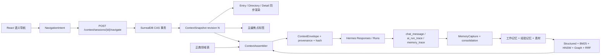

# Scribe3 统一上下文与长短期记忆系统 Implementation Plan

> **For agentic workers:** REQUIRED SUB-SKILL: Use superpowers:subagent-driven-development (recommended) or superpowers:executing-plans to implement this plan task-by-task. Steps use checkbox (`- [ ]`) syntax for tracking.

**Goal:** 建立“一次语义导航 = 一个完整上下文快照”的原子上下文系统，让主编在同一作品内持续理解作者的历史行为、决策和当前焦点，同时保证作品隔离、正典唯一、可追溯、可更正与可验证。

**Architecture:** Scribe3 以 SurrealDB 为唯一领域真相源，在产品内建立 `ContextSnapshot + EditorialThread + MemoryFabric + ContextAssembler` 四个边界。Hermes Agent 只承担模型运行、Responses/Runs 会话、工具与生命周期适配；Spectron 的权威/经验双流、三时态、分层检索、溯源和调和模型作为设计基线，通过适配器影子评测，不直接成为生产真相源。

**Tech Stack:** Python 3.14.3, FastAPI 0.139.0, Pydantic 2.13.4, SurrealDB 3.2.0, surrealdb-py 2.0.0, MCP SDK 1.28.1, Hermes Agent 0.18.2, React 19.2.7, Vite 8.1.4, Vitest 4.1.10, pytest 9.1.1, HNSW + jieba/BM25 + SurrealDB graph + RRF + optional LLM rerank.

## Global Constraints

- 作品内的角色、事实、事件、秘密、伏笔、章节、素材引用及其时态只能由 Scribe3 SurrealDB 领域表授权；Hermes memory、skill、session transcript 都不得成为第二真相源。
- 严格按 `work` 物理隔离作品记忆；只有用户偏好、通用写作方法和稳定工具约定允许跨作品。
- 导航分为“语义导航”与“展示操作”：切入口、选条目、切视图、切章节阶段、切焦点角色会产生新 snapshot；折叠、拖宽、滚动不产生 snapshot。
- 一次语义导航必须原子提交 `entry + directory_path + focus + detail_route + chapter + phase + focalizer + thread_id + revision`，栏 1、栏 2、栏 3 和主编不得分别维护语义状态。
- 导航只改变焦点，不自动新建对话。同一 work 默认只有一条连续 `editorial_thread`；只有用户明确执行“新建讨论分支/开新线”才分叉。
- 每一次 LLM 调用必须绑定 `context_session_id + context_revision + context_hash`；后端发现过期 revision 时返回 409，不允许旧焦点结果写入新上下文。该强制仅在 `SCRIBE3_CONTEXT_SNAPSHOT_V1=true` 时生效——请求模型字段一律 optional，开关关闭时旧调用方（存量测试/旧前端/loop/pilot）行为不变（见 Task 4/16）。
- 所有 AI 注入必须记录来源、版本/时态、选中理由、未选理由、信心度、token 成本和响应/run id。
- 记忆更正使用 supersede/invalid 语义，不将旧记录静默覆盖；用户明确要求遗忘时才执行物理删除与派生向量/索引清理。
- 动态上下文预算默认 10,000 tokens，不得挤占用户输入、工具输出和生成余量；只把当前快照放入每轮动态层。
- 稳定层分工遵守既有裁决（Q5 + 2026-07-09 spec 文档级修订，本计划不得推翻）：恒定身份与恒定纪律的家是 **profile SOUL.md**（stable 层每请求注入、写盘即生效，2026-07-10 已落地并真机验证）；围栏协议、限知宪法等**强制纪律保持 prompt 内嵌**——Hermes skills 是渐进披露，正文不进系统提示、只有 name+description 索引进稳定层，强制纪律放 skill 必失守，且 doubao 路线无 Anthropic prompt caching 收益；skill 只放模型可按需 `skill_view` 查阅的工序参考。
- Hermes `memory.write_approval=true` 与 `skills.write_approval=true` 保持开启；稳定主编 skill 的任何修改必须经审查。
- Hermes 0.18.2 只允许一个外部 memory provider；不得同时启用自建 `scribe3-memory` 和 Spectron provider。
- 本计划不授权 commit、push、新建分支或删除用户数据；每任务以测试结果和 `git diff --check` 作为检查点。

---

## 1. 当前基线与客观技术裁决

### 1.1 本次已升级基线

| 层 | 升级后版本 | 计划使用的新能力 |
|---|---:|---|
| Hermes Agent | 0.18.2 (`v2026.7.7.2`) | memory provider 完整生命周期、写入审批、默认不自动 reset 的连续 session、FTS5 session search、trace/redacted export、稳定/上下文/易变 prompt 分层、每轮 ephemeral plugin context、MCP 子进程 watchdog/reconnect |
| SurrealDB server | 3.2.0 | 多模数据、ACID 事务、HNSW、FULLTEXT/BM25、图关系、时态字段、安全授权与完整备份通道 |
| surrealdb-py | 2.0.0 | SurrealDB 3.2.0 官方兼容 SDK，项目已自建断线重连语义 |
| Python / FastAPI / MCP | 3.14.3 / 0.139.0 / 1.28.1 | 强类型 Context API、MCP 读写双工具面、Runs approval |
| Node / npm | 26.5.0 / 12.0.0 | 当前稳定工具链 |
| React / Vite / Vitest | 19.2.7 / 8.1.4 / 4.1.10 | 统一上下文 store、原子 reducer、组件回归 |

### 1.2 三种路线的裁决

| 方案 | 优点 | 根本局限 | 裁决 |
|---|---|---|---|
| 只用 Hermes 内置 memory/session | 已有 MEMORY.md/USER.md、FTS5 历史和会话恢复 | 内置 memory 总量约 1,300 tokens，会话启动时冻结；session transcript 是聊天史而非领域真相；无法表达作品时态、限知、伏笔和设定纠正 | 只用于跨作品用户偏好、通用工作流与运行时恢复，不存剧情事实 |
| 直接引入 Spectron | 理论模型完整：权威/经验双流、三时态、溯源、调和、分层检索；官方文档已给 Hermes provider | 2026-07-10 实查文档指定的 `spectron-integration-hermes-agent` PyPI 返回 404；`surrealdb==2.0.0` 只声明 `pydantic` extra，不含 `surrealdb.spectron`；与自建 provider 受 Hermes “单外部 provider”规则冲突 | 吸收数据模型和评测方法；仅在发布门禁通过后做影子流量，不直接接管生产 |
| Scribe3 基于 SurrealDB 自建 memory fabric | 与已有事实、限知、伏笔、素材、lesson、trace 同库；可复用 HNSW + BM25 + graph + RRF；能保证 work 隔离和事务一致性 | 需要自己建捕获、压缩、检索评测与溯源 UI | **生产主路**；Hermes 是适配层，Spectron 是可替换影子实现 |

### 1.3 上下文不等于记忆

- `GlobalContext`：作品意图、主要角色、当前卷/弧光、未回收伏笔、近期重要决策，随 work 连续。
- `FocusContext`：用户此刻在看什么，包括入口、目录路径、条目、视图、章节、阶段、焦点角色和显式选区。
- `WorkingContext`：本次编辑会话的目标、尚未完成的工作、当前假设与近 8 轮摘要，可被更新和压缩。
- `LongTermMemory`：经验性决策、纠正、陷阱、稳定偏好、典型参考和不确定性，按需检索，不全量塞入 prompt。
- `CanonicalEvidence`：实体、事实、事件、知识帧、伏笔、正文等权威领域数据，不是“记忆副本”，而是每轮直接查权威表的证据。

## 2. 目标数据流



## 3. 文件边界

### 新建文件

| 文件 | 唯一职责 |
|---|---|
| `scribe3/context_models.py` | Context session/snapshot/intent/envelope 的 Pydantic 合同 |
| `scribe3/context_service.py` | snapshot CAS、焦点归一化、线程连续与 stale revision 检查 |
| `scribe3/context_assembler.py` | 按预算组装全局、焦点、正典、经验、素材、不确定性块 |
| `scribe3/memory_models.py` | 记忆类型、候选、排名、溯源、生命周期合同 |
| `scribe3/memory_retrieval.py` | 分层检索、RRF、强度/时效、去重与预算选择 |
| `scribe3/memory_capture.py` | turn/navigation/write 事件捕获、幂等入队、工作摘要与经验蒸馏 |
| `scribe3/spectron_adapter.py` | Spectron 可用性门禁、影子写入/查询和对比指标，默认关闭 |
| `scribe3/migrations/076_context_session.surql` | context session/snapshot/navigation event |
| `scribe3/migrations/077_editorial_thread.surql` | 作品级主编线程与 chat_message 关联 |
| `scribe3/migrations/078_memory_fabric.surql` | working/episodic/procedural/uncertainty 记忆及关系 |
| `scribe3/migrations/079_memory_trace.surql` | 检索候选、选中、prompt 注入和评测记录 |
| `scribe3/web/src/context/contextSnapshot.js` | 前端 intent 归一化、快照签名和乐观状态转换 |
| `scribe3/web/src/context/ContextSnapshotContext.jsx` | 唯一语义导航 store，向四栏与主编发布同一 snapshot |
| `scribe3/web/src/context/ContextInspector.jsx` | 展示当前 revision、注入层、来源、不确定性和过期告警 |
| `scribe3/hermes_plugins/scribe3-memory/__init__.py` | 可选 Hermes MemoryProvider 适配，只调 Scribe API，不另建库 |
| `scribe3/hermes_plugins/scribe3-memory/plugin.yaml` | provider 元数据与 lifecycle hooks |

### 修改文件

| 文件 | 改动边界 |
|---|---|
| `scribe3/store.py` | 增加 context/thread/memory/trace 精确 CRUD，不改已有领域表语义 |
| `scribe3/app.py` | Context API、chat 请求绑定 revision、统一 assembler，收口旧的多套 prompt 拼装 |
| `scribe3/hermes_runtime.py` | Responses 线程 id、previous response id、context hash 头与 capability 探测 |
| `scribe3/llm.py` | 传递 thread/session/context envelope，保留读/写双 gateway |
| `scribe3/mcp.py` | 所有记忆工具强制 `work`，写入仍走 approval |
| `scribe3/web/src/layout/FourPaneShell.jsx` | 去掉“入口内部 state + 条目外部 sel”的双源语义，统一发 NavigationIntent |
| `scribe3/web/src/ChiefDock.jsx` | 一 work 一线程；不再用 node/phase/focus 切 chatKey；发送时携带 revision/hash |
| `scribe3/web/src/WriteChat.jsx` | 将章内执行流链到作品级 thread 的 child run，保留 proposal/approval |
| `scribe3/web/src/useChatPersist.js` | 退出权威历史职责，只保留断网草稿缓存；消息改由后端查询 |
| `scribe3/web/src/api.js` | context/thread/message/trace API 与 409 stale-context 类型化错误 |

---

### Task 1: 建立可量化的上下文与记忆黄金评测集

**Files:**
- Create: `scribe3/tests/fixtures/context_memory_gold.json`
- Create: `scribe3/tests/test_context_memory_eval.py`
- Create: `scribe3/tools/context_memory_eval.py`

**Interfaces:**
- Consumes: 已有 `SurrealStore`、事实/事件/伏笔/素材/lesson fixture 构建能力。
- Produces: `EvalCase`, `EvalResult`, `run_eval(cases, retriever) -> dict`，被 Task 8、15、17 共用。

- [ ] **Step 1: 写入 120 个黄金用例的固定分类与首批显式样例**

`context_memory_gold.json` 顶层使用以下完整字段，分 12 类：`global_continuity`、`focus_switch`、`cross_work_isolation`、`canonical_priority`、`temporal_validity`、`focalizer_knowledge`、`decision_recall`、`correction_supersession`、`material_association`、`uncertainty`、`provenance`、`stale_revision`。**首期每类 3 例(共 36 例)即锁门禁**——阈值与 120 例版相同,后续按同 schema 扩到每类 10 例;用例数据从纸命现网真实设定/伏笔/对话中抽取改编,不凭空虚构。

```json
[
  {
    "id": "focus_switch_001",
    "category": "focus_switch",
    "work": "eval_book_a",
    "snapshot": {"entry": "codex", "focus_type": "character", "focus_id": "role:\u7532", "chapter": 8, "phase": "draft", "focalizer": "role:\u4e59"},
    "query": "\u8fd9\u4e2a\u4eba\u5728\u5f53\u524d\u7ae0\u80fd\u77e5\u9053\u4ec0\u4e48\uff1f",
    "must_include": ["fact:\u4e59_known_01"],
    "must_exclude": ["fact:\u4e59_secret_future", "work:eval_book_b"],
    "expected_source_kinds": ["knowledge_frame", "fact"],
    "expected_revision": 3
  }
]
```

- [ ] **Step 2: 先写失败的评测驱动测试**

```python
def test_eval_rejects_cross_work_and_missing_provenance():
    cases = load_gold_cases()
    result = run_eval(cases, FakeRetriever.with_cross_work_leak())
    assert result["cross_work_leaks"] == 0
    assert result["provenance_coverage"] == 1.0
```

- [ ] **Step 3: 运行失败测试**

Run: `scribe3/.venv/bin/python -m pytest -q scribe3/tests/test_context_memory_eval.py`

Expected: FAIL，明确显示 `run_eval`/`load_gold_cases` 未定义或泄漏计数非 0。

- [ ] **Step 4: 实现完整指标计算**

```python
@dataclass(frozen=True)
class EvalResult:
    recall_at_10: float
    ndcg_at_10: float
    provenance_coverage: float
    cross_work_leaks: int
    stale_revision_accepts: int
    p95_ms: float

def run_eval(cases: list[dict], retriever) -> dict:
    rows = []
    for case in cases:
        started = time.perf_counter()
        hits = retriever.retrieve(case["work"], case["snapshot"], case["query"], 10)
        elapsed_ms = (time.perf_counter() - started) * 1000
        ids = [hit.source_id for hit in hits]
        relevant = set(case["must_include"])
        rows.append(score_case(case, hits, ids, relevant, elapsed_ms))
    return aggregate_scores(rows)
```

- [ ] **Step 5: 锁定验收门槛**

`context_memory_eval.py` 在任一条件不满足时退出 1：`Recall@10 >= 0.90`、`nDCG@10 >= 0.85`、溯源覆盖 `100%`、跨 work 泄漏 `0`、过期 revision 接受 `0`、无 LLM 检索 p95 `< 250ms`。

### Task 2: 定义不可变 ContextSnapshot 与主编线程合同

**Files:**
- Create: `scribe3/context_models.py`
- Test: `scribe3/tests/test_context_models.py`

**Interfaces:**
- Consumes: `work`、前端 NavigationIntent 和现有 node/view/phase 命名。
- Produces: `NavigationIntent`、`ContextFocus`、`ContextSnapshot`、`ContextEnvelope`、`StaleContextError`。

- [ ] **Step 1: 写快照完整性与 work 隔离的失败测试**

```python
def test_snapshot_requires_one_complete_semantic_state():
    with pytest.raises(ValidationError):
        ContextSnapshot(
            session_id="ctx-1", work="book-a", revision=2,
            thread_id="thread-a", entry="codex", focus=None,
            detail_route="character:role:a", context_hash="",
        )

def test_snapshot_hash_changes_when_focus_changes():
    a = snapshot(focus_id="role:a")
    b = snapshot(focus_id="role:b")
    assert a.context_hash != b.context_hash
```

- [ ] **Step 2: 运行失败测试**

Run: `scribe3/.venv/bin/python -m pytest -q scribe3/tests/test_context_models.py`

Expected: FAIL with `ModuleNotFoundError: scribe3.context_models`.

- [ ] **Step 3: 实现类型合同与稳定 hash**

```python
class ContextFocus(BaseModel):
    type: Literal["entry", "view", "chapter", "scene", "character", "fact", "event", "promise", "motif", "material", "review_issue", "selection"]
    id: str
    label: str = ""
    source_revision: str | None = None

class NavigationIntent(BaseModel):
    navigation_id: str
    expected_revision: int
    entry: str
    directory_path: list[str] = []
    focus: ContextFocus
    detail_route: str
    chapter: int | None = None
    phase: Literal["outline", "beats", "deduce", "draft", "final"] | None = None
    focalizer: str | None = None
    reason: Literal["entry", "item", "view", "phase", "focalizer", "restore", "explicit"]

class ContextSnapshot(BaseModel):
    session_id: str
    work: str
    revision: int = Field(ge=0)
    thread_id: str
    entry: str
    directory_path: list[str]
    focus: ContextFocus
    detail_route: str
    chapter: int | None
    phase: str | None
    focalizer: str | None
    previous_revision: int | None
    navigation_id: str
    captured_at: datetime
    context_hash: str

    def canonical_payload(self) -> dict:
        return self.model_dump(exclude={"captured_at", "context_hash"}, mode="json")

    def with_hash(self) -> "ContextSnapshot":
        raw = json.dumps(self.canonical_payload(), sort_keys=True, ensure_ascii=False, separators=(",", ":"))
        return self.model_copy(update={"context_hash": hashlib.sha256(raw.encode()).hexdigest()})
```

- [ ] **Step 4: 实现 envelope 块级溯源**

```python
class ContextBlock(BaseModel):
    name: Literal["focus", "global", "canonical", "recent", "procedural", "reference", "uncertainty", "provenance"]
    text: str
    token_estimate: int
    sources: list["ContextSource"]

class ContextEnvelope(BaseModel):
    snapshot: ContextSnapshot
    blocks: list[ContextBlock]
    total_token_estimate: int
    omitted: list[dict]
    assembled_at: datetime
    envelope_hash: str
```

- [ ] **Step 5: 运行类型测试与检查点**

Run: `scribe3/.venv/bin/python -m pytest -q scribe3/tests/test_context_models.py`

Expected: PASS.

### Task 3: 建立 context session/snapshot 的 SurrealDB 原子存储

**Files:**
- Create: `scribe3/migrations/076_context_session.surql`
- Modify: `scribe3/store.py`
- Test: `scribe3/tests/test_context_store.py`

**Interfaces:**
- Consumes: Task 2 `NavigationIntent`/`ContextSnapshot`.
- Produces: `create_context_session(work, actor_id, device_id) -> ContextSnapshot`、`advance_context(session_id, intent) -> ContextSnapshot`、`get_context_snapshot(session_id, revision=None)`.

- [ ] **Step 1: 写 CAS 冲突和导航幂等失败测试**

```python
def test_advance_context_is_atomic_and_idempotent(store):
    first = store.create_context_session("book-a", "author", "browser-a")
    intent = nav(expected_revision=first["revision"], navigation_id="nav-1", focus_id="role:a")
    advanced = store.advance_context(first["session_id"], intent.model_dump())
    repeated = store.advance_context(first["session_id"], intent.model_dump())
    assert repeated["revision"] == advanced["revision"] == 1
    assert repeated["context_hash"] == advanced["context_hash"]

def test_advance_context_rejects_stale_revision(store):
    session = store.create_context_session("book-a", "author", "browser-a")
    store.advance_context(session["session_id"], nav(0, "nav-1", "role:a").model_dump())
    with pytest.raises(StaleContextError):
        store.advance_context(session["session_id"], nav(0, "nav-2", "role:b").model_dump())
```

- [ ] **Step 2: 运行失败测试**

Run: `scribe3/.venv/bin/python -m pytest -q scribe3/tests/test_context_store.py`

Expected: FAIL because migration and store methods do not exist.

- [ ] **Step 3: 创建完整 schema**

```sql
DEFINE TABLE IF NOT EXISTS context_session SCHEMAFULL;
DEFINE FIELD IF NOT EXISTS work ON context_session TYPE string;
DEFINE FIELD IF NOT EXISTS actor_id ON context_session TYPE string;
DEFINE FIELD IF NOT EXISTS device_id ON context_session TYPE string;
DEFINE FIELD IF NOT EXISTS thread_id ON context_session TYPE string;
DEFINE FIELD IF NOT EXISTS status ON context_session TYPE string ASSERT $value IN ['active', 'ended'];
DEFINE FIELD IF NOT EXISTS revision ON context_session TYPE int DEFAULT 0;
DEFINE FIELD IF NOT EXISTS current_snapshot_id ON context_session TYPE option<string>;
DEFINE FIELD IF NOT EXISTS started_at ON context_session TYPE datetime VALUE time::now() READONLY;
DEFINE FIELD IF NOT EXISTS updated_at ON context_session TYPE datetime;
DEFINE INDEX IF NOT EXISTS context_session_work_idx ON context_session FIELDS work;
DEFINE INDEX IF NOT EXISTS context_session_thread_idx ON context_session FIELDS thread_id;

DEFINE TABLE IF NOT EXISTS context_snapshot SCHEMAFULL;
DEFINE FIELD IF NOT EXISTS session_id ON context_snapshot TYPE string;
DEFINE FIELD IF NOT EXISTS work ON context_snapshot TYPE string;
DEFINE FIELD IF NOT EXISTS revision ON context_snapshot TYPE int;
DEFINE FIELD IF NOT EXISTS previous_revision ON context_snapshot TYPE option<int>;
DEFINE FIELD IF NOT EXISTS navigation_id ON context_snapshot TYPE string;
DEFINE FIELD IF NOT EXISTS thread_id ON context_snapshot TYPE string;
DEFINE FIELD IF NOT EXISTS entry ON context_snapshot TYPE string;
DEFINE FIELD IF NOT EXISTS directory_path ON context_snapshot TYPE array<string> DEFAULT [];
DEFINE FIELD IF NOT EXISTS focus ON context_snapshot TYPE object;
DEFINE FIELD IF NOT EXISTS focus.* ON context_snapshot TYPE any;
DEFINE FIELD IF NOT EXISTS detail_route ON context_snapshot TYPE string;
DEFINE FIELD IF NOT EXISTS chapter ON context_snapshot TYPE option<int>;
DEFINE FIELD IF NOT EXISTS phase ON context_snapshot TYPE option<string>;
DEFINE FIELD IF NOT EXISTS focalizer ON context_snapshot TYPE option<string>;
DEFINE FIELD IF NOT EXISTS reason ON context_snapshot TYPE string;
DEFINE FIELD IF NOT EXISTS context_hash ON context_snapshot TYPE string;
DEFINE FIELD IF NOT EXISTS captured_at ON context_snapshot TYPE datetime VALUE time::now() READONLY;
DEFINE INDEX IF NOT EXISTS context_snapshot_session_revision ON context_snapshot FIELDS session_id, revision UNIQUE;
DEFINE INDEX IF NOT EXISTS context_snapshot_navigation ON context_snapshot FIELDS session_id, navigation_id UNIQUE;
DEFINE INDEX IF NOT EXISTS context_snapshot_work_focus ON context_snapshot FIELDS work, focus.id;
```

- [ ] **Step 4: 实现单事务 CAS**

`advance_context` 使用一段 SurrealQL 事务：先按 `navigation_id` 返回已有 snapshot；否则仅在 `context_session.revision == expected_revision` 时把 revision 加 1，创建 snapshot，并将 `current_snapshot_id` 指向新记录。更新返回空集时抛 `StaleContextError(expected, actual)`，不做自动覆盖。并发细节:快照隔离下两个并发重放可能同时通过"先查 navigation_id"检查,最终由 `UNIQUE(session_id, navigation_id)` 索引兜底——实现必须捕获该唯一键冲突并转为"读回已有 snapshot 返回"(幂等成功),不得把它当错误抛给前端。

- [ ] **Step 5: 验证事务、幂等和索引**

Run: `scribe3/.venv/bin/python -m pytest -q scribe3/tests/test_context_store.py scribe3/tests/test_transaction.py scribe3/tests/test_indexes.py`

Expected: PASS.

### Task 4: 暴露 Context API 并强制 chat revision 绑定

**Files:**
- Create: `scribe3/context_service.py`
- Modify: `scribe3/app.py:2848-2863`
- Modify: `scribe3/app.py:3182-3227`
- Modify: `scribe3/web/src/api.js`
- Test: `scribe3/tests/test_context_api.py`

**Interfaces:**
- Consumes: Task 2 models, Task 3 store methods.
- Produces: `POST /context/sessions`, `GET /context/sessions/{id}`, `POST /context/sessions/{id}/navigate`, `GET /context/sessions/{id}/snapshots/{revision}`; chat requests require `context_session_id`, `context_revision`, `context_hash`, `thread_id`.

- [ ] **Step 1: 写过期 chat 拒绝与同 revision 通过的失败测试**

```python
def test_chat_write_rejects_stale_context(client, context_session, monkeypatch):
    monkeypatch.setenv("SCRIBE3_CONTEXT_SNAPSHOT_V1", "true")   # 强制仅在开关开时生效
    response = client.post("/chat/write?work=book-a", json={
        "msg": "\u7eed\u5199", "chapter": 3, "phase": "draft",
        "context_session_id": context_session.id,
        "context_revision": 0,
        "context_hash": "old",
        "thread_id": context_session.thread_id,
    })
    assert response.status_code == 409
    assert response.json()["detail"]["code"] == "stale_context"

def test_navigation_returns_complete_snapshot(client, context_session):
    response = client.post(f"/context/sessions/{context_session.id}/navigate", json=nav_payload())
    assert response.status_code == 200
    assert set(response.json()) >= {"entry", "directory_path", "focus", "detail_route", "thread_id", "revision", "context_hash"}
```

- [ ] **Step 2: 运行失败测试**

Run: `scribe3/.venv/bin/python -m pytest -q scribe3/tests/test_context_api.py`

Expected: FAIL with 404 on context routes and missing request fields.

- [ ] **Step 3: 实现 ContextService 校验**

```python
class ContextService:
    def __init__(self, store):
        self.store = store

    def require_current(self, session_id: str, revision: int, context_hash: str, work: str) -> ContextSnapshot:
        snapshot = ContextSnapshot.model_validate(self.store.get_context_snapshot(session_id))
        if snapshot.work != work:
            raise ContextWorkMismatch(session_id=session_id, expected=work, actual=snapshot.work)
        if snapshot.revision != revision or snapshot.context_hash != context_hash:
            raise StaleContextError(expected=revision, actual=snapshot.revision, latest=snapshot.model_dump(mode="json"))
        return snapshot
```

- [ ] **Step 4: 将 chat 合同改为强制快照**

```python
class ChatWriteReq(BaseModel):
    msg: str
    chapter: int = 1
    focalizer: str = ""
    images: list[ImageModel] = []
    seed_words: list[str] = []
    phase: str = ""
    short_mode: bool = False
    # 上下文绑定字段一律 optional——契约不硬断存量调用方(1270 项测试/旧前端/loop/pilot)。
    # 强制校验挂 SCRIBE3_CONTEXT_SNAPSHOT_V1:开关开 + 字段缺失/过期 → 409;开关关 → 忽略,行为不变。
    context_session_id: str | None = None
    context_revision: int | None = Field(default=None, ge=0)
    context_hash: str | None = Field(default=None, min_length=64, max_length=64)
    thread_id: str | None = None
```

强制逻辑放 `ContextService.enforce(req, work)`:`SCRIBE3_CONTEXT_SNAPSHOT_V1=true` 时字段缺失返回 400 `context_binding_required`、过期返回 409 `stale_context`;开关默认 false,Task 4 落地时**不改变任何现有调用方行为**,存量全量回归必须保持绿。

API 发送函数统一包含：

```javascript
contextHeaders: (snapshot) => ({
  'X-Scribe-Context-Session': snapshot.session_id,
  'X-Scribe-Context-Revision': String(snapshot.revision),
  'X-Scribe-Context-Hash': snapshot.context_hash,
})
```

- [ ] **Step 5: 验证 API 边界**

Run: `scribe3/.venv/bin/python -m pytest -q scribe3/tests/test_context_api.py scribe3/tests/test_app.py -k 'chat or context'`

Expected: PASS；跨 work 请求 409，过期 revision 409，当前 revision 200/SSE。

### Task 5: 将四栏导航改成单一 ContextSnapshot reducer

**Files:**
- Create: `scribe3/web/src/context/contextSnapshot.js`
- Create: `scribe3/web/src/context/ContextSnapshotContext.jsx`
- Create: `scribe3/web/src/context/contextSnapshot.test.js`
- Modify: `scribe3/web/src/layout/FourPaneShell.jsx:55-138`
- Modify: `scribe3/web/src/BinderLayout.jsx`
- Test: `scribe3/web/src/layout/__tests__/fourPane-context-atomic.test.jsx`

**Interfaces:**
- Consumes: Task 4 Context API.
- Produces: `useContextSnapshot() -> {snapshot, navigate, restoring, error}`、`reduceSnapshot(snapshot, intent)`.

- [ ] **Step 1: 写“入口/详情/主编只提交一次”的失败测试**

```jsx
it('切换入口只发一个完整 NavigationIntent', async () => {
  render(<Harness />)
  await user.click(screen.getByRole('button', { name: '设定' }))
  expect(api.navigateContext).toHaveBeenCalledTimes(1)
  expect(api.navigateContext).toHaveBeenCalledWith(expect.objectContaining({
    entry: 'codex',
    directory_path: ['codex'],
    focus: expect.objectContaining({ type: 'entry', id: 'entry:codex' }),
    detail_route: 'entry:codex',
    reason: 'entry',
  }))
})

it('目录选中后详情与主编共享同一 revision', async () => {
  await user.click(screen.getByRole('button', { name: '甲' }))
  expect(screen.getByTestId('detail')).toHaveAttribute('data-context-revision', '4')
  expect(screen.getByTestId('chief-chat-shell')).toHaveAttribute('data-context-revision', '4')
})
```

- [ ] **Step 2: 运行失败测试**

Run: `cd scribe3/web && npm test -- src/context/contextSnapshot.test.js src/layout/__tests__/fourPane-context-atomic.test.jsx`

Expected: FAIL because `ContextSnapshotContext` does not exist and FourPaneShell still has dual semantic state.

- [ ] **Step 3: 实现纯 reducer**

```javascript
export function reduceSnapshot(current, intent) {
  if (!current) throw new Error('context_snapshot_missing')
  if (intent.expected_revision !== current.revision) throw new Error('stale_context')
  return {
    ...current,
    entry: intent.entry,
    directory_path: [...intent.directory_path],
    focus: { ...intent.focus },
    detail_route: intent.detail_route,
    chapter: intent.chapter ?? null,
    phase: intent.phase ?? null,
    focalizer: intent.focalizer ?? null,
    navigation_id: intent.navigation_id,
    previous_revision: current.revision,
    revision: current.revision + 1,
  }
}

export function semanticIntent(snapshot, patch) {
  return {
    navigation_id: crypto.randomUUID(),
    expected_revision: snapshot.revision,
    entry: patch.entry ?? snapshot.entry,
    directory_path: patch.directory_path ?? snapshot.directory_path,
    focus: patch.focus,
    detail_route: patch.detail_route,
    chapter: patch.chapter ?? null,
    phase: patch.phase ?? null,
    focalizer: patch.focalizer ?? null,
    reason: patch.reason,
  }
}
```

- [ ] **Step 4: 实现 provider 的乐观+服务端确认**

`navigate(intent)` 立即用 reducer 生成 optimistic snapshot 供四栏同时渲染，再调 `api.navigateContext`；服务端回快照后整体替换。出现 409 时整体换成服务端 `latest`，显示“上下文已在另一窗口更新”，不拼接局部 state。

- [ ] **Step 5: 修改 FourPaneShell 消费单一 snapshot**

`activeEntry`、`DirectoryPane.sel`、`DetailPane.sel`、`RightDock` 全部由 snapshot 投影得到；`handleActive`、`handleNavigateToObject`、`onSelectItem` 只发 intent，不直接分别 `setTab`/`onSelectNode`。

- [ ] **Step 6: 验证四栏原子性与旧路由回归**

Run: `cd scribe3/web && npm test -- src/context/contextSnapshot.test.js src/layout/__tests__/fourPane-context-atomic.test.jsx src/layout/__tests__/entryRail.test.jsx src/layout/__tests__/directoryPane-manuscript.test.jsx src/layout/__tests__/directoryPane-tools.test.jsx`

Expected: PASS.

### Task 6: 将主编历史改为“一 work 一连续线程 + 每轮焦点标签”

**Files:**
- Create: `scribe3/migrations/077_editorial_thread.surql`
- Modify: `scribe3/store.py`
- Modify: `scribe3/app.py:3222-3227`
- Modify: `scribe3/web/src/ChiefDock.jsx:335-357`
- Modify: `scribe3/web/src/useChatPersist.js`
- Modify: `scribe3/web/src/api.js`
- Test: `scribe3/tests/test_editorial_thread.py`
- Test: `scribe3/web/src/__tests__/chiefDock-thread-continuity.test.jsx`

**Interfaces:**
- Consumes: Task 2/3 snapshot and existing `chat_message`.
- Produces: `editorial_thread`、`GET/POST /chat/threads`、每条 `chat_message.thread_id/context_revision/focus`.

- [ ] **Step 1: 写“切角色不切对话”的失败测试**

```jsx
it('从角色甲切到伏笔乙仍保留同一线程消息', async () => {
  api.threadMessages.mockResolvedValue([
    { id: 'm1', role: 'user', text: '先谈甲', context_revision: 2, focus: { id: 'role:甲' } },
  ])
  const { rerender } = render(<ChiefDock snapshot={snapshot('role:甲', 2)} />)
  rerender(<ChiefDock snapshot={snapshot('promise:乙', 3)} />)
  expect(api.threadMessages).toHaveBeenCalledTimes(1)
  expect(screen.getByText('先谈甲')).toBeTruthy()
  expect(screen.getByTestId('chief-ctx')).toHaveTextContent('伏笔')
})
```

- [ ] **Step 2: 写服务端线程分叉和 work 隔离失败测试**

```python
def test_editorial_thread_is_stable_across_focus(store):
    thread = store.get_or_create_editorial_thread("book-a", "author")
    store.add_chat_message("book-a", 3, "user", "\u7532", thread_id=thread["thread_id"], context_revision=1, focus={"id": "role:a"})
    store.add_chat_message("book-a", 3, "user", "\u4e59", thread_id=thread["thread_id"], context_revision=2, focus={"id": "promise:b"})
    assert len(store.list_thread_messages(thread["thread_id"])) == 2

def test_thread_cannot_be_read_from_another_work(store_a, store_b):
    thread = store_a.get_or_create_editorial_thread("book-a", "author")
    assert store_b.list_thread_messages(thread["thread_id"]) == []
```

- [ ] **Step 3: 创建线程 schema**

```sql
DEFINE TABLE IF NOT EXISTS editorial_thread SCHEMAFULL;
DEFINE FIELD IF NOT EXISTS thread_id ON editorial_thread TYPE string;
DEFINE FIELD IF NOT EXISTS work ON editorial_thread TYPE string;
DEFINE FIELD IF NOT EXISTS actor_id ON editorial_thread TYPE string;
DEFINE FIELD IF NOT EXISTS parent_thread_id ON editorial_thread TYPE option<string>;
DEFINE FIELD IF NOT EXISTS title ON editorial_thread TYPE string DEFAULT '\u4e3b\u7f16\u8ba8\u8bba';
DEFINE FIELD IF NOT EXISTS status ON editorial_thread TYPE string ASSERT $value IN ['active', 'archived'];
DEFINE FIELD IF NOT EXISTS hermes_conversation_id ON editorial_thread TYPE option<string>;
DEFINE FIELD IF NOT EXISTS previous_response_id ON editorial_thread TYPE option<string>;
DEFINE FIELD IF NOT EXISTS summary ON editorial_thread TYPE string DEFAULT '';
DEFINE FIELD IF NOT EXISTS created_at ON editorial_thread TYPE datetime VALUE time::now() READONLY;
DEFINE FIELD IF NOT EXISTS updated_at ON editorial_thread TYPE datetime;
DEFINE INDEX IF NOT EXISTS editorial_thread_id_idx ON editorial_thread FIELDS thread_id UNIQUE;
DEFINE INDEX IF NOT EXISTS editorial_thread_active_idx ON editorial_thread FIELDS work, actor_id, status;

DEFINE FIELD IF NOT EXISTS thread_id ON chat_message TYPE option<string>;
DEFINE FIELD IF NOT EXISTS context_session_id ON chat_message TYPE option<string>;
DEFINE FIELD IF NOT EXISTS context_revision ON chat_message TYPE option<int>;
DEFINE FIELD IF NOT EXISTS context_hash ON chat_message TYPE option<string>;
DEFINE FIELD IF NOT EXISTS focus ON chat_message TYPE option<object>;
DEFINE FIELD IF NOT EXISTS focus.* ON chat_message TYPE any;
DEFINE FIELD IF NOT EXISTS response_id ON chat_message TYPE option<string>;
DEFINE INDEX IF NOT EXISTS chat_message_thread_ts_idx ON chat_message FIELDS thread_id, ts;
```

- [ ] **Step 4: 改造 ChiefDock 不再按焦点拆 chatKey**

```javascript
const threadKey = `${snapshot.work}:editorial:${snapshot.thread_id}`
const focusAtSend = {
  revision: snapshot.revision,
  hash: snapshot.context_hash,
  entry: snapshot.entry,
  focus: snapshot.focus,
  chapter: snapshot.chapter,
  phase: snapshot.phase,
  focalizer: snapshot.focalizer,
}
```

`useChatPersist` 仅保存 `draft:${threadKey}` 的未发送输入和断网尚未同步的 message id；已确认消息从 `/chat/threads/{thread_id}/messages` 加载。

- [ ] **Step 5: 回填存量对话史(不可跳过——纸命现网已有真实 chat_message,无 thread_id)**

077 迁移末尾或 `apply_schema` 后钩子执行幂等回填:为每个 work 建默认 `editorial_thread`(如 `thread:{work}_default`),把所有 `thread_id = NONE` 的 chat_message 归入该线程,`context_revision/focus` 留 NONE(历史消息无快照属正常);回填前后 `SELECT count() FROM chat_message` 必须相等,并加测试钉:

```python
def test_backfill_assigns_default_thread_to_legacy_messages(store):
    store.add_chat_message(1, "draft", "user", "旧消息")          # 模拟无 thread_id 存量
    store.backfill_thread_ids()
    msgs = store.list_thread_messages(store.get_or_create_editorial_thread(store.db_name, "author")["thread_id"])
    assert any(m["text"] == "旧消息" for m in msgs), "升级后旧对话不得从 UI 消失"
```

- [ ] **Step 6: 保留显式分支能力**

`POST /chat/threads/{thread_id}/fork` 只由用户点击“新建讨论分支”调用，写 `parent_thread_id`；导航 reducer 不得调用 fork。

- [ ] **Step 7: 验证历史连续和两层隔离**

Run: `scribe3/.venv/bin/python -m pytest -q scribe3/tests/test_editorial_thread.py scribe3/tests/test_chat_message.py`

Run: `cd scribe3/web && npm test -- src/__tests__/chiefDock-thread-continuity.test.jsx src/__tests__/chiefDock-ui.test.jsx`

Expected: PASS.

### Task 7: 建立可预算、可追溯的 ContextAssembler

**Files:**
- Create: `scribe3/context_assembler.py`
- Create: `scribe3/tests/test_context_assembler.py`
- Modify: `scribe3/app.py:2154-2228`
- Modify: `scribe3/app.py:3115-3178`

**Interfaces:**
- Consumes: `ContextSnapshot`、领域 store、Task 8 `MemoryRetriever`.
- Produces: `assemble_context(store, snapshot, user_query, mode) -> ContextEnvelope`.

- [ ] **Step 1: 写块顺序、预算和正典优先的失败测试**

```python
def test_assembler_is_budgeted_and_canonical_wins(store, snapshot):
    retriever = FakeRetriever.with_conflicting_episode_and_fact()
    envelope = ContextAssembler(store, retriever, token_budget=10_000).assemble(snapshot, "\u7532\u73b0\u5728\u5728\u54ea\uff1f", "discussion")
    assert [b.name for b in envelope.blocks] == [
        "focus", "global", "canonical", "recent", "procedural", "reference", "uncertainty", "provenance"
    ]
    assert envelope.total_token_estimate <= 10_000
    assert "\u6743\u5a01\u4e8b\u5b9e" in block(envelope, "canonical").text
    assert "\u65e7\u63a8\u6d4b" not in block(envelope, "canonical").text
    assert any(item["reason"] == "superseded_by_canonical" for item in envelope.omitted)
```

- [ ] **Step 2: 运行失败测试**

Run: `scribe3/.venv/bin/python -m pytest -q scribe3/tests/test_context_assembler.py`

Expected: FAIL with missing `ContextAssembler`.

- [ ] **Step 3: 实现固定块预算**

| 块 | 默认上限 | 源 |
|---|---:|---|
| focus | 800 | snapshot + 当前条目直接查询 |
| global | 1,200 | 北极星、当前卷/弧光、开放伏笔、主要角色 |
| canonical | 2,800 | fact/event/knowledge frame/chapter/promise 权威表 |
| recent | 1,600 | working summary + 近期 episodic/decision |
| procedural | 900 | lesson/accepted writing method |
| reference | 1,400 | material recall，始终标“借鉴非事实” |
| uncertainty | 500 | 冲突、低信心、待确认 |
| provenance | 800 | 来源 id、revision、时态、选中理由 |

```python
BLOCK_BUDGETS = {
    "focus": 800, "global": 1200, "canonical": 2800, "recent": 1600,
    "procedural": 900, "reference": 1400, "uncertainty": 500, "provenance": 800,
}

def allocate(blocks, total_budget=10_000):
    kept, omitted, used = [], [], 0
    for name in BLOCK_BUDGETS:
        block = blocks[name].truncate(BLOCK_BUDGETS[name])
        if used + block.token_estimate <= total_budget:
            kept.append(block); used += block.token_estimate
        else:
            omitted.extend(block.sources_as_omitted("token_budget"))
    return kept, omitted, used
```

- [ ] **Step 4: 把现有 prompt 拼装收口到 envelope**

`_editor_system()` 保留主编身份和最少硬协议；`_assemble_write_instructions()` 先调 `ContextAssembler`，再叠加 proposal 围栏、当前生成模式和必需的章节执行纪律。旧 `_material_recall_block`、`_recap_block`、`_frame_block` 不再独立向 prompt 追加重复文本，它们成为 assembler 的 source adapter。

- [ ] **Step 5: 记录 envelope hash 与 block manifest**

`chat_message.trace.context` 写入 `snapshot_revision`、`snapshot_hash`、`envelope_hash`、每块 token、source ids 和 omitted reasons；正文较长时只记录 source id + digest，不在 trace 重复存整段秘密。

- [ ] **Step 6: 验证 assembler 与现有限知/素材/简报回归**

Run: `scribe3/.venv/bin/python -m pytest -q scribe3/tests/test_context_assembler.py scribe3/tests/test_brief.py scribe3/tests/test_material_recall.py scribe3/tests/test_lesson.py scribe3/tests/test_irony.py`

Expected: PASS.

### Task 8: 建立统一多通道 MemoryRetriever

**Files:**
- Create: `scribe3/migrations/078_memory_fabric.surql`
- Create: `scribe3/memory_models.py`
- Create: `scribe3/memory_retrieval.py`
- Modify: `scribe3/store.py`
- Test: `scribe3/tests/test_memory_retrieval.py`

**Interfaces:**
- Consumes: 现有 `facts_at/project_frame/open_promises/lesson/material_recall/chat_message`，Task 2 snapshot.
- Produces: `MemoryCandidate`、`RetrievalQuery`、`RetrievalResult`、`MemoryRetriever.retrieve(...)`.

- [ ] **Step 1: 写三通道融合、分类衰减与正典压制失败测试**

```python
def test_rrf_combines_structured_bm25_vector_and_graph():
    result = retriever(structured=["a"], bm25=["b", "a"], vector=["c", "a"], graph=["d", "a"])
    assert result.ids[0] == "a"
    assert result.by_id("a").channels == {"structured", "bm25", "vector", "graph"}

def test_canonical_candidate_suppresses_conflicting_episode():
    result = retrieve_with(
        canonical=fact("role:a", "location", "\u57ce\u4e1c", valid_from=8),
        episodic=episode("\u7532\u8fd8\u5728\u57ce\u897f", observed_at="2026-07-01"),
    )
    assert result.selected_ids == ["fact:location-east"]
    assert result.rejected[0].reason == "conflicts_with_canonical"
```

- [ ] **Step 2: 运行失败测试**

Run: `scribe3/.venv/bin/python -m pytest -q scribe3/tests/test_memory_retrieval.py`

Expected: FAIL with missing `memory_models` and `MemoryRetriever`.

- [ ] **Step 3: 创建经验性 memory schema，不复制正典事实**

```sql
DEFINE TABLE IF NOT EXISTS memory_item SCHEMAFULL;
DEFINE FIELD IF NOT EXISTS work ON memory_item TYPE string;
DEFINE FIELD IF NOT EXISTS scope_type ON memory_item TYPE string ASSERT $value IN ['work', 'thread', 'chapter', 'user_global'];
DEFINE FIELD IF NOT EXISTS scope_id ON memory_item TYPE string;
DEFINE FIELD IF NOT EXISTS kind ON memory_item TYPE string ASSERT $value IN ['working', 'episodic', 'procedural', 'reference', 'uncertainty'];
DEFINE FIELD IF NOT EXISTS text ON memory_item TYPE string;
DEFINE FIELD IF NOT EXISTS summary ON memory_item TYPE string DEFAULT '';
DEFINE FIELD IF NOT EXISTS condition ON memory_item TYPE option<string>;
DEFINE FIELD IF NOT EXISTS source_type ON memory_item TYPE string;
DEFINE FIELD IF NOT EXISTS source_id ON memory_item TYPE string;
DEFINE FIELD IF NOT EXISTS source_revision ON memory_item TYPE option<string>;
DEFINE FIELD IF NOT EXISTS status ON memory_item TYPE string ASSERT $value IN ['active', 'superseded', 'invalid'];
DEFINE FIELD IF NOT EXISTS confidence ON memory_item TYPE float ASSERT $value >= 0 AND $value <= 1;
DEFINE FIELD IF NOT EXISTS importance ON memory_item TYPE int ASSERT $value >= 0 AND $value <= 5;
DEFINE FIELD IF NOT EXISTS pinned ON memory_item TYPE bool DEFAULT false;
DEFINE FIELD IF NOT EXISTS supersedes ON memory_item TYPE option<record<memory_item>>;
DEFINE FIELD IF NOT EXISTS observed_at ON memory_item TYPE datetime;
DEFINE FIELD IF NOT EXISTS valid_from ON memory_item TYPE option<int>;
DEFINE FIELD IF NOT EXISTS valid_to ON memory_item TYPE option<int>;
DEFINE FIELD IF NOT EXISTS known_from ON memory_item TYPE option<int>;
DEFINE FIELD IF NOT EXISTS known_to ON memory_item TYPE option<int>;
DEFINE FIELD IF NOT EXISTS tokens ON memory_item TYPE string;
DEFINE FIELD IF NOT EXISTS embedding ON memory_item TYPE option<array<float>>;
DEFINE FIELD IF NOT EXISTS recall_count ON memory_item TYPE int DEFAULT 0;
DEFINE FIELD IF NOT EXISTS last_recalled_at ON memory_item TYPE option<datetime>;
DEFINE FIELD IF NOT EXISTS created_at ON memory_item TYPE datetime VALUE time::now() READONLY;
DEFINE FIELD IF NOT EXISTS updated_at ON memory_item TYPE datetime;
DEFINE INDEX IF NOT EXISTS memory_scope_kind_idx ON memory_item FIELDS work, scope_type, scope_id, kind, status;
DEFINE INDEX IF NOT EXISTS memory_source_idx ON memory_item FIELDS work, source_type, source_id;
DEFINE INDEX IF NOT EXISTS memory_embedding_idx ON memory_item FIELDS embedding HNSW DIMENSION 512 DIST COSINE;
DEFINE ANALYZER OVERWRITE memory_zh TOKENIZERS blank FILTERS lowercase;
DEFINE INDEX IF NOT EXISTS memory_fts_idx ON memory_item FIELDS tokens FULLTEXT ANALYZER memory_zh BM25;

DEFINE TABLE IF NOT EXISTS memory_relation TYPE RELATION IN memory_item OUT memory_item SCHEMAFULL;
DEFINE FIELD IF NOT EXISTS relation ON memory_relation TYPE string ASSERT $value IN ['supports', 'contradicts', 'derived_from', 'same_topic', 'caused_by', 'corrects'];
DEFINE FIELD IF NOT EXISTS weight ON memory_relation TYPE float DEFAULT 1.0;
DEFINE FIELD IF NOT EXISTS provenance ON memory_relation TYPE object DEFAULT {};
DEFINE FIELD IF NOT EXISTS provenance.* ON memory_relation TYPE any;
DEFINE INDEX IF NOT EXISTS memory_relation_kind_idx ON memory_relation FIELDS relation;

DEFINE TABLE IF NOT EXISTS working_summary SCHEMAFULL;
DEFINE FIELD IF NOT EXISTS work ON working_summary TYPE string;
DEFINE FIELD IF NOT EXISTS thread_id ON working_summary TYPE string;
DEFINE FIELD IF NOT EXISTS through_turn ON working_summary TYPE int;
DEFINE FIELD IF NOT EXISTS goals ON working_summary TYPE array<string> DEFAULT [];
DEFINE FIELD IF NOT EXISTS open_tasks ON working_summary TYPE array<string> DEFAULT [];
DEFINE FIELD IF NOT EXISTS decisions ON working_summary TYPE array<string> DEFAULT [];
DEFINE FIELD IF NOT EXISTS assumptions ON working_summary TYPE array<string> DEFAULT [];
DEFINE FIELD IF NOT EXISTS summary ON working_summary TYPE string;
DEFINE FIELD IF NOT EXISTS updated_at ON working_summary TYPE datetime;
DEFINE INDEX IF NOT EXISTS working_summary_thread_idx ON working_summary FIELDS work, thread_id UNIQUE;
```

- [ ] **Step 4: 实现候选合同与 RRF**

```python
class MemoryCandidate(BaseModel):
    source_kind: Literal["canonical", "working", "episodic", "procedural", "reference", "uncertainty"]
    source_id: str
    text: str
    work: str
    channels: set[str] = set()
    channel_ranks: dict[str, int] = {}
    rrf_score: float = 0.0
    final_score: float = 0.0
    confidence: float = 1.0
    importance: int = 2
    pinned: bool = False
    observed_at: datetime | None = None      # final_score 衰减用;canonical 可为 None
    linked_ids: set[str] = set()             # 与 focus 关联加权用
    provenance: list[dict] = []

CHANNEL_WEIGHTS = {"structured": 2.0, "bm25": 1.0, "vector": 1.0, "graph": 1.2, "recency": 0.8}

def reciprocal_rank_fusion(rankings: dict[str, list[str]], k: int = 60) -> dict[str, float]:
    scores: dict[str, float] = {}
    for channel, ids in rankings.items():
        weight = CHANNEL_WEIGHTS[channel]
        for rank, source_id in enumerate(ids, 1):
            scores[source_id] = scores.get(source_id, 0.0) + weight / (k + rank)
    return scores
```

- [ ] **Step 5: 实现分类强度与冲突规则**

```python
HALF_LIFE_DAYS = {"working": 3, "episodic": 30, "procedural": 180, "reference": 90, "uncertainty": 14}

def final_score(candidate: MemoryCandidate, now: datetime, focus_ids: set[str]) -> float:
    if candidate.source_kind == "canonical":
        return candidate.rrf_score + 1.0
    age_days = max(0.0, (now - candidate.observed_at).total_seconds() / 86400)
    decay = 1.0 if candidate.pinned else 0.5 ** (age_days / HALF_LIFE_DAYS[candidate.source_kind])
    importance = 0.65 + 0.07 * candidate.importance
    confidence = 0.75 + 0.25 * candidate.confidence
    focus_bonus = 0.15 if candidate.linked_ids & focus_ids else 0.0
    pin_bonus = 0.25 if candidate.pinned else 0.0
    return candidate.rrf_score * importance * confidence * decay + focus_bonus + pin_bonus
```

冲突处理顺序固定为：当前有效 canonical > 后续 canonical supersession > 作者明确决策 > 高信心 procedural > episodic > reference > uncertainty。reference 绝不参与剧情真假裁决。

- [ ] **Step 6: 验证检索与现有素材/lesson 路径**

Run: `scribe3/.venv/bin/python -m pytest -q scribe3/tests/test_memory_retrieval.py scribe3/tests/test_material_recall.py scribe3/tests/test_lesson.py scribe3/tests/test_hybrid_recall.py`

Expected: PASS.

### Task 9: 建立短期工作记忆、经验记忆和幂等捕获管线

**Files:**
- Create: `scribe3/migrations/079_memory_capture.surql`  ← 迁移只增不改铁律 + runner 按 `_migration:{stem}` 去重永久跳过已应用文件,078 已应用故【改 078 无效】,必须新建 079(memory_item 追加 provenance/linked_ids + memory_event outbox + pending_authority_claim,全 IF NOT EXISTS)
- Create: `scribe3/memory_capture.py`
- Modify: `scribe3/store.py`
- Modify: `scribe3/app.py`
- Test: `scribe3/tests/test_memory_capture.py`

**Interfaces:**
- Consumes: navigation/chat/write/approval/save events and existing `distill_chapter` lessons.
- Produces: `MemoryEvent`、`capture_event(event)`、`consolidate_thread(thread_id)`、`flush_before_compress(thread_id)`.

**实施状态(诚实边界,与 Task 11 同款记账;勿把待办呈现为已兑现):**
- ✅ 已兑现:幂等 outbox 状态机 + 同步 drain;P0 限知红线(身份/血缘/生死/秘密/背叛揭示经
  「登记实体反查 + 高风险断言谓词」强制进 `pending_authority_claim`,绝不进 `memory_item`);
  `add_memory_item` 效果幂等(按 `(work,source_type,source_id)` 预查去重,崩溃窗口后重放不重复);
  `claim_pending_events` 单条 CAS 防双认领;`linked_ids` 生产接线(领域反查 → focus 加权对真机
  记忆生效,`unlinked_count` 降);`known_from` 生产接线(挂点传当前章 → 限知门生效)。
- 🔶 部分/待后续(不夸大):进 `memory_item` 的经验记忆的**自由文本 (entity,attribute) 精确
  抽取待后续**——检索层正典压制路径已通(带 provenance 即压制,单测手喂验证),但生产捕获暂不
  自动抽 attribute,故真机经验记忆 `unconflictable_count` 仍 >0(如实哨兵测试守着,接入后翻绿);
  `memory_relation` 建边(graph 通道对捕获记忆暂无边)、`session_end`/`on_pre_compress` 真接线
  (本仓无 Hermes 生命周期挂点,`flush_before_compress` 就绪待接)、procedural「经用户确认」门、
  material 授权保留、`user_global` scope —— 均记为后续。
- 挂点:仅主写作路径 `chat_write_post`(turn 捕获,有 turn_id 幂等键 + thread 绑定);
  navigation/approval/save 未挂(捕获器支持任意 event_type,后续接线零改动)。

- [ ] **Step 1: 写幂等捕获、事实不误存为经验的失败测试**

```python
def test_turn_capture_is_idempotent(store):
    event = turn_event(event_id="turn:42", text="\u6211\u4eec\u51b3\u5b9a\u5220\u6389\u7b2c\u4e8c\u5e55\u5012\u53d9")
    capture.capture_event(event)
    capture.capture_event(event)
    assert store.count_memory_by_source("chat_turn", "turn:42") == 1

def test_canonical_fact_is_routed_to_domain_ingest_not_memory_item(store):
    capture.capture_event(turn_event(text="\u7532\u7684\u771f\u5b9e\u8eab\u4efd\u662f\u738b\u5b50", classification="canonical_claim"))
    assert store.list_memories(kind="episodic") == []
    assert store.list_pending_authority_claims()[0]["text"] == "\u7532\u7684\u771f\u5b9e\u8eab\u4efd\u662f\u738b\u5b50"
```

- [ ] **Step 2: 运行失败测试**

Run: `scribe3/.venv/bin/python -m pytest -q scribe3/tests/test_memory_capture.py`

Expected: FAIL with missing capture pipeline.

- [ ] **Step 3: 增加幂等 event outbox**

```sql
DEFINE TABLE IF NOT EXISTS memory_event SCHEMAFULL;
DEFINE FIELD IF NOT EXISTS event_id ON memory_event TYPE string;
DEFINE FIELD IF NOT EXISTS work ON memory_event TYPE string;
DEFINE FIELD IF NOT EXISTS thread_id ON memory_event TYPE option<string>;
DEFINE FIELD IF NOT EXISTS event_type ON memory_event TYPE string ASSERT $value IN ['navigation', 'turn', 'write', 'approval', 'save', 'compress', 'session_end'];
DEFINE FIELD IF NOT EXISTS payload ON memory_event TYPE object;
DEFINE FIELD IF NOT EXISTS payload.* ON memory_event TYPE any;
DEFINE FIELD IF NOT EXISTS status ON memory_event TYPE string ASSERT $value IN ['pending', 'processing', 'complete', 'failed'];
DEFINE FIELD IF NOT EXISTS attempts ON memory_event TYPE int DEFAULT 0;
DEFINE FIELD IF NOT EXISTS error ON memory_event TYPE option<string>;
DEFINE FIELD IF NOT EXISTS created_at ON memory_event TYPE datetime VALUE time::now() READONLY;
DEFINE FIELD IF NOT EXISTS processed_at ON memory_event TYPE option<datetime>;
DEFINE INDEX IF NOT EXISTS memory_event_id_idx ON memory_event FIELDS event_id UNIQUE;
DEFINE INDEX IF NOT EXISTS memory_event_pending_idx ON memory_event FIELDS work, status, created_at;
```

- [ ] **Step 4: 实现同步/异步边界**

- 同步事务：保存 chat_message、context revision、approval 结果、正典写入和 memory_event outbox。
- 异步工作者：分类、摘要、embedding、jieba tokens、relation 建边、working summary 压缩。
- 每 8 个完成 turn、每次 session end、Hermes `on_pre_compress` 前触发 `consolidate_thread`。
- 工作者失败不阻断对话，但必须把 `failed/error/attempts` 留在 outbox 并进入 runtime-status 告警。

- [ ] **Step 5: 实现分类决策表**

| 输入 | 去向 |
|---|---|
| “以后少用全知解说” | procedural，scope=work 或 user_global，经用户确认 |
| “这次已决定把第二幕倒叙删掉” | episodic decision，scope=thread/work |
| “我们现在正在修第 8 章结尾” | working，被下一个工作目标 supersede |
| “角色甲真实身份是王子” | authority claim 待审/领域 fact，不进 memory_item |
| “我猜甲可能已经知道” | uncertainty，confidence <= 0.5，不作事实注入 |
| 文章/研究/风格片段 | material/reference，保留来源和授权信息 |

- [ ] **Step 6: 验证捕获、蒸馏和已有 lesson 严格分家**

Run: `scribe3/.venv/bin/python -m pytest -q scribe3/tests/test_memory_capture.py scribe3/tests/test_lesson.py scribe3/tests/test_chat_message.py scribe3/tests/test_ingest_idempotency.py`

Expected: PASS.

### Task 10: 实现小说领域的三时态、纠正、衰减与遗忘

**Files:**
- Create: `scribe3/memory_lifecycle.py`
- Modify: `scribe3/store.py`
- Modify: `scribe3/memory_retrieval.py`
- Test: `scribe3/tests/test_memory_lifecycle.py`

**Interfaces:**
- Consumes: `memory_item`、领域 fact/event/knowledge frame 的时态.
- Produces: `supersede_memory`、`invalidate_memory`、`forget_memory`、`resolve_temporal_view`.

- [ ] **Step 1: 写时态与更正的失败测试**

```python
def test_story_validity_and_character_knowledge_are_distinct(store):
    memory = item(valid_from=4, valid_to=None, known_from=8, known_to=None)
    assert visible(memory, chapter=6, focalizer=None) is True
    assert visible(memory, chapter=6, focalizer="role:a") is False
    assert visible(memory, chapter=9, focalizer="role:a") is True

def test_correction_keeps_audit_history(store):
    old = store.add_memory(text="\u7532\u559c\u6b22\u9752\u8272")
    new = store.supersede_memory(old.id, text="\u7532\u53ea\u662f\u5bb3\u6015\u7ea2\u8272", reason="author_correction")
    assert store.get_memory(old.id)["status"] == "superseded"
    assert store.get_memory(new.id)["supersedes"] == old.id
```

- [ ] **Step 2: 运行失败测试**

Run: `scribe3/.venv/bin/python -m pytest -q scribe3/tests/test_memory_lifecycle.py`

Expected: FAIL with missing lifecycle functions.

- [ ] **Step 3: 固定三时态语义**

- `system_time`：`created_at/updated_at/invalid_at`，表示系统何时记录或更正。
- `story_time`：`valid_from/valid_to`，表示事实在故事世界第几章成立。
- `knowledge_time`：`known_from/known_to + focalizer`，表示某角色何时可以知道；真相成立不代表角色知道。
- episodic 另保留 `observed_at`，它只表示用户/主编何时说过，不代表内容为真。

- [ ] **Step 4: 实现生命周期操作**

`supersede` 总是新建记录 + `corrects` 边 + 旧记录 `status=superseded`；`invalidate` 保留审计但从检索中排除；`forget` 先生成影响清单，用户确认后才删 memory_item、memory_relation、embedding/tokens 和可识别 trace payload，正典领域数据仍走已有 object lifecycle。

- [ ] **Step 5: 验证时态、限知和更正**

Run: `scribe3/.venv/bin/python -m pytest -q scribe3/tests/test_memory_lifecycle.py scribe3/tests/test_timeline.py scribe3/tests/test_irony.py scribe3/tests/test_setting_system.py`

Expected: PASS.

### Task 11: 按 Hermes 0.18.2 的稳定/动态层重构 prompt 与会话连续

**Files:**
- Modify: `scribe3/hermes_runtime.py:65-237`
- Modify: `scribe3/llm.py:151-181`
- Modify: `scribe3/app.py:222-226`
- Modify: `scribe3/hermes_skills/scribe-novel-v2/SKILL.md`
- Test: `scribe3/tests/test_hermes_runtime.py`
- Test: `scribe3/tests/test_prompt_assembly.py`

**Interfaces:**
- Consumes: Task 6 thread, Task 7 envelope.
- Produces: `HermesTurnContext`、稳定 work-thread session key、conversation/previous_response continuation.

- [ ] **Step 1: 写“导航不换 Hermes session”和“焦点是每轮动态层”失败测试**

```python
def test_hermes_session_key_is_thread_stable_across_chapters():
    assert _hermes_session_key("book-a", "thread-1", chapter=1) == _hermes_session_key("book-a", "thread-1", chapter=9)

def test_responses_carries_conversation_previous_response_and_context_headers(monkeypatch):
    captured = {}

    def fake_stream(method, url, *, headers=None, json=None, **kw):
        captured.update({"headers": headers or {}, "json": json or {}})
        return _FakeSSE([])   # \u9879\u76ee\u60ef\u4f8b:monkeypatch fake,\u4e0d\u5f15\u5165 pytest-httpx \u65b0\u4f9d\u8d56

    monkeypatch.setattr(runtime_module.httpx, "stream", fake_stream)
    list(runtime.responses_events(
        "\u7ee7\u7eed", "dynamic", conversation="conv-1", previous_response_id="resp-9",
        session_key="scribe3|work:book-a|thread:thread-1", context_revision=7, context_hash="a" * 64,
    ))
    assert captured["json"]["conversation"] == "conv-1"
    assert captured["json"]["previous_response_id"] == "resp-9"
    assert captured["headers"]["X-Scribe-Context-Revision"] == "7"
```

- [ ] **Step 2: 运行失败测试**

Run: `scribe3/.venv/bin/python -m pytest -q scribe3/tests/test_hermes_runtime.py scribe3/tests/test_prompt_assembly.py`

Expected: FAIL because current key encodes scope/chapter and runtime lacks context fields.

- [ ] **Step 3: 稳定 session key 只包含 work + thread**

```python
def _hermes_session_key(work: str, thread_id: str, chapter: int | None = None) -> str:
    del chapter
    return f"scribe3|work:{work}|thread:{thread_id}"
```

chapter/phase/focalizer 只存在 `ContextEnvelope.focus` 中，不再用 session key 切断主编历史。

- [ ] **Step 4: 实现 HermesTurnContext 传递**

```python
@dataclass(frozen=True)
class HermesTurnContext:
    work: str
    thread_id: str
    conversation_id: str | None
    previous_response_id: str | None
    context_session_id: str
    context_revision: int
    context_hash: str
    envelope_hash: str
```

Responses 完成后把新 response id 写回 `editorial_thread.previous_response_id`；Hermes session 丢失时，Scribe 从自己的 thread messages + working summary 重建，不依赖 Hermes SQLite 才能继续。

- [ ] **Step 5: 拆分稳定与动态 prompt**

稳定层分工按全局约束执行（Q5 裁决,不放 skill）：主编身份与恒定纪律（剧情事实不进 Hermes memory、s3_ 必带 work、写入必待批）已在 profile SOUL.md（2026-07-10 落地）；讨论/动稿围栏协议、限知宪法等强制纪律保持 prompt 内嵌（由 `_editor_system`/assembler 的硬协议段承载）；`scribe-novel-v2` 只保留按需查阅的写作工序参考。`ContextEnvelope` 作为每轮动态层，包含当前 work/focus/证据/记忆/溯源。

设计约束（官方文档实测）：Hermes Responses 服务端存储是 **LRU 100 条**——长线程 `previous_response_id`/`conversation` 必然掉链，实现不得依赖 Hermes 端无限续接;Scribe 侧 thread messages + working summary 重建是第一恢复通道,掉链是常态而非异常。

- [ ] **Step 6: 验证缓存边界和线程连续**

Run: `scribe3/.venv/bin/python -m pytest -q scribe3/tests/test_hermes_runtime.py scribe3/tests/test_prompt_assembly.py scribe3/tests/test_chat_message.py`

Run: `bash scribe3/scripts/hermes_smoke.sh`

Expected: tests PASS, smoke `PASS=11 FAIL=0`.

**实施状态(2026-07-11)** —— 如实分类,不假装已交付:

*已就绪(本任务落地并验证)*:
- 稳定/动态层底座:强制纪律三层承载已定型 —— ①恒定纪律在 profile SOUL.md(`~/.hermes/profiles/scribe3/SOUL.md`,**不在本仓**,2026-07-10 已落地);②讨论/动稿围栏协议、限知宪法等强制纪律 prompt 内嵌(`_editor_system`/`_write_protocol_block`,每轮 instructions);③结构性兜底(H-01 网关 work-scoped MCP、只暴露 s3_ 只读工具、写入走 elicitation 待批)。`scribe-novel-v2` SKILL.md 收敛为按需查阅的写作工序参考(去命令式强制纪律,保留工序知识)。
- 稳定 work+thread session key(`scribe3|work:{work}|thread:{thread_id}`,导航切章不换 Hermes session)+ `HermesTurnContext`(会话连续值对象,`.session_key` 属性)+ 格式单一源 `scribe3_session_key`(防三处漂移)。
- 锚回写机制:`store.update_thread_response_id`(幂等/fail-soft) + `chat_agentic_stream` turn 结束回写 `editorial_thread.previous_response_id`,下一轮 `_editor_turn_context` 读回作续接锚。有行为测试(store 幂等 + app 回写/读回/fail-soft)。
- `responses_events`/`hermes_responses_events` 参数管路:`previous_response_id` 进 body + `X-Scribe-Context-Revision/Hash` 头(仅在带值时发,默认路径字节不变)。

*功能就绪待前端启用(非缺陷,产品决策,不在 Task 11 范围)*:
- agentic 路径(`chat_agentic_stream`)会话连续到模型侧的接线**完整正确**,但前端 ChiefDock 恒 `agentic:false` 未启用该路;启用是独立产品决策。

*后续接线(真正的跨任务依赖,本任务不独立接)*:
- **掉链后从 Scribe 主动重建**(把 `list_thread_messages` + working summary 重放进 prompt):依赖 Task 8/9 的 working_summary 蒸馏产出(Task 9 owns);本任务只落"Scribe 持久化即真相 + 稳定 key + 锚回写"的重建底座,不在写作质量敏感的 `/chat/write` 上仓促塞重放。
- **context 头生产发送**:依赖 Task 7 envelope 开启(默认关,Task 16-17 灰度才开);当前 runtime/llm 层管路已就绪并有测试,`chat_agentic_stream` 不构造 envelope 故默认不发 context 头。

### Task 12: 建立可选 scribe3-memory Hermes provider 适配层

**Files:**
- Create: `scribe3/hermes_plugins/scribe3-memory/__init__.py`
- Create: `scribe3/hermes_plugins/scribe3-memory/plugin.yaml`
- Create: `scribe3/hermes_plugins/scribe3-memory/README.md`
- Create: `scribe3/scripts/install_hermes_scribe3_memory.sh`
- Test: `scribe3/tests/test_hermes_memory_provider.py`

**Interfaces:**
- Consumes: Hermes 0.18.2 `MemoryProvider` lifecycle, Scribe Context/Memory REST API.
- Produces: `Scribe3MemoryProvider`，只在直接 Hermes 会话需要读 Scribe 记忆时开启；Scribe Web 主路不依赖它。

- [ ] **Step 1: 写 lifecycle 与非阻塞 sync 失败测试**

```python
def test_provider_prefetch_is_work_scoped(provider, api):
    provider.initialize("scribe3|work:book-a|thread:t1", hermes_home="/tmp/hermes")
    block = provider.prefetch("\u4f0f\u7b14\u8fdb\u5c55", session_id="scribe3|work:book-a|thread:t1")
    assert "work=book-a" in api.last_request.url
    assert "book-b" not in block

def test_sync_turn_returns_without_waiting_for_network(provider, slow_api):
    started = time.perf_counter()
    provider.sync_turn("u", "a", session_id="scribe3|work:book-a|thread:t1")
    assert time.perf_counter() - started < 0.05
```

- [ ] **Step 2: 运行失败测试**

Run: `scribe3/.venv/bin/python -m pytest -q scribe3/tests/test_hermes_memory_provider.py`

Expected: FAIL with missing provider.

- [ ] **Step 3: 实现 provider 最小且完整的生命周期**

```python
class Scribe3MemoryProvider(MemoryProvider):
    name = "scribe3-memory"

    def is_available(self) -> bool:
        return bool(os.environ.get("SCRIBE3_API_BASE"))

    def initialize(self, session_id: str, **kwargs) -> None:
        self.api = ScribeMemoryApi(os.environ["SCRIBE3_API_BASE"])
        self.session_id = session_id
        self.work, self.thread_id = parse_scribe_session_id(session_id)
        self._sync_thread = None

    def prefetch(self, query: str, *, session_id: str = "") -> str:
        work, thread_id = parse_scribe_session_id(session_id or self.session_id)
        return self.api.prefetch(work=work, thread_id=thread_id, query=query)["context"]

    def sync_turn(self, user: str, assistant: str, *, session_id: str = "", messages=None) -> None:
        payload = {"event_id": uuid.uuid4().hex, "user": user, "assistant": assistant, "messages": messages or []}
        self._sync_thread = Thread(target=self.api.capture_turn, args=(self.work, self.thread_id, payload), daemon=True)
        self._sync_thread.start()

    def on_pre_compress(self, messages) -> None:
        self.api.flush(self.work, self.thread_id, reason="pre_compress")

    def on_session_end(self, messages) -> None:
        self.api.flush(self.work, self.thread_id, reason="session_end")
```

- [ ] **Step 4: 限制 provider tools 只读，写入走产品审批**

`get_tool_schemas()` 只暴露 `scribe_memory_search`、`scribe_memory_trace`、`scribe_context_current`；不暴露设定/事实直写。显式“记住偏好”通过 Scribe pending memory approval API，不在 provider 内直接落库。

- [ ] **Step 5: 安装脚本仅复制到 scribe3 profile 且不自动启用**

`install_hermes_scribe3_memory.sh` 把 repo-owned plugin 同步到 `$HOME/.hermes/profiles/scribe3/plugins/scribe3-memory/`，然后只运行 `hermes -p scribe3 plugins list`。启用必须是独立显式命令 `hermes -p scribe3 plugins enable scribe3-memory` + `hermes -p scribe3 config set memory.provider scribe3-memory`。

- [ ] **Step 6: 验证单 provider 规则和关闭时主路不受影响**

Run: `scribe3/.venv/bin/python -m pytest -q scribe3/tests/test_hermes_memory_provider.py scribe3/tests/test_hermes_runtime.py`

Expected: PASS；provider 未开启时 Scribe Web ContextAssembler 仍完整工作。

### Task 13: 将 Runs/审批、Responses 和 child execution 链回作品级主编线程

**Files:**
- Modify: `scribe3/app.py:577-753`
- Modify: `scribe3/hermes_runtime.py:171-236`
- Create: `scribe3/migrations/081_ai_run_context.surql`（**订正**：迁移只增不改——store.apply_schema 按 f.stem 去重，074 已 apply，改 074 无效；本任务八字段以 `DEFINE FIELD IF NOT EXISTS` 追加到既有 `ai_run_trace`。080 已被 Task 10 占用，本任务用 081）
- Modify: `scribe3/web/src/ChiefDock.jsx:392-519`
- Modify: `scribe3/web/src/WriteChat.jsx:179-247`
- Modify: `scribe3/web/src/lib/hermesRunRecovery.js`
- Create: `scribe3/tests/test_ai_runs.py`（新文件——现有 ai-runs 测试在 test_app.py，本任务的 context 绑定测试独立成文件）
- Create: `scribe3/web/src/__tests__/chiefDock-run-context.test.jsx`
- Create: `scribe3/web/src/lib/hermesRunRecovery.test.js`（Step 7 的 run 命令会执行它，必须先创建）

**Interfaces:**
- Consumes: `thread_id/context_revision/context_hash/envelope_hash`.
- Produces: 每个 run 的 `parent_thread_id`、`origin_context_revision`、`completion_context_revision`、`write_effects`.

- [ ] **Step 1: 写“旧 run 不得写新焦点”失败测试**

```python
def test_run_approval_rechecks_origin_context_before_write(client, run, context_session):
    advance_context(context_session, focus="chapter:9")
    response = client.post(f"/ai/runs/{run.id}/approval?work=book-a", json={
        "approval_id": run.approval_id,
        "decision": "approve",
        "context_session_id": context_session.id,
        "context_revision": 9,
    })
    assert response.status_code == 409
    assert response.json()["detail"]["code"] == "run_context_changed"
```

- [ ] **Step 2: 运行失败测试**

Run: `scribe3/.venv/bin/python -m pytest -q scribe3/tests/test_ai_runs.py -k context`

Expected: FAIL because run trace does not retain the complete origin snapshot.

- [ ] **Step 3: 扩展 run trace schema**

```sql
DEFINE FIELD IF NOT EXISTS parent_thread_id ON ai_run_trace TYPE option<string>;
DEFINE FIELD IF NOT EXISTS context_session_id ON ai_run_trace TYPE option<string>;
DEFINE FIELD IF NOT EXISTS origin_context_revision ON ai_run_trace TYPE option<int>;
DEFINE FIELD IF NOT EXISTS origin_context_hash ON ai_run_trace TYPE option<string>;
DEFINE FIELD IF NOT EXISTS envelope_hash ON ai_run_trace TYPE option<string>;
DEFINE FIELD IF NOT EXISTS focus ON ai_run_trace TYPE option<object>;
DEFINE FIELD IF NOT EXISTS focus.* ON ai_run_trace TYPE any;
DEFINE FIELD IF NOT EXISTS completion_context_revision ON ai_run_trace TYPE option<int>;
DEFINE FIELD IF NOT EXISTS write_effects ON ai_run_trace TYPE array DEFAULT [];
DEFINE FIELD IF NOT EXISTS write_effects.* ON ai_run_trace TYPE object;
DEFINE FIELD IF NOT EXISTS write_effects.*.* ON ai_run_trace TYPE any;
```

- [ ] **Step 4: 固定审批三种结果**

- snapshot 未变：按原审批执行，记录 write_effects。
- snapshot 已变但写目标与焦点无关：前端展示原焦点卡片和当前焦点，用户二次确认后带 `approve_stale=true`。
- snapshot 已变且会影响当前章/条目：原审批作废，新建 run 重新联查和生成影响清单。

- [ ] **Step 5: 前端把 run 作为线程子节点**

ChiefDock 连续消息不切线；Run 卡片显示“发起时焦点”、“当前焦点”、“工具证据”、“写入影响”和“已过期”。刷新后依 `run_id + parent_thread_id` 恢复，不依赖当前 React state。

- [ ] **Step 6: 验证批准、拒绝、过期和恢复**

Run: `scribe3/.venv/bin/python -m pytest -q scribe3/tests/test_ai_runs.py scribe3/tests/test_hermes_runtime.py`

Run: `cd scribe3/web && npm test -- src/__tests__/chiefDock-run-context.test.jsx src/__tests__/chiefDock-ui.test.jsx src/lib/hermesRunRecovery.test.js`

Expected: PASS.

**实现注记(双审后加固,写入安全边界):**
- **I-3 fail-closed(写入闸不信任自报值)**：`_recheck_run_origin_context` 在 run 已绑 `origin_context_revision` 但【核实不了当前快照】(未绑 `context_session_id` / `get_context_snapshot` 读不到)时，**保守作废**(409 `run_context_changed`)，绝不回退用审批请求自报的 `context_revision` 放行——`/ai/runs*` 是后端公开面，"能核实才放行"。
- **I-1(a) 章内 run 同样受闸**：WriteChat(章内写作槽)与 ChiefDock 走同一 `scribe3_write` 写路径；WriteChat 经 `useContextSnapshot()`(四栏共享的统一快照 Provider 在其上层)把发起时 `session/revision` 绑进 `runWrite`，让审批重校验对章内 approval 型 run 也生效，`RunStaleCard` 因此可达(非死代码)。快照缺席(无 Provider / 降级直通)→ 不绑，退回旧版零回归。
- **I-2 残留风险(如实记账,MVP 判据)**：`_run_focus_affects` 只按焦点 `(kind,key)` 相等判"是否影响当前章/条目"，**未纳入下游爆炸半径**——过期 run 写其原目标、作者已导航到相邻/下游章并 `approve_stale` 放行时，写入可能与作者刚写的当前章矛盾(如 `origin=promise:7` 的伏笔回收牵动其所属章，但焦点停别处则判无关)。有 `approve_stale` 二次确认(作者主动"忽略过期")兜底，故 Important 非 Critical；未收紧到"把写目标所属章纳入判定"是为不伤"切个章就作废"的体验，收紧留后续。

### Task 14: 增加上下文检查器和记忆溯源 UI

**Files:**
- Create: `scribe3/migrations/079_memory_trace.surql`
- Create: `scribe3/web/src/context/ContextInspector.jsx`
- Create: `scribe3/web/src/context/ContextInspector.test.jsx`
- Modify: `scribe3/store.py`
- Modify: `scribe3/app.py`
- Modify: `scribe3/web/src/ChiefDock.jsx`
- Modify: `scribe3/web/src/api.js`

**Interfaces:**
- Consumes: ContextEnvelope and RetrievalResult.
- Produces: `GET /context/sessions/{id}/trace/{revision}` and an author-visible inspector.

- [ ] **Step 1: 写 trace 完整性失败测试**

```python
def test_memory_trace_explains_selected_and_rejected_candidates(store):
    trace = store.get_memory_trace("trace-1")
    assert trace["snapshot_revision"] == 7
    assert trace["selected"][0]["source_id"]
    assert trace["selected"][0]["reason"]
    assert trace["rejected"][0]["reason"] in {"token_budget", "duplicate", "superseded", "conflicts_with_canonical", "wrong_work", "wrong_time"}
    assert trace["latency_ms"]["total"] >= 0
```

- [ ] **Step 2: 创建 trace schema**

```sql
DEFINE TABLE IF NOT EXISTS memory_trace SCHEMAFULL;
DEFINE FIELD IF NOT EXISTS trace_id ON memory_trace TYPE string;
DEFINE FIELD IF NOT EXISTS work ON memory_trace TYPE string;
DEFINE FIELD IF NOT EXISTS thread_id ON memory_trace TYPE string;
DEFINE FIELD IF NOT EXISTS context_session_id ON memory_trace TYPE string;
DEFINE FIELD IF NOT EXISTS snapshot_revision ON memory_trace TYPE int;
DEFINE FIELD IF NOT EXISTS snapshot_hash ON memory_trace TYPE string;
DEFINE FIELD IF NOT EXISTS envelope_hash ON memory_trace TYPE string;
DEFINE FIELD IF NOT EXISTS query ON memory_trace TYPE string;
DEFINE FIELD IF NOT EXISTS channels ON memory_trace TYPE object;
DEFINE FIELD IF NOT EXISTS channels.* ON memory_trace TYPE any;
DEFINE FIELD IF NOT EXISTS selected ON memory_trace TYPE array;
DEFINE FIELD IF NOT EXISTS selected.* ON memory_trace TYPE object;
DEFINE FIELD IF NOT EXISTS selected.*.* ON memory_trace TYPE any;
DEFINE FIELD IF NOT EXISTS rejected ON memory_trace TYPE array;
DEFINE FIELD IF NOT EXISTS rejected.* ON memory_trace TYPE object;
DEFINE FIELD IF NOT EXISTS rejected.*.* ON memory_trace TYPE any;
DEFINE FIELD IF NOT EXISTS block_tokens ON memory_trace TYPE object;
DEFINE FIELD IF NOT EXISTS block_tokens.* ON memory_trace TYPE any;
DEFINE FIELD IF NOT EXISTS latency_ms ON memory_trace TYPE object;
DEFINE FIELD IF NOT EXISTS latency_ms.* ON memory_trace TYPE any;
DEFINE FIELD IF NOT EXISTS response_id ON memory_trace TYPE option<string>;
DEFINE FIELD IF NOT EXISTS run_id ON memory_trace TYPE option<string>;
DEFINE FIELD IF NOT EXISTS created_at ON memory_trace TYPE datetime VALUE time::now() READONLY;
DEFINE INDEX IF NOT EXISTS memory_trace_id_idx ON memory_trace FIELDS trace_id UNIQUE;
DEFINE INDEX IF NOT EXISTS memory_trace_thread_idx ON memory_trace FIELDS work, thread_id, created_at;
```

- [ ] **Step 3: 实现三层检查 UI**

- 第 1 层常显：当前 focus 、revision 和“主编知道你在看什么”状态。
- 第 2 层展开：Global / Canonical / Recent / Procedural / Reference / Uncertainty 各块 token 和来源数。
- 第 3 层证据：每条 source id、时态、信心度、选中理由；秘密只显示“秘密事实已屏蔽”，不在 UI 泄露 value。

- [ ] **Step 4: 增加 stale 和降级状态**

Inspector 显示：`current`、`optimistic`、`stale`、`retrieval_degraded`、`hermes_read_only`、`hermes_offline`。无检索结果时显示“未检索到证据”，不显示“没有相关事实”。

- [ ] **Step 5: 验证 UI 与 trace API**

Run: `scribe3/.venv/bin/python -m pytest -q scribe3/tests/test_memory_trace.py scribe3/tests/test_security.py`

Run: `cd scribe3/web && npm test -- src/context/ContextInspector.test.jsx src/__tests__/chiefDock-ui.test.jsx`

Expected: PASS.

### Task 15: 建立 Spectron 影子适配器与严格采用门禁

**Files:**
- Create: `scribe3/spectron_adapter.py`
- Create: `scribe3/tests/test_spectron_adapter.py`
- Create: `scribe3/tools/spectron_shadow_eval.py`
- Modify: `scribe3/app.py`
- Modify: `scribe3/requirements-dev.txt`

**Interfaces:**
- Consumes: Task 1 gold cases, Task 8 retrieval query/result.
- Produces: `SpectronAvailability`、`SpectronShadowAdapter`、对比报告；不产生生产写入。

- [ ] **Step 1: 写“包不可用时必须关闭”失败测试**

```python
def test_spectron_is_disabled_when_documented_packages_are_unavailable(monkeypatch):
    monkeypatch.setattr(importlib.util, "find_spec", lambda name: None)
    state = detect_spectron()
    assert state.enabled is False
    assert state.reason == "sdk_or_integration_missing"

def test_shadow_result_never_replaces_primary_result():
    primary = result(ids=["fact:a"])
    shadow = result(ids=["memory:b"])
    chosen = choose_production_result(primary, shadow, shadow_mode=True)
    assert chosen.ids == ["fact:a"]
```

- [ ] **Step 2: 实现发布可用性检测**

```python
@dataclass(frozen=True)
class SpectronAvailability:
    enabled: bool
    reason: str
    sdk_version: str | None = None
    integration_version: str | None = None

def detect_spectron() -> SpectronAvailability:
    sdk = importlib.util.find_spec("surrealdb.spectron")
    integration = importlib.util.find_spec("spectron_integration_hermes_agent")
    if not sdk or not integration:
        return SpectronAvailability(False, "sdk_or_integration_missing")
    return SpectronAvailability(True, "available")
```

`requirements-dev.txt` 只在这两个官方包真正发布后加可选的 `spectron` 约束；在发布前不填虚构版本，不用 GitHub 未发布分支冒充稳定依赖。

- [ ] **Step 3: 实现只读影子流**

10% 采样请求并行调 Spectron，但不把它的 context 传给生产 LLM，只保存候选 id、排名、延迟和溯源完整性。任何超时、认证错误、结果无溯源都只记录 shadow error，不降级主路。

- [ ] **Step 4: 采用门禁**

Spectron 只有同时满足以下条件才可进入 50% 读流量：

- 官方 PyPI 包与 `surrealdb[spectron]` 可安装，版本可锁定。
- 连续 14 天无 P0/P1 数据丢失或 work 泄漏。
- gold set `nDCG@10` 比自建主路高至少 5%。
- p95 延迟不高于主路 20%，溯源覆盖仍为 100%。
- 既有 SurrealDB 备份、恢复、审计和忘却流程都能完整覆盖 Spectron 派生数据。
- 若使用 Spectron Hermes provider，必须关闭 `scribe3-memory`；两者不得同时开启。

- [ ] **Step 5: 运行影子对比**

Run: `scribe3/.venv/bin/python scribe3/tools/spectron_shadow_eval.py --gold scribe3/tests/fixtures/context_memory_gold.json --output /tmp/scribe3-spectron-shadow.json`

Expected: 包未发布时输出 `enabled=false, reason=sdk_or_integration_missing` 且 exit 0；只有 `--require-available` 才因不可用 exit 2。

### Task 16: 完成隔离、安全、性能、可观测与灰度开关

**Files:**
- Modify: `scribe3/app.py`
- Modify: `scribe3/store.py`
- Modify: `scribe3/memory_retrieval.py`
- Modify: `scribe3/web/src/api.js`
- Modify: `scribe3/web/src/context/ContextSnapshotContext.jsx`
- Modify: `scribe3/scripts/hermes_smoke.sh`
- Modify: `DEPLOY.md`
- Test: `scribe3/tests/test_context_security.py`
- Test: `scribe3/tests/test_context_performance.py`

**Interfaces:**
- Consumes: Tasks 3-15.
- Produces: feature flags、runtime status、metrics、rate limits、fallbacks、rollout controls.

- [ ] **Step 1: 写隔离和秘密遮罩失败测试**

```python
@pytest.mark.parametrize("surface", ["context", "thread", "memory", "trace", "run"])
def test_every_surface_rejects_cross_work(client, surface):
    response = request_surface(client, surface, token_for="book-a", requested_work="book-b")
    assert response.status_code in {403, 404}

def test_focalized_context_never_contains_secret_value(assembler, focalized_snapshot):
    envelope = assembler.assemble(focalized_snapshot, "\u4ed6\u77e5\u9053\u4ec0\u4e48", "discussion")
    assert "\u738b\u5b50\u771f\u540d" not in envelope.model_dump_json()
    assert any(source.masked for block in envelope.blocks for source in block.sources)
```

- [ ] **Step 2: 实现统一访问控制**

当前系统是单机单用户、无用户/claim 体系(仅可选 `SCRIBE3_API_TOKEN`),不虚构认证层:work 隔离改为**服务端绑定校验**——context/thread/memory/trace/run 的每个 API 先取 context_session(或 thread)记录中落库的 work,与请求 `?work=` 比对,不一致返回 409 `context_work_mismatch`(即:work 以创建 session 时落库值为准,前端 query string 只是声明);MCP 所有工具仍强制显式 work,并与 `X-Hermes-Session-Key` 解出的 work 比对。trace 的 tool output、附件、私密事实和认证头经统一 redactor 再持久化。

- [ ] **Step 3: 实现性能缓存与失效**

- `GlobalContextCard`：按 `work + authority_revision` 缓存 60 秒。
- embedding：按 `sha256(normalized_text) + model_version` 缓存。
- RetrievalResult：按 `work + context_hash + normalized_query + retrieval_policy_version` 缓存 30 秒。
- 正典写入、记忆 supersede、素材 archive/pin 发出表级 invalidation event。
- 不缓存 approval 决策和 stale revision 检查。

- [ ] **Step 4: 增加指标与运行状态**

`GET /ai/runtime-status` 扩展：`context_sessions_active`、`memory_events_pending/failed`、`retrieval_p50/p95`、`context_tokens_p95`、`stale_rejections`、`cross_work_rejections`、`spectron_shadow`、`hermes_memory_provider`。指标不包含原始 prompt 或秘密值。

- [ ] **Step 5: 实现独立功能开关**

```python
SCRIBE3_CONTEXT_SNAPSHOT_V1 = False
SCRIBE3_EDITORIAL_THREAD_V1 = False
SCRIBE3_MEMORY_FABRIC_V1 = False
SCRIBE3_CONTEXT_INSPECTOR_V1 = False
SCRIBE3_SPECTRON_SHADOW = False
```

开关通过后端 capabilities 下发，前端不允许只靠 localStorage 开启未就绪的服务端能力。回滚顺序是 inspector -> memory retrieval -> editorial thread -> context snapshot；数据表保留，不在回滚中删表。

- [ ] **Step 6: 验证安全、性能和降级**

Run: `scribe3/.venv/bin/python -m pytest -q scribe3/tests/test_context_security.py scribe3/tests/test_context_performance.py scribe3/tests/test_security.py scribe3/tests/test_store_reconnect.py`

Expected: PASS；无 LLM retrieval p95 < 250ms，跨 work 泄漏 0，秘密值泄漏 0。

### Task 17: 全量验收、灰度放量与产品语义验收

**Files:**
- Create: `docs/audits/scribe3-context-memory-acceptance.md`
- Modify: `docs/superpowers/specs/2026-07-09-scribe3-hermes-v018-usage-review-design.md`
- Modify: `docs/superpowers/specs/2026-07-10-scribe3-surrealdb-docs-optimization.md`
- Modify: `DEPLOY.md`

**Interfaces:**
- Consumes: 全部任务和 Task 1 gold set.
- Produces: 可复查的验收报告、灰度决策和回滚锺点.

- [ ] **Step 1: 执行后端完整回归**

Run: `scribe3/.venv/bin/python -m pytest -q scribe3/tests`

Expected: 0 failures, 0 errors.

- [ ] **Step 2: 执行前端完整回归与生产构建**

Run: `cd scribe3/web && npm test`

Run: `cd scribe3/web && npm run build`

Expected: 0 failed tests; build exit 0.

- [ ] **Step 3: 执行运行时与数据库验收**

Run: `/Users/miaoma/.surrealdb/surreal version`

Run: `/Users/miaoma/.surrealdb/surreal is-ready --endpoint http://127.0.0.1:8001`

Run: `hermes --version`

Run: `bash scribe3/scripts/hermes_smoke.sh`

Expected: SurrealDB 3.2.0, ready `OK`, Hermes 0.18.2, smoke `PASS=11 FAIL=0`.

- [ ] **Step 4: 执行产品语义浏览器验收**

1. 在同一 work 先谈角色甲，切到伏笔乙后追问“继续刚才的取舍”，主编能承接历史且明确当前焦点是伏笔乙。
2. 切到另一 work，主编不得提及前作品角色/秘密，但仍保留用户通用偏好。
3. 在角色限知视角中打开秘密事实，Inspector 只显示已遮罩来源，主编不泄露 value。
4. 发起写入 Run 后切焦点，审批卡显示过期并要求二次确认或重建 Run。
5. 刷新页面，同一 editorial thread、pending approval、当前 snapshot 和消息焦点标签均能恢复。
6. 断开 Hermes read gateway，UI 显示只读联查不可用而不伪装成模型失败；恢复后不丢 thread。
7. 断开 SurrealDB 再恢复，store 重连后 context revision 不回退，幂等 navigation 不重复。

- [ ] **Step 5: 执行金标评测与容量评测**

Run: `scribe3/.venv/bin/python scribe3/tools/context_memory_eval.py --gold scribe3/tests/fixtures/context_memory_gold.json --output /tmp/scribe3-context-memory-eval.json`

Expected: `Recall@10 >= 0.90`, `nDCG@10 >= 0.85`, provenance `1.0`, cross-work leaks `0`, stale accepts `0`, retrieval p95 `<250ms`.

- [ ] **Step 5b: 写作质量金丝雀门(必过——Task 7 重构了经乱世铜炉级验证的注入块)**

沿 D-028 惯例:在 loop-qa(或临时演练 work)真机生成一章,跑既有 QC/检测器基线(复读/telling/限知泄露/排比/拟声词),各项计数不得高于重构前基线;`chat_message.trace.context` 必须含 envelope 块清单。任何一项回退 → assembler 收口(Task 7 Step 4)回滚为旧注入块路径,重新定位后再来。

- [ ] **Step 6: 按固定次序灰度**

1. 开发环境打开 ContextSnapshot，保持 memory fabric 关闭。
2. 内部 work 打开 EditorialThread，连续 3 天检查 stale/cross-work 指标。
3. 打开 MemoryFabric 只读检索，不开自动捕获，对比 gold set。
4. 开启 capture + consolidation，保持 memory 写入审批与可视化 trace。
5. 打开 Inspector 给作者检查主编“为什么知道”。
6. Spectron 只在发布门禁通过后进入 shadow，不与生产开关捆绑。

- [ ] **Step 7: 写明确的回滚锺点**

验收报告记录每个 flag 开启前后的 migration 最高版本、Hermes/SurrealDB 版本、gold metrics、旧/new API 路由和可恢复备份路径。回滚只关开关和恢复路由，不删表、不改写历史、不丢弃作者会话。

---

## 4. 实施顺序与独立交付点

1. Task 1 单独交付评测基线，不改产品。
2. Task 2-5 交付原子 ContextSnapshot；此时仍可用现有 prompt/历史。
3. Task 6 交付 work 级主编线程；这一阶段已能满足“主编知道我之前做了什么”的主要产品需求。
4. Task 7-10 交付产品自有长短期记忆与追溯；不依赖 Hermes provider。
5. Task 11 交付 Hermes 动态上下文与线程连续；Task 12 是可选适配，不阻塞 Scribe Web 主路。
6. Task 13-14 交付审批一致性和作者可见的证据链。
7. Task 15 永远从 shadow 开始；Task 16-17 完成安全、容量、灰度和运维闭环。

## 5. 不纳入首期主路的能力

- 不把 Hermes Context Engine 换成自建 LCM。它解决会话压缩，不解决作品记忆的权威、时态和 work 隔离。只有在 1,000 条真实线程中因压缩丢失关键决策的比率超过 2% 时才立项。
- 不每本书建一个 Hermes profile。profile 用于工具面和安全策略，work 用于作品隔离；混用会造成配置和运维爆炸。
- 不让纯向量检索直接决定上下文。当前焦点和正典结构化查询先行，向量只承担联想召回。
- 不让自动摘要覆盖原会话或决策。summary 是可重建投影，原 chat_message/context_snapshot/approval trace 是证据。
- 不因导航返回上一条目就“恢复旧 AI 脑袋”。主编脑袋是作品级连续的，条目只是焦点；如需独立思路，用显式 thread fork。

## 6. 方案完成后的用户体感

- 你从角色切到伏笔，主编不会“失忆”，但回答的主焦点会立刻变成当前伏笔。
- 你切换栏 1 入口时，栏 2、栏 3 和主编同时进入一个新 revision，不会出现“目录已换、详情还在旧页、AI 又在谈第三个对象”。
- 你问“我们为什么当时这么改”，主编先查决策/turn 证据，给出来源，而不是用当前设定反推一个合理故事。
- 你更正主编后，旧推断保留为已 supersede 的历史，新回答不再召回它，仍可审计更正发生于何时。
- 你可以打开 Inspector 看见主编本轮用了哪些正典事实、近期决策、写作经验和素材，哪些因冲突、过期或 token 预算被排除。

## 7. 方案自审结论

- 覆盖了“全局知道历史 + 随当前功能聚焦”，两者不再是二选一。
- 把“完整新上下文”定义为原子 snapshot，而不是每次导航开新 chat/session。
- 正典、经验、过程、素材和不确定性已分层，不会全塞进一张向量表。
- Hermes 0.18.2 的 session、provider lifecycle、prompt tier、approval 和审计能力都有明确用途，但没有让 Hermes 取代产品真相源。
- Spectron 的优秀设计被纳入，同时用发布可用性和量化效果阻止“文档已写但包未发布”的集成风险。
- 每个任务都有精确文件、接口、失败测试、实现边界和验收命令，可按顺序独立审查。
