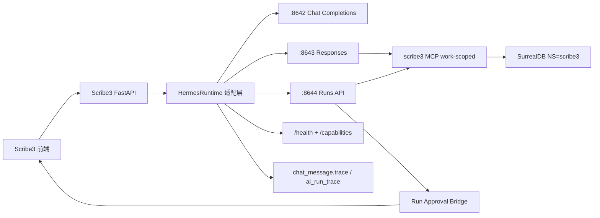

# scribe3 Hermes Agent v0.18 使用审查与最优改造方案

> 性质:审查 + 改造设计 + 当前落地状态文档。
> 依据:本地已抓取 Hermes 官方文档、当前 `scribe3` 源码、Hermes 运行时只读探测。
> 结论先行:当前方向没有错,但原先“Responses 请求体传 `tools=[{server_label}]` 即完成读写隔离”的判断不完整。Hermes v0.18 的 `/v1/runs` 和当前 `/v1/responses` agent 路径实际由 gateway profile 的 `platform_toolsets.api_server` 决定模型工具面。因此最优方案不是在一个 profile 内靠提示词约束,而是拆成读 gateway 与写 gateway:读入口只加载 `scribe3_read`,写入口加载 `scribe3_read + scribe3_write`,并保留 Hermes Approval。

## 当前实施状态(2026-07-10)

已落地:

- P0/P1 地基:
  - 新增 `scribe3/hermes_runtime.py`,集中处理 Hermes auth、health/capabilities probe、Responses、Runs、approval、stop、SSE 事件归一。
  - `/ai/runtime-status` 已接入 Hermes default/read/write 三网关探测,并返回 `summary`、`profile_configs`、cron ops 摘要与降级 `issues`。
  - `summary` 会明确显示默认补全、只读 Responses、写入 Runs/Approval 是否可用,以及 read/write API server 实际启用的 MCP toolset 与工具数量。
  - profile config 摘要只暴露非敏感工具面信息,不返回 `model.api_key`、`.env`、provider key 等 secret。
  - `_api_key(profile="scribe3")` 已支持 env > profile `.env` > default `.env`。
  - Responses 请求已支持 `conversation`、`store:true`、`X-Hermes-Session-Key`。
  - `chat_message.trace` 已保存 response id、tool calls、tool outputs、approval、usage。
  - Runs/Approval 已新增 `ai_run_trace` 审计表与 `/ai/runs/{id}/trace` 只读接口,保存 run id、session key、input、tool call id、tool output、approval id、usage、status。
- H-01 多书 MCP:
  - `scribe3/mcp.py` 已改为 per-work `SurrealStore` LRU。
  - `s3_` 工具已支持显式 `work` 参数。
  - `app.py::_work_has_tools()` 不再按 `SCRIBE3_WORK` 禁掉非默认书,防串库改由 `_s3_work_scope_block(work)` 和 MCP work 参数约束。
- H-02 Runs/Approval:
  - 已新增 `/ai/runs`、`/ai/runs/{id}`、`/ai/runs/{id}/events`、`/ai/runs/{id}/approval`、`/ai/runs/{id}/stop`。
  - 前端 `api.aiRun*` 已接入。
  - `ChiefDock`、`WriteChat` 已能展示 Hermes approval card,批准/拒绝后调用后端 approval endpoint。
  - 前端新增 `api.runWrite()` 作为写入型主编任务的统一 Runs 包装:创建 run、订阅事件、停止 run。
  - `api.runWrite()` 创建 run 后立即回传 `run_id`,上层消息可持久化 run 归属。
  - `ChiefDock`、`WriteChat` 对“新增/登记/写入/落库/更新/删除 + 设定/伏笔/母题/素材/角色/命题”等明确改世界状态的自然语言请求,主动分流到 `:8644 scribe3_write /ai/runs`,不再走普通 `/chat/write` Responses 写作流。
  - `ChiefDock`、`WriteChat` 已接入 pending approval 恢复:刷新后从本地消息历史识别未决 approval,调用 `/ai/runs/{id}` 确认状态,再重连 `/ai/runs/{id}/events`,审批后继续接收 resolved/delta/tool output。
  - `/ai/runs` create/status/events/approval/stop 已 best-effort 写入同一条 `ai_run_trace`;审计落库失败不阻断 Hermes 主流程。
- H-09 事件与工具输出:
  - `HermesEventAdapter` 已归一 `text.delta`、`tool.started`、`tool.output`、`approval.requested/resolved`、`run.completed/failed`。
  - 已补齐 Hermes Runs 真实 SSE 形状:`event` 字段版 `tool.started/tool.completed/approval.request/approval.responded` 会被归一,`mcp_scribe3_write_s3_*` 工具名会还原为 `s3_*`。
  - `/ai/runs/{id}/approval` 已按 Hermes v0.18 真实契约把前端 `decision=approve/deny` 翻译为 `choice=once/deny`,并把上游 4xx/5xx 转成可读错误,不再裸 500。
  - `/chat/write`、`/chat/agentic-stream`、Runs events 已把 `tool_output` 转给前端。
  - `ChiefDock`、`WriteChat` 已展示“工具返回”摘要。
  - `ai_run_trace` 会在 Hermes 空 `tool.completed` 输出时,结合 approval 事件和审批消息解析出 `result_status=written/declined` 与 `write_effect.objects`。
- H-07 配置治理:
  - `~/.hermes/profiles/scribe3/config.yaml` 已改为 `memory.write_approval=true`、`skills.write_approval=true`。
  - MCP profile 已拆成 `scribe3_read` / `scribe3_write` 两个 server label:
    - `scribe3_read`:32 个只读工具。
    - `scribe3_write`:24 个写/状态变更工具。
  - `scribe3` profile 的 `platform_toolsets.api_server=["scribe3_read"]`,API server 模型面只有 32 个只读 MCP 工具。
  - 新增 `scribe3_write` profile,端口 `8644`,`platform_toolsets.api_server=["scribe3_read","scribe3_write"]`,API server 模型面为 32 个读工具 + 24 个写工具,无 terminal/file/web/memory 等默认 Hermes 原生工具。
  - 用 Ruby YAML 解析确认配置有效;用 Hermes 运行时 `discover_mcp_tools()` 确认注册面为 `read=32`、`write=24`。
  - 注意:`hermes -p scribe3 mcp test <server>` 显示的是 MCP server 原生发现面,会列出 56 个工具;真实模型注册过滤发生在 `tools.mcp_tool._register_server_tools()`。
- H-05 工具面治理:
  - 普通 Responses 路径默认只传 `server_label="scribe3_read"`。
  - `/chat/write`、`/chat/agentic-stream`、`llm.hermes_responses_events()` 已默认走只读 MCP 面。
  - 后端新增 `HERMES_RUNS_API` / `HERMES_RUNS_PROFILE`,默认指向 `http://127.0.0.1:8644/v1` / `scribe3_write`。
  - `/ai/runs` 已从 `:8643 scribe3` 切到 `:8644 scribe3_write`,用于会改状态的长任务与审批流。
  - `/ai/runtime-status` 现在同时探测 default `:8642`、read `:8643`、write `:8644`。
  - 前端工具芯片已兼容 `mcp_scribe3_read_s3_*` / `mcp_scribe3_write_s3_*` 显示名。

2026-07-10 第二批(H-06/H-08/H-10/H-11)已落地:

- H-06 稳定层治理(按官方文档证据**修订原方案**):
  - 文档事实(prompt-assembly / skills / context-compression-and-caching):
    ① skills 是渐进披露——正文不进系统提示,只有 name+description 索引进 stable 层,
      强制纪律放 skill 必失守(与仓内 Q5 裁决一致);
    ② Hermes prompt caching 仅对 Claude 模型 + Anthropic/OpenRouter provider 自动启用,
      scribe3 走 doubao(ARK)——把静态纪律搬进稳定层**没有缓存收益**;
    ③ API server 的 `instructions` 是叠加层,SOUL.md(per-profile HERMES_HOME)是
      stable 层身份槽,每请求注入。
  - 据此落地:`~/.hermes/profiles/scribe3/SOUL.md`、`~/.hermes/profiles/scribe3_write/SOUL.md`
    从默认 Hermes 人格(约 500B 的"You are Hermes Agent, created by Nous Research",
    与 instructions 里"资深主编"身份冲突)换成 scribe3 主编身份 + 恒定纪律
    (事实唯一源=SurrealDB、s3_ 必带 work、写入必待批、memory 不存剧情)。
    真机验证:写盘后 `:8643 /v1/responses` 新会话自述即为主编身份,无需重启网关。
  - **刻意不迁移**:章/相位级纪律块(`_final_reminder`/`_revelation_discipline_block` 等)
    留在每请求 instructions——无缓存收益、要保 recency 强化、且随 phase/focalizer 条件化。
    原 H-06"静态宪法进 skill/context"的表述按上述文档证据作废。
- H-08 凭证治理:实测确认已完成——三个 config.yaml 的 `model.api_key` 均为
  `${ARK_API_KEY}` 引用,auxiliary.* 全部 VAR_REF,密钥只在 `.env`;
  `_api_key(profile)` 走 env > profile `.env` > default `.env`。无遗留明文。
- H-10 全系统预算:
  - 新增 `scribe3/usage.py`:跨进程共享 SQLite 日帽台账(缺省
    `~/.scribe2-surreal/scribe3_llm_ledger.sqlite3`,env `SCRIBE3_LLM_LEDGER` 可覆盖);
    app 与 MCP stdio 进程同记一本账,SQLite 故障 fail-open 回退进程内计数。
    `llm.py` 的 `_tick_daily/daily_remaining/_reset_daily_counter` 全部改走台账。
  - 新增 `store.usage_summary(days)`:聚合 `chat_message.trace.usage` +
    `ai_run_trace.usage`(Responses/Runs 分列,按天)。
  - 新增 `GET /ai/usage`:日帽(cap/used/remaining/scope)+ token 真实用量;fail-soft。
  - 前端:`api.aiUsage()` + ChiefDock 头部预算 chip(`chief-usage-chip`,5 分钟轮询)。
  - 测试:`scribe3/tests/test_usage_budget.py` 10 项(共享/回退/接线/聚合/端点),
    `conftest.py` autouse 夹具把台账隔离到 tmp 防测试灌生产账。
  - 实测参照::8643 一次极简 Responses 请求 input_tokens≈6473(稳定层+工具 schema
    基线开销),预算解读时须知底数。
- H-11 canary 常态化:新增 `scribe3/scripts/hermes_smoke.sh`(只读三网关体检 +
  `--live` 一笔端到端;真机 11/11 PASS),演练固定顺序写入 `HERMES_UPGRADE_EVAL.md`。

暂不直接落地:

- (无——原"阶段二/三"項中 H-06/H-10/H-11 已按上批注落地或修订,prompt 稳定层
  迁移按文档证据裁定不迁。)

---

## 0. 证据基线

### 0.1 官方文档抓取

- 抓取目录:`docs/external/hermes-agent-docs/`
- 抓取摘要:`docs/external/hermes-agent-docs/_summary.json`
- 抓取时间:`2026-07-09T15:47:42.185037+00:00`
- 成功页数:`360 / 360`
- 本次重点对照:
  - `developer-guide/programmatic-integration.md`
  - `user-guide/features/api-server.md`
  - `user-guide/features/mcp.md`
  - `guides/use-mcp-with-hermes.md`
  - `user-guide/features/skills.md`
  - `user-guide/features/memory.md`
  - `user-guide/features/delegation.md`
  - `user-guide/features/cron.md`
  - `user-guide/features/context-files.md`
  - `developer-guide/prompt-assembly.md`
  - `developer-guide/session-storage.md`
  - `developer-guide/tools-runtime.md`

### 0.2 当前 Hermes 运行时

二进制实测:

```text
Hermes Agent v0.18.0 (2026.7.1) · upstream daedf4f6
Project: /Users/miaoma/.hermes/hermes-agent
Python: 3.11.15
OpenAI SDK: 2.24.0
Update available: 837 commits behind — run 'hermes update'
```

网关健康只读探测:

- default `:8642`
  - `/health` = `200`, version `0.18.0`
  - `/health/detailed` = `status: ok`, `api_server.state: connected`
  - `/v1/capabilities` = 支持 `chat_completions`、`responses_api`、`run_submission`、`run_events_sse`、`run_approval_response`、`session_*`、`skills_api`
- scribe3 profile `:8643`
  - `/health` = `200`, version `0.18.0`
  - `/health/detailed` = `status: ok`, `api_server.state: connected`
  - `/v1/capabilities` = 同样支持 Runs / Approval / Sessions / Skills
- scribe3_write profile `:8644`
  - `/health` = `200`, version `0.18.0`
  - `/health/detailed` = `status: ok`, `api_server.state: connected`
  - `/v1/capabilities` = 同样支持 Runs / Approval / Sessions / Skills

旧文档中的三项历史风险需要更新:

- `:8642 disconnected` 已不再成立。
- `scribe-novel-v2` skill 已在 `hermes -p scribe3 skills list` 中显示 enabled。
- `scribe3-体检` cron 当前 active,最近一次 `last_status: ok`。

### 0.3 当前 scribe3 使用点

核心代码证据:

- `scribe3/llm.py:59-61`
  - `HERMES_API=http://127.0.0.1:8642/v1`
  - `HERMES_RESPONSES_API=http://127.0.0.1:8643/v1`
  - `HERMES_RUNS_API=http://127.0.0.1:8644/v1`
  - `HERMES_RESPONSES_PROFILE=scribe3`
  - `HERMES_RUNS_PROFILE=scribe3_write`
- `scribe3/llm.py:64-74`
  - `_api_key(profile)` 走 `HermesAuth().api_key(profile)`:优先读进程环境,其次读对应 profile `.env`,最后回退默认 `~/.hermes/.env`。
- `scribe3/llm.py:105-133`
  - `hermes_complete()` 走 `/chat/completions`。
- `scribe3/llm.py:136-163`
  - `hermes_complete_stream()` 走 `/chat/completions` SSE。
- `scribe3/llm.py:166-200`
  - `hermes_responses_events()` 走 `:8643 /responses`,请求体包含 `input`、`instructions`、`stream`、`store:true`、可选 `tools=[{type:mcp, server_label:scribe3_read}]`。
- `scribe3/app.py:_hermes_runs_runtime()`
  - `/ai/runs` 走 `HERMES_RUNS_API` + `HERMES_RUNS_PROFILE`,默认 `:8644` + `scribe3_write`。
- `scribe3/app.py:198-205`
  - `_work_has_tools()` 当前恒为 true;多书防串库不再靠禁用非默认书工具,而靠 `_s3_work_scope_block(work)` + 所有 s3_ 工具显式 `work` 参数。
- `scribe3/app.py:1795-1829`
  - `/chat/agentic-stream` 代理 Responses 事件,只转 `response.output_text.delta` 与 `response.output_item.added(function_call)`。
- `scribe3/app.py:1946-2023`
  - `_stream_write()` 解析主编输出的 `⟦PROPOSAL⟧` 围栏,同样只处理文本 delta 与工具开始事件。
- `scribe3/app.py:2625-2663`
  - POST `/chat/write` 支持 inline image data URL,通过 Responses 输入。
- `scribe3/mcp.py:28-38`
  - `WRITE_GATED` 标出写工具。
- `scribe3/mcp.py:57-63`
  - `_ask()` 通过 `ctx.elicit()` 审批;异常/超时 fail-closed。
- `scribe3/mcp.py:817-837`
  - MCP 工具层已改为 per-work `SurrealStore` LRU,每次工具调用通过显式 `work` 参数选择作品。

运行时配置证据:

- `~/.hermes/profiles/scribe3/config.yaml`
  - `mcp_servers.scribe3_read.command=/Users/miaoma/Downloads/写作 3.0/scribe3/run_mcp.sh`
  - `mcp_servers.scribe3_write.command=/Users/miaoma/Downloads/写作 3.0/scribe3/run_mcp.sh`
  - `mcp_servers.scribe3_read.tools.include` 共 32 个只读工具。
  - `mcp_servers.scribe3_write.tools.include` 共 24 个写/状态变更工具。
  - `platform_toolsets.api_server=["scribe3_read"]`
  - `skills.external_dirs=["/Users/miaoma/Downloads/写作 3.0/scribe3/hermes_skills"]`
  - `memory.memory_enabled=true`
  - `memory.write_approval=true`
  - `skills.write_approval=true`
- `~/.hermes/profiles/scribe3_write/config.yaml`
  - 复用同一 `scribe3_read` / `scribe3_write` MCP server 配置。
  - `platform_toolsets.api_server=["scribe3_read","scribe3_write"]`
  - profile `.env` 端口为 `API_SERVER_PORT=8644`。
- `hermes -p scribe3 mcp test scribe3_read` / `scribe3_write`
  - 连接成功,各自原生发现 `56` 个 `s3_` 工具。
  - 该命令不代表模型注册面,因为它调用 `_probe_single_server()` 直接列 server._tools。
- Hermes 运行时注册实测:
  - `discover_mcp_tools()` 注册 `total=56 read=32 write=24`。
  - `mcp_scribe3_read_s3_save_chapter` 不存在。
  - `mcp_scribe3_write_s3_get_chapter` 不存在。
- Hermes platform toolset 实测:
  - `scribe3` + `api_server`:模型工具定义 `tool_defs=32 read=32 write=0 native=0`。
  - `scribe3_write` + `api_server`:模型工具定义 `tool_defs=56 read=32 write=24 native=0`。
- `hermes -p scribe3 cron list`
  - `scribe3-体检` active,no-agent script,最近运行 `ok`。

### 0.4 Hermes API server 源码结论

本次补查了 `/Users/miaoma/.hermes/hermes-agent/gateway/platforms/api_server.py` 与官方 API Server 文档:

- 官方文档写明 Runs 只接受 `input` 与可选 `session_id`、`instructions`、`conversation_history`、`previous_response_id`。
- `_handle_runs()` 源码确实只读取这些字段和 `model`;没有读取 `tools`、`toolsets`、`enabled_toolsets`。
- `_create_agent()` 通过 `hermes_cli.tools_config._get_platform_tools(user_config,"api_server")` 决定 agent 的 `enabled_toolsets`。
- `_handle_responses()` 会把 `tools` 放进幂等指纹,但当前 agent 路径同样经 `_run_agent()` -> `_create_agent()`,没有用请求体 `tools` 裁剪 `enabled_toolsets`。

结论:

- `tools=[{type:"mcp",server_label:"scribe3_read"}]` 对 scribe3 仍有协议表达和前端显示价值,但不能作为安全边界。
- 真正的读写隔离必须落在 profile 级 `platform_toolsets.api_server`。
- 若未来 Hermes upstream 支持 per-request toolsets,可以再把 `HERMES_RUNS_API` 合回同一 gateway;在 v0.18.0 当前源码下,双 profile 是最稳妥方案。

---

## 1. 总体判断

### 1.1 当前没有“根方向错误”

scribe3 没有绕过 Hermes 直连模型。普通补全、流式速答、agentic 写作都经 Hermes 网关。主编联查真实数据也确实通过 `scribe3` profile MCP,且自定义 skill 已加载。核心方向是对的:

- Hermes = LLM 网关 + agentic runtime。
- SurrealDB = 小说事实唯一真相源。
- scribe3 MCP = 主编访问故事本体的工具层。
- 前端/后端 = 产品工作台与领域规则。

这条边界不应推翻。

### 1.2 当前问题是“集成层太薄”

现在的 `scribe3/llm.py` 只是三个函数:

- `chat/completions`
- `chat/completions stream`
- `responses stream`

它没有把 Hermes v0.18 已经提供的这些能力纳入产品架构:

- `/v1/capabilities` 运行时能力发现。
- `/health/detailed` 网关状态和 active agent 状态。
- `/v1/runs` 长任务创建、状态、事件重连、停止。
- `/v1/runs/{id}/approval` 审批闭环。
- `/api/sessions/*` 会话、fork、history。
- `X-Hermes-Session-Id` / `X-Hermes-Session-Key` 长期记忆与会话作用域。
- `/v1/skills` / `/v1/toolsets` 确定性能力发现。

结果是:Hermes 运行时已经具备更完整的平台表面,scrib3 仍靠自建 SSE 解析、文本围栏、进程内日帽、局部对话落库来补。

---

## 2. 问题清单

### H-01 P0: MCP 单书绑定导致非当前书失去 agentic 能力

原问题:

- MCP 进程在 `setup_store()` 启动时固定绑定 `SCRIBE3_WORK`。
- 后端通过 `_work_has_tools()` 防串书:不是当前 `SCRIBE3_WORK` 的 work 一律不挂工具。
- 这是安全止血,但产品能力上等于“只有一部书能用完整主编联查”。

影响:

- 多书切换后,非 `SCRIBE3_WORK` 的书只剩纯对话,没有设定/伏笔/素材/章节真实联查。
- 这会让用户以为主编“忘了书”,实际是工具被主动关闭。
- 如果未来误删 `_work_has_tools()` 守卫,则变成更严重的串库读写。

已采用的最优修法:

1. MCP 工具层改为 per-work store LRU,所有工具显式带 `work` 参数或通过统一 `ScribeMcpContext` 注入 work。
2. App 层调用 Hermes 时把当前 `work` 写进 instructions,并要求工具调用必须带该 work。
3. 写工具服务端仍二次校验 work 与当前会话绑定,不信任模型参数。
4. `_work_has_tools()` 当前不再按 `SCRIBE3_WORK` 禁掉非默认作品;所有作品都能挂工具,防串库转移到 work-scoped prompt 与工具参数校验。

不推荐:

- 每本书建一个 Hermes profile。profile 数会爆炸,端口、cron、skills、配置同步都会失控。

### H-02 P0: 写工具审批没有完整接入 scribe 前端

现状:

- 写工具在 MCP 内用 `ctx.elicit()`。
- API 代理层只看到 `function_call` added,不处理审批 request / approval id / pending state。
- `_ask()` 异常或超时 fail-closed,所以很多 agentic 写工具在浏览器工作流中实际不能落库。

这不是“安全错”,而是“交互闭环不完整”。

Hermes v0.18 文档给出的新机会:

- `/v1/capabilities` 已声明 `run_approval_response=true`。
- Runs API 提供:
  - `POST /v1/runs`
  - `GET /v1/runs/{id}`
  - `GET /v1/runs/{id}/events`
  - `POST /v1/runs/{id}/approval`
  - `POST /v1/runs/{id}/stop`

最优修法:

- 需要落世界状态的 agentic 任务改走 Runs API,前端订阅 run events。
- 出现 approval event 时,在 scribe 右栏或收件箱渲染审批卡。
- 用户批准后,后端调用 `/v1/runs/{id}/approval`。
- pending approval 必须可恢复:approval 卡随对话历史持久化,刷新后用 run id 查状态并重连 events,不能只依赖当前页面内存态。
- Runs 不可用时,回退到 scribe 自管 `pending_writes` 队列,写工具先入队,作者批准后由 scribe 后端执行。

### H-03 P0: Responses 没有使用会话连续能力

现状:

- `hermes_responses_events()` 没传 `previous_response_id`。
- 没传 `conversation`。
- 没设置 `X-Hermes-Session-Id` / `X-Hermes-Session-Key`。
- App 只把 user/assistant 文本写进 `chat_message`,没有保存 Hermes response id、tool call、function output、usage。

影响:

- Hermes 的 session DB、FTS5、跨会话搜索、fork、resume、usage 统计无法成为 scribe 的可靠审计面。
- 主编每轮主要靠 `_editor_system()` 重新拼上下文,没有充分利用 Hermes 的 stateful Responses。
- 工具调用证据只被 UI 临时展示,没有完整回放链。

最优修法:

- 为每个 book/chapter/phase 生成稳定 conversation key:
  - `scribe3:{work}:chapter:{seq}:phase:{phase}`
  - 书级讨论用 `scribe3:{work}:global`
- Responses 请求增加:
  - `conversation`
  - `store:true`
  - `X-Hermes-Session-Key: scribe3:{work}`
- 保存返回的 response id / run id 到 `chat_message` 或独立 `ai_trace` 表。
- 前端历史回放时能展示“本轮调了哪些工具、工具返回了什么、生成为何成立”。

### H-04 P1: 没有启动期 Hermes 能力探测与降级说明

现状:

- 后端直接假设 `:8642`、`:8643` 可用。
- 功能失败时常表现为流式 error 或请求异常。
- 没有用 `/v1/capabilities` 判定 Runs、Approval、Sessions 是否可用。

影响:

- 网关没启动、profile 端口错、API key 错、MCP 未加载时,用户只看到“生成失败”,不知道是模型、网关、工具还是审批断了。
- 新旧 Hermes 版本能力差异无法优雅处理。

最优修法:

- 新建 `HermesRuntime.probe()`:
  - 检查 `:8642 /health/detailed`
  - 检查 `:8643 /health/detailed`
  - 检查 `:8643 /v1/capabilities`
  - 检查 `:8643 /v1/skills` 是否含 `scribe-novel-v2`
  - 检查 `scribe3_read` / `scribe3_write` 的 MCP 连接与运行时注册工具数。
- 后端暴露 `/ai/runtime-status`。
- 前端主编区显示明确降级:
  - “Hermes 未连接”
  - “MCP 未加载,仅纯对话”
  - “Runs Approval 不可用,写操作进入 scribe 待批队列”

### H-05 P1: MCP 工具面过宽,没有按场景过滤

历史现状:

- `mcp_servers.scribe3` 暴露 56 个工具。
- 没有 `tools.include` 或 `tools.exclude`。
- 读、写、QC、素材、设定、声音、回写全部在同一工具面。

当前状态:

- profile 已拆 `scribe3_read` / `scribe3_write`。
- read 面注册 32 个只读工具,write 面注册 24 个写/状态变更工具。
- `scribe3` API server profile 只启用 `scribe3_read`,普通 Responses 即使请求体 `tools` 被 Hermes 忽略,模型实际也只能看到只读 MCP。
- `scribe3_write` API server profile 启用 `scribe3_read + scribe3_write`,Runs 写入口实际拥有读前核实 + 待批写入能力。
- 前端已兼容新工具名前缀显示。
- 剩余缺口:产品 UI 入口仍需进一步分流,把“查询/讨论”留在 Responses,把“会改状态”统一引到 Runs approval 工作流。

影响:

- 若某条路径未显式选择工具面,仍可能退回默认全工具或错误工具面。
- 写工具虽然有审批,但不应出现在普通写作/讨论的工具候选集合。
- Runs 写入口需要让用户明确进入“会改状态”的审批工作流。

最优修法:

- 配置层已拆两类:
  - read gateway `:8643`:`scribe3_read`,用于只读联查、素材、章节、QC 预览。
  - write gateway `:8644`:`scribe3_read + scribe3_write`,用于需要读前核实再写入的 Runs/审批工作流。
- App 按任务选择 tool surface:
  - 简报/讨论:read only。
  - 写正文 proposal:read + QC,不暴露设定写。
  - “请新增角色/记录伏笔”:write + approval。

### H-06 P1: prompt 拼装没有利用 Hermes 的稳定层/动态层边界

现状:

- 大量稳定写作纪律、风格纪律、流程纪律都在 `_editor_system()` / `_assemble_write_instructions()` 每次拼。
- `scribe-novel-v2` skill 也存在,但 App 仍把许多静态纪律重复塞进 instructions。

Hermes 文档指出:

- SOUL / skills / context 属系统提示稳定层。
- API `instructions` 是调用时叠加层。
- 稳定内容与动态内容应分离,以保留缓存与减少漂移。

最优修法:

- 静态内容:
  - 主编身份
  - 写一章流程
  - craft 原则
  - proposal 围栏协议
  - 禁止事项
  放到 `scribe-novel-v2` 或 profile context。
- 动态内容:
  - 当前 work、chapter、phase
  - 章前简报
  - 设定/素材召回
  - 当前选区/图片
  继续由 app 生成 instructions。
- 保留 app 侧最终提醒,但缩短为“协议校验 + 当前任务约束”,避免每次塞超长宪法。

### H-07 P1: Hermes memory / skill 自学习策略不适合直接写入生产事实

历史现状:

- `memory.memory_enabled=true`
- memory 写入审批曾关闭。
- skill 写入审批曾关闭。
- `scribe-novel-v2` 鼓励 `skill_manage(action="patch")`

当前状态:

- `memory.memory_enabled=true`
- `memory.write_approval=true`
- `skills.write_approval=true`
- 剩余治理点是明确 memory/skill 可写内容边界,避免剧情事实进入 Hermes memory。

风险:

- 小说事实若被写入 Hermes memory,会形成 SurrealDB 之外的第二真相源。
- skill 自动 patch 若无审批,可能把一次坏经验固化进主编流程。
- 当前事实唯一性原则要求“剧情事实进 SurrealDB,流程偏好进 skill/memory”。

最优策略:

- scribe3 profile:
  - `memory.write_approval=true`
  - `skills.write_approval=true`
- memory 只允许:
  - 用户偏好
  - 环境事实
  - 稳定工作流偏好
  - 不含剧情事实的写作习惯
- 禁止 memory 保存:
  - 角色秘密
  - 世界设定
  - 章节事件
  - 伏笔真相
  - 素材正文
- skill patch 必须走 review,并写入仓库内 `scribe3/hermes_skills` 后由 git 审查。

### H-08 P1: 凭证位置与 profile key 读取存在隐患

现状:

- `~/.hermes/config.yaml` 与 `profiles/scribe3/config.yaml` 的 `model.api_key` 有值。
- 文档建议 secrets 进 `.env`,非 secret 进 `config.yaml`。
- `_api_key()` 只读取默认 `~/.hermes/.env`,不读取 profile `.env`。当前 default 与 scribe3 key 一致,所以没爆。

风险:

- 未来 profile API key 分离后,scripbe3 后端仍会用 default key 调 `:8643`。
- provider key 留在 config,不符合 Hermes 文档的 secret 分层建议。

最优修法:

- provider key 改成 `${ARK_API_KEY}` 或通过 `hermes config set ARK_API_KEY ...` 落 `.env`。
- `_api_key(profile="scribe3")` 支持读取:
  1. 进程环境 `API_SERVER_KEY`
  2. `~/.hermes/profiles/scribe3/.env`
  3. `~/.hermes/.env`
- 增加启动自检:default 与 scribe3 key 不一致时仍能分别通过。

### H-09 P2: SSE 事件适配过窄

现状:

- 只处理 `response.output_text.delta` 和 `response.output_item.added(function_call)`。
- 忽略 `function_call_output`、`response.completed`、错误事件、usage、approval、run lifecycle。
- `function_call` 只把工具名推给前端,没有 call id、arguments、output、status。

影响:

- UI 只能显示“调用了某工具”,不能解释“工具查到了什么”。
- 失败/审批/停止/完成状态没有统一语义。
- 无法做工具链审计。

最优修法:

- 新建 `HermesEventAdapter`:
  - 输入 Hermes SSE 原始事件。
  - 输出 scribe 标准事件:
    - `text.delta`
    - `tool.started`
    - `tool.output`
    - `approval.requested`
    - `approval.resolved`
    - `proposal.delta`
    - `run.completed`
    - `run.failed`
    - `usage`
  - 所有未知事件进入 debug trace,不静默丢弃。

### H-10 P2: LLM 日帽是进程级,不等于系统预算

现状:

- `_daily` 在 `scribe3/llm.py` 进程内计数。
- app 进程、MCP stdio 进程各自有计数器。
- Hermes agentic 内多轮工具调用/重试/token 消耗不透明。

影响:

- UI 显示“剩余调用”不是全系统真实预算。
- 成本控制不能覆盖 Hermes 子代理、MCP 侧 LLM 工具、cron 等路径。

最优修法:

- 短期:把调用计数写进 SurrealDB 或 SQLite,按 work/profile 共享。
- 中期:接入 Hermes session usage / run usage,记录 token、model、provider、estimated_cost。
- UI 区分:
  - scribe 请求次数预算
  - Hermes 实际 token/cost 统计

### H-11 P2: 升级策略已有,但需常态化

现状:

- 已升级到 v0.18.0。
- `hermes --version` 显示仍落后上游 837 commits。
- `scribe3/HERMES_UPGRADE_EVAL.md` 已记录“不盲升 + HERMES_HOME 隔离演练”的正确策略。

最优修法:

- 保留不盲升原则。
- 建 `hermes-canary` profile / `HERMES_HOME` 隔离环境。
- 每次升级跑:
  - `/health`
  - `/v1/capabilities`
  - `/v1/responses` 文本
  - MCP 工具发现
  - read tool call
  - write approval fail-closed
  - Runs approval
  - scribe3 `/chat/write` e2e

---

## 3. 三种改造路线

### 方案 A: 最小补丁

内容:

- 加 `/health/detailed` 探测。
- 修 `_api_key()` profile 读取。
- 记录 response id。
- 把 `tools.include` 收窄。

优点:

- 风险低,改动少。

缺点:

- 多书 MCP、审批闭环、Runs、session 仍未解决。
- 只能减少故障,不能把 Hermes v0.18 平台能力真正接进产品。

适用:

- 临时止血。

### 方案 B: Responses 适配增强

内容:

- 保持 `/v1/responses` 主路径。
- 加 `conversation`、`store:true`、`X-Hermes-Session-Key`。
- 完整适配 Responses SSE。
- 增加 health/capabilities/status。

优点:

- 对当前代码最贴近。
- 主编讨论与 proposal 生成会明显稳定。

缺点:

- 审批与长任务仍不如 Runs 自然。
- 写工具落库闭环仍要自建 pending 队列或等 elicit 适配。

适用:

- 先提升普通主编体验。

### 方案 C: HermesRuntime 分层接入(推荐)

内容:

- 新建统一 `HermesRuntime` 适配层。
- Responses 用于快速对话与 proposal。
- Runs 用于会改状态、长任务、后台体检、审批。
- MCP 改为 work-scoped。
- Tool policy、memory policy、skill policy、trace 全部纳入。

优点:

- 对齐 Hermes v0.18 官方架构。
- 保留 scribe3 的领域边界。
- 能彻底解决“写工具审批不进前端”“非主书无工具”“无运行时可观测”。

缺点:

- 是一次平台层改造,需要分阶段交付。

推荐:

- 采用方案 C,但按 P0/P1/P2 分批落地,避免一次性大爆炸。

---

## 4. 推荐目标架构



### 4.1 HermesRuntime

职责:

- `probe_default_gateway()`
- `probe_scribe3_gateway()`
- `capabilities()`
- `chat_completion()`
- `responses_stream()`
- `create_run()`
- `stream_run_events()`
- `approve_run()`
- `stop_run()`
- `list_skills()`
- `list_toolsets()`

要求:

- 所有 Hermes HTTP 调用集中在一个模块。
- 统一 timeout、retry、auth、error mapping。
- 不让业务端点直接拼 Hermes URL。

### 4.2 HermesEventAdapter

职责:

- 把 Hermes 原始 SSE 转成 scribe 内部事件。
- 保留 call id、tool name、arguments、output、approval id、usage。
- 兼容 Responses 与 Runs 两套事件。
- proposal 围栏解析只处理文本 delta,不吞掉工具/审批事件。

### 4.3 WorkScopedMCP

职责:

- 替代当前单 `_store`。
- 内部按 `work` 缓存 `SurrealStore`。
- 所有工具统一 work 校验。
- 写工具落库前二次确认:
  - work 是否存在
  - 当前 run/session 是否绑定该 work
  - 是否有 approval

### 4.4 ApprovalBridge

职责:

- Runs API 可用时:
  - run event -> scribe approval card
  - user decision -> `/v1/runs/{id}/approval`
- Runs API 不可用时:
  - MCP 写工具入 `pending_writes`
  - scribe 前端审批
  - 后端执行真实 write

### 4.5 PromptAssemblyPolicy

职责:

- 稳定内容进 skill/context。
- 动态内容进 instructions。
- 每次请求记录 prompt block 清单,便于审计“为什么主编知道这些”。

### 4.6 MemorySkillPolicy

职责:

- 防止 Hermes memory 成为第二剧情事实源。
- skill patch 必须可审查、可回滚。
- profile 配置启用 write approval。

### 4.7 Observability

当前落地分两层:

- Responses 写作/讨论:进入 `chat_message.trace`。
- Runs/Approval 写入型任务:进入 `ai_run_trace`。

`ai_run_trace` 字段:

- `work`
- `run_id`
- `session_key`
- `status`
- `input_text`
- `instructions`
- `tool_calls`
- `tool_outputs`
- `approvals`
- `raw_events`
- `usage`
- `error`
- `response`
- `created_at`
- `updated_at`

这样可以回答:

- 主编这次查了哪些设定?
- 哪个工具返回了这个结论?
- 哪次审批让某个事实落库?
- 失败是模型、网关、MCP 还是业务校验?

---

## 5. 分阶段实施计划

### P0: 运行时地基

目标:不改用户交互,先让系统知道 Hermes 当前能做什么、失败在哪里。

交付:

- `HermesRuntime` 模块。
- `/ai/runtime-status`。
- `/v1/capabilities` 缓存与版本记录。
- `_api_key()` 支持 profile env。
- 统一 Hermes error 类型:
  - gateway_down
  - unauthorized
  - capability_missing
  - mcp_unavailable
  - model_error
  - stream_interrupted
- 测试:
  - fake HTTP capability parse
  - auth fallback
  - health degraded mapping
  - 当前 `llm.py` 三条路径不回归

### P1: 会话连续与 trace

目标:让主编对话可回放、可续接、可审计。

交付:

- Responses 请求加入 `conversation` / `store:true` / `X-Hermes-Session-Key`。
- 记录 `response_id`、tool calls、usage。
- `chat_message.trace` 与 `ai_run_trace` 能展示工具链。
- 前端工具时间线显示 arguments/output 摘要。
- 测试:
  - fake SSE 含 function_call/function_call_output/completed。
  - trace 写入。
  - conversation key 随 work/chapter/phase 正确变化。

### P2: 多书 MCP 正式化

目标:每部书都能用完整主编工具,且不会串库。

交付:

- MCP 工具引入 work 参数或统一上下文。
- MCP 内部 per-work `SurrealStore` LRU。
- app 取消“非 SCRIBE3_WORK 不挂工具”的长期限制,改成 work-scoped 工具。
- 写工具校验 work。
- 测试:
  - book A 工具读不到 book B。
  - book A 写操作不会落到 book B。
  - 非 main work agentic 查询真实伏笔/角色/素材。

### P3: Runs + 审批闭环

目标:会改世界状态的 agentic 动作必须能在 scribe 前端审批。

交付:

- `create_run()` / `run_events()` / `approve_run()`。
- 前端 approval card。
- Runs 不可用时 pending_writes fallback。
- 写工具分组:
  - read tools in Responses
  - read + write tools in Runs
- Runs 创建/事件/审批端点已完成;`/ai/runs` 已绑定 `scribe3_write` profile。下一步是把所有会改状态的产品按钮和主编动作统一迁到 Runs 工作流。
- 测试:
  - approval event -> 前端卡片。
  - approve -> Hermes approval endpoint。
  - reject -> 不落库。
  - 断线后根据 run id 恢复状态。

### P4: 工具面、memory、skill 与凭证治理

目标:把平台能力收紧成产品可控能力。

交付:

- MCP `tools.include` 策略。已完成第一阶段:read/write 双 server label。
- `memory.write_approval=true`。已完成。
- `skills.write_approval=true`。已完成。
- provider api_key 迁移到 `.env` / `${ARK_API_KEY}`。
- `scribe-novel-v2` 拆成小工序技能:
  - `scribe-limited-pov-guard`
  - `scribe-foreshadow-tracker`
  - `scribe-material-reference`
  - `scribe-revision-pass`
  - `scribe-ingest-verify`
- 测试:
  - skills REST discovery 包含 scribe 技能。
  - memory 不写剧情事实。
  - skill patch 进入审批。

### P5: 可选增强

目标:只接真正增益创作工作流的 Hermes 能力。

可选项:

- skill-backed cron:异常时生成体检摘要,干净时保持 no-agent 静默。
- Sessions fork:对同一章生成两种改写路线。
- Delegation:多代理审稿/素材研究,只用于后台分析,不直接写世界事实。
- Context files:把稳定主编宪法收进 profile context,减少每次 instructions 体积。

不建议接:

- IM 网关。
- Voice/TTS。
- Dashboard 替代 scribe 前端。
- Hermes memory 保存剧情事实。
- 每书一个 profile。

---

## 6. 验收标准

### 6.1 运行时验收

- `GET /ai/runtime-status` 能显示:
  - default gateway online/offline
  - scribe3 read gateway online/offline
  - scribe3 write gateway online/offline
  - Hermes version
  - capabilities
  - scribe skill loaded
  - MCP tool count
  - cron status
- 关掉 `:8643` 后,前端明确显示“主编联查不可用,纯对话降级”。
- 关掉 `:8644` 后,会改状态的 Runs 入口明确显示“写入工作流不可用”,普通只读主编仍可用。
- API key 错误时显示 unauthorized,不伪装成模型失败。

### 6.2 主编对话验收

- 同一章连续追问可续接 conversation。
- 工具调用有完整时间线:
  - tool name
  - arguments 摘要
  - output 摘要
  - error
- 切换 work 后仍能联查该 work 的角色/伏笔/素材。

### 6.3 写工具审批验收

- 主编提出新增事实/伏笔时,前端出现审批卡。
- 拒绝后 DB 无变化。已真实验收:
  - work=`codex_hermes_e2e_20260710`
  - run=`run_61be0f4ce3924208b90d9c36c73025cc`
  - fact=`fact:codex_hermes_denied_thread_1783630312`
  - 结果:`/facts?chapter=1` 未出现该 fact,trace `tool_outputs[0].result_status=declined`。
- 批准后 trace 记录 approval id / tool call id。(后端覆盖:`test_ai_runs_endpoints_persist_run_trace`)
- 批准后 DB 有变化。已真实验收:
  - work=`codex_hermes_e2e_20260710`
  - run=`run_ebba03a0cf0c40e6a6a65232fb1b6cb3`
  - fact=`fact:codex_hermes_approval_thread_1783630268`
  - 结果:`/facts?chapter=1` 返回该 fact,value=`最终批准路径已落库`,trace `tool_outputs[0].result_status=written`,并含 fact `write_effect`。
- 浏览器刷新后能恢复 pending approval。(前端覆盖:`writeChat-phase.test.jsx`、`chiefDock-ui.test.jsx`)

### 6.4 安全验收

- Hermes memory 不包含剧情事实。
- skill patch 默认 staged,未经审查不落入生产 skill。
- provider key 不在 `config.yaml` 明文保存。
- MCP 默认只暴露当前场景需要的工具。

### 6.5 回归验收

- 后端:
  - `pytest scribe3/tests/test_app.py`
  - `pytest scribe3/tests/test_mcp.py`
  - `pytest scribe3/tests/test_proposal.py`
  - 新增 `test_hermes_runtime.py`
- 前端:
  - 主编对话/工具时间线/审批卡相关测试。
- 真机:
  - 纸命 main work:手稿写作、素材召回、设定联查。
  - 非 main work:主编能联查本书,不能串 main。
  - Runs approval:批准/拒绝各一次。

---

## 7. 最终建议

采用方案 C,按 P0-P4 分阶段执行。

第一批不要动 UI 大结构,先做:

1. `HermesRuntime` + capability/health probe。
2. Responses 增加 conversation/session key/trace。
3. HermesEventAdapter 补齐事件。
4. `_api_key()` profile 化。
5. MCP tool surface 先加最小 include 白名单。已落地为 `scribe3_read` / `scribe3_write` 双面。
6. API server profile 按读/写拆 gateway。已落地为 `:8643 scribe3` 只读、`:8644 scribe3_write` 读写审批。

第二批再做:

1. 所有“会改状态”的产品入口统一迁到 Runs approval,禁止继续用普通 Responses 直接表达写入。
2. prompt 稳定层迁移到 skill/context。
3. provider credential 迁移与全系统预算治理。

这样能在不破坏现有写作路径的前提下,把 scribe3 从“薄代理 Hermes”升级成“以 Hermes v0.18 为运行时底座的小说主编系统”。
