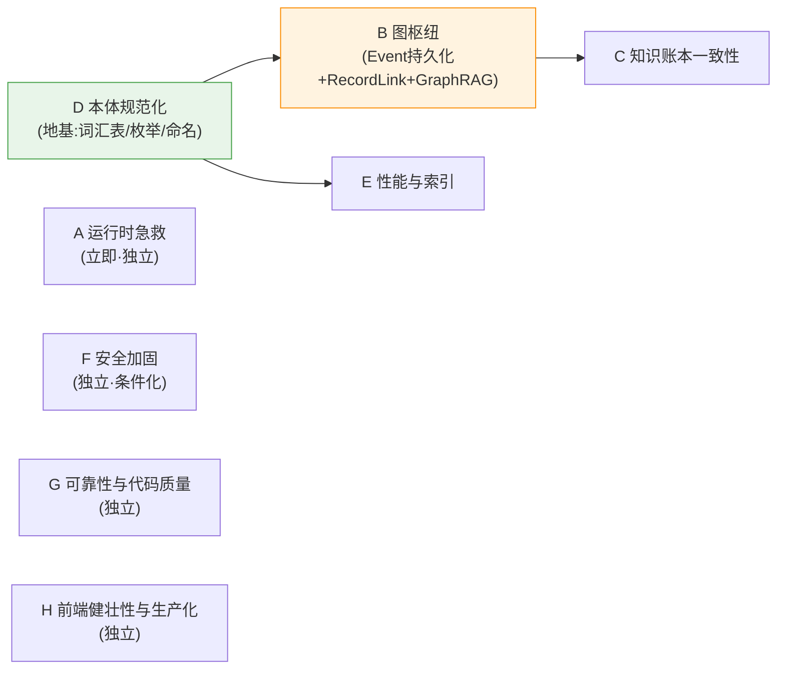

# 00 · 系统改进方案总纲

> 对象:**scribe3**。基于 [docs/系统架构/](../系统架构/) 的 6 篇深度诊断,把全部问题(P01-P49 + R1-R6 + SurrealDB/Hermes/本体改进)聚合成 **8 个改进枢纽**,每枢纽一份详细方案文档(spec 设计 ⊕ TDD 实施计划)。
> 生成日期:2026-06-24。本总纲是方案集的导航 + 排期 + 全覆盖证明。

---

## 1. 概述

### 1.1 目的

6 篇诊断文档已识别全部问题并给出 ROI 与三阶段路线,但问题散在 4 篇文档里、且彼此高度关联(**限知裂口 P03 = 本体关系缺失文档04§3 = SurrealDB Event 蒸发文档06,是同一件事的三个视角**)。本方案集把关联问题**聚合成内聚枢纽**,每枢纽一份可执行方案,避免"按 P 编号逐条修"导致的同一改动被拆到多处。

### 1.2 方案集构成(9 份文档)

```
docs/改进方案/
├── 00-系统改进方案总纲.md          ← 本文档(导航/映射/排期)
├── A-运行时急救.md                 R1-R6(Hermes 健康)
├── B-图枢纽.md                     总枢纽:Event持久化+RecordLink+Graph RAG
├── C-知识账本一致性.md             ingest幂等+幻觉校验+投影正确
├── D-本体规范化.md                 词汇表+枚举约束+命名一致(地基)
├── E-性能与索引.md                 索引+预聚合+章节级RAG
├── F-安全加固.md                   认证+门控统一+凭证+权限(条件化)
├── G-可靠性与代码质量.md           LLM重试+降级+去吞错+DRY+死代码+事务
└── H-前端健壮性与生产化.md         ErrorBoundary+配置外置+测试+Docker+CI
```

### 1.3 每份枢纽方案的统一模板

1. **概述** — 聚合哪些问题编号 + 一句话目标
2. **背景与动机** — 引诊断,讲清"为何这些是一件事"
3. **详细设计** — schema/SurrealQL/Pydantic/代码示例(可直接照做)
4. **TDD 实施计划** — bite-sized 任务序列(写测试→实现→验收→commit)
5. **验收标准** — 可度量的完成定义
6. **风险与依赖** — 前置枢纽 + 回归风险
7. **闭环问题清单** — 本枢纽覆盖了哪些 P/R(对账)

---

## 2. 八大改进枢纽概览

| 枢纽 | 目标 | 聚合问题数 | 阶段 | 依赖 |
|---|---|---|---|---|
| **A 运行时急救** | 修 cron/skill/网关/凭证,让"已配"真正在跑 | 6(R1-R6) | 立即 | 无 |
| **B 图枢纽**(总枢纽) | Event 持久化 + 引用 RecordLink 化 + Graph RAG,一并修限知裂口/本体关系/上下文精准 | 2 P + 本体/DB 多项 | 短期 | D |
| **C 知识账本一致性** | ingest 幂等 + 幻觉角色校验 + 去吞错 + 投影正确 | 6 | 短期 | B(部分) |
| **D 本体规范化** | 统一词汇表 + 枚举约束(Enum/ASSERT)+ 命名一致 + taxonomy | 1 P + 本体多项 | 立即-短期 | 无(地基) |
| **E 性能与索引** | 补索引 + 预聚合 + DEFINE EVENT + 章节级 RAG | 2 P + DB 多项 | 立即-中期 | D |
| **F 安全加固** | 认证 + 写门控统一 + 凭证外置 + DB 权限(条件化:本地 vs 暴露) | 9 P + 权限 | 中期 | 无 |
| **G 可靠性与代码质量** | LLM 重试 + 降级 + 去静默吞错 + 拆函数 + DRY + 删死代码 + 事务 | 16 | 短期-中期 | 无 |
| **H 前端健壮性与生产化** | ErrorBoundary + 配置外置 + 测试 + Docker + CI | 13 | 中期 | 无 |

---

## 3. 全问题 → 枢纽映射(无遗漏对账)

> 证明 49 个 P + 6 个 R 全部有归属。同一问题若跨枢纽,标注主归属 + (关联)。

| 枢纽 | 覆盖的问题编号 |
|---|---|
| **A** | R1(cron 路径)、R2(skill 未加载)、R3(agentic 写不进澄清)、R4(:8642 disconnected)、R5(明文 key)、R6(版本落后) |
| **B** | P03(Event 蒸发/限知裂口)、P38(引用完整性)+ 文档06 关系建模(proposition.entity/reader_knows/voice/focalizer 升 RecordLink)、Event 图边(involves/causes/causal)、Graph RAG(s3_graph_recall)、文档04§3(角色关系图 character_relation) |
| **C** | P04(knowledge @property N+1)、P07(ingest 幂等+双触发)、P13(find_leaks 吞错)、P18(幻觉角色)、P33(事件块限知门控)、P44(learned/did 属性名) |
| **D** | P32(SCHEMALESS 收紧)+ 文档04(统一词汇表/枚举 Enum+ASSERT/命名一致/taxonomy/死值清理 learned·cover_action·done) |
| **E** | P05(零索引)、P29(/quality N 章重活)+ 文档06(DEFINE EVENT 级联/Hybrid Search RRF/chapter.prose 向量化) |
| **F** | P01(无认证)、P02(写门控 REST 绕过)、P08(root 凭证)、P14(secret 直出)、P22(CORS)、P24(f-string 表名)、P26(图片校验)、P28(限流成本熔断)、P45(prompt 注入)+ 文档06 §2.5(DEFINE ACCESS/PERMISSIONS) |
| **G** | P06(连接事务)、P15(流式 LLM 重试)、P16(soak 降级)、P17(静默吞错)、P19(build_render_prompt 巨函数)、P20(chat/write DRY)、P21(双实现漂移)、P23(works 绕过单写点)、P27(SSE 连接累积)、P31(连接释放)、P34(QC 误报)、P39(PALETTE 死代码)、P40(ChatView 死代码)、P41(冗余依赖)、P42(魔法值)、P43(升华正则 DRY) |
| **H** | P09(ErrorBoundary)、P10(BASE 硬编码)、P11(前端零测试)、P12(无 Docker/CI)、P25(输入校验)、P30(MCP db=main 硬编码)、P35(.env.example)、P36(部署说明)、P37(llm 无测试)、P46(alert 阻塞)、P47(a11y)、P48(requirements)、P49(迁移版本表) |

**对账**:P01-P49 共 49 项 + R1-R6 共 6 项 = 55 项,全部映射到 A-H,无遗漏、无重复主归属。

---

## 4. 依赖关系与实施顺序

### 4.1 枢纽依赖图



**关键路径**:`D(本体地基)→ B(图枢纽)→ C(账本)`。D 的统一命名/枚举是 B 升 RecordLink 的前提(否则在混乱命名上建图边是返工);B 的 Event 持久化是 C 修复"看见即知道"的前提。A/E/F/G/H 大体独立,可与关键路径并行。

### 4.2 三阶段排期(对齐诊断路线图)

| 阶段 | 时间 | 枢纽(及其中可立即做的子集) | 验收 |
|---|---|---|---|
| **第一阶段** 立即 | 本周(1-3 天) | **A 全部**(运行时急救)+ **D 子集**(枚举 ASSERT/Enum)+ **E 子集**(DEFINE INDEX)+ **G 子集**(删死代码 P39/40、去静默吞错加日志 P17) | cron 转绿;脏枚举被拒;索引生效;失败可见 |
| **第二阶段** 短期 | 本月(2-4 周) | **D 完整**(词汇表/命名重构)→ **B**(图枢纽:Event 持久化+RecordLink+图边)→ **C**(账本:ingest 幂等+幻觉校验)+ **G 子集**(LLM 重试 P15、soak 降级 P16、DRY P19/P20) | 真库 see_event 生效;ingest 不漂移;主编上下文用图 |
| **第三阶段** 中期 | 本季度(1-3 月) | **E 完整**(Graph RAG/Hybrid/prose 向量化)+ **F**(安全:认证/权限,条件化)+ **G 完整**(事务/连接治理)+ **H**(前端健壮性/Docker/CI) | DB 层身份隔离;生产可部署;前端不白屏 |

> 条件化提示:**F 安全加固**的优先级取决于部署意图——永久本地单用户则降级(绑 127.0.0.1 已是边界),计划暴露/多用户则升为第一阶段最高优先级。

---

## 5. 产出与执行方式

- **产出**:8 份枢纽方案由 subagent 并行起草(每个拿该枢纽的问题清单 + 诊断引用 + 本模板),控制器(主)逐份审校保证引用准确、与诊断一致、依赖顺序无环。
- **执行**:每份方案的"TDD 实施计划"章可直接喂给 superpowers:subagent-driven-development 或 executing-plans 落地。建议执行顺序按 §4.2 三阶段。
- **不变量**:所有方案遵守 scribe3 既有红线——`_execute_write` 单一落库点、限知 load-bearing 测试(`test_*_does_not_break_pov`)、命名/枚举改动需配迁移、commit 精确(当前 main 分支,工作区有会话前无关改动,绝不 `-A`)。

---

## 6. 阅读导航

| 你想… | 看 |
|---|---|
| 知道整体排期与依赖 | 本总纲 §4 |
| 立即修能跑起来的东西 | A(运行时急救) |
| 理解"为什么图是总枢纽" | B + 诊断 [03 P03](../系统架构/03-问题诊断与整改方案.md) / [04§3](../系统架构/04-本体论实现分析与改进方案.md) / [06](../系统架构/06-SurrealDB使用深度诊断.md) |
| 先打本体地基 | D(词汇表/枚举/命名) |
| 安全上线前必做 | F(条件化) |
| 提升代码质量 | G |
| 前端与部署 | H |
