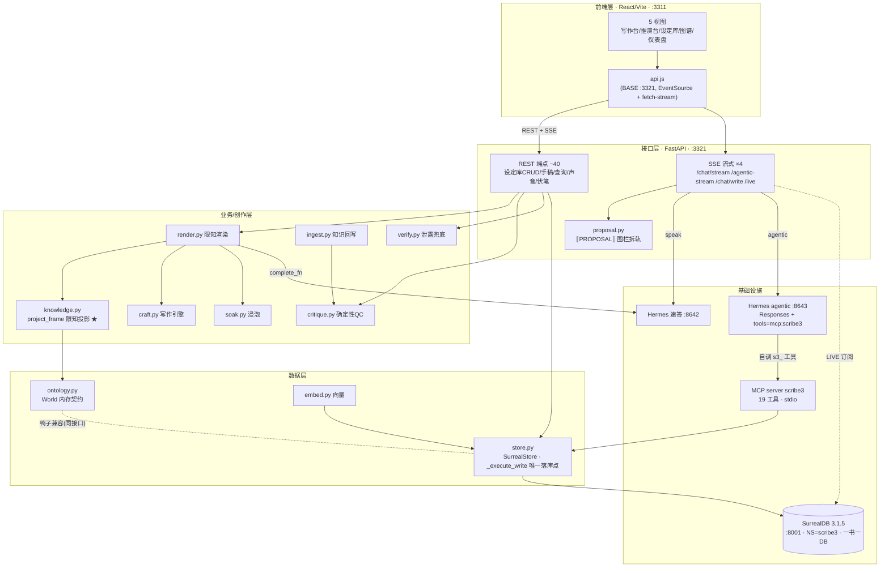
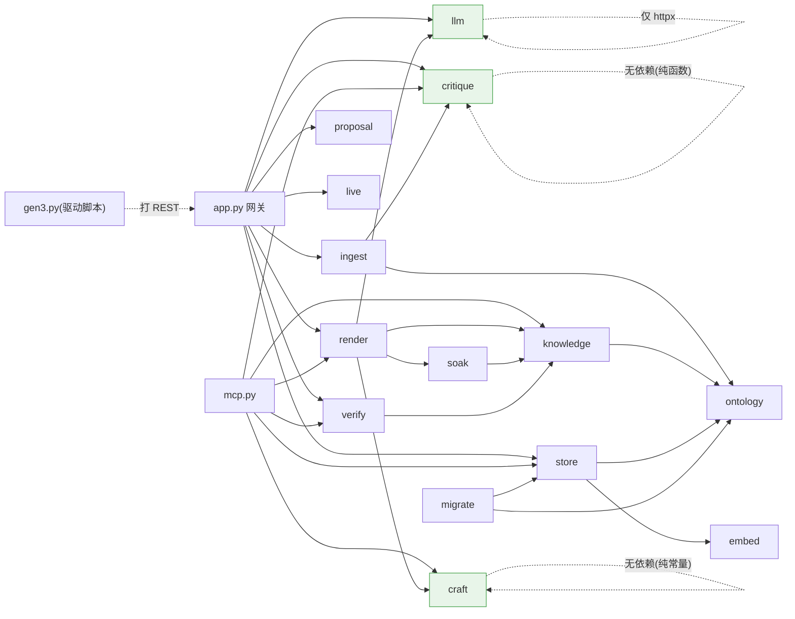
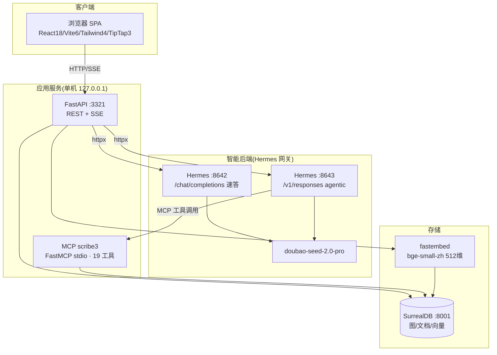
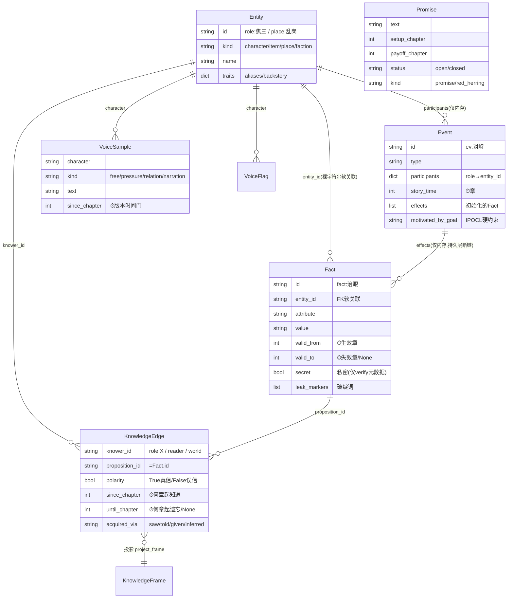

# 01 · 系统架构总览

> 对象:**scribe3**(AI 辅助长篇小说写作系统)。代码根 `scribe3/`。
> 生成日期:2026-06-24。所有引用为 `文件:行号`,基于当前磁盘源码。

---

## 1. 系统概述

### 1.1 项目定位与核心目标

scribe3 是一套**人机协同的长篇小说写作系统**,目标是让 AI 主编与作者协作产出"乱世铜炉"级别的长篇虚构作品。它的核心范式只有一句话:**限知靠渲染前的"知识帧投影",不靠事后判官**——系统在把内容交给大模型生成之前,先按当前视角角色(focalizer)投影出"他此刻知道的事实集合",**只把这个集合喂给模型**。视角角色不知道的私密事实物理上进不了 prompt,因此模型"写不出"越界信息,POV(视角)泄露被结构性根治(`knowledge.py:3-4`,`render.py:3-4`)。

围绕这一范式,系统提供:故事本体管理(角色/设定/事件/知识)、限知渲染、确定性质量管控(QC)、半自动知识回写、声音库与声音进化、非线性叙事(插叙/闪回)、对话驱动的 agentic 写作工作台。

### 1.2 技术栈总览

| 层 | 技术 | 说明 |
|---|---|---|
| 前端 | React 18.3 + Vite 6 + Tailwind CSS v4 | 纯 SPA、无路由库(`App.jsx` 的 `view` state 手动切视图) |
| 富文本 | TipTap v3(ProseMirror) | 手稿编辑器,纯文本↔HTML 互转,场景分隔节点 |
| 可视化 | @xyflow/react(React Flow)+ elkjs + recharts + cmdk | 知识图谱、仪表盘图表、命令面板 |
| 后端 | FastAPI + Pydantic + uvicorn | REST 网关 + 4 个 SSE 流式端点,单进程 :3321 |
| Agent 协议 | MCP(FastMCP,stdio) | 暴露 19 个 `s3_*` 工具给主编 agentic 调用 |
| 数据库 | SurrealDB 3.1.5(Python SDK 2.0) | 图+文档+向量一体;NS=scribe3,一书一 DB |
| 向量 | fastembed(BAAI/bge-small-zh-v1.5,512 维) | 本地 CPU 嵌入,无网络/无 key,语义召回 RAG |
| LLM 网关 | Hermes(豆包 doubao-seed-2.0-pro) | :8642 速答补全 / :8643 agentic Responses(挂 scribe3 MCP) |
| Schema | 裸 `.surql` 迁移 + `apply_schema()` 幂等 | 无 ORM、无 Alembic |

> LLM **不直连**模型厂商,统一经 Hermes 网关(`llm.py:12-14`)。Hermes 本身是 agent 平台底座(cron/skills/MCP/elicitation)。

### 1.3 系统规模

| 维度 | 数量 |
|---|---|
| 后端 Python 模块(非测试) | 24 个,**2905 行** |
| 最大模块 | `app.py` 629 行 / `store.py` 441 行 / `mcp.py` 274 行 |
| 前端 JSX/JS | ~25 个文件(5 视图 + 编辑器 + 组件 + api 客户端) |
| 数据库迁移 | 9 个 `.surql`(001_ontology … 009_voice) |
| 单元测试 | 24 个 `test_*.py`(后端覆盖强,前端零测试) |
| MCP 工具 | 19 个(12 只读 + 8 待批写 + 2 直写,见文档二) |
| REST 端点 | 约 40 个(含 4 个 SSE) |

---

## 2. 目录结构说明

```
写作 3.0/                          仓库根(注意:目录名含中文+空格,见文档三已知坑)
├── scribe3/                       ← 唯一代码主体
│   ├── app.py                     FastAPI REST 网关 + 4 个 SSE 端点(629 行,最大)
│   ├── store.py                   SurrealStore 持久层,唯一落库点 _execute_write(441)
│   ├── mcp.py                     MCP s3_* 工具 + WRITE_GATED 写门控(274)
│   ├── llm.py                     Hermes 客户端(:8642 补全 / :8643 Responses)(104)
│   ├── ── 数据/本体 ──
│   ├── ontology.py                内存数据模型 World + 四类一等公民(132)
│   ├── knowledge.py               知识帧投影 project_frame(限知物理门控,load-bearing)(61)
│   ├── embed.py                   fastembed 向量嵌入(21)
│   ├── migrate.py                 scribe2→3 数据迁移(151)
│   ├── ── 创作渲染链 ──
│   ├── render.py                  限知渲染 prompt 拼装 + render 编排(120)
│   ├── craft.py                   写作引擎层(8 引擎)+ build_craft_block(161)
│   ├── critique.py                确定性 QC + LLM 纪律判官 + 知识抽取(189)
│   ├── soak.py                    写前情感浸泡(42)
│   ├── ingest.py                  正文→知识 delta 回写(57)
│   ├── verify.py                  find_leaks 泄露兜底 + causal_complete 因果校验(52)
│   ├── scenario.py                canonical 泄露场景 luanshi_leak_world(40)
│   ├── ── 接口/编排 ──
│   ├── proposal.py                ⟦PROPOSAL⟧ 围栏状态机(对话/手稿拆轨)(60)
│   ├── live.py                    SurrealDB LIVE → SSE 表变更广播(48)
│   ├── health.py                  cron 体检报告(非路由)(46)
│   ├── proposal/gen3.py           对话驱动写作真机驱动脚本(90)
│   ├── ── 运维/演示 ──
│   ├── demo.py / seed_demo.py / walkthrough.py / qc_scan.py
│   ├── migrations/                9 个 .surql schema 迁移(SurrealDB)
│   ├── tests/                     24 个 test_*.py + conftest.py(临时内存库 fixture)
│   ├── web/                       ← 前端(React/Vite)
│   │   ├── src/
│   │   │   ├── main.jsx → App.jsx → shell.jsx        入口/编排/布局骨架
│   │   │   ├── WriteLayout / DeduceLayout            写作台 / 推演台
│   │   │   ├── views/{Atlas,Codex,Insight,Chat}View  图谱/设定库/仪表盘/(孤儿)聊天
│   │   │   ├── WriteChat / NorthStarBar / CommandPalette / Library / AppRail
│   │   │   ├── editor/{ProseEditor,DraftCard,SceneBreak}   TipTap 手稿编辑
│   │   │   └── api.js                                前端 API 客户端(BASE :3321)
│   │   ├── package.json / vite.config.js
│   │   └── dist/                   生产构建产物
│   ├── hermes_skills/scribe-novel-v2/SKILL.md   给主编的写作指令(挂 scribe3 MCP)
│   ├── run_mcp.sh / run_qc.sh      MCP 挂载 / 体检 cron 入口
│   ├── README.md / AGENTIC_SETUP.md
│   └── .venv/                      Python 虚拟环境(依赖隐式,无 requirements.txt)
├── docs/                          superpowers specs/plans + 本架构文档
├── 乱世铜炉.md / 交付说明.md / 调研文档-人机协同长篇写作系统.md
└── 设计文档/
```

---

## 3. 整体架构图

### 3.1 系统分层架构图



### 3.2 模块依赖关系图



> 绿色为零业务依赖的纯模块(craft 纯常量、critique 纯函数、llm 仅 httpx),最易测、最稳定。`ontology` 是内存契约,`store` 是其鸭子兼容的持久实现,`knowledge` 跨二者按 knower 投影——**对接口编程、不绑实现**是本系统最干净的设计。

### 3.3 技术栈组件图



---

## 4. 核心模块详解

### 4.1 数据层 — `ontology` / `store` / `knowledge` / `embed`

- **职责**:承载"故事世界"的全部状态;实现"内存契约 + 持久实现"双形态;实现限知投影。
- **关键文件**:
  - `ontology.py` — 内存 `World`(`ontology.py:71`)+ 四类一等公民 dataclass(见 §5)。唯一写入口 `add_fact`/`add_knowledge`(`ontology.py:85-95`)。
  - `store.py` — `SurrealStore`(`store.py:98`),**唯一落库点 `_execute_write`**(`store.py:121-123`,16 个内部调用者,改世界状态的唯一 SurrealQL 出口,系统不变量1)。
  - `knowledge.py` — `project_frame(world, knower, chapter)`(`knowledge.py:24-37`),限知物理门控:`knower=='world'` 返回全知真相,否则只返回"有 KnowledgeEdge 且时间门 `since_chapter≤chapter<until_chapter` 且 polarity 为真"的事实。
  - `embed.py` — fastembed 单例(`embed.py:8-13`),`semantic_index`/`semantic_recall`(HNSW COSINE)。
- **对外接口**:`SurrealStore` 全套 CRUD(实体/事实/知识/事件/手稿/伏笔/母题/craft_rule/voice/intent/works);`project_frame`/`dramatic_irony`/`see_event`/`witnesses_of`。
- **依赖**:`ontology` 零外部依赖(纯 dataclass);`store` → surrealdb SDK + ontology + embed;`knowledge` → ontology。

### 4.2 创作渲染链 — `render` / `craft` / `critique` / `soak` / `ingest` / `verify`

- **职责**:把"要写第 N 章某视角"变成"限知正文",并把定稿正文的客观知识回写世界。
- **关键文件**:
  - `render.py` — `build_render_prompt`(`render.py:31`)只用 focalizer 知识帧拼 prompt;`render`(`render.py:92`)编排"浸泡→投影→拼 prompt→LLM"。**非线性参数** `story_at`(事件故事时间)/`frame_at`(知识帧时间),沉浸式闪回 `frame_at` 默认=`story_at`(`render.py:40-41`)。
  - `craft.py` — `ENGINES` 8 个写作引擎(身体先行/温度曲线/闲笔/认知比喻/潜台词/感官锚定/浸泡/留白,`craft.py:8-53`);`build_craft_block(rules)`(`craft.py:147`)注入引擎层(通用)+ 题材层(`craft_rule` per-work 表)。
  - `critique.py` — `quality_flags`(`critique.py:113`)聚合 5 类确定性扫描(复读/排比/升华/AI腔/过饱和);`build_discipline_prompt`/`parse_discipline` LLM 纪律判官;`build_knowledge_extract_prompt`/`parse_knowledge_delta` 知识+voice_shift 抽取。
  - `soak.py` — `build_soak_prompt`(`soak.py:12`)写前情感浸泡,**同样受限知约束**(只取 `frame.facts[:8]`,`soak.py:15-16`)。
  - `ingest.py` — `apply_delta`(`ingest.py:21`)把 learned/did/voice_shift 落库,实现"看见即知道"的知识传播。
  - `verify.py` — `find_leaks`(`verify.py:29`)第二道兜底:扫散文里的帧外 secret 破绽词;`causal_complete` 因果连贯校验。
- **对外接口**:`render()`、`build_render_prompt()`、`quality_flags()`、`find_leaks()`、`ingest_chapter()`、`build_craft_block()`。
- **依赖**:见 §3.2。`craft`/`critique` 是零依赖纯模块。

### 4.3 LLM 网关 — `llm`

- **职责**:统一对接 Hermes,隔离三个端点。
- **关键接口**:`hermes_complete`(`llm.py:30`,非流式,**600s 超时 + 3 次重试**,4xx 立即抛)、`hermes_complete_stream`(`llm.py:57`,流式速答,**无重试**)、`hermes_responses_events`(`llm.py:81`,agentic Responses,挂 `tools=[{type:mcp,server_label:scribe3}]`,**无重试**)。
- **配置**:`HERMES`(:8642)、`HERMES_RESPONSES`(:8643)、`_api_key`(`llm.py:17`,环境变量或 `~/.hermes/.env`)。

### 4.4 接口层 — `app` / `mcp` / `proposal` / `live` / `health`

- **职责**:对外暴露 REST + SSE + MCP;实现对话驱动写作的围栏拆轨;实现写门控。
- **关键文件**:
  - `app.py` — ~40 REST 端点 + 4 SSE;`_store_for`/`_stores` 一书一连接缓存(`app.py:27-46`);`/save-chapter` 软校验 + 后台 ingest(`app.py:573-591`)。
  - `mcp.py` — 19 个 `s3_*` 工具;`WRITE_GATED` 集合(`mcp.py:30-32`)+ `commit_if_approved` 门控(`mcp.py:39`)+ `_ask` elicitation 待批(`mcp.py:52`,fail-closed)。
  - `proposal.py` — `ProposalParser`(`proposal.py:13`)把主编输出按 `⟦PROPOSAL⟧` 围栏拆成"对话 delta(右轨)"vs"手稿 prose(中区草稿)",跨 chunk 留尾兜底。
  - `live.py` — `live_stream`(`live.py:14`)每表一条 AsyncSurreal LIVE 订阅 → SSE 广播表名,前端据此重取。
  - `health.py` — `health_report` cron 体检(非路由)。
- **对外接口**:见文档二"API 接口地图"。

### 4.5 前端 — `web/`

- **职责**:作者工作台 SPA。
- **关键组成**:`main.jsx`→`App.jsx`(顶层 `useState` 编排,无路由库)→`shell.jsx`(可拖拽五栏骨架)。**5 视图**:写作台(`WriteLayout` + `WriteChat` 右轨主编对话 + TipTap 手稿)、推演台(`DeduceLayout` 限知检视 + LIVE)、设定库(`CodexView` CRUD)、图谱(`AtlasView` React Flow + ELK)、仪表盘(`InsightView` recharts)。
- **状态管理**:纯 `useState`+`useEffect`+`localStorage`,**无 Redux/Context/React Query**;`api.js` 模块级 `WORK` 单例(`api.js:3`)是唯一全局可变状态。
- **对外依赖**:`api.js`(BASE `http://127.0.0.1:3321`)经 REST + EventSource + fetch-stream 调后端。

---

## 5. 数据模型

### 5.1 核心数据实体

四类"一等公民"(`ontology.py`),遵循 BFO/DOLCE 的"持续体 vs 发生体"区分。⏱ 标注双时态字段。

| 实体 | 文件:行号 | 关键字段 | 说明 |
|---|---|---|---|
| **Entity** 持续体 | `ontology.py:17-22` | id, kind(character/item/place/faction), name, traits | 角色/物件/地点/阵营。**注意:item/faction 持久层无表,只 character/place 落库**(`store.py:139-147`) |
| **Fact** 状态@章 | `ontology.py:25-41` | id, entity_id, attribute, value, ⏱valid_from, ⏱valid_to, ⏱secret, leak_markers, caused_by_event | `secret` **仅 verify 元数据,不是投影门控**;`entity_id` 是裸字符串非外键 |
| **KnowledgeEdge** 视角边 | `ontology.py:43-52` | knower_id, proposition_id, polarity, certainty, ⏱since_chapter, ⏱until_chapter, acquired_via | "谁在何章知道何事";限知门控只看边的有无 |
| **Event** 发生体 | `ontology.py:55-68` | id, type, participants, location, ⏱story_time, effects, causal_in, motivated_by_goal | **持久层只存 etype/valid_from/goal,participants/effects/causal 全丢失**(见文档三高危项) |
| **KnowledgeFrame** 投影产物 | `knowledge.py:13-21` | knower_id, chapter, facts[] | `project_frame` 的输出,renderer 唯一可见的事实集 |

持久层独有表实体(以 dict 流转):promise(伏笔)、motif(母题)、chapter(正文)、intent(北极星单例)、craft_rule(题材规则)、voice_sample(声音库)、voice_evolution_flag(声音进化标记)。

### 5.2 实体关系 ER 图



> **关键约束**:scribe3 自称"图库"但**真正的 DB 图边只有 `knows`**(`KnowledgeEdge` 落 RELATE);其余关联(`Fact.entity_id`、`voice_sample.character`、`reader_knows.proposition`)全是**裸字符串 oid 相等匹配**,无 DB 层引用完整性。删除角色不级联清理其事实/知识边/声音样本(详见文档三)。

### 5.3 9 个迁移与表结构

| # | 文件 | 表(模式) | 关键字段 |
|---|---|---|---|
| 001 | `001_ontology.surql` | character/place/proposition/event(SCHEMAFULL)+ knows(RELATION) | 核心本体,ASSERT 强约束防 LLM 写脏 |
| 002 | `002_reader_frame.surql` | reader_knows(FULL) | reader 帧走单表,不走图边 |
| 003 | `003_vector.surql` | proposition.embedding + **idx_prop_vec HNSW DIM 512 COSINE** | **全库唯一非主键索引** |
| 004 | `004_manuscript.surql` | chapter(FULL) | seq/title/focalizer/prose/updated |
| 005 | `005_promise.surql` | promise(FULL) | 伏笔/红鲱鱼 |
| 006 | `006_motif.surql` | motif(FULL) | 母题 |
| 007 | `007_intent.surql` | intent(**SCHEMALESS**) | 北极星单例 intent:main |
| 008 | `008_craft_rule.surql` | craft_rule(**SCHEMALESS**) | 题材层规则(升华正则/法器写法) |
| 009 | `009_voice.surql` | voice_sample + voice_evolution_flag(**SCHEMALESS**) | 声音库 + 进化标记 |

> 核心本体(001-006)SCHEMAFULL 强约束;后加表(007-009)退化为 SCHEMALESS。**除 HNSW 外零普通索引、零 UNIQUE 约束**(去重靠 Python 层),长篇规模下时间门查询全表扫(文档三性能项)。

---

## 6. 配置与环境

### 6.1 环境变量(全有默认值)

| 变量 | 默认值 | 用途 | 位置 |
|---|---|---|---|
| `SCRIBE3_SURREAL_URL` | `ws://127.0.0.1:8001/rpc` | SurrealDB 连接 | `store.py:34/103`、`app.py:617` |
| `HERMES_API` | `http://127.0.0.1:8642/v1` | 速答/补全网关 | `llm.py:12` |
| `HERMES_RESPONSES_API` | `http://127.0.0.1:8643/v1` | agentic responses 网关 | `llm.py:14` |
| `API_SERVER_KEY` | 读 `~/.hermes/.env` → 否则 `"local"` | Hermes 鉴权 | `llm.py:17-27` |
| `SURREAL_BIN` | `which surreal` | 测试起临时库 | `conftest.py:16` |

> 固定项(非环境变量,硬编码):NS=**scribe3**、SurrealDB 凭证 **root/root**(`store.py:102-105`)、后端端口 **3321**(`app.py:625`)、前端端口 **3311**(`vite.config.js`,strictPort)、MCP 库 **db=main**(`mcp.py:259`)。

### 6.2 各环境差异

**几乎无 dev/prod 分离**:全部绑定 `127.0.0.1`,无 `NODE_ENV`/环境分支,前端 `BASE` 硬编码 :3321(`api.js:2`),CORS `allow_origins=["*"]`(`app.py:25`)。本系统当前形态是**单用户本地工具**,生产化配置缺失(详见文档三部署项)。

### 6.3 依赖的外部服务

| 服务 | 端口 | 作用 | 必需性 |
|---|---|---|---|
| SurrealDB | :8001 | 唯一数据存储(图/文档/向量) | 必需 |
| Hermes 速答网关 | :8642 | `/chat/completions` 补全 | 渲染/速答必需 |
| Hermes agentic 网关 | :8643 | `/v1/responses` + 挂 scribe3 MCP | 对话驱动写作必需 |
| fastembed 模型 | 本地 | bge-small-zh 向量(无网络) | 语义召回必需 |

### 6.4 启动方式

```
1. (可选) python -m scribe3.seed_demo        # 填演示数据
2. 后端  scribe3/.venv/bin/python -m scribe3.app    # uvicorn :3321
3. 前端  cd web && npm install && npm run dev       # vite :3311
4. agentic 主编(AGENTIC_SETUP.md):hermes profile scribe3 网关 :8643 + 挂 run_mcp.sh
5. 体检 cron:hermes --profile scribe3 cron(每 6h 跑 run_qc.sh,静默除非有问题)
```

---

> **延伸阅读**:业务流程与时序见 [02-业务流程与交互时序.md](./02-业务流程与交互时序.md);问题诊断与整改见 [03-问题诊断与整改方案.md](./03-问题诊断与整改方案.md)。
