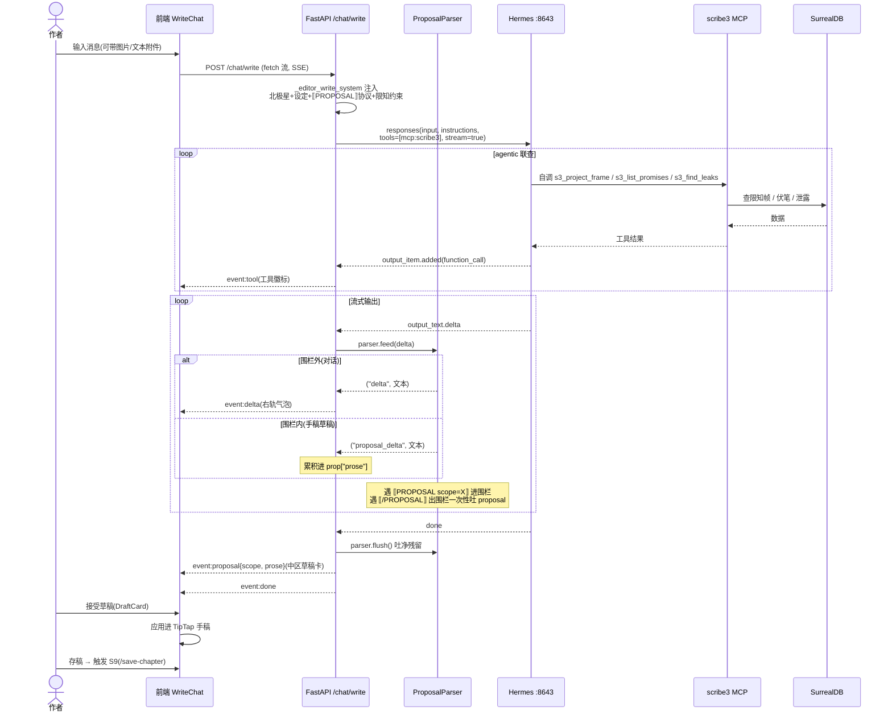
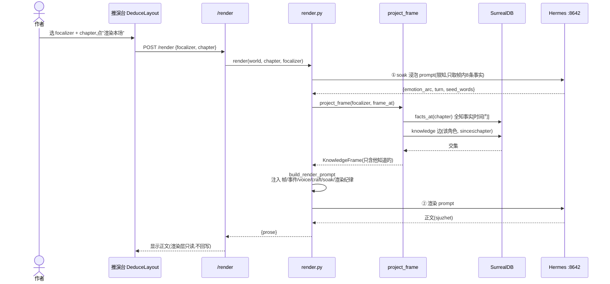
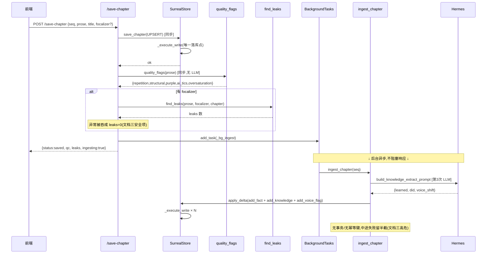
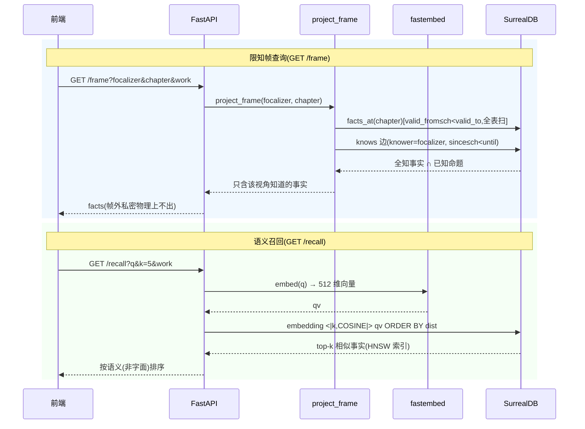
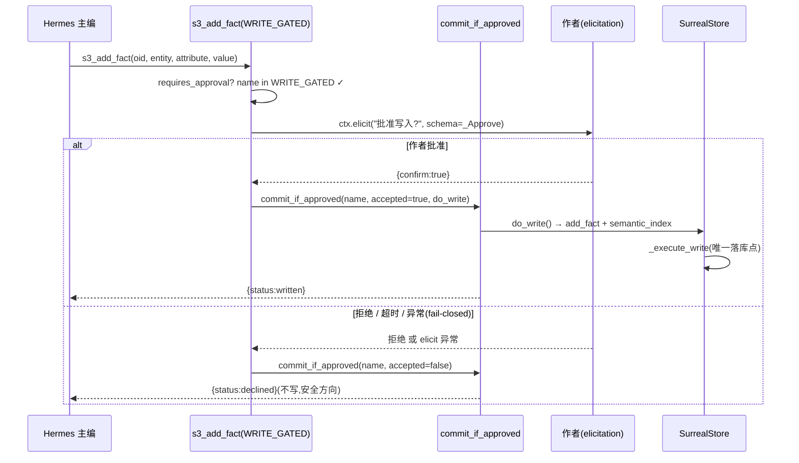
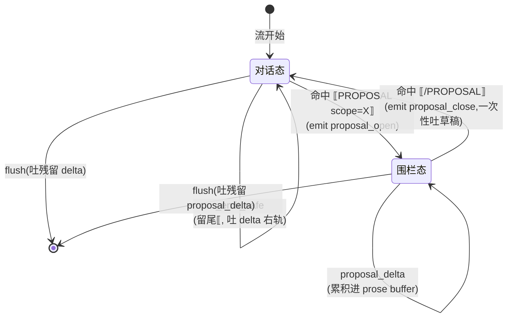
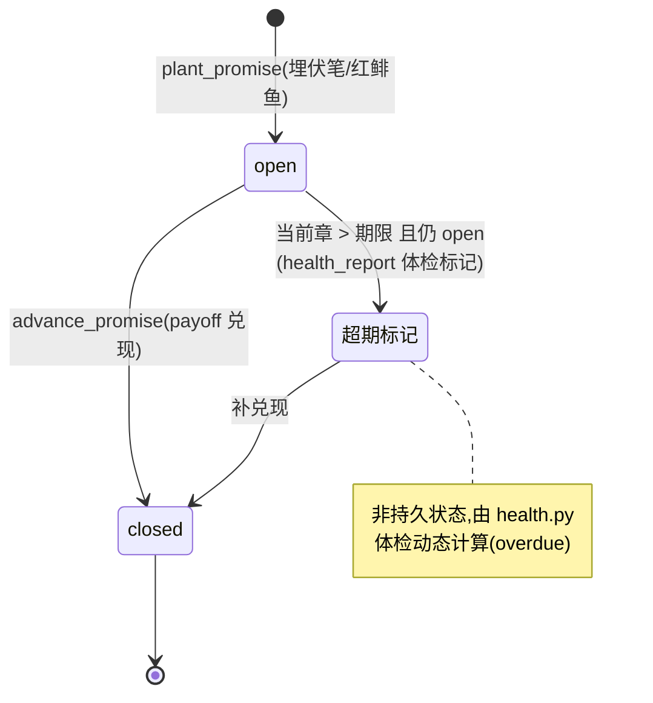
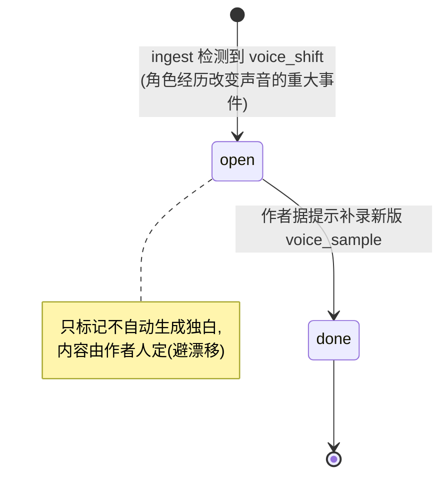
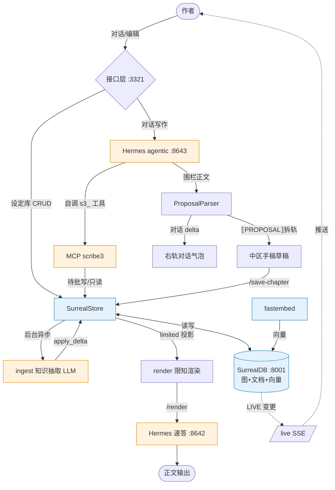

# 02 · 业务流程与交互时序

> 对象:**scribe3**。聚焦业务场景、调用时序、状态流转、API 地图、数据流向、前后端协议。
> 引用为 `文件:行号`。配套 [01-系统架构总览.md](./01-系统架构总览.md)。

---

## 1. 核心业务场景清单(用户故事视角)

| # | 场景 | 一句话 | 主入口 |
|---|---|---|---|
| S1 | 作品管理 | 作者新建/切换/改名/删除"书",书间数据隔离(一书一 DB) | `/works` 系列 |
| S2 | 设定库编辑 | 作者直编角色/事实/伏笔/母题(绕过待批,作者全权) | `/characters` `/facts` `/promises-new` `/motifs-new` |
| S3 | 设北极星 | 作者写"读者感受/情感弧/红线"作为全局写作纲领 | `PUT /intent` |
| S4 | 声音库 | 作者为角色录 4 类独白样本,可版本化(声音进化) | `POST /voice` |
| S5 | **对话驱动写作** | 作者与主编对话,主编联查限知数据→出改写草稿→接受进手稿 | **`POST /chat/write`(SSE)** |
| S6 | 速答问答 | 作者问主编,纯补全快速回答(非 agentic) | `/chat/stream`(SSE) |
| S7 | 联查实证问答 | 主编自调 s3_ 工具查真实数据后回答 | `/chat/agentic-stream`(SSE) |
| S8 | 限知渲染 | 选视角角色+章,渲染该视角本场正文(只读生成) | `POST /render` |
| S9 | 存稿+校验+回写 | 存章 → 同步软校验(QC+泄露)→ 后台异步知识回写 | `POST /save-chapter` |
| S10 | 手动知识回写 | 读定稿抽"谁新知道/做了什么"更新知识账本 | `POST /ingest` |
| S11 | 限知检视 | 看某视角的知识帧/反讽点/因果违规/伏笔/QC | `/frame` `/irony` `/causal` `/qc` |
| S12 | 语义召回 | 向量 RAG:按意义(非字面)召回相关事实 | `/recall` |
| S13 | 质量仪表盘 | 逐章字数/QC 问题数/伏笔状态聚合 | `/quality` |
| S14 | 知识图谱 | 角色—knows→命题 可视化 | `/graph` |
| S15 | 实时同步 | SurrealDB 表变更经 SSE 推前端,触发重取 | `/live`(SSE) |
| S16 | 主编 agentic 写世界 | 主编经 MCP 写工具改世界状态,需作者 elicitation 待批 | MCP `s3_add_*` |
| S17 | 自动体检 | cron 每 6h 跑因果连贯体检,有问题才报 | `qc_scan.py` |

> **注意:本系统无用户认证/注册/登录流程**——单用户本地工具,绑定 `127.0.0.1`,无 auth 层(详见文档三安全项)。因此本文档不含"认证流程"时序,代之以"MCP 写门控"作为权限控制的唯一机制。

---

## 2. 主流程时序图

### 2a. 对话驱动写作(核心主流程,`POST /chat/write`)

最重要的用户路径:作者与主编对话,主编 agentic 联查 + 围栏拆轨,产出可接受的手稿草稿。



### 2b. 限知渲染(`POST /render` / `s3_render_scene`)

程序化单视角渲染,两次 LLM 调用(浸泡 + 渲染)。



### 2c. 数据写入完整链路(`POST /save-chapter`)

存稿同步、知识回写异步——增删改的完整链路与"软校验"。



### 2d. 数据查询链路(限知帧 + 语义召回)



### 2e. MCP 写门控(`s3_add_*` 待批,权限控制核心)

主编要改世界状态,必须经作者 elicitation 待批——系统唯一的"权限"机制。



### 2f. 实时同步(`/live` SurrealDB LIVE → SSE)

```mermaid
sequenceDiagram
    participant FE as 推演台
    participant API as /live (SSE)
    participant L as live_stream
    participant DB as SurrealDB

    FE->>API: EventSource('/live?work')
    API->>L: live_stream(url, ns, db, 9张表)
    loop 每张表一条独立 WS 连接
        L->>DB: signin + use(ns,db) + live(table) + subscribe
    end
    API-->>FE: retry:3000 + _init

    loop 监听
        DB-->>L: 某表 CREATE/UPDATE/DELETE
        L-->>API: q.put(table)
        API-->>FE: event:{table:名}
        FE->>FE: tick++ → 重取该视图数据
    else 15s 无变更
        API-->>FE: ": keepalive"(SSE 注释行保活)
    end
```

---

## 3. 状态机图

### 3.1 ⟦PROPOSAL⟧ 围栏状态机(`proposal.py`)

主编流式输出在"对话态"与"围栏态"间切换,决定文本进右轨还是中区。



> `_emit_safe`(`proposal.py:21-27`):每次只吐 `buf` 里最后一个 `⟦` 之前的内容,留住可能被 chunk 边界截断的标记开头,等下一 chunk 拼全——保证跨 chunk 的 `⟦PROPOSAL⟧` 标记不被当正文吐出。

### 3.2 伏笔(promise)状态流转



### 3.3 声音进化标记(voice_evolution_flag)



---

## 4. API 接口地图

> 约定:除 `/works` 系列外,几乎所有端点吃 query 参数 `work=<slug>`(默认 main)→ 映射 `ns=scribe3/db=slug`。**全部端点无认证**。

### 4.1 作品 / 健康
| Method 路径 | 行号 | 功能 | 请求 | 权限 |
|---|---|---|---|---|
| GET `/health` | `app.py:55` | 存活探针 | — | 无 |
| GET `/works` | `app.py:60` | 列书+统计 | — | 无 |
| POST `/works` | `app.py:76` | 新建书 | `WorkIn{title}` | 无 |
| PATCH `/works/{slug}` | `app.py:81` | 改名 | `WorkIn{title}` | 无,无存在校验 |
| DELETE `/works/{slug}` | `app.py:87` | 删书+清缓存 | — | **无确认无鉴权** |

### 4.2 限知读(只读查询)
| Method 路径 | 行号 | 功能 | 关键参数 |
|---|---|---|---|
| GET `/entities` | `app.py:95` | 角色+地点清单 | work |
| GET `/facts` | `app.py:101` | 某章有效事实(**含 secret**) | chapter |
| GET `/events` | `app.py:106` | 某章事件 | chapter |
| GET `/frame` | `app.py:112` | **focalizer 限知帧投影** | focalizer, chapter |
| GET `/irony` | `app.py:117` | 戏剧反讽点 | focalizer, chapter |
| GET `/causal` | `app.py:122` | 因果连贯违规 | chapter |
| GET `/recall` | `app.py:127` | **语义召回(向量 RAG)** | q, k=5 |
| GET `/promises` | `app.py:132` | 列伏笔 | work |
| GET `/motifs` | `app.py:137` | 列母题 | work |
| GET `/graph` | `app.py:268` | 知识图谱(Atlas) | chapter? |
| GET `/quality` | `app.py:274` | **质量仪表盘聚合** | work |

### 4.3 设定库直编(作者全权,**不经待批**)
| Method 路径 | 行号 | 模型 |
|---|---|---|
| POST/PATCH/DELETE `/characters[/{local}]` | `app.py:148/154/160` | `CharIn{name,backstory?}` |
| POST/PATCH/DELETE `/facts[/{local}]` | `app.py:174/182/189` | `FactIn{entity,attribute,value,valid_from,secret}` |
| POST/PATCH/DELETE `/promises[-new]/{pid}` | `app.py:201/207/213` | `PromIn{text,setup_chapter,kind}` |
| POST/PATCH/DELETE `/motifs[-new]/{mid}` | `app.py:226/232/239` | `MotifIn{name,theme,echoes,unfolding}` |

### 4.4 声音 / 北极星
| Method 路径 | 行号 | 模型/参数 |
|---|---|---|
| POST `/voice` | `app.py:252` | `VoiceIn{character,kind,text,since_chapter}` |
| GET `/voice` | `app.py:258` | character |
| GET `/voice-flags` | `app.py:263` | work |
| GET/PUT `/intent` | `app.py:300/311` | `IntentIn{reader_feeling,emotional_arc,red_lines}` |

### 4.5 对话写作(SSE 流式)
| Method 路径 | 行号 | 模式 | 流事件 |
|---|---|---|---|
| GET `/chat/stream` | `app.py:343` | 速答(纯补全 :8642) | delta/error/done |
| GET `/chat/agentic-stream` | `app.py:363` | 联查实证(:8643 自调工具) | tool/delta/error/done |
| GET `/chat/write` | `app.py:414` | 对话驱动写作(围栏拆轨) | delta/tool/proposal/done |
| POST `/chat/write` | `app.py:470` | 同上 + 图片附件 | 同上 |

### 4.6 手稿 / QC / 渲染 / 回写
| Method 路径 | 行号 | 功能 |
|---|---|---|
| GET `/chapters` `/chapter` | `app.py:526/531` | 列章 / 读某章 |
| GET `/qc` | `app.py:536` | 确定性 QC(快) |
| GET `/discipline` | `app.py:543` | **LLM 纪律判官(慢,走 Hermes)** |
| POST `/save-chapter` | `app.py:573` | 存稿+软校验+后台 ingest |
| POST `/ingest` | `app.py:594` | 手动知识回写(打 LLM) |
| POST `/render` | `app.py:606` | 限知渲染(只读生成) |
| GET `/live` | `app.py:615` | SurrealDB LIVE → SSE |

### 4.7 MCP 工具(19 个,主编 agentic 调用)
- **只读(12)**:`s3_project_frame` `s3_render_scene` `s3_find_leaks` `s3_causal_complete` `s3_semantic_recall` `s3_dramatic_irony` `s3_list_promises` `s3_list_motifs` `s3_get_chapter` `s3_qc_chapter` `s3_emotion_palette` `s3_craft_rule_list`(+ `s3_discipline_check` 标只读但内部打 LLM)
- **待批写(8,∈WRITE_GATED)**:`s3_add_character` `s3_add_fact` `s3_add_event` `s3_record_knowledge` `s3_plant_promise` `s3_advance_promise` `s3_craft_rule_add` `s3_craft_rule_remove`
- **直写不待批(2)**:`s3_save_chapter`(手稿非世界状态)、`s3_ingest_chapter`(客观回写非创作)

---

## 5. 数据流向总图



**数据从哪进入**:作者对话/设定编辑(经接口层)、主编 agentic 联查 + 待批写、定稿正文回写。
**经过哪些处理**:限知投影(渲染前过滤)、围栏拆轨(对话/手稿分离)、软校验(QC+泄露)、知识抽取(ingest)。
**存在哪**:SurrealDB(一书一 DB,图边 knows + 文档表 + HNSW 向量)。
**如何输出**:限知渲染正文、查询投影结果、LIVE 实时推送。

---

## 6. 前后端交互协议

### 6.1 接口调用规范
- **基址**:前端 `BASE = http://127.0.0.1:3321`(`api.js:2` 硬编码)。
- **书上下文**:除 `/works` 外每请求自动附 `?work=<WORK>`(`api.js:5` `ww()`),`WORK` 是 `api.js:3` 模块级单例,切书经 `api.setWork()` 命令式更新。
- **请求头**:`Content-Type: application/json`(写请求);**无认证头**(无 Authorization/Token/Cookie)。
- **CORS**:`allow_origins=["*"]` + 全方法全头(`app.py:25`)。
- **错误处理**:REST 端点多直接抛或静默(无统一错误码体系);前端 `api.js` 的 `j/post/...` **不检查 `r.ok`**(`api.js:6-18`),仅 `chatWrite` 检查(`api.js:77`)。无标准化错误码定义——这是缺口(文档三)。

### 6.2 SSE / 长连接机制
- **格式**:`StreamingResponse(media_type="text/event-stream")`,逐事件 `data: {json}\n\n`,收尾固定 `data: {"done":true}\n\n`,异常回流 `data: {"error": "..."}\n\n`(截断 160 字)。
- **GET 流**:前端用 `EventSource`(`/chat/stream`、`/chat/agentic-stream`、`/live`)。
- **POST 流**:前端用 `fetch` + `reader.getReader()` 手动拆行(`/chat/write`,因 EventSource 不支持 POST/附件,`api.js:69-100`),返回 `AbortController` 供取消。
- **保活**:`/live` 每 15s 无变更发 `: keepalive\n\n`(SSE 注释行);`retry:3000` 控制重连。
- **事件类型**:`delta`(对话)/`tool`(工具调用)/`proposal`(手稿草稿)/`error`/`done`;`/live` 发 `{table:名}`。

### 6.3 文件上传/下载
- **图片附件**(`POST /chat/write`,`app.py:485-488`):前端把图片转 base64 放进 `ChatWriteReq.images=[{data, type}]`,后端组装成 Hermes `input_image`。**无大小/数量/MIME 白名单校验**(文档三安全项)。
- **文本附件**(`WriteChat.jsx:75-87`):<200KB 的文本文件内容直接引入消息体。
- **无独立文件存储/下载端点**:正文以 `chapter.prose` 字段存库,经 `/chapter` 读取。

### 6.4 双模在协议层的体现
- **速答**(`/chat/stream` → :8642 `/chat/completions`):无工具,逐 `delta` 推送。
- **联查实证 / 写作**(`/chat/agentic-stream`、`/chat/write` → :8643 `/v1/responses`):body 带 `tools=[{type:mcp, server_label:"scribe3"}]`,主编自动发现并自调 `s3_` 工具查真实数据;`server_label="scribe3"` 引用 Hermes profile 里挂载的 scribe3 MCP(`run_mcp.sh`,stdio)。
