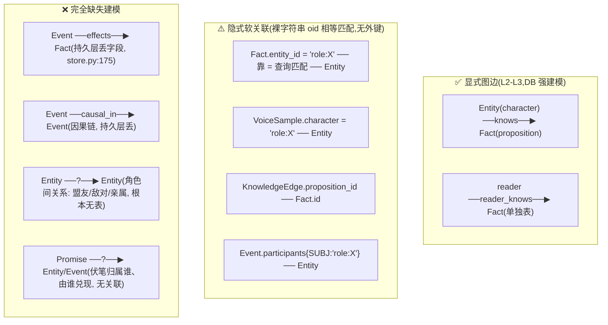

# 04 · 本体论实现分析与改进方案

> 对象:**scribe3**(AI 小说写作系统)。本文分析系统在"概念定义、关系建模、属性约束、分类层级、语义一致性、知识图谱"六维度的**形式化设计程度**。
> 引用均为 `文件:行号`,基于 2026-06-24 全库只读扫描。配套 [01](./01-系统架构总览.md)/[02](./02-业务流程与交互时序.md)/[03](./03-问题诊断与整改方案.md)。

---

## 1. 本体论实现现状总览

### 一句话评估

**scribe3 是一个"设计雄心在 L4、形式化地基只到 L2"的系统——整体定位 L2.5(关联数据→显式语义之间),局部有 L4 雏形(知识图谱 + 限知推理)但未稳定达成。** 它有真正的领域本体设计(四类一等公民 dataclass + SCHEMAFULL 核心表 + 图边 `knows` + 双时态 + 知识帧投影 + "看见即知道"的类推理),这套设计的**意图**直指 L4 知识图谱;但它**同时**零正式枚举、命名极度不一致、关系大多是裸字符串软关联、推理是硬编码函数且持久层失效——这些把形式化严谨度拉回 L2。设计图纸是知识图谱,浇筑出来的地基是关联数据库。

### 五层对照判定

| 层次 | 描述 | scribe3 是否达到 | 证据 |
|---|---|---|---|
| L0 隐式 | 概念散落代码注释命名 | 已超越 | 有显式 dataclass + schema |
| L1 结构化数据 | 有表/Schema 但无语义关系 | 已达成 | 9 个 `.surql` 迁移,核心表 SCHEMAFULL |
| L2 关联数据 | 实体间有引用关系,语义靠代码 | **当前主体在此** | 仅 `knows` 是显式图边;其余全裸字符串软关联 |
| L3 显式语义 | 统一概念定义文件,关系显式声明 | **部分达成(不稳定)** | 有 dataclass `ontology.py`,但无统一 schema 层、命名不一、枚举零约束 |
| L4 推理能力 | 知识图谱/规则引擎,可推断新事实 | **有雏形,失败/缺失** | `see_event` 类推理但真库失效;无规则引擎;`ontology.py:45` 明示"无隐式闭包" |

### 分维度判定(雷达)

| 维度 | 层次 | 关键证据 |
|---|---|---|
| 概念定义 | **L3** | `Entity/Fact/KnowledgeEdge/Event` 四 dataclass(`ontology.py:17-68`)+ 核心表 SCHEMAFULL(`001_ontology.surql`) |
| 关系建模 | **L2** | 唯一显式图边是 `knows`(RELATION);其余(Fact.entity_id、voice.character、participants)全裸字符串软关联,无外键 |
| 属性约束 | **L1.5** | 核心表有 `TYPE`/`ASSERT len>0`,但**全库零枚举约束**(无 Enum、无 `ASSERT IN`) |
| 分类层级 | **L1** | 实证确认全扁平,无任何 taxonomy/继承(grep `parent/subtype/extends/is_a` 零命中) |
| 语义一致性 | **L1** | 命名极度混乱:同概念多名(章=8+名)、同名多义(`kind`×5)、跨层四名(事实=proposition/Fact/facts/命题) |
| 知识图谱 | **L3 雏形(~55%)** | 有图边 + HNSW 向量 + 双时态 + 投影,但单一边类型 + 推理硬编码 + 持久层丢事件结构 |

> **核心张力**:`knowledge.py` 的 `project_frame` 限知投影是教科书级的本体驱动设计(渲染前按 knower 投影知识帧),配 `see_event` 的"看见即知道"知识传播,这是 L4 知识图谱的思路。但它脚下的地基——枚举、命名、关系建模、事件持久化——只有 L2 的严谨度。**上层建筑的优雅被下层地基的松散反复侵蚀**(如 `see_event` 在真库失效、知识账本被 LLM 幻觉角色污染)。

---

## 2. 核心概念清单

系统显式建模的实体/概念。"有 dataclass"=Python 一等公民;"仅表"=只有 DB 表无 Python 类(以 dict 流转)。

| 实体 | 位置(文件/表) | 属性数 | 与其他实体的关系 | 语义完整度 |
|---|---|---|---|---|
| **Entity** 持续体 | `ontology.py:17` / `character`+`place` 表 | 4(id/kind/name/traits) | 被 Fact/KnowledgeEdge/Event/Voice 软引用 | 中(kind 4 种声明但仅 2 种落库,item/faction 静默丢,`store.py:139-147`) |
| **Fact** 状态@章 | `ontology.py:25` / `proposition` 表 | 11(含双时态 valid_from/to、secret、leak_markers、tx_from/to) | entity_id→Entity(软);被 KnowledgeEdge 指向 | 高(字段最丰富,双时态完整) |
| **KnowledgeEdge** 视角边 | `ontology.py:43` / `knows`(RELATION)+`reader_knows` | 7(knower/proposition/polarity/certainty/since/until/acquired_via) | **唯一真图边**:Entity→knows→Fact | 高(关系属性建模最好的一处) |
| **Event** 发生体 | `ontology.py:55` / `event` 表 | 内存 10 / **持久仅 3** | participants→Entity、effects→Fact(**均仅内存,持久层丢**) | 内存高 / **持久层低**(`store.py:175-179` 丢 participants/effects/causal) |
| **KnowledgeFrame** 投影产物 | `knowledge.py:13` / 无表(运行时计算) | 3(knower/chapter/facts) | project_frame(Entity, chapter) 的输出 | 高(renderer 唯一可见对象) |
| **Promise** 伏笔 | 仅 `promise` 表 | 6(text/setup_chapter/payoff_chapter/status/kind) | **无实体关联**(不与角色/事件挂钩) | 中(孤立,无法关联"谁的伏笔") |
| **Motif** 母题 | 仅 `motif` 表 | 4(name/theme/echoes/unfolding) | 无关联 | 低(纯文本,无结构) |
| **Intent** 北极星 | 仅 `intent` 表(SCHEMALESS 单例) | 3(reader_feeling/emotional_arc/red_lines) | 全局单例,无关联 | 低(SCHEMALESS,自由字段) |
| **CraftRule** 题材规则 | 仅 `craft_rule` 表(SCHEMALESS) | 3(kind/pattern/note) | per-work,无实体关联 | 中(kind 3 声明仅 2 产出) |
| **VoiceSample** 声音库 | 仅 `voice_sample` 表(SCHEMALESS) | 4(character/kind/text/since_chapter) | character→Entity(软,裸字符串) | 中(有版本时间门,但软关联) |
| **VoiceEvolutionFlag** 进化标记 | 仅 `voice_evolution_flag` 表 | 4(character/seq/reason/status) | character→Entity(软) | 中(status 的 done 是死值,无写入路径) |

> **观察**:四类"一等公民"(Entity/Fact/KnowledgeEdge/Event)有完整 dataclass + SCHEMAFULL,语义完整度高;后加的 7 类(Promise…VoiceFlag)**全部无 Python 类、半数 SCHEMALESS、零实体关联**——它们是挂在本体外围的"文档表",未真正进入本体网络。这是本体设计"核心紧、外围松"的两极分化。

---

## 3. 关系建模分析

### 3.1 关系的三种状态



### 3.2 逐项分析

**显式建模的关系(仅 2 条边类型)**:
- `knows`(`migrations/001_ontology.surql:36`):`RELATION FROM character TO proposition`。这是全系统**唯一真正的图边**,且**关系属性建模得最好**——边上带 `since_chapter`/`until_chapter`/`polarity`/`acquired_via`(`001:37-40`),即"谁在第几章、经由何种方式、知道/误信某命题"。这是本体设计的亮点。
- `reader_knows`(`002_reader_frame.surql`):reader 帧因类型安全单独建表(character→knows→proposition 的两端类型约束不容 reader),与 `knows` 异构,合并靠 `store.py:430-441` property 手工 union。

**只存在于代码逻辑的隐式关系(裸字符串软关联)**:
- `Fact.entity_id`→Entity:DB 字段 `entity` 是 `TYPE string`(`001:18`)而非 record link,靠 `=` 查询匹配,**无引用完整性**。
- `VoiceSample.character`/`VoiceFlag.character`→Entity、`KnowledgeEdge.proposition_id`→Fact、`Event.participants` 值→Entity:全部裸 oid 字符串,无 DB 层外键。

**完全缺失建模的关系**:
- **Event→Fact(effects)**:内存有(`ontology.py:62`),持久层 `add_event` 丢弃(`store.py:175-179`)→ `see_event`(`knowledge.py:53-61`)在真库无数据可依。这是限知知识自动生成的断点。
- **Event→Event(causal_in 因果链)**:同样持久层丢失。
- **Entity→Entity(角色间关系)**:**根本无表无字段**。角色的盟友/敌对/亲属/师徒关系无处建模——这对小说系统是重大缺失(见 §7)。
- **Promise→Entity/Event**:伏笔不与"谁的伏笔/由哪个事件兑现"关联,孤立存在。

### 3.3 方向性、基数、关系属性

| 项 | 现状 |
|---|---|
| **方向性** | 仅 `knows` 有明确方向(character→proposition)。软关联无方向语义。 |
| **基数(1:1/1:N/N:M)** | **无任何显式标注**。`knows` 实际是 N:M(多角色知道多命题)但 schema 不声明基数;软关联的基数全靠代码理解。 |
| **关系属性** | **仅 `knows` 有**(since/until/polarity/acquired_via,`001:37-40`)——这是难得的"关系即一等公民"设计。**其余关系零关系属性**:如 `participants` 只有角色 oid,无"参与角色(主动/被动/旁观)"的关系语义(SUBJ/OBJ/WITNESS 槽位是 dict 键,无定义枚举,`scenario.py:33`)。 |

> **结论**:关系建模是**两极**——`knows` 边做到了 L3(显式 + 带关系属性 + 时态),是整个本体的脊柱;但它是**孤边**,其余所有关系停在 L2 软关联或完全缺失。系统"只有一种边",而小说世界需要的"角色关系网、事件因果链、伏笔兑现链"全部缺位。

---

## 4. 分类体系(Taxonomy)分析

### 4.1 实证结论:全扁平,无任何层级

grep `parent`/`subtype`/`extends`/`is_a`/`hierarchy`/`inherit`/`subclass` 跨 `*.py`/`*.surql`/`*.jsx` —— **唯一命中是 `store.py:116` 的 `Path(__file__).parent`(文件路径,无关)**。系统所有"分类"均为**单层扁平字符串标签**:

- `Entity.kind`(`ontology.py:20`):character/item/place/faction 四者**平级**,无父子,`store.py:139-147` 扁平 if/elif 分派,无 is-a。
- 四类一等公民 dataclass 彼此**无继承**(均直接 `@dataclass`,无基类),是并列的"持续体/发生体/quality/belief",非层级。
- 唯一近似层级的是 craft 的"引擎层 vs 题材层"二分(`craft.py:1-5`),但那是**注入优先级的两段拼接**(`craft.py:153-160`),非数据父子继承。

### 4.2 枚举/分类字段全集(全部无正式声明)

**全库零 Python Enum、零 `typing.Literal`、零 SurrealDB `ASSERT IN`**。所有枚举域只活在注释与默认值里:

| 字段 | 取值域 | 声明形式 | 位置 |
|---|---|---|---|
| `Entity.kind` | character/item/place/faction(仅 2 落库) | 注释 | `ontology.py:20`,`store.py:139` |
| `KnowledgeEdge.acquired_via` | 声明 saw/told/inferred/given,**实际还有 learned** | 注释+默认值 | `ontology.py:52`,`ingest.py:31` |
| `Event.type`/`etype` | **完全自由字符串**,无受控域 | 无 | `ontology.py:60`,`001:29` |
| `promise.status` | open/closed | 字面量 | `store.py:353,364` |
| `promise.kind` | promise/red_herring | 字面量 | `005:8` |
| `craft_rule.kind` | 声明 3,产出 2(cover_action 零产出) | 字面量 | `008:4`,`store.py:311-312` |
| `voice_sample.kind` | free/pressure/relation/narration | render 端 dict 白名单 | `render.py:69`(唯一对齐良好) |
| `voice_flag.status` | open/done(**done 无写入路径**) | 字面量 | `store.py:342` |
| proposal `scope` | selection/chapter/append | **regex 捕获组(唯一机器锁定)** | `proposal.py:8` |
| craft `ENGINES` | 8 个 key | Python dict 常量 | `craft.py:8-53` |

### 4.3 缺失 taxonomy 带来的问题

| 缺失 | 业务问题 |
|---|---|
| `Entity.kind` 无子类型 | 无法区分"主角/配角/反派/龙套"等角色子类;无法按角色重要度过滤/排序;无法对"反派类"统一施加约束 |
| `Event.type` 完全自由 | 事件类型不可枚举(对峙/取丹/逃…任意),无法按类型统计、检索、施加结构规则(如"所有'死亡'类事件须关联伏笔") |
| 无 kind 约束 | LLM 经 MCP 写 `s3_add_event` 可填任意 etype,知识库类型字段污染,统计/过滤失真 |
| 角色无层级继承 | 无法表达"焦三 is-a 江湖人 is-a 角色"的属性继承(如所有江湖人共享某套默认设定) |

---

## 5. 语义一致性检查

> 这是 scribe3 本体论最薄弱的一环。下表为代表性不一致项(完整证据见扫描素材)。

### 5.1 同概念多名 — "第N章"整数语义有 8+ 个字段名

| 概念/字段 | 位置A 叫法 | 位置B 叫法 | 不一致类型 | 风险 |
|---|---|---|---|---|
| 事件发生章 | `Event.story_time`(`ontology.py:63`) | DB 存为 `valid_from`(`store.py:178,426`) | 同概念跨层换名 | event 表**无 story_time 字段**,排查时找错字段;靠 store 两行手工映射 |
| 事件发生章(第三名) | API 输出 `chapter`(`app.py:108`) | 同上 | 三层三名 | 同一"事件发生章"= story_time/valid_from/chapter |
| 事实生效章 | `Fact.valid_from`(`ontology.py:34`) | 知识边 `since_chapter`(`ontology.py:50`) | 同概念多名 | "第几章起有效/知道"两套词 |
| 章序号 | `chapter.seq`(`004:4`) | `voice_flag.seq`(`009:11`,实为章号) | 同名异义 | seq 在两表语义不同(主键 vs 触发章) |
| 渲染时间参数 | `story_at`/`frame_at`(`render.py:34`) | `chapter`/`upto_chapter`(`store.py:328`) | 同概念多名 | 同是"章号"在渲染层又造 2 个新名 |

> 单一"第N章"语义散成 `valid_from/valid_to/since_chapter/until_chapter/story_time/setup_chapter/payoff_chapter/seq/story_at/frame_at/upto_chapter/chapter` **12 个名字**,跨 4 个实体 + 渲染参数。

### 5.2 同名多义 — `kind` 一个字段名,五套互斥语义

| 概念/字段 | 位置A | 位置B | 不一致类型 | 风险 |
|---|---|---|---|---|
| `kind` | `Entity.kind`=本体类别(`ontology.py:20`) | `craft_rule.kind`=规则类型(`008:4`) | 同名多义 | 同字段名零交集语义 |
| `kind` | `voice_sample.kind`=语域(`009:4`) | `promise.kind`=伏笔性质(`005:8`) | 同名多义 | Pydantic `PromIn.kind`/`VoiceIn.kind` 同名加剧(`app.py:198,247`) |
| `kind`(第五处) | critique QC 标签(`critique.py:42`) | proposal 事件类型(`proposal.py:21`) | 同名多义 | 内部 dict 键又一义 |

### 5.3 跨层四名 — 同一对象在表/类/路径/UI 各叫各的

| 概念 | DB 表/字段 | Python 类 | API 路径 | 前端术语 | 风险 |
|---|---|---|---|---|---|
| 事实/命题 | `proposition`(`001:17`) | `Fact`(`ontology.py:26`) | `/facts` | "命题/设定"(`CodexView.jsx:8`) | **四层四名**,oid 前缀又是 `fact:` |
| 角色 | `character`(`001:7`) | `Entity(kind='character')` | **`/characters` 写 + `/entities` 读** | "角色" | 同对象读写两路径(`api.js:31` vs `45`);role:/character/entity 三词 |
| 事件类型 | `etype`(`001:29`) | `Event.type` | 输出 `type` | — | DB/Python/API 三换名,两处手工桥 |
| 事件时间 | `valid_from` | `story_time` | `chapter` | — | 三层三名 |
| 伏笔 | `promise` | 无类(dict) | `/promises`+`/promises-new` | "伏笔" | promise(承诺)↔伏笔术语漂移;增端点 `-new` 后缀 |

### 5.4 类型/默认值不一致 + 死值

| 概念/字段 | 位置A | 位置B | 不一致类型 | 风险 |
|---|---|---|---|---|
| `acquired_via` 默认值 | `ontology.py:52`=`given` | `mcp.py:233`=`saw` | 默认值不一致 | 同字段三处默认不同(store 读取兜底又 given) |
| `acquired_via` 取值域 | 声明 saw/told/inferred/given | 实写 `learned`(`ingest.py:31`) | 越界值 | `learned` 超声明域无校验;told/inferred 是死值(从不写入) |
| `craft_rule.kind` | 声明 cover_action(`008:4`) | 零产出零消费 | 死值 | 声明但永不可达 |
| `voice_flag.status` | 声明 done(`009:13`) | 无任何写入路径 | 死值 | flag 永远 open,无法置 done |

---

## 6. 知识图谱 / 概念图实现情况

| 能力 | 是否实现 | 实现到哪 | 证据 |
|---|---|---|---|
| **图数据库** | ✅ 有(多模) | SurrealDB,含 `RELATE` 图边 | `knows` RELATION(`001:36`);但**只用了 1 种边类型** |
| **时态知识图谱(TKG)** | ⚠️ 自建雏形 | 双时态字段(valid_from/since_chapter),非标准 TKG | `ontology.py:34,50`;但 story_time↔valid_from 换名、无标准 TKG 查询语义 |
| **向量数据库** | ✅ 有 | SurrealDB HNSW,bge-small-zh 512 维 | `003_vector.surql` `idx_prop_vec`;`semantic_recall`(`store.py:236`) |
| **推理规则** | ⚠️ 硬编码,非引擎 | `see_event`(看见即知道)是 Python 函数,非规则引擎 | `knowledge.py:53-61`;**且真库失效**(事件 effects 持久层丢) |
| **传递闭包/继承推理** | ❌ 明确不做 | "无隐式闭包,不自动知道逻辑后果" | `ontology.py:45` 注释明示 |
| **差集/反讽推理** | ✅ 有(查询式) | `dramatic_irony` = reader 帧 ∖ focalizer 帧 | `knowledge.py:40-45`(可计算查询,非人脑判断) |

### LLM 上下文注入方式

**结构化投影 → 自然语言文本拼接**(非图检索、非结构化 JSON 注入):
- `project_frame` 返回结构化 `KnowledgeFrame`(`knowledge.py:13`),但 `build_render_prompt`(`render.py:31-89`)把它**拼成自然语言文本**喂 LLM("此刻所知:- X·属性:值")。
- MCP 工具(`s3_project_frame` 等)向主编返回**结构化 JSON**,主编据此 agentic 推进——这条路径接近"图检索",但检索粒度是"按 focalizer+chapter 取整帧",非图遍历(无"查与 A 相关的所有 B")。
- RAG:`semantic_recall` 是**向量相似度**召回(`store.py:236`),非图结构精确检索。

### 完整度评估:**约 55%**

**理由**:
- ✅ 有的(+):图存储(SurrealDB RELATE)、向量语义检索(HNSW)、双时态、知识帧投影、差集反讽计算、看见即知道的类推理设计。这套组合在"AI 写作"领域是领先的本体思路。
- ❌ 缺的/坏的(−):
  1. **图边单一**(只 `knows`),无角色关系/事件因果/伏笔链等边类型 → 图很"瘦"。
  2. **推理硬编码**(`see_event`/`dramatic_irony` 是 Python 函数,非 OWL/SHACL/Datalog 规则引擎),不可声明式扩展。
  3. **持久层丢事件结构**(`store.py:175`)→ 真库上 `see_event` 形同空操作,知识传播退化为 ingest LLM 概率补(L4→L2 的实际滑落)。
  4. **上下文注入是文本**,非图检索 → 限知投影的结构化优势在拼 prompt 那一步被"压平"成自然语言。
  5. **TKG 非标准**,自建双时态且跨层换名。

> 一句话:**知识图谱的"骨架"(图+向量+时态+投影)立起来了,但"血肉"(多边类型、规则引擎、事件持久化、图检索注入)未长成**,故 ~55%。

---

## 7. 本体论缺陷对业务的实际影响

| # | 现象 | 根本原因(本体论层面) | 业务损失 |
|---|---|---|---|
| B1 | 主编 agentic 写作偶尔"凭空多出一个角色" | `who` 是裸名字、Entity 无唯一性约束、kind 无枚举、ingest `_ensure_char` 来者不拒(`ingest.py:15`) | 知识图谱被 LLM 幻觉污染;角色清单出现"幽灵",限知投影基于错误实体 |
| B2 | 限知知识无法由事件自动产生,全靠 ingest LLM 抽 | Event→Fact(effects)关系**持久层缺失**(`store.py:175`),`see_event` 真库失效 | "看见即知道"从**结构化保证**退化为**概率保证**;LLM 漏抽则后续章限知帧不演进 → 穿帮 |
| B3 | AI 不知道角色之间是盟友还是敌对,只能靠 prompt 文字描述 | Entity→Entity **关系根本无建模**(无角色关系图) | 多角色互动、阵营冲突的一致性无结构支撑;AI 靠每次 prompt 重述关系,易遗忘/矛盾 |
| B4 | 排查"事件发生在第几章"要在 story_time/valid_from/chapter 三个名字间找 | 同概念跨层多名(§5.1),靠手工映射桥接 | 开发/调试成本高;改一处易漏映射(`store.py:178` vs `426`),引入隐蔽 bug |
| B5 | 主编可写入越界的 etype/acquired_via 值 | 零枚举约束(§4.2),`learned` 已越界在用 | 类型字段污染,按类型统计/过滤失真;`/quality` 等聚合不可信 |
| B6 | 删除一个角色,其事实/知识边/声音样本变成孤儿 | 无引用完整性(裸字符串软关联,§3.2) | 数据卫生差;孤儿知识边永不命中却长期残留,投影性能与正确性双损 |
| B7 | 伏笔无法自动关联"谁的伏笔、由哪个事件兑现" | Promise→Entity/Event **无关联建模** | 伏笔管理靠人肉;无法自动校验"伏笔 X 由事件 Y 兑现"的因果一致 |
| B8 | 同一对象前端叫"命题"、API 叫 facts、库里叫 proposition | 跨层四名(§5.3) | 新人理解成本高;前后端联调易错;AI 读代码/文档时概念对不齐 |

---

## 8. 整改方案:本体论升级路线

### 8.1 核心概念统一词汇表(Glossary)

| 中文业务名 | 建议英文代码名 | 定义 | 不应混用的错误叫法 |
|---|---|---|---|
| 角色 | `character`(实体) / `character_id`(标识) | kind=character 的 Entity | ~~role/entity/who/focalizer/knower~~ 作"角色"统称时一律 character |
| 视角角色 | `focalizer` | 当前渲染章的 POV 角色,值是 character_id | (此名保留,语义明确,但需注明=character_id) |
| 事实/命题 | `fact` | 某实体在某章的状态断言 | ~~proposition~~(DB 表名)对外统一为 fact |
| 知识边 | `knowledge_edge` | 谁在何章知道某 fact | ~~knows/KnowledgeEdge~~ 统一 |
| 事件 | `event`,类型字段统一 `event_type` | 发生体 | ~~etype/type~~ 统一 event_type |
| 章号(故事时间) | `chapter`(通用) / 实体专用加前缀 | 第 N 章整数 | 事件发生章统一 `story_chapter`,不再用 valid_from/story_time 两名 |
| 事实生效区间 | `valid_from`/`valid_to` | 事实有效的章区间 | (此组保留,语义是"区间"非"单点") |
| 获知章 | `since_chapter`/`until_chapter` | 知识边的时态 | (保留) |
| 标识符 | `<entity>_id` 统一后缀 | 带前缀 oid | ~~oid/pid/mid/rid/fid/local~~ 统一 `xxx_id` + `xxx_local` |
| 正文 | `prose`(章节) / `text`(短文本) | 长正文 vs 短文本 | 明确二分,不再混用 value/note 指正文 |

### 8.2 实体与关系的显式化改造(核心 4 实体的目标 Schema)

以 Pydantic 表达"属性有类型/注释/约束 + 关系显式 + 关系属性完整 + 枚举受控":

```python
from enum import Enum
from pydantic import BaseModel, Field

# —— 受控枚举(替换全库裸字符串)——
class EntityKind(str, Enum):
    character = "character"; item = "item"; place = "place"; faction = "faction"

class AcquiredVia(str, Enum):
    saw = "saw"; told = "told"; inferred = "inferred"; given = "given"; learned = "learned"  # 补全 learned

class CharacterRelationType(str, Enum):   # §3.3 缺失的角色关系(新增)
    ally = "ally"; enemy = "enemy"; kin = "kin"; master_disciple = "master_disciple"; lover = "lover"

class Entity(BaseModel):
    id: str = Field(..., description="带前缀 oid, 如 role:焦三")
    kind: EntityKind = Field(..., description="本体类别(受控枚举, 不再静默丢 item/faction)")
    name: str = Field(..., min_length=1)
    aliases: list[str] = Field(default_factory=list)
    backstory: str | None = None

class Fact(BaseModel):
    id: str = Field(..., description="带前缀 oid, 如 fact:治眼")
    entity_id: str = Field(..., description="主体 character/place 的 id(应升级为 record link)")
    attribute: str
    value: str
    valid_from: int = Field(..., ge=1, description="生效章")
    valid_to: int | None = Field(None, description="失效章, None=惯性持续")
    secret: bool = False
    leak_markers: list[str] = Field(default_factory=list)

class KnowledgeEdge(BaseModel):   # 关系即一等公民(已是亮点, 仅补约束)
    knower_id: str
    proposition_id: str = Field(..., description="= Fact.id")
    polarity: bool = True
    since_chapter: int = Field(..., ge=1)
    until_chapter: int | None = None
    acquired_via: AcquiredVia = AcquiredVia.given   # 三处默认值统一到此

class Event(BaseModel):
    id: str
    event_type: str                                  # 统一 etype/type → event_type
    story_chapter: int = Field(..., ge=1, description="发生章(统一 story_time/valid_from)")
    participants: dict[str, str] = Field(..., description="槽位→character_id, 槽位应受控枚举")
    effects: list[str] = Field(default_factory=list, description="★须持久化(修 B2 限知裂口)")
    causal_in: list[tuple[str, str]] = Field(default_factory=list, description="★须持久化(因果链)")
    motivated_by_goal: str | None = None

# —— 新增:显式角色关系表(填 §3.2 缺失, 修 B3)——
class CharacterRelation(BaseModel):
    src_id: str; dst_id: str
    relation: CharacterRelationType
    since_chapter: int = Field(..., ge=1)            # 关系属性: 何时建立
    note: str | None = None
```

> 落到 SurrealDB:把 `Fact.entity` 升级为 record link、给所有枚举字段加 `ASSERT $value IN [...]`、给 `event` 补 `participants/effects` 字段、新增 `character_relation` 边表(`RELATE character->relates->character`)。

### 8.3 分阶段实施路线

| 阶段 | 目标层次 | 核心工作 | 工作量 | 收益 |
|---|---|---|---|---|
| **第一阶段** | L1→L2 | ① 建统一词汇表(§8.1)并改命名(章/标识符/kind 五义拆名);② 补全枚举 `ASSERT IN` + Python Enum,清死值(learned 补、cover_action/done 删或实现);③ `Fact.entity` 升级 record link,补引用完整性 | 小(<1 周) | 消歧义、清死值、删孤儿,B4/B5/B6/B8 缓解 |
| **第二阶段** | L2→L3 | ① 引入统一 Schema 层(§8.2 Pydantic,前后端/MCP 共用);② **持久化 Event.effects/causal**(修 B2 限知裂口),`see_event` 真库生效;③ **新增 character_relation 边**(修 B3);④ 关系基数/方向显式声明 | 中(2-4 周) | AI 理解系统结构,限知由事件结构化生成,角色关系有结构支撑 |
| **第三阶段** | L3→L4 | ① 多边类型图(角色关系/事件因果/伏笔兑现链)+ 图检索注入(替部分文本 prompt);② 引入声明式规则(传递闭包如阵营敌友传播、伏笔兑现校验);③ TKG 标准化(角色状态跨章演化查询);④ MCP 工具返回图子结构 | 大(1-3 月) | 系统获真正知识推理,AI 上下文从"文本描述"升级为"图结构精确检索" |

### 8.4 对 AI 功能的直接提升

本体论升级后,系统内 AI/LLM 功能的具体改善:

- **Prompt 工程:从文本描述 → 结构化注入**。当前 `build_render_prompt`(`render.py:31`)把知识帧"压平"成"- X·属性:值"自然语言。升级后可向支持结构化输入的模型直接注入 JSON 知识帧 + 角色关系子图,减少"压平再让模型重新理解"的损耗,也消除 §5 命名不一致导致的模型困惑。
- **RAG:从向量相似度 → 图 + 向量混合检索**。当前 `semantic_recall`(`store.py:236`)只按向量相似度召回事实。补全角色关系边/事件因果边后,可做"先图遍历定位相关实体子图,再向量排序"的混合检索——回答"与焦三敌对的人都知道哪些他的秘密"这类**结构化 + 语义**查询,纯向量做不到。
- **Multi-Agent 协作:共享本体减少误解**。当前主编经 MCP 拿结构化帧但写回靠 elicitation 文本协商。统一 Schema(§8.2)后,主编/校验/ingest 各 agent 通过**同一套受控枚举与命名**通信,消除"who 是名字还是 oid"(B1)、"章号叫哪个字段"(B4)这类 agent 间误解。
- **记忆系统:从"键值/文本账本" → 语义事实图谱**。当前知识账本是 proposition 表 + knows 边,但事件结构丢失(B2)、角色关系缺失(B3)。补全后,"角色 A 在第 3 章 vs 第 7 章的状态演化"可由 TKG 直接查询(而非 LLM 通读全文回忆),记忆从"扁平事实集"升级为"有时序、有因果、有关系的事实图谱"——这正是限知范式真正落地为 L4 的关键。

---

> **总判定**:scribe3 的本体论是"**高立意、欠地基**"。它的限知投影 + 知识帧 + 时态边设计在 AI 写作领域是少见的本体自觉,值得肯定;但零枚举、命名混乱、单一图边、事件持久化失效四块短板,让它实际停在 L2.5。**第一阶段(统一词汇表 + 补枚举约束 + 引用完整性)是 ROI 最高的本体投资**——小工作量即可把"高立意"从被地基侵蚀中解救出来,为后续 L3/L4 铺平道路。
>
> 本分析基于只读扫描,未改任何代码。标注"需人工确认"项:`craft_rule.kind` 的 `cover_action` 是否计划启用(当前零产出)、`voice_flag.status` 的 `done` 是否有未实现的消费方——这两处需结合产品意图确认是"未完成"还是"已废弃"。
