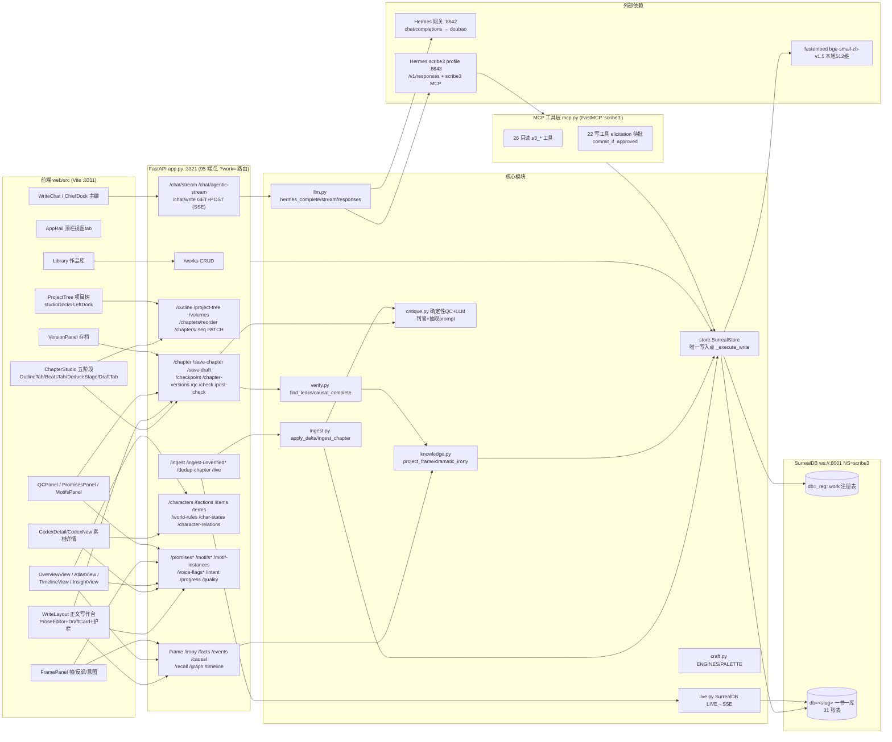
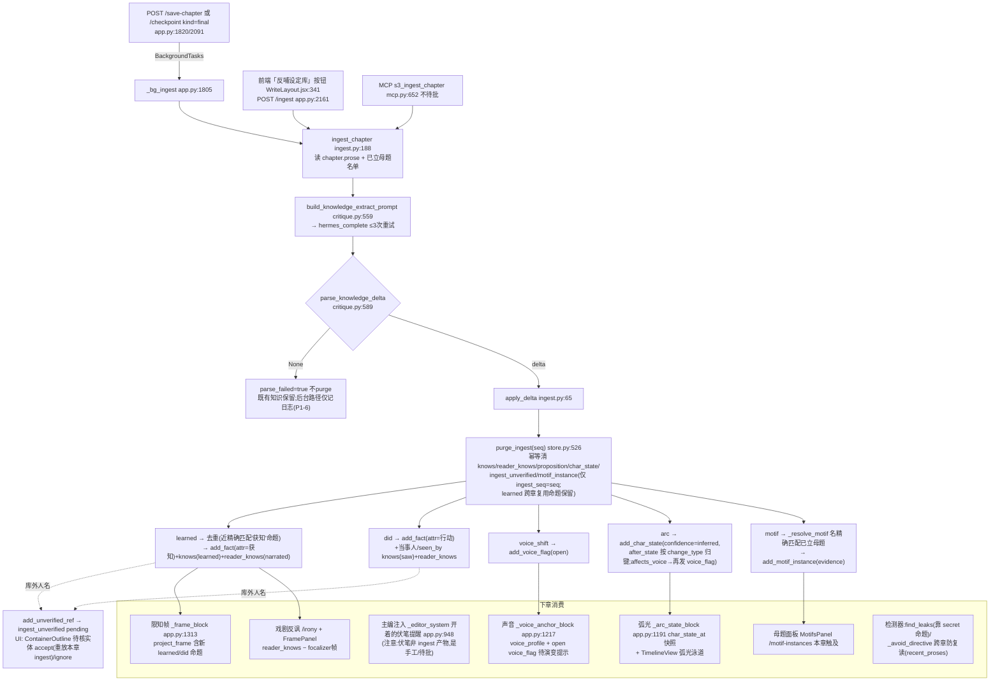
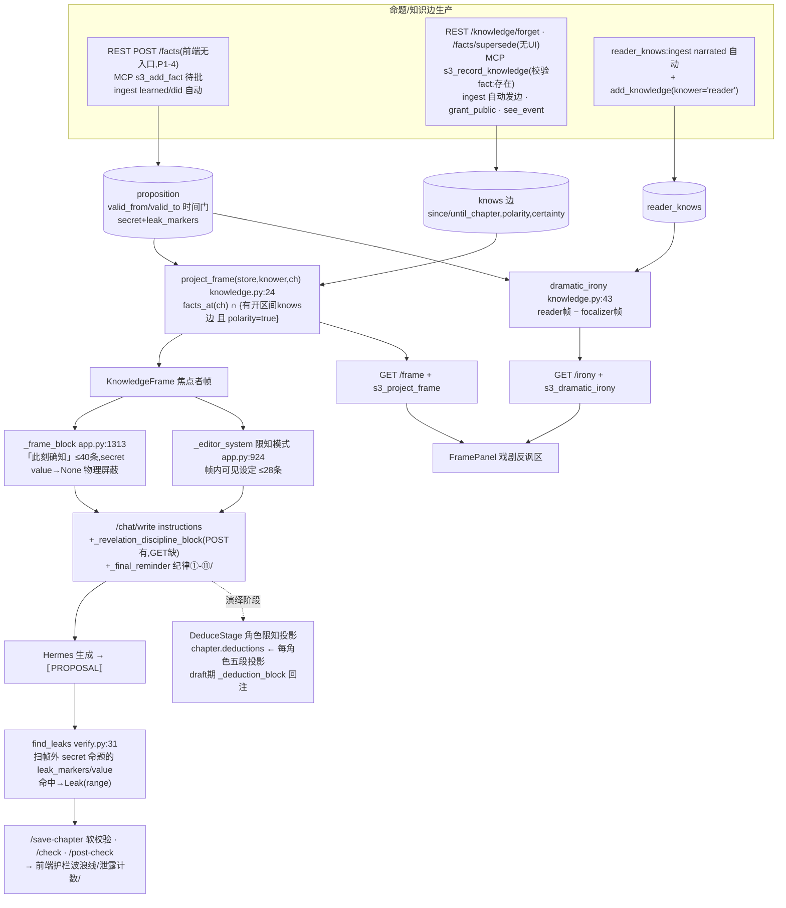

# scribe3 全系统架构与业务闭环审计

- **审计基准 commit**:`4b05dd58b8be9fd1aab8ea88227bd692720d11aa`(feat/audit3-fixes,"块一-B spec审查补齐")。工作区未提交改动不在审计范围。
- **审计范围**:后端 `scribe3/`(app.py 95 端点 / store.py 2870 行 / ingest / critique / craft / knowledge / verify / llm / mcp 26 只读+22 写 MCP 工具)、迁移 `migrations/*.surql` 51 个文件(001–052,**051 缺号**)、前端 `web/src` 44 个 jsx/js 模块。
- **方法**:逐 migration 拼出最终 schema → 按表逐字段反查生产者(CREATE/UPDATE/RELATE 语句)与消费者(SELECT/prompt 注入/前端渲染)→ 按作者工作流走业务闭环 → 汇总问题清单。所有结论均有 file:line 证据。
- **约定**:与《2026-07-03-工艺引擎强化-design.md》已规划项重合的发现标注 **[已规划]**,只验证其诊断、不展开修法。

---

## 1. 架构图

### 1.1 系统总览



关键架构事实:
- **一书一 DB**:`?work=<slug>` → `_store_for()`(app.py:90)按书取 store,LRU 缓存上限 8(app.py:58)。注册表在 `NS=scribe3/db=_reg` 的 `work` 表(store.py:44-103)。
- **写授权双通道**(app.py:6-10):REST=作者可信通道直写;MCP 写工具经 elicitation 待批(mcp.py:29-49)。例外:`s3_save_chapter`、`s3_ingest_chapter` 不待批(manuscript/客观回写)。
- **MCP 单库限制**:`mcp.setup_store()` 只连 `SCRIBE3_WORK`(默认 main)一个库(mcp.py:733-741),没有 work 路由——而 `/chat/write` 对**所有书**都带 `tools=[{type:mcp,server_label:scribe3}]`(llm.py:163-166)。详见问题 P0-2。
- **限知主防线是物理隔断**:渲染 prompt 只喂 `project_frame` 投影出的帧(app.py:1313 `_frame_block`),`find_leaks` 只是第二道兜底(verify.py:31)。

### 1.2 数据模型 ER 图(migrations 001–052 累积终态 + 隐式表)

```mermaid
erDiagram
  character {
    string name "ASSERT len>0"
    array_string aliases "029 option<array>"
    string backstory "option"
    bool backstory_secret "035 默认false"
    string importance "protagonist/major/minor/background"
    array_string personality_tags "030"
    string appearance "031"
    string personality_detail "031"
    string abilities "031 JSON串[{name,level,description,acquired_chapter}]"
    array weaknesses "031"
    int first_appearance "031"
    string surface_goal "031"
    string deep_need "031"
    string internal_conflict "031"
    string fear "031"
    datetime created "READONLY"
  }
  place {
    string name "ASSERT len>0 (027扩展字段已被038删除)"
  }
  proposition {
    string entity_id "014 (旧entity已被040删除)"
    record entity_link "026 option<record<character|place>> 从未写入"
    string attribute
    string value
    int valid_from "时间门"
    int valid_to "option null=惯性持续"
    bool secret "泄露=穿帮"
    array_string leak_markers "破绽词"
    array_float embedding "003 HNSW 512 COSINE"
    int ingest_seq "012 option NONE=作者直编"
    datetime created "READONLY"
  }
  event {
    string event_type "015 (etype已删)"
    int story_chapter "018 (valid_from已删)"
    int narrative_position "046 option 叙事位"
    string motivated_by_goal "option IPOCL"
    record location "013 option<record<place>>"
    array_string preconditions "013 无消费方"
    int draft_version "001 默认1 无读写"
    datetime tx_at "001 无读写"
  }
  knows {
    int since_chapter
    int until_chapter "option"
    bool polarity "false=误信 无生产者"
    string acquired_via "saw/told/inferred/given/learned/narrated"
    float certainty "036 默认1.0 投影不消费"
    int ingest_seq "012 option"
  }
  reader_knows {
    string proposition "fact:oid 串"
    int since_chapter
    int ingest_seq "037 option"
  }
  involves {
    string role "SUBJ/OBJ/WITNESS"
  }
  causes {
    string _ "event→proposition 无属性"
  }
  causal {
    string ctype
  }
  character_relation {
    string relation "26词受控表(029)"
    int since_chapter "ASSERT>=1"
    int until_chapter "028 option"
    string note "option"
  }
  chapter {
    int seq "record id=seq"
    string title
    string focalizer "option 本章限知视角"
    string prose "正文"
    string synopsis "044 大纲"
    string beats "048 JSON串[{text,done}]"
    string draft "048 草稿正文"
    string scene_truth "049 场景真相"
    string involved_characters "049 JSON串[id]"
    string deductions "049 JSON串[{character_id,character_name,prose}]"
    record volume "044 option<record<volume>>"
    int sort_order "044 展示序"
    string label "044 draft/revise/done/idea/beat 无设置UI"
    array_float embedding "016 HNSW"
    int qc_word_count "022"
    int scene_count "047"
    string scene_meta "047 JSON串"
    int qc_issues "047"
    int qc_causal "047"
    string qc_breakdown "047 JSON串五类"
    datetime updated
  }
  chapter_version {
    int seq
    string prose
    string label
    string kind "checkpoint/final(038 ASSERT)"
    object qc
    string stage "048 draft/final"
    string summary "048"
    string stats "048 JSON串{words,avg_sentence,dialog_count}"
    datetime created_at
  }
  volume {
    string title
    int sort_order
    string intro "option 无UI"
    string color "option 无UI"
    datetime updated
  }
  promise {
    string text
    int setup_chapter
    int payoff_chapter "option"
    string status "open/closed"
    string kind "promise/red_herring"
    array clues "045 [{chapter,note}]"
    string tier "052 option chapter/arc/book"
    int payoff_min "052 option"
    int payoff_max "052 option"
    string resolution "052 option 无生产/消费"
  }
  promise_audit {
    record promise "017 触发器写 无读者"
    int setup
    int payoff
    datetime closed_at
  }
  motif {
    string name
    string theme
    string echoes
    string unfolding
  }
  motif_instance {
    string motif_id "050"
    int chapter
    string evidence "option"
    int ingest_seq "option"
  }
  intent {
    string reader_feeling "单例 intent:main"
    string emotional_arc
    string red_lines
    int overdue_threshold "039 option 无UI"
    int total_word_goal "043 option"
    int daily_word_goal "043 option"
  }
  craft_rule {
    string kind "purple_regex/artifact_craft/cover_action"
    string pattern
    string note "option"
  }
  voice_evolution_flag {
    string character
    int trigger_chapter "021/033 option (seq已删)"
    string reason
    string status "open/done"
  }
  voice_profile {
    string character_id "029 SCHEMALESS"
    string style_summary
    array catchphrases
    object sentence_patterns
    object vocabulary_profile
    array tone_rules
    string internal_monologue_style
    array ooc_signals
    object reference_lines
    int version
    int last_updated_chapter "从未写入"
  }
  char_state {
    string character_id "028 SCHEMALESS"
    int chapter
    string change_type "ability/relation/personality/composite"
    string summary
    object before_state "042"
    object after_state "042"
    string trigger_event "option"
    string arc_phase "option"
    bool affects_voice "option true→自动voice_flag"
    string confidence "confirmed/inferred"
    int ingest_seq "042 option"
  }
  world_rule {
    string name "UNIQUE(038)"
    string category "magic/technology/social/physical/economic/political"
    string source "option"
    array_string capabilities
    string cost "option"
    array_string limitations
    array_string exceptions
    string scope "global/regional/faction_specific"
    int established_chapter "option"
    string note "option"
  }
  faction {
    string name "UNIQUE"
    string ideology "option"
    string status "active/dissolved/dormant/reformed"
    string leader "option"
    array_string known_members
    string public_face "option"
    string private_operation "option"
    bool private_operation_secret "035"
    int first_mention_chapter "option"
  }
  item {
    string name "UNIQUE SCHEMALESS"
    string category "option"
    string description "option"
    string current_owner "option"
    string symbolic_state "active/lost/destroyed/unknown"
    array state_history "编辑即清零"
    array special_properties
    int first_chapter "option"
  }
  term {
    string name "UNIQUE SCHEMALESS"
    string category "option"
    string definition "option"
    array aliases
    int first_mention_chapter "option"
  }
  ingest_unverified {
    string name
    int seq
    string role "learned_who/did_who/seen_by/arc_who"
    string status "pending/accepted/ignored"
  }
  daily_progress {
    string date "record id=YYYY-MM-DD UNIQUE"
    int words_written
    int words_total
    array chapters_touched "无消费"
    int save_count "无消费"
    datetime updated_at
  }
  meta {
    int last_saved_seq "017触发器 无读者"
    datetime last_saved_at
  }
  work {
    string slug "db=_reg 注册表"
    string title
    int ord
    datetime created
  }
  migration_ {
    datetime applied_at "_migration 幂等记录"
  }

  character ||--o{ knows : "in"
  knows }o--|| proposition : "out"
  reader_knows }o--|| proposition : "proposition(串引用)"
  event ||--o{ involves : "in"
  involves }o--|| character : "out"
  event ||--o{ causes : "in"
  causes }o--|| proposition : "out"
  event ||--o{ causal : "event→event"
  event }o--o| place : "location"
  character ||--o{ character_relation : "in/out"
  chapter }o--o| volume : "volume link"
  chapter ||--o{ chapter_version : "seq"
  promise ||--o{ promise_audit : "触发器"
  motif ||--o{ motif_instance : "motif_id(串)"
  character ||--o| voice_profile : "character_id(串)"
  character ||--o{ char_state : "character_id(串)"
  character ||--o{ voice_evolution_flag : "character(串)"
```



Schema 备注:
- SCHEMALESS 表:`char_state`、`voice_profile`、`item`、`term`、`work`、`_migration`、`promise_audit`(触发器隐式建表)、`meta`(隐式)。其余 SCHEMAFULL。
- 已删除的死列(034/038/039/040/041 清债):`word_stats` 表、`character.traits/motivation`、`place.geography/first_visit_chapter/political_affiliation/notable_events`、`voice_sample` 表、`voice_evolution_flag.seq`、`event.etype/valid_from/event_category/event_subtype`、`proposition.entity`。
- **051 迁移缺号**(050→052):`apply_schema` 按文件名 glob 排序,缺号无害,但暗示有一个迁移被撤走,应补占位说明防误会。
- **apply_schema 把失败迁移也标记为已应用**(store.py:320-329:except 后仍 `CREATE _migration`)——见问题 P1-7。

### 1.3 五阶段写作流程图(大纲→节拍→演绎→草稿→正文)

```mermaid
flowchart TD
  subgraph S1["① 大纲 OutlineTab (ChapterStudio.jsx:49)"]
    A1[读 GET /chapter?seq → synopsis]
    A2["写 PATCH /chapters/:seq {synopsis}<br/>失焦/切章 flush,dirtyRef 防丢"]
    A3[右栏 ChiefDock 讨论:GET /chat/stream<br/>prefix=正在写第N章大纲]
  end
  subgraph S2["② 节拍 BeatsTab (ChapterStudio.jsx:108)"]
    B1[读 chapter.beats JSON串→list]
    B2["写 PATCH /chapters/:seq {beats:[{text,done}]}"]
    B3[讨论 /chat/stream prefix=正在拆节拍]
  end
  subgraph S3["③ 演绎 DeduceStage (DeduceStage.jsx)"]
    C1["DeduceTree 左树:场景真相+涉及角色<br/>involved_characters 智能预填(按名匹配大纲/节拍)"]
    C2[生成:POST /chat/write chapter+focalizer<br/>truth→全知场景真相 / 角色→五段限知投影]
    C3["写 PATCH /chapters/:seq<br/>{scene_truth | deductions 读最新合并}"]
  end
  subgraph S4["④ 草稿 DraftTab (ChapterStudio.jsx:227)"]
    D1["读 GET /latest-draft?seq (chapter_version stage=draft 最新)"]
    D2["主编生成:POST /chat/write phase=draft<br/>后端注入 _deduction_block(场景真相+各角色投影)<br/>proposal→ChiefSlotContext.draftProposal→填入/追加"]
    D3["写 POST /save-draft?seq {prose,summary}<br/>= chapter.draft + chapter_version(stage=draft,kind=checkpoint)"]
    D4[采用为正文 → onAdopt 切 final tab]
  end
  subgraph S5["⑤ 正文 WriteLayout"]
    E1[读 GET /chapter /qc /facts /events /causal /promises]
    E2["主编写作:POST /chat/write(全套注入块,见1.5)<br/>⟦PROPOSAL⟧围栏→DraftCard 接受/弃用"]
    E3["护栏:POST /check 3s防抖(QC+leaks+issues range)<br/>POST /post-check 全量体检(+discipline LLM+setting+跨章矛盾)"]
    E4["保存 POST /save-chapter<br/>= UPSERT chapter(prose+embedding+qc缓存)<br/>+ 自动 chapter_version(final) + 后台 ingest"]
    E5["存为正文 = persist + POST /checkpoint kind=final<br/>(再次触发后台 ingest → 竞态,见P0-1)"]
    E6[存档点 POST /checkpoint kind=checkpoint<br/>回看/恢复 GET /chapter-versions /chapter-version/:vid]
  end
  S1-->S2-->S3-->S4-->S5
  E4-.后台 BackgroundTasks._bg_ingest.->ING[ingest 反哺,见1.4]
```

要点:
- 大纲/节拍/演绎的数据全挂在 `chapter` 行的 `synopsis/beats/scene_truth/involved_characters/deductions` 列(049 迁移,JSON 串绕 SCHEMAFULL 嵌套校验),经 `update_chapter_meta` 白名单 PATCH(store.py:2823-2870)。
- 草稿与正文物理分离:`chapter.draft` vs `chapter.prose`;草稿区不跑护栏/QC(设计有意)。
- `phase` 参数只影响 prompt(`_phase_role_block` app.py:1499 + draft 期 `_deduction_block` app.py:1515),不影响数据落点。

### 1.4 ingest 反哺闭环图



闭环判定:learned/did/arc/motif/voice_shift 五类抽取物都有≥1 个真实消费出口(帧注入/反讽/弧光块/母题面板/声音待演变提示),**主干闭环成立**。断点:①失败静默(P1-6);②双任务竞态(P0-1);③伏笔不在 ingest 抽取范围内(design 缺口③,M1 已规划 ingest 联动 last_refresh_at);④事件(event)不在抽取范围 → 因果/时间线事件泳道靠 MCP 手工喂(P1-5)。

### 1.5 限知引擎数据流图



限知红线核查结果:✅ 帧投影是唯一门控(secret 只是 verify 元数据,不是门控——ontology.py:28 注释与实现一致);✅ SurrealDB 事件触发器不写 knows(017 注释红线,已核实);✅ ingest reader_knows 与 knows 同步落,`dramatic_irony` 可计算;⚠ 生产侧断链见 P1-4/P1-5。

---

## 2. 字段级生产-消费闭环分析(全量,一表一节)

图例:✅ 闭环 | 🟡 半闭环(有产有消但语义不完整/单侧受限) | 🔴 断链(类别标注:只产不消/只消不产/不对齐/UI黑洞)。"MCP"均指经 elicitation 待批后的写。

### 2.1 character

| 字段 | 生产者 | 消费者 | 判定 |
|---|---|---|---|
| name | POST /characters(app.py:333)→add_entity(store.py:385);MCP s3_add_character;accept_unverified(store.py:583) | characters()(store.py:663)→/entities→前端全域;_codex_block/_editor_system 注入;resolve_entities;validate_* | ✅ |
| aliases | POST/PATCH /characters;add_entity | resolve_entities 路2(store.py:2225);validate_setting/validate_cross known_names;/entities→CodexView | ✅ |
| backstory | 同上 | _codex_block(app.py:890 前48字注入);/entities(secret 掩码 app.py:190);setting_completeness 缺项检查 | ✅ |
| backstory_secret | 同上 | /entities `_mask_field`;project_tree secret 角标(store.py:2760) | ✅ |
| importance | PATCH /characters | WriteLayout 在场面板分组(WriteLayout.jsx:810);project_tree meta | ✅ |
| personality_tags | POST/PATCH | setting_completeness(store.py:2062 缺项);/entities→CodexView | ✅ |
| appearance / personality_detail / weaknesses / surface_goal / deep_need / internal_conflict / fear / first_appearance | PATCH /characters(app.py:342 白名单 store.py:107) | /entities→CodexView DetailView 档案区(展示+编辑) | 🟡 落库+UI 编辑闭环,但**写作 prompt 完全不注入**(`_editor_system` 只用 name/backstory)——角色深描白填 **[已规划 M3 静态锚]** |
| abilities(JSON串) | PATCH /characters;CodexView AbilitiesRow(CodexView.jsx:112) | CodexView 展示;`_arc_state_block` 不读它(读 char_state) | 🟡 同上,静态能力表不进 prompt |
| created | DB VALUE time::now() | 无读者 | 🟡 审计元数据,可接受 |

### 2.2 place

| 字段 | 生产者 | 消费者 | 判定 |
|---|---|---|---|
| name | **无产品入口**:仅 migrate.py/seed_demo/tools 脚本 add_entity(kind=place);REST/MCP/UI 均无"新建地点" | all_entities()(store.py:684)→/entities;setting_completeness(store.py:2054);validate_* known_names;event.location 引用 | 🔴 **只消不产(UI黑洞)**:新书永远"缺地点",setting_completeness 恒报缺失且无处补(P1-5) |

### 2.3 proposition(限知引擎核心载体)

| 字段 | 生产者 | 消费者 | 判定 |
|---|---|---|---|
| entity_id | POST /facts(app.py:373)、PATCH /facts、supersede_fact、MCP s3_add_fact、ingest add_fact(ingest.py:90/109) | facts_at/fact/semantic_recall/hybrid/graph_recall/_keyword_search(store.py 各处);/facts→WriteLayout 本章事实;_frame_block/_editor_system 注入 | 🟡 后端全闭环;**前端 api.addFact/editFact/delFact 定义了但零调用**(api.js:78-80),项目树素材支无"命题"分类 → 作者在 UI 里无法创建/编辑命题(P1-4) |
| attribute / value | 同上 | 同上 + find_leaks(value 作兜底破绽词) | 🟡 同上 |
| valid_from / valid_to | 同上;supersede_fact 关闭先驱(store.py:446) | facts_at 时间门(store.py:653);graph_recall AND valid_from<=ch | ✅ 后端;UI 无 supersede 入口(api.js 无 wrapper)🔴 UI黑洞 |
| secret / leak_markers | 同上(REST/MCP 可设) | find_leaks(verify.py:37-47);_facts 掩码(app.py:103);graph 私密节点;setting_completeness"缺私密伏线" | 🟡 消费链完整,但 UI 无处录入 secret 命题与 leak_markers → **限知泄露检测在纯 UI 工作流下空转**(P1-4) |
| embedding | add_fact→semantic_index(store.py:412);edit_fact 重建(app.py:397) | semantic_recall/hybrid_recall/graph_recall(HNSW) | ✅ |
| ingest_seq | ingest 路径 add_fact(ingest_seq=seq) | purge_ingest 幂等清理(store.py:526) | ✅ |
| entity_link | **从未写入**(add_fact 不写;仅 026 定义) | graph_recall `entity_link.name AS subject`(store.py:741)→永远 None,回退 entity_id | 🔴 **只消不产**:026"双写阶段"从未开始,列+索引是摆设 |

### 2.4 event

| 字段 | 生产者 | 消费者 | 判定 |
|---|---|---|---|
| event_type / story_chapter / motivated_by_goal | MCP s3_add_event(mcp.py:395,待批);tools 脚本。**REST 无创建端点、ingest 不抽事件、UI 无入口** | events_at(store.py:1558)→/events→WriteLayout 本章事件;causal_complete(verify.py:51);timeline 事件泳道;max_chapter 兜底;_recap_block(app.py:1351) | 🔴 **生产端断链**:纯 UI 工作流下 event 表恒空 → `/causal` 恒 []、`qc_causal` 恒 0(假绿)、时间线事件泳道空(P1-5) |
| location | s3_add_event | events_at 回读;timeline refs.location | 🟡 同上游断链 |
| preconditions | s3_add_event | events_at 回读后**无人检查**(verify 不校验前置条件) | 🔴 只产不消(摆设) |
| narrative_position | s3_add_event;PATCH /events/:eid/narrative(app.py:210) | timeline axis=narrative 投影(store.py:1680);TimelineView 双轴切换 | 🟡 读侧闭环;**api.patchEventNarrative(api.js:82)零调用**——前端只能看不能改叙事位 🔴 UI黑洞 |
| draft_version / tx_at | 无(默认值) | 无 | 🔴 只产不消(001 双时态骨架,从未启用) |
| involves/causes/causal 边 | add_event(store.py:489-510) | events_at 子查询→participants/effects/causal_in;see_event 看见即知道(knowledge.py:57);graph_recall 子图;timeline causal_in 弧线 | 🟡 同 event 上游断链 |

### 2.5 knows(RELATION character→proposition)

| 字段 | 生产者 | 消费者 | 判定 |
|---|---|---|---|
| since_chapter / until_chapter | add_knowledge(store.py:418,REST 无直接端点;MCP s3_record_knowledge;ingest;grant_public;forget_knowledge 设 until) | load_knowledge(store.py:1858)→project_frame 时间门;graph knows 边 | ✅ |
| polarity | 无人写 false(所有路径默认 true) | project_frame 过滤 `k.polarity`(knowledge.py:35) | 🔴 **只消不产**:"误信"机制有门没货 |
| acquired_via | ingest(learned/saw/narrated);MCP(saw/told/inferred);grant_public(given) | load_knowledge 回读→KnowledgeEdge;**无任何逻辑按来源区分** | 🟡 记录性字段;注意 s3_record_knowledge 文档写 "heard" 不在枚举(P2-14) |
| certainty | add_knowledge 恒写 1.0(无人传≠1.0) | load_knowledge 回读;project_frame **不按 certainty 过滤/加权** | 🔴 只产不消(036 落列后无语义) |
| ingest_seq | ingest 路径 | purge_ingest | ✅ |

### 2.6 reader_knows

| 字段 | 生产者 | 消费者 | 判定 |
|---|---|---|---|
| proposition / since_chapter | ingest narrated(ingest.py:93/119);add_knowledge(knower='reader') | load_knowledge→project_frame('reader')→dramatic_irony;/irony;FramePanel | ✅ |
| ingest_seq | ingest | purge_ingest(037) | ✅ |

### 2.7 chapter(最重的表)

| 字段 | 生产者 | 消费者 | 判定 |
|---|---|---|---|
| seq | save_chapter UPSERT(record id=seq);ContainerOutline 新建章 max+1(ContainerOutline.jsx:119) | 全域主键 | ✅ |
| title | save_chapter(WriteLayout persist 带 chTitle);update_chapter_meta 白名单 | list_chapters/outline/project_tree/前端各处 | 🔴 **UI黑洞**:`patchChapter({title})` 无任何调用、WriteLayout 无标题输入框(仅加载显示)→ 章名永远是建章时的"第N章",改不了 |
| focalizer | WriteLayout 视角选择器→save_chapter;DeduceStage 不写 | get_chapter→四阶段 MetaBar;_frame_block/_editor_write_system;find_leaks;project_tree pov 角标 | ✅ |
| prose | save_chapter(手动/接受草稿/切章autosave/版本恢复);dedup_chapter 改写回存 | get_chapter→编辑器;recent_proses(防复读/QC);ingest;embedding;/qc /check | ✅ |
| synopsis | OutlineTab PATCH;ContainerOutline 行内编辑 | outline()/Corkboard/Outliner;DeduceTree 智能预填;ChiefDock 阶段上下文(间接) | ✅(但**不注入写作 prompt**——大纲写了,主编靠作者口述,🟡 [已规划 M5/M6 方向]) |
| beats | BeatsTab PATCH(JSON串) | get_chapter→BeatsTab;DeduceTree 预填文本 | ✅(同上,**不注入 prompt**,🟡) |
| draft | save_chapter_draft(store.py:1259) | get_chapter;DraftTab 不读它(读 latest-draft 版本)——chapter.draft 仅 /chapter 回带 | 🟡 双真相源:chapter.draft 与 chapter_version(stage=draft) 并存,读侧只用后者;chapter.draft 实际是冗余写 |
| scene_truth / involved_characters / deductions | DeduceStage/DeduceTree PATCH(update_chapter_meta store.py:2832) | get_chapter→DeduceStage/MetaBar;draft 期 _deduction_block 注入 prompt(app.py:1515) | ✅(本轮块一修复后闭环成立) |
| volume / sort_order | reorder_chapters(store.py:2791);update_chapter_meta;044 回填 | outline() Python 排序;project_tree 卷分组 | ✅ |
| label | **无生产**:update_chapter_meta 白名单有,但前端零调用 | ChapterCard/Outliner 渲染色标(ChapterCard.jsx:34) | 🔴 **UI黑洞**:色标图例画了,永远不会亮 |
| embedding | save_chapter(title+前200字) | chapter_recall(MCP s3_chapter_recall)——REST 无端点、UI 无入口 | 🟡 仅 agent 可用 |
| qc_word_count | save_chapter | stats()/outline→字数;daily_progress delta;/quality;Library 书卡 | ✅ |
| scene_count / scene_meta | save_chapter _compute_chapter_caches(store.py:1139);backfill | outline() 场景;project_tree 场景子节点 | ✅ |
| qc_issues / qc_causal / qc_breakdown | save_chapter;backfill | outline/quality/project_tree qc 角标;OverviewView 弱章 | ✅(qc_causal 因 event 断链恒 0,假绿,见 P1-5) |
| updated | DB VALUE | 无读者 | 🟡 可接受 |

### 2.8 chapter_version

| 字段 | 生产者 | 消费者 | 判定 |
|---|---|---|---|
| seq/prose/label/kind/qc | POST /checkpoint(app.py:2091);save-chapter 自动 final 版(app.py:1826);save-draft(stage=draft) | /chapter-versions→VersionPanel;/chapter-version/:vid 回看/恢复;latest_draft_version | ✅ 功能闭环;⚠ **每次保存都自动落一条 kind=final 全文版本**(含切章 autosave),与 032 设计"不存每次生成、去噪"相悖 → 版本列表噪声+库膨胀(P2-1) |
| stage / summary / stats | save-draft/save-chapter(_prose_stats app.py:2102) | latest-draft 恢复;list_chapter_versions 回带;**VersionPanel 不显示 stage/summary/stats**(VersionPanel.jsx 只用 label/kind/qc) | 🟡 stats/summary 产了 UI 不露出 |

### 2.9 volume

| 字段 | 生产者 | 消费者 | 判定 |
|---|---|---|---|
| title / sort_order | POST/PATCH /volumes(BinderLayout/ContainerOutline/ProjectTree 重命名) | outline/project_tree;reorder 基址 | ✅ |
| intro | API 可写(VolumeReq) | **无任何 UI 读写**(grep 0 命中) | 🔴 只产不消 |
| color | api.addVolume 恒传 null(api.js:105) | **无任何 UI 消费**(卷色带没画) | 🔴 只产不消 |

### 2.10 promise

| 字段 | 生产者 | 消费者 | 判定 |
|---|---|---|---|
| text / setup_chapter / kind | POST /promises-new(CodexNew);PATCH /promises/:pid(CodexDetail);MCP s3_plant_promise;migrate | list_promises→/promises(+overdue 单源 _overdue_flag store.py:154)/ledger(store.py:1057)→InsightView 台账三栏/PromisesPanel/OverviewView/WriteLayout 伏笔面板;_editor_system 开着的承诺线注入(app.py:948);timeline 伏笔泳道;project_tree 素材支 | ✅ 主链闭环;🔴 **不对齐**:CodexDetail 编辑用字段名 `promise_kind`(CodexView.jsx fieldMap)而行数据是 `kind` → 类型栏永远显示空;保存任何字段时 PromIn.promise_kind 默认 'promise' → **red_herring 被静默重置**(P1-3) |
| status / payoff_chapter | POST /promises/:pid/advance(payoff≥setup 校验 store.py:1005);MCP s3_advance_promise | 台账/quality/foreshadow 统计;timeline payoff 点;017 触发器 | ✅ |
| clues[] | POST /promises/:pid/clues(范围校验 app.py:496);MCP s3_add_clue;DELETE …/clues/:idx | ledger clues 排序;InsightView 线索点/删除 | ✅ |
| tier / payoff_min / payoff_max | plant_promise 按 tier 写(store.py:971);**REST PromIn 不收 tier**(app.py:437)→UI 建的伏笔恒 chapter 级;update_promise 白名单不含(store.py:117)→不可改 | 唯一消费者 promise_window_state(store.py:170)**本身零调用**;list_promises 回带但前端忽略 | 🔴 只产不消 **[已规划 M1 半落地:052 schema 先行,窗口注入/检测器未接]** |
| resolution | plant 恒写 NONE;无人更新 | 无人读 | 🔴 双向死 **[已规划 M1]** |
| (窗口函数) promise_window_state + last_refresh_at | last_refresh_at 无迁移定义、无人写 | promise_window_state 读(store.py:180)但该函数无任何调用方 | 🔴 死代码 **[已规划 M1:ingest 联动 last_refresh_at/refresh_count]** |

### 2.11 promise_audit(017 触发器隐式表)

| 字段 | 生产者 | 消费者 | 判定 |
|---|---|---|---|
| promise/setup/payoff/closed_at | ev_promise_closed 触发器(017) | **全仓零读者** | 🔴 只产不消 |

### 2.12 motif / motif_instance

| 字段 | 生产者 | 消费者 | 判定 |
|---|---|---|---|
| motif.name/theme/echoes/unfolding | POST /motifs-new、PATCH(CodexNew/CodexDetail);migrate | /motifs→WriteLayout 母题面板/MotifsPanel;_motif_block prompt 注入(app.py:1289);motif_terms 白名单(防复读放行 store.py:1302);ingest 抽取候选名单 | ✅ |
| motif_terms 内置硬编码词 | store.py:1314 写死乱世铜炉专名 | 跨章复读白名单 | 🟡 **题材泄漏**:新书也会放行"镇煞钉/奈何谷"等(P2-8) |
| motif_instance.motif_id/chapter/evidence/ingest_seq | ingest motif 抽取(ingest.py:171)→add_motif_instance;purge 幂等 | /motif-instances→MotifsPanel"本章触及"高亮+引文 | ✅(本轮新接通) |

### 2.13 intent(单例 intent:main)

| 字段 | 生产者 | 消费者 | 判定 |
|---|---|---|---|
| reader_feeling / emotional_arc / red_lines | PUT /intent(NorthStarBar/FramePanel/InsightView GoalDialog) | _editor_system 北极星注入(app.py:953);FramePanel/NorthStarBar 展示 | ✅ |
| overdue_threshold | API 可写(IntentIn);**无 UI 字段**(GoalDialog 只有字数目标) | /promises、/quality、/promises/ledger 阈值覆盖(app.py:286/299/830) | 🔴 只消不产(UI黑洞):per-work 阈值实际改不了 |
| total_word_goal / daily_word_goal | InsightView GoalDialog(InsightView.jsx:354) | /progress 目标线/达标 toast;/works 书卡进度;Library;WriteLayout 顶栏 | ✅ |
| (写风险) | set_intent 用 `UPSERT CONTENT` 整体替换(store.py:1481):None 字段不写入 → 若前端 GET /intent 失败(catch 留默认三字段)再保存,会**静默抹掉目标/阈值** | — | 🟡 P2-12 |

### 2.14 craft_rule

| 字段 | 生产者 | 消费者 | 判定 |
|---|---|---|---|
| kind/pattern/note | seed_craft_rules(仅乱世系种子 store.py:873);MCP s3_craft_rule_add/remove(待批)。**REST/UI 均无** | build_craft_block prompt 注入(app.py:1408/1587);purple_patterns→/check、/post-check quality_issues extra(app.py:1918/2013) | 🟡 消费链健全;生产端只有 agent 通道,作者在 UI 看不到也改不了本书题材规则 🔴 UI黑洞;另:`cover_action` 枚举值无任何专门消费逻辑(与 purple_regex 不同,只会被当普通规则文本注入) |

### 2.15 voice_evolution_flag

| 字段 | 生产者 | 消费者 | 判定 |
|---|---|---|---|
| character/trigger_chapter/reason/status | ingest voice_shift(ingest.py:128);add_char_state(affects_voice=True)(store.py:2010);CodexView 弧光表单勾"影响声音" | list_voice_flags→GET /voice-flags(**前端零调用**);_voice_anchor_block"声音待演变提示"注入(app.py:1259);fold_voice_flags 折叠(store.py:911) | 🟡 prompt 消费闭环;**resolve/fold 环断在 UI**:/voice-flags、/voice-flags/:fid/resolve、/voice-flags/fold 三端点无任何前端入口 🔴 UI黑洞(P1-11);MCP 侧 s3_resolve_voice_flag 文档引用的 `s3_list_voice_flags` 工具**不存在**(mcp.py:631)→ agent 拿不到 flag_id(P2-13) |

### 2.16 voice_profile

| 字段 | 生产者 | 消费者 | 判定 |
|---|---|---|---|
| style_summary/catchphrases/tone_rules/ooc_signals/version | MCP s3_set_voice_profile(仅 4+1 节);fold_voice_flags 合并回写 | _voice_anchor_block 注入(9 节尽读 app.py:1217-1258);check_ooc(store.py:2120)→validate_setting OOC;list_voice_profiles 对白速记 | 🟡 prompt 消费完整;**生产端只有 MCP,且 UI 完全不展示声音指纹**(角色详情无声音区)🔴 UI黑洞 |
| sentence_patterns/vocabulary_profile/internal_monologue_style/reference_lines | s3_set_voice_profile **不收这 4 节**(mcp.py:556 只传 4 字段);仅 fold 合并可能保留 | _voice_anchor_block 读(P3-d 接的) | 🔴 不对齐:消费方等 9 节,生产方最多写 5 节 |
| last_updated_chapter | **无人写** | 无人读 | 🔴 schema 死列 |

### 2.17 char_state

| 字段 | 生产者 | 消费者 | 判定 |
|---|---|---|---|
| character_id/chapter/change_type/summary/after_state/arc_phase/affects_voice/confidence/trigger_event | POST /char-states(CodexView 弧光表单);MCP s3_add_char_state;ingest arc 自动(confidence=inferred) | char_state_at 快照(store.py:2013)→_arc_state_block prompt(app.py:1191)+GET /char-state-at(CodexView 时点查询);list_char_states→/char-states(CodexView 时间线);timeline 弧光泳道;MCP s3_character_state/timeline | ✅ 本表是反哺闭环的样板 **[design 缺口①诊断"完全不注入"已过时——_arc_state_block 已接;但仅注入焦点者一人、且无 lie_belief 等结构化弧光,M3 仍成立]** |
| before_state | MCP/REST 可传;ingest 不写 | list_char_states 回带;char_state_at 不用;UI 不显示 | 🔴 基本只产不消 |
| ingest_seq | ingest | purge_ingest | ✅ |

### 2.18 character_relation

| 字段 | 生产者 | 消费者 | 判定 |
|---|---|---|---|
| relation/since_chapter/note/until_chapter | POST /character-relations、/evolve、/end(实体存在校验);MCP s3_add_character_relation/s3_evolve_relation。**前端只读不写** | relations_at(店1895)→graph 关系边→AtlasView;/character-relations→CodexView 关系区(只读列表);_all_relations→timeline 关系泳道(since→until 全史) | 🟡 读侧三处闭环;写侧 🔴 UI黑洞:界面上无法建立/演变/终止关系(只能靠 agent 待批)**[M4 关系动态矩阵已规划,但"UI 无写入口"不在其范围]** |

### 2.19 world_rule

| 字段 | 生产者 | 消费者 | 判定 |
|---|---|---|---|
| name/category/source/capabilities/cost/limitations/exceptions/established_chapter/note | POST /world-rules(CodexNew/CodexDetail,同名删后建);MCP s3_add_world_rule | /world-rules→CodexDetail;_codex_block 注入(名+代价 app.py:903);validate_setting limitations 粗查(store.py:2285);setting_completeness;MCP s3_list_world_rules | ✅ |
| scope | 同上 | 同上 | 🔴 **不对齐**:前端 scopeOptions=`['global','local']`(CodexView.jsx:340),DB ASSERT 只认 `global/regional/faction_specific`(027)→ 选"local"保存必被 SurrealDB 拒绝(P1-8) |

### 2.20 faction

| 字段 | 生产者 | 消费者 | 判定 |
|---|---|---|---|
| name/ideology/status/leader/known_members/public_face/first_mention_chapter | POST /factions(CodexNew/CodexDetail);MCP s3_add_faction | /factions(掩码)→CodexDetail;_codex_block;setting_completeness;project_tree | ✅(status/first_mention_chapter 无 UI 字段但整行回传保留,不丢) |
| private_operation + private_operation_secret | 同上 | /factions `_mask_field`(app.py:584);s3_list_factions 掩码(mcp.py:166) | ✅ |
| (幽灵)aliases | 无此字段 | validate_cross_chapter_consistency 读 `fc.get("aliases")`(store.py:2365) | 🔴 只消不产(恒空,无害但误导) |

### 2.21 item

| 字段 | 生产者 | 消费者 | 判定 |
|---|---|---|---|
| name/category/description/current_owner/special_properties/first_chapter | POST /items(CodexNew/CodexDetail,**删后建**);MCP s3_add_item | /items→CodexDetail;_codex_block 物件名;resolve_entities;validate_setting 状态校验 | ✅ |
| symbolic_state | 同上(编辑=重建) | validate_setting"lost/destroyed 出现在正文"(store.py:2263);CodexDetail select | ✅ |
| state_history | **唯一写者 update_item_state(store.py:2173)无任何 REST/MCP/UI 调用**(仅 tools/e2e_test.py);add_item 重建时恒置 `[]` | CodexView ItemStateHistory 展示 | 🔴 **双重断链**:①状态变迁 API 不可达;②在 CodexDetail 改任何物品字段都会 DELETE+CREATE 把历史清零(P1-9) |

### 2.22 term

| 字段 | 生产者 | 消费者 | 判定 |
|---|---|---|---|
| name/category/definition/aliases/first_mention_chapter | POST /terms(CodexNew/CodexDetail);MCP s3_add_term | /terms→CodexDetail;_codex_block 术语注入;resolve_entities 别名路;validate_* known_names | ✅(aliases 无 UI 编辑字段,🟡 小缺) |

### 2.23 ingest_unverified

| 字段 | 生产者 | 消费者 | 判定 |
|---|---|---|---|
| name/seq/role/status | ingest _resolve_char 未命中(ingest.py:19);purge 清理 | GET /ingest-unverified→ContainerOutline 待核面板;accept(建角色+**重放该章 ingest 回填被阻塞的边** store.py:583)/ignore | ✅ 设计闭环良好 |

### 2.24 daily_progress

| 字段 | 生产者 | 消费者 | 判定 |
|---|---|---|---|
| date/words_written/words_total | save_chapter→_record_daily_progress(store.py:1327,delta=全书净增,不倒扣) | progress()(store.py:1353)→/progress→InsightView 进度面板(曲线/热力/streak/理想线)+WriteLayout 顶栏+达标 toast | ✅ |
| chapters_touched / save_count | _record_daily_progress 累加 | **progress() 不返回,无任何读者** | 🔴 只产不消 |
| updated_at | 同上 | 无 | 🟡 |

### 2.25 chapter QC 相关端点级闭环(非表)

| 产物 | 生产者 | 消费者 | 判定 |
|---|---|---|---|
| quality_flags 五类 | critique.py:242 | /qc /check /post-check /save-chapter、save 时缓存 qc_breakdown、s3_qc_chapter | ✅ |
| quality_issues(带 range) | critique.py:287 | /check /post-check issues→ProseEditor 波浪线/悬浮卡/"改这处" | ✅(F-05 闭环) |
| find_cross_chapter_repetitions / duplicate_lines / emotion_telling | critique.py:47/643/794 | /qc /save-chapter /post-check→QCPanel/保存返回 | ✅ |
| **find_parallelism / find_poetic_fragments / find_unbalanced_quotes / find_watch_regression** | critique.py:695/742/761/777(双POV验收时新建) | **全仓零生产消费**(仅 tests)——不在 quality_flags、不在 /qc、不在 /post-check、pw.mjs 也不调 | 🔴 **只产不消**(P1-10)**[与 M7 检测器扩容同族但 M7 未列这4个,不算已规划]** |
| discipline_truncate(LLM 判官) | critique.py:485 | GET /discipline(**前端零调用** 🔴)、/post-check(前端有)、s3_discipline_check | 🟡 |
| rewrite_cross_repetitions | critique.py:124 | POST /dedup-chapter(**前端零调用** 🔴 UI黑洞)、s3_dedup_cross | 🟡 跨章复读"治"层只有 agent 能按 |
| soak.py(build_soak_prompt/parse_soak) | 无调用方 | _soak_block 只等 seed_words,**前端从不传 seed_words、无 /soak 端点** | 🔴 双向死(浸泡链路:生产者缺失+消费者空转) |
| CircuitBreaker(llm.py:21) | 从未实例化 | 无 | 🔴 只产不消(熔断保护是纸面) |
| _check_daily / _sema(app.py:63-77) | 定义后**零调用** | 无 | 🔴 只产不消:LLM 日上限/并发上限完全未生效(P1-12) |
| orphan_knowledge_edges(store.py:1814) | — | 无调用方(诊断工具没接体检) | 🔴 只产不消 |
| meta:manuscript(017 触发器) | 每次章保存写 last_saved_seq/at | 无读者 | 🔴 只产不消 |
| health.py/qc_scan.py 体检 | cron 入口 | OVERDUE_SPAN=3 硬编码(health.py:11),**不读 intent.overdue_threshold、且只连 db=main** | 🟡 口径漂移+单书(P2-9) |

---

## 3. 业务闭环分析(作者工作流为轴)

### 3.1 建书 → 多书隔离
- ✅ Library 建书→`create_work`(store.py:90)登记 `_reg` + 独立 DB apply_schema;删书有确认框、main 保护;REST 全线 `?work=` 路由,数据物理隔离。
- 🔴 **MCP 层无隔离**:`python -m scribe3.mcp` 固定连 `SCRIBE3_WORK`(默认 main)。`/chat/write`(所有书共用)带 scribe3 MCP 工具 → 写第二本书时,主编的 `s3_project_frame/s3_list_promises/s3_semantic_recall` 读到的是 **main 的数据**,待批写工具批准后也**写进 main**。instructions 注入的是对的书(_editor_system 从 work store 取),工具联查是错的书——同一轮对话里两套世界观混流。`/chat/agentic-stream` 已因此被前端弃用(ChiefDock.jsx:247 恒 `agentic:false`),但 `/chat/write` 这条主写作链**还在带工具**(app.py:986 注释只承认了 agentic-stream 的问题)。→ P0-2。
- 🟡 `/works` 每次列表对每本书开 store+stats+intent(app.py:128-142),store LRU 上限 8:书多时反复建连/驱逐,且驱逐会 `close()` 可能正被后台 ingest 使用的连接(app.py:95-97 vs BackgroundTasks)→ P2-2。

### 3.2 立设定/角色
- ✅ 角色/势力/物品/术语/世界规则:项目树素材支 + CodexNew/CodexDetail 全 CRUD;secret 掩码链完整。
- 🔴 **命题(proposition)、地点(place)、事件(event)、关系(character_relation 写)、声音指纹、题材规则在 UI 没有生产入口**(§2.3/2.2/2.4/2.18/2.16/2.14)。这不是长尾:命题+secret+leak_markers 是限知引擎的燃料,事件是因果校验/时间线的燃料。纯 UI 作者得到的是:知识帧只有 ingest 自动抽的"获知/行动"命题、时间线只有伏笔/弧光/关系三条泳道、`/causal` 恒绿。绕行成本 = 必须开 Hermes agent 会话走待批工具,或直接 curl。
- 🟡 setting_completeness 的"缺私密伏线/缺地点"提示(OverviewView)指出的缺口,作者在产品内**无法补**——提示了一个死胡同。

### 3.3 大纲 → 逐章五阶段
- ✅ 五阶段 tab 流转顺畅;各阶段 dirtyRef+失焦 flush+卸载兜底(本轮块一修复);草稿软门提示未演绎角色;演绎智能预填 involved_characters。
- 🟡 大纲/节拍**不注入写作 prompt**(_editor_write_system 无 synopsis/beats 块)——作者在①②阶段写的东西,⑤阶段主编看不见,要靠作者在聊天里复述(draft 阶段 ChiefDock 的 prefix 只有一句"正在起草稿")。[已规划 M5/M6 部分覆盖]
- 🔴 GET/POST `/chat/write` 注入块不对称:GET 缺 `_revelation_discipline_block`(app.py:1396-1416 vs 1583)。前端全走 POST 不受影响,但 gen3.py 驱动与任何 GET 调用方拿到的是"少一层限知纪律"的主编 → P2-4。

### 3.4 ingest 反哺 → 质检 → 修订
- ✅ 手动"反哺设定库"按钮:busy 态、parse_failed 提示、待核实体计数、accept 重放回填——这段 UX 是全系统错误路径处理的标杆。
- 🔴 **自动路径静默**:每次 /save-chapter(含切章自动保存)后台 ingest,失败只写服务端日志(app.py:1813-1817),作者以为反哺了其实没有;下章限知帧悄悄缺料。→ P1-6。
- 🔴 **"存为正文"双 ingest 竞态**:WriteLayout"存为正文"按钮先 `persist`(→/save-chapter→bg ingest #1)再 `/checkpoint kind=final`(→bg ingest #2)(WriteLayout.jsx:626-632)。两个任务并发:T2 的 `purge_ingest` 在 T1 写入前执行 → T1+T2 的产物**双份落库**(knows/reader_knows/char_state/motif_instance 重复),或相互删写交错。每点一次"存为正文"必排两个任务,不是边缘场景。→ P0-1。
- 🟡 每次保存(含自动保存)都触发一次全章 LLM 抽取:成本高且 `_check_daily/_sema` 限流是死代码(P1-12);频繁 purge+重写也放大 3.4 竞态面。
- ✅ 质检消费:护栏 3s 防抖 /check、保存返回 QC、/post-check 全量(discipline fail-open、degraded_stages 如实回报)、issues range 点击定位、"让主编改这处"回环到改写链。修订环成立。
- 🔴 4 个已实现检测器未接线(§2.25)+ /dedup-chapter、/discipline 无 UI 入口:QC 的"治"层作者按不到。

### 3.5 跨章推进(伏笔/母题/弧光/时间线)
- ✅ 伏笔:台账三栏+审计(closed_without_setup 等)+超期单源阈值+本章埋/收分桶+跳章;母题:章实例高亮+prompt 注入+防复读白名单;弧光:表单/时点快照/时间线泳道/prompt 注入;时间线:四泳道+双轴+truncated 提示。
- 🔴 伏笔"何时收/怎么收"仍是软提醒(052 窗口字段半落地、window 函数死代码)**[已规划 M1]**;伏笔编辑会丢 red_herring(P1-3);tier 建不了、resolution 记不了。
- 🔴 时间线事件泳道/因果弧线依赖 event——见 3.2 生产断链。
- 🟡 voice 演变环:flag 自动立、prompt 自动提示,但 resolve/fold 无 UI、MCP 缺 list 工具——flag 会无限累积,"声音随情节演变"的后半环只能靠外部脚本。

### 3.6 版本/checkpoint 机制
- ✅ 命名存档点、回看、恢复(RightDock 恢复带二次确认+保留 title/focalizer)。
- 🔴 每次保存自动落 final 全文版本(app.py:1824-1831):一个下午写作 = 几十条"定稿"版本,VersionPanel 无分页/无 diff/无清理,既是噪声也是存储负担;且与迁移 032 的设计注释直接矛盾。→ P2-1。

### 3.7 错误路径总评
| 场景 | 用户看到什么 | 评价 |
|---|---|---|
| LLM 流失败(chat) | SSE error 事件→气泡追加"⚠ …" | ✅ |
| 保存失败 | danger toast,dirty 保留可重试;切章自动保存失败 toast 指回原章 | ✅ |
| 手动 ingest parse_failed | warn toast"可重试" | ✅ |
| **后台 ingest 失败** | **什么都看不到** | 🔴 P1-6 |
| 演绎/大纲/节拍保存失败 | danger toast+dirty 保留(本轮修复) | ✅ |
| /post-check LLM 判官挂 | degraded 标志+"仅含确定性结果" | ✅ |
| live SSE 断线 | 指数退避重连,放弃时 toast | ✅ |
| 迁移失败 | 服务端 warning 后**标记已应用**,永不重试 | 🔴 P1-7 |
| 前端 world_rule scope='local' 保存 | SurrealDB ASSERT 拒绝→toast 报错但用户不知道为何 | 🔴 P1-8 |

---

## 4. 全量问题清单

### P0(数据丢失/正确性)

| # | 问题 | 证据 | 影响 | 建议 |
|---|---|---|---|---|
| **P0-1** | **"存为正文"触发双后台 ingest 并发竞态**:/save-chapter 与 /checkpoint(kind=final) 各排一个 `_bg_ingest`,两任务对同章 purge→LLM→写 交错,产物重复落库或互删 | WriteLayout.jsx:626-632(先 persist 再 checkpoint);app.py:1867 与 2098 各 add_task;purge_ingest 非事务(store.py:526) | 每次点"存为正文"knows/reader_knows/char_state/motif_instance 高概率双份;限知帧污染(同一事实两条边)且 purge 交错时可丢边 | ①同章 ingest 加进程内互斥/去重(pending set,后到覆盖先到);②/checkpoint 发现刚保存过同 prose 则跳过 ingest;③长期:ingest 队列化 |
| **P0-2** | **多书下 /chat/write 的 MCP 工具串书**:MCP server 固定连 SCRIBE3_WORK(默认 main),而所有书的写作对话都带 scribe3 工具;主编联查读到别的书、待批写入落到别的书 | mcp.py:733-741(setup_store 固定 db);llm.py:163-166(tools 恒挂);app.py:986 注释只承认 agentic-stream 受影响;ChiefDock 已弃 agentic 但 WriteChat/DeduceStage 走的 POST /chat/write 仍带工具 | 写第二本书时事实性错误(引用错书设定进正文)+ 数据污染(s3_add_fact/s3_plant_promise 写进 main);与"一书一DB隔离"承诺矛盾 | 短期:/chat/write 对 work≠SCRIBE3_WORK 的书禁用 tools(instructions 里也删"你能调用 s3_"段);中期:MCP 工具加 work 参数或按书起 profile 网关 |

### P1(功能断链/误导)

| # | 问题 | 证据 | 影响 | 建议 |
|---|---|---|---|---|
| P1-3 | **素材详情页编辑伏笔静默丢 red_herring**:行数据字段是 `kind`,表单读写 `promise_kind`;PATCH 时 PromIn.promise_kind 默认 'promise' | CodexView.jsx fieldMap `promises:[...['promise_kind','类型','text']]`;CodexDetail.jsx persist→api.editPromise(全行);app.py:449-453 | 改一下伏笔文案,障眼法标记就被重置;台账三栏分类随之错 | 表单字段改 `kind`(或 persist 映射 kind→promise_kind);PromIn 改为可选字段+exclude_unset 语义 |
| P1-4 | **命题/secret 伏线在 UI 无生产入口**:api.addFact/editFact/delFact 零调用,项目树无命题分类;/facts/supersede、/knowledge/forget 连 api.js wrapper 都没有 | api.js:78-80 定义处即全部引用;project_tree codex_children(store.py:2762)无 fact 类 | 限知引擎核心素材(secret+leak_markers)只能靠 ingest 自动抽或外部 agent;find_leaks 对 UI 作者形同虚设;FramePanel 帧内容贫瘠 | 素材支加"设定/命题"分类(entities 面已有数据端点),补 secret/leak_markers 编辑表单 **[部分与 M6 设定注入改造相邻,但 UI 生产入口不在 M6 范围]** |
| P1-5 | **事件图生产端断链 → 因果校验假绿**:REST 无建事件端点、ingest 不抽事件、UI 无入口;event 表纯 UI 流程下恒空 | mcp.py:395 唯一生产;app.py:269 /causal、store.py:1139 qc_causal 对空表恒 0/[] | "因果完整 ✅"/qc_causal=0 是假信号;时间线事件泳道、graph_recall 子图、_recap 关键事件全空;narrative_position 编辑端点+wrapper(api.js:82)成摆设 | 最小闭环:ingest 抽取段加 events(与 arc 同构);或 UI 时间线提供手工建事件;在事件为空时把"因果完整"改显示"无事件数据" |
| P1-6 | **后台 ingest 失败静默**:仅 logger.warning,前端无感知 | app.py:1805-1817 | 反哺闭环断在暗处;作者以为知识库在长,限知帧其实停更;与 P0-1 叠加更难排查 | save 响应已带 `ingesting:true`——补一个 ingest 完成/失败的落库状态(如 chapter.last_ingest_status)+ live 推送/下次加载 toast |
| P1-7 | **apply_schema 把失败迁移标记为已应用** | store.py:320-329(except 后仍 CREATE _migration) | 一次连接抖动/语法错 → 该迁移永久跳过,schema 静默漂移(033 那类"漂移修复迁移"的根源循环) | 失败时不写 _migration 记录并向上抛;启动日志聚合失败清单 |
| P1-8 | **world_rule.scope 前端枚举漂移**:UI 提供 'local',DB ASSERT 只认 global/regional/faction_specific | CodexView.jsx:340 `scopeOptions=['global','local']` vs migrations/027:349 | 用户选 local 保存必失败,报错信息是 SurrealDB 断言,不可理解 | 前端选项对齐三值;后端 RuleIn 加枚举校验提前 422 |
| P1-9 | **物品状态历史双断链**:update_item_state 无任何可达调用方;CodexDetail 编辑物品=DELETE+CREATE,state_history 恒清零 | store.py:2153-2166(add_item 置 state_history=[])、2173(无调用方);CodexDetail.jsx persist→api.post('/items') | "镇煞钉 lost@第3章"这类关键状态流转记不了;已有历史被一次编辑抹掉;validate_setting 的物品状态校验失去数据基础 | items 改 PATCH 语义(保留未传字段);暴露 POST /items/:name/state(接 update_item_state)+UI 状态变更按钮 |
| P1-10 | **4 个已实现检测器零接线**:find_parallelism/find_poetic_fragments/find_unbalanced_quotes/find_watch_regression 无任何生产消费 | critique.py:695/742/761/777;grep 全仓仅 tests 引用 | 双POV验收时实证有效的"排比/诗化分行/引号失配/更次倒退"检查,产品里一处都跑不到;《纸命》验收靠的是外部 harness | 接进 quality_flags(或 /qc、/post-check 各补一项)——近零成本 **[与 M7 同族,M7 清单未含这4个,建议并入]** |
| P1-11 | **声音演变后半环 UI 黑洞**:/voice-flags、resolve、fold 三端点前端零调用;voice_profile 无 UI 展示 | api.js 无 wrapper;grep web/src 无 /voice-flags;mcp.py:556 只写 5/9 节 | flag 无限累积;"声音随情节演变"闭环只能外部脚本完成;作者不知道系统在维护声音指纹 | 角色详情加"声音"区(profile 展示+open flags+一键折叠调 /voice-flags/fold) |
| P1-12 | **LLM 限流与熔断全是死代码**:_check_daily/_sema 定义后零调用;CircuitBreaker 从未实例化 | app.py:63-77;llm.py:21-52(仅 tests 引用) | SCRIBE3_DAILY_CALL_CAP/MAX_CONCURRENT 环境变量是假配置;自动保存风暴/故障重试可无上限打 LLM | 在 hermes_complete/_stream_write 入口接 _check_daily+semaphore;或删掉避免"已受保护"错觉 |
| P1-13 | **MCP 文档级断链两处**:s3_resolve_voice_flag 指引调用不存在的 s3_list_voice_flags;s3_record_knowledge 文档 acquired_via 含 'heard'(枚举无此值,DB ASSERT 会拒) | mcp.py:631、679 vs migrations/041:600 | agent 按文档办事必失败;'heard' 在批准后才炸,浪费一次待批 | 补 s3_list_voice_flags 只读工具;文档改 told |

### P2(完善性)

| # | 问题 | 证据 | 影响 | 建议 |
|---|---|---|---|---|
| P2-1 | 每次保存自动落 kind=final 全文版本(含切章自动保存),与 032"去噪"设计矛盾;VersionPanel 无分页/diff | app.py:1824;VersionPanel.jsx | 版本列表被"定稿"刷屏,真正的里程碑淹没;库膨胀(全文快照) | 自动版仅在 prose 相对上个 final 版有实质变化时落;或自动版降为环形保留 N 份 |
| P2-2 | /works 全量开 store(每书 stats+intent)+ LRU=8 驱逐可 close 正在被后台任务使用的连接 | app.py:90-100/128-142 | 书多时首屏慢;驱逐竞态偶发 ws 报错 | works 列表读注册表缓存的统计;驱逐延迟到无 in-flight |
| P2-3 | store 共享同一 ws 连接跨线程使用(FastAPI 线程池 + BackgroundTasks) | store.py:300(单 Surreal 实例);app.py BackgroundTasks | surrealdb-py 同步客户端并发安全性未验证,交错帧风险 | 每任务独立连接或加锁(至少 _bg_ingest 用独立 store) |
| P2-4 | GET/POST /chat/write 注入块不对称:GET 缺 _revelation_discipline_block | app.py:1396-1416 vs 1583 | gen3 驱动/任何 GET 调用产出少一层限知纪律(实测这层是防"配角批发真相"的关键) | 提块序列为共享函数,GET/POST 同源 |
| P2-5 | 大纲/节拍不注入写作 prompt(§3.3) | app.py:1567-1597 无 synopsis/beats 块 | ①②阶段产出与⑤阶段生成脱节 | **[已规划 M5/M6:场景卡+章前简报]** 验证其诊断成立 |
| P2-6 | 设定注入截断无相关性:facts[:28]、chars[:14]、codex 各类[:10~14] 按库序硬截 | app.py:890-957 | 设定多的书后半截设定从不进 prompt,作者无从知晓 | **[已规划 M6 三态注入+注入清单回显]** |
| P2-7 | 伏笔窗口机制半落地:tier/payoff_min/max 建不了(REST 不收)、window 函数死代码、resolution 无读写 | store.py:117/170/437 | 052 schema 空转 | **[已规划 M1]**:落 REST 参数+简报注入+检测器时一并接 |
| P2-8 | motif_terms 硬编码乱世铜炉专名,跨书生效 | store.py:1314 | 新书防复读白名单被别书专名污染(误放行) | 白名单纯从本书 motif 表构建;种子词移入 craft_rule/seed |
| P2-9 | 体检 cron 口径漂移:health.py OVERDUE_SPAN=3 独立于 OVERDUE_SLACK 与 intent.overdue_threshold;qc_scan 只查 main | health.py:11;qc_scan.py:11 | 多书 cron 失明;阈值改了 cron 不知道 | 体检遍历 list_works,阈值走 store 单源 |
| P2-10 | /chapters 死端点(api.chapters 零调用);/chat/agentic-stream 前端硬编码弃用 | api.js:98/205;ChiefDock.jsx:247 | 维护面误导 | 删或注记;agentic-stream 等 P0-2 解决后再启用 |
| P2-11 | intent.overdue_threshold 无 UI;章 title/label 无编辑入口;volume.intro/color 无 UI;chapter_version.stats/summary 不展示 | §2.7/2.9/2.13/2.8 | 一批"半成品旋钮" | 低成本补齐或从 schema/文档移除 |
| P2-12 | set_intent UPSERT CONTENT 整体替换:GET 失败后保存会抹掉目标/阈值 | store.py:1481;FramePanel.jsx:18 catch 留默认 | 边缘数据丢失 | set_intent 改 MERGE/只 SET 传入字段 |
| P2-13 | validate_cross_chapter_consistency 全书拉 prose 进内存,每次 /post-check 都跑 | store.py:2346;app.py:2070 | 与"千万字基座"方向相悖;长书 post-check 变慢 | 结果缓存(章 hash)或移到显式"全书体检"动作 |
| P2-14 | 迁移 051 缺号;`_TIER_WINDOW`/052 注释与 REST 行为不一致等文档性漂移 | migrations 目录;store.py:167 | 考古成本 | 051 补占位说明 |
| P2-15 | knows.certainty/polarity(false)、event.preconditions/draft_version/tx_at、char_state.before_state、proposition.entity_link、faction.aliases(幽灵)、daily_progress.save_count/chapters_touched、promise_audit、meta:manuscript、orphan_knowledge_edges、soak.py——死字段/死代码合集 | §2 各处 | 认知负担+"以为有此能力"的误导 | 按"要么接线要么删除"清债(entity_link 若不做 RecordLink 化就删 026 索引) |
| P2-16 | 切章自动保存 fire-and-forget 也触发全章 LLM ingest | WriteLayout.jsx:40-46;app.py:1867 | 翻章浏览也烧 LLM 配额(且无限流,见 P1-12) | 自动保存路径跳过 ingest(仅手动/存为正文触发) |

### 与《工艺引擎强化》诊断的交叉验证

设计文档四缺口全部被本次独立审计证实,其中:缺口①(弧光白抽)**已部分过时**——`_arc_state_block`(app.py:1191)已把焦点者弧光快照注入写作 prompt,但"结构化 lie_belief/里程碑/前端露出"仍缺,M3 方向不变;缺口③(伏笔软提醒)证实且发现 052 已半落地(tier/窗口字段在库、函数在库、全部未接线);缺口④(注入截断)证实(28/14 硬截);缺口②(张力零机制)证实(全库仅 dramatic_irony 一个近似)。

---

## 附:覆盖面统计

- 表:**31**(28 显式迁移表 + promise_audit/meta 触发器隐式表 + _reg.work + _migration)
- 端点:**95**(app.py `@app.` 计数,全部逐一核对生产/消费)
- MCP 工具:**48**(26 只读 + 22 写门控)
- 前端模块:**44** 个 jsx/js(逐一 grep API 消费,重点精读 18 个)
- 断链总数:**44**(只产不消 12 / 只消不产 9 / 产消不对齐 8 / UI 黑洞 15)
- 问题分级:**P0 ×2,P1 ×11,P2 ×16**(与工艺引擎强化重合项标注 [已规划] 未计入 P 级重复项)
