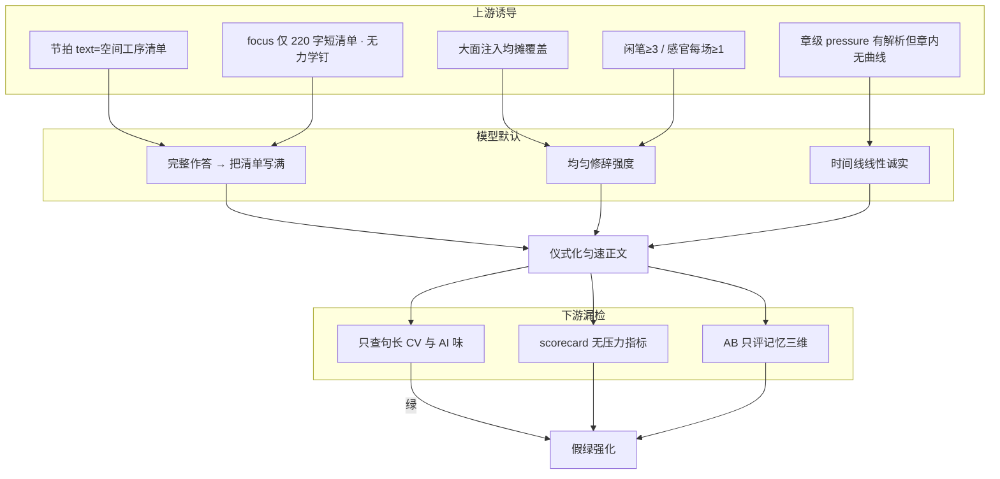
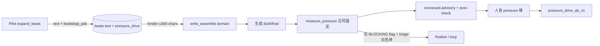
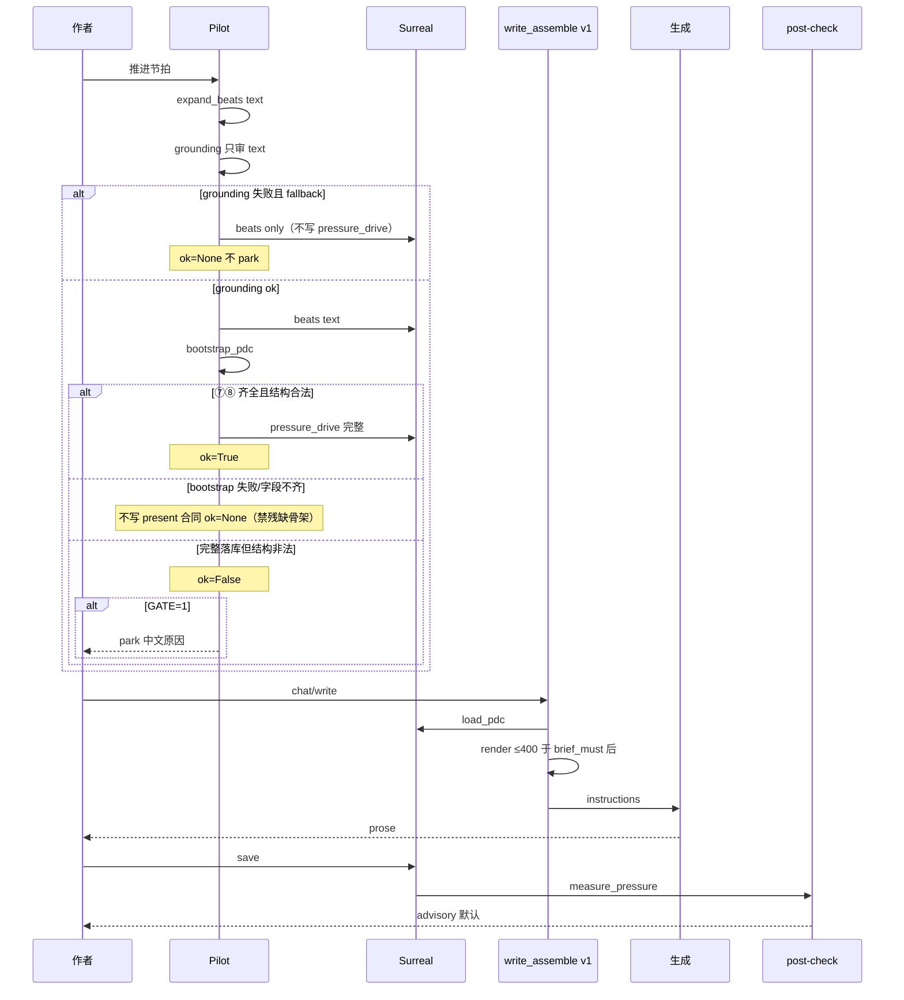

# 设计文档：压力驱动叙事（从「匀速散步」到「被压力推着走」）

| 项 | 值 |
|----|-----|
| **文档标题** | 压力驱动叙事 · 仪式化匀速叙事治理 |
| **副标题** | 在现有铜炉/scribe3 架构上系统化解决「情节顺序清单化 / 时间匀速 / 巷志平均用力 / 正闲笔同强 / 证人功能重复」 |
| **作者** | Grok Design（系统架构） |
| **日期** | 2026-08-09 |
| **修订** | **rev.D** · 用户终裁锁定：BLOCKING 高压力可选 / 方案 E 设计侧合成金标 / **暂不实现** |
| **状态** | **Accepted design · implementation deferred**（先只读设计；**用户口头开工前禁止开 PR**） |
| **产品** | scribe-writing-system / 铜炉 · scribe3 |
| **验证环境** | demo 已部署栈 `https://www.example.com`（只冒烟已部署服务；Grok 机禁 npm ci / 本机 Surreal / 全量测） |
| **样本证据** | `artifacts/ab-minimal-book_aa57f17e-ch6-phase1-escalate/*` · `…-ch6-recheck-20260809-2029/*` |
| **前序** | `设计文档/内核3-反平庸与文学质量.md` · `docs/plans/2026-08-09-chapter-pipeline-closed-loop-design.md` · `scribe3/craft_skills/节奏控制.md` · 方案B 任务10–13（节拍预算/章压/反转） |
| **约束** | UI 中文；Surreal 3.x only；工程分 ≠ 文学 9.5；不靠「请有节奏」贴膏药 |

---

## Overview

多轮 ch6 验证稿（A/B 跨臂，含 phase1-escalate 与 recheck）稳定复现同一文学病症：**仪式化匀速叙事**——空间与工序被清单式展开（出巷→侧门仪式→对话→室内复盘→等待），时间近似匀速步行，巷志/铜腥/门/灰同强度描写淹没主信息，证人功能重复，闲笔平均，读者不被「压力」推着走。

现有系统已具备章级 `压力级:1-5`、节拍字数预算（密|疏）、句长 `find_rhythm_uniformity`、母题 heat、`structure_pacing` 质量维、Scene–Sequel 六格与 craft「闲笔≥3」——但这些要么停在**跨章张弛**，要么停在**表层句长/计数**，要么与问题**同向强化**（均匀闲笔配额、均摊感官锚、均摊 must 注入）。**缺口是章内「压力曲线合同」及其可验证回路。**

本设计提出 **Pressure Drive Contract（PDC，压力驱动章合同）** 作为一等公民：

- **单一真源**：`chapter.pressure_drive` JSON 存全部力学字段；`chapter.beats` 仅保留叙事 `text`（及可选 `budget`/`density`/`id`）。
- **登记**：Pilot `expand_beats` 写 text + `bootstrap_pdc` 写合同（grounding 只审 text）。
- **注入**：v1 `_render_final_input` 内 `brief_must` 之后、`author_prefs` 之前；`domain=pressure_drive`；**≤400 Python 字符**硬顶。
- **门控 / 后验 / 人盲**：GATE 灰区；确定性 metrics（合同锚定优先）；`pressure_drive_ab_v1` 人盲唯一文学路径。

一句话策略：

> **合同先于修辞；预算先于清单；检测锚定合同证据而非可刷词表；注入越短越好；开 PDC flag 必须同时切换 craft 偏科文案。**

---

## Background & Motivation

### 文学诊断（必须被工程直接回应）

| # | 病症 | 验证样本中的表现（示例） | 读者感受 |
|---|------|--------------------------|----------|
| 1 | 情节太顺序 | 出巷→侧门→记门/闻铜腥→退回→巷口证人→室内复盘→等待；空间清单而非因果链 | 「在走流程」 |
| 2 | 时间节奏稳定 | 一昼夜刻度多（五更/大亮/一整天/入夜），但无塌缩/悬置/弯曲 | 匀速步行 |
| 3 | 无关描写过多 | 巷志：扎纸铺/磨刀摊/驴/粥/门板铁钉同强度 | 主信息被淹没 |
| 4 | 重点不突出 | 主笔与闲笔同修辞强度（铜腥/侧门高频回声） | 不知该记什么 |
| 5 | 闲笔太平均 | 证人各报一次断声/功能重复（灰狸/磨刀） | 无故意偏科 |
| 6 | 总名 | **仪式化匀速叙事** | 不被压力推着走 |

处方方向（文学侧，须工程化）：

1. 砍巷志；留 **两笔极闲 + 一笔极狠**
2. **压时间**：两刻钟内从侧门到决定；允许时间弯曲
3. 只允许 **一次**「记门」类仪式；第二次必须变形
4. **证人合并 / 信息差**（一人半知，不各报一遍）
5. **正笔独占高峰**（craft 四件套全开仅一段）
6. **不可逆一步可见**（接名/半寸插匙/册页留灰）
7. **闲笔偏科**（服务蓄力，非均匀撒点）

### 现状能力地图（代码锚点 · rev.B 按真机路径）

| 层 | 已有（生产真路径） | 文件/符号 | 为何不够 |
|----|-------------------|-----------|----------|
| **生产大纲/节拍注入** | envelope **focus** 块：`synopsis[:220]` + 节拍拼接再 `[:220]`；**不含**预算契约/压力级规范长文 | `context_assembler._focus_detail`（~613–634 行） | **强截断**；诱导「短清单」但无力学字段；章内仍可匀速展开 |
| **遗留 `_outline_block`** | 函数定义含密度预算/压力级/反转规范长文 | `write_assemble._outline_block` | **v1 生产组装不调用**（全仓 call site=0；仅 `tests/test_app.py` 与 re-export）。`test_outline_block_wired_into_chat_write` 实际断言的是 **focus 内 synopsis/beats 文本出现**，非该函数接线 |
| 章定位解析 | `压力级:1-5` + role 六型（键名 **`role`/`pressure`**）；`find_tension_monotony`；`find_pressure_adjacent_jumps` | `brief.parse_chapter_meta` · `api/routers/write.py` post-check | **跨章**张弛；章内无曲线 |
| 节拍存储 | `[{"text":...}]`；可选 `budget`；`validate_beat_budgets` 只验字数求和 | `brief.validate_beat_budgets` · `048_four_stage` · Pilot `expand_beats` | budget 常缺→`ok=None`；**无 p_level/time_role/仪式/不可逆** |
| 写路径组装 | prefix domains + envelope 八块 + seed/craft/phase/avoid/revelation/purpose/**brief_must**/author_prefs/voice/**material_recall** | `_assemble_write_instructions_v1` · `_render_final_input` | 注入面已大；再均摊 must → 更「清单齐全」 |
| 工艺 | 温度曲线 / **闲笔≥3** / **感官每场≥1** / 身体先行 | `craft.py` · hermes SKILL · `craft_skills/节奏控制.md` | **计数型**与「平均用力」同向 |
| 后验 | 句长 CV、复读、排比、ai_grade；scorecard 无压力维 | `critique/rules_impl.py` · `connection._compute_scorecard` | 测 AI 节拍器，不测叙事压力 |
| 质量 | 十维含 `structure_pacing` | `quality/models.py` · `rubrics.py` | LLM 软判；正式 9.5 须人盲 |
| 目的 / 戏格 | deltas；scene_grid 六元组 advisory | `purpose.py` · `experience/scene_grid.py` | 不验节奏力学 |
| Pilot | `expand_beats`：4–7 行动作行 → `[{"text"}]`；失败 `synopsis_segments` 回退；`pilot_park` 接地失败 | `pilot_runtime.expand_beats` | 无 PDC；grounding 审全文 |
| AB | memory_gain_ab_v2 三维 | artifacts + `run_memory_ab_minimal.py` | 不测压力；禁 9.5 宣称字段已有 |
| PATCH 白名单 | `update_chapter_meta` allowed：synopsis/beats/deltas/… | `store/chapters.py` ~923 | **尚无 `pressure_drive`** |
| migration | 最高 `113_ingest_lease_table.surql` | `migrations/` | 新字段宜 **`114_pressure_drive.surql`** |
| triage blocking | 仅 leaks / degeneration+blocking / ai_grade heavy / discipline S1 | `loop.triage` | 普通 `issues[].type` **默认 advisory**；pressure 不得静默升格 |

### 根因（工程视角）



**关键洞察**：当前「绿」的东西（无 degeneration、句长 CV 尚可、记忆锚命中、闲笔够数）与「读者被压力推着走」**几乎不相关**。继续在 prompt 里堆「请有节奏」只会加重 B2。

### 痛点量化（样本粗测 · 可复现 · 非 SLA）

复现命令（仓库根目录）：

```bash
for arm in phase1-escalate recheck-20260809-2029; do
  d=artifacts/ab-minimal-book_aa57f17e-ch6-$arm
  for f in a_prose.md b_prose.md b_B1_prose.md b_B2_prose.md b_B3_prose.md; do
    [ -f "$d/$f" ] || continue
    printf '%s %s ' "$arm" "$f"
    for w in 铜腥 侧门 巷; do
      c=$(grep -o "$w" "$d/$f" | wc -l); printf '%s=%s ' "$w" "$c"
    done; echo
  done
done
```

| 目录 / 臂 | 文件 | 铜腥 | 侧门 | 巷 | 备注 |
|-----------|------|------|------|-----|------|
| phase1-escalate / A | `a_prose.md` | 5 | 8 | 9 | 文首 `# A · track2 · fabric ON` |
| phase1-escalate / B3（默认 b） | `b_prose.md`（= `b_B3_prose.md`） | 8 | 7 | 10 | 文首 `# B B3`；与 B3 文件同形 |
| phase1-escalate / B1 | `b_B1_prose.md` | 7 | 13 | 13 | scores 主报告 `b_arm=B1` |
| phase1-escalate / B2 | `b_B2_prose.md` | 6 | 16 | 12 | |
| recheck / A | `a_prose.md` | 8 | 1 | 11 | |
| recheck / **B3（默认 b）** | `b_prose.md`（= `b_B3_prose.md`） | 6 | **9** | **8** | 文首 `# B B3`；**不是 B2** |
| recheck / B2 | `b_B2_prose.md` | 7 | **4** | **15** | 仅绑此文件；scores 主报告 `b_arm=B2` |
| recheck / B1 | `b_B1_prose.md` | 6 | 6 | 11 | |

| AB 工程分 | 值 | 来源 |
|-----------|-----|------|
| phase1 `lead_A_minus_B` | **0.4** | `phase1-escalate/scores.json`；**主报告 `b_arm=B1`**；`scorer=heuristic_v2_not_human_blind` |
| phase1 engineering_gate | false | 同文件；arms: B1 lead0.4 / B2 0.067 / B3 0.233 |
| recheck `lead_A_minus_B` | **0.367** | `recheck-20260809-2029/scores.json`（**文件存在**）；**主报告 `b_arm=B2`**（注意：主报告臂 ≠ 默认 `b_prose` 正文臂 B3） |
| recheck engineering_gate | false | 同文件；arms: B1 lead0.067 / B2 0.367 / B3 0.067 |

**口径注意**：`b_prose.md` = 默认落盘正文（两目录均为 **B3 正文**）；`scores.json` 的 `b_arm` = 主报告对照臂（phase1=B1，recheck=B2）。叙述 AB 时二者勿混。

段长/句长 CV 仅作参考（**不等于**压力曲线）：phase1 A 段 CV≈0.70；recheck 默认 B 段 CV≈0.57 仍可叙事匀速。

---

## Goals & Non-Goals

### Goals

1. **系统级**：压力驱动进入 **数据结构 / 章合同 / 注入 / 门控 / 后验 / AB 协议** 全回路，而不是单点 prompt。
2. **可落地**：复用 `chapter` JSON 字段模式、scorecard advisory、`/post-check` fail-soft、Pilot 状态机、`_domain_input` 注入；**接线坐标对齐 v1 真路径**。
3. **可测且抗游戏**：P0 指标 **合同锚定** + 病/好对照分离性验收；禁止「填曲线/塞词表」单独过闸。
4. **抗啰嗦**：注入硬预算 + 优先级裁剪；**开 PDC 必同步 craft 偏科**；verbosity 对照列。
5. **增量可合并**：PR 可独立 review；flag 默认关；回滚减面。

### Non-Goals

| 非目标 | 说明 |
|--------|------|
| 不把文学 9.5 工程化为自动 pass | 正式 ≥9.5 仍仅 human_blind；machine 永不可单独宣称 |
| 不重写 Memory fabric / envelope 八块架构 | 仅新增 **instructions domain** `pressure_drive`；不进 focus/global/… |
| **P0 不做 must 锚 / brief 预算裁剪** | Non-Goals 写死：可选 must 裁剪属 **P1+ 研究**，本设计不展开实现，避免范围漂移 |
| 不复活 `_outline_block` 为写路径依赖 | 除非另开「复活大纲规范注入」专项；PDC **不**挂在该死代码上 |
| 不替换 Quality 十维 | 可增强 `structure_pacing` 观测点，不增第 11 维 |
| 不改 Surreal 主版本 | 3.x only；`option<string>` JSON |
| 不强制全卷严格 scene_grid | 可交叉引用；empty_grid 不因 PDC 变全局 blocking |
| 不在 Grok 机跑 npm ci / 全量测 / 本机 Surreal | 验收 = demo 冒烟 + 离线 artifact 机检 |
| 不解决记忆质量 lead 闸本身 | 与 memory_gain_ab 正交 |

---

## Proposed Design

### 1. 核心抽象：Pressure Drive Contract（PDC）

#### 1.0 单一真源（K2 · 硬规则）

| 规则 | 说明 |
|------|------|
| **真源** | `chapter.pressure_drive`（JSON 串）承载全部力学：章级 fork/time/ritual/irreversible/stroke_plan/caps **以及** `beats[]` 力学投影（`p_level`/`time_role`/`function`/`is_peak`/…） |
| **章表 beats** | **仅** `text` + 可选 `id`/`budget`/`density`/`done`（兼容现 Pilot 与 `validate_beat_budgets`） |
| **禁止双写力学** | 不得在 `chapter.beats[i]` 上再存 `p_level` 等；展示层 `load_pdc(ch)` 按 `id` 或序位 **投影合并** 给 UI |
| **只 PATCH beats 文本** | 更新 `chapter.beats[i].text`；**不**静默删除 `pressure_drive`；若 text 与投影 `beats[].text` 漂移 → `load_pdc` 以章表 text 为准刷新投影文案，力学字段保留并标 `stale_text: true` warning |
| **Pilot 写路径** | `expand_beats`：先落 `beats=[{text}]`；再 `bootstrap_pdc` 写入/更新 `pressure_drive`（同事务或紧随 PATCH） |
| **`validate_pdc` / 注入 / GATE** | **只读** `pressure_drive`；无字段 → `ok=None` |
| **PATCH 面** | `update_chapter_meta` `allowed` **必须**加入 `pressure_drive`；`get_chapter` SELECT 列表同步；JSON 序列化同 `beats`/`deltas` |

```text
load_pdc(ch) 伪逻辑:
  raw = ch.pressure_drive  # parsed dict or None
  if not raw: return None
  # 用 chapter.beats 的 text 覆盖投影 beats 的 text（叙事真源仍是章表 beats 的文案）
  for i, b in enumerate(ch.beats or []):
      if i < len(raw.beats): raw.beats[i].text = b.text
  return raw
```

**叙事 text 真源**仍是 `chapter.beats`（作者编辑节拍文案的习惯路径不变）；**力学真源**是 `pressure_drive`。

#### 1.1 数据模型（目标形状）

```python
# 落库: chapter.pressure_drive = json.dumps(PDC, ensure_ascii=False)
PressureDriveContract = {
  "version": "pdc.v1",
  "chapter_pressure": 1..5,       # 与 parse_chapter_meta().pressure 对齐
  "role": "高压|推进|修炼|关系回收|低压|信息整理",  # 键名 role，与 brief 一致（非 chapter_role）
  "time_budget": {
    "mode": "collapse|suspend|bend|linear",  # linear 仅低压/关系回收允许
    "story_span": str,                       # 如 "≤两刻钟"
  },
  "fork": {
    "choice": str,              # ≤80 字符
    "cost_steps": [str, ...],   # 1..3；每条 ≤60 字符
  },
  "irreversible": {
    "action": str,              # ≤80
    "evidence_must_show": str,  # ≤80；正文须出现的可感知痕迹（机检锚）
  },
  "ritual_quota": {
    "class": str,               # 如 "记门"
    "max_full": 1,
    "second_must_deform": True,
  },
  "witness_policy": {
    "mode": "merge|info_gap|single",
    "max_same_fact_reporters": 1,
  },
  "stroke_plan": {
    "peak_segment": str,        # 唯一正笔高峰使命标签
    "idle_skew": {"ultra_idle": 2, "ultra_hard": 1, "forbid_even_spread": True},
  },
  "motif_intensity_caps": [     # 可选；默认由书级/题材表填充
    {"term": "铜腥", "max_mentions": 3},
  ],
  "beats": [                    # 力学投影（非章表 beats 的存储形状）
    {
      "id": "b1",               # 可选；与章表 beat id 对齐
      "text": str,              # 缓存文案；load 时以章表为准覆盖
      "density": "密|疏|极疏", # 可选镜像
      "budget": int | None,
      "p_level": 1..5,
      "time_role": "advance|collapse|hold|flash|aftermath",
      "function": "setup|force|choice|cost|peak|release|hook",
      "is_peak": bool,
      "is_ritual": bool,
      "is_irreversible": bool,
      "spatial_inventory": bool,  # True=该拍禁止写成巷志清单（合同意图）
    },
  ],
}
```

**与既有字段关系**：

- `parse_chapter_meta` → 键 **`role` / `pressure`**。`validate_pdc(..., role=)` 回退 `parse_chapter_meta(...).get("role")`；枚举与 `brief._CHAPTER_ROLE_RE` 六型一致。
- **`validate_beat_budgets` 保持纯字数预算**，**不**扩展 p_level/peak（职责分离，见 §5）。
- 压力一律 `validate_pdc` / `beat_pressure_stats`。
- `purpose.deltas`：世界状态；PDC：叙事力学。可提示同步，**不强制绑**。

#### 1.2 压力曲线合法形状（硬规则 · 合同层）

> 下列规则只保证 **合同结构合法**，**不**保证正文有压力。抗游戏见 §环 4 与 Success Criteria。

```text
合法（默认高压/推进章，role∈{高压,推进} 或 chapter_pressure≥4）:
  ① 恰好 1 个 beat.is_peak=true
  ② max(p_level)-min(p_level) ≥ 2
  ③ population variance(p_level) ≥ 0.8 或 至少一次相邻 |Δ|≥2
  ④ function 含 force 与 (choice|cost) 各 ≥1
  ⑤ time_role 不得全为 advance
  ⑥ is_ritual=true 的完整仪式 ≤1；若标注 2+ 须带 deform 标记（否则 errors）
  ⑦ irreversible.evidence_must_show 非空（≥2 字符）
  ⑧ fork.choice 非空

低压/关系回收/修炼/信息整理:
  放宽 ③④；仍要求 time_role 含 hold|aftermath 之一；
  irreversible 可降为「关系/信息微变」但 evidence_must_show 仍必填

无合同 / status=missing / bootstrap 降级: validate_pdc → **ok=None**（兼容旧章；GATE 不 park）
完整落库但结构非法: → **ok=False**（GATE 可 park）
禁止: 用缺 fork.choice / evidence_must_show 的残缺骨架冒充 present contract
```

---

### 2. 系统架构：五环回路



#### 环 1 — 登记（Pilot / PATCH · 闭环）

**K11（默认生成路径 · 关闭原 Open Q1）** + **bootstrap / GATE 三态硬规则**：

1. `expand_beats` LLM 仍输出 **4–7 行动作 text**（保持现有「禁止新增大纲没有的人物/物件/规则」）。
2. **grounding_review 只拼接 `beat.text`**（与现网一致）；**力学标签永不进入 grounding 源文本**，避免「压力级/不可逆」被判无来源主张而 `pilot_park`。
3. grounding ok → `update_chapter_meta(beats=[{text}])`。
4. 紧随 **`bootstrap_pdc(synopsis, beats_text, chapter_meta)`**：
   - **输出格式（写死）**：
     ```text
     节拍行（纯 text，每行一条）…
     ---PDC_JSON---
     { ... PressureDriveContract ... }
     ```
   - **成功落库合同的前置条件（写死）**：解析出的 dict 须通过 `validate_pdc` 的 **完备子集**——至少 §1.2 ⑦⑧（`fork.choice` 非空、`irreversible.evidence_must_show` 非空）及 `beats` 力学投影条数 = 章表 beats 条数；完整合法 → 写 `pressure_drive`，`ok=True`。
   - **bootstrap 失败 / 字段不齐 / JSON 解析失败 / 缺 ⑦⑧**（硬规则，防一开 GATE 即全 park）：
     1. **不写** `pressure_drive`（字段保持 null/缺省），**或**仅 journal 记 `{"version":"pdc.v1","status":"missing","warnings":[...]}` 且 **该 status=missing 对象不得被 `load_pdc` 当作 present contract**（`validate_pdc` → **`ok=None`**）；
     2. **禁止**用「缺 fork/evidence 的残缺骨架」写入 `pressure_drive` 冒充 present（否则 `ok=False` → GATE 下误 park 全章）；
     3. 日志：`pdc_bootstrap=degraded` + warnings；beats text 仍保留。
   - 可选：同次 LLM 为每条 beat 赋 `p_level` 台阶；从 synopsis 解析 `压力级`/`role`（`parse_chapter_meta`）——**仅当** ⑦⑧ 齐全时一并写入。
5. **synopsis_segments 回退**（现网 grounding 失败切大纲）：只写 `[{text}]`；**不写** `pressure_drive` → `ok=None`；GATE **不 park**；journal `warnings: ["pdc_missing_after_fallback"]`。
6. **`validate_pdc` 三态与 GATE（`SCRIBE3_PDC_GATE=1`）**（与 §1.2 对齐）：

   | 状态 | 条件 | GATE=1 | 注入 |
   |------|------|--------|------|
   | `ok=None` | 无字段 / `status=missing` / 作者未登记 | **不 park** | 空块 |
   | `ok=False` | **完整意图落库**但结构非法（如双 peak、time 全 advance、有 fork 但 peak≠1） | **`pilot_park` + 中文 errors** | 不生成或 park 后不进 draft |
   | `ok=True` | 结构合法 | 推进 | 渲染 ≤400 |

   - **仅当**合同完整落库且结构非法 → `ok=False` → GATE 可 park。
   - **bootstrap 降级路径永远对应 `ok=None`，绝不产出「缺 ⑦⑧ 却 present」的 `ok=False`。**
7. 作者可经 PATCH `pressure_drive` 修改完整合同；UI 后置。作者手写不完整 dict 且未标 `status=missing` → `ok=False`（GATE 下 park，促补全）——与 bootstrap 自动降级区分。

#### 环 2 — 注入（v1 真坐标 · 抗啰嗦）

**可执行插入点**（`write_assemble._render_final_input`）：

```text
… purpose …
brief_must          ← 已有
>>> pressure_drive  ← 新增 _domain_input(..., "pressure_drive", block)
author_prefs
voice_anchor
（draft/final）reference_craft / deduction / material_recall
_final_reminder
```

- **禁止**描述为「贴在 `_outline_block` 旁」——该函数不在 v1 链。
- 空 PDC 或 `SCRIBE3_PDC=0` → `""`（字节级无新增）。
- **禁止**重复 beats 原文；块内 **只输出力学钉**（与 focus 短节拍分工：focus=发生什么，PDC=怎么用力）。

**预算计量（写死）**：

- `budget_units(s) = len(s)`（Python 字符，含标点/拉丁/markdown 标题）。
- 硬顶 **`MAX_PDC_BLOCK = 400`**。
- 字段截断与 Security 一致：`choice`/`action`/`evidence_must_show` ≤80；`cost_steps[i]` ≤60。

**渲染算法（伪代码 · 单测契约）**：

```python
MAX = 400
PRI = ["P0_fork_irrev", "P1_time", "P2_ritual_witness", "P3_stroke_idle", "P4_caps"]

def render_pressure_drive_block(contract: dict) -> str:
    if not contract:
        return ""
    sections = {
        "P0_fork_irrev": format_p0(contract),      # 岔路+代价+不可逆痕迹
        "P1_time": format_p1(contract),
        "P2_ritual_witness": format_p2(contract),
        "P3_stroke_idle": format_p3(contract),
        "P4_caps": format_p4(contract),
    }
    # 若单段 P0 已 > MAX：截断字段后再 format，绝不丢 P0 整段
    if len(sections["P0_fork_irrev"]) > MAX:
        sections["P0_fork_irrev"] = sections["P0_fork_irrev"][:MAX]
        return header + sections["P0_fork_irrev"]
    parts, used = [header], len(header)
    for k in PRI:
        s = sections[k]
        if not s:
            continue
        if used + len(s) + 1 > MAX:
            break  # 停在下一优先级；已入段保留
        parts.append(s)
        used += len(s) + 1
    return "\n".join(parts)
```

文案骨架（示意）：

```text
## 压力驱动合同（遵守力学，勿复述本段）
- 时间：{mode}·{story_span}；禁止匀速流水账。
- 岔路：{choice}；代价：{cost_steps}。
- 不可逆：正文须出现「{evidence_must_show}」（动作痕迹，非总结）。
- 仪式：「{class}」完整至多 1 次；再写须变形。
- 证人：同题完整报知 ≤1 人。
- 正笔：仅「{peak_segment}」全开；其余克制。
- 闲笔偏科：2 极闲 + 1 极狠；禁巷志均铺。
- 意象上限：…
```

#### 环 3 — craft 对齐与 flag 原子性（防同向伤害）

| 现状 | 改造 |
|------|------|
| idle：每章≥3 均匀 | **`SCRIBE3_PDC=1` 时**改为：偏科「≥2 极闲 + ≥1 极狠；禁止同强度三联」 |
| 感官每场≥1 | 峰值场强化；过路场至多 1 且不得与峰值同意象 |
| 温度曲线 | 保留；补充「震的是压力台阶，不是再刷铜腥」 |

**硬前置（Rollout / PR）**：

> demo 开启 `SCRIBE3_PDC=1` 的前置条件 = **craft 偏科文案已合入且由同一 flag 切换**（注入 + craft 原子）。  
> 禁止「只开注入、craft 仍闲笔≥3 均匀」。

#### 环 4 — 后验检测（确定性 · 抗游戏 · 可实现）

新建 `scribe3/pressure_metrics.py`。输出 schema（P0 写死）：

```python
{
  "version": "pressure_metrics.v1",
  "contract_present": bool,
  "metrics": {
    "<id>": {
      "value": float | int | bool | None,
      "tier": "light" | "mid" | "heavy" | "n/a",
      "detail": str,           # ≤200
      "anchored": bool,        # 是否合同锚定
    }
  },
  "findings": [
    {"type": "pressure", "message": str, "text": str, "range": None|list,
     "meta": {"kind": str, "severity": "advisory"|"blocking"}}
  ]
}
```

**空合同行为**：`contract_present=false`；仅跑无锚启发式子集（time_linear / spatial / motif 默认 cap 若有书级配置）；`irreversible_anchored` → `tier=n/a`；**不**因缺合同报 heavy。

##### P0 指标集（须单测 + 分离性验收）

| 指标 ID | 输入 | 定义（可实现） | tier 规则 | 通道 |
|---------|------|----------------|-----------|------|
| `irreversible_anchored` | prose + `contract.irreversible` | **`evidence_must_show` 去空后 ≥2 字子串** 在 prose 中出现（大小写/全半角不敏感可选）；**不用**通用「插/嵌」词表刷绿 | 有合同且未命中→heavy；命中→light；无合同→n/a | post-check + scorecard |
| `fork_signal` | prose + `fork.choice` | choice 核心词（截前 8 字）出现 **或** 决策句式弱启发式（`若…就`/`要么`/`不能再`/`他决定` 等 ≥1） | 有合同两者皆无→mid；否则 light | advisory |
| `ritual_overuse` | prose + `ritual_quota.class` | 以 **class 词** 及合同可选 `ritual_lexicon` 计「完整形态」近似：同段内 class 词 + 完成动词（按/启/记/拜）共现次数；≥2 → mid/heavy | 默认 advisory | post-check |
| `motif_overheat_local` | prose + caps | `prose.count(term) > max_mentions` | 超 cap→mid | post-check |
| `time_linear_flag` | prose | 日夜刻度词集合命中数 ≥3 **且** 弯曲信号词（忽然/片刻/两刻/时间像/记不清过了多久…）=0 | true→mid | post-check |
| `spatial_inventory` | prose + **动态 place 集** | place 集 = 从 **本章 synopsis+beats text** 抽 ≥2 字连续专名候选（简单：连续汉字名词块 ∩ 可选 codex 地点名），**禁止**全局写死「扎纸铺」；连续 ≥3 句命中 place 且无 force 动词表 → finding | mid | post-check |
| `event_pace_cv` | prose | 段标签 dialog/move/force 合并为 event，字数序列 CV；**仅**作 advisory 信号 | 章压≥4 且 CV\<0.35→mid | scorecard |
| `beat_pressure_var` | contract only | 合同内 p_level 方差；不读正文 | 结构合法已在 validate；此处镜像 | scorecard |

**PR-1 分离性验收（不通过则阈值不进 GATE）**：

- 固定 **病样本**：ch6 recheck/phase1 已知匀速稿 ≥2 篇（真实 artifact）。
- 固定 **对照样本（K16 用户终裁）**：**设计侧最小合成**短段即可（高事件 CV + 含 `evidence_must_show` 子串 + 砍巷志），落 `artifacts/pressure-gold/` 或 `scribe3/tests/fixtures/pressure_gold/`；**不依赖作者/编辑供稿，P0 不等待真人金标**。方案 E 对照臂同用合成短段。
- 断言方向：病样本 `irreversible_anchored` 在「有合成合同且 evidence 被删」时 heavy；对照在 evidence 保留时 light；`spatial_inventory` 在巷志段上 ≥1 finding，在砍巷志对照上 0。
- **写明**：分离失败 → 不得把该指标写入 Pilot GATE 或 BLOCKING。

##### P1+ / 研究性启发式（附录 C · 不进 P0 GATE）

| 指标 | 最小可实现版（若做） | 默认 |
|------|----------------------|------|
| `witness_dup` | 对话段中 ≥2 个 **次要角色名**（来自章内称谓列表）各自完整复述 **≥8 字相同子串** → 1 finding | report-only |
| `peak_monopoly` | 仅当合同有 `is_peak` 拍：按 beats 字数预算比例切 prose 窗口；非 peak 窗口短句率+身体词密度 > peak 窗口 → mid | report-only |
| `idle_skew` | 闲笔候选段（无 force/choice 标签）的平均句长方差；过低→mid | report-only |

##### BLOCKING 接线协议（K4 / **K15 用户终裁** · 对接 `loop.triage`）

现网 blocking **仅**四类（leaks / degeneration+`meta.severity=="blocking"` / ai_grade heavy / discipline S1）。**普通 `type` 不会因字符串 "blocking" 自动生效**（`_is_blocking_issue` 亦不认 pressure）。

**产品终裁（rev.D · 不可再议）**：

| 层 | 规则 |
|----|------|
| **环境默认** | `SCRIBE3_PDC_BLOCKING` **默认关**（非 demo 全站默认开；亦非永久永不启用） |
| **产品启用后** | 仅当 env=1 **且** 该章 **压力级≥4**（`chapter_pressure≥4`，回退 `parse_chapter_meta().pressure`）时，pressure findings 才可走 blocking 路径 |
| **压力级\<4** | 即使 env=1，pressure **一律 advisory**（不得升 blocking） |
| **未启用 env** | 全部 pressure findings `meta.severity="advisory"`，永不进 finalize blocking |

**实现协议**（与终裁一致）：

1. env 关 → measure **不得**输出 `severity=blocking`。
2. env 开且 `chapter_pressure≥4` 时，下列 kind 可出 `meta.severity="blocking"`：
   - `irreversible_anchored` 未命中（有合同）
   - `ritual_overuse` heavy
3. **必须扩展** `loop.triage` 与 `_is_blocking_issue` 白名单，例如：

```python
# 伪代码 — PR-9（实现延期至用户开工）；env 默认关
elif (iss.get("type") == "pressure"
      and sev == "blocking"
      and pdc_blocking_env_enabled()
      and chapter_pressure_ge_4):  # 压力级≥4；否则降 advisory
    blocking.append({...})
```

4. 单测：**(a)** flag 关 → pressure 永不 blocking；**(b)** flag 开但压力级=3 → 永不 blocking；**(c)** flag 开且压力级≥4 → 白名单 kind 可 blocking。
5. **禁止**把 pressure 接到 S1/discipline 旁路。
6. **禁止** demo 部署默认写死 `SCRIBE3_PDC_BLOCKING=1`；启用属产品/运维显式配置。

接线落点：

1. `connection._compute_scorecard` → `advisory_scores["pressure_drive"] = metrics 摘要`
2. `write.py` `/post-check` → `pressure_metrics` 字段 + issues
3. motif **章内 cap 超限仅 post-check**；**不**自动改 `motif_craft` schedule（免双通道）

#### 环 5 — 人盲与 AB 协议

```text
protocol: pressure_drive_ab_v1
machine:
  - irreversible_anchored, ritual_overuse, motif_overheat_local,
    time_linear_flag, spatial_inventory, event_pace_cv
  - verbosity 对照列：chars, term_counts, spatial_hits
human_blind（唯一文学路径）:
  - forced_fork_felt, time_nonuniform, focus_hierarchy,
    idle_skew_felt, irreversible_visible, overall_pressure  (各 1-5)
声明（写死 scores.json）:
  - scorer 必须标明 heuristic / human
  - 禁止仅凭 machine 宣称 overall_pressure 达标或任一维 ≥9.5
  - engineering_gate 不得仅由 machine 指标全绿构成；
    若定义工程闸，须含「无 critical machine」且 **不** 等同 human_pass
```

人盲包：**直接复用**现 `human-blind-pack` 约定（`X.md`/`Y.md` + `KEY_SECRET`），新增压力维中文问卷即可（与 memory 包并列或同目录加 `pressure_questionnaire.md`）。

---

### 3. 与质量合同 / 十维的映射

| Quality 维 | PDC 贡献 |
|------------|----------|
| `structure_pacing` | 主映射：曲线、时间角色、峰值独占 |
| `scene_necessity` | 岔路/代价 |
| `suspense_payoff` | hold 延宕 |
| `reading_experience` | focus_hierarchy 人盲 |
| `language_voice` | 与 ai_grade 分工 |

不强制改 `QualityContractRevision` schema；提供 `success_criteria.structure` 模板句可选。

### 4. Pilot 契约变更

```text
idle → outline_proposed → beats_ready → deduced → drafting → checked → …
                              ↑
              expand_beats + bootstrap_pdc + validate_pdc
              GATE=1 且 ok=False → park
              ok=None → 不 park
```

### 5. 算法职责分离

| 函数 | 职责 | 不做什么 |
|------|------|----------|
| `validate_beat_budgets` | 字数预算求和 ∈ [target, 1.1×] | **不**看 p_level/peak |
| `validate_pdc` | 合同结构合法 | 不读正文 |
| `beat_pressure_stats` | p_level 方差等 | 不读正文 |
| `measure_pressure` | 正文 + 可选合同 | 不改 prose |
| `render_pressure_drive_block` | 注入文案 | 不落库 |

```python
def beat_pressure_stats(pdc_beats: list[dict]) -> dict:
    levels = [int(b["p_level"]) for b in pdc_beats if b.get("p_level") is not None]
    if len(levels) < 3:
        return {"ok": None, "reason": "insufficient_beats"}
    mean = sum(levels) / len(levels)
    var = sum((x - mean) ** 2 for x in levels) / len(levels)
    peaks = sum(1 for b in pdc_beats if b.get("is_peak"))
    time_roles = {b.get("time_role") for b in pdc_beats}
    return {
        "ok": var >= 0.8 and peaks == 1 and bool(time_roles - {"advance", None, ""}),
        "var": var, "peaks": peaks, "time_roles": sorted(x for x in time_roles if x),
    }
```

### 6. 默认意象过热表（可配置 · 非全局地名表）

| term | 默认 max | 说明 |
|------|----------|------|
| 铜腥 | 3 | 书级可覆盖 |
| 侧门 | 4 | |
| 记门 | 1（完整仪式） | 与 ritual_quota 协同 |

**`spatial_inventory` 的 place 集不使用本表**；本表仅 motif cap。地名来自 **本章草料 + 可选 codex**。

### 7. 端到端序列



---

## API / Interface Changes

### 新增模块

| 模块 | 职责 |
|------|------|
| `scribe3/pressure_drive.py` | 解析、validate_pdc、bootstrap 骨架、render_pressure_drive_block、load_pdc 合并 |
| `scribe3/pressure_metrics.py` | measure_pressure；离线 CLI |
| `scribe3/tests/test_pressure_*.py` | 纯函数 + 分离性 + triage flag 关 |

### 写路径 / 存储

| 接口 | 变更 |
|------|------|
| `_render_final_input` | `brief_must` 后插入 pressure_drive domain |
| `store/chapters.py` | `allowed` += `pressure_drive`；SELECT/get 解析 JSON；PATCH 序列化 |
| migration | **`114_pressure_drive.surql`**：`DEFINE FIELD IF NOT EXISTS pressure_drive ON chapter TYPE option<string>` |
| Pilot `expand_beats` | bootstrap_pdc + 可选 GATE |
| `/post-check` | `pressure_metrics` + issues |
| scorecard | `advisory_scores.pressure_drive` |
| `loop.triage` | **仅 PR-9**：pressure+blocking 白名单 |
| env | `SCRIBE3_PDC`（注入+craft 原子）；`SCRIBE3_PDC_GATE`；`SCRIBE3_PDC_BLOCKING` |

### 前端（后置）

节拍火花条 / 体检列表；无 UI 时可用 PATCH JSON。

---

## Data Model Changes

### Migration

```surql
-- migrations/114_pressure_drive.surql
DEFINE FIELD IF NOT EXISTS pressure_drive ON chapter TYPE option<string>;
```

### 兼容

| 场景 | 行为 |
|------|------|
| 旧章无字段 | 注入空；metrics 启发式子集；不报错 |
| 仅有 synopsis 压力级文本、bootstrap 不齐 | **不写** present 合同 → `ok=None`；journal warnings（勿写缺 ⑦⑧ 骨架） |
| beats 仅 text | 正常；力学在 pressure_drive |
| flag 关 | 零行为变化 |

### 与 purpose.deltas

| PDC | deltas |
|-----|--------|
| 不可逆痕迹 | 常对应 fact |
| 岔路认知 | knowledge |
| 不自动强绑 | 提示即可 |

---

## Alternatives Considered

### 方案 A — 仅加强 Prompt / SOUL / craft

零 migration；百万字下回流均值；**拒绝作主方案**。

### 方案 B — 事后 LLM 张力强制回炉

语义强、成本高、与确定性 finalize 冲突；**P2 可选**。

### 方案 C — PDC + 预算注入 + 确定性后验 + 人盲（**推荐**）

对准根因；可回滚；抗啰嗦有硬顶。

### 方案 D — 导演服务重写全文

双倍成本、声口裂；**不采用**。

### 方案 E — 轻量：只改 focus 节拍文案 + 砍 craft 均匀闲笔（无新字段）

- **做法**：Pilot/作者把 beats 写成「压力台阶」句式；craft 改偏科；不建 `pressure_drive`。
- **优点**：最小改动；可作 AB 对照臂。
- **缺点**：无可机检合同锚；GATE/scorecard 无结构；ch6 多轮已在「强记忆/铁律/大纲」下仍病，**纯文案未证明够用**。
- **金标（K16 终裁）**：对照材料用 **设计侧最小合成短段**，不排队作者。
- **结论**：**实现启动后**作 M0/PR-7 离线对照臂（E vs C）；**不替代 C 主路径**。当前整包实现 **deferred**（见元数据 Status）。

### Trade-off

| 维度 | A | B | **C** | D | E |
|------|---|---|-------|---|---|
| 对准根因 | 低 | 中 | **高** | 中 | 中低 |
| 可机检 | 无 | 弱 | **强** | 中 | 无 |
| 成本 | 低 | 高 | **低中** | 很高 | 最低 |
| 啰嗦风险 | 高 | 中 | **可控** | 中 | 低 |
| 回滚 | 易 | 中 | **易** | 难 | 易 |

---

## Security & Privacy Considerations

| 威胁 | 缓解 |
|------|------|
| 注入 | 字段截断；渲染 `len` 硬顶 |
| 帧外秘密 | PDC 作者视角；限知仍靠 frame；grounding 不因力学标签 park 叙事 |
| 词表误伤 | cap 是上限；spatial place 动态抽取 |
| 权限 | 既有 work 隔离 / MCP 审批 |

---

## Observability

| 信号 | 落点 |
|------|------|
| `pdc_present` / `pdc_valid` / `pdc_bootstrap` | journal / usage |
| domain token | Manifest |
| scorecard.advisory.pressure_drive | 章面板 |
| verbosity 列 | AB machine_pressure.json |
| 不合成文学总分 | 宪法 |

---

## Rollout Plan

> **rev.D**：下列阶段为 **Accepted 后的实现路线图**；**在用户明确说「开工/实现」之前不得启动任何 PR 或改代码。** 当前交付 = 只读设计文档。

| 阶段 | 内容 | 通过标准 |
|------|------|----------|
| M0 | 纯函数 + 离线病/好分离性（**合成金标**） | 分离通过才锁阈值 |
| M1 | flag 关合入 1+2+6 代码 | 关 flag 行为不变 |
| M2 | **craft 偏科已随 flag** → 开 `SCRIBE3_PDC=1` 注入 | demo 冒烟；verbosity 不恶化 |
| M3 | post-check/scorecard | advisory 可见 |
| M4 | Pilot GATE 灰区（ok=None 不 park） | 误杀可接受 |
| M5 | 人盲包 | 禁 9.5 宣称 |
| M6 | UI；**可选** `SCRIBE3_PDC_BLOCKING`（仅压力级≥4） | 产品显式开 env；非 demo 默认 |

### 回滚

env 全关；去掉 domain 一行；字段残留无害；**回滚=减面**。

### 风险登记

| 风险 | 严重度 | 缓解 |
|------|--------|------|
| 更多注入→更啰嗦 | **高** | 400 顶；P0 优先；**craft 同 flag**；verbosity 列 |
| **合同绿 + 正文仍匀速** | **高** | 合同锚定 evidence；分离性验收；**engineering_gate 禁纯 machine**；人盲 overall_pressure |
| 词表假阳 | 中 | P0 少词表；spatial 动态 place；默认 advisory |
| 节拍填写负担 | 中 | bootstrap 成功才写合同；失败 ok=None 不 park |
| 开 GATE 后 bootstrap 常失败导致全 park | **高** | **禁残缺骨架**；降级=ok=None（K11）；M4 先观察 degraded 率再开 GATE |
| 与闲笔≥3 冲突 | 中 | 同 flag 偏科 |
| machine 冒充文学分 | 高 | 协议 + scorer 字段 |
| triage 误伤存稿 | 高 | BLOCKING 双保险；env 默认关；**仅压力级≥4**（K15） |
| 只优化志怪 | 中 | 通用字段 + 可配置 caps |

---

## Open Questions

| # | 原问题 | 终裁 |
|---|--------|------|
| 1 | 谁生成 PDC | **已决 K11**：Pilot bootstrap + 作者可改 |
| 2 | BLOCKING 是否启用 / 范围 | **已决 K15（用户 2026-08-09）**：env **默认关**；产品显式启用后，**仅压力级≥4** 的章可走 `SCRIBE3_PDC_BLOCKING` 路径；非 demo 全站默认、亦非永久禁用 |
| 3 | 事件切分阈值标定 | **实现期开放**（开工后 `calibrate_pressure`；不阻塞设计验收） |
| 4 | 与 scene_grid 是否合并存储 | **设计期定双轨**；实现期可再交叉引用，不阻塞 |
| 5 | 方案 E / 分离性金标谁供 | **已决 K16（用户 2026-08-09）**：**设计侧最小合成**短段；P0 不等待作者/编辑 |
| 6 | 何时开工实现 | **已决 K17（用户 2026-08-09）**：**先只读设计，暂不实现**；用户明确说开工前 **禁止** 开 PR / 改生产代码 |

---

## Key Decisions

| # | 决策 | 理由 |
|---|------|------|
| K1 | PDC 一等公民，非 prompt-only | 根因在力学与漏检 |
| K2 | **`pressure_drive` 力学真源；`beats` 仅 text（+budget/density）** | 禁双写分叉；PATCH/GATE/注入同读一侧 |
| K3 | 注入 **`_render_final_input`：brief_must 后、author_prefs 前**；不挂 `_outline_block` | v1 真路径；outline_block 为死代码 |
| K4 | 默认 advisory；BLOCKING 须 **env + triage 白名单扩展** | 对齐 loop 宪法，防误伤 |
| K5 | 闲笔偏科；**与 `SCRIBE3_PDC` 原子切换** | 防开注入后同向打架 |
| K6 | 机检/人盲分轨；禁 machine 独过文学闸 | 与 AB/quality 一致 |
| K7 | migration **114** + allowed 扩展 | 接 113；store 完整面 |
| K8 | Pilot：text grounding + bootstrap_pdc；**ok=None 不 park** | 闭环且兼容回退 |
| K9 | 章内 cap 只 post-check，不改 motif schedule | 免双通道 |
| K10 | 增量 PR + 三开关；**P0 路径 1→2→6→3→4**（**实现延期**） | 可演示最小集；rev.D 暂不执行 |
| K11 | 默认 Pilot text + bootstrap_pdc；作者可改；**降级不写 present 合同（ok=None）**；仅完整非法 → ok=False | 收敛 Open Q1；防 GATE 误杀 |
| K12 | P0 指标 **合同锚定优先**；研究性指标不进 GATE | 抗游戏 |
| K13 | `validate_beat_budgets` 不扩展压力规则 | 职责单一 |
| K14 | 预算 `len(text)` 400；P0 超顶截断字段不丢段 | 可单测 |
| **K15** | **BLOCKING：env 默认关；启用后仅压力级≥4 可 blocking** | **用户终裁**；非永久关、非 demo 默认全开 |
| **K16** | **分离性/方案 E 金标 = 设计侧最小合成短段** | **用户终裁**；P0 不堵作者 |
| **K17** | **Accepted design · implementation deferred**；用户开工前禁止 PR | **用户终裁**；先只读设计 |

---

## Success Criteria（可操作，不宣称已达 9.5）

### 读者/评者（人盲 · 唯一文学路径）

中位目标（**待标定，非自动门禁**）：`forced_fork_felt`/`time_nonuniform`/`focus_hierarchy`/`irreversible_visible`/`overall_pressure` ≥4；`idle_skew_felt` ≥3.5。

### 工程 machine（P0 · 实现启动后适用）

在 **有合法 PDC 且章压≥4** 的新写章上：

| 检查 | 目标 |
|------|------|
| `irreversible_anchored` | 命中 evidence 子串 |
| `ritual_overuse` | 不 heavy |
| 配置 cap 词 | ≤ max_mentions |
| `spatial_inventory` | 0 finding（病样本对照须能检出） |
| 注入块 | `len(block)≤400` 且含 P0 钉 |
| 分离性 | PR-1 **设计侧合成金标**方向正确（K16） |

**明确**：

- `event_pace_cv` **单独不构成** pass/GATE。
- **engineering_gate 不得定义为「machine 全绿即可」**；须保留 human 维度或仅作「无 critical 机检」弱闸，并在 scores.json 声明。
- **「合同结构合法」≠ 正文有压力**——成功判据必须含人盲或金标分离。
- **`SCRIBE3_PDC_BLOCKING`**：默认关；启用后 **仅压力级≥4** 可 blocking（K15）；压力级\<4 永为 advisory。
- **当前（rev.D）**：上述机检目标为 **Accepted 设计验收口径**，**不**表示已实现或已达标。

### 回归守卫（实现启动后）

- `SCRIBE3_PDC=0`：写路径与 craft 文案与现网一致。
- `SCRIBE3_PDC_BLOCKING=0` 或压力级\<4：pressure 永不 blocking。
- verbosity：开 PDC 注入后铜腥/侧门/字数相对基线不系统性恶化（AB 列监控）。

---

## References

- `scribe3/api/services/write_assemble.py` — `_assemble_write_instructions_v1`、`_render_final_input`、`_outline_block`（**无生产调用**）
- `scribe3/context_assembler.py` — `_focus_detail`（synopsis/beats 220）
- `scribe3/brief.py` — `validate_beat_budgets`、`parse_chapter_meta`（`role`/`pressure`）、`find_tension_monotony`
- `scribe3/motif_craft.py`、`craft.py`、`critique/rules_impl.py`、`loop.py`（`triage`）
- `scribe3/store/chapters.py` — `update_chapter_meta` allowed
- `scribe3/store/connection.py` — `_compute_scorecard`
- `scribe3/api/services/pilot_runtime.py` — `expand_beats`
- `scribe3/migrations/113_ingest_lease_table.surql`（下号 114）
- artifacts：`ab-minimal-book_aa57f17e-ch6-phase1-escalate/`、`…-recheck-20260809-2029/`

---

## PR Plan

> **rev.D · 实现延期**：下列 PR 为 **Accepted 后的执行清单**；**用户明确授权开工前禁止创建分支/开 PR/合入代码。**  
> **P0 最小可演示关键路径：PR-1 → PR-2 → PR-6 → PR-3 → PR-4**  
> （6 与 3 强烈建议同发布列车；若合并冲突可 **6+3 同 PR**。）  
> 每 PR 默认 flag 关；可独立 review。

### PR-1 · PDC 纯函数 + 分离性机检

- **标题**：`feat(pressure): PDC 校验/渲染 + pressure_metrics 与病好对照`
- **文件**：`pressure_drive.py`、`pressure_metrics.py`、`tests/test_pressure_*.py`、可选 `scripts/pressure_metrics_artifact.py`、**设计侧合成** `pressure-gold` fixtures（K16）
- **依赖**：无（**且整体依赖 K17 用户开工令**）
- **说明**：`render` ≤400 与 P0 截断契约；合成金标分离性不通过不锁 GATE 阈值；可对历史 ch6 artifact 出 machine 基线（**不依赖写路径**）。

### PR-2 · migration 114 + store/API 完整 PATCH 面

- **标题**：`feat(pressure): chapter.pressure_drive 读写与 allowed`
- **文件**：
  - `migrations/114_pressure_drive.surql`
  - `store/chapters.py`：`allowed`、`get_chapter` SELECT、JSON 序列化/反序列化
  - 若有 HTTP schema：章 meta PATCH 文档/模型
- **依赖**：PR-1（写前 validate 可选）
- **说明**：缺字段兼容；列明与 `beats`/`deltas` 同模式。

### PR-6 · craft 闲笔偏科（**M2 硬前置 · 先于开注入**）

- **标题**：`fix(craft): SCRIBE3_PDC 下闲笔偏科与感官峰值`
- **文件**：`craft.py`、`craft_skills/节奏控制.md`、hermes SKILL 闲笔条
- **依赖**：无（与 PR-1 并行）
- **说明**：**必须在 demo 开 `SCRIBE3_PDC=1` 前合入**；与 PR-3 同 flag。

### PR-3 · 写路径注入

- **标题**：`feat(pressure): v1 brief_must 后注入 pressure_drive 块`
- **文件**：`write_assemble.py`；单测 flag 关/开、≤400、P0 保留
- **依赖**：PR-1、PR-2；**发布依赖 PR-6**
- **说明**：插入点写死；不调用 `_outline_block`。

### PR-4 · scorecard + post-check

- **标题**：`feat(pressure): scorecard advisory 与 post-check findings`
- **文件**：`connection._compute_scorecard`、`api/routers/write.py`
- **依赖**：PR-1（PR-2 可选：无合同启发式）
- **说明**：默认 advisory；fail-soft。

### PR-5 · Pilot bootstrap + GATE

- **标题**：`feat(pressure): expand_beats bootstrap_pdc 与可选 GATE`
- **文件**：`pilot_runtime.py`；中文 park 文案；`pressure_drive.validate_pdc` 三态单测
- **依赖**：PR-1、PR-2
- **说明**：grounding 只审 text；**bootstrap 失败 / 缺 ⑦⑧ → 不写 present 合同（ok=None）**；synopsis fallback 同；**仅完整落库且结构非法 → ok=False + GATE park**；GATE 默认 0。单测：降级路径在 `SCRIBE3_PDC_GATE=1` 下 **不** park。

### PR-7 · AB pressure_drive_ab_v1

- **标题**：`test(pressure): machine 基线 + 人盲包压力维`
- **文件**：脚本、questionnaire、scores 模板（复用 human-blind-pack）
- **依赖**：**PR-1 即可**历史 artifact 基线；**对照臂**建议 PR-3+6 后
- **说明**：verbosity 列；禁 9.5；可选方案 E 对照臂。

### PR-8 · UI（后置）

- **标题**：`feat(ui): 节拍压力投影与体检展示`
- **依赖**：PR-2、PR-4

### PR-9 · BLOCKING 灰区（可选 · K15）

- **标题**：`feat(pressure): triage 白名单与 SCRIBE3_PDC_BLOCKING（仅压力级≥4）`
- **文件**：`loop.py` triage/`_is_blocking_issue`；metrics severity 门
- **依赖**：PR-4 + 产品显式开 env 的运维约定
- **说明**：**env 默认关**；启用后 **chapter_pressure≥4** 才可 blocking；压力级\<4 强制 advisory；单测覆盖关/低压力/高压力三分支。**非** demo compose 默认环境变量。

---

## 附录 0 · 实现门禁（rev.D）

```text
当前允许：阅读本设计、讨论、评审、与其它目标对齐。
当前禁止：按本 PR Plan 改 scribe3 代码、加 migration、开 feature flag 上 demo、宣称已实现 PDC。
解禁条件：用户在会话中明确要求「开工 / 实现 / 按 PR 落地」等同等指令。
```

---

## 附录 A · 与「处方」逐条映射

| 文学处方 | 工程落点 |
|----------|----------|
| 砍巷志、两极闲+一狠 | stroke_plan + craft 偏科 + spatial_inventory |
| 压时间 / 弯曲 | time_budget + time_role + time_linear_flag |
| 仪式一次 | ritual_quota + ritual_overuse |
| 证人合并 | witness_policy；witness_dup 仅 P1+ |
| 正笔高峰 | peak 唯一 + peak_monopoly P1+ |
| 不可逆可见 | evidence_must_show **锚定** |
| 闲笔偏科 | craft 同 flag |

## 附录 B · 反模式（实现时禁止）

1. 把 `节奏控制.md` 全文每章注入。  
2. 依赖或「复活」`_outline_block` 作为 PDC 挂点。  
3. 双写 p_level 到 `chapter.beats` 与 `pressure_drive` 却无合并规则。  
4. 用通用不可逆动词表代替 `evidence_must_show` 锚定。  
5. 开 PDC 注入却不开 craft 偏科。  
6. 仅 machine 全绿宣称 engineering 文学过关或 9.5。  
7. 不扩展 triage 白名单却假设 `severity=blocking` 生效。  
8. 为验收在 Grok 机起 Surreal / npm ci。  
9. 扩展 `validate_beat_budgets` 做压力校验。  
10. PDC 块重复粘贴 beats 原文。

## 附录 C · 研究性启发式（非 P0）

见 §环 4「P1+ / 研究性启发式」表。实现前须单独分离性验收。

---

*rev.D 结束（用户终裁锁定 · implementation deferred）。主交付：`/tmp/grok-1000/grok-design-doc-ee060acc.md`；项目副本：`设计文档/2026-08-09-压力驱动叙事-匀速散步治理.md`。*
