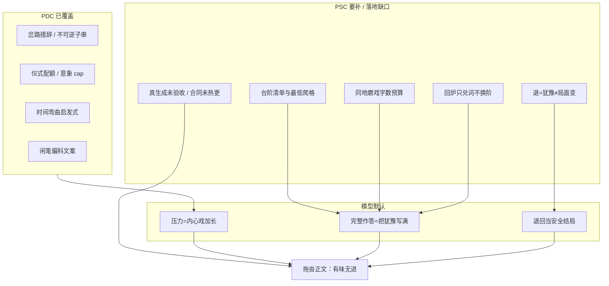
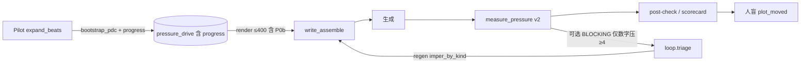
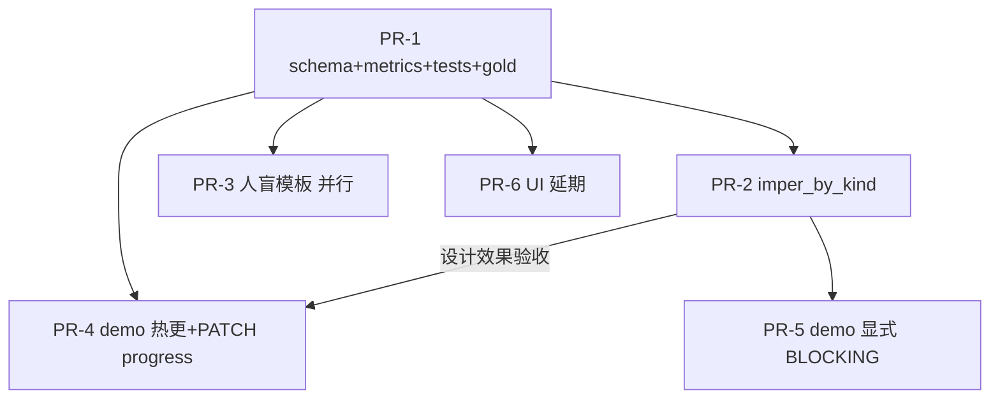

# 设计文档：叙事推进与质量残余 · PDC+PSC 整合最优落地

| 项 | 值 |
|----|-----|
| **文档标题** | 叙事推进与质量残余 · PDC+PSC 整合最优落地 |
| **副标题** | 在已交付压力驱动（PDC）与已部分落地情节台阶（PSC）之上，补齐缺口、验收真生成、并审查其它可优化质量问题 |
| **作者** | Grok Design（系统架构） |
| **日期** | 2026-08-09 |
| **修订** | **rev.D** · 用户决议 O1 立即开工 + O5 demo 验收阶段开 BLOCKING（最有效果） |
| **状态** | **Accepted · 用户已口头开工 · BLOCKING=demo 验收显式开（PR-2 后）** |
| **建议落盘名** | `设计文档/2026-08-09-叙事推进与质量残余-最优方案.md` |
| **产品** | scribe-writing-system / 铜炉 · scribe3 |
| **验证环境** | demo 已部署栈 `https://www.qing.blue`（只冒烟已部署服务；Grok 机禁 npm ci / 本机 Surreal / 全量测） |
| **样本证据** | `artifacts/ab-minimal-book_aa57f17e-ch6-*` · `artifacts/e2e-journey-2w-memory-v63-20260809-book_aa57f17e/04-serialize/ch06.md` · `artifacts/pressure-gold/*` · `scribe3/tests/fixtures/pressure_gold/*` |
| **前序** | `设计文档/2026-08-09-压力驱动叙事-匀速散步治理.md`（PDC rev.D） · `设计文档/2026-08-09-章节推进与反拖沓-最优方案.md`（PSC **rev.C**） |
| **代码锚点** | `scribe3/pressure_drive.py` · `pressure_metrics.py` · `craft.py` · `loop.py` · `api/services/write_assemble.py` · `api/services/pilot_runtime.py` · `api/routers/write.py` · `store/connection.py` · `tests/test_progress_stairs.py` |
| **PDC 已合入提交** | `86e2d57`（全回路）· `f2d9487`（rebind 注入）· `b3b6f81`（GATE + 中文标签） |
| **PSC 工作区状态** | **工作区已部分实现、尚未独立 commit**（相对 `HEAD`：`pressure_drive.py` +387 行级扩展、`pressure_metrics.py` v2、`craft.py` 一句、`test_progress_stairs.py` 未跟踪） |
| **约束** | UI 中文；Surreal 3.x only；工程分 ≠ 文学 9.5；**不推倒** PDC/PSC 两份设计；不靠「请写快一点」贴膏药；不新开 domain / 不新开 Surreal 列 / 不新开默认 env `SCRIBE3_PSC` |

---

## Overview

多轮 ch6 验证稿稳定复现「仪式化匀速叙事」。PDC（压力驱动章合同）已实现并接线：`chapter.pressure_drive`、≤400 字注入、craft 偏科、`measure_pressure`、Pilot bootstrap、GATE/BLOCKING、migration `114_pressure_drive.surql`。demo 真生成后用户明确反馈：**还是很拖沓，故事进度推进太慢。**

根因已在 PSC rev.C 写清：**「有压力」≠「世界挪了一格」**。后验强于抓痕迹字/铜腥，弱于抓「推进了几格」；兑锚改稿还会在同地补词加重磨戏。

本设计 **采纳 PSC rev.C 为主路径**，定位为 **「PDC + PSC 整合后的最优落地与残余质量治理」**：

1. **对照代码真实现状**给出「已实现 / 部分 / 未接线 / 未验证」差距表；
2. 写死全回路与不变量（与 rev.C 一致；代码偏差处以 **rev.C 为规范、代码须收敛**）；
3. 给出 **最短可验收 MVP PR 链**（提交 PSC 工作区 + 补齐缺口 + gold 分离 + demo 热更 + 真生成人读/机检标准）；
4. **质量问题审查台账**覆盖拖沓之外的系统性问题，并给出「主诉控住后下一刀」优先级。

一句话策略：

> **压力管「怎么用力」；台阶管「世界往哪挪了一格」。合同先于修辞；推进先于犹豫；退必改局；检测锚定台阶证据而非可刷动词表。progress 校验 fail-soft，永不抽空既有 P0 注入。落地优先补齐未接线与真生成验收，而非再叠一层 prompt。**

---

## Background & Motivation

### 问题脉络（必须被本方案直接回应）

| # | 事实 | 工程含义 |
|---|------|----------|
| 1 | 多轮 ch6 稳定复现仪式化匀速（空间清单、时间匀速、巷志同强、闲笔平均） | 需章内力学合同，非跨章张弛 |
| 2 | PDC 已落地（`86e2d57` / `f2d9487` / `b3b6f81`） | 勿推倒；扩展 `progress` 即可 |
| 3 | demo 真生成后用户仍判「拖沓、进度太慢」 | PDC  alone 不够；须推进维 |
| 4 | PSC rev.C 已 Accepted design | **主路径采纳**；本文补「落地差距 + 残余治理」 |
| 5 | 工作区 PSC **部分落地**（见差距表） | 最短路径 = 收敛 + 接线 + 验收，不是从零设计 |
| 6 | 用户要 **最优方案 + 审查其它可优化问题** | 台账 + 下一刀优先级 |

### 样本粗测（可复现 · 非 SLA）

| 样本 | 可见特征 | 粗信号 |
|------|----------|--------|
| e2e `…-book_aa57f17e/04-serialize/ch06.md` | ~12k 字符；`侧门`≈9 · `铜腥`≈6 · `决定`=0 · `插`=0 · `打开`=0 · `不敢`≈3 · `推开`=1 · `退`=1 | **零决策动词 + 高地点词** |
| phase1 A / recheck B 臂 | 铜腥/侧门/巷高频；AB engineering_gate 仍 false | 记忆 AB 与推进正交 |
| `artifacts/pressure-gold/bad_walkthrough.md` | 退+记门+无插匙 | 病样：须 grind + retreat |
| `artifacts/pressure-gold/good_pressure.md` | 半寸插匙 + 匙痕落地 | 好样：stairs light、无长磨 |

**复现命令**（仓库根；非 SLA，仅核对叙述）：

```bash
f=artifacts/e2e-journey-2w-memory-v63-20260809-book_aa57f17e/04-serialize/ch06.md
wc -c "$f"
for w in 侧门 铜腥 决定 插 打开 不敢 推开 退; do
  c=$(grep -o "$w" "$f" | wc -l); printf '%s=%s ' "$w" "$c"
done; echo
```

### 根因图（PDC 之后仍拖沓）



**关键洞察**：`irreversible_anchored` 绿 **不等于** 推进（掌灰/记门可写满而决策不落地）。PSC 的工程增量必须落在 **决策/代价台阶 + 磨戏 + 退代价 + 改稿换阶**，不能只把 irrev 再包一层。

### 与 purpose.deltas / scene_grid 的边界（沿用 rev.C）

| 机制 | 验什么 | 与本方案 |
|------|--------|----------|
| `purpose.deltas` | 章承诺世界状态是否兑现 | **互补 / 后续**；不强制每格台阶登记 delta |
| `scene_grid` 六元组 | Goal→Conflict→Disaster 结构 | advisory；PSC 验正文推进，不替代戏格 |
| PDC fork/irreversible | 岔路措辞 + 单一痕迹 | PSC 要求至少一格台阶落地；默认另有 cost/decision 锚 |
| craft 闲笔偏科 | 修辞配额 | 与 PSC 注入同 flag；主通道机检仅 report-only |

---

## Goals & Non-Goals

### Goals

1. **系统级治拖沓全回路**：登记 → 注入(P0+P0b≤400) → craft 偏科 → 后验(measure) → 改稿约束 → 人盲进度维 → flag/回滚。
2. **扩展 PDC 而非分叉**：`progress` 写入既有 `chapter.pressure_drive`；共用 `SCRIBE3_PDC`；metrics 进同一 `measure_pressure` 报告。
3. **可测且抗游戏**：台阶 evidence 合同锚定；禁止纯「决定/推开」词表刷绿或清零磨戏；病/好 + 抗锚刷样分离性验收。
4. **progress fail-soft**：非法 progress **永不**单独 `ok=False` / **永不**抽空 P0 / **永不**单独 GATE park。
5. **对照真代码补齐差距**并以 demo 热更 + 真生成（人读+机检）收口。
6. **审查并分流**其它生成质量问题；主诉控住后给出 1–3 个下一刀推荐。
7. **可回滚**：`SCRIBE3_PDC=0` 即回到无注入/无偏科/metrics n/a。

### Non-Goals

| 非目标 | 说明 |
|--------|------|
| 不推倒 PDC / 不重写 PSC rev.C 主语义 | 本文是落地与残余治理 |
| 不把文学 9.5 工程化为自动 pass | 正式高分仅人盲；machine 永不可单独宣称 |
| 不新开 domain / 不新开 Surreal 列 / 不新开默认 `SCRIBE3_PSC` | 开关矩阵冻结 |
| 不强制每章多高潮 / 假高潮灌满 | 默认 `min_stairs=1`；无连爆机检 |
| 不解决 memory_gain AB engineering_gate | 正交（台账 Q9） |
| 不在 Grok 机跑 npm ci / 本机 Surreal / 全量 pytest | 验收 = 离线纯函数测 + demo 冒烟 |
| 不做全卷节拍导演服务重写 | 成本与声口风险过高 |

---

## 实现差距表（代码真实现状 · 2026-08-09 工作区）

> **规范源**：PSC rev.C + PDC rev.D。  
> **实现源**：仓库工作区（`git status` 显示 PSC 相关改动 **未独立 commit**；`HEAD` 上 `pressure_drive.py` 仍为纯 PDC）。  
> 判定：**以 rev.C 为规范**；代码已对齐处标「已实现」，偏差处写明修正方向。

### 总览

| 能力 | 状态 | 证据 / 缺口 |
|------|------|-------------|
| PDC 字段 / migration 114 / PATCH allowed | **已实现（已 commit）** | `migrations/114_pressure_drive.surql`；`store/chapters.py` allowed 含 `pressure_drive`；`86e2d57` |
| PDC 注入 `write_assemble._pressure_drive_write_block` | **已实现** | flag 开 + `ok is True` → `render_pressure_drive_block`；`ok is False` →「结构待修」短警告；`f2d9487` rebind |
| PDC craft 偏科 `idle_pdc` / `sensory_pdc` | **已实现** | `craft.py`；同 `SCRIBE3_PDC` |
| PDC `measure_pressure` + post-check 并入 issues | **已实现** | `write.py` ~749–822；`connection._compute_scorecard` advisory.pressure |
| PDC Pilot bootstrap + GATE | **已实现** | `pilot_runtime._try_bootstrap_pdc` / `_pdc_gate_park_if_needed`；`b3b6f81` |
| PDC loop triage 认 `type=pressure` blocking | **已实现** | `loop.triage`；**无** `imper_by_kind` |
| PSC `progress` 数据模型 / `_default_progress` 双台阶 | **部分（工作区）** | `pressure_drive._default_progress`；bootstrap 写入 `progress`；**未 commit** |
| PSC `progress_ok` fail-soft | **部分（工作区）** | `validate_pdc` 返回 `progress_ok`；非法不改 `ok`；单测 `test_progress_fail_soft_*` |
| PSC P0b 渲染 + `MIN_RESERVE_P0B=56` + irrev 去重 | **部分（工作区）** | `render_pressure_drive_block` 强制尝试 P0b；`truncated:p0b` **未**作为可观测 meta 返回（仅字符串内最短形） |
| PSC metrics v2：stairs / zero_advance / grind / retreat | **部分（工作区）** | `pressure_metrics.py` `METRICS_VERSION=pressure_metrics.v2`；K16 `_location_grind_stats` 已对齐三式打断 |
| PSC grind G1–G3 / 抗锚刷分离单测 | **部分（工作区）** | `tests/test_progress_stairs.py` **9 个 `test_*` 定义存在、未跟踪**；**本设计环境未跑 pytest**（无复跑绿证）。**未**对 `artifacts/pressure-gold/*` 跑完整硬门闩（fixtures 合同 **无 progress**） |
| 既有 PDC 单测文件 | **部分（工作区已改未 commit）** | `tests/test_pressure_drive.py` · `tests/test_pressure_integration.py` 均为 `M`（craft/注入/progress_ok 相关断言扩展）；PR-1 须一并提交 |
| PSC craft 推进一句 | **部分（工作区）** | `idle_pdc` 已含「推进优先:极闲不得…」 |
| PSC `loop.build_regen_constraints` `imper_by_kind` | **未接线** | 现网 `imper` 无 `pressure_metrics` → 默认「消除该硬伤」；**兑锚加重磨未治** |
| PSC gold `contract_good.json` 含 progress | **未接线** | `artifacts/` 与 `tests/fixtures/pressure_gold/` 合同均 **无** `progress` 键；样例见 **附录 A** |
| PSC `main_channel_idle_ratio` | **未接线（允许 stub）** | 代码已有 metric 键，`tier=n/a`、`detail=report-only stub`；rev.C 写死不进硬门闩 |
| PSC `grind_or_anchor_spam` | **未实现（本链不要求）** | metrics **无此键**；rev.C 可后补、不进硬门闩；**勿称 stub** |
| PSC 高压「可退须 is_retreat_cost」校验 §1.2 ⑤ | **偏差 · PR-1 必做** | rev.C §1.2 ⑤；`_validate_progress` **未**强制；bootstrap 会写 `is_retreat_cost` 但校验侧缺口 → **必须**补 warnings + `progress_ok=False`（永不入 errors） |
| HTTP `PATCH /chapters/{seq}` 写 pressure_drive | **缺口（Issue 11）** | store `allowed` 含 `pressure_drive`；`ChapterMetaReq`（`api/models.py`）**无**该字段 → `model_dump(exclude_unset=True)` 静默丢键；前端无引用。**PR-1 必补** API 字段 |
| 已有 beats 章补 progress | **缺口** | `expand_beats` 在 beats 已存在时 `skipped`，**不**调 bootstrap；ch6 类旧章 **不能**靠 expand 验收 PSC（见 §10.4） |
| PSC 人盲 `pressure_progress_ab_v1` | **未接线** | 仓库无协议文件 |
| PSC demo 热更 + 真生成验收 | **未验证** | 现网 demo 仅有 PDC；PSC 工作区未部署 |
| 分离性 gold 全量证据链 | **未验证** | 硬门闩依赖附录 A progress 样例落地后；**非** demo 真生成文学达标 |

### 代码 vs rev.C 偏差（以哪边为准）

| 点 | rev.C | 工作区代码 | **以谁为准** | 修正方向 |
|----|-------|------------|--------------|----------|
| progress fail-soft | K13 写死 | 已对齐 | 一致 | 提交 + 保持 |
| K16 磨戏打断 | 离场 \| fresh cost 类 ev \| act∧ev | `_location_grind_stats` 对齐 | 一致 | 提交 + 保留 G1–G3 |
| retreat `change_kinds` | 无 danger | `["cost","decision","irreversible"]` | 一致 | 保持 |
| bootstrap 双台阶短锚 | K19 ≤12 字正文核 | `_body_evidence_from_*` 对齐 | 一致 | 保持 |
| `progress_stairs` metric.value | `{hit,need,missed,coverage}` | `value=hit` 整型，detail 带 need/missed | **以代码可测性为准** | 文档接受 int value；硬门闩看 tier |
| 高压可退 is_retreat_cost 校验 | §1.2 ⑤ | 未实现 | **以 rev.C（PR-1 必做）** | `_validate_progress`：可退岔路且 stairs 无 `is_retreat_cost` 且 kinds∩{cost,decision,irreversible}=∅ → warnings + `progress_ok=False`；**永不**入 errors；单测钉死 |
| `truncated:p0b` 可观测 | journal/render_meta | 仅内嵌最短形字符串 | **以 rev.C 可测** | 单测断言关键字即可；不必改 API 返回结构 |
| `imper_by_kind` | PR-6 | 无 | **以 rev.C** | 必做 MVP |
| HTTP 写 pressure_drive | 应可 PATCH | `ChapterMetaReq` 无字段；仅 store/Pilot | **以可运维验收为准** | **PR-1 必做**：`ChapterMetaReq.pressure_drive`；PR-4 用真实 HTTP 冒烟 |
| gold grind cap | 硬门闩须 bad 出 grind | 附录 A@900 → bad max_run≈267 无 finding | **以门闩可实现为准** | 附录 A `max_contiguous_chars=250`（硬门闩） |
| gold 含 progress | 硬门闩前提 | 合同无 progress | **以 rev.C** | 更新 gold JSON |

---

## 质量问题审查台账

> 依据：真实 ch6、AB artifacts、pressure-gold、现有 craft / qc / scorecard / purpose / scene_grid。  
> **分流**：`本方案` = 本 PR 链内；`协同` = 沿用已有能力不重复造轮；`后续` = 独立方案；`非目标` = 明确不做。

| ID | 问题 | 证据 / 能力缺口 | 分流 | 说明 |
|----|------|-----------------|------|------|
| Q1 | **情节台阶不爬 / 卡点磨戏** | 用户主诉；ch6 侧门磨满 | **本方案** | PSC 核心：decision/cost 台阶 + grind |
| Q2 | **压力=犹豫，退而不变** | 退回门仍关 | **本方案** | `retreat_no_cost`；bootstrap `is_retreat_cost` |
| Q3 | **闲笔/景物占主通道** | 巷志与主抉择同强 | **本方案（软）** | craft 一句 + 注入；`main_channel_*` report-only；人盲 `idle_vs_main`；**不宣称 machine 根治** |
| Q4 | **后验不抓推进格数** | 旧 metrics 无 stairs | **本方案** | `progress_stairs_*`；与 irrev 去冗余 warning |
| Q5 | **兑锚改稿加重磨** | regen 只补 evidence 子串 | **本方案** | `imper_by_kind`（**当前最大接线缺口**） |
| Q6 | 仪式化匀速 / 时间流水账 | PDC `time_linear_flag` | **协同** | 不新增时间指标 |
| Q7 | 铜腥/侧门意象过热 | `motif_overheat_local` | **协同** | 磨戏限长间接降刷词动机 |
| Q8 | 证人功能重复 | PDC P1 `witness_dup` 研究 | **后续** | report-only；不进 PSC P0 GATE |
| Q9 | 记忆三维 engineering_gate 未过 | phase1 lead 0.4 等 | **后续 / 非本方案** | memory_gain_ab 正交 |
| Q10 | AI 味 / degeneration / 句式套路 | `aggregate_ai_grade` / loop | **非目标** | 既有 critique；不叠词表 |
| Q11 | 限知泄露 | `find_leaks` | **非目标** | 本体公证处 |
| Q12 | 目的合同 deltas 空/未兑现 | purpose fulfillment | **后续** | 可选台阶→delta 投影 P1+ |
| Q13 | Scene–Sequel 断链 | scene_grid advisory | **后续** | 戏格严格模式独立 |
| Q14 | 跨章张弛单调 | `find_tension_monotony` | **非目标** | 已有跨章工具 |
| Q15 | 注入面过大 / verbosity | PDC 400 顶 | **本方案（纪律）** | P0b 预留 + irrev 去重；不新开 domain |
| Q16 | 假高潮灌满 / 每场都炸 | 产品风险 | **防（软）** | `min_stairs=1`；无连爆检；人盲 |
| Q17 | 声口/角色过滤不稳 | craft soak | **后续** | 内核2 / voice |
| Q18 | 正笔高峰被闲笔稀释 | stroke_plan | **本方案（软）** | 与 craft 偏科协同 |
| Q19 | bootstrap 合同与正文脱节 | 合同绿正文匀速 | **本方案（部分）** | 正文短锚 + gold + 人盲；**不宣称** bootstrap 质量单靠机检 |
| Q20 | 人盲缺「进度感」维 | 无协议文件 | **本方案** | **新建** `pressure_progress_ab_v1` |
| Q21 | 章间衔接生硬 / 钩子空转 | 卷级 pulse / 章末 hook | **后续** | 与弧光/卷信号协同；非 PSC P0 |
| Q22 | 弧光/角色一致性漂移 | `arc_signals` / character_arc（工作区另有改动） | **后续** | 见弧光专项；本方案不绑 |
| Q23 | 假绿：痕迹命中仍长磨 | gold 抗锚刷样 | **本方案** | grind 硬门闩 + 人盲 `grind_felt` |
| Q24 | demo 与工作区 PSC 漂移 | 未热更 | **本方案** | PR 合入后 `./scripts/deploy_demo.sh` |
| Q25 | 工程分冒充文学分 | AB scorer 字段 | **纪律 / 协同** | 沿用 `literary_claim_ban`；人盲唯一正式路径 |

---

## Proposed Design

### 1. 一句话策略与全回路

```text
登记(bootstrap/PATCH)
  → 注入(P0 岔路/不可逆 + P0b 推进钉 ≤400)
  → craft 偏科(idle_pdc 含推进优先一句)
  → 后验(measure_pressure v2)
  → 改稿约束(imper_by_kind · 换阶/换场)
  → 人盲进度维(plot_moved / grind_felt / …)
  → flag/回滚(SCRIBE3_PDC)
```



### 2. 写死不变量（对照 rev.C + 代码）

| ID | 不变量 | 说明 |
|----|--------|------|
| **I1** | progress fail-soft | 永不单独 `ok=False`；永不抽空 P0；永不单独 GATE park |
| **I2** | 磨戏打断唯一语义（K16） | 离场 \| fresh cost 类 evidence \| act∧evidence；**裸 force 不断** |
| **I3** | retreat `change_kinds` | `{cost, decision, irreversible}`，**无 danger** |
| **I4** | 台阶证据合同锚定 | 禁止纯「决定/推开」词表刷绿 |
| **I5** | 默认 `min_stairs=1` | 高压可升 2；低压 grind `n/a`（除非 `min_stairs≥2`） |
| **I6** | 不新开 domain / Surreal 列 / 默认 `SCRIBE3_PSC` | 共用 `SCRIBE3_PDC` |
| **I7** | 注入硬顶 | `MAX_PDC_BLOCK=400`；`MIN_RESERVE_P0B=56`；P0b 与 irrev 去重 |
| **I8** | severity | progress 系 blocking **仅** `SCRIBE3_PDC_BLOCKING=1` 且 `chapter_pressure≥4`；role 不参与 severity；**代码 default-off**；**demo 验收可显式开**（O5） |
| **I9** | 文学分 | machine 永不可单独宣称；`literary_claim_ban` 保留 |
| **I10** | 默认 bootstrap 双台阶 | cost/decision 短锚 + irrev；禁唯一 stair≡irrev 冒充治拖沓 |

### 3. 数据模型（嵌在 `pressure_drive` · 无新列）

```python
# chapter.pressure_drive JSON 增量
"progress": {
  "version": "psc.v1",
  "min_stairs": 1,
  "stairs": [  # 1..4
    {
      "id": "s1",
      "kind": "info|relation|danger|cost|decision|irreversible",
      "label": str,
      "evidence_must_show": str,  # ≥2；evidence_ok()；正文子串锚
      "is_retreat_cost": bool,
    },
  ],
  "location_grind": {
    "primary_locus": str,
    "max_contiguous_chars": 900,   # 高压默认；低压 1400
    "max_contiguous_paras": 6,     # 低压 10
  },
  "retreat_policy": {
    "allow_retreat": True,
    "require_world_change": True,
    "change_kinds": ["cost", "decision", "irreversible"],
  },
  "main_channel": {
    "forbid_idle_majority": True,  # 仅提示 / report-only
    "hint": "极闲不得连续盖过主抉择段",
  },
}
```

**字数统计（写死）**：`location_grind` contiguous = 段内去空白后 `len` 之和（与 `MAX_PDC_BLOCK` 同计量族）。

### 4. 环 1 — 登记

**文件**：`pressure_drive.bootstrap_pdc_from_texts` · `pilot_runtime._try_bootstrap_pdc` · PATCH `pressure_drive`

| 规则 | 实现要点 |
|------|----------|
| ⑦⑧ 齐全时同时填 progress | 失败 **省略 progress 键**，不写残缺对象 |
| progress 非法 | 仅 `progress_ok=False` + warnings |
| 短锚 K19 | cost/decision evidence **2–12 字**正文核；禁整句 cost_steps 黑话 |
| 可退岔路 · **§1.2 ⑤ 必做** | bootstrap 写 `is_retreat_cost`；`_validate_progress` **必须**校验：高压/推进或 `chapter_pressure≥4` 且可退启发式（`cost_steps` 非空或 choice 含 退/不/或/要么/空过）时，stairs 须至少一条 `is_retreat_cost` **或** `kind∈{cost,decision,irreversible}`，否则 `progress_invalid_retreat` → warnings + `progress_ok=False`；**永不**入 `errors`、**永不**改 core `ok` |
| synopsis_segments 回退 | **不写** pressure_drive → `ok=None`；GATE 不 park |
| **已有 beats 章** | `expand_beats` 见 beats 已有即 `skipped`，**不会** bootstrap。**禁止**仅 expand 验收。补 progress 写入口见 **§10.4 / 写入口表**（MVP：**HTTP PATCH 经 `ChapterMetaReq.pressure_drive`**，PR-1 必补模型字段；store 已 allowed）。操作：GET/读出当前合同 → upsert `progress` → PATCH 回写；**勿**无备份整表盲替。可选延期：`merge_progress` 子动作（仅缺键时合并，不覆盖作者 stairs） |

### 5. 环 2 — 注入（P0 + P0b ≤400）

**文件**：`render_pressure_drive_block` · `write_assemble._pressure_drive_write_block`

```text
1. header
2. P0 fork/irrev（可裁 cost/括注；保证剩余 ≥ MIN_RESERVE_P0B）
3. P0b 最短形强制尝试（与 irrev 去重；装不下 → 「退须改局。」一行）
4. P1…P4 按 PRI，装不下 break
```

- 决策只看 **core** `validate_pdc.ok`
- `progress_ok is False`：**仍渲染完整 P0**；P0b 可降级最短形
- 不新开 domain

### 6. 环 3 — craft

**文件**：`craft.py` · `idle_pdc`（已含推进一句）

- 不另开 craft flag；`SCRIBE3_PDC=1` 原子切换
- **不**再追加 temperature 第二句

### 7. 环 4 — 后验

**文件**：`pressure_metrics.measure_pressure` · `write.py` post-check · `connection` scorecard

| 指标 | 过闸 / 语义 | severity |
|------|-------------|----------|
| `progress_stairs_anchored` | `hit >= min_stairs` → light；否则 heavy | BLOCKING 可选（heavy + env + cp≥4） |
| `progress_zero_advance` | hit==0 且 irrev 未命中 | 同上 |
| `location_grind_run` | K16 超顶 | **永不** blocking（advisory） |
| `retreat_no_cost` | 退信号且无 cost/decision/irrev 阶落地 | **永不** blocking |
| `main_channel_idle_ratio` | report-only **stub**（键已在、算法未做） | 不进硬门闩 |
| `grind_or_anchor_spam` | **未实现（本链不要求）**；非 stub | 不进硬门闩；P1+ 可后补 |

**K16 唯一打断（与代码一致）**：

```text
break_run =
  (A) 离场
  or (B) 本段首次 fresh cost|decision|irreversible evidence（含 irrev）
  or (C) (force ∨ 窄动作表) ∧ 本段有 stair/irrev evidence
裸 force / 同 evidence 重复贴 → 不断
```

### 8. 环 5 — 改稿（**本方案必补缺口**）

**文件**：`loop.build_regen_constraints` · `loop.triage`

**kind 取值路径（写死）**：

```text
measure_pressure findings → meta.kind
  → write post-check 并入 issues（meta 透传）
  → triage：type=pressure 且 severity=blocking 时
       blocking[] 项：detector="pressure_metrics", kind=meta.kind
  → build_regen_constraints：
       if b["detector"] == "pressure_metrics":
           template = imper_by_kind.get(b["kind"]) or "消除该硬伤"
       else:
           template = imper.get(detector)  # 既有表
```

- **`kind` 只读 `b["kind"]`**（triage 已从 `meta.kind` 填入）；**禁止**从 `note`/`message` 二次解析。
- **仅 blocking 进入 regen**；advisory findings **不得**进入 `build_regen_constraints`（宪法 + 单测钉死：advisory 列表构造不产生换阶约束串）。

```python
# 伪代码 · 与 rev.C PR-6 一致
imper_by_kind = {
  "progress_stairs_anchored":
    "换场或换阶写入合同台阶痕迹「{ev}」；禁止同地同句型原地补锚/重复犹豫感官",
  "progress_zero_advance":
    "本章须至少落地一格台阶或不可逆痕迹；禁止只加长犹豫",
  "irreversible_anchored":
    "换场写入「{ev}」痕迹；禁止同段反复刷同一锚词",
  "location_grind_run":
    "压缩同地主戏；须付代价、做决策或换场，禁止裸 force 词表假装推进",
  "retreat_no_cost":
    "允许退，但须代价/决策/不可逆落地；禁止原状空转",
}
# {ev}：优先 b 附带 meta.evidence；否则从 note/quote 中「」短串；再无则省略括注
```

- advisory 仍 **不**自动 regenerate（宪法）
- UI「一键粘贴」后置

### 9. 环 6 — 人盲

**新建** `artifacts/pressure_progress_ab_v1/`（问卷 md + machine 列说明）：

| 人盲维（1–5） | 中文题干 |
|---------------|----------|
| `plot_moved` | 读完是否觉得「事情往前挪了」？ |
| `grind_felt` | 是否长时间停在同一处磨？ |
| `retreat_cost_felt` | 若有退缩，是否付了可见代价？ |
| `idle_vs_main` | 闲笔是否压过主事？ |
| `overall_pressure` | 是否被压力推着走？ |
| `irreversible_visible` | 是否见到收不回的痕迹？ |

machine 列：`progress_stairs_anchored.tier` · `location_grind_run` · `retreat_no_cost` · `literary_claim_ban`。  
**禁止** machine 单独宣称文学达标。

### 10. 可测方案与真生成验收标准

#### 10.1 离线机检（Grok 机可跑 · 纯函数）

> **前置**：`contract_good.json` 须含 **附录 A** 的 `progress` 块（PR-1 落地）；否则 `progress_*` 全为 `n/a`，硬门闩不可跑。

```bash
# 仓库根；更新 gold 含 progress 后
python3 - <<'PY'
from pathlib import Path
import json
from scribe3.pressure_metrics import measure_pressure
bad = Path("artifacts/pressure-gold/bad_walkthrough.md").read_text(encoding="utf-8")
good = Path("artifacts/pressure-gold/good_pressure.md").read_text(encoding="utf-8")
contract = json.loads(Path("artifacts/pressure-gold/contract_good.json").read_text(encoding="utf-8"))
assert "progress" in contract and contract["progress"].get("stairs"), "gold 缺 progress，见附录 A"
for name, prose in [("bad", bad), ("good", good)]:
    r = measure_pressure(prose, contract, synopsis="侧门", beats_text="侧门 抉择", chapter_pressure=5)
    print(name, {k: (r["metrics"].get(k) or {}).get("tier") for k in (
        "progress_stairs_anchored", "location_grind_run", "retreat_no_cost",
        "progress_zero_advance", "irreversible_anchored")})
    print("  findings", [(f.get("meta") or {}).get("kind") for f in r.get("findings") or []])
PY
```

#### 10.2 分离性硬门闩（MVP · 写死）

合同锚串（与附录 A / 正文对齐）：

| 字段 | 值 | 匹配目标 |
|------|-----|----------|
| `primary_locus` | `侧门` | bad/good 正文均含 |
| s1 cost | `空过三日` | good 有相关表述；bad **无** |
| s2 irrev | `半寸匙痕` | good 有；bad **无** |
| `min_stairs` | `1` | hit≥1 → stairs light |
| retreat 阶 | s1 `is_retreat_cost=true` | bad「退了」+ cost 未命中 → `retreat_no_cost` |

| 断言 | bad（`bad_walkthrough.md`） | good（`good_pressure.md`） |
|------|------------------------------|----------------------------|
| `progress_stairs_anchored` | **heavy**（hit=0 < need=1） | **light**（至少命中「半寸匙痕」） |
| `progress_zero_advance` | **true / heavy** | false / light |
| `irreversible_anchored` | heavy | light |
| `location_grind_run` | **hard**：finding ≥1 或 tier mid/heavy（依赖附录 A **cap=250**；bad 实测 max_run≈267） | 0 finding / light（good≈85 < 250） |
| `retreat_no_cost` | **命中** | **不命中** |

**必须样本**：

| 样本 | 落盘？ | 用途 |
|------|--------|------|
| gold bad | **是** | 退+记门+无插匙 → stairs heavy + retreat +（宜）grind |
| gold good | **是** | 半寸插匙 → stairs light |
| gold contract + progress | **是** 附录 A → `contract_good.json` | 硬门闩锚串 |
| **anchor_hit_still_grind** | **可不落盘** | 单测内联合成即可（`test_separation_grind_vs_good`）；**不**要求新 artifact 文件 |
| G1–G3 单测 | 代码内 | 安静落地断 / 裸 force 不断 / force+evidence 断 |

**不进硬门闩**：`main_channel_idle_ratio`（stub）、`grind_or_anchor_spam`（未实现）。

> **Issue 12 写死**：gold 合同 `location_grind.max_contiguous_chars` **必须为 250**（允许 200–280 区间内标定，默认 **250**）。生产 bootstrap 高压默认仍 **900**（不因 gold 门闩改生产默认）。附录 A@900 时 bad 仅约 267 字连续主戏 → **不会**出 grind finding；故 **硬门闩用 250**，与「病样须 grind」一致。G1–G3 单测可自带更紧 cap，与 gold 无关。

#### 10.3 真生成设计效果验收（禁止 machine 单独宣称文学达标）

| 层 | 标准 | 通过定义 |
|----|------|----------|
| **机检** | 章合同 **含 progress** 后，post-check 的 `progress_*` **非**全 n/a；grind/retreat 可 advisory | 工程绿 |
| **人读（工程交付必过）** | 三问：① 章末世界相对章初变了什么？② 若退了，代价？③ 主场戏是否明显短于章长一半？ | **n=1 作者自读** + 书面记录归档 artifact 即够 **MVP 工程交付** |
| **人盲问卷阈值** | `plot_moved`≥4 且 `grind_felt`≤2（5 分制） | **仅问卷默认 / 可标定**；**不作 CI gate** |
| **未达标处置** | 人读否或机检仍 stairs heavy / 长磨 | **优先**查：合同是否含 progress 且 evidence 对齐书 → 注入是否含 P0b → `imper_by_kind` 是否接线 → grind finding；**禁止**再叠「写快一点」prompt |
| **禁止** | 仅用 `irreversible_anchored=light` 或工程分宣称「不拖沓了」 | 写进验收清单 |

#### 10.4 demo 冒烟与 ch6 真生成验收入口（写死）

> **关键事实 A**：`pilot_runtime.expand_beats` 在章已有 `beats` 时直接 skipped，**不会**调用 `_try_bootstrap_pdc`。  
> **关键事实 B（Issue 11）**：`store.update_chapter_meta` 的 `allowed` **含** `pressure_drive`（dict→JSON 串），Pilot bootstrap 走 store 可写；但公开 HTTP `PATCH /chapters/{seq}` 的请求体模型 `ChapterMetaReq`（`scribe3/api/models.py`）**当前没有** `pressure_drive` 字段。`patch_chapter` 使用 `req.model_dump(exclude_unset=True)`，客户端即使 JSON 带该键也会被 Pydantic **静默丢弃**，**不会**进入 store。前端无 `pressure_drive` 编辑入口。

##### 写入口对照（代码真源）

| 入口 | 能否写 `pressure_drive` | 备注 |
|------|-------------------------|------|
| `Store.update_chapter_meta(seq, {"pressure_drive": ...})` | **能** | `chapters.py` allowed 已含；Pilot `_try_bootstrap_pdc` 用此路径 |
| HTTP `PATCH /chapters/{seq}` + `ChapterMetaReq` | **现网不能**（静默丢） | **PR-1 必补**字段后才能作为验收主路径 |
| Surreal 直写 / demo SSH 临时脚本调 store | 能 | 仅应急；**不作** MVP 首选文档主路径 |
| expand_beats（已有 beats） | **不能**补 progress | skipped |

##### MVP 写死路径（推荐 · 与 Issue 11 对齐）

| 步骤 | 动作 | 硬/软 |
|------|------|--------|
| 0 | **PR-1 合入**：`ChapterMetaReq` 增加 `pressure_drive: dict \| str \| None = None`（与 beats/deltas 同风格；store 已序列化）。可选单测：PATCH mock 断言字段进入 `update_chapter_meta` | **硬（PR-1）** |
| 1 | `./scripts/deploy_demo.sh` 热更 backend | 硬 |
| 2 | 确认 `SCRIBE3_PDC=1`。接线冒烟阶段 BLOCKING 可仍关；**设计效果验收**在 **PR-2 已部署后** 于 **demo 机**显式 `SCRIBE3_PDC_BLOCKING=1`（代码 default-off；其它环境不强制） | 硬（分阶段） |
| 3a | **必须** HTTP `PATCH /chapters/{seq}?work=…`：body 含 `pressure_drive`（读出当前合同后 **upsert `progress`**，附录 A 形；ch6 evidence 可按书改写）。**禁止**假设「任意 JSON 键都会写入」——须确认 PR-1 已部署 | **硬（ch6 验收）** |
| 3b | **仅新章无 beats** 时：Pilot expand_beats → bootstrap 可写 progress（store 路径，不依赖 ChapterMetaReq） | 可选 |
| 3c | **禁止**将「仅 expand_beats」作为 ch6/已有 beats 章验收充分条件 | 硬 |
| 3d | **禁止**文档再写含糊的「PATCH」而不指 HTTP 模型；若某环境 API 未升，临时用 demo 机 `python` 调 `update_chapter_meta` **须**在冒烟记录中注明「store 直写旁路」，并开 follow-up 补 API | 硬纪律 |
| 4 | 组装块含「台阶/同地/退」之一；post-check：`progress_*` 非全 n/a | 硬 |
| 5 | 可选旧稿只读 post-check；再 **一次**真写 + §10.3 人读三问书面记录 | 交付建议 |
| 6 | UI 台阶编辑延期 PR-6；不阻塞 HTTP 字段 | 延期 |

**PATCH 风险**：整表替换会覆盖作者已改的 fork/irrev；操作前备份现网 `pressure_drive` JSON。推荐：读出 → 仅 upsert `progress` 键 → PATCH 回去。


---

## API / Interface Changes

| 位置 | 变更 | 状态目标 |
|------|------|----------|
| `pressure_drive.py` | progress 模型、`progress_ok`、P0b、`evidence_ok`、bootstrap 双台阶、**§1.2 ⑤ 校验必做** | 提交工作区 + ⑤ 必做 |
| `pressure_metrics.py` | v2 stairs/grind/retreat | 提交工作区 |
| `craft.py` | idle_pdc 推进一句 | 提交工作区 |
| `loop.py` | `imper_by_kind` | **新增** |
| `write_assemble.py` | 仅 core `ok is False` 结构待修 | 已有；回归 |
| `pilot_runtime.py` | GATE 只看 core；bootstrap 写 progress | 已有；回归 |
| `api/routers/write.py` | pressure_report 已透传 | 已有 |
| `api/models.py` `ChapterMetaReq` | **新增** `pressure_drive: dict | str | None = None` | **PR-1 必做**（Issue 11） |
| `api/routers/chapters.py` `patch_chapter` | 随 model_dump 透传；无需特判（store 已序列化） | 随 PR-1；可加集成测 |
| gold JSON | 补 `progress`（附录 A，**grind cap=250**） | **新增** |
| migration | **无** | — |
| env | 不新开 `SCRIBE3_PSC` | — |
| 前端台阶编辑 | 延期 | PR 后置 |

---

## Data Model Changes

- JSON 增量 `progress`；**无**新 Surreal 字段（114 已够）。
- 旧章缺 progress：兼容，指标 `tier=n/a`。
- `escape_requires_stair` **不**单独落库。

---

## Key Decisions

| ID | 决策 | 理由（rationale） |
|----|------|-------------------|
| **D1** | **采纳 PSC rev.C 为主路径**，本文不推倒重来 | 语义已闭（K13–K20）；代码已 60%+ 对齐；用户问题仍是落地与验收 |
| **D2** | 规范源 = rev.C；代码偏差收敛到 rev.C（metric.value 形状例外以可测性为准） | 避免设计/实现双真源 |
| **D3** | progress 嵌 `pressure_drive`，共用 `SCRIBE3_PDC` | 防双写/双 flag；注入预算一体 |
| **D4** | 治拖沓三硬钉：台阶、同地磨戏、退必改局 | 对齐用户诊断 1–3 |
| **D5** | progress fail-soft 三永不（ok / P0 / GATE） | 现网 write_assemble 整块替换行为；保护 P0 |
| **D6** | K16 磨戏唯一打断语义 | 抗裸 force 刷绿 + 抗锚刷 |
| **D7** | retreat 无 danger | 防「嗡响更近」空转否决 |
| **D8** | 默认 min_stairs=1；不新开 SCRIBE3_PSC | 低压可活；开关矩阵简单 |
| **D9** | MVP 必含 `imper_by_kind`；**demo 验收阶段**在 PR-2 合入后显式 `SCRIBE3_PDC_BLOCKING=1` | 用户 O5「最有效果」：进度 heavy 须走换阶改稿；**须先** imper 再开 BLOCKING |
| **D10** | 真生成验收 = 人读 + 机检；machine 禁单独文学达标 | 宪法；用户已证「工程绿仍拖」 |
| **D11** | 台账分流：闲笔软治、时间/意象协同、记忆/声口/戏格后续 | 范围纪律 |
| **D12** | 交付验证 = demo 热更冒烟，不在 Grok 机重活 | 主机资源规则 |
| **D13** | 工作区 PSC 改动作为 PR-1 基线提交（可拆 1a/1b），不另开平行实现 | 最短路径；粒度见 PR-1 |
| **D14** | 已有 beats 章验收 **必须** PATCH upsert `progress`；expand_beats 非充分条件 | 代码 expand 见 beats 即 skipped |
| **D15** | §1.2 ⑤ 为 PR-1 **必做**（warnings + progress_ok=False） | 规范源 rev.C；消除可选歧义 |
| **D16** | MVP 验收主写路径 = **HTTP PATCH + `ChapterMetaReq.pressure_drive`**（PR-1 补字段） | store 已能写但公开 API 静默丢键；禁止文档空喊 PATCH |
| **D17** | gold 硬门闩 `max_contiguous_chars=250`；生产 bootstrap 默认仍 900 | Issue 12：bad@900 无 grind finding；门闩与生产默认分离 |
| **D18** | **立即开工**实现：PR-1→PR-2→PR-4 最短路径；PR-3 可并行 | 用户 O1 决议 2026-08-09 |
| **D19** | 代码侧 `SCRIBE3_PDC_BLOCKING` **仍 default-off**；**仅 demo 试跑**在验收阶段显式打开；误伤则 env=0，不回滚代码 | 用户 O5；保护 cp&lt;4 / 低压 grind n/a / 其它书不强制 |

---

## Alternatives Considered

### 方案 A — 只加 prompt「请加快情节 / 少犹豫」

- **优点**：零代码。  
- **缺点**：百万字回流均值；与 PDC 注入抢注意力；无抗刷。  
- **结论**：**拒绝**（用户已明确不要贴膏药）。

### 方案 B — 独立 `chapter.plot_progress` + 新 domain + `SCRIBE3_PSC`

- **优点**：语义隔离清晰。  
- **缺点**：双真源、双注入、预算翻倍、开关矩阵爆炸。  
- **结论**：**不采用**。

### 方案 C — PSC 嵌入 `pressure_drive.progress` + 共享 400（**推荐 · 已采纳**）

- **优点**：对准五条诊断；fail-soft；与 PDC 一体；工作区已部分落地。  
- **缺点**：400 字内 P0/P0b 争预算（用 MIN_RESERVE 缓解）。  
- **结论**：**主路径**。

### 方案 D — 事后 LLM 进度审判回炉

- **优点**：语义理解强。  
- **缺点**：成本高、不稳、难回归、易与限知冲突。  
- **结论**：**P2 可选**，不进 MVP。

### 方案 E — 仅靠 purpose.deltas / scene_grid 严格化

- **优点**：复用既有。  
- **缺点**：deltas 常空；戏格 advisory 不验正文推进；不治同地磨戏。  
- **结论**：**互补后续**，非主刀。

### Trade-off

| 维度 | A | B | **C** | D | E |
|------|---|---|-------|---|---|
| 对准拖沓根因 | 低 | 高 | **高** | 中高 | 中 |
| 与 PDC 一体 | — | 差 | **好** | 中 | 中 |
| 可机检抗刷 | 无 | 强 | **强** | 弱 | 中 |
| 注入啰嗦 | 中 | 高 | **可控** | 中 | 低 |
| 落地成本（现状） | 低 | 高 | **最低（已部分实现）** | 高 | 中 |
| 回滚 | 易 | 难 | **易** | 中 | 易 |

---

## Security & Privacy Considerations

| 威胁 | 严重度 | 缓解 |
|------|--------|------|
| 注入膨胀挤掉其它 must | 中 | 400 顶；MIN_RESERVE_P0B；字段截断 |
| 帧外秘密写入 evidence | 中 | 作者责任；`find_leaks` 仍生效；bootstrap 用 synopsis 短核 |
| GATE 误 park 全章 | 高 | progress 永不 park；ok=None 不 park |
| BLOCKING 误伤低压 | 高 | 默认关；仅数字压≥4 |
| 权限越权读合同 | 低 | 既有 work 隔离 |

---

## Observability

| 信号 | 落点 |
|------|------|
| `progress_ok` / stairs hit·need·tier | post-check `pressure` · scorecard advisory |
| `location_grind_run` max_run_chars | metrics.detail |
| `retreat_no_cost` | findings |
| `progress_redundant_with_irrev` | validate warnings |
| P0b 是否装入 | 渲染串含「台阶/同地/退」关键字（单测） |
| AB machine 列 | stairs_hit, grind, retreat + literary_claim_ban |
| 日志 | 既有 `pdc_bootstrap=degraded`；可加 `progress_ok` |

---

## Rollout / 回滚

| 阶段 | 内容 | 通过标准 |
|------|------|----------|
| M0 | 提交工作区 PSC 纯函数 + 附录 A gold progress + 分离性 + §1.2 ⑤ | 硬门闩绿；G1–G3；pytest 过滤命令见 PR-1 |
| M1 | bootstrap/校验小修；flag 关行为不变 | 单测；flag off 字节级无新增 |
| M2 | `imper_by_kind`（PR-2） | 单测禁默认「消除该硬伤」对 progress kinds |
| M3 | demo `./scripts/deploy_demo.sh` 热更（PR-4 前半） | 注入含推进钉；post-check 见 progress_* |
| M4 | ch6：HTTP PATCH progress + 真生成人读（n=1 三问）；PR-3 问卷可并行 | 工程交付；阈值不作 CI |
| M5 | **demo 验收显式** `SCRIBE3_PDC_BLOCKING=1`（仅 demo；**PR-2 之后**） | cp&lt;4 永不 block；误伤 env=0 |

### 回滚

1. `SCRIBE3_PDC=0` → 无注入 / craft 回均匀闲笔 / metrics 无合同则 n/a。  
2. **`SCRIBE3_PDC_BLOCKING=0`** → 关闭 demo 验收期 blocking 升格（**优先于**代码回滚；O5：误伤只关 env）。  
3. 去掉 P0b/metrics progress 分支（代码回滚 PR）。  
4. JSON `progress` 残留无害（旧客户端忽略）。  
5. **禁止**为回滚删 migration 114（字段 option 兼容）。

### 风险登记

| 风险 | 严重度 | 缓解 |
|------|--------|------|
| 合同绿正文仍磨 | **高** | grind 硬门闩 + 抗锚刷样 + 人盲 |
| stairs≈irrev 假绿 | **高** | 双台阶；redundant warning；门闩含 grind |
| 改稿仍磨 | **高** | `imper_by_kind` 必进 MVP |
| 400 丢 P0b | 中 | MIN_RESERVE + 最短形 |
| 误伤低压 | 中 | grind n/a；blocking 数字压 |
| 假高潮灌满 | 中 | min_stairs=1；无连爆；人盲 |
| 工作区与 demo 漂移 | 中 | 热更 + 冒烟清单 |
| bootstrap 短锚与书题材不匹配 | 中 | 作者 PATCH；evidence 可手写 |
| demo 开 BLOCKING 误伤高压章 | 中 | **PR-2 先合入**；cp&lt;4 永不 block；env=0 即时回滚 |

---

## 其它可优化问题的优先级建议（主诉控住后）

> 前提：Q1/Q2/Q5 经 demo 真生成 + 人盲判定「进度感」通过。

| 优先 | 下一刀 | 理由 | 风险 |
|------|--------|------|------|
| **1** | **Q3 闲笔占主通道（软→半硬）** | 用户诊断并列项；当前仅 craft/注入软约束；若进度已动而「味淡被巷志淹没」仍在，读者仍说拖 | 过硬会伤氛围；保持 report-only 算法 + 人盲，再考虑段级启发式 |
| **2** | **Q8 证人功能重复** | ch6 灰狸/磨刀双报断声；PDC 已有 witness_policy 注入但后验弱 | 误伤「多视角」；先 report-only finding |
| **3** | **Q12 目的合同 deltas 兑现** | 与台阶互补：台阶是「挪了」，deltas 是「世界账本」；空 deltas 时进度感难跨章累计 | 过载目的合同；仅 P1 投影研究 |

**刻意不优先**：Q9 记忆 AB（正交大工程）、Q10 AI 味（已有 heavy 闸）、Q17 声口（专项）、Q22 弧光（另有设计）。

---

## Open Questions

| # | 问题 | 决议 / 默认 | 状态 |
|---|------|-------------|------|
| **O1** | 是否立即开工实现？ | **立即开工**（推荐）：按 **PR-1→PR-2→PR-4** 最短路径落地；PR-3 可并行 | **已决议** · 用户 2026-08-09 |
| O2 | demo 是否默认 `SCRIBE3_PDC=1`？ | 保持现网策略；热更后确认已开 | 运维确认（非阻塞开工） |
| O3 | 真生成验收是否绑定 book_aa57f17e ch6？ | **是**（连续对照） | 已建议采纳，无需再拍板 |
| O4 | `main_channel_idle_ratio` 是否在本链实现算法？ | **否**，保持 stub | 已决议（设计默认） |
| **O5** | BLOCKING 如何开才「最有效果」？ | 见下方 **O5 写死** | **已决议** · 用户 2026-08-09（Other：最有效果） |

### O5 写死（用户：最有效果的方案）

为使「进度未挪」真正影响产出（不只 advisory 灯）：

1. **前置**：`imper_by_kind`（**PR-2**）必须已合入并部署；否则 blocking 回炉仍会兑锚加重磨。  
2. **demo 验收阶段**在 demo 试跑环境 **显式** `SCRIBE3_PDC_BLOCKING=1`：数字压 **≥4** 时 `progress_stairs_anchored` / `progress_zero_advance` 的 **heavy** 可升 **blocking**，从而走 loop 换阶改稿。  
3. **保护（写死）**：`chapter_pressure < 4` **永不** block；低压 grind 仍 **n/a**；代码侧 env **仍 default-off**（生产/其它书 **不**强制打开）。  
4. **回滚**：若误伤明显 → **只** `SCRIBE3_PDC_BLOCKING=0`，**不**回滚代码。

PSC 规范已关闭项保持不变：`min_stairs` 默认 1；progress 非法不 ok=False；无 `SCRIBE3_PSC`；main_channel report-only；UI 不阻塞 MVP。

---

## References

| 路径 | 用途 |
|------|------|
| `设计文档/2026-08-09-压力驱动叙事-匀速散步治理.md` | PDC 母设计 rev.D |
| `设计文档/2026-08-09-章节推进与反拖沓-最优方案.md` | PSC rev.C（规范源） |
| `scribe3/pressure_drive.py` | 合同/渲染/bootstrap/progress |
| `scribe3/pressure_metrics.py` | 后验 v2 |
| `scribe3/craft.py` | 闲笔偏科 + 推进一句 |
| `scribe3/loop.py` | triage / regen（待 imper_by_kind） |
| `scribe3/api/services/write_assemble.py` | 注入 |
| `scribe3/api/services/pilot_runtime.py` | bootstrap + GATE |
| `scribe3/api/routers/write.py` | post-check pressure |
| `scribe3/store/connection.py` | scorecard advisory.pressure |
| `scribe3/migrations/114_pressure_drive.surql` | 字段 |
| `scribe3/tests/test_progress_stairs.py` | PSC 单测（工作区） |
| `artifacts/pressure-gold/*` | 病/好对照 |
| `artifacts/e2e-journey-2w-memory-v63-20260809-book_aa57f17e/04-serialize/ch06.md` | 拖沓证据 |
| 提交 `86e2d57` / `f2d9487` / `b3b6f81` | PDC 交付史 |
| `scripts/deploy_demo.sh` | demo 热更主路径 |

---

## PR Plan

> 每条可独立 review/merge；**依赖写死**。MVP = **PR-1 → PR-2 → PR-4（热更+PATCH progress 冒烟）**；PR-3 人盲模板 **并行**（不阻塞热更）。  
> **用户 2026-08-09 已决议立即开工（O1）**。PR-5：demo 验收阶段显式开 BLOCKING（O5 最有效果；**必须** PR-2 之后）。

### PR-1 · `psc: commit progress schema + P0b + metrics v2 + unit tests`

| 项 | 内容 |
|----|------|
| **标题** | `psc: progress 子合同 + P0b 注入 + metrics v2 + 单测` |
| **文件** | `scribe3/pressure_drive.py` · `pressure_metrics.py` · `craft.py` · **`api/models.py`（ChapterMetaReq.pressure_drive）** ·（可选）`api/routers/chapters.py` 测 · `tests/test_progress_stairs.py`（**新建/??**）· `tests/test_pressure_drive.py`（**M**）· `tests/test_pressure_integration.py`（**M**）· 双份 `contract_good.json`（**附录 A，cap=250**） |
| **依赖** | 无（基于已合入 PDC） |
| **等价 rev.C 范围** | 合并原 **PR-1+PR-2+PR-3+PR-4** 内容：schema/`progress_ok`/P0b · metrics v2 + G1–G3 · bootstrap 双台阶 · craft 一句。**另强制**：§1.2 ⑤；附录 A gold（**cap=250**）；**`ChapterMetaReq.pressure_drive`（Issue 11）** |
| **可拆（可选）** | **PR-1a** 纯函数+单测（无 gold 硬门闩落盘）；**PR-1b** gold progress + §10.1/10.2 硬门闩。二者无外部 PR 依赖，仅顺序建议 1a→1b |
| **描述** | 将工作区 PSC 实现对齐并提交。**必做**：① §1.2 ⑤ 校验+单测 ② 双份 gold=附录 A（**max_contiguous_chars=250**）③ **`ChapterMetaReq.pressure_drive`** 使 HTTP PATCH 不再静默丢键（单测/轻量断言字段进入 store）。flag 关行为不变。生产 bootstrap 高压 grind 默认仍 900。 |
| **验收** | ① 缺 progress 兼容 ② progress 非法不改 ok 且 P0 仍在 ③ G1–G3 ④ ≤400 含推进钉 ⑤ gold 分离性（§10.2 表，**含 bad grind finding**，cap=250）⑥ §1.2 ⑤ 单测 ⑦ ChapterMetaReq 含 pressure_drive 且 PATCH 路径可写入（单测 mock 即可）⑧ demo/CI：`python -m pytest scribe3/tests/test_progress_stairs.py scribe3/tests/test_pressure_drive.py -q`（**禁** Grok 全量） |

### PR-2 · `psc: regen imper_by_kind 治兑锚加重磨`

| 项 | 内容 |
|----|------|
| **标题** | `psc: loop 改稿约束按 pressure kind 分支` |
| **文件** | `scribe3/loop.py` · `tests/test_pressure_integration.py`（或新增 `test_regen_pressure_kind.py`） |
| **依赖** | PR-1（kind 名稳定） |
| **描述** | `build_regen_constraints`：`detector=="pressure_metrics"` 时 **`kind` 只读 `b["kind"]`**（triage 从 `meta.kind` 填入，禁止二次解析 note）。按 kind 选用换阶/换场模板。advisory **不**进入 regen。 |
| **验收** | 构造 `blocking=[{detector:"pressure_metrics", kind:"progress_stairs_anchored", note:"…", quote:""}]` → 输出含「换场」或「换阶」，**且该条不出现**默认「消除该硬伤」；`detector=find_leaks` 行为不变；仅 advisory 列表不产生 progress 换阶约束 |

### PR-3 · `psc: pressure_progress_ab_v1 人盲模板 + 验收清单`

| 项 | 内容 |
|----|------|
| **标题** | `docs: pressure_progress_ab_v1 问卷与真生成验收清单` |
| **文件** | `artifacts/pressure_progress_ab_v1/questionnaire.md` · `machine_columns.md` · （可选）落盘本设计文档 |
| **依赖** | PR-1（machine 列字段名）；**与 PR-4 并行，非 PR-4 硬依赖** |
| **描述** | 新建人盲六维；阈值仅默认不作 CI；附 §10.3 未达标处置。 |
| **验收** | 文件存在；含 `plot_moved`/`grind_felt`；含 `literary_claim_ban`；声明 n=1 三问即够工程交付 |

### PR-4 · `ops: demo 热更 + PDC/PSC 冒烟`

| 项 | 内容 |
|----|------|
| **标题** | `ops: deploy_demo 后压力/推进冒烟` |
| **文件** | 无强制代码；可加 `scripts/smoke_pressure.sh`（轻量 curl） |
| **依赖** | **硬依赖 PR-1**；接线/HTTP 冒烟可先于 PR-2；**设计效果验收（开 BLOCKING）硬依赖 PR-2**；**不依赖 PR-3** |
| **描述** | `./scripts/deploy_demo.sh` 热更；`SCRIBE3_PDC=1`。ch6：**HTTP** PATCH upsert progress（§10.4）。**禁止**仅 expand_beats。post-check progress_* 非 n/a。**设计效果验收**：PR-2 部署后 demo 显式 `SCRIBE3_PDC_BLOCKING=1`（O5），再真写/回炉观察换阶；人读三问。 |
| **验收** | health 绿；**HTTP PATCH 后** GET/读章见 progress；post-check progress_* 非全 n/a；人读笔记（若当次真写） |

### PR-5 · `psc: demo 验收显式 BLOCKING（最有效果 · O5）`

| 项 | 内容 |
|----|------|
| **标题** | `ops/psc: demo 验收阶段打开 SCRIBE3_PDC_BLOCKING`（代码 default-off 不变） |
| **文件** | `pressure_metrics._sev`（已部分支持）· 单测确认 severity；**demo 环境配置**（compose/env，**不**把 env=1 写进仓库默认） |
| **依赖** | **硬依赖 PR-1、PR-2**（无 imper_by_kind 不得开 BLOCKING） |
| **描述** | 用户 O5「最有效果」：demo 试跑在 **PR-2 合入并热更后** 显式 `SCRIBE3_PDC_BLOCKING=1`，使数字压≥4 的 progress heavy 升 blocking → loop 换阶改稿。代码侧 env **仍 default-off**；生产/其它书不强制。误伤 → 只关 env。 |
| **验收** | ① env 关 / cp&lt;4 永不 block ② demo env=1 且 cp≥4 时 progress heavy 可进 triage blocking ③ 回炉约束含换阶/换场（PR-2）④ 运维记录写明「仅 demo 验收」 |

### PR-6 · `psc: UI 台阶编辑（延期 OK）`

| 项 | 内容 |
|----|------|
| **标题** | `web: 章合同 progress 台阶中文编辑` |
| **文件** | `scribe3/web/**` |
| **依赖** | PR-1 |
| **描述** | 中文 PATCH stairs；不阻塞 MVP。 |
| **验收** | 可改 evidence 落库 |

### PR 依赖关系



**说明**：PR-3 **不**指向 PR-4。**接线冒烟**可 PR-1+PR-4（BLOCKING 仍关）；**设计效果验收（最有效果）** = PR-1 + **PR-2** + PR-4 + demo **显式** `SCRIBE3_PDC_BLOCKING=1` + 人读三问。PR-5 = 运维打开 env，非大代码。

**MVP 闭环定义**：PR-1 → PR-2 → PR-4（含 PATCH progress）+ 人读三问；PR-3 并行；demo 验收阶段按 O5 开 BLOCKING。**禁止**仅靠机检宣称成功。

---

## Revision Summary

| 修订 | 日期 | 说明 |
|------|------|------|
| rev.A | 2026-08-09 | 初版：PDC+PSC 整合落地；代码差距表；台账；MVP PR；下一刀优先级 |
| rev.B | 2026-08-09 | design review：§10.4 已有 beats 必须 PATCH progress；附录 A gold；§1.2 ⑤ 必做；PR 依赖图；imper kind 路径；人读 n=1 与未达标处置；pytest 过滤命令 |
| rev.C | 2026-08-09 | re-review Issue 11：`ChapterMetaReq.pressure_drive` PR-1 必补 + §10.4 写入口表；Issue 12：gold grind cap=250 进硬门闩，生产默认 900 不变 |
| rev.D | 2026-08-09 | 用户决议 O1 立即开工 + O5 demo 验收阶段开 BLOCKING（最有效果） |

---


---

## 附录 A · gold `contract_good.json` 的 `progress` 块（可粘贴）

> 并入现有 `artifacts/pressure-gold/contract_good.json` 与 `scribe3/tests/fixtures/pressure_gold/contract_good.json` 顶层（与既有 fork/irrev 并列）。  
> 锚串对齐 `good_pressure.md` / `bad_walkthrough.md`；bootstrap 短核语义一致。

```json
"progress": {
  "version": "psc.v1",
  "min_stairs": 1,
  "stairs": [
    {
      "id": "s1",
      "kind": "cost",
      "label": "退则空过",
      "evidence_must_show": "空过三日",
      "is_retreat_cost": true
    },
    {
      "id": "s2",
      "kind": "irreversible",
      "label": "半寸匙痕",
      "evidence_must_show": "半寸匙痕",
      "is_retreat_cost": false
    }
  ],
  "location_grind": {
    "primary_locus": "侧门",
    "max_contiguous_chars": 250,
    "max_contiguous_paras": 6
  },
  "retreat_policy": {
    "allow_retreat": true,
    "require_world_change": true,
    "change_kinds": ["cost", "decision", "irreversible"]
  },
  "main_channel": {
    "forbid_idle_majority": true,
    "hint": "极闲不得连续盖过主抉择段"
  }
}
```

**期望（§10.2 摘要）**：同一合同下 bad → stairs heavy + zero_advance + retreat_no_cost + **location_grind_run finding**（cap=250，bad max_run≈267）；good → stairs light + irrev light + 无 retreat_no_cost + grind light。

> **与生产默认分离**：`bootstrap_pdc_from_texts` / `_default_progress` 高压 `max_contiguous_chars=900` **不改**；仅 **gold / 硬门闩合同** 使用 250。单测 G2 等可继续用 80/200 等更紧 cap。


*本文为系统设计文档。产品对用户表述使用中文（台阶、同地磨戏、退必改局、进度感）；工程标识符可保留 English。**用户 2026-08-09 已决议立即开工**；实现以本文 PR Plan 与 O5 BLOCKING 纪律为准。*
