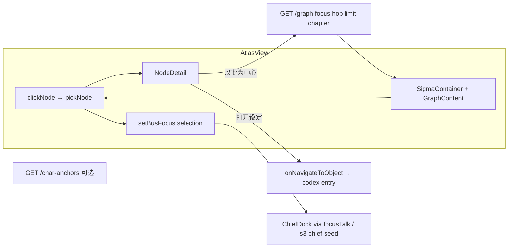
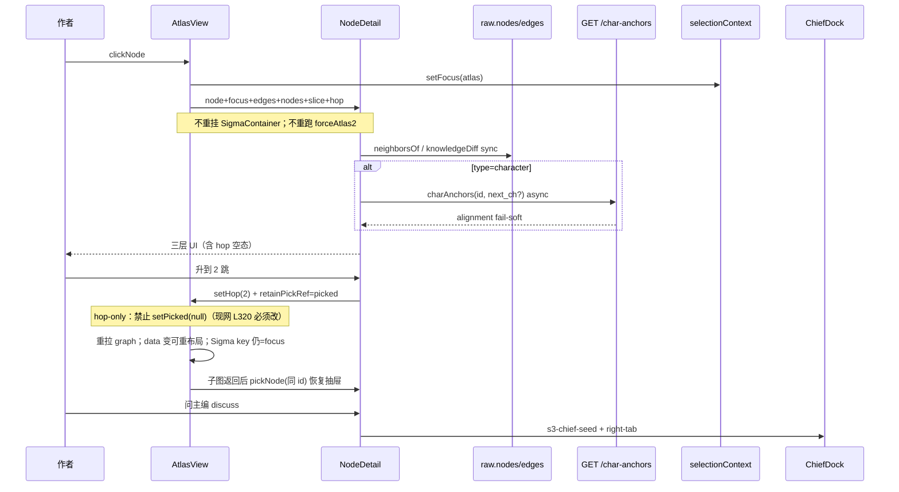

# 知识图谱节点抽屉（NodeDetail）最优改进方案

| 项 | 值 |
|----|-----|
| 文档状态 | **Accepted**（R2 审查修订合入 · 可直接实施 PR-A） |
| 作者 | Grok Build（系统设计） |
| 日期 | 2026-08-10 |
| 审查 | R1 合入 Issue 1–13；R2 合入升跳保留 picked / peerKnowsUnobservable / frame 伪代码 |
| 产品 / 仓库 | 铜炉（tonglu）· `scribe-writing-system` / `scribe3/` |
| 图谱视图 | `scribe3/web/src/views/AtlasView.jsx` |
| 当前抽屉 | 同文件 `NodeDetail`（约 L167–217） |
| 图数据 | `api.graph` → `store.graph` / `GET /graph?focus=&hop=&limit=` |
| 相关已落地 | 角色弧光 `GET /char-anchors`（含 `alignment`）；选中总线 `selectionContext`；主编 seed `lib/chiefSeed.js` + `focusTalk` + `shouldUseHermesRun` |
| 资源与验收 | Grok 机禁重活；验收优先已部署 demo 冒烟（`www.qing.blue`） |
| 第一性 | **帮助写出好小说** → 抽屉是「戏剧操作台」，不是缩版设定库 |

---

## Overview

知识图谱是铜炉的**真知识图**：角色 —`knows`→ 命题，以及角色关系 / 势力成员 / 物件持有等边。作者点节点后右侧浮层 `NodeDetail` 理应回答写作现场的三问——**是谁、与当前中心·章切片的张力、立刻能做什么**——但现状几乎只消费「名字 + 类型 + 与 focus 一条边 + 打开设定」。

本方案把 `NodeDetail` 升级为**分类型、分三层的轻量戏剧操作台**，严格划清与 Codex 的分工：

| | 图谱抽屉（本方案） | Codex（`CodexDetail` / ObjectFrame） |
|--|-------------------|-------------------------------------|
| 定位 | 图上下文 + 戏剧张力 + 写下一步 CTA | 档案深读 / 全字段 / 弧光完整表 / 主编补全 |
| 深度 | 一眼扫描 + 3 个主动作 | 可滚动全页 |
| 数据 | 优先当前子图 `edges`/`nodes` + 可选轻量 `charAnchors` | 全量 REST 单条读 |
| 交互 | 单击轻抽屉；「打开设定」按钮深潜（**PR-A 不做双击**） | 设定库主路径 |

**不**嵌整页 Codex、**不**先大改 Sigma/forceAtlas2 布局引擎、**不**为炫技可视化加无关字段。分三 PR 交付，PR-A 零新 API 即可显著可用。

**审查关键补丁摘要**：

1. 默认 **hop=1** ego BFS 下「对方独知」结构性近空 → 空态诚实 + 一键升 2 跳。  
2. **R2**：`setHop` 不得 `setPicked(null)` 关抽屉；子图返回后按 id 恢复（§3.1.3）。  
3. **R2**：`peerKnowsUnobservable = hop<2 && node≠focus`（不依赖对方有无 knows 出边）。  
4. PR-B 角色间知情差 = **`frame×2`（FactRow[]）**，不得用 `/irony` 顶替。  
5. 命题 graph label 后端 **`[:18]`**；「问主编」默认 **discuss** seed。

---

## Background & Motivation

### 代码锚定（现状）



**图数据**（`store/structure.py` · `graph`）：

- 节点：`character` / `proposition`（含 `secret`）/ `faction` / `item`
- 边：`knows`（角色→命题）、`relations_at`（角色关系）、`entity_relations_at`、`member`（势力→角色）、`held_by`（物件→角色）
- ego 子图：`focus` 起 **无向 BFS** `hop` 跳，节点硬上限 `limit`（前端默认 **hop=1**、limit 300）
- 命题出站 label：非 secret `(f.value or "")[:18]`；secret `"🔒 私密"`（**无完整 value**）
- 章切片：`chapter` 时间门（knows 的 since/until；`relations_at(ch)`）

**ego hop 与知情差的结构性约束（必须理解）**：

```
hop=1 子图 = focus 的直接邻居（含：关系对端角色、focus 的 knows 命题、member/held_by 等）
角色 B（A 的关系邻居）的 knows 目标 P 路径为 A —rel→ B —knows→ P → 距离 2
∴ hop=1 时 P ∉ 子图 → K(B)\K(A) 系统性为空或极稀
K(A)\K(B) 仍可用（A 的 knows 目标在子图内）
命题「知情集合」亦只含 keep 内角色，会漏子图外知情人
（对照：test_graph_focus_query_returns_ego — 甲 ego 不含乙独知 fact:f2）
```

**当前 `NodeDetail`（L167–217）能力**：

1. 名字（secret → 锁图标 +「私密命题」）
2. 类型色点（仅 character / 命题二分，**未展示 faction/item**）
3. 与 `focus` 的**一条**直连边（`edges.find`，多边只取首条）
4. CTA：「打开设定」；角色另有「以此为中心展开」
5. **Bug**：打开设定 `type: character | proposition` 硬编码，faction/item 错路由

**已接通但抽屉未消费**：

| 能力 | 位置 | 抽屉现状 |
|------|------|----------|
| 全部邻居边 | `raw.edges` | 仅 1 条 relToFocus |
| 度数 / 关系邻域 | 可对 `edges` 聚合 | 无 |
| 弧光一行 | `api.charAnchors` → `alignment` | 无 |
| 知情差（相对 focus） | 子图 knows 过滤（受 hop 约束） | 无 |
| 选中总线 | `pickNode` → setBusFocus | 有，无显式「问主编」seed |
| 类型导航 | `atlasNavType` + `navToNode` | 抽屉打开设定 type 错误 |

### 用户问题（原话）

> 图谱每一个节点点击后右侧展开的抽屉详情太简单，根本起不到作用。

### 动机摘要

1. **信息浪费**：子图已含边与邻居，UI 只露一条。  
2. **类型盲区**：faction/item 详情当命题处理。  
3. **写作断链**：无弧光、知情差（诚实边界）、问主编。  
4. **分工模糊**：「打开设定」与「在图上操作」无层次。

---

## Goals & Non-Goals

### Goals

1. **三问默认答出**（任意类型节点单击后 ≤1s 可见，**在 hop 诚实边界内**）：
   - 是谁（身份 + 类型 + 子图度数）
   - 与 focus·当前章切片的张力（直连关系 / 可见的 knows 差 / 职能关联）
   - 立刻做什么（3 个主 CTA；含 hop=1 时「升 2 跳看对方知情」引导）
2. **按类型分面**：`character` / `proposition` / `faction` / `item`（及未知 fail-soft）
3. **抽屉 ≠ Codex**：深读一律「打开设定」；不嵌 `CodexDetail`
4. **数据优先零新 API**（PR-A）；PR-B 复用现有 `/frame`（×2）加深，**不**用 `/irony` 做角色间 diff
5. **隐私**：`secret` 永不展示/拼接明文 value
6. **性能**：子图 ≤300；抽屉附加请求 fail-soft；**pick 节点不重跑 forceAtlas2 / 不重挂 SigmaContainer**
7. **可验收**：纯函数+组件单测 + demo 已部署冒烟（含 hop=1 空态引导与 hop≥2 双方差集）

### Non-Goals

- 嵌整页 Codex / ObjectFrame 进浮层
- 只加静态档案字段而无 focus 关系上下文
- 大改 Sigma 布局引擎；PR-A 开边事件 / 路径高亮（PR-C 可选，默认 flag 关）
- 图谱内完整弧光编辑 / 里程碑 CRUD
- 新 migration / 改 knows 存储或 BFS 拓扑（除非未来 B2 极小端点）
- 默认每次 pick 拉全书 `project_frame`（PR-B 且用户显式增强时才）
- PR-A 双击深潜（sigma 事件未钉死，避免膨胀）
- 在 Grok 机跑 `npm ci` / 全量 e2e

---

## Proposed Design

### 1. 原则

1. **第一性：服务写作** — 每块须推出「下一笔」或动作。  
2. **按类型分面** — 顶栏 / 中部 / 底栏同壳，中部按 `node.type`。  
3. **图上下文优先** — 默认只读当前 `raw`；跨 hop 不假装已知。  
4. **单击轻、深潜重** — 单击 = 抽屉；「打开设定」= Codex；列表主操作 = pick，行内「设定」= 深潜。  
5. **fail-soft** — anchors / frame 失败不拖垮图。  
6. **hop 诚实** — 知情差空态区分「真无差」vs「当前跳数看不到」。

### 2. 交互与壳层

#### 2.1 布局

| 阶段 | 形态 | 宽度 | 说明 |
|------|------|------|------|
| P0（PR-A） | 浮层 `absolute top-3 right-3` | **`w-80`～`w-96`（320–384px）** | 替代 `w-64` |
| P1（PR-B 可选） | 右栏半宽偏好 | `min(420px, 40%)` | 仅 Atlas 内 flex；不改 FourPane |

```
┌─ NodeDetailShell ─────────────────────┐
│ [顶栏] 身份 · 度数 · 关  ×            │
│ [中部] TypeFacet（可滚动 max-h）       │
│ [底栏] 3 主 CTA 固定                  │
└───────────────────────────────────────┘
```

- 中部 `max-h-[min(50vh,360px)] overflow-y-auto`
- `data-testid="atlas-node-detail"`
- 关闭：× / `clickStage` / Esc（可选 P0）

#### 2.2 单击 / 列表 / 双击（PR-A 合同）

| 手势 | 行为 | PR |
|------|------|-----|
| 单击节点 | `pickNode` → 轻抽屉 + selection bus | A |
| **双击节点** | **PR-A 明确不做** | — |
| 左侧对象列表 | 见 §2.2.1 可访问结构 | A |
| 「打开设定」按钮 | `onNavigateToObject` + **`atlasNavType`** | A |

**双击（Issue 7）**：`@react-sigma/core` / sigma v3 是否暴露 `doubleClickNode` 未钉死；Timeline 的 doubleClick 不可类比。PR-A **仅**提供「打开设定」按钮深潜。若后续要做：单独 spike ≤0.5d 确认 `registerEvents`；用 click 时间戳时须防与 `clickStage` 清空竞态。**禁止**在 PR-A 范围膨胀实现双击。

##### 2.2.1 对象列表可访问合同（Issue 6）

列表从「单击即深潜」改为与画布一致的轻选中，**必须**保留键盘/读屏可达的设定入口：

```
<li>
  <button data-testid="atlas-list-pick" aria-label="选中 {label}">  // pickNode
    · 色点 · [Lock?] · truncate label
  </button>
  <button data-testid="atlas-list-open-codex" aria-label="打开设定 {label}">  // navToNode / atlasNavType
    设定
  </button>
</li>
```

- 主按钮 pick 后焦点可留在列表或移入抽屉（实现任选，但「设定」须可 Tab 到）
- 冒烟/单测：faction、item 点「设定」导航 type 正确（非 proposition）

#### 2.3 选中总线与主编

保持 `pickNode` 映射（`AtlasView.jsx` L235–246）：

- character → `{ type:'character', origin:'atlas' }`
- faction / item → 同名 type
- proposition → `{ type:'frame_fact', payload:{ secret }, origin:'atlas', label: secret ? '私密命题' : label }`（**脱敏保持**）

「问主编」另发 seed（§4）；与 bus focus 叠加时：

- bus → `focusTalk` 生成槽位 **prefix/suggests**（即时话术）
- seed → `s3-chief-seed` 写入输入框正文
- **合同**：seed 正文**不要**再复制一整段 `【当前聚焦:…】` 前缀（避免双前缀）；seed 用 `【图谱操作台】` 起头的独立分析请求即可。focusTalk prefix 仍由 Chief 槽逻辑拼接。

#### 2.4 图操作 expand 与工具条 focusLabel（Issue 9）

| 规则 | 说明 |
|------|------|
| expand 目标 | **必须是 `character` id**（与顶栏 `<select>` 角色模型一致） |
| 命题 CTA「以知情人展开」 | resolve 首个 knows 入边角色；无则 disabled |
| 势力 CTA | 首个 `member` 角色；无则 disabled |
| 物件 CTA | `held_by` 角色；无则 disabled |
| 禁止 | 将 faction/item/proposition id 直接 `setFocus` 当图中心 |
| 工具条 fallback | `focusLabel = chars.find(…) \|\| raw.nodes.find(n => n.id===focus)?.label \|\| focus`（防 session `s3.atlas.focus` 非角色时空白） |

### 3. 信息架构（按类型）

#### 3.0 邻居派生纯函数（`lib/atlasNodeDetail.js`）

```js
// EDGE_LABEL：补全 REL_LABEL 所缺（Issue 8）
EDGE_LABEL = {
  ...REL_LABEL,
  knows: '知道',
  member: '成员',
  held_by: '持有',
}
// 展示：EDGE_LABEL[rel] || rel

neighborsOf(nodeId, edges, nodes) → {
  relDegree,      // 与 nodeId 关联的非 knows 边条数（每条边计 1，多边分别计）
  knowsDegree,    // knows 边条数（角色=出边；命题=入边）
  degree,         // relDegree + knowsDegree（顶栏主数；title 可悬停拆分「关系 n · 知情 m」）
  relEdges: [{ peerId, peerLabel, peerType, rel, relLabel, direction }],
  knowsOut,       // 角色：知道的命题
  knowsIn,        // 命题：谁知道
  sharedWithFocus, // 与 focus 全部直连边（可多条，替代 edges.find 只取首条）
}

knowledgeDiffSubgraph(nodeId, focusId, edges, nodes, { hop }) → {
  onlySelf,       // K(node)\K(focus) 中命题仍在 nodes 内者
  onlyFocus,      // K(focus)\K(node)
  both,           // 可选：交集计数
  scope: 'subgraph',
  hop,
  // R2 定稿（推荐 A）：凡 hop<2 且看非中心角色 → 结构上对方独知不可全观
  // 不得再依赖「对方子图内有无 knows 出边」（共知命题会让对方也有出边，却仍漏 2-hop 独知）
  peerKnowsUnobservable: boolean, // === (hop < 2 && nodeId !== focusId)
  showHopBoost: boolean,          // === peerKnowsUnobservable（UI 用同一谓词）
  truncated: boolean,
}
```

**secret 强制**（Issue 11）：任何输出行若 `peer.secret===true` 或命题 `secret`，`peerLabel`/`display` 一律占位 `私密命题` / `🔒 私密`，**禁止**回退 `node.label` 当可读摘要（即使后端改策略）。单测夹具含 secret 边，断言输出不含明文样本字符串。

#### 3.1 角色 `character`

| 区 | 内容 | 数据源 |
|----|------|--------|
| 顶栏 | 名 · 「角色」· `d=degree`（title：关系/知情拆分）· 中心标 | neighborsOf |
| 中部·弧光一行 | alignment 状态中文 + beat + 信奉度；冷启动缺 Lie amber | `charAnchors`（§3.1.2） |
| 中部·与中心 | `sharedWithFocus` 全部 rel 标签；无则「子图内无直连」 | edges |
| 中部·知情差 | §3.1.1 | knowledgeDiffSubgraph |
| 中部·关系邻域 | 最多 6 条非 knows（`EDGE_LABEL`） | relEdges |
| 中部·已知命题 | 最多 5 条 knows 目标（secret 占位） | knowsOut |
| 底栏 | 问主编（discuss）/ 打开设定 / 以此为中心 | §4 |

##### 3.1.1 知情差（PR-A 客户端版 · 含 hop 诚实 UX）

**算法（在当前子图 edges 上）**：

- `K(X)` = 从角色 X 出发 `rel==='knows'` 且目标节点仍在 `nodes` 的命题 id 集合
- `onlySelf = K(A)\K(focus)`，`onlyFocus = K(focus)\K(A)`（各最多 4 条展示）
- `A === focus`：不展示差集两侧；改「本中心已知命题数 / 子图命题数」+ 前 5 条

**hop=1 结构性限制（Issue 1 · critical）**：

| 侧 | hop=1 预期 | 原因 |
|----|------------|------|
| 中心独知 `onlyFocus` | **通常有数据** | focus 的 knows 目标是 1-hop 邻居 |
| 对方独知 `onlySelf` | **系统性空/极稀** | 对方 knows 目标多为 2-hop，不在 keep |
| 双方共知 | 可计 | 双方出边目标皆在子图时 |

**UI 空态 / 升跳引导合同（PR-A 必须实现，禁止假绿）**：

1. **`peerKnowsUnobservable = (hop < 2 && nodeId !== focusId)`**（R2 定稿 A；与 `showHopBoost` 同谓词）  
   - **凡** hop=1 且点非中心角色 → **恒展示**结构说明 + `data-testid="atlas-hop-boost"` 按钮  
   - 文案：`当前 1 跳子图无法保证看到「{对方}」的全部独知命题（其独知内容常在 2 跳外）。`  
   - 若 `onlySelf.length > 0`：仍列出可见条目，并脚注「以下仅子图内可见，可能不全」——**不得**因有共知出边而隐藏 boost  
   - 若 `onlySelf.length === 0`：**禁止**写「双方知情完全一致」；仅用上列结构说明 + boost  
   - 控件：`[升到 2 跳以查看对方知情]` → `setHop(2)`（**不改 focus**；**必须保留/恢复 picked**，见 §3.1.3）  
   - 默认仍 hop=1 画图；**勿**在打开抽屉时自动升跳  
2. 若 `hop >= 2` 且两侧皆空：`子图内可见范围内，双方知情差为空（仍非全书）。`  
3. 脚注恒在：`仅当前子图 · {hop} 跳内，非全书知情帧`  
4. secret 行：只显示占位，不拼明文  

**验收边界**（写入 PR-A）：

- hop=1 且 `node≠focus`：中心独知（有则见）+ 关系邻域 + **必有**升跳引导文案与 `atlas-hop-boost`；**不**要求 onlySelf 非空  
- fixture「A—rel—B，A/B 共知 P1，B 独知 P2（2-hop）」：hop=1 → boost 可见且 onlySelf 可空；hop=2 → P2 ∈ onlySelf、`peerKnowsUnobservable===false`  
- hop≥2：双方差集可测  
- 纯函数单测：hop 标记、**共知仍 showHopBoost**、secret 占位、self===focus  

PR-B 用 `frame×2` 升到全书级差集（§API），不依赖 hop。

##### 3.1.3 升跳必须保留抽屉选中（R2 · critical · 现网冲突）

**现网问题**（`AtlasView.jsx` L316–331）：`useEffect` 依赖 `[focus, hop, sliceChapter, retryTick]`，入口统一 `setPicked(null)`。因此抽屉内 `setHop(2)` 会 **关抽屉 + 清选中**，作者看不到更新后的知情差，打穿 PR-A 升跳验收。

**PR-A 必改合同**（实现落在 `AtlasView` 图加载效应，非仅 NodeDetail）：

| 触发 | 清空 picked？ | selection bus |
|------|---------------|---------------|
| `focus` / `sliceChapter` / `retryTick` 变化 | **是** `setPicked(null)` + `setBusFocus(null)`（或经 `pickNode(null)`） | 清 |
| **仅 `hop` 变化**（工具条跳数 **或** `atlas-hop-boost`） | **否** — 保留选中 | **不清**；子图返回后按 id 重同步 |

**推荐实现**（二选一或组合，DoD 认结果）：

```js
// 概念：reselectAfterHop
const retainPickRef = useRef(null) // { id, label?, type?, secret? } | null

// setHop 前（boost 与工具条 hop 共用）:
retainPickRef.current = picked ? { id: picked.id, label: picked.label, type: picked.type, secret: !!picked.secret } : null

// graph effect 内：
// 仅当 deps 含 focus/slice/retry 变化时 setPicked(null)
// hop-only：不要 setPicked(null)；加载中可保持旧 picked 或显示「更新邻域…」叠层（现有 loading 即可）
api.graph(...).then((g) => {
  setRaw(g)
  const keep = retainPickRef.current
  if (keep) {
    const n = (g.nodes || []).find((x) => x.id === keep.id)
    if (n) {
      // 用新子图节点刷新 label/type/secret，再 pickNode（重 setBusFocus，防槽闪断后不一致）
      pickNode({ id: n.id, label: n.label, type: n.type, secret: !!n.secret })
    } else {
      pickNode(null) // hop↑ 理论上角色邻居仍在；缺则 fail-soft 关抽屉
    }
    retainPickRef.current = null
  }
})
```

**硬性要求**：

1. `atlas-hop-boost` 路径：**hop 1→2 完成后抽屉仍打开且 `picked.id` 不变**（label/type 可自新 nodes 刷新）。  
2. 工具条 hop 切换：**同一保留策略**（统一体验；避免「按钮保留、工具条清空」分叉）。  
3. `SigmaContainer key={focus}` **保持**——仅 hop 变时 **不** 因 key 重挂（key 只绑 focus，现网已满足）；forceAtlas2 会随 data 重跑（可接受）。  
4. 单测/组件测：mock `api.graph`，模拟 hop 1→2 后 `picked` 仍为原角色 id；`peerKnowsUnobservable` 在 hop=2 为 false。  
5. 换 focus / 切片 / 重试：仍清空 picked（与现网「换中心清选中」一致）。

##### 3.1.2 弧光与章切片（Issue 5）

后端 `GET /char-anchors?character_id=&next_ch=`：缺省 `next_ch = max_seq+1`（即将写）。

| 项 | PR-A 合同 |
|----|-----------|
| API 封装 | `api.charAnchors(id, { next_ch }?)` 支持可选 query（现仅 `character_id`，需扩展拼接） |
| 传参 | `next_ch = sliceChapter != null ? sliceChapter + 1 : undefined`（undefined = 后端默认即将写） |
| UI 标注 | 有切片时旁注「弧光对齐：截至第 N 章后的下一拍」；全书时「弧光对齐：即将写章」 |
| fail-soft | 失败不渲染弧光段或「弧光暂不可用」 |
| 请求生命周期 | abort / ignore stale（换 picked id）；**不**触发 graph 重载 |

#### 3.2 命题 `proposition`

| 区 | 内容 | 数据源 |
|----|------|--------|
| 顶栏 | 非 secret：graph **label 原样**（≤18 字）；secret：锁+「私密命题」· knowsIn 人数 | node / edges |
| 中部·摘要 | **PR-A 仅展示 graph 出站 label**（`structure.py` `[:18]`），**不**承诺完整 value / 80 字；secret 固定「私密内容，图谱不展示明文」。需要全文 →「打开设定」Codex | node |
| 中部·与中心 | focus 是否 knows 此命题 | edges |
| 中部·知情集合 | 子图内 knows 入边角色（可点 pick）；脚注「可能不全，升跳或打开设定」 | edges |
| 底栏 | 问主编 discuss / 打开设定 / 以首个知情人（character）展开 | §2.4 |

**勿**对 graph label 再加锁前缀（`buildGraph` 已防双锁）。

**可选加深（非 PR-A 必须）**：产品若坚持抽屉内较长摘要 → 单列决策 + 只读 `GET /facts/{local}` 或 frame 项；secret **永不**请求明文 value。该路径 **不进 PR-A**。

#### 3.3 势力 `faction`

| 区 | 内容 |
|----|------|
| 顶栏 | 名 · 「势力」· degree |
| 中部 | `member` 边数 + 最多 8 名成员（`EDGE_LABEL.member`）；与 focus 直连 rel |
| 底栏 | 问主编 / 打开设定 / 以**首个 member 角色** expand（§2.4） |

#### 3.4 物件 `item`

| 区 | 内容 |
|----|------|
| 顶栏 | 名 · 「物件」· degree |
| 中部 | `held_by` 持有者；其它 entity 边（`EDGE_LABEL`） |
| 底栏 | 问主编 / 打开设定 / 持有者角色 expand（无则 disabled） |

#### 3.5 边（PR-C）

`enableEdgeEvents: false` 保持至 PR-C。点边 → edge 面：src/dst、`EDGE_LABEL[rel]`、跳转节点、问主编 discuss。

#### 3.6 未知 / 占位

`type==='unknown'`：显示 id；「不在当前作品索引」；仅关闭。

### 4. 底栏三主 CTA 与主编 seed 合同（Issue 4）

所有类型底栏固定 **3 槽**（不足 disabled + title）：

| 槽 | 标签 | 行为 |
|----|------|------|
| 1 | **问主编** | 默认 **discuss** seed（见下表）+ `s3-right-tab: chief` |
| 2 | **打开设定** | `onNavigateToObject` + `atlasNavType` |
| 3 | **图操作** | 仅 expand 到 **character**（§2.4） |

#### 4.1 discuss vs write（钉死）

| 模式 | 何时 | seed 特征 | `shouldUseHermesRun` 期望 |
|------|------|-----------|---------------------------|
| **discuss（默认）** | 主按钮「问主编」 | 分析/戏剧张力语气；**禁止**出现 `s3_*` 工具名、`写入落库`、`供我批准`、`提交写入提案`；避免 MUTATION_WORDS∩世界对象强写句式 | **`false`** |
| **write（次级）** | 冷启动缺 Lie 时中部链「请主编写入弧光」；或底栏次级「请主编补设定」 | 对齐 `seedChiefCodexWrite`：点名 `s3_set_char_anchors` / `s3_add_arc_beat` 等 + 审批话术 | **`true`** |

实现：`lib/atlasChiefSeed.js`

- `buildAtlasDiscussSeed({ type, name, focusLabel, hop, slice, relSummary, diffCounts, alignmentLine, secret })`
- `buildAtlasArcWriteSeed({ characterId, name })` — 仅冷启动次级
- 单测：discuss 样本 `shouldUseHermesRun===false`；write 样本 `===true`；secret 样本不含明文且含「勿泄露」

**discuss 模板（角色）**：

```text
【图谱操作台】角色「{name}」；图中心「{focusLabel}」；章切片={slice|全书}；跳数={hop}
子图关系：{relList 非 secret 摘要}
知情差（仅子图{hop}跳）：中心独知 {nFocus} 条；对方独知 {nSelf} 条{peerUnobs? '（对方独知当前跳数不可见）':''}
弧光：{alignment 一行或「冷启动缺 Lie」}
请分析：当前可怎么用这对关系/信息差推动戏剧？（只需讨论建议，不要直接改库）
```

**secret 命题 discuss**：对齐 `focusTalk` frame_fact secret 分支——不写入任何疑似正文；强调勿泄露明文、讨论知情面与反讽。

**长度**：seed ≤ **1200** 字（收紧自 1.5k，降低截断后半截误触 MUTATION 风险）；截断时去掉关系列表尾部并注 `…(截断)`。discuss 截断后仍须复检 `shouldUseHermesRun===false`。

**与 bus 叠加**：见 §2.3——seed 不用 `【当前聚焦:】` 以免与 focusTalk 双前缀。

### 5. 组件拆分

```
web/src/views/AtlasView.jsx           # 壳、Sigma、工具条、graph 加载
web/src/views/atlas/NodeDetail.jsx    # Shell + 分发
web/src/views/atlas/facets/*.jsx      # 可选分面
web/src/lib/atlasNodeDetail.js        # neighborsOf / knowledgeDiffSubgraph / EDGE_LABEL
web/src/lib/atlasChiefSeed.js         # discuss/write seed + 单测 hermes 期望
web/src/lib/arcLabels.js              # 可选：ALIGN_LABEL 与 Codex 共享
```

### 6. 数据流（PR-A）



**硬约束（Issue 10 DoD + R2 升跳）**：

- `pickNode` / 打开抽屉 / anchors 返回 → **禁止**改 `SigmaContainer` 的 `key`、**禁止**仅因 pick 调用 forceAtlas2  
- 仅 `focus`/`hop`/`sliceChapter`/主题 变化才重载图（现有行为）  
- **仅 hop 变化：禁止 `setPicked(null)`**；子图返回后按 id 恢复选中（§3.1.3）  
- 邻居聚合 **O(E_sub)**，E ≤ 当前子图边数  
- 组件测 mock api，**不**加载 sigma / WebGL  
- anchors：abort 或 ignore stale id

### 7. 打开设定类型修复（P0）

```js
// 错误（现状 L197–201）
type: node.type === 'character' ? 'character' : 'proposition'
// 正确
type: atlasNavType(node)  // character|faction|item|proposition
```

与 `navToNode`、`targetNodeToSelection` · `codexNode` 一致。

### 8. 与弧光方案的关系

只读消费 `alignment` 一行（`ALIGN_LABEL` 可抽共享）。冷启动：amber + **次级** write seed；主「问主编」仍 discuss。不重做里程碑表。

---

## API / Interface Changes

### PR-A：零新后端 API

| 接口 | 变更 |
|------|------|
| `GET /graph` | 无 |
| `GET /char-anchors` | 前端开始传可选 `next_ch`（后端已支持） |
| `api.charAnchors(id, opts?)` | **扩展**支持 `opts.next_ch` query 拼接 |
| `api.graph` | 无 |
| `setHop(2)` 自抽屉 | 复用 state；**须改** graph effect 的 picked 清理策略（§3.1.3） |

### PR-B：全书知情差 = frame×2（定稿）

**默认关闭**（Q8）；用户打开「全书知情（相对章切片）」增强时：

#### B1 角色间 / 相对 focus 知情差（推荐）

`api.frame(foc, ch)` → `GET /frame` → **事实对象数组** `FactRow[]`（与 `FramePanel` 一致；**无** `.ids` 字段）。  
`focalizer` 须为角色 id（`role:…`），与现 API 一致。

```js
// chapter 与 Query(ge=1) 对齐
const chapter = sliceChapter ?? maxChapter
if (!chapter || chapter < 1) { /* 禁用增强，UI「尚无章节」 */ }

// 两次 frame，各返回 FactRow[]（id / value / is_secret / …）
const rowsP = await api.frame(pickedId, chapter)  // 非中心角色
const rowsF = await api.frame(focusId, chapter)   // 图中心角色
const idSet = (rows) => new Set(
  (Array.isArray(rows) ? rows : []).map((r) => r.id).filter(Boolean),
)
const setP = idSet(rowsP)
const setF = idSet(rowsF)
const onlySelfIds = [...setP].filter((id) => !setF.has(id))
const onlyFocusIds = [...setF].filter((id) => !setP.has(id))

// display：按 id 回查 row；is_secret 或 value==null → 占位；否则与 FramePanel 一致截断展示
function displayOf(row) {
  if (!row || row.is_secret || row.value == null) return '私密/未知'
  return String(row.value)
}
```

- **cost = 2 RTT**；fail-soft；取消令牌  
- **禁止**用 `api.irony` 结果当作该 diff  
- secret：diff 用 **id + 占位文案**；禁止把 `null` value 渲成「空命题」正文

#### B1′ 可选并列段：相对读者的戏剧反讽

- `api.irony(focalizer, chapter)`：语义 = `K(reader) ∧ ¬K(focalizer)`（`knowledge.py` · `dramatic_irony`）
- UI 独立标题「读者已知 · 视角未知」；与「相对图中心知情差」**并列不得混写**
- 默认可不请求；仅当作者展开「反讽」折叠时再拉

#### B2（仅 B1 过重时）

`GET /graph/node-context?...` 聚合 diff + 可选 alignment；secret 只计数/id；须 chapter + limit。能 B1 不 B2。

### PR-C

- `enableEdgeEvents: true` + edge 面；路径高亮只改渲染属性；**feature flag 默认关**

### 导航合同（无破坏）

| 合同 | 保持/修正 |
|------|-----------|
| `onNavigateToObject` | type 用 `atlasNavType` |
| selection bus | 保持；proposition label 脱敏 |
| `s3.atlas.focus` | 保持；工具条 label fallback |
| `s3-chief-seed` / `s3-right-tab` | discuss/write 分模板 |
| `window.__s3Atlas` | 保持 |

---

## Data Model Changes

**无 schema / migration。**

```ts
type KnowledgeDiff = {
  onlySelf: { id: string, display: string, secret: boolean }[]
  onlyFocus: { id: string, display: string, secret: boolean }[]
  scope: 'subgraph' | 'frame'
  hop?: number
  peerKnowsUnobservable: boolean
  truncated: boolean
}
// display: secret → 固定占位；非 secret subgraph → graph label（≤18）
// frame scope → frame 项文案策略与 FramePanel 一致（secret value null → 占位）
```

---

## Alternatives Considered

### A. 抽屉内嵌 CodexDetail

拒绝：重、双轨、权限面扩大。

### B. 仅加宽 + 静态字段

拒绝：不回答 focus 张力。

### C. 先做路径高亮 / 社区发现

延后 PR-C：不服务「写下一笔」。

### D. 分类型三层操作台 + 分 PR 加深（本方案）

采纳。

### E. 默认 hop=2 或打开抽屉自动 hop=2（Issue 13）

- **优点**：对方独知更容易非空  
- **缺点**：子图与 forceAtlas2 成本上升；改变作者「默认 1 跳扫关系」习惯；与工具条 hop 语义冲突  
- **结论**：**拒绝默认自动升跳**；PR-A 用诚实空态 + **显式**「升到 2 跳」按钮（用户知情触发，与点工具条等价）

### F. PR-A 即可选打 `GET /frame`×2（零新后端，多 RTT）

- **优点**：不依赖 hop 即可全书差  
- **缺点**：模糊「图上下文优先」；每次点角色 2 RTT；与 Frame 面板职责重叠；易在未完成 secret 占位时泄漏预期  
- **结论**：**拒绝作为 PR-A 默认**；明确为 **PR-B、默认关** 的加深。承认 frame 复用是「诚实加深」而非新后端。

---

## Security & Privacy

1. secret 命题：UI / seed / diff **强制占位**，不渲染 value；无 reveal 入口。  
2. seed：secret 只计条数或写「私密命题」；discuss 禁工具名。  
3. 单测夹具：**必须含 secret 边**，断言 `knowledgeDiffSubgraph` / `buildAtlasDiscussSeed` 输出不含夹具明文。  
4. 打开设定：继续传 `secret: true` 与脱敏 label。  
5. 作品隔离：走现有 `work` API 上下文。

---

## Observability

- `data-testid`：`atlas-node-detail`、`atlas-list-pick`、`atlas-list-open-codex`、`atlas-hop-boost`（升 2 跳）、`atlas-ask-chief`
- anchors/frame 失败：fail-soft；可选 console warn 一次
- 不强制新后端 metrics

---

## Rollout Plan

1. PR-A → demo `./scripts/deploy_demo.sh` → 冒烟（含 hop 引导）  
2. 观察对方独知/升跳使用率  
3. 需要全书差 → PR-B（默认关）  
4. PR-C 按需 + flag  
5. 纯前端回滚： redeploy 上一版

---

## Open Questions

| # | 问题 | 定稿 |
|---|------|------|
| Q1 | 列表单击改轻抽屉？ | **是**；行内「设定」深潜（§2.2.1） |
| Q2 | 双击深潜？ | **PR-A 不做**；仅按钮深潜 |
| Q3 | 右栏半宽？ | PR-B 可选 |
| Q4 | 知情差默认 `/frame`？ | **否** |
| Q5 | 弧光每次请求？ | 角色是；可 60s 同 id 缓存 |
| Q6 | edge 抽屉？ | PR-C |
| Q7 | hop=1 对方独知 UX？ | **恒 boost**（node≠focus）+ setHop(2)；**升跳保留 picked**；不自动升跳 |
| Q8 | PR-B frame 增强默认？ | **默认关**；用户显式打开 |

无需再等产品拍板。

---

## References

- `scribe3/web/src/views/AtlasView.jsx` — NodeDetail、hop 默认 1、`pickNode`、`__s3Atlas`
- `scribe3/store/structure.py` · `graph()` — ego BFS、label `[:18]`、secret
- `scribe3/knowledge.py` · `project_frame` / `dramatic_irony` — frame vs irony 语义
- `scribe3/web/src/api.js` · `graph` / `charAnchors` / `frame` / `irony`
- `scribe3/api/routers/world_read.py` · `get_char_anchors`（`next_ch`）
- `scribe3/web/src/lib/chiefSeed.js` · `focusChiefWithSeed`
- `scribe3/web/src/lib/hermesRunIntent.js` · `shouldUseHermesRun` / `WORLD_WRITE_FORCE` / `MUTATION_WORDS`
- `scribe3/web/src/lib/focusTalk.js` — bus 话术与 secret 分支
- `scribe3/web/src/CodexDetail.jsx` · `CharArcAnchors` / `ALIGN_LABEL` / write seed
- `scribe3/web/src/lib/relColors.js` · `REL_LABEL`（无 member/held_by → EDGE_LABEL 补全）
- `设计文档/2026-08-09-角色弧光子系统完善改进方案.md`
- e2e：`window.__s3Atlas`；`web/e2e/graph_semantics_approval.mjs`

---

## Key Decisions

| ID | 决策 | 理由 |
|----|------|------|
| KD-1 | 抽屉 = **戏剧操作台**，≠ Codex | 第一性服务写作 |
| KD-2 | 顶栏 / 分类型中部 / 底栏 3 CTA | 答三问 |
| KD-3 | PR-A 零新 API；子图 edges + charAnchors | 最快见效 |
| KD-4 | 知情差标注子图范围；hop=1 **恒** `peerKnowsUnobservable` + 升 2 跳；**升跳保留 picked**；全书差 PR-B | 防假绿；打通 boost 主路径 |
| KD-5 | secret 全路径强制占位；测含 secret 夹具 | 隐私纪律 |
| KD-6 | 打开设定用 `atlasNavType` | 修 faction/item bug |
| KD-7 | 列表 pick + 行内「设定」；**PR-A 无双击** | a11y + 避免 sigma 未定事件 |
| KD-8 | 浮层 320–384；半宽非必须 | 少动布局 |
| KD-9 | pick 不重跑 forceAtlas2；anchors fail-soft | 性能 |
| KD-10 | 纯函数 `atlasNodeDetail.js` + 组件迁出 | 可测 |
| KD-11 | 主「问主编」= **discuss**（Hermes false）；写库次级 | 对齐 chief 分流合同 |
| KD-12 | 拒绝嵌 Codex / 自动 hop=2 / PR-A 默认 frame | 否决项 |
| KD-13 | 验收 = 单测 + demo 冒烟 | 资源规则 |
| KD-14 | 弧光只读一行；`next_ch` 对齐切片 | 与弧光方案一致 |
| KD-15 | PR-B diff = **frame×2**；irony 仅可选读者反讽段 | 语义正确 |
| KD-16 | 命题 PR-A 仅 graph label≤18；全文走 Codex | 与 store 出站一致 |
| KD-17 | expand 目标必须 character；工具条 label fallback | 避免 focus 空洞 |
| KD-18 | `EDGE_LABEL` 补 member/held_by/knows；degree=边条数可拆分 | 展示与计数清晰 |
| KD-19 | **仅 hop 变化不清 picked**；子图返回后按 id 恢复（工具条与 boost 统一） | 现网 `setPicked(null)` 会关抽屉，打穿升跳验收 |
| KD-20 | `peerKnowsUnobservable = hop<2 && node≠focus`（不看对方有无 knows 出边） | 共知命题会误藏 boost |
| KD-21 | PR-B frame 消费 **FactRow[]**，自 `r.id` 建集合；无 `.ids` | 对齐 `api.frame` / FramePanel |

---

## PR Plan

> 每 PR 独立可合并、可回滚。

### PR-A — 边列表 + 分面壳 + hop 诚实知情差 + 弧光一行 + discuss seed（零新后端）

**范围**

- `lib/atlasNodeDetail.js`：`EDGE_LABEL`、`neighborsOf`、`knowledgeDiffSubgraph`（`peerKnowsUnobservable = hop<2 && node≠focus`）；secret 强制占位；单测（hop=1/2、**共知仍 boost**、secret、self===focus、member/held_by）
- `lib/atlasChiefSeed.js`：discuss/write；单测 `shouldUseHermesRun`
- `views/atlas/NodeDetail.jsx` + Atlas 接入；浮层加宽；三层 UI
- 知情差空态 + `atlas-hop-boost` → `setHop(2)`（不自动升跳）
- **`AtlasView` graph effect：仅 hop 变化时保留/恢复 picked**（§3.1.3；改现网 L320 一律 `setPicked(null)`）
- `api.charAnchors(id, { next_ch })`；切片对齐 UI 标注
- 打开设定 type 修复；列表 pick +「设定」双按钮 a11y
- 工具条 `focusLabel` fallback；expand 仅 character
- **不做**：双击、frame 请求、改 `store.graph`、开 `enableEdgeEvents`

**DoD / 性能**

- [ ] pick 节点不重挂 `SigmaContainer`、不因 pick 跑 forceAtlas2  
- [ ] **hop 1→2（boost 或工具条）后 `picked.id` 仍在且抽屉打开**  
- [ ] focus/切片/重试变化仍清空 picked  
- [ ] anchors stale-safe；聚合 O(E)  
- [ ] 组件测无 sigma  
- [ ] discuss seed Hermes false；write 次级 true  

**验收**

- [ ] 角色：度数、关系邻域、中心关系、弧光一行（有数据时）  
- [ ] hop=1 且非中心：中心独知（有则见）+ **恒有**升跳文案与 `atlas-hop-boost`（含 A/B 共知 fixture）；不出现「完全一致」假绿  
- [ ] 点 boost 后抽屉**不关**；hop=2 后可见对方独知（fixture P2）  
- [ ] hop≥2 fixture：双方差集可测；`peerKnowsUnobservable===false`  
- [ ] 命题：label≤18 原样；secret 无明文；知情人列表  
- [ ] faction/item：类型色与打开设定进对类型 Codex  
- [ ] 问主编：右栏 + discuss seed 含图谱上下文  
- [ ] 列表：「设定」键盘可达；faction/item type 正确  
- [ ] demo 冒烟：登录→图谱→点节点→见邻居/动作→升跳后抽屉仍开  

**风险**：低–中（须改 graph effect 清理逻辑；升跳仍触发子图重拉/布局，可接受）

---

### PR-B — frame×2 全书知情差 + 可选 irony 段 + 半宽

**范围**

- 增强开关 **默认关**  
- 角色相对 focus：`api.frame` ×2 → **FactRow[]**，用 `r.id` 建 Set 做差（**无** `.ids`）；chapter = `sliceChapter ?? maxChapter`（0 则禁用）  
- **不用** irony 做该 diff  
- 可选折叠：「读者反讽」→ 单次 `api.irony(focalizer, chapter)`  
- secret：id + 占位（`is_secret` / `value==null`）；null 不渲染为正文  
- 半宽右栏 `localStorage` 可选  
- fail-soft + 中部骨架；取消令牌  
- 单测：diff 合并、secret、chapter 边界  

**验收**

- [ ] 开启后可见子图外差（有数据时）  
- [ ] 关闭/失败回退 PR-A 子图差 + hop UX  
- [ ] irony 段独立，不替换 diff  
- [ ] demo：开关无白屏、图可拖  

**风险**：中（2 RTT）；节流 + 默认关

---

### PR-C — 点边 / 路径（flag 默认关）

**范围**

- `enableEdgeEvents` + edge 面 + `EDGE_LABEL`  
- 子图路径高亮：只改渲染属性，不重跑 forceAtlas2  
- feature flag 默认 **false**

**验收**

- [ ] flag 开：点边见 rel、跳转  
- [ ] 路径不高触发布局重算  
- [ ] demo 正常  

---

### 非目标 PR

- 嵌 CodexDetail；取消 graph limit；migration；Grok 机全量 Playwright 门禁

---

## 实施备忘

1. 先纯函数与测（含 hop 标记、secret、EDGE_LABEL），再 UI。  
2. 复用 `atlasNavType`；删错误三元 type。  
3. `charAnchors` 用 `role:…` + 可选 `next_ch`。  
4. `ALIGN_LABEL` 可抽 `arcLabels.js`。  
5. **禁止**在 buildGraph/forceAtlas2/Sigma key 路径读 picked/抽屉状态。  
6. discuss seed 禁止 `s3_` / 审批套话；截断后复检 Hermes。  
7. 部署：`./scripts/deploy_demo.sh`；勿因 GHA 红阻塞。  
8. 升 2 跳 = 用户显式；勿在 `useEffect(picked)` 里自动 `setHop(2)`。  
9. **改 graph effect**：仅 hop 变时 **禁止** 无脑 `setPicked(null)`；恢复策略见 §3.1.3。  
10. `peerKnowsUnobservable` **不要**写成「对方无 knows 出边」；恒用 `hop<2 && node≠focus`。  
11. PR-B：`api.frame` 返回数组，用 `.map(r => r.id)`，勿写 `.ids`。

---

### Revision History

| 版本 | 说明 |
|------|------|
| 2026-08-09 | 初稿 Accepted-ready |
| 2026-08-09 R1 | 审查 Issue 1–13 合入：hop 诚实 UX、frame×2 vs irony、label≤18、discuss/write seed、next_ch、列表 a11y、禁双击、EDGE_LABEL、expand 合同、PR-A DoD、secret 测、状态 Accepted、Q7/Q8、替代 E/F |
| 2026-08-10 R2 | 升跳保留 picked（§3.1.3 / KD-19）；`peerKnowsUnobservable` 放宽为 hop&lt;2（KD-20）；PR-B frame FactRow[] 伪代码（KD-21） |

---

*文档结束 · Accepted（R2） · 2026-08-10*
