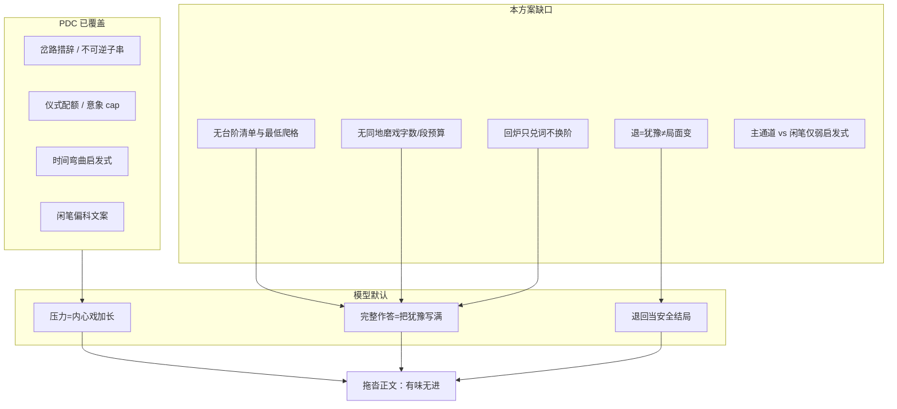
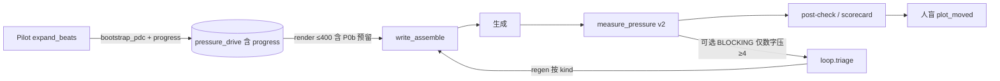

# 设计文档：章节推进与反拖沓（情节台阶合同 · 扩展 PDC）

| 项 | 值 |
|----|-----|
| **文档标题** | 章节推进与反拖沓 · 情节台阶合同（Plot Stair Contract, PSC） |
| **副标题** | 在已落地的压力驱动（PDC）之上补「推进了几格」回路，治「卡点磨戏 / 退而不变 / 闲笔占主通道」 |
| **作者** | Grok Design（系统架构） |
| **日期** | 2026-08-09 |
| **修订** | **rev.C** · 复审 3 open：磨戏打断唯一语义+三单测；bootstrap 正文可写短锚；change_kinds 与 retreat 对齐（去掉 danger） |
| **状态** | **Accepted design · rev.C review closed · 待用户开工实现**（未口头开工前禁止开 PR） |
| **产品** | scribe-writing-system / 铜炉 · scribe3 |
| **验证环境** | demo 已部署栈 `https://www.qing.blue`（只冒烟已部署服务；Grok 机禁 npm ci / 本机 Surreal / 全量测） |
| **样本证据** | `artifacts/ab-minimal-book_aa57f17e-ch6-*` · `artifacts/e2e-journey-2w-memory-v63-20260809-book_aa57f17e/04-serialize/ch06.md` · `artifacts/pressure-gold/*` |
| **前序** | `设计文档/2026-08-09-压力驱动叙事-匀速散步治理.md`（PDC rev.D） · `scribe3/pressure_drive.py` · `scribe3/pressure_metrics.py` · craft 偏科 · purpose.deltas · scene_grid · craft_skills/节奏控制.md |
| **约束** | UI 中文；Surreal 3.x only；工程分 ≠ 文学 9.5；扩展 PDC **不推倒重来**；用户侧表述避免英文黑话 |

---

## Overview

PDC（压力驱动章合同）已实现并接线：`pressure_drive` 字段、`render_pressure_drive_block`（≤400 字）、craft 闲笔偏科（`SCRIBE3_PDC` 原子切换）、`measure_pressure` 合同锚定后验、Pilot bootstrap、GATE/BLOCKING flag。demo 上对 `book_aa57f17e` 第 6 章真生成后，用户明确反馈：

> **还是很拖沓，故事进度推进太慢。**

根因不在「没有压力感修辞」，而在 **「压力」被模型实现成「多犹豫、多感官、多回环」**，整章可卡在**同一地点 / 同一决策前**磨满四千字，**情节台阶几乎只爬一格甚至零格**（侧门前犹豫 → 记门/退回 → 巷口闲聊 → 室内等夜，门仍关、名未接、锁未开）。

现有后验 **强于抓痕迹字与铜腥次数**（`irreversible_anchored`、`motif_overheat_local`），**不抓「推进了几格」**。为兑锚点的改稿约束有时还会 **加厚磨戏**（在同一段上反复补「掌灰/铜腥/记门」以满足锚，而非跨过决策点）。

本设计提出 **情节台阶合同（Plot Stair Contract, PSC）** 作为 **PDC 的一等扩展子合同**（落在 `chapter.pressure_drive.progress`，不另开平行真源）：

| 能力 | 一句话 |
|------|--------|
| **台阶登记** | 本章至少 1 格叙事台阶；**默认路径须含与不可逆不同的决策/代价锚**（不可逆映射仅兼容，不单独治拖沓） |
| **同地磨戏限长** | 同一地点连续主戏超预算 → 注入禁止 + 后验 finding（抗裸 force / 锚点刷屏） |
| **退也须付代价** | 允许退/犹豫，但须 cost/decision/irreversible 类台阶落地（**不被任意 info stair 静默**） |
| **改稿不加重磨** | 回炉约束按 `kind` 分支；禁止「原地补锚」；须换阶或换场兑现 |
| **可测抗刷** | 台阶证据锚定合同字符串；**禁止**纯词表「决定/推开」刷绿或清零磨戏 |

一句话策略：

> **压力管「怎么用力」；台阶管「世界往哪挪了一格」。合同先于修辞；推进先于犹豫；退必改局；检测锚定台阶证据而非可刷动词表。progress 校验 fail-soft，永不抽空既有 P0 注入。**

---

## Background & Motivation

### 用户诊断（必须被工程直接回应）

| # | 用户诊断 | ch6 证据（可复现） | 现有系统为何漏 |
|---|---------|-------------------|----------------|
| 1 | **整章卡在一个点上磨**（侧门前犹豫写满，情节台阶几乎一格） | e2e `ch06.md`：侧门摸灰/听嗡/攥匙/缩手循环占主篇幅，门未开；phase1 `a_prose.md` 侧门→记门→退回→证人→室内，**未插匙、未接名** | PDC 有 `is_peak` / `p_level` 曲线，**不要求正文跨过决策点**；beats 仍可全是「站在门前」工序 |
| 2 | **「有压力」被理解成「多犹豫」**，退回且局面不变 | 多臂常见：退步、收回铜匙、回头再看；门仍锁、灰仍松、三日窗口未耗 | `fork_signal` 只查「有选择措辞」，**不查选了之后世界是否变**；退回可被当「有代价」文案却无局面 delta |
| 3 | **闲笔/景物仍占主通道** | 扎纸铺/粥/墙根/纸牛/干饼等与主抉择同强度；巷志 run 仍可 ≥3 句 | PDC craft 偏科文案已切，但 **无可靠「主通道」机检**；`spatial_inventory` 仅 advisory |
| 4 | **检查抓痕迹字/铜腥强，不抓推进格数** | `motif_overheat`、`irreversible_anchored` 可绿；读者仍觉得「没发生」 | **无 stairs / progress_count 指标**；且「痕迹绿 ≠ 决策落地」 |
| 5 | **兑锚改稿有时加重磨** | loop `build_regen_constraints` 祈使式「须含 evidence」→ 模型在同段再刷掌灰/铜腥 | 回炉模板 **未区分「换阶兑现」与「原地补词」**；按 detector 默认文案 |

### 量化粗测（非 SLA · 只证明病状可机读）

| 样本 | 可见特征 | 粗信号 |
|------|----------|--------|
| e2e ch06 | 约 12k 字符；`侧门`≈9 · `铜腥`≈6 · `决定`=0 · `插`=0 · `打开`=0 · `不敢`≈3 | **零决策动词 + 高地点词** |
| phase1 A | 约 4.5k 字；`又`≈33 · `退`≈3 · `推开`=2（推开的是旧库正门，非侧门抉择） | 回环词密、主门未破 |
| pressure-gold bad | 显式「退了三步又记门」「没有插匙」 | 病样对照（须稳定出 grind + retreat） |
| pressure-gold good | 「半寸插匙」「掌心里嵌着那半寸匙痕」 | 决策落地 + 锚定证据 |

### 根因图（PDC 之后仍拖沓）



**关键洞察**：PDC 让正文 **更像「有压力」**；读者要的是 **「故事往前挪了」**。二者正交——可同时有高压修辞与零推进。进一步：`irreversible_anchored` 绿 **不等于** 推进（掌灰/记门类痕迹可写满而决策不落地）。PSC 的工程增量必须落在 **决策/代价台阶 + 磨戏 + 退代价**，不能只把 irrev 再包一层。

### 与 purpose.deltas / scene_grid 的边界

| 机制 | 验什么 | 与 PSC |
|------|--------|--------|
| `purpose.deltas`（knowledge/promise/fact/heat） | 章承诺的世界状态清单是否兑现 | **互补**：台阶证据常可投影为 delta；**不强制**每格台阶都登记 delta（避免目的过载） |
| `scene_grid` 六元组 | Goal→Conflict→Disaster→… 结构断链 | advisory 戏格；PSC 验 **正文推进**，不替代六格填表 |
| PDC fork/irreversible | 岔路措辞 + 单一痕迹锚 | PSC **要求至少一格台阶落地**；不可逆痕迹 **是台阶的一种**，默认路径须另有决策/代价锚 |
| craft 闲笔≥3 / 偏科 | 修辞配额 | PSC 注入强调极闲不得盖过主抉择；机检主通道 **仅 report-only** |

---

## Goals & Non-Goals

### Goals

1. **系统级治拖沓**：台阶登记 → 注入钉 → 后验推进指标 → 改稿约束 → 人盲进度维，全回路，而不是 prompt 加一句「请写快一点」。
2. **扩展 PDC 而非分叉**：`progress` 子对象写入既有 `chapter.pressure_drive`；共用 `SCRIBE3_PDC` 注入/craft 原子；metrics 进 `measure_pressure` 同报告。
3. **可测且抗游戏**：台阶 `evidence` 合同锚定；禁止纯「决定/推开/忽然」词表单独过闸或清零磨戏；病/好样本分离性验收（**含 grind/retreat**）。
4. **低压章可活**：关系回收 / 修炼 / 信息整理 允许「微台阶」；grind/main_channel 在低压下默认 `n/a`；**不**用高压推进尺子误伤。
5. **改稿不加重磨**：regen 按 `kind` 分支；显式「禁止同地同句型补锚；须换阶或换场」。
6. **progress fail-soft**：非法 progress **永不**单独把 `validate_pdc.ok` 打成 False，**永不**抽空既有 P0 岔路/不可逆注入，**永不**单独 GATE park。
7. **审查并分流**其它生成质量问题（见台账）；**可回滚**。

### Non-Goals

| 非目标 | 说明 |
|--------|------|
| 不推倒 PDC / 不换 Surreal 主版本 | 3.x；`option<string>` JSON 兼容 |
| 不把文学 9.5 工程化为自动 pass | 正式高分仍仅人盲；machine 永不可单独宣称 |
| 不强制每章多高潮 / 假高潮灌满 | 最低 **1 格**有效台阶；高压章可要求 2 格（可配）；**无**连爆机检 |
| 不重写 Memory fabric / envelope 八块 | 仅扩展 `pressure_drive` domain 渲染与 metrics |
| 不强制绑定 purpose.deltas 写路径 | 可选同步提示；P1+ |
| 不在 Grok 机跑 npm ci / 本机 Surreal / 全量测 | 验收 = demo 冒烟 + 离线 artifact 机检 |
| 不解决 memory_gain AB engineering_gate 本身 | 正交（台账另列） |
| 不做全卷节拍导演服务重写 | 成本与声口风险过高 |
| **不宣称** `main_channel_idle_ratio` 单独根治闲笔占主通道 | 仅 report-only + craft 一句 + 人盲 |

---

## 质量问题审查台账（除「进度慢」外）

> 依据：真实 ch6 验证稿、AB artifacts、pressure-gold、现有 craft / qc / scorecard / purpose / scene_grid 能力。  
> **分流**：`本方案` = PSC+PDC 扩展内解决；`协同/不重复造轮` = 沿用 PDC 既有指标；`后续` = 独立方案；`非目标` = 本设计明确不做。

| ID | 问题 | 证据/能力缺口 | 分流 | 说明 |
|----|------|---------------|------|------|
| Q1 | **情节台阶不爬 / 卡点磨戏** | 用户主诉；ch6 侧门磨满 | **本方案** | PSC 核心：决策/代价台阶 + grind |
| Q2 | **压力=犹豫，退而不变** | 退回门仍关 | **本方案** | retreat 不被任意 info 静默；bootstrap 写 cost 阶 |
| Q3 | **闲笔/景物占主通道** | 巷志与主抉择同强 | **本方案（软）** | craft 一句 + 注入；`main_channel_*` **仅 report-only**；人盲 `idle_vs_main`；**不宣称 machine 根治** |
| Q4 | **后验不抓推进格数** | metrics 无 stairs | **本方案** | `progress_stairs_*`；且与 irrev **去冗余** |
| Q5 | **兑锚改稿加重磨** | regen 只补 evidence 子串 | **本方案** | 改稿约束按 kind 分支 v2 |
| Q6 | 仪式化匀速 / 时间刻度流水账 | PDC `time_linear_flag` 已有 | **协同 / 不重复造轮** | 沿用 PDC；PSC 不新增时间指标 |
| Q7 | 铜腥/侧门意象过热 | `motif_overheat_local` 已有 | **协同 / 不重复造轮** | 沿用 PDC；磨戏限长可间接降刷词动机 |
| Q8 | 证人功能重复 | PDC P1 `witness_dup` 研究项 | **后续** | 保持 report-only；不进 PSC P0 GATE |
| Q9 | 记忆三维 engineering_gate 未过 | phase1 lead 0.4 等 | **后续 / 非本方案** | memory_gain_ab 正交 |
| Q10 | AI 味 / degeneration / 句式套路 | `aggregate_ai_grade` / loop | **非目标** | 既有 critique；PSC 不叠词表 |
| Q11 | 限知泄露 | find_leaks | **非目标** | 本体公证处 |
| Q12 | 目的合同 deltas 空/未兑现 | purpose 已有 fulfillment | **后续** | 可选「台阶→delta 投影」研究；P1+ |
| Q13 | Scene–Sequel 断链 | scene_grid advisory | **后续** | 戏格严格模式独立 |
| Q14 | 章级跨章张弛单调 | `find_tension_monotony` | **非目标** | 已有跨章工具 |
| Q15 | 注入面过大 / verbosity | PDC 已 400 顶 | **本方案（纪律）** | P0b 预留 + 与 irrev 去重；**不**新开 domain |
| Q16 | 假高潮灌满 / 每场都炸 | 用户风险顾虑 | **防（软）** | min_stairs 低 + 不奖励多 climax；**无**连爆检测指标/注入钉 |
| Q17 | 声口/角色过滤不稳 | craft soak | **后续** | 内核2/voice |
| Q18 | 正笔高峰被闲笔稀释 | stroke_plan 已有文案 | **本方案（软）** | 与 craft 偏科协同；非独立机检 |
| Q19 | bootstrap 合同与正文脱节 | 合同绿正文匀速 | **本方案（部分）** | 正文锚定 + gold 分离 + 人盲；**不宣称** bootstrap 质量单靠机检保证 |
| Q20 | 人盲缺「进度感」维 | 仓库未见已落地 pressure AB 协议文件 | **本方案** | **新建**问卷模板（见环 6）；不依赖未提交旧协议文件名 |

---

## Proposed Design

### 1. 核心抽象：情节台阶合同（PSC）

#### 1.0 真源与版本

| 规则 | 说明 |
|------|------|
| **真源** | `chapter.pressure_drive` JSON 内新增 **`progress`** 对象（PSC） |
| **版本** | 父合同仍 `pdc.v1`；`progress.version = "psc.v1"` |
| **无 progress** | 兼容：旧合同 / bootstrap 未写 → 推进指标 `tier=n/a`；**不**因缺 progress 单独 park |
| **禁止第二字段** | 不设 `chapter.plot_stair` 平行列，避免双写 |
| **load** | 仍走 `load_pdc(ch)` |
| **校验输出** | `validate_pdc` 返回既有 `ok/errors/warnings`，另附 **`progress_ok`: True\|False\|None**（仅观测；**不**改写 `ok`） |

#### 1.1 数据模型

```python
# 嵌在 PressureDriveContract 内
"progress": {
  "version": "psc.v1",
  "min_stairs": 1,                 # 默认 1；书级可升 2（O1 已闭：默认 1）
  "stairs": [                      # 1..4；每条 evidence ≤80
    {
      "id": "s1",
      "kind": "info|relation|danger|cost|decision|irreversible",
      "label": str,                # 人读短名
      "evidence_must_show": str,   # ≥2 字；须 evidence_ok()；正文子串锚
      "is_retreat_cost": bool,     # 退代价台阶；bootstrap 在可退岔路时 True
    },
  ],
  "location_grind": {
    "primary_locus": str,          # 如「侧门」；extract_primary_locus
    "max_contiguous_chars": 900,   # 高压默认；统计定义见 §字数
    "max_contiguous_paras": 6,
    # escape_requires_stair：语义并入 location_grind_run（超顶且全程无代价类 stair 命中）
    # 不再单独字段，避免死配置（rev.B）
  },
  "retreat_policy": {
    "allow_retreat": True,
    "require_world_change": True,
    # 与环 4 retreat cost_hit 完全一致（rev.C）：不含 danger（易写成「嗡响更近」空转）
    "change_kinds": ["cost", "decision", "irreversible"],
  },
  "main_channel": {
    "forbid_idle_majority": True,  # 仅提示/report-only 算法用
    "hint": "极闲不得连续盖过主抉择段",
  },
}
```

**字数统计（写死）**：`location_grind` 的 contiguous 字符 = 参与累计的段落内 `len(para.replace(" ","").replace("\n","").replace("\u3000",""))` 之和（Python `len`，去空白）；**含标点汉字**，与 `MAX_PDC_BLOCK` 同一计量族。

**台阶 kind 语义**：

| kind | 读者可感知变化 | ch6 正例 / 反例 |
|------|----------------|-----------------|
| `info` | 新信息进入叙事 | 正：灰被拨过；反：反复闻铜腥无新知 |
| `relation` | 关系位变化 | 微台阶合法（低压） |
| `danger` | 危险/窗口升级 | 须比章初更紧 |
| `cost` | 付了代价（退回空过、时间耗尽） | **退的默认合法化** |
| `decision` | 可见抉择落地 | 仅内心戏不算 |
| `irreversible` | 与 PDC irrev 可对齐的痕迹 | **默认可与 irrev 同串，但不得作为唯一 stair**（默认路径） |

#### 1.2 合法形状与校验协议（**K13 · 写死**）

现网风险：`write_assemble._pressure_drive_write_block` 在 `validate_pdc` → `ok is False` 时 **整块替换**为「合同结构待修」短警告，**丢掉** P0 岔路/不可逆钉；`pilot_runtime` GATE 在 `ok=False` 时 park。

```text
【硬规则 · progress 永不拖垮 core】

validate_pdc(contract):
  # 1) 先算 core（既有 ⑦⑧、peak、p_level…）→ ok / errors
  # 2) 再算 progress 子校验 → 只写 warnings + progress_ok
  #
  # progress 缺失 / status 无 progress 键:
  #   progress_ok = None
  #   warnings 可含 "progress_missing"（可选，低压可省略）
  #   ok 完全不受影响
  #
  # progress present 但非法（stairs 空、evidence 不 ok、条数>4 等）:
  #   progress_ok = False
  #   warnings += ["progress_invalid_*", ...]
  #   **禁止**把上述写入 errors[]
  #   **禁止**因此把 ok 从 True 改为 False
  #   **禁止** GATE park
  #   **禁止**注入侧因 progress 走「结构待修」整块替换
  #
  # progress present 且结构合法:
  #   progress_ok = True
  #   若唯一 stair.evidence 与 irrev.evidence 完全同串:
  #     warnings += ["progress_redundant_with_irrev"]
  #     （不因此非法；提示作者/验收勿只盯 stairs 绿）

注入（render / write_assemble）:
  - 决策只看 validate_pdc.ok（core）
  - ok is False → 既有「结构待修」短警告（仅 core 非法）
  - ok is True → render_pressure_drive_block（含 P0b；progress 非法则 P0b 降级最短形或省略 stairs 行，仍可渲染「退须改局」）
  - progress_ok is False → 仍渲染完整 P0；journal 可记 progress_invalid

GATE（SCRIBE3_PDC_GATE=1）:
  - 仅 ok is False → park
  - progress_ok is False / None → **永不** park

PR-1 单测强制:
  core 合法 + progress 非法（stairs=[] 或 evidence="的"）
  → ok is True（或保持 core 原结果 True）
  → progress_ok is False
  → render 仍含岔路/不可逆 P0 实质内容（非「结构待修」整块）
  → GATE 不 park
```

**progress 子规则（仅 → warnings / progress_ok，永不 → errors/ok）**：

```text
若 progress 完整 present:
  全角色:
    ① len(stairs) ≥ min_stairs（默认 1）否则 progress_invalid_min
    ② 每条 evidence_ok(evidence) 且 label 非空
    ③ len(stairs) ≤ 4
  高压/推进 或 chapter_pressure≥4:
    ④ kinds 不得全是 relation（须含 info|danger|cost|decision|irreversible 之一）
    ⑤ 可退岔路（见 bootstrap 启发式）时：至少一条 is_retreat_cost 或 kind∈{cost,decision,irreversible}
    ⑥ primary_locus 非空（可推断）
  低压:
    放宽 ④⑤；min_stairs 仍 1 允许纯 info/relation
    max_contiguous_chars 默认 1400
```

#### 1.3 与 PDC 字段协同（不重复注入）

| PDC 已有 | PSC 用法 |
|----------|----------|
| `fork.choice` / `cost_steps` | 注入仍优先 P0；P0b 与 irrev **去重**后只补推进/磨/退 |
| `irreversible.evidence_must_show` | 可作为 stair **之一**；metrics 可共享命中；**默认 bootstrap 另增 cost/decision 阶** |
| `stroke_plan.idle_skew` | 与 craft 偏科同向 |
| `spatial_inventory` 指标 | **place 抽取复用**；与 `location_grind_run` 关系见环 4 |
| `beats[].function` force/choice | bootstrap 提示台阶落点，非硬绑字数 |

---

### 2. 系统架构：在 PDC 五环上加「推进维」



#### 环 1 — 登记（bootstrap 扩展）

文件锚点：`scribe3/api/services/pilot_runtime.py` · `scribe3/pressure_drive.py` · `bootstrap_pdc_from_texts`

**变更**：

1. ⑦⑧ 齐全时 **同时** 填 `progress`（失败则 **省略 progress 键**，不写残缺对象冒充 present）。
2. progress 子校验失败 → 只 warnings / 可省略 progress；**绝不**让 core `ok=False`。
3. 作者可 PATCH stairs；UI 后置。

**`evidence_ok` 与虚词表（PR-1 写死）**：

```python
_FUNCTION_WORDS = frozenset(
    "的了着在是和与又都也而及或被把让给对从到得地么呢吧啊呀"
)
# 另拒：纯空白、len<2、全部由虚词单字组成、全标点

def evidence_ok(s: str) -> bool:
    t = (s or "").strip()
    if len(t) < 2:
        return False
    # 去掉空白后若每个字都在虚词表 → 拒绝
    chars = [c for c in t if not c.isspace()]
    if not chars:
        return False
    if all(c in _FUNCTION_WORDS for c in chars):
        return False
    return True
```

**`extract_primary_locus`（复用 place 启发式）**：

```python
# 伪代码：优先 synopsis+beats 中 _PLACE_CAND（铺|巷|门|库|房|庄|坊|街|口|檐|摊）
# 命中频次最高者；无则回退首个 2–4 字地名候选；再无则 "主场"
# 与 pressure_metrics._place_set / _PLACE_CAND 同源，禁止第二套全局地名表
```

**确定性 bootstrap（rev.C · 禁止「唯一 stair = irrev」；禁止合同黑话整句当锚）**：

```python
# 正文可写短锚：2–12 字实词核 / 感知痕迹；禁止整句 cost_steps / 长 choice 黑话
MAX_BODY_EVIDENCE = 12
_BLACK_SPEAK_MAX = 24  # 超过则不得原样作 evidence

def _body_evidence_from_cost(step: str) -> str | None:
    """从代价说明抽 2–12 字正文可写核；禁止整句合同黑话。"""
    t = (step or "").strip()
    # 优先命中短核词表（可扩展）
    for core in ("空过", "收不回", "三日空过", "装不知道", "接不上", "退则空过"):
        if core in t and evidence_ok(core):
            return core[:MAX_BODY_EVIDENCE]
    # 再抽连续汉字 2–12（去掉则/若/要么 等连接）
    import re
    chunks = re.findall(r"[\u4e00-\u9fff]{2,12}", t)
    for c in chunks:
        if c in ("要么", "若是", "不能", "不可") or not evidence_ok(c):
            continue
        if len(c) <= MAX_BODY_EVIDENCE:
            return c
    return None

def _body_evidence_from_choice(choice: str) -> str | None:
    """选择句 → 短决策痕迹，非 choice 原文[:40]。"""
    t = (choice or "").strip()
    for core in ("拧开", "接名", "退回", "插匙", "空过三日"):
        if core in t and evidence_ok(core):
            return core[:MAX_BODY_EVIDENCE]
    import re
    chunks = re.findall(r"[\u4e00-\u9fff]{2,12}", t)
    for c in chunks:
        if evidence_ok(c) and len(c) <= MAX_BODY_EVIDENCE:
            return c
    return None

def _default_progress(
    irrev_evidence: str,
    locus: str,
    *,
    high: bool,
    fork_choice: str = "",
    cost_steps: list[str] | None = None,
) -> dict | None:
    """返回 progress 或 None（字段不齐则调用方省略 progress 键）。"""
    irrev_ev = (irrev_evidence or "").strip()
    costs = [str(c).strip() for c in (cost_steps or []) if str(c).strip()]
    choice = (fork_choice or "").strip()
    retreatish = bool(costs) or any(
        k in choice for k in ("退", "不", "或", "要么", "空过")
    )

    stairs = []
    # s1：优先 cost/decision 短锚（与 irrev 不同串）
    # **禁止** evidence_must_show == 未截断整句 cost_steps / 长 choice
    cost_ev = _body_evidence_from_cost(costs[0]) if costs else None
    if cost_ev:
        stairs.append({
            "id": "s1",
            "kind": "cost",
            "label": "岔路代价",
            "evidence_must_show": cost_ev,  # ≤12 字正文核
            "is_retreat_cost": bool(retreatish),
        })
    else:
        dec_ev = _body_evidence_from_choice(choice)
        if dec_ev:
            stairs.append({
                "id": "s1",
                "kind": "decision",
                "label": "岔路抉择",
                "evidence_must_show": dec_ev,
                "is_retreat_cost": False,
            })

    # s2：irrev 痕迹（兼容；已是短痕迹时原样，仍须 evidence_ok）
    if irrev_ev and evidence_ok(irrev_ev):
        # irrev 允许略长（≤80）因作者合同常是「半寸匙痕」类；
        # 但若 >24 且像说明句，bootstrap 仍应用原文（作者锚），与黑话 cost 区分
        if not stairs or stairs[0]["evidence_must_show"] != irrev_ev[:80]:
            stairs.append({
                "id": f"s{len(stairs)+1}",
                "kind": "irreversible",
                "label": "不可逆痕迹",
                "evidence_must_show": irrev_ev[:80],
                "is_retreat_cost": False,
            })

    if not stairs:
        fallback = "局面已变"
        if not evidence_ok(fallback):
            return None
        stairs = [{
            "id": "s1",
            "kind": "info",
            "label": "本章微变",
            "evidence_must_show": fallback,
            "is_retreat_cost": False,
        }]

    if retreatish and not any(s.get("is_retreat_cost") for s in stairs):
        cev = _body_evidence_from_cost(costs[0]) if costs else "三日空过"
        if cev is None:
            cev = "三日空过"
        if evidence_ok(cev) and all(s["evidence_must_show"] != cev for s in stairs):
            stairs.append({
                "id": f"s{len(stairs)+1}",
                "kind": "cost",
                "label": "退的代价",
                "evidence_must_show": cev[:MAX_BODY_EVIDENCE],
                "is_retreat_cost": True,
            })

    stairs = stairs[:4]
    return {
        "version": "psc.v1",
        "min_stairs": 1,
        "stairs": stairs,
        "location_grind": {
            "primary_locus": (locus or "主场")[:40],
            "max_contiguous_chars": 900 if high else 1400,
            "max_contiguous_paras": 6 if high else 10,
        },
        "retreat_policy": {
            "allow_retreat": True,
            "require_world_change": True,
            "change_kinds": ["cost", "decision", "irreversible"],  # 无 danger
        },
        "main_channel": {
            "forbid_idle_majority": True,
            "hint": "极闲不得连续盖过主抉择段",
        },
    }
```

**锚质量纪律（K19 · 写死）**：

| 规则 | 说明 |
|------|------|
| **禁止** | 把整句 `cost_steps` / 长 `fork.choice`（说明腔、>24 字合同黑话）当作 **唯一** 可写 `evidence_must_show` |
| **必须** | cost/decision 默认锚为 **2–12 字**、正文可写的感知/事件核（如「空过」「三日空过」「拧开」） |
| **允许** | 作者 PATCH 手写更长痕迹（仍须 `evidence_ok`）；irrev 沿用作者短痕迹 |
| **PR-3 单测** | bootstrap 输出的 cost/decision evidence：`len≤12` **或**（若 >12）不得 `==` 未处理的整句 `cost_steps[0]`；且 `evidence_ok` |

**兼容声明（写死 · 回应用户诊断 #1/#4）**：

> 将 `irreversible.evidence_must_show` 映射为 stair **只保证与 PDC 兼容**，**不宣称**单独治拖沓。  
> 工程门闩与 gold 分离性以 **`location_grind_run` + `retreat_no_cost` + stairs 过闸** 为主；  
> 若仅 irrev 同串 1 条 stair 且命中 → 可 stairs light 但仍须 grind/retreat 分离。  
> 验收 **禁止**只用「半寸匙痕已命中」证明 PSC 成功；须另构「痕迹已命中但仍长磨」样本验 grind。

#### 环 2 — 注入（仍 ≤400 · **P0b 预留 + 去重**）

文件锚点：`pressure_drive.render_pressure_drive_block` · `write_assemble._pressure_drive_write_block`

**不新开 domain**。常量：

```python
MAX_PDC_BLOCK = 400
MIN_RESERVE_P0B = 56   # 48–64 取中；为 P0b 最短形预留
```

**渲染顺序（写死 · 替换「整段装不下就 break 丢 P0b」的最坏结果）**：

```text
1. header
2. P0_fork_irrev —— 可字段截断；但若 used + MIN_RESERVE_P0B > MAX，
   则先从 P0 裁 cost_steps / 动作括注，保证剩余 ≥ MIN_RESERVE_P0B
   （P0 的 fork.choice 与 evidence 核心行优先于 cost_steps）
3. P0b_progress 最短形（见下）—— 强制尝试装入；若仍放不下，
   journal/render_meta: truncated:p0b（可测），并尽量塞 1 行「退须改局」
4. P1…P4 按原 PRI，装不下 break
```

**P0b 文案与 irrev 去重**：

```text
# 收集 stair evidences（最多 2 条上屏）
# 若 stair.evidence 与 irrev.evidence 同串 → P0b **不重复**写「须出现该串」
#   只补：同地勿磨 / 退须改局 /（若有不同串 stair）须现「{ev_other}」

最短形（预算极紧，目标 ≤ MIN_RESERVE_P0B）：
- 台阶须现「{ev1}」；退须改局。     # 当 ev1 与 irrev 不同
或
- 同地勿磨；退须改局。               # 当唯一 stair 与 irrev 同串

常态形（预算充裕）：
- 台阶：至少 {min_stairs} 格；须现「{ev…}」（已与 irrev 去重）。
- 同地：「{locus}」连续主戏勿超长。
- 退：允许，须代价/决策落地，禁原状空转。
```

**PR-1 单测**：

| 用例 | 断言 |
|------|------|
| 常态 gold 合同 | `len(block)≤400` 且（含「台阶」或「退」或「同地」） |
| P0 字段顶满 | 仍含 P0b 最短形关键字，或 `truncated:p0b` 可观测；**不得**只剩 header |
| 同串 irrev+stair | P0b **不**二次完整复述同一 evidence 长句 |

#### 环 3 — craft 对齐

文件锚点：`scribe3/craft.py` · `idle_pdc`

**不另开 craft flag**。`SCRIBE3_PDC=1` 时 **仅追加一句**（总追加 ≤40 字，PR-4 测长度上限）：

```text
idle_pdc 追加：
「推进优先:极闲不得连续盖过主抉择段；同地磨戏须尽早付代价或换场。」
```

- **不**再追加 temperature 第二句（防与「2 极闲」语意叠床架屋）。
- 与 `idle_pdc` 原文「2 极闲 + 1 极狠」并存：极闲仍要，但不得连续盖过主抉择。

#### 环 4 — 后验（`pressure_metrics` 扩展）

文件锚点：`scribe3/pressure_metrics.py` · `measure_pressure`  
接线：`api/routers/write.py` post-check（**现网已调 measure_pressure**，PR-2 扩返回字段即可；**PR-5 并入 PR-2**）

##### 新增指标与过闸定义（**写死**）

**`progress_stairs_anchored`（K14）**：

```text
need = int(progress.min_stairs)  # 默认 1；不是 len(stairs)
hit  = 命中 stair 条数（每条 evidence 子串命中计 1，与 irrev 同规范化）
missed = 未命中的 evidence 列表
coverage = hit / max(len(stairs), 1)   # 仅 report，不过闸

tier:
  n/a    — 无 progress 或 stairs 空
  light  — hit >= need
  heavy  — hit < need

单测: min_stairs=1, 2 stairs, 1 hit → light
     min_stairs=2, 2 stairs, 1 hit → heavy
```

| 指标 ID | 定义（可实现 · 抗刷） | tier | severity |
|---------|----------------------|------|----------|
| `progress_stairs_anchored` | 见上 | light/heavy/n/a | 见 BLOCKING 表 |
| `progress_zero_advance` | 有 progress 且 hit==0 **且** PDC irrev 也未命中 | heavy if true | 同上 |
| `location_grind_run` | 见下「磨戏算法」 | mid/heavy/n/a | **永不** blocking |
| `retreat_no_cost` | 见下「退算法」 | mid/n/a | **永不** blocking |
| `main_channel_idle_ratio` | 段启发式闲/主比；**仅 report-only** | mid/n/a | **永不** blocking；**不进**分离性硬门闩 |
| `grind_or_anchor_spam` | report-only：同地密集 + evidence 句占比过高 | mid | report-only |

##### 磨戏算法 `location_grind_run`（**唯一打断语义 · K16 rev.C**）

> **废止** rev.B 中「仅 force∧evidence 才 break」与注释「新 kind 继续累计」的双轨表述。  
> 实现与单测 **只认** 下列伪代码，无第二套状态机。

```text
# 常量
_NARROW_ACT = re.compile(r"接了|拧开|空过|咬合|拨开|嵌进|半寸|锁芯")  # 写死，非 optional
# _FORCE_VERBS 沿用 pressure_metrics 现网表

place_set = {primary_locus} ∪ 从 primary 扩展的 2–4 字块
         ∪ _place_set(synopsis, beats_text) 中与 primary 有共享字的候选
         # 复用 spatial 抽取，禁止第二套全局地名表

# 本 run 内已计过的 evidence 字符串集合（抗锚刷）
seen_in_run: set[str] = {}
run_chars = 0; run_paras = 0; max_run_chars = 0; max_run_paras = 0

def cost_kind_evidences(contract):
    # kind ∈ {cost, decision, irreversible} 的 stair.evidence
    # ∪ irrev.evidence_must_show（若有）
    ...

对每个段落 para（按 \n\s*\n 切）:
  has_locus = 任 place 命中 para
  if not has_locus:
      # (A) 离场 → 打断
      结算 max_run*; run 清零; seen_in_run 清零
      continue

  # 本段「首次」命中的代价类 evidence（未在本 run 计过）
  fresh_cost_evs = []
  for ev in cost_kind_evidences(contract):
      if ev and (ev in para or norm(ev) in norm(para)) and ev not in seen_in_run:
          fresh_cost_evs.append(ev)

  has_any_stair_or_irrev_ev = 任 stair.evidence 或 irrev.evidence 命中 para
  has_act = bool(_FORCE_VERBS.search(para) or _NARROW_ACT.search(para))

  # ========== 唯一 break 判定（写死）==========
  break_run = False
  # (B) 本段首次出现「未在本 run 计过的」cost|decision|irreversible evidence
  #     —— 安静落地句（无 force 词表）也可断 run，防 false positive
  if fresh_cost_evs:
      break_run = True
  # (C) (force 或窄动作表) 且 本段有 stair/irrev evidence
  #     —— 裸 force / 裸窄表 **不得** 断 run
  elif has_act and has_any_stair_or_irrev_ev:
      break_run = True
  # 同一 evidence 重复贴 → fresh 为空 → 不因 (B) break（抗锚刷）
  # 裸 force 无 evidence → 不 break

  if break_run:
      for ev in fresh_cost_evs:
          seen_in_run.add(ev)
      # 若仅 (C) 打断：把本段命中的 cost 类 ev 也记入 seen，避免下段同串再 fresh
      for ev in cost_kind_evidences(contract):
          if ev and (ev in para or norm(ev) in norm(para)):
              seen_in_run.add(ev)
      结算 max_run*; run 清零
      # 注意：清零后本段不计入新 run（落地段本身不算磨）
      seen_in_run 保持为本段已见（可选：清零后空集；实现选 **清零** 更简单，
      因 run 已断；下一段同 evidence 再出现算新 run 的 fresh——允许「再磨再落地」）
      seen_in_run = set()  # rev.C 选定：断后 seen 清空
  else:
      # 累计磨戏（含：同地 + 重复贴同一 evidence + 裸 force 无锚）
      run_chars += char_len(para)
      run_paras += 1
      max_run_chars = max(max_run_chars, run_chars)
      max_run_paras = max(max_run_paras, run_paras)
      # 重复 evidence 贴上时：将该 ev 记入 seen，避免误把「首次」算二次
      for ev in cost_kind_evidences(contract):
          if ev and (ev in para or norm(ev) in norm(para)):
              seen_in_run.add(ev)

超 max_contiguous_chars 或 max_contiguous_paras → finding location_grind_run
```

**PR-2 强制三单测（磨戏打断 · 写死 · 与上式一一对应）**：

| # | 场景 | 断言 |
|---|------|------|
| G1 | **安静落地**：同地多段犹豫后，一段 **无** `_FORCE_VERBS` 命中、但首次出现 cost/decision/irrev evidence（如「匙齿咬合」「半寸匙痕」） | 该段 **打断** run；若落地前未超顶 → **无** `location_grind_run` finding（或 max_run 在阈值内） |
| G2 | **裸 force 不断**：同地连续段仅有「他决定了/推开」等 force 词、**无** stair/irrev evidence | run **不**清零；超顶 → **有** grind finding |
| G3 | **同段 force+evidence 断**：同地段同时有 force/窄表 **且** stair/irrev evidence | run **打断** |
| G4（抗锚刷） | 同 evidence 连贴 ≥10 段（已在 seen） | run **不断**；可超顶出 grind 或 `grind_or_anchor_spam` |

（G1–G3 为审查要求的三核心；G4 保留抗锚刷。）

与 `spatial_inventory` 关系：

- 共用 place 抽取  
- spatial：连续句 place 无 force → 巷志（仍可用裸 force 打断，**不改**现网）  
- grind：上表唯一语义，**严于** spatial  
- 可同时亮；不互相抑制  

低压（`role∈_LOW_ROLES` 或 `chapter_pressure∈{1,2}`）：`location_grind_run` → `tier=n/a`（不跑 finding），除非作者显式 `min_stairs≥2`。

##### 退算法 `retreat_no_cost`（与 `change_kinds` 对齐 · rev.C）

```text
# change_kinds 写死 = {cost, decision, irreversible}  —— 不含 danger（K20）
retreat_pat = 退回|退了|转身离开|缩回|没敢|不敢开|收回.*匙|头也不回

if retreat_pat 命中 prose:
  cost_hit = 任 stair 满足
      (is_retreat_cost or kind in {cost, decision, irreversible})
      and evidence 命中 prose
  # danger / info / relation 命中 **不得** 否决本 finding
  if not cost_hit:
      finding retreat_no_cost (mid)

分离性：bad「退了三步又记门、没有插匙」+ 合同含 cost 阶未兑现
  → 必须命中 retreat_no_cost 或 progress_zero_advance / stairs heavy
```

##### severity / BLOCKING（与现网 metrics **只看数字压力** 对齐）

```text
blocking_eligible =
  pdc_blocking_env_enabled()
  and chapter_pressure >= 4
  # role 不参与 severity（与 pressure_metrics._sev 一致）
  # 注：validate 的 high 仍可用 role∪pressure；那是合同形状，不是 blocking

chapter_pressure 缺省/0 → 永不 blocking（即使 role=高压）
  → 文档承认：合同 high 与 severity 可能分裂；**以数字压为准** 防误伤

progress_stairs_anchored / progress_zero_advance:
  blocking_eligible 且 heavy → 可 meta.severity=blocking
其余 progress 系指标: 永不 blocking
```

##### 抗刷规则汇总

1. stairs 过闸 **只认** 合同 evidence 子串。  
2. grind 打断 **仅** K16 rev.C 三式：(离场) | (fresh cost 类 evidence) | (act∧evidence)；裸 force **不得** 断。  
3. `evidence_ok` 拒虚词/过短；bootstrap cost/decision 锚 **2–12 字正文核**（K19）。  
4. 同地重复贴同一 evidence → 不 break（seen_in_run）；可出 `grind_or_anchor_spam`。  
5. 默认 stair≠仅 irrev 同构；冗余 warning `progress_redundant_with_irrev`。  
6. retreat `change_kinds` ≡ `{cost,decision,irreversible}`，**无 danger**（K20）。

##### metrics schema（增量）

```python
metrics["progress_stairs_anchored"] = {
  "value": {"hit": 1, "need": 1, "missed": [...], "coverage": 0.5},
  "tier": "light|heavy|n/a",
  "detail": "…",
  "anchored": True,
}
# validate 镜像：report["progress_ok"] = True|False|None
# METRICS_VERSION = "pressure_metrics.v2"
```

#### 环 5 — 改稿回路（治「兑锚加重磨」）

文件锚点：`scribe3/loop.py` · `build_regen_constraints`

现网：`imper` 按 **detector** 索引；`pressure_metrics` 不在表内 → 默认「消除该硬伤」。blocking 项已带 `kind`。

**实现写死（PR-6）**：

```python
imper_by_kind = {
  "progress_stairs_anchored": "…换场写入「{evidence}」；禁止同地重复犹豫/感官原地补词…",
  "progress_zero_advance": "…",
  "irreversible_anchored": "…",  # 可与 progress 共用换场句式
  "location_grind_run": "压缩同地磨戏…",
  "retreat_no_cost": "退可以，须代价/决策落地…",
}
# 选用：
#   if detector == "pressure_metrics":
#       template = imper_by_kind.get(kind) or "消除该硬伤"
# evidence：优先 findings.meta.evidence；否则从 note/quote 解析「」内短串
```

**advisory 路径**：

- 宪法保留：**不**自动 regenerate。  
- findings 的 `message` 在 `measure_pressure` 内已用中文写清；triage 的 advisory_items 透传即可。  
- 「一键粘贴」属 **UI 后置**（PR-9）；**勿**默认开 `SCRIBE3_PSC_REWRITE_HINT`。  
- 可选 env 仅 P1 研究，默认关。

#### 环 6 — 人盲与 AB

仓库内记忆 AB 有 `d6_questionnaire` / human_blind 模板；**未见**已落地的 `pressure_drive_ab_v1` 协议文件。

**PR-7 交付**：**新建** artifacts 约定 `pressure_progress_ab_v1`（问卷 md + machine 列说明），**不**依赖未提交旧协议文件名。machine 列直接消费 `measure_pressure` 返回字段 + `literary_claim_ban`。

| 人盲维（1–5） | 中文题干 |
|---------------|----------|
| `plot_moved` | 读完是否觉得「事情往前挪了」？ |
| `grind_felt` | 是否长时间停在同一处磨？ |
| `retreat_cost_felt` | 若有退缩，是否付了可见代价？ |
| `idle_vs_main` | 闲笔是否压过主事？ |
| `overall_pressure` | 是否被压力推着走？ |
| `irreversible_visible` | 是否见到收不回的痕迹？ |

**声明写死**：`scorer` 标明 heuristic/human；禁止 machine 宣称文学达标。

---

### 3. 可测方案（机器粗测 + 人读）

#### 3.1 离线机检（Grok 机可跑 · 纯函数 · 无 Surreal）

```bash
# 仓库根；实现后 gold 含 progress（双台阶：cost≠irrev）
python - <<'PY'
from pathlib import Path
from scribe3.pressure_metrics import measure_pressure
import json
bad = Path("artifacts/pressure-gold/bad_walkthrough.md").read_text()
good = Path("artifacts/pressure-gold/good_pressure.md").read_text()
contract = json.loads(Path("artifacts/pressure-gold/contract_good.json").read_text())
for name, prose in [("bad", bad), ("good", good)]:
    r = measure_pressure(prose, contract, synopsis="侧门", beats_text="侧门 抉择")
    print(name, {k: r["metrics"].get(k) for k in (
        "progress_stairs_anchored", "location_grind_run", "retreat_no_cost")})
PY
```

#### 3.2 分离性硬门闩（MVP · 写死）

| 断言 | bad | good |
|------|-----|------|
| `progress_stairs_anchored` | heavy（need 未达）或与 zero_advance 组合 | light |
| `location_grind_run` finding | ≥1 | 0 |
| `retreat_no_cost` | 命中（退了无 cost 阶落地） | 不命中 |

**额外样本（必须）**：

| 样本 | 用途 |
|------|------|
| gold bad 原文 | 退+记门+无插匙 → grind + retreat |
| gold good 原文 | 半寸插匙落地 → stairs light、无 grind |
| **anchor_hit_still_grind**（合成） | 正文反复出现 irrev/stair evidence 但同地超长犹豫 → **grind 仍 finding**（证抗锚刷） |
| ch6 真稿 + 合成 decision evidence 未出现 | stairs heavy |

**不进硬门闩**：`main_channel_idle_ratio`、`grind_or_anchor_spam`（report-only）。

#### 3.3 人读维度

1. 章末世界比章初 **多了/少了/更危险在哪**？  
2. 若退了，**代价**是什么？  
3. 主场戏是否 **明显短于** 章长一半？  

机检绿但人读否 → **不得**宣称进度治理成功。

#### 3.4 demo 冒烟

| 步骤 | 动作 |
|------|------|
| 1 | `./scripts/deploy_demo.sh` 热更 backend（开工后） |
| 2 | `SCRIBE3_PDC=1`；BLOCKING 默认关 |
| 3 | PATCH 含合法 progress 的合同 |
| 4 | post-check JSON 见 `progress_*`；组装块含推进钉或 `truncated:p0b` 可观测 |
| 5 | 可选 ch6 只读 post-check |

---

### 4. API / Interface Changes

| 位置 | 变更 |
|------|------|
| `pressure_drive.py` | `progress_ok`；`evidence_ok`；`_FUNCTION_WORDS`；`_format_p0b`；`MIN_RESERVE_P0B`；bootstrap 双台阶；`extract_primary_locus` |
| `pressure_metrics.py` | v2 指标；grind 抗刷；retreat 加强；低压 n/a |
| `craft.py` | idle_pdc **一句**追加（≤40 字） |
| `write_assemble.py` | **仅**因 core `ok is False` 走结构待修；progress 非法不替换整块 |
| `pilot_runtime.py` | GATE 只看 core ok；bootstrap 写 progress |
| `loop.py` | `imper_by_kind` + detector==pressure_metrics |
| `api/routers/write.py` | 随 measure 返回扩字段（**并入 PR-2**，无独立 PR-5） |
| migration | **无新列** |
| env | 不新开 `SCRIBE3_PSC`；`SCRIBE3_PSC_REWRITE_HINT` 默认关且非 P0 |
| 测试 | 见 PR Plan MVP 四条 |
| 前端 | PR-9 后置 |

### 5. Data Model Changes

- JSON 增量 `progress`；无新 Surreal 字段。  
- 旧章缺 progress：兼容。  
- `escape_requires_stair` **不**作为独立落库字段（rev.B 删除死配置）。

---

## Alternatives Considered

### 方案 A — 只加 prompt「请加快情节」

零代码；百万字回流均值。**拒绝**。

### 方案 B — 独立 `chapter.plot_progress` + 新 domain

双真源/双注入。**不采用**。

### 方案 C — PSC 嵌入 `pressure_drive.progress` + 共享 400 预算（**推荐**）

对准五条诊断；fail-soft；P0b 预留。**主路径**。

### 方案 D — 事后 LLM 进度审判回炉

成本高、不稳。**P2 可选**。

### 方案 E — 仅靠 purpose.deltas

deltas 常空。**互补后续**。

### Trade-off

| 维度 | A | B | **C** | D | E |
|------|---|---|-------|---|---|
| 对准拖沓根因 | 低 | 高 | **高** | 中高 | 中 |
| 与 PDC 一体 | — | 差 | **好** | 中 | 中 |
| 可机检抗刷 | 无 | 强 | **强** | 弱 | 中 |
| 注入啰嗦 | 中 | 高 | **可控（预留）** | 中 | 低 |
| 低压误伤 | 低 | 中 | **中低（n/a）** | 中 | 低 |
| 回滚 | 易 | 难 | **易** | 中 | 易 |

---

## Security & Privacy

| 威胁 | 缓解 |
|------|------|
| 注入膨胀 | 400 顶；MIN_RESERVE_P0B；字段 ≤80 |
| 帧外秘密进 evidence | 作者责任；leaks 仍生效 |
| 权限 | 既有 work 隔离 |

---

## Observability

| 信号 | 落点 |
|------|------|
| `progress_ok` / `stairs_hit` / `stairs_need` | post-check · scorecard |
| `location_grind_run` max chars | metrics.detail |
| `truncated:p0b` | render journal |
| `progress_redundant_with_irrev` | warnings |
| AB machine | stairs_hit, grind_run, retreat_no_cost |
| 禁合成文学进度分 | 宪法 |

---

## Rollout Plan

> **用户口头开工前不得开 PR。**

| 阶段 | 内容 | 通过标准 |
|------|------|----------|
| M0 | 纯函数 + gold 分离（含 grind/retreat/抗锚刷样） | 硬门闩绿 |
| M1 | bootstrap 双台阶；flag 关不变 | 单测 |
| M2 | craft 一句；demo 热更 | 注入含推进钉 |
| M3 | post-check 见 progress_*（随 PR-2） | curl |
| M4 | regen kind 分支 | 单测禁原地补词 |
| M5 | **新建**人盲问卷模板 | 禁 9.5 |
| M6 | 可选 BLOCKING（数字压≥4） | 产品显式 |

### 回滚

`SCRIBE3_PDC=0`；去掉 P0b/metrics 分支；JSON 残留无害。

### 风险登记

| 风险 | 严重度 | 缓解 |
|------|--------|------|
| 误伤低压 | 高 | 数字压\<4 不 blocking；低压 grind n/a |
| 假高潮灌满 | 中 | min_stairs=1；无连爆检；人盲 |
| 400 丢 P0b | 中 | MIN_RESERVE_P0B + 最短形 + 去重 |
| 合同绿正文仍磨 | 高 | grind 硬门闩 + 抗锚刷样 + 人盲 |
| stairs≈irrev 假绿 | 高 | 默认双台阶；redundant warning；门闩含 grind |
| 改稿仍磨 | 中 | kind 模板 |
| role/压 severity 分裂 | 低 | **只认数字压** 写死 |

---

## Open Questions（rev.B 已关闭项标闭）

| # | 问题 | 决议 |
|---|------|------|
| O1 | 高压 `min_stairs` 默认？ | **闭：1**；书级可升 2 |
| O2 | progress 非法是否 ok=False？ | **闭：否**；仅 `progress_ok=False` + warnings（K13） |
| O3 | 新 env `SCRIBE3_PSC`？ | **闭：否** |
| O4 | evidence 强制=irrev？ | **闭：否**；默认双台阶，irrev 可并存；同串 warning |
| O5 | main_channel 阈值？ | **闭：report-only**；不进硬门闩 |
| O6 | UI 阻塞？ | **闭：否** |

无未决 Open Question 阻塞实现；细节实现以 Key Decisions 为准。

---

## References

| 路径 | 用途 |
|------|------|
| `设计文档/2026-08-09-压力驱动叙事-匀速散步治理.md` | PDC 母设计 |
| `scribe3/pressure_drive.py` | 合同/渲染/bootstrap |
| `scribe3/pressure_metrics.py` | 后验 |
| `scribe3/craft.py` | 闲笔偏科 |
| `scribe3/loop.py` | triage / regen |
| `scribe3/api/services/write_assemble.py` | 注入；`ok is False` 整块替换行为 |
| `scribe3/api/services/pilot_runtime.py` | bootstrap + GATE |
| `artifacts/pressure-gold/*` | 病/好对照 |
| `artifacts/ab-minimal-book_aa57f17e-ch6-*` | 真生成拖沓证据 |
| e2e `…/ch06.md` | 序列化稿 |

---

## Key Decisions

| ID | 决策 | 理由 |
|----|------|------|
| **K1** | PSC 嵌入 `pressure_drive.progress`，无平行真源 | 扩展/互补；降双写 |
| **K2** | 治拖沓三硬钉：台阶、同地磨戏、退必改局 | 用户诊断 1–3 |
| **K3** | 过闸只认合同 evidence 子串 | 抗词表刷 |
| **K4** | 不新开 `SCRIBE3_PSC` | 开关矩阵 |
| **K5** | 不新开 domain；P0b 共享 400；**MIN_RESERVE_P0B=56** + irrev 去重 | 防丢台阶钉 |
| **K6→K13** | **progress 永不单独 ok=False / 永不 GATE park / 永不抽空 P0 注入**；仅 `progress_ok`+warnings | 现网 write_assemble 行为 |
| **K7** | progress blocking **仅** env 且 **chapter_pressure≥4**（role 不参与 severity） | 对齐 `_sev` |
| **K8** | 改稿 `imper_by_kind`；detector=pressure_metrics | 治兑锚加重磨 |
| **K9** | 台账分流（rev.B 校正 Q3/6/7/16/19） | 范围纪律 |
| **K10** | 文学分仅人盲 | 宪法 |
| **K11** | demo 冒烟 + 离线 artifact | 主机资源 |
| **K12** | 实现 deferred 至用户开工 | 纪律 |
| **K14** | stairs 过闸：`need=min_stairs`；`light iff hit>=need` | 消歧 Issue 3 |
| **K15** | 默认 bootstrap **双台阶**（cost/decision + irrev）；禁默认真推进=仅 irrev | 复审前 Issue 2/6 |
| **K16** | grind **唯一**打断：离场 \| fresh cost 类 evidence \| (force∨窄表)∧evidence；裸 force 不断；PR-2 三单测 G1–G3 | rev.C 复审 Issue 1 |
| **K17** | retreat 不被 info/relation/danger 静默；bootstrap 设 is_retreat_cost | Issue 6 |
| **K18** | MVP 四单测 + PR-5 并入 PR-2 | Issue 12 |
| **K19** | bootstrap cost/decision 锚为 **2–12 字正文可写核**；禁止整句 cost_steps/长 choice 黑话 | rev.C 复审 Issue 2 |
| **K20** | `change_kinds` = cost\|decision\|irreversible，**去掉 danger**；与 cost_hit 一致 | rev.C 复审 Issue 3 |

---

## PR Plan

> 用户开工后方可创建。

| PR | 标题 | 范围 | 依赖 | 验收 |
|----|------|------|------|------|
| **PR-1** | `psc: schema + validate progress_ok + render P0b` | `pressure_drive.py`；gold JSON；evidence_ok | 无 | ①缺 progress 兼容 ②**progress 非法不 GATE 且仍渲染 P0** ④`len≤400` 常态含推进钉/最短形；P0 顶满预留 |
| **PR-2** | `psc: metrics v2 + post-check 透传` | `pressure_metrics.py`；write 若需字段；fixtures | PR-1 | ③ gold stairs+grind+retreat 分离；**G1–G3 磨戏打断三单测** + G4 抗锚刷；`min_stairs=1,2stairs,1hit→light` |
| **PR-3** | `psc: bootstrap 双台阶 + 正文短锚 + retreat cost` | bootstrap + pilot_runtime | PR-1 | 可退含 is_retreat_cost；cost/decision evidence **≤12 字**且非整句 cost_steps；flag 关无行为 |
| **PR-4** | `psc: craft 一句推进` | `craft.py` | 无 | 追加 ≤40 字；含「极闲不得连续盖过」 |
| **PR-6** | `psc: regen imper_by_kind` | `loop.py` | PR-2 | kind 分支；禁默认「消除该硬伤」对 progress |
| **PR-7** | `psc: 新建 pressure_progress_ab_v1 问卷` | artifacts 模板 | PR-2 | 不依赖未落地旧协议文件名 |
| **PR-8** | `psc: BLOCKING 数字压≥4` | severity 单测 | PR-2 | env 关/cp\<4 永不 block |
| **PR-9** | `psc: UI 台阶编辑（延期 OK）` | web | PR-1 | 中文 PATCH |

**MVP 闭环**：PR-1 → PR-2 → PR-3（+ PR-4/6 紧随）。  
**MVP 单测（写死）**：① 缺 progress 兼容；② progress 非法不 GATE 且 P0 仍在；③ gold stairs+grind+retreat 分离 **且** 磨戏 G1–G3（安静落地断 / 裸 force 不断 / force+evidence 断）；④ 渲染 ≤400 且常态含推进钉；⑤ bootstrap 短锚（PR-3）。

~~PR-5~~：并入 PR-2（现网 post-check 已接 `measure_pressure`）。

---

## Revision Summary

| 修订 | 日期 | 说明 |
|------|------|------|
| rev.A | 2026-08-09 | 初版 |
| rev.B | 2026-08-09 | 收口 design review Issues 1–14 |
| rev.C | 2026-08-09 | 复审 3 open：K16 磨戏唯一打断语义 + G1–G3 单测；K19 bootstrap 正文短锚禁黑话；K20 change_kinds 去 danger 与 retreat 对齐 |

---

*本文为系统设计文档；实现以用户开工指令为准。产品对用户表述使用中文（台阶、同地磨戏、退必改局），工程标识符可保留 English。*
