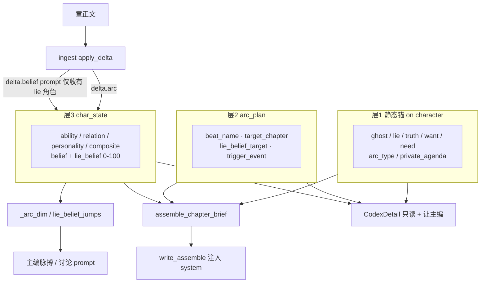
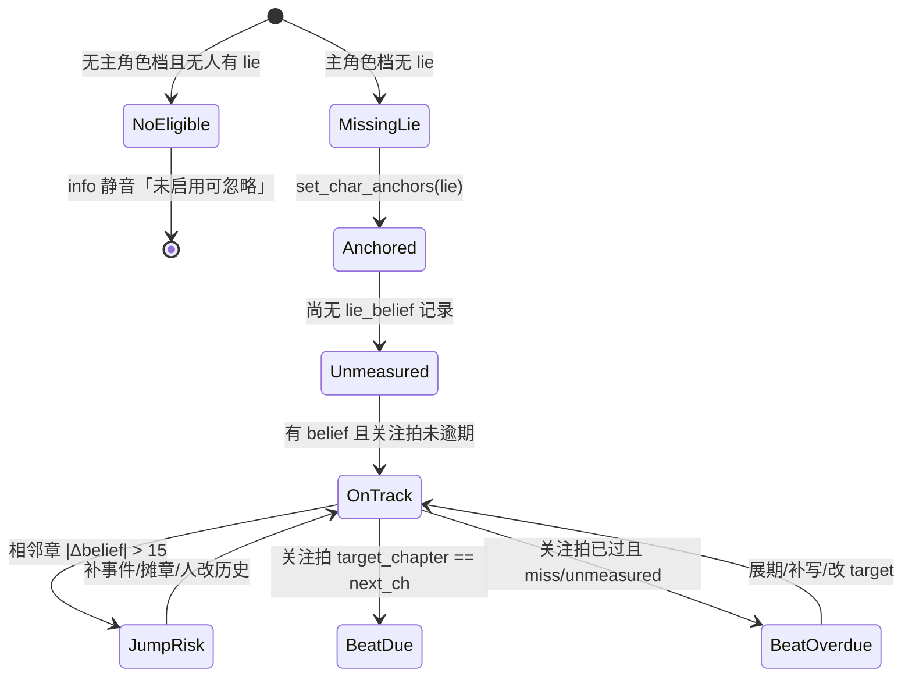
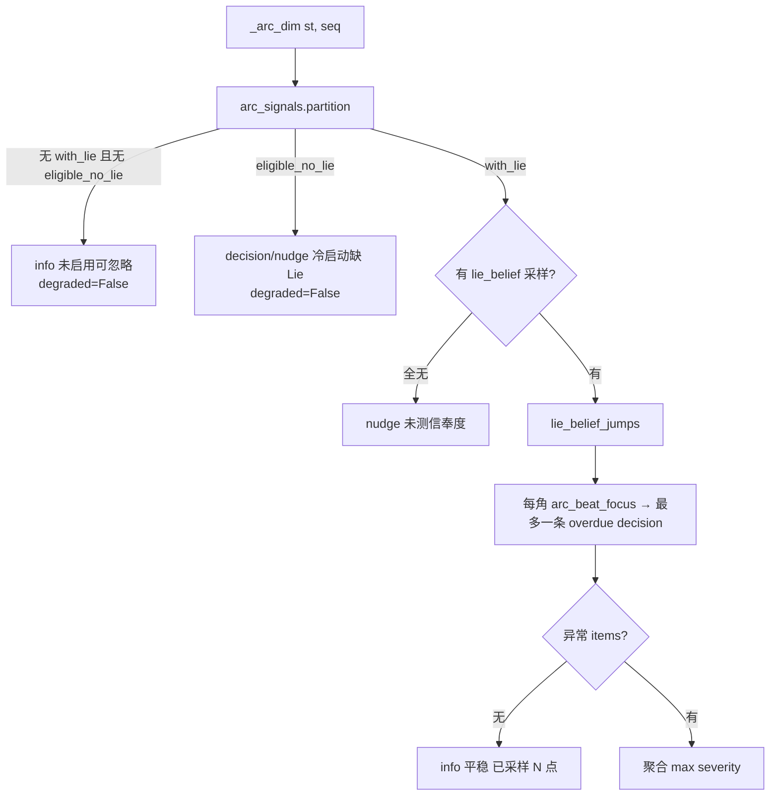
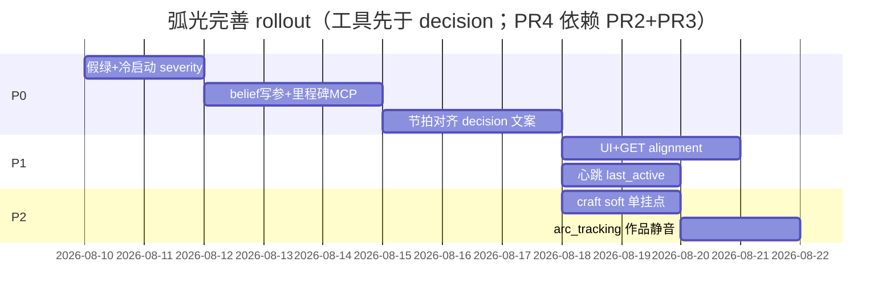

# 角色弧光（Character Arc）子系统完善改进方案

| 项 | 值 |
|----|-----|
| 文档状态 | **Accepted（ready for implement）** |
| 作者 | Grok Build（设计） |
| 日期 | 2026-08-09 |
| 产品 / 仓库 | 铜炉（tonglu）· `scribe-writing-system` / `scribe3/` |
| 既有蓝图 | `设计文档/2026-07-03-工艺引擎强化-design.md` §M3 |
| 相关迁移 | `028_char_state` · `042_char_state_ingest_seq` · `054_arc_anchor`（本方案默认零 migration；仅 PR8 可选 intent 字段） |
| 目标成熟度 | ~50–60% → 生产可用（不假绿、有节拍催收、工具面齐、冷启动可引导） |
| 审查修订 | R1 审查合入；**R2 产品定稿**（owner:「你来定，最优效果」） |
| 产品定稿 | slack 固定 15；GET anchors 回 alignment；不做 evidence migration；作品级 arc_tracking=off 走 PR8 |

---

## Overview

铜炉的弧光子系统已具备 **三层数据模型**（静态锚 / `arc_plan` 里程碑 / `char_state` 质变时间线）、章前简报注入、ingest 反抽 belief、脉搏 arc 维与 Codex 只读露出；但日常建角只填名时子系统整片休眠，脉搏在无数据时写「弧光节奏未见跳变」形成 **假绿**，里程碑逾期/偏离未进入简报与 decision，MCP 有锚与 `char_state` 却无里程碑写工具，且 **MCP/REST 均未透传 `lie_belief`**，与伏笔的窗口状态机 + overdue 三选一对等能力缺口明显。

本方案在 **零或极小 migration** 前提下，对齐现有范式（brief 软指令、pulse `info|nudge|decision`、`degraded` **仅传感器故障**、MCP `commit_if_approved`、ingest `inferred` + `purge` 幂等），分阶段补齐：冷启动诚实信号 → **可写 belief/里程碑工具** → 节拍催收 decision → UI/心跳增强。明确 **不做** 第二个限知硬裁、不做全量 Weiland 15 拍强制，并与 quality/intent 的「情绪弧光 / emotional_arc」严格分域。

**共享纯函数** 落 `scribe3/arc_signals.py`（新薄模块），禁止 store→brief 环依赖。  
**状态**：Accepted — Open Questions 已全部由产品 owner 按最优效果定稿，可实施。

---

## Background & Motivation

### 当前架构（代码锚定）



| 层 | 存储 | 读写入口 | 消费方 |
|----|------|----------|--------|
| 静态锚 | `character` 七字段（`054`） | `set_char_anchors` / `char_anchors`；REST PATCH `/char-anchors`；MCP `s3_set_char_anchors` | `arc_directive` 仅当 `a.get("lie")` |
| 里程碑 | 表 `arc_plan` SCHEMAFULL | store `add_arc_beat` / `list_arc_plan` / `delete_arc_beat`；REST POST/DELETE `/arc-beats`；**无 MCP** | `arc_directive` 当前拍→下一拍文案 |
| 质变时间线 | 表 `char_state` | store `add_char_state(..., lie_belief=)` **已有**；MCP `s3_add_char_state` **未透传** `lie_belief`；REST `POST /char-states` **未透传**；ingest 自动写 belief | 时间线泳道、`latest_lie_belief`、`lie_belief_jumps`、`_arc_state_block` |

关键路径（已核实）：

- **写前**：`scribe3/brief.py` · `arc_directive` + `assemble_chapter_brief`（约 L73–91、L642–670）——无 `lie` 则该角不进 `sections.arcs`。
- **写中**：`api/services/write_assemble.py` 注入 brief 文本；`prompt_blocks._arc_state_block` 注入焦点者能力/关系/性格快照（**不含** lie 指令与 belief 标量）。
- **写后**：`ingest.py` · `apply_delta`：`delta.arc` → ability/relation/personality/composite（`confidence=inferred`）；`delta.belief` 在 **prompt 侧** 仅对有 `lie` 的角色收集（`belief_chars`），`apply_delta` **不再二次校验** lie（幻觉 who 只经 `_resolve_char`）。
- **可观测**：`pulse._arc_dim` 只扫 `lie_belief_jumps(threshold=15)`；无跳变时固定 info「弧光节奏未见跳变」。`chapter_pulse` 现为 **七维**（promise/arc/relation/tension/causal/quality/**scene**）；`degraded` 契约 = **传感器/取数故障**（模块头 + 异常路径 + `PulseBar.jsx` 展示「该维降级:没查≠没病」）。
- **前端**：`web/src/CodexDetail.jsx` · `CharArcAnchors` + `LieBeliefSpark` 只读 + `seedChiefCodexWrite`。

### 痛点清单（本会话诊断）

| # | 缺口 | 症状 | 根因 |
|---|------|------|------|
| 1 | 冷启动 | 日常只建角色名 → 弧光指令整书休眠 | 门槛 `if a.get("lie")`；`s3_add_character` 不引导锚 |
| 2 | 假绿 | 无 belief 序列时脉搏像健康 | `_arc_dim` 空 items 默认「未见跳变」 |
| 3 | 软约束不对等 | 节拍逾期/停滞不进 decision；与限知硬裁也不对等 | 无 beat 对齐信号；仅有跳变检测 |
| 4 | MCP 不齐 | 主编无法经审批链写里程碑 | REST 有 `post_arc_beat`/`del_arc_beat`，MCP 无 |
| 5 | belief 写路径残缺 | 人/agent 难补正 `lie_belief` | MCP/REST 未透传 store 已有参数 |
| 6 | UI 未闭环 | 设计写「作者可改 char_state 历史」未做 | 仅只读列表/spark；无历史条目种子 |
| 7 | 里程碑对齐未做 | 目标章过了、信奉度未到无告警 | `arc_directive` 只拼文案，不比对 |
| 8 | 心跳近似 | `last_active = max(char_state.chapter)` | 露面无质变不刷新；无 `char_state` 永不入待激活 |
| 9 | ingest 偏弱 | arc schema 偏能力轴；belief 无独立溯源字段；人批拒无一等 UX | prompt 侧过滤；summary=why；无人审队列 |
| 10 | 概念混淆风险 | quality contract「情绪弧光」≠ 角色 Lie 弧 | intent.`emotional_arc` 与 M3 并列存在 |

### 与伏笔 lifecycle 的类比

伏笔已有完整生命周期（可作弧光对标，但 **不要抄成硬裁**）：

```text
plant → open + window(in_window|over_half|overdue)
     → touch 刷新 → advance/closed | abandon | mark_herring
MCP: s3_plant_promise / touch / advance / patch / abandon
pulse: promise 维 decision 三选一
brief: promise_directives 分流
```

弧光现状：

```text
锚(lie?) → [可选] arc_plan 节拍 → [可选] belief 序列
         → 仅跳变检测；无 overdue 节拍态；无 MCP 节拍工具；人写 belief 参数未暴露
```

本方案为弧光补上 **派生状态机（纯计算、不改表 status 字段）** 与 **decision 催收**；动作面先 **打通真实工具**（里程碑 + belief 写参），再让文案点名工具名。

---

## Goals & Non-Goals

### Goals

1. **冷启动可引导**：主角色档缺 `lie` 时 severity+文案可见；设定完整度聚合提示；**合法无弧光书**保持 info 静音，不常驻 decision 红点。
2. **脉搏不假绿**：无锚 / 有锚无 belief / 有数据无异常 —— 三类文案可区分；**禁止**用「未见跳变」当健康；**不**用 `degraded` 表示配置缺口。
3. **节拍催收**：目标章已过且信奉度未达 → brief + pulse decision（每角色最多一条当前关注拍）。
4. **工具面可执行**：MCP 里程碑增删；**MCP + REST 透传 `lie_belief`**（及 `change_type=belief`）；与 decision 文案同批或先于文案上线。
5. **对齐现有范式**：brief 软指令、pulse 分级、`degraded`=传感器故障、MCP `commit_if_approved`、ingest inferred + purge 幂等。
6. **增量可 merge**：每个 PR 独立可审；默认零 migration；共享逻辑在 `arc_signals.py`。
7. **验收**：轻量单测 + **已部署 demo 冒烟**（禁止在 Grok 运行机 npm ci / 起 Surreal / 全量测）。

### Non-Goals

| 明确不做 | 理由 |
|----------|------|
| 第二个限知硬裁（epistemic hard block） | 弧光是作者工艺信号，不是读者知识泄露 |
| 强制 Weiland 全 15 拍 / 每角色必满 `arc_plan` | ROI 低；群像配角 flat/无 Lie 合法 |
| 新建平行「弧光状态表」或重写三层模型 | 现模型足够；问题在消费与门控 |
| 把 intent.`emotional_arc` 并入本子系统 | 概念不同；仅防混淆 |
| 默认 save **硬拦** 大 belief 跳变 | 可选 craft soft 报告项；作者可跳过 |
| 全量人审弧光队列 / 新前端表单墙 | 对话写入 + 让主编 |
| 用 `degraded=True` 表示冷启动/缺锚/未测 | 与 `PulseBar`「没查≠没病」契约冲突 |
| `char_state.evidence` migration / 独立证据栏 | 产品定稿：summary/why 足够（原 PR7 cancelled） |
| 本阶段按书配置 belief slack | 固定 `ARC_BELIEF_SLACK=15`；可配属 follow-up |
| 本机起 Surreal / 全量 pytest 作为交付定义 | 全局规则：demo 已部署栈冒烟 |

---

## Proposed Design

### 0. 模块落点（KD11）与共享常量

```text
scribe3/arc_signals.py   # 新：纯函数，零 store 写
  ARC_BELIEF_SLACK = 15   # 与 pulse._ARC_JUMP_MAX 同值；本阶段不可按书配置
  MAIN_CAST_IMPORTANCE / normalize_importance_for_arc
  is_arc_eligible(char, anchors) -> bool
  partition_arc_chars(chars, anchors_by_id) -> ...
  arc_beat_focus(..., slack=ARC_BELIEF_SLACK) -> focus beat + alignment state
  miss_belief(current, target, arc_type, slack=ARC_BELIEF_SLACK) -> bool
  bootstrap_messages(...) / healthy_arc_message(n_samples)
  format_beat_decision(...) / format_cold_start_decision(...)
  is_arc_tracking_off(intent_or_flag) -> bool  # PR8

scribe3/store/*           # 只查询：list_arc_plan, latest_lie_belief, lie_belief_jumps, ...
scribe3/pulse.py          # import arc_signals；degraded 仅 try/except
scribe3/brief.py          # import arc_signals；assemble 组装文案
scribe3/store/character_arc.py  # setting_completeness 调 arc_signals 判 eligible，不 import brief
```

**禁止** `store` → `brief`。`pulse` 已依赖 `brief.promise_directives` 可保留；弧光新逻辑 **不** 再堆进 brief 供 store 复用。

### 1. 信号分级与「弧光 lifecycle」（派生，零 migration）

与伏笔 `window.state` 对标，引入 **纯函数派生态**（不落库 status）：



#### 1.1 ArcEligible（对齐仓库真源）

**关闭 OQ#1**：与 `context_assembler._main_cast_names` + `mcp/_common._CHARACTER_IMPORTANCE_ALIASES` 对齐。

```python
# scribe3/arc_signals.py — 单一真源，pulse/brief/completeness 共 import

# 规范值（alias 归一后）与中文/历史别名；与 _main_cast_names rank 键一致
MAIN_CAST_IMPORTANCE = frozenset({
    "protagonist", "主角",
    "major", "主要", "main",
    # 兼容别名（若历史数据出现，归一前也可命中）
    "lead", "primary", "核心",
})

# 非主角色档（有 lie 仍启用；无 lie 合法休眠）
# 规范：minor / background；MCP alias：配角→minor、龙套→background
# 注意：canon_apply 对非主档会写成 importance="extra"——视为非主角色档休眠，
# 与 major 无关；「extra」不是主角色档。

def is_main_cast_importance(imp: str | None) -> bool:
    s = (imp or "").strip().lower()
    # 若上游已用 _CHARACTER_IMPORTANCE_ALIASES 归一，s 多为 protagonist|major|...
    return s in MAIN_CAST_IMPORTANCE or s in {"protagonist", "major", "main"}

def is_arc_eligible(char, anchors: dict) -> bool:
    """有 lie → 一定启用弧光跟踪；
    无 lie 但 importance∈主角色档 → 冷启动缺口（eligible_no_lie）；
    minor/background/extra 且无 lie → 合法休眠，不进冷启动 decision。"""
    if (anchors.get("lie") or "").strip():
        return True
    imp = ""
    traits = getattr(char, "traits", None) or {}
    if isinstance(traits, dict):
        imp = str(traits.get("importance") or "")
    elif isinstance(char, dict):
        imp = str((char.get("traits") or {}).get("importance")
                  or char.get("importance") or "")
    return is_main_cast_importance(imp)
```

| 角色形态 | eligible? | 冷启动 decision? |
|----------|-----------|------------------|
| 任意 + 有 `lie` | 是（with_lie） | 否 |
| `importance∈{protagonist,major,main,主角,主要,…}` 无 lie | 是（eligible_no_lie） | 是（nudge/decision） |
| `minor`/`background`/`extra` 无 lie | 否 | 否 |
| 空书 / 全无主档且无人有 lie | 无 eligible | **否** → info 静音 |

#### 1.2 章号契约（pulse ↔ brief）

| 调用方 | 入参 `seq` 语义 | 调用 `arc_signals` 时 | belief 上界 |
|--------|-----------------|----------------------|-------------|
| `assemble_chapter_brief(st, seq)` | **即将写的章** = `next_ch` | `next_ch = seq` | `latest_lie_belief(cid, upto=seq-1)`（与现 brief `max_ch` 一致） |
| `chapter_pulse(st, seq)` | **当前审视的章**（已有章或工作章） | `next_ch = seq`（「以该章为写作目标」的对齐视角） | `latest_lie_belief(cid, upto=seq)`（与跳变过滤 `j["chapter"] > seq` 同窗：含本章已落库 belief） |

**共享函数签名**（写死）：

```python
def arc_beat_focus(
    plan: list[dict],
    *,
    belief: int | None,
    next_ch: int,
    arc_type: str | None = None,
    slack: int = 15,
) -> dict | None:
    """返回该角色唯一「当前关注拍」及 alignment，或 None（无 plan）。
    next_ch: 当前写作目标章（brief=即将写；pulse=审视 seq）。
    belief: 调用方按上表取 latest_lie_belief 后传入——函数内不再查库。
    """
```

边界单测必须覆盖：`target_chapter == next_ch`（due）、`== next_ch-1`（刚过 → overdue 判定）、`== next_ch+1`（approaching）。

#### 1.3 节拍对齐算法（冻结；每角色一条）

**只关注一拍**：在 `target_chapter` 升序的 plan 上：

1. 找 **最早的未达标 past/due 拍**（`target_chapter <= next_ch` 且未 `passed`）；
2. 若无，则取 **下一拍**（最早 `target_chapter > next_ch`）作 approaching/due；
3. 若 plan 空 → `no_plan`（仅主角色档 + 有 lie 时 info，不 decision）。

**`passed` / `miss` 定义**（`miss_belief`）：

```python
def miss_belief(current: int | None, target: int | None, arc_type: str | None,
                slack: int = ARC_BELIEF_SLACK) -> bool:
    """True = 尚未达标（overdue_miss 用）。slack 固定 ARC_BELIEF_SLACK=15，
    与 pulse._ARC_JUMP_MAX 同值；本阶段不按书可配（KD14）。
    - target is None → 永不因数值 miss（见下表 target 缺失）
    - current is None → 由调用方标 overdue_unmeasured，不进本函数
    - arc_type 空 / 未知 / flat：abs(current - target) > slack → miss
    - positive / disillusionment（信奉度应下降）:
        current > target + slack → miss（仍信得过猛）
        current <= target + slack → 达标（允许超调下降）
    - fall / corruption（信奉度应上升或恶化）:
        current < target - slack → miss（还不够「陷」）
        current >= target - slack → 达标
    """
```

| 条件（对 **唯一关注拍**） | alignment | severity | 出 decision？ |
|---------------------------|-----------|----------|---------------|
| `target_chapter > next_ch` 且 `target - next_ch <= 2` | `approaching` | info | 否 |
| `target_chapter == next_ch` | `due` | nudge | 否（nudge 足够） |
| `target_chapter < next_ch` 且 `belief is None` | `overdue_unmeasured` | decision | **是（每角最多 1）** |
| `target_chapter < next_ch` 且 `miss_belief(...)` | `overdue_miss` | decision | **是（每角最多 1）** |
| `target_chapter < next_ch` 且达标 | `passed` → 推进到下一关注拍 | — | 否 |
| `lie_belief_target is None` 且目标章已过 | `overdue_no_target` | info | 否（「缺信奉度目标，可补 target 或忽略」） |
| 无 plan | `no_plan` | info（仅 with_lie 主档） | 否 |

**§1 与 §4 统一**：brief 与 pulse **共用** `arc_beat_focus`；brief 的「逾期行」= 该角色 focus 的 decision/nudge 文案，**不对每个 past beat 刷屏**。

**decision 三选一**（工具名仅在 PR 工具合入后使用；见 PR 序）：

```text
角色「{name}」关注拍「{beat_name}」目标第{target}章已过，
当前信奉度 {cur|未测}，目标 {target_val|—}：
① 补事件推动信念并落库（ingest 反哺，或 s3_add_char_state change_type=belief + lie_belief）；
② 展期/重规划（s3_add_arc_beat 新目标章，或 s3_delete_arc_beat 后重建）；
③ 改写 Lie/弧型（s3_set_char_anchors）——简报持续携带直至决策。
```

> 与伏笔差异：弧光 **不** 引入 `status=closed`；「拍完成」= `passed` 派生。

### 2. 脉搏假绿修复（P0，纯逻辑）

改 `scribe3/pulse.py` · `_arc_dim`：

**`degraded` 纪律（KD1 修订）**：

| 场景 | `degraded` | severity / 文案 |
|------|------------|-----------------|
| `_arc_dim` 内部抛错（chapter_pulse 捕获） | **True** | 既有「该维检测未跑成」 |
| 无 eligible（合法未启用） | **False** | **info**：「未启用角色弧光——无主角色档/无 lie，可忽略」 |
| 主角色档缺 lie | **False** | **decision**（或 nudge）：冷启动补 Lie |
| 有 lie 全未测 belief | **False** | **nudge**：「已设 Lie 尚无信奉度采样」 |
| 有采样无跳变/无逾期 | **False** | **info**：「弧光节奏平稳(已采样 N 点,未见未见异常)」 |
| 跳变 / 关注拍逾期 | **False** | decision/nudge（既有 + 新） |

**禁止**：配置态/工艺态设 `degraded=True`（避免 `PulseBar` 显示「没查≠没病」）。  
**可选后续**：`mode: "bootstrap"|"healthy"` 字段——**本方案不强制**；用 severity+文案即可。



**假绿修复验收口径**：

| 场景 | 期望 |
|------|------|
| 空书 / 仅路人 | **info** 未启用；**禁止**「未见跳变」；`degraded` 非 True |
| 主档无 lie | severity ≥ nudge/decision；文案含 Lie/冷启动；`degraded` 非 True |
| 有 lie 无 belief | nudge；**禁止**「未见跳变」当健康 |
| 有 belief 无异常 | info「平稳 / 已采样 N 点」 |
| 相邻章跳变 >15 | decision（保持现测） |
| 取数异常 | `degraded=True` + 故障文案（既有） |

### 3. 冷启动（P0）

三道闸，**默认不硬拦建角**；空书不 decision（见 §2）。

| 闸 | 位置 | 行为 |
|----|------|------|
| A. 设定完整度 | `setting_completeness` | **全书一条聚合** issue（见下），不按角色 *5 连环扣 |
| B. 脉搏 + 简报 | `_arc_dim` + `assemble` | 仅 `eligible_no_lie` → decision/nudge；bootstrap 文案 |
| C. craft soft（可选、P2） | **仅** `verify_craft_compliance` 报告 soft 项 | 不进 `evaluate_save_craft_gate` 的 `allowed=False`；**不**在 §9 再做第二套 |

**`setting_completeness` 量化（Issue 9）**：

```python
# 在 character_arc.setting_completeness 内：
n_missing_lie = count main-cast chars without lie  # arc_signals
if n_missing_lie:
    # 聚合进 missing_dimensions，按「维度」扣 20 一次，而不是 char_issues 每人 -5
    missing.append(f"主角色弧光锚(Lie):{n_missing_lie}人缺错误信念")
# 不把缺 lie 写入逐角色 char_issues（避免 20 主角 ×5 分崩）
# 既有 backstory/personality_tags 的 char_issues 逻辑不变
```

分数公式保持：`100 - len(missing)*20 - len(char_issues)*5`；缺 Lie 只增加 **1** 条 `missing`，最坏 -20。

**作品级静音 `arc_tracking`**（产品定稿 KD17，**PR8**，不拖 PR1）：见 §3.1。

**MCP / 主编引导**：`s3_add_character` / Hermes skill：主档创建后应 `s3_set_char_anchors(lie=...)`。可选 result `hints: ["set_lie_anchor"]`。

### 3.1 作品级 `arc_tracking`（PR8，最优静音出口）

**产品定稿**：做轻量作品级开关，默认 **on**；群像/设定集可永久关闭弧光维催收红点。

| 项 | 选择 |
|----|------|
| 语义 | `arc_tracking: "on" \| "off"`，缺省 / 未设 = **on** |
| 行为 | `off` 时：`_arc_dim` **不**扫 eligible/跳变/节拍，固定 **info**「本书已关闭弧光追踪」+ `degraded=False`；brief 可不注入 arcs bootstrap/overdue（或同文案一行） |
| 挂点（最小） | **优先**复用书级北极星 **`intent`**（与 `overdue_threshold` 同属 per-work 工艺旋钮）：`get_intent` / `set_intent` / MCP `s3_set_intent` 增可选字段 `arc_tracking`。intent 表 SCHEMAFULL → 需极小 migration **`115_intent_arc_tracking.surql`**：`DEFINE FIELD IF NOT EXISTS arc_tracking ON intent TYPE option<string>`（应用层 ASSERT `on`/`off`）。 |
| 备选（零 Surreal migration） | 若 intent 改动排期冲突：`settings_store` 键 `arc_tracking:{work}`（同 `orchestration/state.py` per-work 范式）；产品面仍建议最终收敛到 intent。 |
| 非目标 | 不进 PR1–3；不与 PulseBar localStorage 维 mute 互斥（作品关 = 服务端真关；维 mute = 仅 UI） |

实现入口：`arc_signals.is_arc_tracking_off(st.get_intent())`；pulse/brief 开头 short-circuit。

### 4. 简报增强：与 §1 同一套 focus

扩展路径：`assemble_chapter_brief` 对每个 with_lie 角色：

1. **先**算 `focus = arc_beat_focus(plan, belief=..., next_ch=..., arc_type=...)`；
2. **`arc_directive` 与 focus 对齐（PR2 强制）**：三行指令里的「所处节拍 / 下一拍 / 本章指令」以 **focus 拍** 为权威，禁止再用「仅按 target_chapter 切 done/ahead 列表、与 focus 不一致」的旧路径导致简报自相矛盾（例如 focus 判 overdue_miss，正文却写「朝下一拍缓移」像一切正常）；
3. 若 alignment ∈ {overdue_unmeasured, overdue_miss} → **追加一行** ⚠（与 pulse decision **同文案源** `format_beat_decision`）；
4. 若 due → 「本章指令」收紧为「本章应到达「{beat}」」；
5. 对 `eligible_no_lie` → bootstrap 行（`format_cold_start_decision`），写入 `sections.arcs` 或 `sections.arc_bootstrap`。

**不对** `done` 列表里每一个 past beat 追加逾期——仅 focus 一拍。

### 5. 工具面：里程碑 MCP + belief 写参（可执行面）

#### 5.1 MCP 里程碑

| 工具 | 类型 | 行为 |
|------|------|------|
| `s3_add_arc_beat` | 写，待批 | 对齐 REST `post_arc_beat`：`character_id, beat_name, target_chapter, lie_belief_target?, trigger_event?`；`lie_belief_target` 0–100；**角色存在性与 REST 同宽**（当前 REST 不 404 角色，MCP 同宽，不发明更严） |
| `s3_delete_arc_beat` | 写，待批 | 对齐 REST `del_arc_beat`：**静默删**（不存在也 success/noop 与 REST 一致）；`commit_if_approved` |

落点：`tools_write.py`、`mcp/_common.py` WRITE_GATED、`orchestration/catalog.py` · `codex.character` 的 `write_tools` + 关键词「里程碑」。

**读侧**：需要 list plan 时 **单列** `s3_list_arc_plan(character_id)` 或扩展 GET anchors；**不要**假设 `s3_character_timeline` 含 plan（其仅 `list_char_states`）。

#### 5.2 MCP + REST 透传 belief / lie_belief（阻塞催收动作面）

| 路径 | 现状 | 必做 |
|------|------|------|
| `store.add_char_state(..., lie_belief=)` | 已有 | 不变 |
| `s3_add_char_state` | 无 `lie_belief`/`confidence` 入参 | 增 `lie_belief: int \| None`、`confidence`；`change_type` 文档含 `belief`；`lie_belief` 若给则 clamp/校验 0–100（同 arc-beat） |
| `POST /char-states` | 未 `req.get("lie_belief")` | `lie_belief=req.get("lie_belief")` 传入 store；非法 422 |

decision 文案中的工具名 **仅在本能力合入后** 出现在 pulse/brief（见 PR 序）。

### 6. UI 闭环（P1，仍禁表单墙）

| 项 | 改动 |
|----|------|
| 锚 / 里程碑 | 只读；缺 lie 醒目 empty；**消费 GET char-anchors 的 `alignment`** 显示 focus 状态 badge（逾期/due/平稳） |
| char_state 历史 | 折叠列表 + inferred 标记 +「让主编改」种子（含 `lie_belief` 参数说明） |
| 不提供 | 行内表单、DELETE 直打 REST |
| 文案 | 「角色弧光 / Lie 信奉度」，避免「情绪弧光」 |

### 7. 心跳 last_active（P1）

1. **P1a**：`last_active = max(char_state 章, 涉及该角的 relation_touch 章, involved_characters 含该角的章)`  
2. **P1b**：`heartbeat_list`：有 `private_agenda` 且 `last is None` → 视作待激活（`last_active` 当作 0 / 永久 cold）。  

### 8. ingest 增强（P2，克制）

| 项 | 建议 | migration |
|----|------|-----------|
| belief 溯源 | `summary=why`；prompt 强制 why 非空 | 无 |
| evidence 独立字段 | **不做**（产品定稿）：`summary`/why 足够 inferred 审计 | **cancelled** |
| 人批 inferred | Codex 标机抽 + 让主编写 confirmed | 无 |
| 大跳变 | 落库后 pulse decision，apply_delta 不静默丢 | 无 |
| prompt vs apply | 文档写清：prompt 只对有 lie 收 belief_chars；apply 不二次校验 lie | — |

### 9. craft soft（P2，单挂点）

- **仅**在 `verify_craft_compliance` 增加 soft check：主档缺 lie → soft warn 进 reports。  
- **默认不做** save 路径第二套；**不做** `SCRIBE3_ARC_SOFT_BLOCK` 除非产品后续开口。  
- §3 闸 C = 本条；不在 finalize/save 再实现。

### 10. 与「情绪弧光」分域

| 概念 | 字段 / 模块 | 用途 |
|------|-------------|------|
| **角色弧光**（本方案） | `lie` / `arc_plan` / `char_state.lie_belief` | 错误信念击穿进度 |
| **情绪弧光** | intent.`emotional_arc` | 读者情绪曲线 |
| **场景动能** | experience scene grid；pulse `scene` 维 | Scene–Sequel |

---

## API / Interface Changes

### REST

| 方法 | Path | 变更 |
|------|------|------|
| POST | `/char-states` | **透传** `lie_belief`（0–100）；`change_type` 允许 `belief`（store/DB 已允许）；可选 `confidence`（已有则保持） |
| GET | `/char-anchors` | **做 alignment（产品定稿，PR4）**：响应在既有 `anchors`+`arc_plan` 上增加只读派生字段，例如 `alignment: { focus_beat_id?, beat_name?, status, current_belief, target, next_ch, miss_slack }`（`status`=`arc_beat_focus` 的 alignment；`miss_slack`=15）。零 migration；服务端调 `arc_beat_focus`（依赖 PR2）。前端 Codex **禁止**再本地重算 focus 为主路径。 |
| POST/DELETE | `/arc-beats` | 行为不变（MCP 对齐之） |
| PATCH/GET | intent（既有） | **PR8**：读写 `arc_tracking` |
| GET | `/chapter-pulse` | arc 维 items/severity 语义变更；**结构兼容**；配置态 **不** 设 degraded |
| GET | `/chapter-brief` | arcs 增强；可选 bootstrap |

### MCP

```python
async def s3_add_arc_beat(...) -> dict:  # 对齐 post_arc_beat
async def s3_delete_arc_beat(beat_id, work=None) -> dict:  # 对齐 del_arc_beat 静默

async def s3_add_char_state(
    ...,
    change_type: str,  # 含 belief
    lie_belief: int | None = None,
    confidence: str | None = None,
    ...
) -> dict:
    # lie_belief 非 None → 0–100 校验；传入 store.add_char_state
```

可选读：`s3_list_arc_plan(character_id)`（**非** timeline 附带）。

### 纯函数

见 §0 `arc_signals.py` 签名；`next_ch` / `belief` 契约见 §1.2。

---

## Data Model Changes

### 默认：零 migration

沿用 `054` 七锚、`arc_plan`、`char_state.lie_belief`、`ingest_seq`。

### 可选 / 取消

| 编号 | 内容 | 状态 |
|------|------|------|
| ~~115 evidence on char_state~~ | 独立证据栏 | **wontfix / cancelled**（summary/why 足够） |
| **115** `115_intent_arc_tracking.surql` | `arc_tracking option<string>` on intent | **PR8 可选**（仅当走 intent 挂点；备选 settings_store 则无此 migration） |

**不做**：`arc_plan.status`；再扩 `change_type`；**不做** char_state.evidence。

---

## Alternatives Considered

### A. 硬门：无 lie 禁止写实质正文
拒绝默认；最多 soft warn。

### B. 新建 `arc_runtime` 表
拒绝；派生态 + 现表。

### C. 仅换脉搏文案、不做节拍与写参
拒绝作为终态；假绿可先合，但可执行催收必须工具+对齐。

### D. 用 `degraded` 表示冷启动
**拒绝**（审查 Issue 1）：与 `PulseBar` 传感器契约冲突。

### E. 全量 Weiland 15 拍模板
Non-Goal。

---

## Security & Privacy Considerations

| 风险 | 缓解 |
|------|------|
| 注入伪造 section | 新文案同样换行清洗 |
| MCP 越权 | `commit_if_approved` + work 隔离 |
| 限知 | 简报作者向；不按 focalizer 滤弧光（既有） |
| private_agenda | 心跳既有面，不新增 |

---

## Observability

| 信号 | 出口 |
|------|------|
| pulse arc severity（**非** degraded 配置态） | `/chapter-pulse`、讨论脉搏速览 |
| brief arcs / bootstrap | `/chapter-brief`、BriefPanel |
| ingest belief 失败 warning | 既有 non-fatal 日志 |

---

## Rollout Plan



- **回滚**：逻辑 PR 可 revert；无 migration 默认。  
- **兼容**：旧书无锚 → info/decision 诚实，不炸。

---

## Risks

| 风险 | 严重度 | 缓解 |
|------|--------|------|
| decision 过多 | 中 | **每角色最多 1 条** focus overdue；空书 info；跳变另计 |
| importance 历史脏值 | 中 | MAIN_CAST 含 major + alias；extra=非主档 |
| N+1 查询 | 低–中 | 批查 states；角色数通常 <50 |
| 中间态文案点名不存在工具 | 高（已缓解） | **PR 序：工具先于或同批 decision 文案** |
| 与 emotional_arc 混淆 | 低 | 术语分域 |

---

## Testing Strategy

### 轻量单测

| 文件 | 用例 |
|------|------|
| `tests/test_arc_signals.py`（新） | eligible/`major`；`miss_belief` 各 arc_type；focus 单拍收敛；边界 target==next_ch / next_ch-1 |
| `tests/test_pulse.py` | 无 eligible → info 非 degraded；缺 lie → decision 非 degraded；未测 nudge；平稳文案；跳变保持；**维数不写死 6**（`>=6` 或含 arc） |
| `tests/test_brief.py` | focus 逾期一行；与 pulse 同 format 源 |
| `tests/test_mcp.py` | `s3_add_arc_beat`/`s3_delete_arc_beat` 注册；`s3_add_char_state` 带 lie_belief |
| REST/集成轻测 | POST char-states 带 lie_belief 落库 |

### Demo 冒烟（交付定义）

目标机：`www.example.com` / `203.0.113.10`，应用目录 `/opt/scribe3/app`。

**步骤**：

1. 探活：`curl -sS https://www.example.com/api/health`（或项目既有 health）。
2. 选定 demo `work` slug（部署后 `list works` / 现有 e2e 书名写入当次笔记；占位不写死以免过期）。
3. **无库改造最小断言**：`GET /chapter-pulse?work=…&seq=1` → `dimensions[arc]` 的 message **不得**在「无 belief 跳变数据」时仅为「弧光节奏未见跳变」；若无主档，应为「未启用…可忽略」类 **info**。
4. **可写验证（审批链）**（推荐）：临时 `s3_add_character` importance=major → pulse 应出现冷启动 → `s3_set_char_anchors(lie=…)` → 冷启动消失；`s3_add_arc_beat` +（可选）`s3_add_char_state(..., belief, lie_belief=…)` → brief/pulse 可见。
5. 不在 Grok 运行机起 Surreal。

---

## Open Questions

**全部已由产品 owner 定稿（「你来定，我要最优的效果」→ Grok-optimal defaults）。无阻塞实现的开放项。**

| # | 原问题 | 定稿 |
|---|--------|------|
| 1 | 主角判定 importance？ | **已关闭（R1）**：对齐 `_main_cast_names` + alias，**含 major**。 |
| 2 | slack 是否按书可配？ | **固定 15**：`ARC_BELIEF_SLACK = 15`，与 `_ARC_JUMP_MAX` 同值；本阶段不进 intent/配置面。若未来可配，单列 follow-up，**不进 PR1–3**。 |
| 3 | GET char-anchors 回 alignment？ | **做**：并入 **PR4**；只读派生，依赖 PR2 的 `arc_beat_focus`。 |
| 4 | migration 115 evidence？ | **不做 / PR7 cancelled**；`summary`/why 足够。 |
| 5 | 作品级 `arc_tracking=off`？ | **做轻量 PR8**（PR5 之后）：默认 on；off → pulse/brief 固定 info 静音；挂点优先 intent（小 migration）或 settings_store 备选。 |

---

## Key Decisions

| # | 决策 | 理由 |
|---|------|------|
| KD1 | **假绿只靠 severity+文案**；`degraded` **仅**传感器/取数故障 | 与 `pulse` 头注释 + `PulseBar`「没查≠没病」契约一致；配置缺口不是降级 |
| KD2 | 节拍完成态派生、不落库 status；**每角色唯一 focus 拍** | 避免 decision 风暴与第二账本；§1≡§4 |
| KD3 | 冷启动 soft；空书/无 eligible = **info 静音**；仅主档缺 lie 才 decision | 群像合法；防 PulseBar 常驻红点 |
| KD4 | **ArcEligible** = 有 lie **或** importance∈主角色档（**含 major**，对齐 `_main_cast_names` / alias） | 修「主要角色」静默；`extra`/`minor`/`background` 无 lie 休眠 |
| KD5 | MCP 里程碑增删 + **MCP/REST 透传 lie_belief** 属可执行面，**先于或同批** decision 工具名 | 避免三选一指向虚空 |
| KD6 | UI 只读 + 让主编 | AGENTS 对话写入政策 |
| KD7 | 跳变/逾期 → pulse/brief；craft soft **单挂** verify 报告；默认不 save 硬拦 | 职责分离 |
| KD8 | 与 emotional_arc 严格分域 | 防 quality 互踩 |
| KD9 | heartbeat 多源 + 从未活跃可激活 | 修设计已点名近似 bug |
| KD10 | 验收 = demo 冒烟 + 过滤单测 | 主机资源规则 |
| KD11 | 纯函数落 **`scribe3/arc_signals.py`**；store 不 import brief | 避环依赖；三方共 import |
| KD12 | `miss_belief` 有向：positive/disillusionment 看「降不够」；fall/corruption 看「升不够」；默认/flat 用 abs | 可单测唯一实现 |
| KD13 | 章号：`next_ch`=写作目标章；brief belief=`seq-1`；pulse belief=`seq` | 与现 brief/pulse 窗一致并写死 |
| KD14 | **`ARC_BELIEF_SLACK = 15` 固定**，与 `_ARC_JUMP_MAX` 同值；本阶段不按书可配 | 避免第二配置面；与跳变阈值心智一致 |
| KD15 | **GET `/char-anchors` 返回 `alignment` 派生**（PR4） | Codex 一等 UX，前端不重算 focus；零 migration |
| KD16 | **不做 char_state.evidence migration**（原 PR7 cancelled） | summary/why 足够；降 demo 盘与迁移面 |
| KD17 | **作品级 `arc_tracking` on/off，默认 on；PR8 实现** | 群像/设定集合法永久静音；不拖 PR1–3 |
| KD18 | **PR2：`arc_directive` 由 `arc_beat_focus` 驱动** | 简报「当前拍」与催收 focus 不自相矛盾 |

**文档状态**：Accepted — 可按 PR Plan 开工。

---

## References

- `设计文档/2026-07-03-工艺引擎强化-design.md` §M3  
- `scribe3/brief.py` — `arc_directive`, `assemble_chapter_brief`, `heartbeat_list`  
- `scribe3/pulse.py` — `_arc_dim`（七维 `_DIMS`）, `degraded` 契约  
- `scribe3/ingest.py` — belief_chars 过滤 vs apply_delta  
- `scribe3/store/character_arc.py` / `characters.py`  
- `scribe3/mcp/_common.py` — `_CHARACTER_IMPORTANCE_ALIASES`  
- `scribe3/context_assembler.py` — `_main_cast_names`  
- `scribe3/web/src/CodexDetail.jsx`、PulseBar degraded 文案  
- `scribe3/api/routers/world_read.py` — anchors/beats/char-states  
- `scribe3/store/intent.py` — get/set_intent（PR8 arc_tracking 挂点）  
- Weiland Character Arc（Lie→Truth）

---

## PR Plan

**硬依赖序**：工具可执行（里程碑 + belief 写参）→ 再合带工具名的 decision 文案。  
假绿修复（severity 文案、不滥用 degraded）可先于工具独立上线，但 **逾期三选一若点名 MCP，必须等 PR3**。

### PR1 — 脉搏假绿 + 冷启动信号 + arc_signals 骨架

- **标题**：`fix(arc): honest pulse copy for empty/bootstrap; no degraded for config gaps`
- **影响**：
  - **新** `scribe3/arc_signals.py`（eligible、partition、healthy/bootstrap 文案、MAIN_CAST）
  - `scribe3/pulse.py`（`_arc_dim`）
  - `scribe3/store/character_arc.py`（`setting_completeness` 聚合缺 Lie → `missing_dimensions` 一条）
  - `scribe3/tests/test_pulse.py`、`tests/test_arc_signals.py`
- **依赖**：无  
- **说明**：info 静音空书；主档缺 lie → decision；未测 → nudge；平稳「已采样 N」；**永不**对配置态 `degraded=True`。decision **暂不**写 `s3_add_arc_beat` 等未上线工具名（可用「规划里程碑 / 补信奉度采样」中性措辞）。

### PR3 — 里程碑 MCP + belief 写参（MCP + REST）【提前于 decision 工具名】

- **标题**：`feat(arc): s3_add/delete_arc_beat; pass lie_belief on char_state MCP+REST`
- **影响**：
  - `scribe3/mcp/tools_write.py`（`s3_add_arc_beat`、`s3_delete_arc_beat`；`s3_add_char_state` + `lie_belief`/`confidence`/`belief`）
  - `scribe3/mcp/_common.py` WRITE_GATED
  - `scribe3/orchestration/catalog.py`
  - `scribe3/api/routers/world_read.py`（`add_char_state_endpoint` 透传 `lie_belief`）
  - `scribe3/tests/test_mcp.py` + REST 轻测
  - Hermes skill 一句
- **依赖**：无（可与 PR1 并行；**建议紧接 PR1 后 merge**）  
- **说明**：行为对齐 REST post/del_arc_beat（0–100；删静默；角色存在性同宽）。**入口条件（对 PR2）**：本 PR merge 后，decision 文案方可点名工具。

### PR2 — 节拍对齐 brief + pulse decision

- **标题**：`feat(arc): beat focus alignment in brief and pulse`
- **影响**：
  - `scribe3/arc_signals.py`（`arc_beat_focus`、`miss_belief`、`format_beat_decision`、`ARC_BELIEF_SLACK`）
  - `scribe3/brief.py`（**`arc_directive` 改为 focus 驱动**，禁止与 focus 分叉）
  - `scribe3/pulse.py`
  - `tests/test_arc_signals.py`、`test_brief.py`、`test_pulse.py`
- **依赖**：**PR3（及 belief 写参）**；建议 PR1 已合  
- **入口条件**：PR3 已提供 `s3_add_arc_beat` / `s3_delete_arc_beat` / belief 写参，decision 三选一工具名可执行  
- **说明**：每角一条 focus；章号契约 §1.2；与 §4 统一；`slack` 固定 15。

### PR4 — Codex UI + GET alignment + 历史/种子

- **标题**：`feat(arc): char-anchors alignment API + Codex history/cold-start UX`
- **影响**：
  - `scribe3/api/routers/world_read.py`（`get_char_anchors` 附加 `alignment`）
  - `scribe3/web/src/CodexDetail.jsx`（消费 alignment badge；char_state 历史；冷启动文案；主编种子）
  - 相关前端/API 轻测
- **依赖**：**PR2 + PR3**（focus 算法 + 工具名/lie_belief 种子）
- **说明**：禁表单墙；alignment 只读派生；前端不以本地重算为主路径。

### PR5 — 心跳 last_active 多源 + 从未活跃

- **标题**：`fix(arc): heartbeat last_active multi-source and first activation`
- **影响**：`scribe3/brief.py`、`tests/test_brief.py`
- **依赖**：无（注意与 PR2 brief 冲突时 rebase）
- **说明**：relation_touch / involved_characters；`last is None` 可入名单。

### PR6 — craft soft 单挂点 + skill/prompt 强化

- **标题**：`chore(arc): craft soft missing-lie; skill/prompt belief why`
- **影响**：`scribe3/verify_craft_compliance.py`（**仅此** soft）；ingest/critique belief 段 why；Hermes skill  
- **依赖**：PR1–2 语义稳定  
- **说明**：**不做** save 第二套；**不做** 仅 docstring 充数（写参已在 PR3）。

### PR7 — char_state.evidence migration

- **状态**：**cancelled / wontfix**（产品定稿 KD16）
- **说明**：不使用独立 evidence 字段；inferred 审计继续靠 `summary`/why + `confidence`。

### PR8（可选 P2）— 作品级 `arc_tracking`

- **标题**：`feat(arc): per-work arc_tracking on/off mute`
- **影响**（择一挂点，优先 A）：
  - **A（推荐）**：`migrations/115_intent_arc_tracking.surql` + `store/intent.py` get/set + `s3_set_intent` / API 模型 + `pulse`/`brief` short-circuit
  - **B（零 Surreal migration）**：`settings_store` 键 `arc_tracking:{work}` + 薄读写封装
  - `arc_signals.is_arc_tracking_off`；`tests/test_pulse.py` off 路径
- **依赖**：PR1 语义已合；建议 **PR5 之后**，绝不阻塞 PR1–4  
- **说明**：默认 on；off → 固定 info「本书已关闭弧光追踪」。

---

**实施原则**：PR1 止血假绿 → **PR3 打通工具** → PR2 可执行催收（focus 驱动 directive）→ **PR4 UI+alignment（依赖 PR2+PR3）** → PR5 心跳 → PR6 soft → **PR8 arc_tracking**；**无 PR7**。验证打 **已部署 demo**，不在 Grok 运行机起库或全量装依赖。
