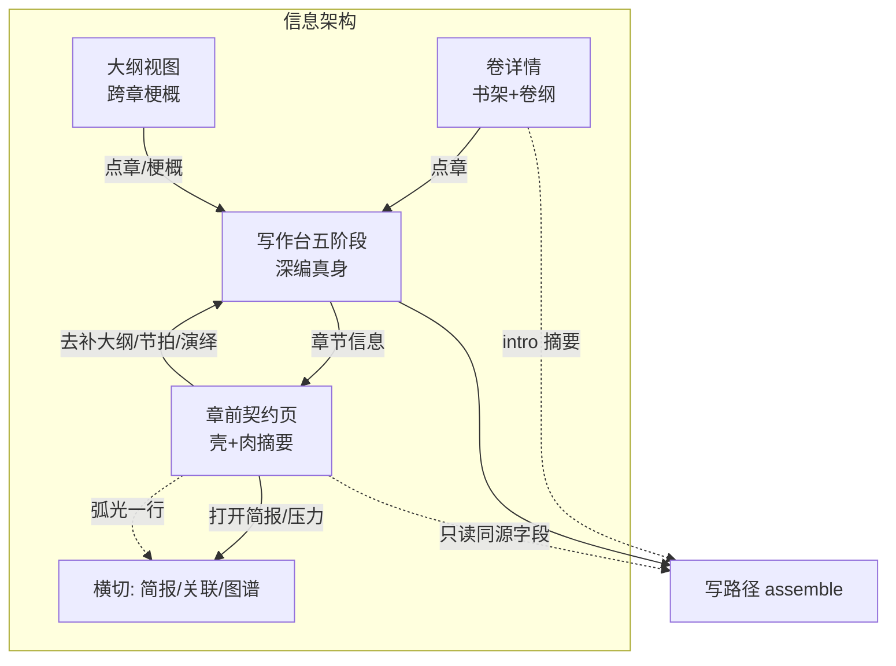

# 卷信息 / 章节信息 · 信息架构改造（壳与肉合一）

| 项 | 值 |
|----|-----|
| 产品 | 铜炉 / tonglu · scribe3 |
| 仓库 | `scribe-writing-system` |
| 日期 | 2026-08-10 |
| 修订 | **r2 · 吸收 design review（关闭 Issue 1–13）** |
| 状态 | **已实现（demo 冒烟中）** |
| 作者 | Grok Build · 架构设计 |
| 关联铁律 | `设计文档/2026-07-22-对话驱动写入-禁表单直填-决策与改造方案.md` |
| 验收环境 | demo 已部署栈（`www.qing.blue` / `./scripts/deploy_demo.sh`）；禁止 Grok 运行机 `npm ci` / 本机 Surreal |

---

## Overview

把作者「章前契约」从散落的大纲阶段 / 卡片墙 / 过瘦章节信息页 / 写路径旁路，收敛成**可发现、可维护、与写作注入同源**的一页章详情；卷详情保持书架与卷纲备忘定位，并可选把当前卷 intro 摘要安全注入本章写上下文。

**第一性目标**：写好小说的**章前契约可发现、可维护**——作者打开「章节信息」就能看见「写这章前该齐什么」，并能一键让主编补齐；不是再造第二个设定库，也不把章详情变成全量编辑器。

**r2 相对 r1 的硬纠正**（见文末 Revision 与 review）：

1. draft/final **不得**原样粘贴 `_outline_block` 全量（含「生成大纲/节拍」协议尾段）——拆 **content / plan** 两 mode。  
2. PR-2 单测必须 **>220 字 synopsis + `source_kind=outline` + 内容标记**，废止 focus 假绿。  
3. final 路径必须加载契约字段，否则 soft 永不触发。  
4. soft 覆盖与 GATE-B 对齐的 B1/B2/B3 发现层；文案诚实区分 soft vs save 硬拦。  
5. focus 与 outline domain **去重 + source_id 改名** 为 PR-2 硬范围，非「评估」。

---

## Background & Motivation

### 代码核实后的现状（相对会话诊断的修正）

| 表面 | 代码真源 | 核实结论 |
|------|----------|----------|
| **卷信息** | `scribe3/web/src/layout/VolumeDetailPane.jsx` | 只读：`title` / `intro` / `color` / `sort_order` + 本卷章列表字数与 label 分布；写入走 `seedChiefNarrativeWrite`。局部 `form` state 仅作 **UI 缓冲**（未分卷「创建正式分卷」填草稿），**提交仍是主编种子**，非 REST 直写。**卷纲 intro 仅存库，写路径零注入。** |
| **卷 store** | `store/chapters.py`：`add_volume` / `list_volumes` / `update_volume` | 字段白名单 `title, sort_order, intro, color`；`structure.outline()` 返回 volumes+chapters（含 synopsis 摘要，**不含** scene_truth/beats 全文）。 |
| **章节信息** | `ChapterMetaPane.jsx` + `ChapterStudio` 头部「章节信息」 | **仅** `title` / `label` / `volume` 只读 + 主编种子。**过瘦**。父组件传入的 `onSaved` **组件未声明/未使用**（死 prop，PR-1 清理）。 |
| **大纲视图** | `ContainerOutline.jsx` → Corkboard / Outliner | 多章泳道：synopsis 卡片/表格式只读种子；label 乐观+主编；重排/建章走主编。 |
| **章工作台「肉」** | `ChapterStudio.jsx` 五阶段 | `outline`→synopsis · `beats`→beats · `deduce`→scene_truth/deductions · `draft` · `final`(WriteLayout)。辅助：`brief` / `frame` / `northstar` / `pressure`。 |
| **meta 加载（soft 关键）** | `ChapterStudio.jsx` L615–626 | `META_PHASES = outline\|beats\|deduce\|draft`；**`phase === 'final'` 时直接 return，不调 `api.chapter`**。默认/记忆 phase 常为 `final`；`sceneIdx` 强制 final。→ **仅依赖 meta 的 final soft 会落空**。 |
| **写路径大纲注入** | | `_outline_block`（`write_assemble.py` L574+，`_OUTLINE_BUDGET=1200` **分项** clip synopsis 与 beats）**已实现且有单测**，生产 `_assemble_write_instructions_v1` **未调用**。synopsis/beats 走 `context_assembler._focus_detail` 各 **[:220]**，且 focus 明细 `source_id=f"chapter:{n}:outline"`、`source_kind="focus"`。 |
| **假绿单测** | `tests/test_app.py::test_outline_block_wired_into_chat_write` | 仅断言短 synopsis/beats **子串**在 instructions——**focus 路径即可绿**，不能证明 outline domain 挂接。 |
| **`_outline_block` 内容结构** | 同文件 L602–635 | 内容：〔大纲〕/〔节拍〕+ 限知免责 +（有 beats 时）「按预算分配笔墨」。**尾段恒附**：情节点字数预算契约 / 章节定位标注 / 反转标注规范——语义是 **生成/调整大纲或节拍**，不宜进 draft/final 正文生成。 |
| **工艺门闩** | `verify_craft_compliance.gate_b` + `evaluate_save_craft_gate` | **仅**存实质正文时硬拦：B1 空 synopsis、B2 节拍不足、B3 空 scene_truth；短 prose 放行。**chat-write / 流式生成路径当前不调用 craft gate**（已核实 `routers/write`）。 |
| **前端 soft** | `lib/deduceGate.js` + `setPhaseP` | 仅演绎缺/过期，且 **仅切 draft** 时 toast。 |
| **写入政策** | 2026-07-22 铁律 + 现网 UI | 结构/叙事字段禁止常驻表单墙 REST；只读 + `seedChiefNarrativeWrite` / 提案审批。 |

### 用户痛点（动机）

1. 「章节信息」看起来像壳：点开只有标题/标签/卷。  
2. synopsis / beats / scene_truth / brief / purpose 分散，**发现路径长**。  
3. 无脚手架时可轻松进正文并流式生成；**save 实质正文**才 GATE-B 硬拦——反馈过晚。**诚实边界**：chat-write 今日本就不跑 craft；本改造用 **UI soft** 提前发现，**不**把生成流默认改成 409。  
4. 卷纲 intro 写了也不进写上下文。

---

## Goals & Non-Goals

### Goals

1. **G1 · 章详情合成一页（壳+肉摘要）**  
   `ChapterMetaPane` 升级为「章前契约」合成页：元数据 + synopsis/beats/scene_truth 摘要 + 齐套指示 + 可选简报/弧光一行入口 + 跳转五阶段深编。

2. **G2 · 写前 soft 提示（默认不硬拦生成流）**  
   契约缺口（**B1 空 synopsis、B2 节拍不足、B3 空 scene_truth**，阈值对齐 GATE-B normal 章）时：  
   - 切到 `final` / 冷启动已在 `final` / WriteLayout 顶栏 **默认 soft banner**；  
   - phase 切换另 toast。  
   **不改变** `evaluate_save_craft_gate`；**不**默认给 chat-write 加 craft 409。文案必须写清：「不建议开写 / 存实质正文仍会被工艺门拦」。

3. **G3 · 可选：当前卷 intro 摘要注入本章写上下文**  
   fail-soft、预算可控、可观测；默认开；空 intro / 无卷 → 空串。

4. **G4 · 恢复大纲/节拍契约注入（content / plan 分 mode）**  
   生产 v1 写栈注入 **大纲/节拍契约正文**（复用 clip 与标记），**剥离**「生成大纲/节拍」协议尾段于 draft/final；plan/outline/beats 阶段可保留完整协议。修正 focus 假绿与 220 字过短。

5. **G5 · 信息架构分工表落地**  
   卷详情 / 章详情 / 大纲视图 / 写作台 / 横切视图 职责清晰。

### Non-Goals

- **NG1** 不做卷级「小设定库」或把 codex/facts 搬进卷页。  
- **NG2** 不恢复表单直写 synopsis/beats/scene_truth/meta。  
- **NG3** 不把章详情变成第二套五阶段编辑器。  
- **NG4** 不默认硬拦 chat-write / 禁止打开正文（除非后续产品书面要求 + flag）。  
- **NG5** 不改图谱/弧光数据模型；仅交叉引用。  
- **NG6** 不在 Grok 运行机跑 `npm ci` / 全量 Playwright / 本机 Surreal。  
- **NG7** 不把 soft 包装成「提示过就能存长正文」——须与 GATE-B 文案区分。

---

## Proposed Design

### 1. 信息架构分工表

| 表面 | 入口 | 主责 | 不负责 | 写路径关系 |
|------|------|------|--------|------------|
| **卷详情** `VolumeDetailPane` | 目录点卷 | 卷身份、卷纲 intro、本卷章书架、状态分布、让主编建章/改卷 | 单章 synopsis 深编、scene_truth、设定库 | intro **可选摘要注入**；章列表点进章 |
| **章详情（改造后）** | 章工作台「章节信息」 | 元数据 + **契约字段摘要与齐套态** + 主编种子 + 跳阶段/辅助 | 正文编辑、全量简报、图谱编辑 | 展示字段 = 写路径同源 |
| **大纲视图** | 手稿根 / 全书大纲 | **跨章**梗概总览、重排、label、导航 | 单章演绎/简报深读 | synopsis 与章契约同源 |
| **写作台五阶段** | 点章 | **深编与生成** | 跨章总览 | 阶段内容即契约真身 |
| **辅助栏** | AUX_ENTRIES | 读着写横切资料 | 改 title/volume | brief 已注入 must 段 |
| **图谱 / 弧光** | AppRail / 抽屉 | 实体关系、弧光采样 | 章元数据表单 | 契约页一行外链 |



### 2. 章前契约页（UI）

#### 2.1 定位与布局

- 仍挂 `ChapterStudio` 的 `chapterMetaOpen` 覆盖栏 3（与 auxView 互斥），不破坏四栏。  
- v1 **单栏滚动分区**（可不内嵌 Tab）：概览齐套 + 元数据 + 契约摘要 + 相关入口。

#### 2.2 概览区块规格

```
┌─ 章节信息（章前契约）──────────────────── [返回写作]
│  第 N 章 · {title} · {label} · 卷 {vol}
│  [让主编写元数据]
│
│  ■ 写前齐套（对齐 GATE-B normal）
│    ✓/✗ 大纲 synopsis（非空；短于 40 字黄点 warn）
│    ✓/✗ 节拍 beats（v1 固定 ≥3 条非空 text；chapter_kind 桥接差异 → v2）
│    ✓/✗ 场景真相 scene_truth（非空；短于 40 字黄点）
│    · 演绎：{done}/{involved} · stale {n}   ← softGateIssues
│    [去补大纲] [去补节拍] [去演绎] [去正文]
│    脚注：以上为建议；存实质正文时工艺门仍可能硬拦缺项。
│
│  ■ 本章大纲（只读摘要）
│  ■ 节拍（N 条，前 5 + 跳转）
│  ■ 场景真相（摘要）
│  ■ 相关：章前简报 · 压力 · 图谱弧光（一行）
└────────────────────────────────────────
```

#### 2.3 数据加载

- `api.chapter(seq, work)` + `api.listVolumes()` 即可（`get_chapter` 已含 synopsis/beats/scene_truth/deductions/purpose_text/deltas/…）。  
- 可选 `api.chapterBrief` 角标，失败 fail-soft 隐藏。

#### 2.4 写入与种子（对齐现网 scope）

| 字段 | 行为（PR-1 强制与现网同源） |
|------|---------------------------|
| title/label/volume | `seedChiefNarrativeWrite('chapter-meta', …)` — 与现 `ChapterMetaPane` 一致 |
| synopsis | 与 `OutlineTab` / `ChapterCard` 同一 scope **`'outline'`** 与同类文案模板；**优先抽 shared helper**（如 `seedChapterOutline(seq, synopsis)`）防漂移 |
| beats | 与 `BeatsTab` 同一 scope **`'beats'`** 与列表序列化模板；抽 `seedChapterBeats(seq, beats)` |
| scene_truth | 优先 `onNavigatePhase('deduce')`；次选主编种子「请写场景真相」 |
| 禁止 | 本页出现 `api.patchChapter` 叙事直写 |

#### 2.5 与阶段页关系 / props

```ts
// ChapterMetaPane props（PR-1 定稿）
{
  seq, work,
  onClose: () => void,
  onNavigatePhase?: (phase: 'outline'|'beats'|'deduce'|'draft'|'final') => void,
  onOpenAux?: (key: 'brief'|'frame'|'northstar'|'pressure') => void,
  // 删除无效 onSaved，或真正在元数据审批回流后调用 onContractRefresh
}
```

- 「去补大纲」→ `onNavigatePhase('outline')` 后 `onClose`（父级 `setPhaseP`，并 `setChapterMetaOpen(false)` / 清 aux——**只走 `setPhaseP` 一条路径**，避免双关）。  
- 打开简报 → `onOpenAux('brief')` + 关契约页。

### 3. 写前 soft 提示（G2）— 含 meta 加载策略

#### 3.1 规则（`lib/chapterContractGate.js` pure）

对齐 `CraftGateThresholds` / `gate_b` **normal 章**（v1 不解析 chapter_kind）：

| id | 条件 | soft 级别 |
|----|------|-----------|
| missingSynopsis | `!trim(synopsis)` | **error 级提示**（不建议开写） |
| shortSynopsis | `0 < len < 40` | warn |
| missingBeats | 非空 beat text 条数 **&lt; 3** | **error 级提示** |
| missingSceneTruth | `!trim(scene_truth)` | **error 级提示** |
| shortSceneTruth | `0 < len < 40` | warn |
| deduce* | 复用 `softGateIssues` | 既有 |

`contractNeedsAttention` = 任一 error 级。  
`contractSoftSummary(issues)` → 中文一句（可列多项）。

**与 GATE-B 对齐的诚实表述（KD4）**：

| 时机 | 行为 |
|------|------|
| UI 发现层（本 G2） | soft banner / toast：**不建议**开写；**不**阻断进入正文、**不**阻断 chat-write |
| 存实质正文 | `evaluate_save_craft_gate` → GATE-B B1/B2/B3 **硬拦**（短 prose 仍放行） |
| 流式生成 chat-write | **当前与本改造默认：不跑 craft gate**；禁止实现者误加默认 409 |

#### 3.2 meta 加载策略（Issue 3 · **硬决策**）

**决策**：章契约字段缓存与 phase 解耦——**任意 phase（含 final）在 `seq` 变化或 `refresh` 时拉取**至少：

`title, synopsis, beats, scene_truth, scene_truth_revision, involved_characters, deductions, focalizer, label, volume`（volume/label 供契约页；final 也需要 synopsis/beats/truth）。

实现要点（PR-4 或 PR-4 前置可并入 PR-1 若契约页也要父级 meta——推荐 **PR-4 必含**，PR-1 契约页可自拉 `api.chapter` 以免阻塞）：

```text
// ChapterStudio 目标行为（示意）
useEffect(() => {
  // 不再: if (phase === 'final') return
  // 改为: 始终为当前 seq 拉契约字段（final 不 setLoading 挡 WriteLayout）
  api.chapter(seq).then(mergeIntoMeta)
}, [seq, refresh])  // phase 变化不必重拉，除非 refresh

// 阶段编辑器（outline/beats/...）仍可在 META_PHASES 下用 loading 占位；
// final 路径：meta 后台填充，WriteLayout 独立拉 prose。
```

- **不得**让 soft 判定依赖「仅非 final 才有的 meta」。  
- 冷启动 `phase=final`、draft→final、`sceneIdx` 强制 final：meta 到位后 banner 出现（允许首帧空 → 拉完再显，避免假绿「无问题」）。

#### 3.3 触发点（Issue 7 · banner 升默认）

| 触发 | 行为 | PR-4 范围 |
|------|------|-----------|
| `setPhaseP('final')` 且 contractNeedsAttention | toast warn + action「去补」 | **必做** |
| **WriteLayout 顶栏 / 章工作台 final 壳** soft banner | 常驻至关闭当次会话；文案含 soft vs save 硬拦区分 | **必做（默认）**，非可选 |
| 冷启动已在 final | meta 加载完成后若缺口 → 同 banner（不依赖「切换」事件） | **必做** |
| 契约页齐套条 | 红/黄点 | PR-1 |
| sessionStorage | `s3.soft.contract:{work}:{seq}` 关闭 banner 当次会话 | 必做 |

#### 3.4 不做什么

- 不默认 chat-write 409。  
- 可选 flag `SCRIBE3_WRITE_REQUIRE_SYNOPSIS=1` 等列入 Open Questions，**默认关**。

### 4. 写路径：content/plan 拆分、预算、focus 去重

#### 4.1 拆分 `_outline_block`（Issue 2 · **硬决策**）

**禁止**在 draft/final 原样调用当前整函数（会注入「生成/调整节拍时…」「生成/调整大纲或节拍时…」「reversal_type…」等 **plan 协议尾段**）。

推荐 API（实现二选一，语义等价）：

```python
def _outline_block(st, chapter, focalizer="", *, mode: str = "write") -> str:
    """
    mode="write"  (draft/final 及生产写栈默认):
      标题 + 〔大纲〕/〔节拍〕clip + 可选「按预算分配笔墨」(仅当有 beats)
      + 限知免责。**不含** 生成协议三尾段。
    mode="plan"   (outline/beats 讨论或 phase∈{outline,beats} 组装):
      write 内容 + 情节点字数预算契约 + 章节定位标注 + 反转标注规范。
    """
```

或显式 `_outline_content_block` + `_outline_plan_protocol_tail`，由 caller 拼接。

| 调用方 | mode |
|--------|------|
| `_assemble_write_instructions_v1` draft/final | **`write`** |
| 大纲/节拍主编讨论链、phase outline/beats 组装（若有） | **`plan`** |
| 既有单测 `test_outline_block_*` / reversal 协议测 | 测 **plan** 含协议；另增 **write** 测 **不含**「生成/调整节拍时」「reversal_type」等 |

**KD5 修订措辞**：必须恢复大纲/节拍**契约正文**注入并复用 clip/标记逻辑；**不是**零改动整函数粘贴进 draft/final。

#### 4.2 挂接与 fail-soft（Issue 6 · **硬决策**）

在 `_render_final_input` 中（建议 **purpose 之后、brief_must 之前**）：

```python
def _outline_write_domain(st, chapter, focalizer):
    try:
        return _outline_block(st, chapter, focalizer=focalizer or "", mode="write")
    except Exception as e:
        logging.getLogger("scribe3").warning(
            "写路径 outline 注入失败(fail-soft): %s", e)
        return ""

rendered += _domain_input(
    f"chapter:{chapter}:outline", "outline",
    _outline_write_domain(st, chapter, focalizer),
)
```

- **组装路径外层 fail-soft**（与 `_pressure_drive_write_block` / volume_intro 对称），避免 get_chapter 瞬时失败打崩整次 chat/write。  
- 单元测可直接调 `_outline_block` 保留内部 raise 语义（U-011）若需要；**生产 domain 挂接层必须 catch**。  
- 空 synopsis 且无 beats → 仍返回 `""`。

#### 4.3 focus 去重与 source_id（Issue 5 · **硬决策，关闭 Q2**）

| 项 | 决策 |
|----|------|
| 长契约正文 | **仅** outline domain（`source_kind="outline"`，`source_id=f"chapter:{n}:outline"`） |
| focus 章明细 | **改为指针一行**，例如：`- 本章大纲/节拍:见 outline 域（勿重复展开）`；**不再** `syn[:220]` / beats `[:220]` 全文 |
| focus source_id | 从 `chapter:{n}:outline` **改为** `chapter:{n}:focus`（`source_kind` 保持 `"focus"`） |
| 验收 | 同一 instructions 内 synopsis **正文不出现两遍**（允许一行指针）；长文（>220）必须出现在带 `source_kind=outline` 的登记源或含 `〔大纲〕` 的 domain 段 |

PR-2 **范围包含** 改 `context_assembler._focus_detail`（章分支）+ 相关单测，**不是**「评估可选」。

#### 4.4 卷 intro 摘要注入（G3）

```text
_volume_intro_block(st, chapter) -> str
  1. ch.volume 无 → ""
  2. list_volumes 匹配 intro；空 → ""
  3. clip 至 _VOLUME_INTRO_BUDGET = 400
  4. 文案:
     ## 本卷卷纲摘要(作者备忘·氛围与卷级冲突;不得覆盖本章大纲/场景真相)
     + clipped
  5. 限知章(focalizer 非空): 追加与 outline write 同级免责一句
  6. fail-soft: 异常 → warning + ""
  7. flag: SCRIBE3_VOLUME_INTRO_INJECT 默认开；读取风格对齐 pdc_flag_enabled（env 真值表）
```

- **剧透 / 知情门**：volume intro **不经** memory `known_from` / epistemic SQL 门；属作者备忘，**作者自负**把未来卷剧透写进 intro 的风险。文档与 Security 节声明此点。  
- Manifest：`source_kind="volume_intro"`，`source_id=f"volume:{vid}:intro"`。  
- 插入：outline **write** 块之后。

#### 4.5 注入顺序（draft/final 领域段节选）

```text
… purpose
→ outline (mode=write, fail-soft domain)     # G4
→ volume_intro (fail-soft)                  # G3
→ brief_must
→ pressure_drive
→ author_prefs / voice / …
→ deduction (scene_truth + 投影)
→ material_recall
→ final_reminder
```

#### 4.6 写栈 domain 预算表（Issue 8）

| Domain | 上限（字符量级） | 空态 | draft/final | 备注 |
|--------|------------------|------|-------------|------|
| outline **write** | synopsis clip ≤1200 **+** beats clip ≤1200（**分项**，最坏 ~2400 正文）+ 短标题/免责/笔墨句 | 双空 → `""` | 是 | **非**「整块 1200」；PR-2 可评估合计 cap（见 Open Q）但不阻塞挂接 |
| outline **plan** 尾 | 协议三段固定数百字 | — | **否**（仅 plan） | 禁止进 write |
| volume_intro | 400 | 无卷/空 intro → `""` | 是 | flag 可关 |
| focus 章明细 | 一行指针 ≪ 50 | — | 是（envelope） | 去重后不再 220×2 |
| brief_must | 既有 | 无 ops → 仅 must_prefix 或空 | 是 | |
| pressure_drive | ≤400 | flag 关/无合同 → `""` | 是 | |
| deduction | 真相+投影 | 空 → 不注入段 | 是 | |
| codex / envelope | 既有策略 | — | 是 | 本改造不扩 |

测量：demo 一章写后看 `envelope_trace` / usage_digest（若 Inspector 可用）；PR-2 以 pytest 为主。

#### 4.7 空态文案

| 状态 | UI | Prompt |
|------|-----|--------|
| 无 synopsis | 齐套红 + soft「不建议开写」 | outline write 空（若亦无 beats） |
| 有 synopsis 无足够 beats | 齐套红 beats | outline 可仅〔大纲〕 |
| 无 scene_truth | 齐套红 | deduction 空/协议 |
| 无卷 / 空 intro | 不展示卷纲行 | volume_intro `""` |

### 5. 卷详情微调

1. 卷纲副文案：可作写作背景摘要注入（有则注入，空则跳过）；作者备忘、不经限知 SQL 门。  
2. 章列表可选角标：无 synopsis →「缺大纲」（`outline()` 已有字段）。  
3. 澄清：`form` 仅为 UI 缓冲，写入仍主编。

### 6. 与弧光 / 图谱

契约页不内嵌图谱；一行跳 `brief` 或 atlas view。不改弧光算法。

### 7. 组件与文件触点

| 层 | 文件 | 变更 |
|----|------|------|
| UI | `ChapterMetaPane.jsx` | 合成页；清 `onSaved` 或接 refresh；props 定稿 |
| UI | `ChapterMetaPane.test.jsx` | 摘要/空态/不调 patchChapter |
| UI | `lib/chapterContractGate.js` | pure B1/B2/B3 soft |
| UI | `lib/chiefSeed.js` 或邻文件 | 可选 `seedChapterOutline` / `seedChapterBeats` |
| UI | `ChapterStudio.jsx` | **final 也缓存契约 meta**；soft toast；final banner；导航 props |
| UI | `WriteLayout.jsx`（或 final 壳） | **默认** soft banner 数据源 |
| UI | `VolumeDetailPane.jsx` | 文案 + 可选缺大纲角标 |
| 写栈 | `write_assemble.py` | `_outline_block(mode=…)`；domain fail-soft；volume_intro |
| 上下文 | `context_assembler.py` | focus 指针 + `source_id` `…:focus` |
| 测 | `tests/test_app.py` 等 | **改写** `test_outline_block_wired_into_chat_write`；新增长 synopsis + kind；write/plan 分测 |
| 文档 | PR-5 | 修正 `_outline_block` docstring「此前从不注入」 |

---

## API / Interface Changes

| 接口 | 变更 |
|------|------|
| `GET /chapters/{seq}` | 无强制变更 |
| `GET /volumes` / `GET /outline` | 无 |
| chat write 组装 | 内部增加 outline(write) + volume_intro；**响应契约不变** |
| 前端 props | 见 §2.5；删除死 `onSaved` 或接真刷新 |

无 migration；无新 Surreal 字段。

---

## Data Model Changes

**无 schema 变更。**

---

## Alternatives Considered

### A1 · 仅加强五阶段空态  
否决：不解决章节信息壳肉分裂。

### A2 · 表单墙直写  
否决：违反铁律。

### A3 · chat-write HTTP 409 无 synopsis  
默认否；可 flag。生成流今日不跑 craft。

### A4 · 删章节信息、只留大纲视图  
否决：写作中需要单章契约。

### A5 · 只加长 focus 到 1200、不引入 outline domain  
否决：source 语义混乱；与 Manifest `outline` kind 目标不符；plan 协议仍无处安放。

### A6 · draft/final 原样整段 `_outline_block`  
**否决（r2）**：plan 协议污染正文生成（Issue 2）。

---

## Security & Privacy

- 卷 intro / synopsis 随 work 隔离。  
- intro **不经** epistemic SQL / known_from；作者自负剧透。  
- 限知章：outline write 与 volume_intro 均附作者备忘免责。  
- 不扩大 emergency REST 写面。

---

## Observability

| 信号 | 方式 |
|------|------|
| outline write 是否进入 | Manifest / supplemental `source_kind=outline`，`source_id=chapter:{n}:outline` |
| focus 不再带长大纲 | `source_id=chapter:{n}:focus`；无双份 synopsis 正文 |
| volume_intro | `source_kind=volume_intro` |
| fail-soft | `scribe3` warning 日志 |
| soft 展示 | banner 可见；无强制后端埋点 |

---

## Rollout Plan

1. **PR-1** 契约页 UI + pure gate 展示 + 种子 helper；契约页可自拉 chapter。  
2. **PR-2** outline **write** mode 挂接 + focus 去重/source_id + **收紧假绿测**（pytest 主验收）。  
3. **PR-3** volume_intro（基线冻结在 PR-2 合并后的 instructions 形状上做「空 intro 等价」）。  
4. **PR-4** meta 全 phase 缓存 + final/冷启动 soft banner + toast。  
5. **PR-5** docstring/注释清理。

回滚：各 PR 独立可 revert。

---

## Open Questions

1. 是否提供 `SCRIBE3_WRITE_REQUIRE_SYNOPSIS`（或全契约）对 chat-write 硬拦？**默认否**。  
2. ~~focus 与 outline 双份？~~ **已关闭** → §4.3。  
3. 契约页是否默认打开？**建议否**，保持 phase 记忆。  
4. outline write 是否改为 synopsis+beats **合计** cap 1200（抑或维持分项 1200×2）？实现前可用 demo usage 决策；默认 **维持分项** 与现 `_outline_block` 一致。  
5. chapter_kind（bridge/epilogue min_beats=1）UI？**v2**。  
6. outline 组装 fail-soft 是否改为「硬依赖 5xx」？**默认 fail-soft**（§4.2）；若产品要硬依赖再开 issue。

---

## References

- `scribe3/web/src/layout/VolumeDetailPane.jsx`
- `scribe3/web/src/ChapterMetaPane.jsx` / `ChapterStudio.jsx`（final 不拉 meta：L615+）
- `scribe3/web/src/ContainerOutline.jsx` / `Outliner.jsx` / `ChapterCard.jsx`
- `scribe3/api/services/write_assemble.py`（`_outline_block`、v1 组装）
- `scribe3/context_assembler.py`（`_focus_detail`，`source_id=…:outline`）
- `scribe3/brief.py` / `verify_craft_compliance.py`（`gate_b`，`evaluate_save_craft_gate`）
- `scribe3/web/src/lib/deduceGate.js`
- `scribe3/tests/test_app.py`（`test_outline_block_wired_into_chat_write`）
- `设计文档/2026-07-22-对话驱动写入-禁表单直填-决策与改造方案.md`
- `docs/craft-first-verification-scheme-v3.md`

---

## Key Decisions

| ID | 决策 | 理由 |
|----|------|------|
| **KD1** | 第一性=章前契约可发现可维护，非第二设定库 | 约束范围 |
| **KD2** | 章详情=只读合成 + 主编种子 + 跳转；不表单直写 | 铁律 |
| **KD3** | 契约字段真源=chapter 表与五阶段；契约页是投影 | 单一真相 |
| **KD4** | UI soft 优先；**生成流（chat-write）默认不 craft 硬拦**；**存实质正文**仍 `evaluate_save_craft_gate`（GATE-B）；soft 文案不得暗示「提示过即可存长正文」 | 对齐现网 + 用户期望 |
| **KD5** | **恢复大纲/节拍契约正文注入**，复用 clip/标记；draft/final 用 **mode=write**（或 content 块），**禁止**把 plan 协议尾段灌进正文生成；**不是**整函数零改粘贴 | Issue 2 |
| **KD6** | 卷 intro ~400 字 fail-soft；作者备忘、不经 epistemic SQL；限知免责默认开 | ROI + 安全诚实 |
| **KD7** | 大纲视图跨章；卷详情书架+卷纲；三者不合并 | 分工 |
| **KD8** | 弧光/图谱仅交叉引用 | 不重复实现 |
| **KD9** | 验收=过滤 pytest（demo/CI）+ 已部署 demo 冒烟；禁 Grok 机重活 | 资源规则 |
| **KD10** | 无 migration；无新 REST 写字段 | 低风险 |
| **KD11** | PR-2 单测：**synopsis 长度 >220** 且全文（或超 220 后缀）进 instructions；登记 **`source_kind="outline"`**；write 模式含 **`〔大纲〕`**；**不含** plan 独有串（如「生成/调整节拍时」）；**改写/拆分** `test_outline_block_wired_into_chat_write` 防 focus 假绿 | Issue 1 |
| **KD12** | focus 章明细改为指针；`source_id=chapter:{n}:focus`；长文只走 outline domain | Issue 5 |
| **KD13** | 写栈 outline domain **fail-soft**（log + 空串） | Issue 6 |
| **KD14** | soft 覆盖 B1+B2+B3（normal 阈值）；banner 为 PR-4 **默认**范围；final **必须**加载契约 meta | Issue 3/4/7 |

---

## PR Plan

> 顺序可独立合并；后 PR 依赖前 PR 行为。写栈连续改动：PR-3 的「空 intro 字节等价」基线 = **PR-2 合并后** 的 instructions 形状。

### PR-1 · 章前契约页 UI

- **范围**：`ChapterMetaPane` 合成布局；`chapterContractGate` pure（展示用）；种子 scope 对齐 OutlineTab/BeatsTab（shared helper 优先）；props：`onNavigatePhase` / `onOpenAux`；**删除死 prop `onSaved`** 或接真 refresh；契约页可自 `api.chapter`。  
- **不做**：写栈注入、volume_intro、final meta 策略可延 PR-4（契约页自拉即可自洽）。  
- **验收**：见摘要齐套；空 synopsis CTA；不调 `patchChapter`；跳转只走父级 `setPhaseP` 一条路径。  
- **demo 冒烟**：章节信息分区可见。

### PR-2 · outline write 挂接 + focus 去重 + 假绿收紧（pytest 主验收）

- **范围**：  
  1. `_outline_block(..., mode="write"|"plan")`（或 content/plan 拆分）；  
  2. v1 `_render_final_input` 挂 **write** + domain **fail-soft**；  
  3. `_focus_detail` 章分支改指针 + `source_id` → `chapter:{n}:focus`；  
  4. **改写** `test_outline_block_wired_into_chat_write`（或拆为 `…_via_focus_removed` / `…_outline_domain`）：  
     - synopsis **>220 字符**（构造明确长于 focus 旧裁剪）；  
     - 断言 instructions 含全文或 **第 221 字之后**子串；  
     - 断言存在 **`source_kind="outline"`**（manifest / supplemental_sources / envelope_trace 任一稳定观测面）；  
     - 断言含 **`〔大纲〕`**；  
     - draft/final 组装 **断言不含** plan 标记：`生成/调整节拍时`、`reversal_type`（或等价）；  
     - plan 单测仍锁协议段存在。  
- **demo 冒烟**：以 pytest 为准；若现网 ContextInspector 可用可抽查 manifest。  
- **不做**：volume_intro（PR-3）。

### PR-3 · 卷 intro 注入 + 卷页文案

- **范围**：`_volume_intro_block` + flag + 限知免责；VolumeDetailPane 文案/角标。  
- **验收**：有 intro 注入；无卷/空 intro 相对 **PR-2 基线** 无新增块；clip/fail-soft 测。  
- **demo 冒烟**：卷页文案。

### PR-4 · meta 全 phase 缓存 + 写前 soft（toast + **默认 banner**）

- **范围**：`ChapterStudio` **final 也拉/保留契约 meta**（§3.2）；`setPhaseP('final')` toast；**WriteLayout/final 壳默认 soft banner**（session 可关）；冷启动 final；单测 pure + 关键路径说明（冷启动 final / draft→final / sceneIdx）。  
- **验收**：无 synopsis **或** beats&lt;3 **或** 空 scene_truth → banner；有齐套无 error banner；save 空脚手架仍 GATE-B（回归）。  
- **文案**：区分「不建议开写」vs「存实质正文将被工艺门拦截」。  
- **demo 冒烟**：空大纲章进正文见 banner。

### PR-5 · 文档与注释

- 修正 `_outline_block` docstring（删除「此前从不注入」；注明 write/plan 与 focus 历史）。  
- `docs/SESSION.md` 一行。无功能变更。

---

## 实现前门禁清单（r2 已关闭）

| # | 决策 | 落点 |
|---|------|------|
| 1 | 长 synopsis + source_kind=outline + 标记，废 focus 假绿 | KD11 / PR-2 |
| 2 | draft/final 仅 write content，剥离 plan 尾 | KD5 / §4.1 |
| 3 | final 加载契约 meta | KD14 / §3.2 |
| 4 | soft 覆盖 B1+B2+B3（normal） | KD14 / §3.1 |
| 5 | focus 指针 + source_id `:focus` | KD12 / §4.3 |
| 6 | outline domain fail-soft | KD13 / §4.2 |
