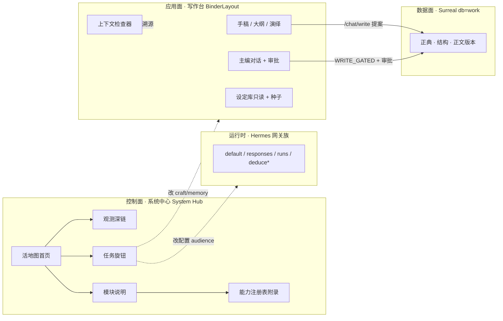
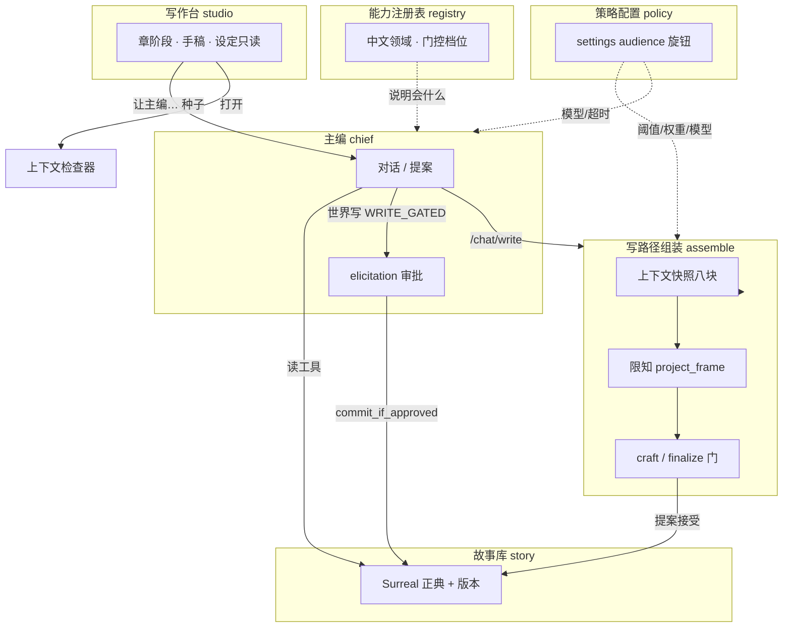
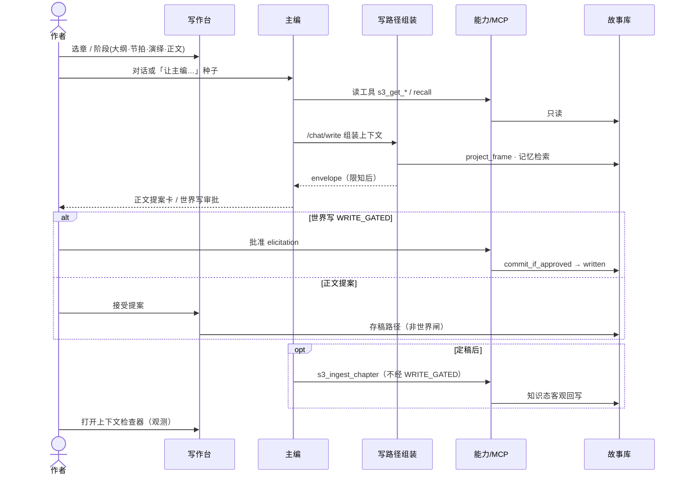
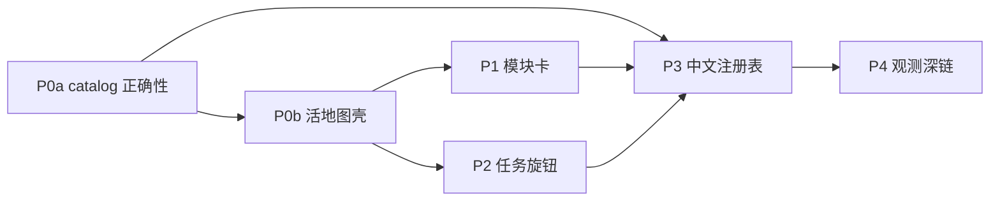

# 控制面活地图：模块说明、能力注册与任务旋钮

| 项 | 值 |
|----|-----|
| 产品 | 铜炉 / tonglu · scribe3 writing system |
| 仓库 | `scribe-ia-verify-wt`（优先）/ `scribe-writing-system` |
| 日期 | 2026-08-10 |
| 修订 | **r2 · 吸收 review Issue 1–12** |
| 状态 | **Ready for implementation**（review 修订后） |
| 作者 | Grok Build · 系统架构 |
| 定位 | **叠加在** `设计文档/2026-08-10-系统中心-管理设置与Hermes-Surreal统一改造.md`（r3 System Hub 壳 + audience RBAC + 三平面）**之上**，重做控制面 **首页心智模型 / IA / 模块解释与可控点**；**不**推翻 KD-Mount / KD-WorkCtx / KD-6/11 audience / 铁律 |
| 关联铁律 | `设计文档/2026-07-22-对话驱动写入-禁表单直填-决策与改造方案.md` · `scribe3/AGENTIC_BOUNDARY_DECISION.md` |
| 关联架构 | `docs/CURRENT_ARCHITECTURE.md` · `scribe3/orchestration/catalog.py` · `scribe3/mcp/_common.py` |
| 验收环境 | demo 已部署栈（`www.example.com` · `./scripts/deploy_demo.sh`）；**禁止** Grok 运行机 `npm ci` / 本机 Surreal 作验收 |
| UI 文案 | 用户可见中文；技术标识符（`s3_*` / settings key）可保留英文并默认折叠 |
| Canonical（本 loop） | `/tmp/grok-1000/grok-design-doc-c2bbc3a0.md` |
| 仓库副本 | `设计文档/2026-08-10-控制面活地图-模块说明与任务旋钮.md` |

---

## Overview

系统中心（System Hub）已以 App 级全页 + 三平面壳落地（`viewKey=system`，`scribe3/web/src/system/SystemHub.jsx` + `planes.js`），并把 settings/gateway 的 **audience RBAC** 钉在后端。但作者打开后看到的仍是 **设置分区清单 + 46 条裸 `s3_*` 工具表**：「能力地图（MCP）」把几乎所有工具显示为「读」，「写（待批 0）」——与 `WRITE_GATED` 约 48 个世界写工具的事实严重不符。用户无法建立 **模块如何运转、自己能控制什么** 的心智模型。

本方案把 System Hub 的 **默认首页** 从「分区列表」升级为 **控制面活地图（Living Map）**：用可点击的架构图 + 写章时序图展示业务流；用约 **6 个模块卡** 解释系统；用 **任务旋钮** 映射到既有 `SettingField` / audience；把 MCP 能力注册表改为 **中文领域分层附录**（默认隐藏原始 `s3_*`），并 **修复 catalog 对 `async def` 的漏扫与 docstring 提取**、**门控分档（含存稿/入库 allowlist）**；中文域数据 **内嵌于 `/mcp/catalog.domains`**（含 `read_tools`），不依赖残缺的 orch HTTP join。  
业界对标：AWS 式 control plane / application plane 分层、C4 容器视图、Backstage / Agent 注册表式目录——**不是** iframe Hermes/Surreal 主路径（r3 KD-4 已定）。

---

## Background & Motivation

### 代码核实后的现状（ground truth · 2026-08-10）

| 表面 | 真源 | 核实结论 |
|------|------|----------|
| System Hub 挂载 | `App.jsx` `viewKey=system`（别名 settings/admin）+ lazy `SystemHub` | **已落地** App 级全页；无书可开；work 选择器写回 App |
| 三平面 IA | `planes.js` `PLANES` | writing / runtime / ops(adminOnly)；写作平面含 book/prefs/skills/**mcp**/craft/health/evolution |
| MCP 能力区 UI | `SystemHub.jsx` §`mcp`：`tools.filter(t => t.write_gated)` | 二元「读 / 写待批」；文案「共 N 个 s3_*」 |
| `GET /mcp/catalog` | `settings_gateway.mcp_catalog` | 正则 **`^def (s3_…)`** 扫 `mcp/tools*.py`（**漏 `async def`**）；`write_gated = name in WRITE_GATED`；doc 提取在首 `(` 后 match，**多行签名下 `doc` 已全空** |
| 写工具定义形态 | `mcp/tools_write.py` | **绝大多数世界写是 `async def s3_*`**；仅 `s3_save_chapter` / `s3_ingest_chapter` 等为同步 `def` |
| 实测 catalog | 本仓扫描 | 命中 **46** 个 `def`（几乎全是 read/recall + 2 个非门控写）；**`WRITE_GATED` 48 个全部未入 catalog** → UI **写待批 = 0**（与用户报告一致） |
| `WRITE_GATED` | `mcp/_common.py` | **48** 工具；`commit_if_approved` 单一落库；测试 `test_mcp.py` 锁集合 |
| 非门控写 | `test_mcp.py` | `EXPECTED_WRITE_UNGATED`=`s3_save_chapter`（manuscript）；`EXPECTED_WRITE_UNGATED_WORLD`=`s3_ingest_chapter`（入库）；**均不待批** |
| 编排域目录 | `orchestration/catalog.py` `CATALOG` | **27** 中文 `label` 域；进程内含 `read_tools`/`write_tools`；写工具 ⊆ WRITE_GATED（有测，**但非全覆盖**） |
| orch HTTP | `director.orch_catalog_ep` → `GET /orchestration/catalog` | 返回 `entries[]` 仅 `domain/label/write_tools/required_outcome/channel`——**无 `read_tools`**；`work` 仅回显默认，**无 per-work 差异** |
| WRITE_GATED∉域 | 实测 | **3** 个门控写不在任何域 `write_tools`：`s3_add_event`、`s3_patch_codex`、`s3_author_pref_add` |
| MapHome 加载 | `SystemHub.jsx` section loaders | 仅 `hermes`/`health` 拉 gateway；`surreal` 才拉 dataHealth——**默认 section 若为 map 时今日无灯/健康数据** |
| 设置注册表 | `settings.py` `REGISTRY` | **79** 键；audience：author **26** / admin **53**；默认 audience=`admin`（KD-6） |
| 写路径组装 | `api/services/write_assemble.py` + `context_assembler` / `CreativeContextEngine` | 写作 envelope / 限知投影 / craft·finalize 门 |
| 上下文检查器 | `web/src/context/ContextInspector.jsx` | 写作台内三层透明；Hub 仅文字引导「去写作台打开」 |
| 铁律 | CURRENT_ARCHITECTURE §4 | 叙事写经主编 + 审批；禁止表单墙直写世界；REST 世界写默认关 |

### 用户痛点（会话弧）

1. **有壳无地图**：三平面分区能点，但看不出「系统由哪些模块构成、数据怎么流」。  
2. **工具清单 ≠ 理解**：46 条 `s3_*` 原始名无法回答「我能控制什么」。  
3. **显示错误加剧不信任**：全部像「读」、待批写为 0，与真实 48 世界写门控矛盾。  
4. **旋钮与任务脱节**：craft/memory/llm 键散在分区，作者要猜「改了会影响哪一步」。  
5. **想要图 + 可控点**：架构图与写章时序图既要 **展示** 也要 **可点进模块 / 任务旋钮**。

### 不解决会怎样

- Hub 沦为运维清单，作者仍不敢动设置、不理解主编写路径。  
- catalog 假绿（写待批 0）掩盖门控真值，排障与文档双失真。  
- 后续能力（自进化 / 观测）继续堆列表，信息架构债务叠加。

### 与 r3 System Hub 文档的边界

| r3 已拍板（本方案 **继承**） | 本方案 **新增** |
|------------------------------|-----------------|
| App 全页挂载、work 写回、三平面壳 | **活地图默认首页**（`map` 段） |
| audience 后端真源 + gateway 写门禁 | **模块模型 + 控制矩阵** |
| Hermes/Surreal 原生面板、非 iframe | **可点击架构 / 写章时序**（产品 UI 规格） |
| `GET /mcp/catalog` 独立于 `/capabilities` | **catalog 修复 + 中文域分层 + 门控档位** |
| craft 常用/进阶 + impact 文案 | **任务旋钮**（任务 → settings 键映射） |

---

## Goals & Non-Goals

### Goals

| # | 目标 | 可验收信号 |
|---|------|------------|
| G1 | **活地图为 Hub 默认首页** | 打开系统中心首屏为地图，非裸工具表；`data-testid=system-hub-map` |
| G2 | **约 6 模块可理解** | 模块卡中文：职责 / 运转方式 / 作者能控 / 不能控 / 深链 |
| G3 | **图即可控** | 架构图节点与时序步骤可点击 → 模块页/注册表筛选/任务旋钮/退出写作台（见 §3.5 P0 最小语义）；键盘可聚焦 |
| G4 | **能力注册表诚实** | catalog 含全部 `async def` 写工具 + **非空 doc**；世界写待批 **=48**；存稿/入库分档；默认中文域；**每个 WRITE_GATED ∈ 某域或显式未分组桶**；原始 `s3_*` 折叠；**无执行按钮** |
| G5 | **任务旋钮复用 SettingField** | 映射到既有 REGISTRY 键 + audience；不发明旁路写 API |
| G6 | **最小新 API** | 优先拼装已有 gateway/health/settings/craft-skills/mcp/orch；仅允许薄 catalog 元数据增强 |
| G7 | **铁律与 RBAC 不退化** | 无新叙事表单墙；author 仍不可写 admin 键；Hub 不绕过 `commit_if_approved` |
| G8 | **增量 PR** | P0 修 catalog + 地图壳 → … → 观测深链；demo 冒烟绿 |

### Non-Goals

- 替换 r3 的挂载模型、三平面 admin 门禁、Surreal A/B/C 契约。  
- 默认 iframe Hermes Dashboard / Surreal 官方 UI。  
- 在 Hub 内实现完整写章工作台（地图 **导航到** 写作台，不复制 FourPane）。  
- 重写 79 键业务语义或新增 Surreal migration。  
- 把 `/capabilities`（feature flags）改成工具清单（KD-13 仍有效）。  
- Grok 机全量 `npm ci` / Playwright / 本机 Surreal 验收。  
- v1 产品内 Hermes sessions/cron CRUD。  
- 自动从源码生成完整 C4 文档站（活地图是产品内嵌，不是 Sphinx）。

---

## Proposed Design

### 1. 心智模型：控制面 vs 应用面



**作者一句话**：写作台是 **做事** 的地方；系统中心是 **看懂系统 + 调旋钮 + 查能力** 的地方。正典仍只经主编/门控写入。

### 2. 模块模型（产品盒子 · ≈6）

模块是 **作者可理解的边界**，不是 Python 包 1:1。映射到代码与现有平面：

| ID | 中文名 | 一句话职责 | 主要代码 / API | 作者默认可控 | 明确不可控（铁律） |
|----|--------|------------|----------------|--------------|-------------------|
| `studio` | **写作台** | 章阶段 UI、手稿、只读设定面、种子入口 | `BinderLayout` / `ChapterStudio` / Codex UI | 导航布局偏好（若已有 prefs）；打开检查器 | 表单失焦直写世界语义 |
| `chief` | **主编** | 对话、工具调用、elicitation 审批、提案卡 | Hermes runs · MCP `s3_*` · `ChiefDock` · `/ai/runs*` | 模型名/超时（author llm.*）；讨论意图 | 绕过审批落正典；改 admin 网关密钥 |
| `assemble` | **写路径组装** | 上下文八块、限知投影、craft/finalize 门、记忆织网 | `context_assembler` · `write_assemble` · `CreativeContextEngine` · craft/memory settings | craft 常用阈值、memory 权重/半衰期（author 键） | 关死铁律 flag（admin）；改 secret 注入规则 |
| `registry` | **能力注册表** | 「系统会什么」的中文目录 + 门控档位 | `orchestration/catalog.py` + 修复后 `/mcp/catalog` | 只读浏览；深链到域说明 | 在 Hub 直接 invoke 写工具 |
| `story` | **故事库** | 一书一库正典与结构/正文版本 | Surreal `db=<slug>` · store mixins · `/data/health` | 选 work；看健康（只读） | Author SurrealQL；emergency REST 默认关 |
| `policy` | **策略配置** | 工程与运行策略：flags/gateway/connection/llm 日帽 | `settings.py` REGISTRY · SystemHub runtime/ops | 仅 audience=author 的键 | connection/flags/gateway 全 admin |
| `observe` | **观测**（附属条） | 用量、网关灯、检查器、lesson、审计 | `/ai/usage` · `/gateway/status` · ContextInspector · lessons · audit | 只读查看；admin 审计 | 伪造审批历史 |

**UI 默认 6 卡**（`observe` 做地图底栏状态条 + 深链，不占第七大卡，避免拥挤）：

```text
┌──────────┬──────────┬──────────┐
│  写作台   │   主编   │ 写路径组装 │
├──────────┼──────────┼──────────┤
│ 能力注册表 │  故事库  │ 策略配置  │
└──────────┴──────────┴──────────┘
        [ 观测条：网关 · 用量 · 数据健康 · 检查器 ]
```

### 3. 活地图首页（MapHome）— 默认着陆

#### 3.1 信息架构调整

在 **不拆** r3 三平面壳的前提下，为 writing 平面增加首段，并作为 **进入 Hub 的默认 section**：

```text
系统中心
├── 写作系统
│   ├── 总览地图          ← 新增 · 默认 section（id: map）  ★
│   ├── 本书与目标
│   ├── 个人偏好
│   ├── 技能与技法
│   ├── 能力注册表        ← 原「能力地图（MCP）」更名 + 重做
│   ├── 工艺与记忆        ← 仍保留；任务旋钮也会深链到此
│   ├── 写路径健康
│   └── 经验与自进化
├── 运行时 · 数据
│   └── （r3 既有）
└── 运维 · 危险
    └── （r3 既有 · admin）
```

- `planes.js`：writing.sections 首项 `{ id: 'map', label: '总览地图', needsWork: false }`。  
- `SystemHub`：**仅当** `initialSection` 未传入时默认 `map`（今日默认 `book` → `map`）。  
  - **保留**现网 `App.jsx` 行为：盾牌/admin 入口传入 `initialSection='accounts'`（或等价）时 **不得**被 map 覆盖。  
- 左轨保留；地图上的模块点击 → **同页** `overlayModule` 或切 section（见 §3.5）。  
- **v1 不做** `SCRIBE3_SYSTEM_MAP_V1` flag（见 Rollout）；回滚靠热更改默认 section。

#### 3.1.1 MapHome 数据加载（必做 · 扩展既有 loader）

今日 `SystemHub.jsx` 仅在 `hermes|health` 拉 `gatewayStatus`、在 `surreal` 拉 `dataHealth`。默认 `map` 后必须扩展：

```js
// section loaders — 伪代码（并入既有 useEffect）
if (section?.id === 'map' || section?.id === 'health' || section?.id === 'hermes') {
  api.gatewayStatus?.().then(setGw).catch(() => setGw(null))
}
if (section?.id === 'map' || section?.id === 'health') {
  api.aiUsage?.().then(setUsage).catch(() => setUsage(null))  // 可与 mount 级 usage 合并去重
}
if ((section?.id === 'map' || section?.id === 'surreal') && work) {
  api.dataHealth?.(work).then(setDataHealth).catch(...)
}
// 无 work：故事库健康位显示「选书后可见」，不请求
```

`settings` 已在 mount 拉取，任务旋钮/ModulePane 可复用，无需因 map 重拉。

#### 3.1.2 与 r3 视觉契约

- MapHome **落在现有中栏**（`flex-1 min-h-0 overflow-y-auto`），**不**另起全宽壳、不改左轨 48 宽。  
- 网关/健康灯复用 r3 / Gateway 既有圆点 class（如 `bg-ok` / `bg-line` 的 `h-2 w-2 rounded-full`），与 `SystemHub` health 段一致；**不**新色板。  
- 模块卡 / 任务卡使用既有 `border-line` / `bg-surface` / `text-f13` token；可选外包一层与 r3 一致的内容框（若仓内已有 `ObjectFrame` 则复用，**无则**用 `rounded-lg border border-line p-4` 等价，禁止第三套卡片体系）。  
- 架构/时序为 **语义化 SVG 或 button 热区 div**，**禁止** mermaid CDN 运行时、禁止静态 PNG 作为唯一交互面。

#### 3.2 首页布局（产品规格）

```
┌─ 顶栏：系统中心 | 作品 ▾ | 返回 ─────────────────────┐
│ 左轨（三平面） │  主区 MapHome                         │
│                │  ┌─ 架构图（可点）─────────────────┐ │
│                │  │  写作台 → 主编 → 组装 → 故事库   │ │
│                │  │       ↘ 能力注册表  策略配置     │ │
│                │  └────────────────────────────────┘ │
│                │  ┌─ 写章时序（可点步骤）───────────┐ │
│                │  │ 选章→大纲→演绎→组装→生成→审批   │ │
│                │  │ →存稿→入库 → 观测                │ │
│                │  └────────────────────────────────┘ │
│                │  模块卡 2×3 + 观测条                  │
│                │  快捷：任务旋钮入口 | 能力注册表 | 健康 │
└────────────────┴─────────────────────────────────────┘
```

#### 3.3 可点击架构图（UI 规格 · 亦作本文插图）



**交互（完整目标态 · P1+）**：

| 用户动作 | 结果 |
|----------|------|
| 点击模块节点 | 打开 `ModulePane`（职责/时序/旋钮/深链） |
| 点击「审批」节点 | 跳转能力注册表 filter=`world_write_gated` |
| 点击「故事库」 | ModulePane + `/data/health` 摘要（需 work） |
| 点击「策略」 | 打开 TaskControls 默认任务组「写得更稳」 |
| 键盘 | 节点 `tabIndex=0`，Enter 激活；`aria-label` 中文 |

实现：v1 用 **语义化 SVG / div 热区**（非 mermaid 运行时）；图源与文档 mermaid **同源** `system/mapGraph.js`（导出 `nodes[]` / `edges[]` / `seqSteps[]`）。

#### 3.4 写章时序图（产品 UI 规格）



**步骤芯片（可点）** 与模块/旋钮映射：

| 步骤 | 说明（中文） | 点击去向（诚实边界） |
|------|--------------|----------------------|
| 选章 | 当前 work + 章 | **仅** `onExit` 回写作台；**不**保证落到某 seq（现网无稳定 query） |
| 大纲/节拍/演绎 | 章阶段 | ModulePane `studio` + 域说明文案（P1）；P0 可点到 `studio` 退出 |
| 组装 | 八块上下文 | ModulePane `assemble` / P0→`craft` section |
| 生成 | prose 通道 | 域 `prose.generate` 说明（**无** MCP 世界写） |
| 审批 | WRITE_GATED | 能力注册表 filter=`world_write_gated` |
| 存稿 | `s3_save_chapter` / HTTP save | 档位说明：不经世界闸；仍过 craft/finalize |
| 入库 | `s3_ingest_chapter` | 档位说明：客观回写 ≠ 审批写 |
| 观测 | 检查器 / 健康 | P0–P3：文案引导 + `onExit`；P4：可选自动打开协议 |

#### 3.5 P0 最小可点语义（必须交付 · 非静态插图）

P0b 地图壳 **不得**只画不能点的装饰。最小交互表（`mapGraph.js` 的 `onActivate` 约定）：

| 节点 / 步骤 id | P0 行为（最小） | P1+ 增强 |
|----------------|-----------------|----------|
| `studio` | `onExit()` 返回写作台；**不**保证落到某 seq/阶段 | ModulePane 文案 + 阶段说明 |
| `chief` | `setSectionId('mcp')` 并提示「世界写在主编会话审批」或打开占位 ModulePane | 完整 ModulePane |
| `assemble` | `setSectionId('craft')`（工艺与记忆 = 组装相关旋钮入口） | ModulePane + 任务深链 |
| `registry` | `setSectionId('mcp')` | CapabilityRegistry 中文域 |
| `story` | 有 work：展示 health 摘要条；无 work：中文「请先选书」 | ModulePane |
| `policy` | `setSectionId('craft')` 或展开 TaskControls 占位 | 完整任务旋钮 |
| 时序 `seq-pick`（选章） | 同 `studio`：仅 `onExit`；**无** deep-link 到具体章 | 若未来有稳定路由再加 |
| 时序 `seq-approve` | `setSectionId('mcp')` + filter 世界写 | 同左 |
| 时序 `seq-save` / `seq-ingest` | 打开轻量说明 toast/面板（中文档位差异） | 注册表 gate 筛选 |
| 时序 `seq-observe` | 文案：「在写作台打开上下文检查器」+ `onExit`；**P4 前无**自动打开协议 | sessionStorage 协议 |

**明确不承诺（v1）**：无章上下文时，时序芯片 **不能** deep-link 到具体 `seq`/阶段；「可控」= 进模块说明 / 改旋钮 / 回写作台 / 看注册表，**不是**在 Hub 内完成选章写作。

### 4. 控制矩阵（谁能在哪改什么）

| 控制对象 | 作者 UI 入口 | Admin UI 入口 | API / 真源 | 门控 |
|----------|--------------|---------------|------------|------|
| 书级北极星 intent 叙事 | 写作台 → 主编对话 | 同左 | `s3_set_intent` | WRITE_GATED |
| 工程字数目标等 | 本书与目标 | 同 | `PUT /intent-goals`（非世界闸） | 登录 + work |
| 角色/势力/伏笔等正典 | 只读 + 种子 → 主编 | 同；break-glass Surreal 另册 | MCP 写工具 | WRITE_GATED + 审批 |
| 正文草稿 | 写作台提案/编辑器 | 同 | save-chapter / `s3_save_chapter` | craft + finalize；**非** WRITE_GATED |
| 定稿知识回写 | 主编/ingest 路径 | 同 | `s3_ingest_chapter` / POST ingest | **非** WRITE_GATED |
| craft 密度/近重 | **任务旋钮（推荐编排）** 或 工艺与记忆 section | 同 | `PUT /settings/{key}` · 同一 REGISTRY | audience=author |
| memory 权重/半衰期 | 同上双入口 | 同 | 同上 | audience=author |
| llm.model / timeout / retries | 任务「模型手感」/ 运行时·模型 | 同 | 同上 | author |
| 日调用帽 | 只读摘要 | 运行时·模型 | `SCRIBE3_DAILY_CALL_CAP` | admin |
| 网关 URL / 密钥 / 重启 | 不可见 | 运维 + Hermes | gateway/connection | admin |
| feature flags / 紧急 REST | 不可见 | 灰度与紧急开关 | flags | admin |
| Surreal 表预览 | 健康 OK/异常 | 表浏览器 | `/data/*` | A 登录；B/C admin |
| 技法库 md | 技能与技法只读 | 同 | `/craft-skills` | 改仓库部署 |
| promotable lessons | 经验与自进化只读 | 同 | `/lessons/promotable` | 写入走既有审批 |
| MCP 写工具执行 | **无**（Hub 禁止） | **无** | 仅主编会话 elicitation | WRITE_GATED |

**原则**：

1. 矩阵每一行在 ModulePane「你能控制 / 不能控制」用中文复述。  
2. **Settings 真源唯一**：`PUT /settings/{key}` + `settings.py` REGISTRY / audience。任务旋钮与「工艺与记忆」section 是 **同一 `SettingField` 的两种编排**，无第二存储、无本地 shadow state 持久化。  
3. **编辑入口推荐**：作者从地图/任务进入；完整列表仍以左轨「工艺与记忆」为目录式入口。两者改同一键、即时互相可见（均 `reloadSettings`）。  
4. **ObserveStrip vs 写路径健康**：观测条 = 地图首页摘要；「写路径健康」section = 稍详只读页。数据同源（gw/usage），非双写。

### 5. 能力注册表重设计（原 MCP 段）

#### 5.1 根因修复（P0a · 后端 · 正则 **与** docstring）

`settings_gateway.mcp_catalog` 当前：

```python
for m in re.finditer(r"^def (s3_[a-z0-9_]+)\(", text, re.M):
    ...
    rest = text[m.end():]  # 落在「第一个 (」之后 → 多行参数中间
    dm = re.match(r"\s*:\s*(?:\n\s*)?\"\"\"(.*?)\"\"\"", rest, re.S)
```

**缺陷 A · 漏扫 `async def`** → 48 个 WRITE_GATED 全部缺失 → UI 写待批 0。  
**缺陷 B · docstring 提取点错误** → 即使今日 46 个同步 `def`，写工具（及多数多行签名）的 `doc` **已全为空**；async 修复后若不改 B，48 个写工具同样无 doc，中文注册表依赖 `doc`/`label_zh` 会全白。

**修复（P0a 必做 · 同 PR 不可拆出「只改正则」）**：

```python
# 1) 名称扫描
NAME_RE = re.compile(r"^(?:async\s+)?def (s3_[a-z0-9_]+)\(", re.M)

# 2) 在签名闭合后取 docstring（跳过多行参数）
DOC_RE = re.compile(
    r"\)\s*(?:->[^:]+)?:\s*(?:\n\s*)?\"\"\"(.*?)\"\"\"",
    re.S,
)
# 用法：rest = text[m.start():]  # 从 def 行起；或 text[m.end()-1:] 自参数列表
# doc = (DOC_RE.search(rest) or …).group(1).strip().split("\n")[0][:160]
```

`label_zh` 优先级：`TOOL_LABEL_ZH.get(name)` → docstring 首行截断 → 回落 `name`（**不得**假装旧 `doc` 管线已可用）。

**单测（P0a）**：

| 测试 | 断言 |
|------|------|
| `test_mcp_catalog_includes_write_gated` | `WRITE_GATED ⊆ {t["name"]}` 且 `gate==world_write_gated` 计数 == 48 |
| `test_mcp_catalog_doc_nonempty_samples` | `s3_add_fact`、`s3_save_chapter` 的 `doc` 非空（长度 ≥ 4） |
| `test_mcp_catalog_gate_partition` | 见 §5.2 判定伪代码 + allowlist 与 `test_mcp` 常量同步 |

#### 5.2 门控档位（替代二元 read/write）

| `gate` 枚举 | 含义 | 判定 | UI 中文标签 |
|-------------|------|------|-------------|
| `world_write_gated` | 世界正典写 | `name in WRITE_GATED` | 世界写 · 待审批 |
| `manuscript_save` | 正文存稿 | `name == "s3_save_chapter"` | 存稿 · 不经世界闸 |
| `ingest` | 定稿知识回写 | `name == "s3_ingest_chapter"` | 入库 · 客观回写 |
| `ungated_other` | 未来显式非门控写 | `name in UNGATED_WRITE_ALLOWLIST`（默认空或仅测试夹具） | 特殊写 · 不经世界闸 |
| `read` | 只读 / 召回 | **else**（最后兜底） | 读 / 召回 |

**判定伪代码（实现必遵 · 顺序不可颠倒）**：

```python
# 与 test_mcp.EXPECTED_WRITE_UNGATED / EXPECTED_WRITE_UNGATED_WORLD 同步维护
MANUSCRIPT_SAVE = {"s3_save_chapter"}
INGEST = {"s3_ingest_chapter"}
UNGATED_WRITE_ALLOWLIST = set()  # 未来第三种非门控写只许加这里，禁止静默变 read

def gate_for(name: str) -> str:
    if name in WRITE_GATED:
        return "world_write_gated"
    if name in MANUSCRIPT_SAVE:
        return "manuscript_save"
    if name in INGEST:
        return "ingest"
    if name in UNGATED_WRITE_ALLOWLIST:
        return "ungated_other"
    return "read"
```

单测锁：`MANUSCRIPT_SAVE|INGEST|UNGATED_WRITE_ALLOWLIST` 与 `test_mcp` 的 `EXPECTED_WRITE_UNGATED*` 集合相等；新增非门控写必须同时改 allowlist + 测试，**禁止**落入 `read`。

响应字段（**向后兼容**）：

```json
{
  "tools": [
    {
      "name": "s3_add_fact",
      "write_gated": true,
      "gate": "world_write_gated",
      "group": "write",
      "doc": "登记事实…",
      "module": "tools_write.py",
      "domain_ids": ["fact.proposition"],
      "label_zh": "登记事实"
    }
  ],
  "count": 94,
  "counts_by_gate": {
    "read": 44,
    "world_write_gated": 48,
    "manuscript_save": 1,
    "ingest": 1,
    "ungated_other": 0
  },
  "domains": [ /* §5.3 · P0a 可不返回；P3 必返回 */ ]
}
```

- 保留 `write_gated` 布尔（`gate == "world_write_gated"`）。  
- 新 UI **只按 `gate` + 中文域展示**。

#### 5.3 中文领域层（默认主视图）与数据路径（**写死**）

**进程内真源**：`orchestration/catalog.py` 的 27 域（`label` / `read_tools` / `write_tools` / `channel`）。

**HTTP 缺口（核实）**：`GET /orchestration/catalog` 的 `entries` **只有** `write_tools`，**没有 `read_tools`** → 前端「双请求 join」**无法**做域卡「读 N」。

**采纳路径 B（KD-M9 修订）**：由 **`GET /mcp/catalog` 内嵌 `domains[]`**，在服务端从进程内 `CATALOG` 投影，**含** `read_tools` / `write_tools` / 计数：

```json
"domains": [
  {
    "id": "codex.character",
    "label": "角色设定",
    "channel": "world_write",
    "read_tools": ["s3_list_chapters", "s3_character_timeline", "s3_get_voice_profile"],
    "write_tools": ["s3_add_character", "s3_patch_character", …],
    "read_count": 3,
    "write_gated_count": 7
  }
]
```

- **P3 前端只消费** `/mcp/catalog` 的 `tools` + `domains` + `counts_by_gate`；**不**依赖 orch HTTP 的 `read_tools`。  
- `GET /orchestration/catalog` **可不改**（主编编排路径保持）；若顺手加 `read_tools` 为 nicety，**不**作为 P3 阻塞依赖。  
- 无书可拉：`work` 对 mcp catalog 无硬依赖；orch 的 `work` 仅回显——**Open Q2 关闭**。

| 展示分组（Hub 折叠面板） | 域示例 | channel |
|--------------------------|--------|---------|
| 意图与目的 | 北极星、目的合同 | world_write |
| 设定 Codex | 角色/势力/物件/术语/世界规则/生命周期 | world_write |
| 关系与知识 | 角色关系、实体关系、命题、知识边 | world_write |
| 事件与完整更正 | **补域** `event.record` / `codex.patch`（见下） | world_write |
| 作者偏好 | **补域** `author.pref` | world_write |
| 伏笔母题线索 | plant/lifecycle/motif/clue | world_write |
| 结构与章阶段 | 卷/章、大纲/节拍/演绎 | world_write |
| 正文通道 | 生成/修订 | **prose_write**（工具列表可空） |
| 正文落库档位 | **静态卡** 存稿 / 入库（gate 筛选，非 world_write 域） | manuscript_save / ingest |
| 工艺与声线 | craft.rules、voice | world_write |
| 质检与讨论 | qc.review、discuss | discuss |
| 召回（只读） | **未入域 read/recall** 进「未分组·读」或静态「记忆召回」卡 | read |
| 未分组·世界写 | 仅当 CATALOG 仍缺 WRITE_GATED 时的兜底桶 | world_write |

##### 5.3.1 WRITE_GATED 域覆盖（P3 验收 · 升级为硬门禁）

实测 **3** 个 WRITE_GATED 不在任何域 `write_tools`：

| 工具 | 推荐补域（改 `orchestration/catalog.py`） | label |
|------|------------------------------------------|--------|
| `s3_add_event` | `event.record` | 事件登记 |
| `s3_patch_codex` | `codex.patch` | 设定完整更正 |
| `s3_author_pref_add` | `author.pref` | 作者偏好写入 |

**P3 验收（自动化）**：

```text
missing = WRITE_GATED - ∪(domain.write_tools)
assert missing == ∅
# 或（过渡）missing ⊆ EXPLICIT_UNGROUPED_WORLD_WRITE 白名单，且 UI 必渲染「未分组·世界写」桶
```

推荐 **补 CATALOG 域使 missing=∅**，避免作者找不到「事件 / 完整设定更正 / 作者偏好」。

存稿 `s3_save_chapter`、入库 `s3_ingest_chapter`：**不进** world_write 域；靠 gate 筛选 + 静态说明卡可达。  
约 25 个纯读/recall 未入域：进「未分组·读」或「记忆召回」折叠，**不**阻塞 G4 写覆盖。

**可选**：`scribe3/mcp/catalog_meta.py` 的 `TOOL_LABEL_ZH` 仅补中文短名；**禁止**第二份 WRITE_GATED。

#### 5.4 UI 行为（CapabilityRegistry）

1. **默认**：中文域卡片网格；每卡显示：读 N · 世界写待批 M · channel 徽章（N/M 来自 `/mcp/catalog.domains`）。  
2. **点域**：展开工具表（中文 `label_zh` 主列，`s3_*` mono 副列）；门控列用中文标签。  
3. **筛选**：全部 / 世界写待批 / 存稿 / 入库 / 只读 / 未分组。  
4. **「显示原始工具名」**：默认关；打开后完整 `s3_*` 搜索（工程师模式）。  
5. **禁止**：任何「执行 / 调用 / 试跑」写工具按钮；**不**新增 `POST /mcp/invoke`（或任意 Hub 代理 invoke）。  
6. 摘要条：`世界写待批 48 · 存稿 1 · 入库 1 · 读/召回 44`（`counts_by_gate`）。  
7. **P3 组件测**：`queryByRole('button', { name: /执行|调用|试跑/ })` 为空（或仅存在与工具无关的导航按钮白名单）。

### 6. 任务旋钮（TaskControls）

把作者高频意图映射到 **已有 settings 键**，复用 `SettingField` + `IMPACT_HINTS` / 扩展 `presentationCatalog`。

#### 6.1 任务目录（v1 · **精确 key · 禁止 `*` 通配**）

键名必须与 `settings.py` REGISTRY **逐字一致**（下列均已核实为 `audience=author`，除 `usage_guard` 日帽为 admin）。

| 任务 ID | 中文标题 | 说明 | 精确 keys 数组 | 深链模块 |
|---------|----------|------|----------------|----------|
| `stable_prose` | 写得更稳 | 降 AI 腔与近重 | `craft.banned_density_per_k`, `craft.near_dup_sim`, `craft.adverb_per_k_max`, `craft.oversaturation_per_k` | assemble |
| `recall_tune` | 召回更准 | 正典 vs 向量权重 | `memory.weight_structured`, `memory.weight_vector`, `memory.weight_bm25`, `memory.weight_graph` | assemble |
| `memory_half_life` | 记忆时效 | 半衰期（**默认只暴露 2 个常用**；其余进阶链） | **默认**：`memory.half_life_working`, `memory.half_life_episodic`；**进阶（展开或链到工艺 section）**：`memory.half_life_procedural`, `memory.half_life_reference`, `memory.half_life_uncertainty` | assemble |
| `model_feel` | 模型手感 | 模型与超时 | `llm.model`, `llm.timeout_seconds`, `llm.max_retries` | chief |
| `usage_guard` | 用量护栏 | 只读今日用量；日帽仅 admin 可编辑 | 只读：`GET /ai/usage`；键：`SCRIBE3_DAILY_CALL_CAP`（**admin**） | observe / policy |

**不存在**的键（实现禁止引用）：`memory.half_life_semantic`、任何 `memory.half_life_*` 字面通配符。

**Admin 追加任务**（ops 或 map 底部「高级」）：

| 任务 ID | 标题 | 键/动作 |
|---------|------|---------|
| `gateway_health` | 网关急救 | 状态灯 + 重启（已有 admin API） |
| `emergency_flags` | 紧急开关 | `SCRIBE3_EMERGENCY_REST_WRITE` 等 flags（admin） |
| `surreal_triage` | 数据面排障 | `/data/health` + 表浏览器 |

#### 6.2 交互

- 任务卡 → 展开 `SettingField` 列表 + 每键 impact 一句中文。  
- 保存路径 = 既有 `PUT /settings/{key}`（audience 403 不绕过）。  
- 只读键（admin-only 对 author）：显示「需管理员」灰态，不露 secret。  
- 数据：`api.settings()` 已拉全量；TaskControls 按 **精确 keys** filter（`items.filter(i => task.keys.includes(i.key))`）。

#### 6.3 配置真源

```js
// web/src/system/taskCatalog.js — keys 必须穷尽字面量，禁止 glob
export const TASKS = [
  {
    id: 'stable_prose',
    label: '写得更稳',
    blurb: '控制禁词、近重与直说情绪密度，影响存稿/工艺门。',
    moduleId: 'assemble',
    keys: [
      'craft.banned_density_per_k',
      'craft.near_dup_sim',
      'craft.adverb_per_k_max',
      'craft.oversaturation_per_k',
    ],
    audience: 'author',
  },
  {
    id: 'recall_tune',
    label: '召回更准',
    moduleId: 'assemble',
    keys: [
      'memory.weight_structured',
      'memory.weight_vector',
      'memory.weight_bm25',
      'memory.weight_graph',
    ],
    audience: 'author',
  },
  {
    id: 'memory_half_life',
    label: '记忆时效',
    moduleId: 'assemble',
    keys: [
      'memory.half_life_working',
      'memory.half_life_episodic',
    ],
    advancedKeys: [
      'memory.half_life_procedural',
      'memory.half_life_reference',
      'memory.half_life_uncertainty',
    ],
    audience: 'author',
  },
  {
    id: 'model_feel',
    label: '模型手感',
    moduleId: 'chief',
    keys: ['llm.model', 'llm.timeout_seconds', 'llm.max_retries'],
    audience: 'author',
  },
]
```

后端可不新增 API；**v1 不做** `GET /settings/tasks`。

### 7. 前端组件结构（扩展 SystemHub）

```text
scribe3/web/src/system/
  SystemHub.jsx              # 壳：顶栏 + 左轨 + section 路由（变薄）
  planes.js                  # + map section；mcp → registry 文案
  mapGraph.js                # 架构节点/边 + 时序步骤（文档与 UI 同源）
  taskCatalog.js             # 任务 → keys
  moduleCatalog.js           # 6 模块文案、深链、控制矩阵摘要
  MapHome.jsx                # 默认首页
  ModulePane.jsx             # 模块详情（可由 map 或左轨进入）
  TaskControls.jsx           # 任务旋钮
  CapabilityRegistry.jsx     # 中文域 + 门控（替换内联 mcp 列表）
  ArchitectureMap.jsx        # 可点击架构热区
  WriteSequence.jsx          # 可点击时序步骤
  ObserveStrip.jsx           # 网关/用量/健康/检查器入口
  components/                # StatusDot 等可复用（若 r3 已有则复用）
```

**SystemHub 职责收敛**：

- 数据加载：settings（mount）；**map/health/hermes** 时 gateway + usage；**map/surreal** 且有 work 时 dataHealth；mcp/skills/lessons 按 section（见 §3.1.1）。  
- 可下沉 `useSystemHubData`；section switch 调用 MapHome / CapabilityRegistry 等。

**测试 id（验收）**：

| testid | 用途 |
|--------|------|
| `system-hub-map` | 活地图首页 |
| `system-hub-arch-node-{id}` | 架构节点（可点） |
| `system-hub-seq-step-{id}` | 时序步骤（可点） |
| `system-hub-module-{id}` | 模块卡 |
| `system-hub-task-{id}` | 任务卡 |
| `system-hub-registry` | 能力注册表 |
| `system-hub-registry-gate-counts` | 门控计数摘要 |
| `system-hub-raw-tools-toggle` | 原始 s3 开关 |
| `system-hub-observe-strip` | 观测条（gw/usage/health） |

### 8. 数据源与 API

#### 8.1 拼装已有（优先）

| 数据 | API | 用于 |
|------|-----|------|
| 设置 + audience | `GET /settings` | 任务旋钮、模块可控声明 |
| MCP 工具 + **domains** | `GET /mcp/catalog`（P0a 修扫描/doc/gate；P3 内嵌 domains） | 注册表 **唯一**前端数据源 |
| 编排域 HTTP | `GET /orchestration/catalog` | **主编编排**既有路径；Hub **不**依赖其 `read_tools`（因其缺失） |
| 网关灯 | `GET /gateway/status` | ObserveStrip / map（§3.1.1） |
| 用量 | `GET /ai/usage` | 观测 / 用量护栏 |
| 数据健康 | `GET /data/health?work=` | 故事库 / map |
| 技法 | `GET /craft-skills` | 技能段 |
| lessons | `GET /lessons/promotable` | 自进化 |
| capabilities flags | `GET /capabilities` | 检查器开关等（**不是**工具表） |

#### 8.2 允许的薄变更

| 变更 | 类型 | 说明 |
|------|------|------|
| 修 `mcp_catalog`：**async 正则 + docstring 闭合提取** + `gate` + `counts_by_gate` + allowlist | 后端 | **P0a** |
| `domains[]` 内嵌进程内 orch CATALOG（**含 read_tools**） | 后端 | **P3 必做**（可与 P0a 同批预埋空数组，但 P3 UI 前必须有真数据） |
| CATALOG 补 3 域（event / codex.patch / author.pref） | 后端 | **P3** 与 WRITE_GATED 覆盖单测 |
| `TOOL_LABEL_ZH` 补丁表 | 可选 py | 仅中文短名 |
| **不**改 `/capabilities` 语义 | — | KD-13 |
| **不**新增叙事写 REST / **不**新增 `/mcp/invoke` | — | 铁律 |

#### 8.3 上下文检查器深链

- Hub 内 **不嵌** 完整 Inspector（依赖章会话快照）。  
- P0–P3：ObserveStrip / ModulePane 仅中文引导「返回写作台后打开检查器」+ `onExit`。  
- P4 可选：`sessionStorage` 键（如 `scribe3.openContextInspector=1`）与写作台 `ChiefDock` 约定；**现网无协议，不提前承诺**。

### 9. 与左轨旧段的共存

| 旧 section | 关系 |
|------------|------|
| map | 新增默认（`initialSection` 未传时）；**不覆盖** admin→`accounts` |
| book / prefs / skills / craft / health / evolution | 保留；ModulePane / TaskControls 深链进入 |
| mcp | **替换为** CapabilityRegistry；planes **label** →「能力注册表」；**id 仍为 `mcp`** 以兼容深链 |
| hermes / models / surreal | 保留；地图角链到 runtime 平面 |
| connection / flags / accounts / audit | 保留 admin |

**双入口防双真相**（与 §4 原则呼应）：

- 任务旋钮 ↔「工艺与记忆」：同一 `SettingField` + 同一 PUT；无第二存储。  
- ObserveStrip ↔「写路径健康」：同源只读 API，详略不同。  
- 能力注册表：工具元数据只信 `/mcp/catalog`，不在前端另维护 WRITE_GATED 副本。

---

## API / Interface Changes

### `GET /mcp/catalog`（破坏性：否 · 行为修复：是 · P0a + P3）

**Before**：仅同步 `def`；`write_gated` 对世界写几乎全 false；doc 在多行签名下全空；无 gate 枚举。  

**After（P0a）**：

- 匹配 `(?:async\s+)?def`。  
- docstring：在 **`)` 闭合签名后** 提取（§5.1 `DOC_RE`）。  
- 每工具：`gate`（§5.2 伪代码）、`write_gated`（兼容）、`doc`、`module`；可选 `label_zh`。  
- 顶层：`counts_by_gate`。  

**After（P3）**：

- 顶层 `domains[]`：从进程内 `orchestration.catalog.CATALOG` 投影，**必须含** `read_tools` / `write_tools` / `read_count` / `write_gated_count` / `label` / `channel` / `id`。  
- 每工具可选 `domain_ids`（反查）。  
- CATALOG 已补齐 3 个缺域（或显式 ungrouped 白名单 + UI 桶）。

### 前端 props（示意）

```jsx
// 仅当 initialSection 为空时默认 map；App 传入 accounts 等必须尊重
const [sectionId, setSectionId] = useState(initialSection || 'map')

// MapHome — health 必须由 §3.1.1 loader 填入，禁止空 props 装死
<MapHome
  work={work}
  isAdmin={isAdmin}
  health={{ gw, usage, dataHealth }}
  onActivateNode={(id) => { /* §3.5 表 */ }}
  onOpenModule={(id) => setOverlayModule(id)}
  onOpenTask={(id) => setTaskFocus(id)}
  onOpenRegistry={(filter) => { setSectionId('mcp'); setRegistryFilter(filter) }}
  onExitToStudio={onExit}
/>
```

模块详情：React 状态 `overlayModule`（推荐）或虚拟 section；左轨仍只显示稳定 section。

### 无变更

- `commit_if_approved` / WRITE_GATED 集合语义（可 **扩展 CATALOG 域条目**，不改门控集合本身）。  
- settings PUT audience 规则。  
- `/capabilities` feature flags。  
- **不**新增 `/mcp/invoke`。

---

## Data Model Changes

| 变更 | 需要？ |
|------|--------|
| Surreal migration | **否** |
| settings REGISTRY 新键 | **否**（v1） |
| WRITE_GATED 集合变更 | **否**（仅展示修复） |
| 进程内 catalog 元数据 | 可选 `label_zh` 映射 |
| 前端 task/module/map 静态表 | 是（JS 模块） |

---

## Alternatives Considered

### Alt-1 · 仅修 catalog 数字 + 保留裸工具表

- **优点**：最小 diff。  
- **缺点**：不解决「模块/控制」心智；用户仍面对 `s3_*` 海。  
- **结论**：P0 必含修复，但 **不足以为终态**。

### Alt-2 · iframe Hermes + Surreal 当「架构可视化」

- **优点**：零绘制。  
- **缺点**：与 r3 KD-4 冲突；Cookie/权限/中文任务模型全无；非控制点。  
- **结论**：**否决**。

### Alt-3 · 独立 Backstage 式 portal 微服务

- **优点**：企业目录范本。  
- **缺点**：部署/鉴权/双壳；铜炉单仓体量不匹配。  
- **结论**：**否决**；借思想（catalog + 实体页），不借部署形态。

### Alt-4 · 活地图 + 模块 + 任务旋钮 + 中文注册表（**采纳**）

- **优点**：对齐 AWS control/app 平面、C4 容器、Agent 注册表；复用 SystemHub/RBAC/orch CATALOG；增量 PR。  
- **缺点**：需维护 `mapGraph`/`taskCatalog` 与文案；图热区无障碍要注意 a11y。  
- **结论**：**采纳**。

### Alt-5 · 运行时从 FastMCP 反射工具列表

- **优点**：与注册完全一致。  
- **缺点**：`mcp_catalog` 今日静态扫源以免 import 重依赖；完整 import 需 mcp 包与副作用。  
- **结论**：v1 **修正则扫源**；若再漂，P2 可改为扫 AST 或 pytest 锁「源码集合 = WRITE_GATED ∪ READ」双轨。

---

## Security & Privacy Considerations

| 威胁 | 严重度 | 缓解 |
|------|--------|------|
| 注册表展示诱导作者以为可直写正典 | **P0** | UI 明示「待审批 / 仅主编会话」；无 Execute；P3 测无「执行\|调用」按钮 |
| catalog 扩展泄露 secret 工具参数默认值 | P1 | 仍只 name/doc/gate；不返回参数默认密钥 |
| 任务旋钮绕过 audience | **P0** | 只调既有 PUT；服务端 audience 真源不变 |
| 地图深链把 author 带到 admin section | P1 | 平面过滤保持；深链前 `isAdmin` 判断 |
| 原始 `s3_*` 列表被爬作攻击面枚举 | P2 | 需登录；与 MCP 暴露面相同；不新增 |
| 铁律：Hub 加叙事表单 | **P0** | Non-goal；ModulePane 只说明 + 种子文案链到写作台 |
| 未来非门控写静默变「读」 | P1 | `UNGATED_WRITE_ALLOWLIST` + 单测与 `test_mcp` 同步 |
| 伪造 invoke API | **P0** | 禁止 `/mcp/invoke`；评审 PR 检查路由表 |

**铁律重申**：活地图是 **解释与配置**，不是第二写作入口。世界写仍只经主编 MCP + `commit_if_approved`。

---

## Observability

| 层 | 内容 |
|----|------|
| 产品内 | ObserveStrip：5 路网关灯、今日 LLM 用量、work 级 data health、检查器入口 |
| 注册表 | `counts_by_gate` 与 WRITE_GATED 单测锁，防再漏扫 |
| 日志 | 不强制新 logger；若加 `scribe3.system_hub` 仅 debug 点击（可选，v1 可不做） |
| 验收 | demo：打开 Hub → 地图可见 → 注册表世界写待批 ≥ 48 → author 任务键能改 / admin 键 403 |

---

## Rollout Plan



- **无 feature flag（v1）**：不登记 `SCRIBE3_SYSTEM_MAP_V1`，避免幻影 env / 未入 REGISTRY 的键。默认 section=`map`；回滚 = 热更改 `planes.js` 默认首项或 `SystemHub` 默认 section 回 `book`。  
- **P0a 可独立热更 demo**（仅后端 catalog）；**禁止**用 flag 关闭 catalog 正确性修复。  
- **RBAC**：无回退。

---

## Risks

| 风险 | 严重度 | 缓解 |
|------|--------|------|
| 图与代码再漂移 | 中 | `mapGraph.js` 单源；pytest 锁 gate 计数 |
| **WRITE_GATED 缺 orch 域（3 工具）** | **高**（P3 前） | 补 CATALOG 域或显式「未分组·世界写」+ 单测 `missing==∅`；**非**低风险忽略 |
| 纯读/recall 未入域（~25） | 低 | 「未分组·读」折叠；不阻塞写覆盖验收 |
| 作者以为地图可写正文 / 深链到某章 | 中 | 文案 + §3.5 不承诺 seq deep-link；无编辑器 |
| 默认改 `map` 影响习惯 | 低 | 左轨一键本书/工艺；热更回滚默认 section |
| P0 前后端耦合拖住正确性修复 | 中 | **P0a/P0b 拆分**；P0a 可先上 demo |
| docstring 再空 | 中 | P0a 样本 doc 非空单测 |
| 前端体积 | 低 | SVG 静态；懒加载 Registry |
| async 正则仍漏 | 低 | 单测 ⊆ WRITE_GATED；必要时 AST |

---

## Open Questions

| # | 问题 | 状态 |
|---|------|------|
| Q1 | 是否 localStorage 记忆上次 section？ | **P1 optional**：默认始终 `map`（无 initialSection 时）；记忆上次不阻塞 P0 |
| Q2 | orch catalog 是否 work 硬依赖？ | **关闭**：HTTP `work` 仅回显；无 per-work 域差异；Hub 无书可拉 `/mcp/catalog` |
| Q3 | 检查器自动打开协议？ | **保留 → P4**：现网无协议；P0–P3 仅文案 + `onExit` |
| Q4 | 模块是否进左轨？ | **关闭**：v1 仅地图/任务入口；左轨不增 6 项 |
| Q5 | 英文 domain id 是否对作者暴露？ | **关闭**：默认只 `label`；工程师模式 / 原始名 toggle 可见 id |

---

## References

### 业界

- AWS：Control plane vs data/application plane（运维面与业务面分离）  
- C4 model：Context / Container 视图作「可导航架构」  
- Backstage Software Catalog；Microsoft Agent 365 / 企业 Agent 注册表思路（能力目录 + 所有权，而非裸 RPC 列表）  
- MCP 工具注解：`readOnlyHint` 与产品门控档位对齐叙事  

### 仓内

- `设计文档/2026-08-10-系统中心-管理设置与Hermes-Surreal统一改造.md`（r3 壳 + RBAC）  
- `设计文档/2026-07-22-对话驱动写入-禁表单直填-决策与改造方案.md`  
- `docs/CURRENT_ARCHITECTURE.md`  
- `scribe3/web/src/system/SystemHub.jsx` · `planes.js`  
- `scribe3/api/routers/settings_gateway.py` `mcp_catalog`  
- `scribe3/mcp/_common.py` `WRITE_GATED` · `gating.py` `commit_if_approved`  
- `scribe3/mcp/tools_write.py` / `tools_read.py` / `tools_recall.py`  
- `scribe3/orchestration/catalog.py`  
- `scribe3/settings.py` REGISTRY audience  
- `scribe3/web/src/context/ContextInspector.jsx`  
- `scribe3/api/services/write_assemble.py` · context_assembler  
- `scribe3/tests/test_mcp.py` · `test_orchestration.py`  
- `scripts/deploy_demo.sh`  

---

## Key Decisions

| ID | 决策 | 理由 |
|----|------|------|
| **KD-M1 · 叠加不替换** | 本设计 **叠加** System Hub r3：保留全页挂载、三平面、audience RBAC、Hermes/Surreal 原生面板边界 | 安全与壳已付成本；本迭代解决 **理解与 IA** |
| **KD-M2 · 默认首页 = 活地图** | writing 平面新增 `map`；**无** `initialSection` 时默认 `map`；**尊重** admin→`accounts` | 打开即见模块与流；不破坏现网入口 |
| **KD-M3 · 六模块盒子** | studio / chief / assemble / registry / story / policy（+ observe 条） | 对齐作者叙事与代码边界 |
| **KD-M4 · 图即产品 UI** | SVG/div 热区 + `mapGraph.js` 单源；§3.5 P0 最小可点表 | 展示 + 控制；非 PNG/mermaid 运行时 |
| **KD-M5 · 注册表中文域优先** | 默认中文域；原始 `s3_*` 折叠；**禁止** Hub invoke / `/mcp/invoke` | 理解优先；铁律 |
| **KD-M6 · 五档 gate 判定序** | WRITE_GATED → manuscript → ingest → UNGATED_ALLOWLIST → read | 与 `test_mcp` 对齐；防未来非门控写变「读」 |
| **KD-M7 · catalog 正确性单向** | async 正则 **+** 签名闭合 docstring + 单测；**P0a 可独立热更**；禁止 flag 关闭修复 | 根治待批 0 与 doc 全空 |
| **KD-M8 · 任务旋钮** | 精确 REGISTRY keys + SettingField；与 craft section **同真源** | 复用 RBAC；无双存储 |
| **KD-M9 · domains 走 mcp catalog** | P3 **必须** `/mcp/catalog.domains`（含 `read_tools`）；**不**把 orch HTTP join 当可行路径 | orch HTTP 无 read_tools |
| **KD-M10 · 验证** | demo 冒烟 + CI/demo 单测；禁 Grok 机重活 | 资源纪律 |
| **KD-M11 · 无 map flag** | v1 不登记 `SCRIBE3_SYSTEM_MAP_V1` | 避免幻影 env；热更回滚默认 section |
| **KD-M12 · WRITE_GATED 域覆盖** | P3：`WRITE_GATED - ∪write_tools == ∅`（补域或显式未分组桶+测） | 默认中文域诚实性 |

---

## PR Plan

### PR-P0a · MCP catalog 正确性（可独立热更 demo）

| 项 | 内容 |
|----|------|
| **标题** | `fix(api): mcp catalog 识别 async 写工具、修复 docstring 与 gate 分档` |
| **影响** | `settings_gateway.mcp_catalog`：NAME_RE / DOC_RE / `gate_for` / `counts_by_gate` / UNGATED allowlist；pytest：`WRITE_GATED ⊆ catalog`、样本 `doc` 非空、gate 分区与 `test_mcp` 同步 |
| **依赖** | 无 UI |
| **描述** | **不**含 MapHome。合并后 curl 即绿。**禁止** feature flag 关闭本修复。 |
| **成功标准** | ① `counts_by_gate.world_write_gated == 48` ② `s3_add_fact`/`s3_save_chapter` 的 `doc` 非空 ③ `s3_save_chapter.gate=manuscript_save` ④ demo 热更后 curl 通过 |

### PR-P0b · 活地图壳 + 最小可点 + map 数据加载

| 项 | 内容 |
|----|------|
| **标题** | `feat(web): SystemHub 活地图首页与可点节点` |
| **影响** | `planes.js` 增 `map`；默认 section；`MapHome`/`ArchitectureMap`/`WriteSequence`/`mapGraph.js`；§3.1.1 loader；§3.5 点击表；`data-testid`；**尊重** `initialSection` |
| **依赖** | Hub 壳已在主线；**建议** P0a 已合并（地图上可显示正确 gate 摘要，否则数字仍错） |
| **描述** | SVG/div 热区非静态图；点 `registry`→`mcp` section；点 `studio`→`onExit`；map 段拉 gw/usage/health。 |
| **成功标准** | ① `system-hub-map` ② 至少 3 类节点可点产生导航/退出 ③ ObserveStrip 在有网关时非空（demo） ④ author 无 ops；admin accounts 入口不被 map 覆盖 |

> 若排期合并为单 PR：仍须 **两个逻辑提交**（backend catalog / frontend map），且 catalog 提交可单独 revert 决策上 **不**因 UI 回滚而回滚。

### PR-P1 · 模块卡 + ModulePane + 控制矩阵文案

| 项 | 内容 |
|----|------|
| **标题** | `feat(web): SystemHub 六模块说明与控制矩阵` |
| **影响** | `moduleCatalog.js` `ModulePane.jsx`；§3.5 增强为 ModulePane；铁律句 |
| **依赖** | P0b |
| **描述** | 6 卡完整文案；双入口同真源说明；故事库 health。 |

### PR-P2 · 任务旋钮

| 项 | 内容 |
|----|------|
| **标题** | `feat(web): SystemHub 任务旋钮映射 settings` |
| **影响** | `taskCatalog.js`（**精确 keys**，无 glob）`TaskControls.jsx`；`SettingField`；`IMPACT_HINTS` |
| **依赖** | P0b；建议 P1 后 |
| **描述** | §6.1 表；author PUT 成功；admin 键 403/灰态。 |

### PR-P3 · 中文能力注册表 + 域覆盖

| 项 | 内容 |
|----|------|
| **标题** | `feat: mcp catalog domains 与中文能力注册表 UI` |
| **影响** | 后端：`/mcp/catalog.domains`（含 `read_tools`）；orch CATALOG 补 `event.record` / `codex.patch` / `author.pref`（或 ungrouped 白名单）；前端 `CapabilityRegistry.jsx`；**无执行按钮**组件测；WRITE_GATED 覆盖单测 |
| **依赖** | **P0a**（硬）；P0b 建议 |
| **描述** | 默认中文域网格；读 N·写 M 来自 domains；gate 筛选；原始名 toggle；**不**依赖 orch HTTP join。 |
| **成功标准** | ① `WRITE_GATED - ∪domain.write_tools == ∅`（或 ⊆ 显式桶且 UI 可见）② 无「执行\|调用」按钮 ③ 存稿/入库分档 ④ 默认非裸 s3 列表 |

### PR-P4 · 观测条打磨 + 检查器深链

| 项 | 内容 |
|----|------|
| **标题** | `feat(web): SystemHub 观测条与写作台检查器深链` |
| **影响** | `ObserveStrip` 打磨；可选 sessionStorage 协议 + ChiefDock 读取；文档一句 |
| **依赖** | P1–P3 建议齐 |
| **描述** | 无新叙事写；协议可选。 |

### PR 依赖图

```text
PR-P0a  catalog 正确性（可先上 demo）
  ├─ PR-P0b  活地图壳 + 可点 + loaders
  │    ├─ PR-P1  模块
  │    └─ PR-P2  任务旋钮
  └─ PR-P3  domains + 中文注册表 + 域覆盖
         └─ PR-P4  观测 / 检查器协议
```

### 各 PR 演示冒烟（demo 已部署）

```bash
# P0a 即可（无需前端）
curl -sS -b "$COOKIE" "https://www.example.com/api/mcp/catalog" \
  | jq '{count, counts_by_gate, add_fact:(.tools[]|select(.name=="s3_add_fact")|{gate,write_gated,doc:(.doc|length)})}'

# P0b+：浏览器打开系统中心 → 总览地图 → 点节点
# P2：author 改 craft.banned_density_per_k → 200；改 HERMES_API → 403
# P3：domains 有 read_tools；世界写 48；无执行按钮
```

---

## Success Metrics

1. 新作者打开系统中心 **60 秒内** 能指出：写作台 / 主编 / 故事库 三者关系（走查）。  
2. **世界写 · 待审批** 数量与 `len(WRITE_GATED)` 一致（自动化）；样本工具 **doc 非空**。  
3. 存稿与入库 **不** 在「待审批」桶，且有独立中文说明 / gate。  
4. 默认视图 **不** 以裸 `s3_*` 列表为主；**每个 WRITE_GATED** 可在中文域或显式未分组桶找到。  
5. 至少 3 个任务旋钮（**精确 keys**）author 可写；admin-only 403。  
6. 无叙事表单直写；CapabilityRegistry **无**执行/调用按钮（组件测）；无 `/mcp/invoke`。  
7. 地图节点 P0 最小可点语义生效；map 段可见网关/用量摘要（有服务时）。  
8. demo `deploy_demo.sh` 后 P0a curl + 手工点地图绿。  

---

## Revision History

| 版本 | 说明 |
|------|------|
| r1 | 初稿：活地图、六模块、门控四档、catalog async 根因、任务旋钮、PR-P0…P4 |
| r2 | 吸收 review Issue 1–12：docstring 提取；MapHome loader 与 P0 可点表；domains 走 mcp catalog（含 read_tools）；WRITE_GATED 缺域验收；精确 half_life keys；P0a/P0b 拆分；双入口同真源；gate allowlist；无 map flag；关闭 Q2/Q4/Q5 |

*Canonical：`/tmp/grok-1000/grok-design-doc-c2bbc3a0.md`；仓库副本：`设计文档/2026-08-10-控制面活地图-模块说明与任务旋钮.md`。*
