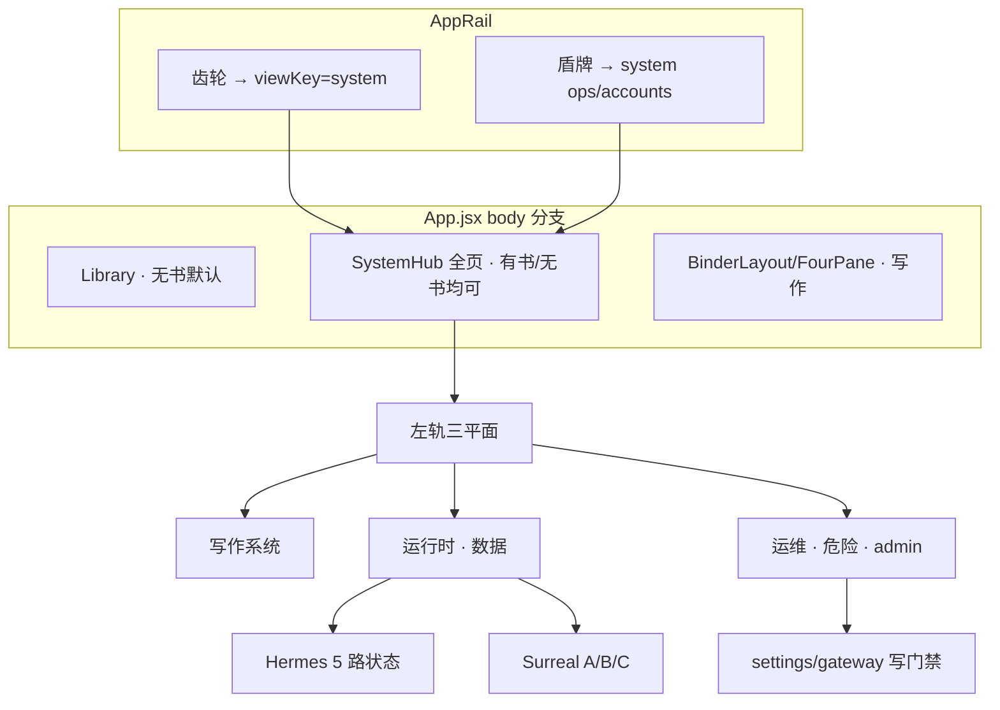
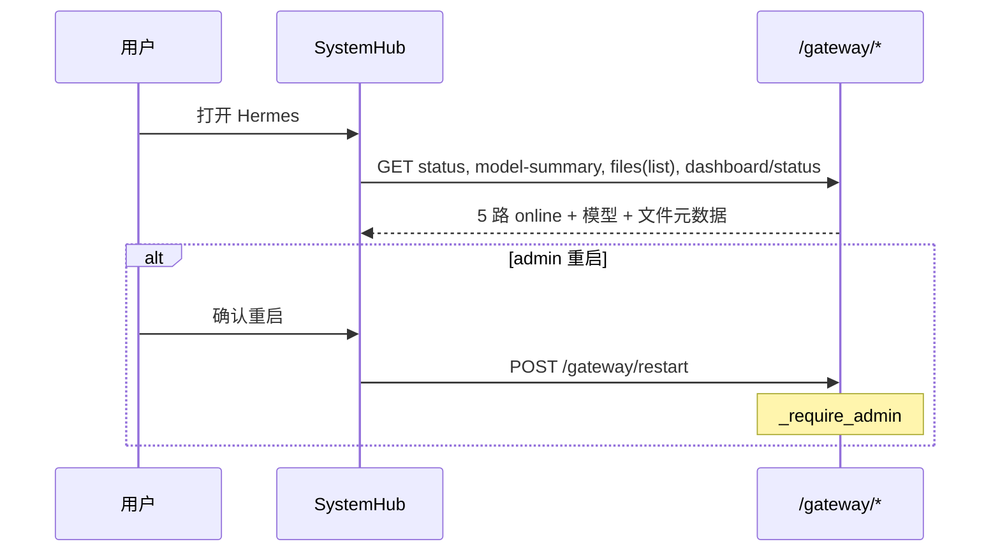
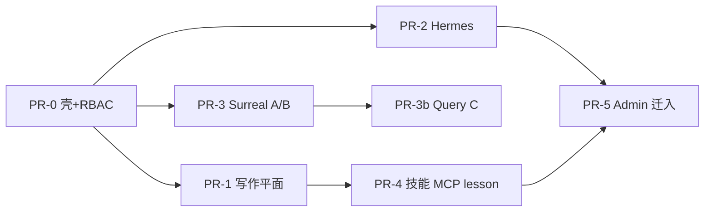

# 铜炉系统中心：管理 / 设置信息架构统一改造

| 项 | 值 |
|----|-----|
| 产品 | 铜炉 / tonglu · scribe3 writing system |
| 仓库 | `scribe-ia-verify-wt`（主 worktree）/ `scribe-writing-system` |
| 日期 | 2026-08-10 |
| 修订 | **r3 · 复审：audience 穷尽规则 + work 同步 + files 分角色** |
| 状态 | **Ready for implementation** |
| 作者 | Grok Build · 系统架构 |
| 关联铁律 | `设计文档/2026-07-22-对话驱动写入-禁表单直填-决策与改造方案.md` |
| 关联架构 | `docs/CURRENT_ARCHITECTURE.md` · `docs/L1-AUTH-ISOLATION.md` · `设计文档/工程8-HermesAgent复用方案.md` |
| 验收环境 | demo 已部署栈（`www.qing.blue` · `./scripts/deploy_demo.sh`）；**禁止** Grok 运行机 `npm ci` / 本机 Surreal 作验收 |
| UI 文案 | 用户可见中文；技术标识符可保留英文 |

---

## Overview

当前「设置」嵌在 FourPane **详情栏**内（`DetailPane` · `viewKey=settings`），「管理台」则在 `App.jsx` **整页替换** body（`viewKey=admin`）。两者挂载模型不同、导航与视觉分裂；Hermes 能力主要靠 `GatewaySection` **外链** Dashboard；Surreal 无产品内数据面。设置注册表 70 键对作者呈现为运维清单，效果不明。任意已登录 `author` 现网可调用 `/settings*` 写与 `/gateway/*` 重启/写文件（**仅有登录门禁，无 admin 角色门禁**）——安全债与 IA 债并存。

本方案将顶栏入口收敛为 **系统中心（System Hub）**：

1. **App 级全页挂载**（与 Admin 同构），**无书也可打开**；本书/Surreal 等依赖 work 的子区在无 work 时 disabled + 中文提示。  
2. 用与写作台同源的 **左轨三平面 + ObjectFrame** 重组 IA（写作系统 / 运行时·数据 / 运维·危险）。  
3. **服务端 RBAC** 锁定 settings/gateway 危险写与 Surreal 数据面；UI 隐藏是体验，不是唯一防线。  
4. Hermes / Surreal **原生组合面板**（非 iframe 主路径）；v1 对 sessions/cron 诚实外链降级。  
5. 视觉对标 Hermes/Surreal 的状态密度，但全部落在铜炉 token（`T`/`CX`/`ObjectFrame`/`EntryRail`）。

---

## Background & Motivation

### 代码核实后的现状（ground truth · r2 修正）

| 表面 | 真源 | 核实结论 |
|------|------|----------|
| 设置 UI | `DetailPane.jsx`：`viewKey==='settings'` → `SettingsView` | **嵌在 FourPane 详情栏内**，与左轨 EntryRail **双导航并存**；**不是** Admin 式全页。无书时（`App.jsx`：`!cur` → `Library`）点齿轮只改 `sel`，**不会挂载 SettingsView** |
| 管理台 | `App.jsx`：`activeView==='admin' && isAdmin` → `AdminConsole` | **整页替换** body，不经 FourPane |
| 设置分区 | `SettingsView.jsx` `SECTIONS` | 8 项：`connection`/`llm`/`craft`/`flags`/`gateway`/`book`/`prefs`/`audit`；默认 `section=llm`；注释写「七分区+审计」与代码 8 项不一致（以 8 为准） |
| 设置注册表 | `settings.py` `REGISTRY` | **恰好 70 键**：`connection` 15 · `llm` 4 · `craft` 23 · `flags` 16 · `gateway` 12；`danger` / `effect` / secret 掩码已有；**无 audience/role 字段** |
| Hermes 设置区 | `GatewaySection.jsx` | 状态灯 + 外链 dashboard（models/skills/mcp/cron/sessions）+ 文件编辑 + 重启 |
| 网关探活 | `gateway_status()` | **5 路**：default / responses / runs / deduce / deduce_preview |
| 网关文件白名单 | `gateway_files.py` | `profiles/{scribe3,scribe3_write}/{config.yaml,SOUL.md,.env}`（及 list 覆盖的 deduce 等只读 model 摘要） |
| `/capabilities` | `settings_gateway.py` | **运行时 feature flags**（snapshot/memory_fabric/…），**不是** MCP 工具清单 |
| MCP 工具 | `mcp/tools_*.py` + `_common.WRITE_GATED` | **约 94 个** `s3_*` 函数；`WRITE_GATED` 约 48 个待批写工具 |
| craft 技法 | `craft_skills/*.md`（4 篇）+ **`craft_skills.py`** | 已有 `list_skills()` / `read_skill(slug)` / 路径安全校验；MCP `s3_skill_read` |
| 可观测 | ContextInspector · UsageCard · settings audit · Admin audit · docker 日志 | 分裂；`GET /ai/usage` 有；**近次 run 列表 HTTP 端点 v1 不做**（单 run 有 `/ai/runs/{id}`） |
| 自进化 | `lesson.py` · `GET /lessons/promotable` · pilot inbox · ExperiencePressurePanel | 有后端，无统一治理台 |
| L1 角色 | `auth/users.py` `admin`/`author`；`/admin/*` 有 `_require_admin` | **`/settings*` `/gateway*` 仅登录全局路由**（`middleware.py` 前缀 allowlist），**无 is_admin** → author 可改密钥/紧急 flag/重启网关 |
| `/ready` | `api/health.py` | 固定 `store_for("main")`，**非**当前 work 作用域 |
| 路由 | `App.jsx` `sel = { mode:'view', viewKey }` | **无** `#/system/...` hash 路由 |
| 铁律 | 2026-07-22 文档 | 叙事写经主编对话 + 审批；设置仅工程配置白名单 |
| Docker | `Dockerfile.backend` `COPY scribe3/ scribe3/` | `craft_skills/` **已入镜像**，可运行时读模块 |

### 用户痛点

1. 管理/设置难用、难懂、分类与效果不明  
2. Hermes + Surreal 管理要深度融入铜炉，无割裂感  
3. 需统一视觉与可落地的增量 PR

### 不解决会怎样

- Author 经 API 改紧急开关/Surreal 密码/重启网关 → 事故面  
- 实现者按「设置全页」误挂导致无书无法运维  
- iframe 双产品或只藏 UI 的假 RBAC  

---

## Goals & Non-Goals

### Goals

| # | 目标 | 可验收信号 |
|---|------|------------|
| G1 | **受众清晰的 IA** + **服务端角色门禁** | author 打开 Hub 无运维平面；`PUT` 危险 settings / `POST /gateway/restart` → **403**；admin 可达 |
| G2 | **一体壳**：设置 + Hermes 能力 + Surreal 数据面 + Admin 同构 System Hub | 顶栏齿轮/盾牌均进 Hub；v1 一体感边界见 Success Metrics（sessions/cron 可外链） |
| G3 | **统一视觉**：状态卡/轨/ObjectFrame/密度可验收 | Visual Spec checklist + 无新色板 grep；`data-testid` |
| G4 | **写作系统可治理**：技能、MCP 地图、craft、健康摘要、lesson 入口 | 只读 + 既有审批通道 |
| G5 | **安全**：Surreal 写不对 author；break-glass 写有 flag+审计；settings/gateway 写按 audience | pytest/API 冒烟 403；审计行 |
| G6 | **增量可交付**；demo 冒烟验收 | 见 PR Plan |

### Non-Goals

- 默认 iframe 嵌完整 Hermes Dashboard / Surreal 官方 UI（外链逃生口保留）  
- Author 侧任意 SurrealQL 或叙事表单墙  
- 默认 Surreal schema migration  
- Grok 机 `npm ci` / 全量 Playwright / 本机 Surreal 验收  
- 重写 70 键业务语义  
- L2/L3 多租户升级  
- v1 产品内 Hermes sessions/cron CRUD 表  
- v1 近次 AI run 列表卡（端点未稳定产品化）  

---

## Key Decisions

| ID | 决策 | 理由 |
|----|------|------|
| **KD-Mount** | SystemHub 在 **`App.jsx` 与 Admin 同级全页挂载**；`viewKey=system`（兼容别名 `settings`/`admin`）。**禁止**在 `DetailPane`/FourPane 详情栏内再塞第三套左轨。**无 book 可打开**；依赖 work 的子区 disabled。 | 修正「双全页」误述；解决无书无法进运维；避免 EntryRail + Hub 轨双导航 |
| **KD-WorkCtx** | Hub 顶栏或 ObjectFrame 操作区提供 **work 上下文**：默认 `App` 当前书；无书时 Surreal/本书/工艺书级区 disabled；**账号/跨书/全局设置**不依赖 work。**选择器必须写回** `App` 的当前作品状态（与打开书同一路径：`setCur` / `writeActiveWorkSlug` / 既有 `onSelect` 等价物），禁止 Hub 内另持一份与写作台脱节的「幽灵 work」 | Admin 今日可无 work；数据面必须 `db=<slug>`；避免 Hub 与 BinderLayout work 分叉 |
| **KD-1** | 顶栏齿轮 → SystemHub；盾牌 → Hub `ops/accounts`（admin）；不再平行孤岛 | 一体入口 |
| **KD-2** | IA 三平面：**写作系统** / **运行时·数据** / **运维·危险** | 按任务非后端 category |
| **KD-3** | 壳：左分组轨 +（可选）中目录 + ObjectFrame；token 原生 | 与 EntryRail/ObjectFrame 同源 |
| **KD-4** | Hermes/Surreal **原生面板**主路径；外链高级。v1 sessions/cron = 说明+外链 | 一体感与诚实降级并存 |
| **KD-5** | Surreal：**A** 健康（work-scoped 新 API）全登录只读；**B** 表白名单浏览器 admin；**C** 受控查询 admin，默认只读，写需 `SCRIBE3_ADMIN_SURREAL_WRITE`。C 首合并可放 **PR-3b** | 排障 vs 铁律 |
| **KD-5b · 铁律边界** | 铁律适用范围 = **产品叙事写入路径**（作者面 UI + 默认 REST/MCP 写世界）。Admin Surreal break-glass 是 **显式运维例外**，不替代主编审批。即使 `allow_write`，**默认拒绝**改 `chapter.prose` 及 intent 叙事字段（表/字段黑名单）；突破需确认文案含「我理解这会绕过主编」+ 审计 | 关闭「admin SQL 是否算违铁律」歧义 |
| **KD-6** | 设置 **audience** 与 impact：**后端 REGISTRY 为 RBAC 真源**；`Setting.audience` **dataclass 默认 `"admin"`**（未标注 = admin，禁止「未匹配 → author」）。仅显式 `audience="author"` 的键可被 author 写。前端 impact/tier 可本地 catalog，但 audience **只信** snapshot 下发字段 | 关闭 gateway 启发式漏标；服务端门禁不可只靠 JS |
| **KD-7** | 技能/MCP/lesson UI 默认只读；升格走既有审批 | 铁律 |
| **KD-8** | 写路径健康 = 用量 + 5 路网关摘要 + ContextInspector 引导；**不做**近次 run 列表卡（v1） | API 未产品化 |
| **KD-9** | 验证 = demo `deploy_demo.sh` 冒烟；pytest 权限测在 **CI 或 demo 机**，禁止 Grok 机重活 | 资源纪律 |
| **KD-10** | 视觉：Hermes 状态点 + Surreal 表密度 → 铜炉 token；见 Visual Spec | 可验收 |
| **KD-11 · RBAC** | `PUT/POST /settings*` 按 `Setting.audience`（默认 admin）；**`category ∈ {connection, flags, gateway}` 全部 15+16+12 键均为 admin**（见完整映射，无「secret/地址类」启发式）。gateway **写/重启/dashboard start** → admin；`GET /gateway/files`：**list 元数据可登录，content 仅 admin（PR-0 必须）**；`GET /settings` 对 author 过滤 secret 与 audience=admin 的 value。UI 隐藏 ≠ 安全边界 | 关闭现网 author 可改密钥/网关 URL/读 SOUL 全文债 |
| **KD-12 · 平面归属** | `llm.*` 编辑 + 日帽 → **运行时/模型**；写作/健康仅 **只读 UsageCard 摘要**。`SCRIBE3_DAILY_CALL_CAP` audience=admin | 消除 PR-1/IA 矛盾 |
| **KD-13 · MCP catalog** | **新建** `GET /mcp/catalog`，**禁止**塞进 `/capabilities`（flags 语义不变） | 避免改错端点 |
| **KD-14 · craft_skills** | `GET /craft-skills` = `craft_skills.list_skills` / `read_skill` 薄封装 | 不重复路径规则 |
| **KD-15 · 路由** | `viewKey=system` + React state `plane`/`section`（可选 localStorage）；**不上**首版 hash 路由 | 对齐现网 selection |

---

## Proposed Design

### 1. 总体架构



**挂载顺序（实现必遵）**

```text
if viewKey === 'system' || viewKey === 'settings' || (viewKey === 'admin' && isAdmin):
    body = <SystemHub ... />   // 全页；settings/admin 别名归一
elif !cur:
    body = <Library />
else:
    body = <BinderLayout />    // DetailPane 内不再渲染 SettingsView
```

迁移：PR-0 起 DetailPane 去掉 `settings` 分支（或 301 心智：选 settings 时 App 提升为 system 全页）。更新 `settingsRoute.test.jsx` / DetailPane 契约。

### 2. 信息架构（作者可见文案）

```
系统中心                              [作品上下文: 当前书 ▾ | 未选书]
├── 写作系统                          ← author + admin
│   ├── 本书与目标                      依赖 work
│   ├── 个人偏好                        不依赖 work（脉搏静音按 work 键）
│   ├── 技能与技法                      craft_skills + hermes skill 摘要
│   ├── 能力地图（MCP）                 s3_* 读/召回/写门控
│   ├── 工艺与记忆                      craft.* / memory.*（常用 / 进阶分组）
│   ├── 写路径健康                      只读用量摘要 + 网关摘要灯 + Context 引导
│   └── 经验与自进化                    promotable lessons 等
│
├── 运行时 · 数据
│   ├── Hermes 运行时                   5 路状态；admin：文件/重启；sessions/cron 外链
│   ├── 模型与服务                      llm.* 编辑 + UsageCard 全卡 + 日帽(admin)
│   └── Surreal 数据面                  A 健康；B/C admin
│
└── 运维 · 危险                         ← admin only（UI 不渲染 + API 403）
    ├── 连接与密钥
    ├── 灰度与紧急开关
    ├── 账号与跨书                      不依赖 work
    └── 统一审计                        admin audit + settings 全量；见 §审计策略
```

**Author 设置变更历史**：放在 **写作系统** 子区「最近设置变更」（只读、可调用现 `GET /settings/audit`），**不**放进运维平面。运维「统一审计」= admin audit + 全量 settings audit 双 tab。

**渐进披露**

| 角色 | 默认 | 锁 |
|------|------|-----|
| author | 写作全量；运行时只读健康/模型中 author 可编辑的非 danger llm 项（若有）；**无**日帽编辑 | 运维平面不渲染；Hermes 文件/重启隐藏；Surreal B/C 隐藏；API 层仍 403 |
| admin | 三平面全开 | 危险项 ConfirmDialog + 服务端 audience |

### 3. 壳与视觉系统

#### 3.1 布局

| 区域 | 规格 |
|------|------|
| 挂载 | App 全页，占 `body` 除 `AppRail` 外全部高度 |
| 左轨 | **宽 220px**（`w-[220px]`）；**不**强行等于 `PC_LAYOUT.directory.ideal=264`（那是写作目录栏）。组头对齐 `EntryRail`：`text-meta uppercase tracking-wider text-faint/50`；行：`px-2.5 py-2 rounded-md text-f13`，active `bg-brand/10 text-brand font-medium` |
| 中栏 | 可选；有列表时 `min 240 / ideal 264` 对齐 `PC_LAYOUT.directory`；无列表折叠 |
| 主区 | `ObjectFrame`：`breadcrumb=平面 › 子区`，`title`，`status`，`tabs`，`actions`（含 work 选择器） |
| work 选择器 | 选项来自 `App` 已加载 `works` 列表；onChange **必须**调用与作品库/顶栏选书相同的状态更新（`setCur` + 持久化 active slug），随后 Hub 与返回写作台共用同一 `cur` |
| 无 work | ObjectFrame 内 `text-f13 text-faint`：「请先在顶栏选择作品，或从作品库打开一本书。」依赖 work 的控件 `disabled` |

#### 3.2 Visual Spec（可验收 checklist）

**硬性**

1. **禁止新色板**：不得新增 hex；仅用 `index.css` / `T.color`（brand/ink/faint/line/surface/canvas/soft/ok/warn/danger）。  
2. **状态灯**：`inline-block h-2 w-2 rounded-full` + `bg-ok` | `bg-line` | `bg-warn` | `bg-danger`（与 GatewaySection 一致）。  
3. **HealthStrip**：一行一网关；`text-f13` 名 + `text-meta text-muted` API/profile + 右对齐状态文案；底部分隔 `border-b border-line/60`。  
4. **CatalogTable**：表头 `text-meta text-faint font-normal`；行 `border-b border-line/50`、单元格 `py-1.5 text-f13`；数字 `tnum`；对齐 `AuditSection`。  
5. **Panel 卡**：`rounded-md border border-line bg-surface/60 p-3` 或 `shadow-panel`；**不用** AdminConsole 长期遗留的 `text-f12` 作为新组件默认（迁移 Admin 时逐步收到 `text-f13`/`text-meta`）。  
6. **危险平面**：ObjectFrame `status` 文案固定「危险操作区 · 仅管理员」；一切 `danger` 设置与 gateway 重启 / Surreal 写 → `ConfirmDialog`（`danger`）。  
7. **testid**：`system-hub`、`system-rail`、`system-plane-writing|runtime|ops`、`system-section-*`。  
8. **密度**：状态条行高约 32–36px；表行不小于可点 32px；左轨组间距 `mb-3.5`（EntryRail）。

**ASCII 线框（必遵结构）**

```
┌ AppRail ─────────────────────────────────────────────────┐
│ 铜炉 · 书 ▾ · 旅程…          [系统] [盾] 主题 用户        │
├──────────┬───────────────────────────────────────────────┤
│ 写作系统  │ ObjectFrame: 运行时 · 数据 › Hermes            │
│  本书…   │ status: 5/5 在线          [刷新] [作品▾]      │
│  …       │ ┌ HealthStrip ─────────────────────────────┐  │
│ 运行时   │ │ ● default …  ● responses …  ● runs …     │  │
│  Hermes  │ │ ● deduce …   ● deduce_preview …          │  │
│  模型    │ └──────────────────────────────────────────┘  │
│  Surreal │ ┌ panel 技能文件 ─┐ ┌ panel MCP 标签 ────┐   │
│ 运维·危险│ └────────────────┘ └─────────────────────┘   │
│ (admin)  │ 高级：外部 Dashboard ↗                         │
└──────────┴───────────────────────────────────────────────┘
```

### 4. 各平面详细设计

#### 4.1 写作系统

##### 4.1.1 本书与目标 / 个人偏好

- 包装 `BookSection` / `PrefsSection`；铁律不变（叙事只读 + `seedChiefNarrativeWrite`；配额 `putIntentGoals`）。  
- 无 work：本书区 disabled。

##### 4.1.2 技能与技法

| 层 | 数据源 | UI |
|----|--------|-----|
| 仓内技法 | **`GET /craft-skills`** → `craft_skills.list_skills()`；`?slug=` → `read_skill` | 列表 + MD 预览 |
| 主编工序 | `hermes_skills/scribe-novel-v2/SKILL.md` 摘要（可读仓内文件或静态摘要字段） | 卡片 |
| 运行时挂载 | 见 Hermes：files 列表中 `*/config.yaml` / `SOUL.md` **文件名存在性**（fail-soft 空态） | 状态 |

作者不在此编辑 SKILL；admin 改文件在运行时平面。

##### 4.1.3 MCP 能力地图

- **`GET /mcp/catalog`**（新建；**不**改 `/capabilities`）。  
- 生成策略：从 `mcp/tools_read.py` / `tools_recall.py` / `tools_write.py` 注册的 `s3_*` + `_common.WRITE_GATED` / 未门控写集合导出：  
  - `name`, `family` ∈ {read, recall, write}, `gated: bool`, `summary_zh`（可先空字符串渐进填）, `iron_law: bool`（世界写）  
- 前端按 family 过滤；说明自动可用 / 须批准。

##### 4.1.4 工艺与记忆阈值

- `category=craft` 共 23 键。  
- **UI 分组（关闭 Q5）**：  
  - **常用**：禁词/情绪跨度/近重等与作者直觉相关的约 8–10 项（catalog 标记 `tier: common`）  
  - **进阶**：默认折叠 `memory.*` 权重与半衰期等  
- impact 文案 PR-1 只要求 **常用组**写满；其余回落 `desc`。

##### 4.1.5 写路径健康

| 卡片 | API | v1 |
|------|-----|----|
| 今日用量摘要 | `GET /ai/usage` | 只读；完整编辑在 runtime/models |
| 网关摘要 | `GET /gateway/status` + `model-summary` | 5 路灯 |
| 上下文检查 | 文案 + 深链事件打开写作台 ContextInspector | 有 |
| 近次 AI run | — | **v1 不做**（`POST /ai/runs` 创建与 `GET /ai/runs/{id}` 存在，但无稳定 list 产品契约） |

##### 4.1.6 经验与自进化

- `GET /lessons/promotable` 列表 + 升格须审批说明  
- 经验压力：入口跳写作台，不复制第二套 store  

##### 4.1.7 我的设置变更（author）

- `GET /settings/audit` 分页只读；放在写作平面，避免 author 进入运维平面。

#### 4.2 运行时 · 数据

##### 4.2.1 Hermes 运行时（产品内）



| 模块 | v1 | 数据源 |
|------|----|--------|
| 5 路状态总览 | 必做 | `gateway_status` |
| 模型摘要 | 必做 | `gateway_model_summary`（default/scribe3/scribe3_write/deduce/deduce_preview） |
| 技能相关文件名 | 必做：展示 files 列表中 `config.yaml`/`SOUL.md` 的 id 与 exists | `GET /gateway/files` → **仅元数据**（`id`/`exists`/`path`）；**content 不进 author 响应**（PR-0 必须拆分，见 API） |
| MCP 暴露标签 | 必做：`SCRIBE3_READ_MCP_LABEL` 等 settings 只读 | settings snapshot |
| 配置文件编辑 | admin + Confirm | `PUT /gateway/files` **admin**；读 content 亦 **admin** |
| 重启 / dashboard start | admin + Confirm | **admin** |
| sessions / cron | **说明 + 外链** dashboard（非产品内表） | 外链 |

**技能摘要数据源写死**：不解析任意 YAML 技能树；v1 = **白名单文件存在性 + model-summary**；解析 skills 目录属后续。失败 → 空态「未能读取网关文件列表」。

##### 4.2.2 Surreal 数据面

###### A · 健康（全登录用户）

- **不要**声称现有 `GET /ready` 已 work-scoped。  
- 新增 **`GET /admin/data/health?work=`**（或 `/data/health` 登录可访问）：`store_for(work)` 执行轻量 `RETURN 1`；返回 `{ work, ns: "scribe3", db: work, ready, latency_ms }`。  
- 全局 `GET /ready` 仍探 `main`，运维探活保留；Hub 健康卡用 work-scoped 端点。  
- 连接密钥是否已配置：非 secret 的 URL/user + secret 的 `is_set`，不回显密码。

###### B · 浏览器（admin）· 表白名单（首版）

| table_key | 中文 | Store 方法 | 投影 fields（示例） | 计数 |
|-----------|------|------------|---------------------|------|
| `chapter` | 章节 | `list_chapters` | id/seq/title/label/words/volume | `len` 或上限 500 截断标注 truncated |
| `character` | 角色 | `characters` | id/name/importance/… 非 secret 字段 | 同上 |
| `event` | 事件 | `events_at(chapter)` **需 chapter 查询参数**；无 chapter 时仅说明「请带 chapter」或返回空+hint | id/etype/valid_from/… | — |
| `fact` | 事实 | `facts_at(chapter)` 同需 chapter | 掩码 secret | — |
| `promise` | 伏笔 | `list_promises` | id/text/status/… | len |
| `motif` | 母题 | `list_motifs` | id/name/theme | len |
| `material` | 素材 | `list_materials_page` 或 `list_materials` | id/title/kind | page total |
| `volume` | 卷 | `list_volumes` | id/title/sort_order | len |
| `faction` | 势力 | `list_factions` | name/… 非 secret | len |

**契约**

```http
GET /admin/data/tables?work=main
→ { tables: [{ key, label_zh, supports_list, needs_chapter: bool }] }

GET /admin/data/rows?work=main&table=chapter&limit=50&offset=0&chapter=3
→ { rows: [...], limit, offset, truncated, row_count? }
```

- `table` **枚举校验**，禁止字符串拼 Surreal 表名。  
- `limit` 默认 50，上限 200。  
- 无对应安全 list 的表 **不进白名单**。

###### C · 查询台（admin）· PR-3b 可选

**规范化与拒绝**

1. 去掉 `--` 行注释与 `/* */`；trim。  
2. **单语句**：存在 `;` 后非空 → 400。  
3. 首 token 白名单（大小写不敏感）：`SELECT` | `INFO`；`allow_write=false` 时仅此。  
4. 禁止 token 族（即使嵌套）：`DEFINE` `REMOVE` `DELETE` `UPDATE` `CREATE` `RELATE` `UPSERT` `INSERT` `LIVE` `KILL` `REBUILD` 等（正则词边界）。  
5. 强制：若无 `LIMIT`，服务端改写或包装限制 **max 200 rows**；`timeout_ms` 默认 3000，上限 10000。  
6. 最大响应字节 1MB，超出 `truncated=true`。  
7. `allow_write=true` 要求：  
   - settings `SCRIBE3_ADMIN_SURREAL_WRITE==true`（默认 false，danger）  
   - Confirm 文案含绕过主编  
   - **字段黑名单**：拒绝改 `chapter` 的 prose 正文列、intent 叙事字段（实现：写语句若匹配黑名单表/字段 → 400；或 allow_write 仅开放运维表）  
8. Audit：`actor, work, sql_hash, allow_write, truncated, row_count, took_ms, ts`。

```http
POST /admin/data/query
{ "work":"main", "sql":"SELECT id, title FROM chapter LIMIT 20", "allow_write": false }
```

#### 4.3 运维 · 危险

| 子区 | 内容 | API |
|------|------|-----|
| 连接与密钥 | connection secrets 等 audience=admin | settings PUT admin |
| 灰度与紧急 | flags；含 `SCRIBE3_EMERGENCY_REST_WRITE`、`SCRIBE3_ADMIN_SURREAL_WRITE` | 同上 |
| 账号与跨书 | AdminConsole 主体迁入 | `/admin/*` |
| 统一审计 | admin audit + settings 全量 | admin |

---

## API / Interface Changes

### 服务端 RBAC（必做 · PR-0）

| 端点 | 现状 | 目标 |
|------|------|------|
| `GET /settings` | 登录 | 登录；**author 响应中**：`type=secret` 永不回显明文；`audience=admin` 项可省略或仅 `{key,audience,label}` 无 value（实现二选一，PR-0 钉死并测） |
| `PUT /settings/{key}` `POST .../reset` | 登录即可写全部 | `assert_setting_writable`：`Setting.audience != "author"` 或非 admin 角色 → **403**。仅 `audience=="author"` 可被 author 写/reset |
| `GET /settings/audit` | 登录 | 保持登录可读（写作平面「我的变更」） |
| `GET /gateway/status` `model-summary` `dashboard/status` | 登录 | 保持登录只读 |
| `GET /gateway/files` | 登录且**返回 content**（掩码） | **PR-0 必须**：非 admin → 仅 `{id, path, exists, error?}`，**禁止** `content`/`sha256` 正文；admin → 现网 shape（含 content，.env 掩码保留） |
| `PUT /gateway/files` | 登录 | **admin** |
| `POST /gateway/restart` | 登录 | **admin** |
| `POST /gateway/dashboard/start` | 登录 | **admin** |
| `/admin/*` | admin | 不变 |
| `/admin/data/*` | 新 | admin（health 对 author：`/data/health`） |

### audience 规则（可机读 · PR-0 合并门禁 · 后端真源）

**原则（无歧义）**

1. `Setting` dataclass 增加字段：`audience: str = "admin"` —— **默认即 admin**。  
2. **禁止**实现「规则表未命中 → author」。未知/新键未显式标注前一律 admin。  
3. **整类 admin（不写启发式）**：  
   - `category == "connection"` → **全部 15 键** admin  
   - `category == "flags"` → **全部 16 键** admin  
   - `category == "gateway"` → **全部 12 键** admin（下表穷尽，含非 secret 的 profile/URL/bin/guard）  
4. **显式 author 白名单**（仅这些可被 author `PUT`/`reset`）：  
   - 全部 `category == "craft"`（含 `craft.*` 与 `memory.*` 共 23 键）  
   - `llm.model`、`llm.timeout_seconds`、`llm.max_retries`  
5. **llm 例外 admin**：`SCRIBE3_DAILY_CALL_CAP` → **admin**（danger 日帽）  
6. 本地 prefs（`PrefsSection` localStorage）不在 REGISTRY，不受本表约束。  
7. `settings_snapshot()` 每项下发 `audience` 字段，供前端隐藏编辑控件；**写路径只信服务端**。

**`category=gateway` 12 键（全部 admin · 与 `settings.py` 一致）**

| key | type | audience |
|-----|------|----------|
| `HERMES_API` | str | admin |
| `HERMES_RESPONSES_API` | str | admin |
| `HERMES_RESPONSES_PROFILE` | str | admin |
| `HERMES_RUNS_API` | str | admin |
| `HERMES_RUNS_PROFILE` | str | admin |
| `HERMES_DEDUCE_RUNS_API` | str | admin |
| `HERMES_DEDUCE_PREVIEW_RUNS_API` | str | admin |
| `HERMES_HOME` | str | admin |
| `DEEPSEEK_API_KEY` | secret | admin |
| `SCRIBE3_STRICT_GATEWAY_GUARD` | bool | admin |
| `gateway.hermes_bin` | str | admin |
| `gateway.dashboard_url` | str | admin |

**登记伪代码（实现必遵）**

```python
@dataclass(frozen=True)
class Setting:
    key: str
    category: str
    type: str
    default: object
    effect: str
    label: str
    desc: str = ""
    min: float | None = None
    max: float | None = None
    danger: bool = False
    audience: str = "admin"   # 默认 admin；仅 craft / 非日帽 llm 显式 audience="author"

def assert_setting_writable(user, key: str) -> None:
    s = _BY_KEY[key]
    if s.audience == "author":
        return  # 任意已登录可写
    _require_admin(user)  # 其余一律 admin
```

**PR-0 验收（参数化，不可省略）**

- 对 **全部 12 个 gateway 键** + **全部 connection 键** + **全部 flags 键**：author `PUT` → **403**；snapshot 中 `audience=="admin"`。  
- 对 `llm.model` 与任一 `craft.*`：author `PUT` 合法值 → **非 403**（在 auth 开启环境）。  
- 对 `SCRIBE3_DAILY_CALL_CAP`：author `PUT` → **403**。  
- author `GET /gateway/files`：响应 items **无** `content` 字段（或恒为 null）；admin 有 content。

### 复用

| API | 用途 |
|-----|------|
| settings / gateway 只读 | 健康与展示 |
| `/admin/*` | 账号书籍 |
| `/lessons/promotable` | 自进化 |
| `/ai/usage` | 用量 |
| `/capabilities` | **仅** feature flags，不扩展为 MCP |

### 新增

| 方法 | 路径 | 角色 | 说明 |
|------|------|------|------|
| GET | `/craft-skills` | 登录 | `list_skills`；`?slug=` → `read_skill` 全文 |
| GET | `/mcp/catalog` | 登录 | s3_* 元数据 |
| GET | `/data/health` | 登录 | work-scoped ready |
| GET | `/admin/data/tables` | admin | 白名单 |
| GET | `/admin/data/rows` | admin | 分页投影 |
| POST | `/admin/data/query` | admin | PR-3b；契约见上 |
| Setting | `SCRIBE3_ADMIN_SURREAL_WRITE` | admin | bool 默认 false，danger |

### 前端模块

```
scribe3/web/src/system/
  SystemHub.jsx
  planes.js                 # IA + 角色过滤
  presentationCatalog.js    # impact/tier；audience 以 API 为准
  sections/...
  components/StatusDot.jsx HealthStrip.jsx CatalogTable.jsx
```

---

## Data Model Changes

| 变更 | 需要？ |
|------|--------|
| Surreal migration | 否 |
| `Setting.audience`（进程内注册表） | 是（PR-0） |
| `SCRIBE3_ADMIN_SURREAL_WRITE` | 是（PR-3/3b 前登记） |
| 多书 `db=<slug>` | 不变；Hub work 上下文绑定 |

---

## Alternatives Considered

### Alt-A · iframe Hermes + Surreal 官方 UI  
否决：Cookie/样式/权限割裂。

### Alt-B · 仅改文案分组、双入口保留  
否决：不满足一体感与安全债。

### Alt-C · 独立控制塔微前端  
否决：部署与导航分裂。

### Alt-D · 统一 System Hub + 原生面板（**采纳**）  
优点：一体、可 RBAC、增量。缺点：sessions/cron v1 外链。

### Alt-E · **先后端锁定 settings/gateway 危险写 + impact 文案，壳后置**  
- **优点**：最快关掉 author 改密钥/重启的安全债；不必等全页壳。  
- **缺点**：用户感知的「难用/割裂」不缓解；随后仍要做壳，两次触达设置代码。  
- **权衡（本方案）**：**PR-0 同批交付最小后端 gate + App 级壳**，避免「安全永远后置」；若工期被砍，**可先 merge PR-0 的后端 gate 子提交**再开壳 UI，但计划上不拆成无限延期的纯安全 PR。

---

## Security & Privacy Considerations

| 威胁 | 严重度 | 缓解 |
|------|--------|------|
| Author PUT 紧急 flag / Surreal 密码 | **P0** | PR-0 服务端 audience 门禁 |
| Author gateway restart / 写 .env | **P0** | gateway 写类 admin only |
| Admin SurrealQL 毁库 / 改正文 | **P0** | 默认只读；黑名单 prose；flag+确认+审计 |
| Secret 回显 | **P0** | snapshot 掩码；files content admin |
| 仅藏 UI 的假安全 | **P0** | KD-11；验收 API 403 |
| CSRF | P1 | L1 Cookie SameSite |
| 审计缺失 | P1 | settings + admin + query audit |

---

## Observability

- 产品：HealthStrip 5 路、Surreal work health、用量  
- 审计：settings 变更、admin 操作、data query  
- 日志：`scribe3.settings.rbac` / `scribe3.admin.data` 拒绝 WARNING  
- 验收：demo health/ready + Hub 打开 + author 403 抽查  

---

## Rollout Plan



可选前端 flag `SCRIBE3_SYSTEM_HUB_V1`（或纯前端）：**PR-0 实现**——关则齿轮回退旧 DetailPane Settings（若仍保留 thin wrap）；默认开。

回滚：关 flag / 热更上一提交；后端 RBAC **不回滚为 author 可写危险项**（安全单向加固）。

---

## Risks

| 风险 | 严重度 | 缓解 |
|------|--------|------|
| sessions/cron 仍外链被评「未集成」 | 中 | Success Metrics v1 边界句 |
| craft impact 不全 | 低 | 常用组优先 |
| Admin 迁移视觉 diff | 中 | Visual Spec；分 PR |
| 查询台滥用 | 高 | PR-3b 硬化后才上；默认可不上 |
| 双源 audience | 中 | 后端真源 KD-6 |
| DetailPane 测试大面积更新 | 中 | PR-0 单测清单 |

---

## Open Questions

1. ~~路由真源~~ → **已关闭（KD-15）**：`viewKey=system` 全页。  
2. Hermes sessions/cron 是否值得适配私有 API → **保持后续**；v1 外链。  
3. ~~`SCRIBE3_ADMIN_SURREAL_WRITE` vs EMERGENCY_REST~~ → **独立 flag（推荐已采纳）**。  
4. ~~craft_skills 读路径~~ → **已关闭（KD-14）**：模块薄封装；镜像已 COPY。  
5. ~~craft 对 author 惊吓~~ → **已关闭**：可见但 **常用/进阶** 分组。  
6. ~~统一审计~~ → **已关闭**：author 用写作平面「我的设置变更」；ops 双 tab admin。  
7.~~llm 非日帽~~ → **已关闭（r3）**：`llm.model` / `timeout_seconds` / `max_retries` = author；`SCRIBE3_DAILY_CALL_CAP` = admin。收紧时只改 REGISTRY 显式字段，不改默认 admin 原则。

---

## References

- `DetailPane.jsx` · `App.jsx` · `SettingsView.jsx` · `GatewaySection.jsx` · `AdminConsole.jsx`  
- `settings.py` · `settings_gateway.py` · `auth/middleware.py` · `auth/admin_routes.py`  
- `mcp/_common.py` `WRITE_GATED` · `craft_skills.py` · `gateway_files.py` · `api/health.py`  
- `layout/ObjectFrame.jsx` · `EntryRail.jsx` · `tokens.js`  
- `设计文档/2026-07-22-对话驱动写入-…` · `docs/L1-AUTH-ISOLATION.md`  
- `scripts/deploy_demo.sh` · `Dockerfile.backend`  

---

## PR Plan

### PR-0 · App 级 SystemHub 壳 + settings/gateway 服务端 RBAC

| 项 | 内容 |
|----|------|
| **标题** | `feat: SystemHub 全页壳与 settings/gateway 角色门禁` |
| **影响** | `App.jsx` 挂载；`system/SystemHub.jsx` `planes.js`；`Setting.audience` 默认 admin + REGISTRY 显式 author 键；put/reset 门禁；`gateway_files_list` **content 分角色**；gateway 写/重启/start `_require_admin`；work 选择器写回 `App.cur`；DetailPane settings 分支移除；pytest **参数化** 全 gateway/connection/flags author 403；可选 `SCRIBE3_SYSTEM_HUB_V1` |
| **依赖** | 无 |
| **描述** | 无书可开 Hub；audience 规则见上文可机读表；author `PUT` 全部 gateway/connection/flags → 403；author 不可读 gateway files content；`POST /gateway/restart` → 403。Visual Spec testid。**安全单向：不回滚门禁。** |
| **成功标准** | ① Hub `data-testid=system-hub` 无书可开；② 参数化 403 覆盖 12 gateway + connection + flags；③ author GET files 无 content；④ demo admin/author 冒烟 |

### PR-1 · 写作平面迁移（book/prefs/craft）+ 常用 impact

| 项 | 内容 |
|----|------|
| **标题** | `feat(web): 写作系统平面 book/prefs/craft 与常用 impact` |
| **影响** | `WritingBook/Prefs/Craft`；presentationCatalog **常用 8–10 键**；`SettingField` 显示 impact；**不含 llm 编辑**（见 PR-2/runtime） |
| **依赖** | PR-0 |
| **描述** | craft 常用/进阶分组；作者设置变更只读区。 |

### PR-2 · Hermes 产品内运行时 + 模型平面

| 项 | 内容 |
|----|------|
| **标题** | `feat: Hermes 运行时面板与 runtime/models（含 llm）` |
| **影响** | `RuntimeHermes.jsx` `RuntimeModels.jsx`；拆分 GatewaySection；UsageCard 全卡在 models；gateway files 读策略；**后端**：写/重启/start 门禁若 PR-0 未尽则补齐 + 审计 |
| **依赖** | PR-0 |
| **描述** | v1：**5 路状态 + model-summary + 文件名存在性 + MCP 标签**；sessions/cron **仅外链**。验收：admin 无需外站判断在线与主模型；author restart → 403。 |
| **非目标** | 产品内 sessions/cron 表 |

### PR-3 · Surreal A/B（健康 + 白名单浏览器）

| 项 | 内容 |
|----|------|
| **标题** | `feat: Surreal 数据面健康与 admin 表浏览器` |
| **影响** | `/data/health`、`/admin/data/tables|rows`；`RuntimeSurreal.jsx`；pytest **在 CI/demo 机**；登记 flag 键可先不启用写 |
| **依赖** | PR-0 |
| **描述** | 实现 §4.2.2 A/B 契约；**不含** C 查询台。 |

### PR-3b · Surreal C 受控查询（可选）

| 项 | 内容 |
|----|------|
| **标题** | `feat: admin SurrealQL 查询台（默认只读硬化）` |
| **依赖** | PR-3 |
| **描述** | 全文 §C 规范化/黑名单/flag/审计；可独立延后。 |

### PR-4 · 技能 · MCP catalog · lesson 入口

| 项 | 内容 |
|----|------|
| **标题** | `feat: craft-skills API、/mcp/catalog 与自进化入口` |
| **影响** | `GET /craft-skills` 薄封装；`GET /mcp/catalog` 自 WRITE_GATED+tools；WritingSkills/Mcp/Evolution |
| **依赖** | PR-0；建议 PR-1 后 |
| **描述** | 禁止改 `/capabilities` 语义。 |

### PR-5 · Admin 迁入运维平面 · 删旧壳

| 项 | 内容 |
|----|------|
| **标题** | `refactor: AdminConsole 迁入 Hub 并删除 DetailPane 设置残留` |
| **影响** | OpsAccounts/Audit；清理 SettingsView 全页路径；e2e/契约；文档 |
| **依赖** | PR-0 必选；PR-1/2 建议；PR-3/4 可后置但双壳成本上升 |
| **描述** | 单一入口；`view=admin|settings` 别名稳定。 |

### PR 依赖图

```text
PR-0（壳 + RBAC）
 ├─ PR-1 写作 ─→ PR-4 技能/MCP/lesson ─┐
 ├─ PR-2 Hermes/models ────────────────┼→ PR-5 收敛
 └─ PR-3 Surreal A/B → PR-3b(C 可选) ─┘
```

---

## Success Metrics

1. 新作者能区分写作平面与（不可见的）运维。  
2. **Admin 无需外站**可判断：**5 路网关在线状态 + 主模型 +（若可）files 列表 skill 相关文件名**；sessions/cron **允许**高级外链。  
3. Admin 可对**当前 work** 见 Surreal ready，并只读预览白名单表。  
4. Author：`PUT` **全部** connection/flags/gateway 键、`SCRIBE3_DAILY_CALL_CAP`、`POST /gateway/restart`、`PUT /gateway/files`、`/admin/data/*` → **403**；author `GET /gateway/files` **无 content**。  
5. 无新增叙事表单直写；break-glass SQL 不默认能改 `chapter.prose`。  
6. Visual Spec checklist 通过；无新色板。  
7. Hub 切换 work 后，退出 Hub 进入写作台时 `cur` 与所选 slug 一致（无幽灵 work）。  

---

## Revision History

| 版本 | 说明 |
|------|------|
| r1 | 初稿 Draft |
| r2 | 吸收 review Issue 1–20：App 挂载、服务端 RBAC、Surreal 契约、llm 平面、MCP/craft_skills、Visual Spec、PR 重排、铁律边界、Alt-E 等 |
| r3 | 复审：`audience` 默认 admin + `connection/flags/gateway` 整类穷尽（12 gateway 键表）；PR-0 参数化验收；KD-WorkCtx 写回 App.cur；`GET /gateway/files` content 分角色由建议升为 **必须** |

*Canonical：`/tmp/grok-1000/grok-design-doc-d37691cc.md`；仓库副本：`设计文档/2026-08-10-系统中心-管理设置与Hermes-Surreal统一改造.md`。*
